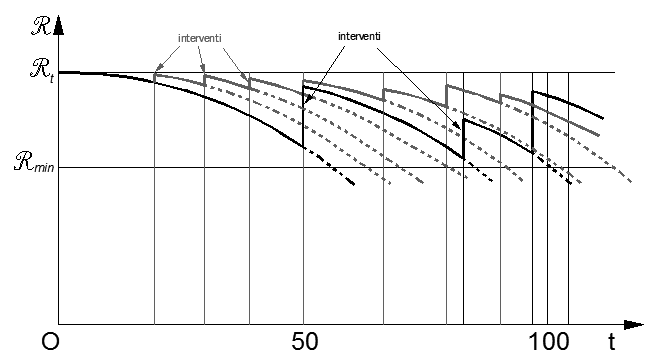

[Torna all'indice del capitolo](indice-cap02.md) | [Torna all'indice generale](../indice-ntc2018.md)

# Capitolo 2 — Sicurezza e prestazioni attese

## Indice del capitolo

- [[#2.1. Principi fondamentali|2.1 Principi fondamentali]]
- [[#2.2. Requisiti delle opere strutturali|2.2 Requisiti delle opere strutturali]]
  - [[#2.2.1. Stati Limite Ultimi (SLU)|2.2.1 Stati Limite Ultimi (SLU)]]
  - [[#2.2.2. Stati Limite di Esercizio (SLE)|2.2.2 Stati Limite di Esercizio (SLE)]]
  - [[#2.2.3. Sicurezza antincendio|2.2.3 Sicurezza antincendio]]
  - [[#2.2.4. Durabilità|2.2.4 Durabilità]]
  - [[#2.2.5. Robustezza|2.2.5 Robustezza]]
  - [[#2.2.6. Verifiche|2.2.6 Verifiche]]
- [[#2.3. Valutazione della sicurezza|2.3 Valutazione della sicurezza]]
- [[#2.4. Vita nominale di progetto, classi d'uso e periodo di riferimento|2.4 Vita nominale, classi d'uso, periodo di riferimento]]
  - [[#2.4.1. Vita nominale di progetto|2.4.1 Vita nominale di progetto]]
  - [[#2.4.2. Classi d'uso|2.4.2 Classi d'uso]]
  - [[#2.4.3. Periodo di riferimento per l'azione sismica|2.4.3 Periodo di riferimento per l'azione sismica]]
- [[#2.5. Azioni sulle costruzioni|2.5 Azioni sulle costruzioni]]
  - [[#2.5.1. Classificazione delle azioni|2.5.1 Classificazione delle azioni]]
  - [[#2.5.2. Caratterizzazione delle azioni elementari|2.5.2 Caratterizzazione delle azioni elementari]]
  - [[#2.5.3. Combinazioni delle azioni|2.5.3 Combinazioni delle azioni]]
- [[#2.6. Azioni nelle verifiche agli stati limite|2.6 Azioni nelle verifiche agli stati limite]]
  - [[#2.6.1. Stati limite ultimi|2.6.1 Stati limite ultimi (EQU, STR, GEO)]]
  - [[#2.6.2. Stati limite di esercizio|2.6.2 Stati limite di esercizio]]
- [[#C2.1 Principi fondamentali|C2.1 — Principi fondamentali (metodo semiprobabilistico, casistiche a-d)]]
- [[#C2.2 Requisiti delle opere strutturali|C2.2 — Requisiti delle opere strutturali]]
  - [[#C2.2.5 Robustezza|C2.2.5 Robustezza]]
- [[#C2.3 Valutazione della sicurezza|C2.3 — Valutazione della sicurezza (metodi di livello superiore)]]
- [[#C2.4 Vita nominale di progetto, classi d'uso e periodo di riferimento|C2.4 — Vita nominale, classi d'uso, periodo di riferimento]]
  - [[#C2.4.1 Vita nominale di progetto|C2.4.1 Vita nominale di progetto (Fig. C2.1)]]
  - [[#C2.4.2 Classi d'uso|C2.4.2 Classi d'uso]]
  - [[#C2.4.3 Periodo di riferimento per l'azione sismica|C2.4.3 Periodo di riferimento V_R (Tab. C2.4.I)]]
- [[#C2.5 Azioni sulle costruzioni|C2.5 — Azioni sulle costruzioni (G_k, combinazioni, coefficienti parziali)]]
- [[#C2.6 Azioni nelle verifiche agli stati limite|C2.6 — Azioni nelle verifiche agli stati limite]]
  - [[#C2.6.1 Stati limite ultimi|C2.6.1 SLU: EQU, STR, GEO, UPL, HYD]]

---

## 2.1. Principi fondamentali

Le opere e le componenti strutturali devono essere progettate, eseguite, collaudate e soggette a manutenzione in modo tale da consentirne la prevista utilizzazione, in forma economicamente sostenibile e con il livello di sicurezza previsto dalle presenti norme.

La sicurezza e le prestazioni di un'opera o di una parte di essa devono essere valutate in relazione agli stati limite che si possono verificare durante la vita nominale di progetto, di cui al § 2.4. Si definisce stato limite una condizione superata la quale l'opera non soddisfa più le esigenze elencate nelle presenti norme.

In particolare, secondo quanto stabilito nei capitoli specifici, le opere e le varie tipologie strutturali devono possedere i seguenti requisiti:

- *sicurezza nei confronti di stati limite ultimi (SLU)*: capacità di evitare crolli, perdite di equilibrio e dissesti gravi, totali o parziali, che possano compromettere l'incolumità delle persone oppure comportare la perdita di beni, oppure provocare gravi danni ambientali e sociali, oppure mettere fuori servizio l'opera;
- *sicurezza nei confronti di stati limite di esercizio (SLE)*: capacità di garantire le prestazioni previste per le condizioni di esercizio;
- *sicurezza antincendio*: capacità di garantire le prestazioni strutturali previste in caso d'incendio, per un periodo richiesto;
- *durabilità*: capacità della costruzione di mantenere, nell'arco della vita nominale di progetto, i livelli prestazionali per i quali è stata progettata, tenuto conto delle caratteristiche ambientali in cui si trova e del livello previsto di manutenzione;
- *robustezza*: capacità di evitare danni sproporzionati rispetto all'entità di possibili cause innescanti eccezionali quali esplosioni e urti.

Il superamento di uno stato limite ultimo ha carattere irreversibile.

Il superamento di uno stato limite di esercizio può avere carattere reversibile o irreversibile.

Per le opere esistenti è possibile fare riferimento a livelli di sicurezza diversi da quelli delle nuove opere ed è anche possibile considerare solo gli stati limite ultimi. Maggiori dettagli sono dati al Capitolo 8.

I materiali ed i prodotti, per poter essere utilizzati nelle opere previste dalle presenti norme, devono essere sottoposti a procedure e prove sperimentali di accettazione. Le prove e le procedure di accettazione sono definite nelle parti specifiche delle presenti norme riguardanti i materiali.

La fornitura di componenti, sistemi o prodotti, impiegati per fini strutturali, deve essere accompagnata da un manuale di installazione e di manutenzione da allegare alla documentazione dell'opera. I componenti, i sistemi e i prodotti edili od impiantistici, non facenti parte del complesso strutturale, ma che svolgono funzione statica autonoma, devono essere progettati ed installati nel rispetto dei livelli di sicurezza e delle prestazioni di seguito prescritti.

Le azioni da prendere in conto devono essere assunte in accordo con quanto stabilito nei relativi capitoli delle presenti norme. In mancanza di specifiche indicazioni, si dovrà fare ricorso ad opportune indagini, eventualmente anche sperimentali, o a documenti, normativi e non, di comprovata validità.

---

## 2.2. Requisiti delle opere strutturali

### 2.2.1. Stati Limite Ultimi (SLU)

I principali Stati Limite Ultimi sono elencati nel seguito:

*a)* perdita di equilibrio della struttura o di una sua parte, considerati come corpi rigidi;
*b)* spostamenti o deformazioni eccessive;
*c)* raggiungimento della massima capacità di parti di strutture, collegamenti, fondazioni;
*d)* raggiungimento della massima capacità della struttura nel suo insieme;
*e)* raggiungimento di una condizione di cinematismo irreversibile;
*f)* raggiungimento di meccanismi di collasso nei terreni;
*g)* rottura di membrature e collegamenti per fatica;
*h)* rottura di membrature e collegamenti per altri effetti dipendenti dal tempo;
*i)* instabilità di parti della struttura o del suo insieme;

Altri stati limite ultimi sono considerati in relazione alle specificità delle singole opere; in presenza di azioni sismiche, gli Stati Limite Ultimi comprendono gli Stati Limite di Salvaguardia della Vita (SLV) e gli Stati Limite di prevenzione del Collasso (SLC), come precisato nel § 3.2.1.

### 2.2.2. Stati Limite di Esercizio (SLE)

I principali Stati Limite di Esercizio sono elencati nel seguito:

*a)* danneggiamenti locali (ad es. eccessiva fessurazione del calcestruzzo) che possano ridurre la durabilità della struttura, la sua efficienza o il suo aspetto;
*b)* spostamenti e deformazioni che possano limitare l'uso della costruzione, la sua efficienza e il suo aspetto;
*c)* spostamenti e deformazioni che possano compromettere l'efficienza e l'aspetto di elementi non strutturali, impianti, macchinari;
*d)* vibrazioni che possano compromettere l'uso della costruzione;
*e)* danni per fatica che possano compromettere la durabilità;
*f)* corrosione e/o degrado dei materiali in funzione del tempo e dell'ambiente di esposizione che possano compromettere la durabilità.

Altri stati limite sono considerati in relazione alle specificità delle singole opere; in presenza di azioni sismiche, gli Stati Limite di Esercizio comprendono gli Stati Limite di Operatività (SLO) e gli Stati Limite di Danno (SLD), come precisato nel § 3.2.1.

### 2.2.3. Sicurezza antincendio

Quando necessario, i rischi derivanti dagli incendi devono essere limitati progettando e realizzando le costruzioni in modo tale da garantire la resistenza e la stabilità degli elementi portanti, nonché da limitare la propagazione del fuoco e dei fumi.

### 2.2.4. Durabilità

Un adeguato livello di durabilità può essere garantito progettando la costruzione, e la specifica manutenzione, in modo tale che il degrado della struttura, che si dovesse verificare durante la sua vita nominale di progetto, non riduca le prestazioni della costruzione al di sotto del livello previsto.

Tale requisito può essere soddisfatto attraverso l'adozione di appropriati provvedimenti stabiliti tenendo conto delle previste condizioni ambientali e di manutenzione ed in base alle peculiarità del singolo progetto, tra cui:

*a)* scelta opportuna dei materiali;
*b)* dimensionamento opportuno delle strutture;
*c)* scelta opportuna dei dettagli costruttivi;
*d)* adozione di tipologie costruttive e strutturali che consentano, ove possibile, l'ispezionabilità delle parti strutturali;
*e)* pianificazione di misure di protezione e manutenzione; oppure, quando queste non siano previste o possibili, progettazione rivolta a garantire che il deterioramento della costruzione o dei materiali che la compongono non ne causi il collasso;
*f)* impiego di prodotti e componenti chiaramente identificati in termini di caratteristiche meccanico-fisico-chimiche, indispensabili alla valutazione della sicurezza, e dotati di idonea qualificazione, così come specificato al Capitolo 11;
*g)* applicazione di sostanze o ricoprimenti protettivi dei materiali, soprattutto nei punti non più visibili o difficilmente ispezionabili ad opera completata;
*h)* adozione di sistemi di controllo, passivi o attivi, adatti alle azioni e ai fenomeni ai quali l'opera può essere sottoposta.

Le condizioni ambientali devono essere identificate in fase di progetto in modo da valutarne la rilevanza nei confronti della durabilità.

### 2.2.5. Robustezza

Un adeguato livello di robustezza, in relazione all'uso previsto della costruzione ed alle conseguenze di un suo eventuale collasso, può essere garantito facendo ricorso ad una o più tra le seguenti strategie di progettazione:

*a)* progettazione della struttura in grado di resistere ad azioni eccezionali di carattere convenzionale, combinando valori nominali delle azioni eccezionali alle altre azioni esplicite di progetto;
*b)* prevenzione degli effetti indotti dalle azioni eccezionali alle quali la struttura può essere soggetta o riduzione della loro intensità;
*c)* adozione di una forma e tipologia strutturale poco sensibile alle azioni eccezionali considerate;
*d)* adozione di una forma e tipologia strutturale tale da tollerare il danneggiamento localizzato causato da un'azione di carattere eccezionale;
*e)* realizzazione di strutture quanto più ridondanti, resistenti e/o duttili è possibile;
*f)* adozione di sistemi di controllo, passivi o attivi, adatti alle azioni e ai fenomeni ai quali l'opera può essere sottoposta.

### 2.2.6. Verifiche

Le opere strutturali devono essere verificate, salvo diversa indicazione riportata nelle specifiche parti delle presenti norme:

*a)* per gli stati limite ultimi che possono presentarsi;
*b)* per gli stati limite di esercizio definiti in relazione alle prestazioni attese;
*c)* quando necessario, nei confronti degli effetti derivanti dalle azioni termiche connesse con lo sviluppo di un incendio.

Le verifiche delle opere strutturali devono essere contenute nei documenti di progetto, con riferimento alle prescritte caratteristiche meccaniche dei materiali e alla caratterizzazione geotecnica del terreno, dedotta – ove specificato dalle presenti norme – in base a specifiche indagini. Laddove necessario, la struttura deve essere verificata nelle fasi intermedie, tenuto conto del processo costruttivo previsto; le verifiche per queste situazioni transitorie sono generalmente condotte nei confronti dei soli stati limite ultimi.

Per le opere per le quali nel corso dei lavori si manifestino situazioni significativamente difformi da quelle di progetto occorre effettuare le relative necessarie verifiche.

---

## 2.3. Valutazione della sicurezza

Nel seguito sono riportati i criteri del metodo semiprobabilistico agli stati limite basato sull'impiego dei coefficienti parziali, applicabili nella generalità dei casi; tale metodo è detto di primo livello. Per opere di particolare importanza si possono adottare metodi di livello superiore, tratti da documentazione tecnica di comprovata validità di cui al Capitolo 12.

Nel metodo agli stati limite, la sicurezza strutturale nei confronti degli stati limite ultimi deve essere verificata confrontando la capacità di progetto $R_d$, in termini di resistenza, duttilità e/o spostamento della struttura o della membratura strutturale, funzione delle caratteristiche meccaniche dei materiali che la compongono ($X_d$) e dei valori nominali delle grandezze geometriche interessate ($a_d$), con il corrispondente valore di progetto della domanda $E_d$, funzione dei valori di progetto delle azioni ($F_d$) e dei valori nominali delle grandezze geometriche della struttura interessate.

La verifica della sicurezza nei riguardi degli stati limite ultimi (SLU) è espressa dall'equazione formale:

$$R_d \geq E_d \tag{2.2.1}$$

Il valore di progetto della resistenza di un dato materiale $X_d$ è, a sua volta, funzione del valore caratteristico della resistenza, definito come frattile 5% della distribuzione statistica della grandezza, attraverso l'espressione: $X_d = X_k/\gamma_M$, essendo $\gamma_M$ il fattore parziale associato alla resistenza del materiale.

Il valore di progetto di ciascuna delle azioni agenti sulla struttura $F_d$ è ottenuto dal suo valore caratteristico $F_k$, inteso come frattile 95% della distribuzione statistica o come valore caratterizzato da un assegnato periodo di ritorno, attraverso l'espressione: $F_d = \gamma_f F_k$ essendo $\gamma_f$ il fattore parziale relativo alle azioni. Nel caso di concomitanza di più azioni variabili di origine diversa si definisce un valore di combinazione $\psi_0 \cdot F_k$, ove $\psi_0 \leq 1$ è un opportuno coefficiente di combinazione, che tiene conto della ridotta probabilità che più azioni di diversa origine si realizzino simultaneamente con il loro valore caratteristico.

Per grandezze caratterizzate da distribuzioni con coefficienti di variazione minori di 0,10, oppure per grandezze che non riguardino univocamente resistenze o azioni, si possono considerare i valori nominali, coincidenti con i valori medi.

I valori caratteristici dei parametri fisico-meccanici dei materiali sono definiti nel Capitolo 11. Per la sicurezza delle opere e dei sistemi geotecnici, i valori caratteristici dei parametri fisico-meccanici dei terreni sono definiti nel § 6.2.2.

La capacità di garantire le prestazioni previste per le condizioni di esercizio (SLE) deve essere verificata confrontando il valore limite di progetto associato a ciascun aspetto di funzionalità esaminato ($C_d$), con il corrispondente valore di progetto dell'effetto delle azioni ($E_d$), attraverso la seguente espressione formale:

$$C_d \geq E_d \tag{2.2.2}$$

---

## 2.4. Vita nominale di progetto, classi d'uso e periodo di riferimento

### 2.4.1. Vita nominale di progetto

La vita nominale di progetto $V_N$ di un'opera è convenzionalmente definita come il numero di anni nel quale è previsto che l'opera, purché soggetta alla necessaria manutenzione, mantenga specifici livelli prestazionali.

I valori minimi di $V_N$ da adottare per i diversi tipi di costruzione sono riportati nella Tab. 2.4.I. Tali valori possono essere anche impiegati per definire le azioni dipendenti dal tempo.

**Tab. 2.4.I** – *Valori minimi della Vita nominale $V_N$ di progetto per i diversi tipi di costruzioni*

| | Tipi di costruzioni | Valori minimi di $V_N$ (anni) |
|:---:|---|:---:|
| 1 | Costruzioni temporanee e provvisorie | 10 |
| 2 | Costruzioni con livelli di prestazioni ordinari | 50 |
| 3 | Costruzioni con livelli di prestazioni elevati | 100 |

Non sono da considerarsi temporanee le costruzioni o parti di esse che possono essere smantellate con l'intento di essere riutilizzate. Per un'opera di nuova realizzazione la cui fase di costruzione sia prevista in sede di progetto di durata pari a $P_N$, la vita nominale relativa a tale fase di costruzione, ai fini della valutazione delle azioni sismiche, dovrà essere assunta non inferiore a $P_N$ e comunque non inferiore a 5 anni.

Le verifiche sismiche di opere di tipo 1 o in fase di costruzione possono omettersi quando il progetto preveda che tale condizione permanga per meno di 2 anni.

### 2.4.2. Classi d'uso

Con riferimento alle conseguenze di una interruzione di operatività o di un eventuale collasso, le costruzioni sono suddivise in classi d'uso così definite:

*Classe I*: Costruzioni con presenza solo occasionale di persone, edifici agricoli.

*Classe II*: Costruzioni il cui uso preveda normali affollamenti, senza contenuti pericolosi per l'ambiente e senza funzioni pubbliche e sociali essenziali. Industrie con attività non pericolose per l'ambiente. Ponti, opere infrastrutturali, reti viarie non ricadenti in Classe d'uso III o in Classe d'uso IV, reti ferroviarie la cui interruzione non provochi situazioni di emergenza. Dighe il cui collasso non provochi conseguenze rilevanti.

*Classe III*: Costruzioni il cui uso preveda affollamenti significativi. Industrie con attività pericolose per l'ambiente. Reti viarie extraurbane non ricadenti in Classe d'uso IV. Ponti e reti ferroviarie la cui interruzione provochi situazioni di emergenza. Dighe rilevanti per le conseguenze di un loro eventuale collasso.

*Classe IV*: Costruzioni con funzioni pubbliche o strategiche importanti, anche con riferimento alla gestione della protezione civile in caso di calamità. Industrie con attività particolarmente pericolose per l'ambiente. Reti viarie di tipo A o B, di cui al DM 5/11/2001, n. 6792, "Norme funzionali e geometriche per la costruzione delle strade", e di tipo C quando appartenenti ad itinerari di collegamento tra capoluoghi di provincia non altresi serviti da strade di tipo A o B. Ponti e reti ferroviarie di importanza critica per il mantenimento delle vie di comunicazione, particolarmente dopo un evento sismico. Dighe connesse al funzionamento di acquedotti e a impianti di produzione di energia elettrica.

### 2.4.3. Periodo di riferimento per l'azione sismica

Le azioni sismiche sulle costruzioni vengono valutate in relazione ad un periodo di riferimento $V_R$ che si ricava, per ciascun tipo di costruzione, moltiplicandone la vita nominale di progetto $V_N$ per il coefficiente d'uso $C_U$:

$$V_R = V_N \cdot C_U \tag{2.4.1}$$

Il valore del coefficiente d'uso $C_U$ è definito, al variare della classe d'uso, come mostrato in Tab. 2.4.II.

**Tab. 2.4.II** – *Valori del coefficiente d'uso $C_U$*

| Classe d'uso | I | II | III | IV |
|---|:---:|:---:|:---:|:---:|
| Coefficiente $C_U$ | 0,7 | 1,0 | 1,5 | 2,0 |

Per le costruzioni a servizio di attività a rischio di incidente rilevante si adotteranno valori di $C_U$ anche superiori a 2, in relazione alle conseguenze sull'ambiente e sulla pubblica incolumità determinate dal raggiungimento degli stati limite.

---

## 2.5. Azioni sulle costruzioni

### 2.5.1. Classificazione delle azioni

Si definisce azione ogni causa o insieme di cause capace di indurre stati limite in una struttura.

#### 2.5.1.1 Classificazione delle azioni in base al modo di esplicarsi

a) *dirette*:
   forze concentrate, carichi distribuiti, fissi o mobili;

b) *indirette*:
   spostamenti impressi, variazioni di temperatura e di umidità, ritiro, precompressione, cedimenti di vincoli, ecc.

c) *degrado*:
   - endogeno: alterazione naturale del materiale di cui è composta l'opera strutturale;
   - esogeno: alterazione delle caratteristiche dei materiali costituenti l'opera strutturale, a seguito di agenti esterni.

#### 2.5.1.2 Classificazione delle azioni secondo la risposta strutturale

*a)* *statiche*: azioni applicate alla struttura che non provocano accelerazioni significative della stessa o di alcune sue parti;
*b)* *pseudo statiche*: azioni dinamiche rappresentabili mediante un'azione statica equivalente;
*c)* *dinamiche*: azioni che causano significative accelerazioni della struttura o dei suoi componenti.

#### 2.5.1.3 Classificazione delle azioni secondo la variazione della loro intensità nel tempo

a) *permanenti* (G): azioni che agiscono durante tutta la vita nominale di progetto della costruzione, la cui variazione di intensità nel tempo è molto lenta e di modesta entità:
   - peso proprio di tutti gli elementi strutturali; peso proprio del terreno, quando pertinente; forze indotte dal terreno (esclusi gli effetti di carichi variabili applicati al terreno); forze risultanti dalla pressione dell'acqua (quando si configurino costanti nel tempo) ($G_1$);
   - peso proprio di tutti gli elementi non strutturali ($G_2$);
   - spostamenti e deformazioni impressi, incluso il ritiro;
   - presollecitazione (P).

b) *variabili* (Q): azioni che agiscono con valori istantanei che possono risultare sensibilmente diversi fra loro nel corso della vita nominale della struttura:
   - sovraccarichi;
   - azioni del vento;
   - azioni della neve;
   - azioni della temperatura.

   Le azioni variabili sono dette di lunga durata se agiscono con un'intensità significativa, anche non continuativamente, per un tempo non trascurabile rispetto alla vita nominale della struttura. Sono dette di breve durata se agiscono per un periodo di tempo breve rispetto alla vita nominale della struttura. A seconda del sito ove sorge la costruzione, una medesima azione climatica può essere di lunga o di breve durata.

c) *eccezionali* (A): azioni che si verificano solo eccezionalmente nel corso della vita nominale della struttura;
   - incendi;
   - esplosioni;
   - urti ed impatti;

d) *sismiche* (E): azioni derivanti dai terremoti.

Quando rilevante, nella valutazione dell'effetto delle azioni è necessario tenere conto del comportamento dipendente dal tempo dei materiali, come per la viscosità.

### 2.5.2. Caratterizzazione delle azioni elementari

Il valore di progetto di ciascuna delle azioni agenti sulla struttura $F_d$ è ottenuto dal suo valore caratteristico $F_k$, come indicato nel § 2.3.

In accordo con le definizioni del § 2.3, il valore caratteristico $G_k$ di azioni permanenti caratterizzate da distribuzioni con coefficienti di variazione minori di 0,10 si può assumere coincidente con il valore medio.

Nel caso di azioni variabili caratterizzate da distribuzioni dei valori estremi dipendenti dal tempo, si assume come valore caratteristico quello caratterizzato da un assegnato periodo di ritorno. Per le azioni ambientali (neve, vento, temperatura) il periodo di ritorno è posto uguale a 50 anni, corrispondente ad una probabilità di eccedenza del 2% su base annua; per le azioni da traffico sui ponti stradali il periodo di ritorno è convenzionalmente assunto pari a 1000 anni. Nella definizione delle combinazioni delle azioni, i termini $Q_{kj}$ rappresentano le azioni variabili di diversa natura che possono agire contemporaneamente: $Q_{k1}$ rappresenta l'azione variabile di base e $Q_{k2}$, $Q_{k3}$, ... le azioni variabili d'accompagnamento, che possono agire contemporaneamente a quella di base.

Con riferimento alla durata relativa ai livelli di intensità di un'azione variabile, si definiscono:

- valore quasi permanente $\psi_{2j} \cdot Q_{kj}$: il valore istantaneo superato oltre il 50% del tempo nel periodo di riferimento. Indicativamente, esso può assumersi uguale alla media della distribuzione temporale dell'intensità;
- valore frequente $\psi_{1j} \cdot Q_{kj}$: il valore superato per un periodo totale di tempo che rappresenti una piccola frazione del periodo di riferimento. Indicativamente, esso può assumersi uguale al frattile 95% della distribuzione temporale dell'intensità;
- valore di combinazione $\psi_{0j} \cdot Q_{kj}$: il valore tale che la probabilità di superamento degli effetti causati dalla concomitanza con altre azioni sia circa la stessa di quella associata al valore caratteristico di una singola azione.

Nel caso in cui la caratterizzazione probabilistica dell'azione considerata non sia disponibile, ad essa può essere attribuito il valore nominale. Nel seguito sono indicati con pedice k i valori caratteristici; senza pedice k i valori nominali.

La Tab. 2.5.I riporta i coefficienti di combinazione da adottarsi per gli edifici civili e industriali di tipo corrente.

**Tab. 2.5.I** – *Valori dei coefficienti di combinazione*

| Categoria/Azione variabile | $\psi_{0j}$ | $\psi_{1j}$ | $\psi_{2j}$ |
|---|:---:|:---:|:---:|
| Categoria A - Ambienti ad uso residenziale | 0,7 | 0,5 | 0,3 |
| Categoria B - Uffici | 0,7 | 0,5 | 0,3 |
| Categoria C - Ambienti suscettibili di affollamento | 0,7 | 0,7 | 0,6 |
| Categoria D - Ambienti ad uso commerciale | 0,7 | 0,7 | 0,6 |
| Categoria E - Aree per immagazzinamento, uso commerciale e uso industriale. Biblioteche, archivi, magazzini e ambienti ad uso industriale | 1,0 | 0,9 | 0,8 |
| Categoria F - Rimesse, parcheggi ed aree per il traffico di veicoli (per autoveicoli di peso $\leq$ 30 kN) | 0,7 | 0,7 | 0,6 |
| Categoria G - Rimesse, parcheggi ed aree per il traffico di veicoli (per autoveicoli di peso > 30 kN) | 0,7 | 0,5 | 0,3 |
| Categoria H - Coperture accessibili per sola manutenzione | 0,0 | 0,0 | 0,0 |
| Categoria I - Coperture praticabili | da valutarsi caso per caso | | |
| Categoria K - Coperture per usi speciali (impianti, eliporti, ...) | da valutarsi caso per caso | | |
| Vento | 0,6 | 0,2 | 0,0 |
| Neve (a quota $\leq$ 1000 m s.l.m.) | 0,5 | 0,2 | 0,0 |
| Neve (a quota > 1000 m s.l.m.) | 0,7 | 0,5 | 0,2 |
| Variazioni termiche | 0,6 | 0,5 | 0,0 |

### 2.5.3. Combinazioni delle azioni

Ai fini delle verifiche degli stati limite, si definiscono le seguenti combinazioni delle azioni.

- Combinazione fondamentale, generalmente impiegata per gli stati limite ultimi (SLU):

$$\gamma_{G1} \cdot G_1 + \gamma_{G2} \cdot G_2 + \gamma_P \cdot P + \gamma_{Q1} \cdot Q_{k1} + \gamma_{Q2} \cdot \psi_{02} \cdot Q_{k2} + \gamma_{Q3} \cdot \psi_{03} \cdot Q_{k3} + \ldots \tag{2.5.1}$$

- Combinazione caratteristica, cosiddetta rara, generalmente impiegata per gli stati limite di esercizio (SLE) irreversibili:

$$G_1 + G_2 + P + Q_{k1} + \psi_{02} \cdot Q_{k2} + \psi_{03} \cdot Q_{k3} + \ldots \tag{2.5.2}$$

- Combinazione frequente, generalmente impiegata per gli stati limite di esercizio (SLE) reversibili:

$$G_1 + G_2 + P + \psi_{11} \cdot Q_{k1} + \psi_{22} \cdot Q_{k2} + \psi_{23} \cdot Q_{k3} + \ldots \tag{2.5.3}$$

- Combinazione quasi permanente (SLE), generalmente impiegata per gli effetti a lungo termine:

$$G_1 + G_2 + P + \psi_{21} \cdot Q_{k1} + \psi_{22} \cdot Q_{k2} + \psi_{23} \cdot Q_{k3} + \ldots \tag{2.5.4}$$

- Combinazione sismica, impiegata per gli stati limite ultimi e di esercizio connessi all'azione sismica E:

$$E + G_1 + G_2 + P + \psi_{21} \cdot Q_{k1} + \psi_{22} \cdot Q_{k2} + \ldots \tag{2.5.5}$$

- Combinazione eccezionale, impiegata per gli stati limite ultimi connessi alle azioni eccezionali A:

$$G_1 + G_2 + P + A_d + \psi_{21} \cdot Q_{k1} + \psi_{22} \cdot Q_{k2} + \ldots \tag{2.5.6}$$

Gli effetti dell'azione sismica saranno valutati tenendo conto delle masse associate ai seguenti carichi gravitazionali:

$$G_1 + G_2 + \sum_j \psi_{2j} Q_{kj} \tag{2.5.7}$$

Nelle combinazioni si intende che vengano omessi i carichi $Q_{kj}$ che danno un contributo favorevole ai fini delle verifiche e, se del caso, i carichi $G_2$.

Altre combinazioni sono da considerare in funzione di specifici aspetti (p. es. fatica, ecc.).

Nelle formule sopra riportate il simbolo "+" vuol dire *"combinato con"*.

I valori dei coefficienti $\psi_{0j}$, $\psi_{1j}$ e $\psi_{2j}$ sono dati nella Tab. 2.5.I oppure nella Tab. 5.1.VI per i ponti stradali e nella Tab. 5.2.VII per i ponti ferroviari. I valori dei coefficienti parziali di sicurezza $\gamma_{Gi}$ e $\gamma_{Qj}$ sono dati nel § 2.6.1.

---

## 2.6. Azioni nelle verifiche agli stati limite

Le verifiche agli stati limite devono essere eseguite per tutte le più gravose condizioni di carico che possono agire sulla struttura, valutando gli effetti delle combinazioni definite nel § 2.5.3.

### 2.6.1. Stati limite ultimi

Nelle verifiche agli stati limite ultimi si distinguono:

| | |
|---|---|
| lo stato limite di equilibrio come corpo rigido: | EQU |
| lo stato limite di resistenza della struttura compresi gli elementi di fondazione: | STR |
| lo stato limite di resistenza del terreno: | GEO |

Fatte salve tutte le prescrizioni fornite nei capitoli successivi delle presenti norme, la Tab. 2.6.I riporta i valori dei coefficienti parziali $\gamma_F$ da assumersi per la determinazione degli effetti delle azioni nelle verifiche agli stati limite ultimi.

Per le verifiche nei confronti dello stato limite ultimo di equilibrio come corpo rigido (EQU) si utilizzano i coefficienti $\gamma_F$ riportati nella colonna EQU della Tabella 2.6.I.

Per la progettazione di componenti strutturali che non coinvolgano azioni di tipo geotecnico, le verifiche nei confronti degli stati limite ultimi strutturali (STR) si eseguono adottando i coefficienti $\gamma_F$ riportati nella colonna A1 della Tabella 2.6.I.

Per la progettazione di elementi strutturali che coinvolgano azioni di tipo geotecnico (plinti, platee, pali, muri di sostegno, ...) le verifiche nei confronti degli stati limite ultimi strutturali (STR) e geotecnici (GEO) si eseguono adottando due possibili approcci progettuali, fra loro alternativi.

Nell'*Approccio 1*, le verifiche si conducono con due diverse combinazioni di gruppi di coefficienti parziali, rispettivamente definiti per le azioni ($\gamma_F$), per la resistenza dei materiali ($\gamma_M$) e, eventualmente, per la resistenza globale del sistema ($\gamma_R$). Nella *Combinazione 1* dell'*Approccio 1*, per le azioni si impiegano i coefficienti $\gamma_F$ riportati nella colonna A1 della Tabella 2.6.I. Nella *Combinazione 2* dell'*Approccio 1*, si impiegano invece i coefficienti $\gamma_F$ riportati nella colonna A2. In tutti i casi, sia nei confronti del dimensionamento strutturale, sia per quello geotecnico, si deve utilizzare la combinazione più gravosa fra le due precedenti.

Nell'*Approccio 2* si impiega un'unica combinazione dei gruppi di coefficienti parziali definiti per le Azioni ($\gamma_F$), per la resistenza dei materiali ($\gamma_M$) e, eventualmente, per la resistenza globale ($\gamma_R$). In tale approccio, per le azioni si impiegano i coefficienti $\gamma_F$ riportati nella colonna A1.

I coefficienti $\gamma_M$ e $\gamma_R$ sono definiti nei capitoli successivi.

**Tab. 2.6.I** – *Coefficienti parziali per le azioni o per l'effetto delle azioni nelle verifiche SLU*

| Azione | Effetto | Coefficiente $\gamma_F$ | EQU | A1 | A2 |
|---|---|---|:---:|:---:|:---:|
| Carichi permanenti $G_1$ | Favorevoli | $\gamma_{G1}$ | 0,9 | 1,0 | 1,0 |
| | Sfavorevoli | | 1,1 | 1,3 | 1,0 |
| Carichi permanenti non strutturali $G_2^{(1)}$ | Favorevoli | $\gamma_{G2}$ | 0,8 | 0,8 | 0,8 |
| | Sfavorevoli | | 1,5 | 1,5 | 1,3 |
| Azioni variabili Q | Favorevoli | $\gamma_{Qi}$ | 0,0 | 0,0 | 0,0 |
| | Sfavorevoli | | 1,5 | 1,5 | 1,3 |

*(1) Nel caso in cui l'intensità dei carichi permanenti non strutturali o di una parte di essi (ad es. carichi permanenti portati) sia ben definita in fase di progetto, per detti carichi o per la parte di essi nota si potranno adottare gli stessi coefficienti parziali validi per le azioni permanenti.*

Nella Tab. 2.6.I il significato dei simboli è il seguente:

- $\gamma_{G1}$ coefficiente parziale dei carichi permanenti $G_1$;
- $\gamma_{G2}$ coefficiente parziale dei carichi permanenti non strutturali $G_2$;
- $\gamma_{Qi}$ coefficiente parziale delle azioni variabili Q.

Nel caso in cui l'azione sia costituita dalla spinta del terreno, per la scelta dei coefficienti parziali di sicurezza valgono le indicazioni riportate nel Capitolo 6.

Il coefficiente parziale della precompressione si assume pari a $\gamma_P = 1{,}0$.

Altri valori di coefficienti parziali sono riportati nei capitoli successivi con riferimento a particolari azioni specifiche.

### 2.6.2. Stati limite di esercizio

Le verifiche agli stati limite di esercizio riguardano le voci riportate al § 2.2.2.

Nel Capitolo 4, per le condizioni non sismiche, e nel Capitolo 7, per le condizioni sismiche, sono date specifiche indicazioni sulle verifiche in questione, con riferimento ai diversi materiali strutturali.

---

# Circolare

## C2.1 Principi fondamentali

Nel Capitolo 2 delle NTC sono illustrati i principi fondamentali per la progettazione strutturale, alla base delle disposizioni applicative trattate nei Capitoli successivi. L'impostazione scientifica e le modalità della trattazione sono state rese il più possibile coerenti con il formato degli Eurocodici, ai quali è possibile fare riferimento per gli eventuali necessari approfondimenti.

Il metodo di riferimento per la verifica della sicurezza è quello semiprobabilistico agli Stati Limite basato sull'impiego dei coefficienti parziali; è stato definitivamente eliminato ogni riferimento al metodo alle tensioni ammissibili. Ovviamente, nel caso di valutazioni di sicurezza di strutture esistenti, laddove si ricorra al "progetto simulato" è ammesso il ricorso ai metodi di verifica previsti all'epoca del progetto originario.

Le NTC prescrivono che le costruzioni posseggano requisiti di:
- sicurezza nei confronti di stati limite ultimi (SLU)
- sicurezza nei confronti di stati limite di esercizio (SLE)
- sicurezza antincendio
- durabilità
- robustezza.

Sui requisiti inerenti la sicurezza per gli stati limite ultimi, di esercizio e per la sicurezza antincendio è sostanzialmente mantenuta l'impostazione delle precedenti NTC.

Ferme restando le procedure autorizzative previste per le parti strutturali, viene precisato che i componenti, sistemi e prodotti, edili od impiantistici, non facenti parte del complesso strutturale, ma che svolgono funzione statica autonoma nei casi in cui il loro eventuale cedimento sia causa di conseguenze non trascurabili per la sicurezza, debbano essere progettati ed installati nel rispetto dei livelli di sicurezza e delle prestazioni previste per gli elementi a carattere propriamente strutturale.

In ordine ai requisiti di durabilità, la norma, oltre a prevedere, ove possibile, verifiche specifiche per i diversi materiali, tali da garantire indirettamente l'ottenimento del livello di durabilità prescritto, individua al § 2.2.4 possibili strategie da seguire, sia in fase di progettazione, sia in fase di esercizio della costruzione, per limitare il degrado dei materiali per uso strutturale entro limiti accettabili.

Rispetto alle precedenti NTC, al § 2.2.5 viene, poi, approfondito il tema della robustezza strutturale, essendo fornite alcune strategie progettuali per il conseguimento di tale requisito, in relazione all'uso previsto per la costruzione.

Per le opere esistenti, rimandando per maggiori dettagli al Capitolo 8, si precisa che è possibile fare riferimento a livelli di sicurezza diversi da quelli delle nuove opere ed è anche possibile considerare solo gli stati limite ultimi, prescindendo dagli stati limite di servizio.

Al proposito, è necessario osservare che in pratica possono presentarsi casistiche molto diverse, e che occorre distinguere gli effetti delle azioni sismiche da quelli delle azioni non sismiche. Le diverse casistiche che possono presentarsi nella pratica sono sostanzialmente riconducibili alle seguenti:

a) costruzioni soddisfacenti i livelli di sicurezza previsti da norme previgenti per azioni ambientali non sismiche, nelle quali i livelli di sicurezza si riducano al disotto dei limiti ammessi per effetto di modifiche normative dei valori delle azioni (quali, ad esempio, aumento del carico neve, modifica dell'azione del vento ecc.) o delle modalità di verifica (es: valutazione del taglio resistente negli elementi strutturali di c.a., ecc.);
b) costruzioni non soddisfacenti i livelli di sicurezza previsti da norme, sia previgenti, sia in vigore, per azioni non sismiche di origine gravitazionale;
c) costruzioni non soddisfacenti i livelli di sicurezza previsti da norme, sia previgenti, sia in vigore, per azioni non sismiche agenti in direzione orizzontale;
d) costruzioni non soddisfacenti i livelli di sicurezza previsti da norme, sia previgenti, sia in vigore, per azioni sismiche.

Nel caso a) se il livello di sicurezza attuale può essere considerato accettabile, non è necessario intervenire; nel caso b) è necessario intervenire, conformando i carichi gravitazionali nelle zone oggetto di intervento a quelli previsti dalle NTC, con le modalità indicate nel Capitolo 8; nei casi c) e d) si deve operare, in accordo con quanto previsto nel Capitolo 8, in funzione della classificazione dell'intervento. Si segnala che nei casi c) e d) l'intervento è necessario soltanto quando si ricada in una delle tre categorie d'intervento previste nel Capitolo 8 delle norme: intervento locale o riparazione, miglioramento, adeguamento.

## C2.2 Requisiti delle opere strutturali

### C2.2.5 Robustezza

Il requisito della robustezza è inteso come la "*capacità di evitare danni sproporzionati rispetto all'entità di possibili cause innescanti eccezionali quali esplosioni e urti*" e, più in generale, rispetto a qualsiasi evento di carattere eccezionale, che possa causare il collasso di una parte limitata dell'organismo strutturale. Le misure che possono essere adottate a tal fine nella progettazione sono legate all'uso previsto della costruzione e alle conseguenze del suo eventuale collasso. L'effettivo livello di robustezza di una costruzione dipende anche, ed in modo non trascurabile, dalle peculiarità del progetto, ed è estremamente complesso da quantificare attraverso prescrizioni progettuali, unicamente riconducibili a verifiche numeriche; esso attiene, più in generale, alla corretta concezione dell'organismo strutturale e dei suoi dettagli costruttivi.

In via generale la progettazione delle costruzioni condotta secondo le prescrizioni contenute nelle NTC, tenuto conto dei criteri di progettazione per le azioni sismiche, garantisce il conseguimento di livelli di robustezza che possono essere ritenuti, in generale, soddisfacenti. Per costruzioni di particolare importanza o complessità strutturale o, laddove ritenuto necessario, anche in relazione alle specificità del progetto, il livello di robustezza potrà essere incrementato attraverso l'adozione di motivate strategie progettuali tra quelle elencate al § 2.2.5, che possono essere combinate tra loro.

Le verifiche per le azioni eccezionali riferite a scenari di rischio prevedibili in sede di progetto fanno parte del complesso delle misure da adottare per il conseguimento della robustezza.

## C2.3 Valutazione della sicurezza

Le NTC si fondano sui criteri del metodo semiprobabilistico agli stati limite, basato sull'impiego dei coefficienti parziali, che è applicabile nella generalità dei casi.

Per opere di particolare importanza, oltre al metodo semiprobabilistico, possono essere utilizzati anche metodi di livello superiore, sulla base di indicazioni contenute in documenti di comprovata validità, di cui al Capitolo 12 delle NTC. Appare utile sottolineare come l'implementazione di questi ultimi metodi richieda la dimostrazione di specifiche competenze, nonché della disponibilità di dati sufficienti per l'adeguata modellazione probabilistica delle variabili in gioco, essendo i risultati di tali analisi largamente influenzati dalle ipotesi assunte alla base delle verifiche stesse.

Qualora venga fatto ricorso a metodi di livello superiore, è necessario che i risultati ottenuti siano verificati anche a mezzo di analisi di sensitività volte a determinare l'influenza delle assunzioni di calcolo sui risultati stessi. In relazione al controllo delle assunzioni di calcolo e dei risultati ottenuti, si richiama la valutazione indipendente del calcolo prevista al §10.2.2 delle NTC.

## C2.4 Vita nominale di progetto, classi d'uso e periodo di riferimento

### C2.4.1 Vita nominale di progetto

Al punto 2.4.1 delle norme, anche ai fini delle verifiche sismiche, è definita la "vita nominale di progetto" di un'opera, $V_N$, che è convenzionalmente definita come il numero di anni nel quale l'opera, purché ispezionata e manutenuta come previsto in progetto, manterrà i livelli prestazionali e svolgerà le funzioni per i quali è stata progettata.

Le opere sono classificate in tre differenti categorie, per ciascuna delle quali viene fissato il valore minimo di $V_N$: 10 anni per le strutture temporanee e provvisorie e quelle in fase di costruzione, 50 anni per le opere con livelli di prestazione ordinari, 100 anni per le opere con livelli di prestazione elevati.

$V_N$ è dunque il parametro convenzionale correlato alla durata dell'opera alla quale viene fatto riferimento in sede progettuale per le verifiche dei fenomeni dipendenti dal tempo, (ad esempio: fatica, durabilità, ecc.), rispettivamente attraverso la scelta ed il dimensionamento dei particolari costruttivi, dei materiali e delle eventuali applicazioni di misure protettive per garantire il mantenimento dei livelli di affidabilità, funzionalità e durabilità richiesti.

Il periodo di ritorno dei sovraccarichi e delle azioni climatiche agenti sulla costruzione non è correlato alla vita nominale di progetto dell'opera, essendo i livelli di affidabilità regolati dalla combinazione dei coefficienti parziali $\gamma_F$, calibrati per essere utilizzati congiuntamente ai valori caratteristici delle azioni stesse. Questi ultimi sono definiti indipendentemente dalla vita nominale attesa per la costruzione con un preassegnato periodo di ritorno (a titolo esemplificativo: 50 anni per le azioni ambientali, 1000 anni per le azioni da traffico, vedasi § 2.5.2).

Quale eccezione alla invariabilità del periodo di ritorno delle azioni di natura climatica, per le sole verifiche nelle fasi costruttive, si può fare riferimento a periodi di ritorno ridotti delle azioni stesse, così come specificato ai §§ 3.3, 3.4 e 3.5.

Il periodo di ritorno dell'azione sismica agente sulla costruzione, invece, è funzione anche della vita nominale della costruzione, oltre che della classe d'uso, del tipo di terreno e della pericolosità del sito.

È ragionevole attendersi che i dettagli dimensionali volti a garantire una maggiore durabilità producano, in generale, anche un incremento della sicurezza della costruzione. Ciò avviene anche per quanto attiene la capacità nei confronti dell'azione sismica, visto che per garantire una maggiore durabilità si progetta con un'azione sismica più grande.

L'adozione di una Vita nominale superiore al valore minimo indicato per ciascun livello di prestazione, infatti, conduce ad una costruzione dotata di una maggiore capacità resistente alle azioni sismiche che, conseguentemente, subirà danni minori e, quindi, minori costi di manutenzione per la riparazione del danno prodottosi.

Il livello di prestazione è cosa diversa dalla classe d'uso che, invece, definisce i livelli minimi di sicurezza differenziati in relazione alla funzione svolta nella costruzione e, pertanto, alle conseguenze che ne derivano in caso di fallimento.

Il livello di prestazione rispetto alla durabilità da fornire alla costruzione dovrà perciò scaturire da una valutazione tecnico-economica che il Committente stabilirà a seguito di un'opportuna interazione con il progettista, ed è disgiunta dalle indicazioni che la norma fornisce per individuare la classe d'uso da attribuire.

Con riferimento alle costruzioni non temporanee, ferma restando la facoltà di garantire una maggiore durabilità adottando valori della Vita nominale maggiori di 50 anni nella progettazione di nuove costruzioni o di interventi sulle costruzioni esistenti, quando si valuta la sicurezza di un'opera esistente rispetto alle azioni sismiche si farà riferimento alla vita nominale di 50 anni. Tale valore, infatti, è rappresentativo del livello di sicurezza minimo richiesto dalla norma nei confronti delle azioni sismiche e assicura la confrontabilità dei risultati ottenuti per diverse costruzioni, indipendentemente dal livello di durabilità che si sarà inteso adottare sulla specifica costruzione.

L'effettiva durata del periodo d'uso di una costruzione esce dalle possibilità di previsione progettuali, venendo a dipendere da eventi futuri fuori dal controllo del progettista; inoltre, la grande maggioranza delle costruzioni ha avuto e ha, anche attraverso successivi interventi di ripristino manutentivo, una vita effettiva molto maggiore della vita nominale di progetto quantificata nelle norme.

Va rilevato che i livelli di affidabilità, funzionalità e durabilità richiesti sono maggiori dei livelli minimi accettabili, e sono tali da far sì che l'inevitabile degrado che si verifica nel tempo non comporti riduzioni inaccettabili dei predetti livelli.

Pertanto, nelle previsioni progettuali, se le condizioni ambientali e d'uso si mantengono, nel corso di $V_N$, nei limiti previsti, sarà possibile utilizzare l'opera senza interventi significativi di riparazione o di manutenzione straordinaria. Peraltro, una volta effettuati detti interventi, la vita nominale di progetto originaria sarà sostanzialmente ripristinata, cosicché risulta possibile che grazie a interventi successivi, la vita effettiva della costruzione possa essere molto maggiore della vita nominale di progetto. La vita nominale di progetto viene così a perdere ogni connotazione di carattere "biologico", perché essa sostanzialmente si rinnova a seguito degli interventi di riparazione o di manutenzione straordinaria.

***Fig. C2.1** — Evoluzione dell'affidabilità strutturale e del periodo di vita nominale in funzione delle strategie d'intervento*

Va anche segnalato, come sintetizzato nella figura C2.1, che non è necessario concentrare gli interventi al termine di $V_N$, perché sono possibili anche strategie d'intervento alternative, che prevedono interventi più contenuti e più ravvicinati nel tempo.

Va ancora rilevato che costruzioni o parti di esse che possono essere smantellate e riutilizzate non sono da considerarsi temporanee e vanno classificate, ai fini della determinazione della vita nominale, come opere con livelli di prestazione ordinari ($V_N \geq 50$ anni) o elevati ($V_N \geq 100$ anni).

Con riferimento alla tabella 2.4.I si evidenzia che, ai sensi e per gli effetti del Decreto del Capo Dipartimento della Protezione Civile n. 3685 del 21 ottobre 2003, il carattere strategico di un'opera o la sua rilevanza ai fini della protezione civile per le conseguenze di un eventuale collasso, sono definiti dalla classe d'uso.

### C2.4.2 Classi d'uso

Le quattro classi d'uso definite al § 2.4.2 delle NTC corrispondono, a meno di alcune limitate modifiche delle definizioni necessarie per il loro adattamento alla realtà nazionale, alle classi di importanza di cui al § 4.2.5 della UNI EN 1998-1; a queste ultime la norma europea fa corrispondere dei coefficienti d'importanza analoghi, per significato, ai coefficienti d'uso della NTC, ma diversi da essi in termini di utilizzo e valori.

In ordine al corretto inquadramento delle opere di ingegneria civile nelle classi d'uso III e IV, fatto salvo quanto esplicitamente indicato nel testo del § 2.4.2 delle NTC nel merito di strade, ferrovie e dighe, si richiama quanto specificato nel Decreto del Capo Dipartimento della Protezione Civile n. 3685 del 21 ottobre 2003.

Più in particolare, detto Decreto individua, tra le opere di competenza statale, gli edifici che possono assumere rilevanza in relazione alle conseguenze di un eventuale collasso e, che quindi, sono compresi nella classe III, in quanto costruzioni il cui uso preveda affollamenti significativi e gli edifici e le opere infrastrutturali, la cui funzionalità durante gli eventi sismici assume rilievo fondamentale per le finalità di protezione civile, che risultano compresi nella classe IV, in quanto costruzioni con importanti funzioni pubbliche o strategiche, anche con riferimento alla gestione della protezione civile in caso di calamità.

A titolo di esempio, in classe III ricadono scuole, teatri, musei, in quanto edifici soggetti ad affollamento e con la presenza contemporanea di comunità di dimensioni significative.

Per edifici il cui collasso può determinare danni significativi al patrimonio storico, artistico e culturale (quali ad esempio musei, biblioteche, chiese) vale quanto riportato nella "Direttiva del Presidente del Consiglio dei Ministri del 9 febbraio 2011 *"Valutazione e riduzione del rischio sismico del patrimonio culturale con riferimento alle norme tecniche per le costruzioni di cui al decreto ministeriale 14 gennaio 2008"*" e ss.mm.ii.

### C2.4.3 Periodo di riferimento per l'azione sismica

Il periodo di riferimento $V_R$ di una costruzione, valutato moltiplicando la vita nominale $V_N$ (espressa in anni) per il coefficiente d'uso della costruzione $C_U$ ($V_R = V_N \cdot C_U$), riveste notevole importanza, in quanto, assumendo che la legge di ricorrenza dell'azione sismica sia un processo poissoniano, è utilizzato per valutare, fissata la probabilità di superamento $P_{VR}$ corrispondente allo stato limite considerato (Tabella 3.2.I della NTC), il periodo di ritorno $T_R$ dell'azione sismica cui fare riferimento per la verifica.

In particolare la tabella mostra i valori di $V_R$ corrispondenti ai valori di $V_N$ che individuano le frontiere tra i tre tipi di costruzione considerati (tipo 1, tipo 2, tipo 3); valori di $V_N$ intermedi tra detti valori di frontiera (e dunque valori di $V_R$ intermedi tra quelli mostrati in tabella) sono consentiti ed i corrispondenti valori dei parametri necessari a definire l'azione sismica sono ricavati utilizzando le formule d'interpolazione fornite nell'Allegato A alle NTC.

**Tabella C2.4.I.** — *Intervalli di valori attribuiti a $V_R$ al variare di $V_N$ e $C_U$*

| Vita nominale $V_N$ | I | II | III | IV |
|:--------------------:|:---:|:---:|:----:|:-----:|
| $\leq 10$ | 35 | 35 | 35 | 35 |
| $\geq 50$ | $\geq 35$ | $\geq 50$ | $\geq 75$ | $\geq 100$ |
| $\geq 100$ | $\geq 70$ | $\geq 100$ | $\geq 150$ | $\geq 200$ |

Per le costruzioni a servizio di attività a rischio di incidente rilevante si adotteranno valori di $C_U$ anche superiori a 2, in relazione alle conseguenze sull'ambiente e sulla pubblica incolumità determinate dal raggiungimento degli stati limite.

Per i fini delle Norme Tecniche delle Costruzioni, le attività a rischio di incidente rilevante sono quelle effettuate in stabilimenti nei quali le sostanze pericolose sono presenti in quantità pari o superiori alle quantità elencate nella colonna 2 della parte 1 o nella colonna 2 della parte 2 dell'allegato 1 al decreto Legislativo 26 giugno 2015, n.105.

Per le strutture il cui collasso può dar luogo ad incidente rilevante si adotteranno i seguenti valori di coefficienti d'uso:
- $C_U > 2$ per attività a rischio di incidente rilevante per i quali risultano essere presenti scenari incidentali con impatto all'esterno dell'attività stessa (sezione L dell'allegato 5 al D. Lgs 105/2015) con categorie di effetti di inizio letalità ed elevata letalità. I valori di soglia da prendere in considerazione per tali categorie di effetti sono quelli indicati nella tabella 2 del punto 6.2 del decreto del Ministro dei Lavori Pubblici 9 maggio 2001. In attesa di più specifiche successive indicazioni normative è possibile assumere cautelativamente $C_U = 2{,}5$.
- $C_U = 2$ per tutti gli altri casi;

Tale valore si intende riferito ad attività, che per il loro elevato contenuto tecnologico sono soggette ad aggiornamento e rinnovamento costruttivo tale da determinare una vita nominale delle strutture, tipicamente non maggiore di 50 anni.

Per le strutture il cui collasso non può dar luogo ad incidente rilevante, ancorché eventualmente presenti all'interno di stabilimenti a rischio di incidente rilevante, si adottano le classi d'uso definite al §2.4.2 delle NTC e C2.4.2.

## C2.5 Azioni sulle costruzioni

Al paragrafo 2.5.1 sono classificate le azioni che agiscono sulle costruzioni in relazione al modo di esplicarsi, alla risposta strutturale da esse indotta ed anche in relazione alla loro variabilità nel tempo, coerentemente con le analoghe indicazioni contenute nella UNI EN 1990. Nel paragrafo 2.5.2 vengono caratterizzate le azioni elementari, i loro valori caratteristici e quelli rappresentativi di quelle variabili da impiegarsi nelle combinazioni per gli stati limite, al fine di tenere conto della ridotta probabilità di contemporanea occorrenza dei valori caratteristici delle azioni variabili stesse in un assegnato scenario di carico.

In relazione al valore caratteristico delle azioni permanenti $G_k$ è specificato che questo possa essere assunto pari al valore medio della distribuzione qualora il coefficiente di variazione dell'azione sia inferiore a 0,10, che è un limite entro cui rientrano la maggior parte delle azioni permanenti.

Il paragrafo 2.5.3 elenca le combinazioni delle azioni ai fini delle verifiche dei vari stati limite ultimi e di esercizio. Viene altresì precisato che nelle combinazioni si dovranno trascurare le azioni di natura variabile $Q_{kj}$ che danno un contributo favorevole ai fini delle verifiche e, se del caso, i carichi permanenti non strutturali $G_2$. Questi ultimi potranno quindi essere trascurati, ad esempio, nel caso di situazioni transitorie, in cui la costruzione subisca alterazioni e modifiche che prevedano la possibilità di assenza dei carichi $G_2$ favorevoli alle verifiche. Questa indicazione non contrasta, quindi, con il contenuto della tabella 2.6.I, nonché delle conseguenti tabelle 6.2.I e 6.2.III, in cui vengono forniti i valori dei coefficienti parziali per le azioni o per l'effetto delle azioni nelle verifiche SLU, in cui, per i carichi $G_2$ qualora questi diano un contributo favorevole ai fini delle verifiche, viene indicato il valore minimo pari a 0,8.

Come previsto nella nota alla Tabella 2.6.I, nel caso in cui l'intensità dei carichi permanenti non strutturali o di una parte di essi (ad es. carichi permanenti portati) sia ben definita in fase di progetto, per detti carichi o per la parte di essi nota si potranno adottare gli stessi coefficienti parziali validi per le azioni permanenti.

La selezione del coefficiente parziale $\gamma_f$ sulla base della classificazione del tipo di carichi in "favorevoli" o "sfavorevoli" va effettuata in relazione agli effetti globali indotti dai carichi stessi e risultanti sulla costruzione, tenendo sempre conto della loro natura fisica e della loro correlazione. Differenti assunzioni possono essere adottate nel caso di singole verifiche locali.

## C2.6 Azioni nelle verifiche agli stati limite

### C2.6.1 Stati limite ultimi

Le NTC fanno riferimento a tre principali stati limite ultimi:

- Lo stato limite per la perdita dell'equilibrio **EQU** della struttura o di una sua parte considerati come corpi rigidi, non riguarda più il terreno o l'insieme terreno-struttura, compresa adesso nelle verifiche GEO, ma tale verifica è limitata al ribaltamento di strutture fuori terra (ad esempio ciminiere, cartelloni pubblicitari, torri, ecc. rispetto ad una estremità della fondazione).
- Lo stato limite di resistenza della struttura, **STR**, che riguarda anche gli elementi di fondazione e di sostegno del terreno, è da prendersi a riferimento per tutti i dimensionamenti strutturali. Nei casi in cui le azioni sulle strutture siano esercitate dal terreno, si deve far riferimento ai valori caratteristici dei parametri geotecnici.
- Lo stato limite di resistenza del terreno, **GEO**, deve essere preso a riferimento per il dimensionamento geotecnico delle opere di fondazione e di sostegno e, più in generale, delle strutture che interagiscono direttamente con il terreno, oltre che per le verifiche delle opere di terra (rilevati, argini, …), degli scavi e di stabilità globale dell'insieme terreno-struttura. Tra gli stati limite GEO sono da considerare anche meccanismi di rottura che coinvolgano la struttura o parte di essa (è il caso, ad esempio, della resistenza a carico limite sotto forze trasversali dei pali di fondazione).

Nel Capitolo 6 delle NTC (Progettazione geotecnica), sono anche considerati gli stati limite ultimi di tipo idraulico, che riguardano la perdita d'equilibrio della struttura o del terreno dovuta alla sottospinta dell'acqua (**UPL**) o l'erosione e il sifonamento del terreno dovuto ai gradienti idraulici (**HYD**).

Come precisato nel § 2.6.1 delle NTC, nella progettazione di elementi strutturali che coinvolgano azioni di tipo geotecnico, (plinti, platee, pali, muri di sostegno, paratie, ...), le verifiche nei confronti degli stati limite ultimi strutturali (STR) e geotecnici (GEO) si eseguono adottando due approcci progettuali, differenziati per tipo di opera e, talvolta, per tipo di verifica, secondo quanto riportato nel Capitolo 6 delle NTC e chiarito al § C6.2.4.1.

Per le verifiche di natura geotecnica secondo gli Approcci progettuali 1 e 2, per i materiali e le resistenze di natura geotecnica, si deve fare riferimento ai coefficienti parziali indicati allo scopo nel Capitolo 6 delle norme.

Ai fini della verifica di dispositivi antisollevamento o, nel caso di travi continue, di dispositivi di sollevamento degli apparecchi d'appoggio, si potranno condurre due verifiche separate: la prima volta a determinare la necessità di un tale dispositivo al fine di garantire l'equilibrio della struttura, con la combinazione EQU, e la seconda volta alla verifica strutturale (combinazione STR) del dispositivo.
