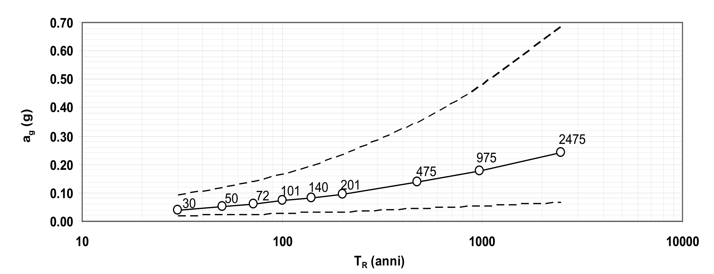
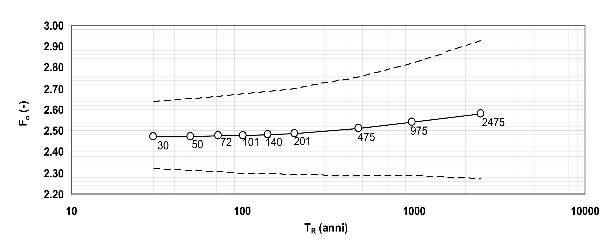
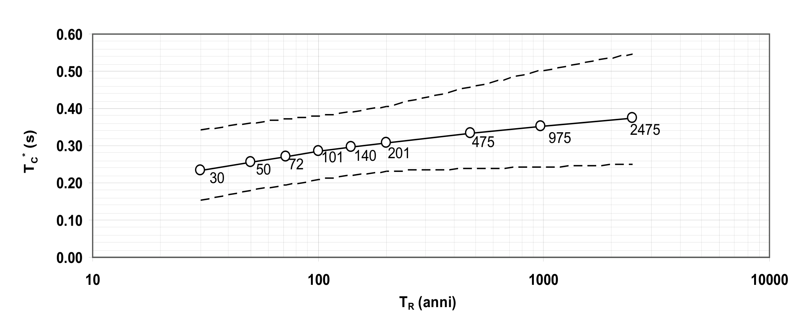

[Torna all'indice del capitolo](indice-cap03.md) | [Torna all'indice generale](../indice-ntc2018.md)

# 3.2. Azione sismica

## Indice del capitolo

- [3.2.1 Stati limite SLO/SLD/SLV/SLC (Tab. 3.2.I)](#321-stati-limite-e-relative-probabilità-di-superamento)
- [3.2.2 Categorie di sottosuolo e topografia (Tab. 3.2.II-III)](#322-categorie-di-sottosuolo-e-condizioni-topografiche)
  - [Categorie di sottosuolo (V_s,eq, A-E)](#categorie-di-sottosuolo)
  - [Condizioni topografiche (T1-T4)](#condizioni-topografiche)
- [3.2.3 Valutazione dell'azione sismica](#323-valutazione-dellazione-sismica)
  - [3.2.3.1 Descrizione del moto sismico](#3231-descrizione-del-moto-sismico-in-superficie-e-sul-piano-di-fondazione)
  - [3.2.3.2 Spettro elastico in accelerazione](#3232-spettro-di-risposta-elastico-in-accelerazione)
  - [3.2.3.2.1 Spettro orizzontale (S_e(T), Tab. 3.2.IV-V)](#32321-spettro-di-risposta-elastico-in-accelerazione-delle-componenti-orizzontali)
  - [3.2.3.2.2 Spettro verticale (Fv, Tab. 3.2.VI)](#32322-spettro-di-risposta-elastico-in-accelerazione-della-componente-verticale)
  - [3.2.3.2.3 Spettro in spostamento (Tab. 3.2.VII)](#32323-spettro-di-risposta-elastico-in-spostamento-delle-componenti-orizzontali)
  - [3.2.3.3 Spostamento e velocità terreno (d_g, v_g)](#3233-spostamento-orizzontale-e-velocità-orizzontale-del-terreno)
  - [3.2.3.4 Spettri di progetto SLO](#3234-spettri-di-risposta-di-progetto-per-lo-stato-limite-di-operatività-slo)
  - [3.2.3.5 Spettri di progetto SLD/SLV/SLC (fattore q)](#3235-spettri-di-risposta-di-progetto-per-gli-stati-limite-di-danno-sld-di-salvaguardia-della-vita-slv-e-di-prevenzione-del-collasso-slc)
  - [3.2.3.6 Storie temporali](#3236-impiego-di-storie-temporali-del-moto-del-terreno)
- [3.2.4 Variabilità spaziale del moto](#324-effetti-della-variabilità-spaziale-del-moto)
  - [3.2.4.1 Variabilità spaziale](#3241-variabilità-spaziale-del-moto)
  - [3.2.4.2 Spostamento assoluto e relativo](#3242-spostamento-assoluto-e-relativo-del-terreno)
- [C3.2 — Azione sismica](#c32-azione-sismica)
  - [C3.2.1 Stati limite e probabilità](#c321-stati-limite-e-relative-probabilità-di-superamento)
  - [C3.2.2 Categorie di sottosuolo e topografia](#c322-categorie-di-sottosuolo-e-condizioni-topografiche)
  - [C3.2.3 Valutazione dell'azione sismica](#c323-valutazione-dellazione-sismica)
  - [C3.2.3.1 Descrizione del moto sismico](#c3231-descrizione-del-moto-sismico-in-superficie-e-sul-piano-di-fondazione)
  - [C3.2.3.2 Spettro elastico in accelerazione](#c3232-spettro-di-risposta-elastico-in-accelerazione)
  - [C3.2.3.6 Storie temporali](#c3236-impiego-di-storie-temporali-del-moto-del-terreno)

---

# Norma

Le azioni sismiche di progetto, in base alle quali valutare il rispetto dei diversi stati limite considerati, si definiscono a partire dalla "pericolosità sismica di base" del sito di costruzione e sono funzione delle caratteristiche morfologiche e stratigrafiche che determinano la risposta sismica locale.

La pericolosità sismica è definita in termini di accelerazione orizzontale massima attesa a_g in condizioni di campo libero su sito di riferimento rigido con superficie topografica orizzontale (di categoria A come definita al §3.2.2), nonché di ordinate dello spettro di risposta elastico in accelerazione ad essa corrispondente S_e(T), con riferimento a prefissate probabilità di eccedenza $P_{V_R}$ come definite nel §3.2.1, nel periodo di riferimento $V_R$, come definito nel §2.4. In alternativa è ammesso l'uso di accelerogrammi, purché correttamente commisurati alla pericolosità sismica locale dell'area della costruzione.

Ai fini della presente normativa le forme spettrali sono definite, per ciascuna delle probabilità di superamento $P_{V_R}$ nel periodo di riferimento $V_R$, a partire dai valori dei seguenti parametri su sito di riferimento rigido orizzontale:

- $a_g$ — accelerazione orizzontale massima al sito;
- $F_o$ — valore massimo del fattore di amplificazione dello spettro in accelerazione orizzontale;
- $T_C^*$ — valore di riferimento per la determinazione del periodo di inizio del tratto a velocità costante dello spettro in accelerazione orizzontale.

Per i valori di $a_g$, $F_o$ e $T_C^*$, necessari per la determinazione delle azioni sismiche, si fa riferimento agli Allegati A e B al Decreto del Ministro delle Infrastrutture 14 gennaio 2008, pubblicato nel S.O. alla Gazzetta Ufficiale del 4 febbraio 2008, n.29, ed eventuali successivi aggiornamenti.

## 3.2.1. Stati limite e relative probabilità di superamento

Nei confronti delle azioni sismiche, sia gli Stati limite di esercizio (SLE) che gli Stati limite ultimi (SLU) sono individuati riferendosi alle prestazioni della costruzione nel suo complesso, includendo gli elementi strutturali, quelli non strutturali e gli impianti.

Gli Stati limite di esercizio (SLE) comprendono:

- **Stato Limite di Operatività (SLO)**: a seguito del terremoto la costruzione nel suo complesso, includendo gli elementi strutturali, quelli non strutturali e le apparecchiature rilevanti in relazione alla sua funzione, non deve subire danni ed interruzioni d'uso significativi;
- **Stato Limite di Danno (SLD)**: a seguito del terremoto la costruzione nel suo complesso, includendo gli elementi strutturali, quelli non strutturali e le apparecchiature rilevanti alla sua funzione, subisce danni tali da non mettere a rischio gli utenti e da non compromettere significativamente la capacità di resistenza e di rigidezza nei confronti delle azioni verticali e orizzontali, mantenendosi immediatamente utilizzabile pur nell'interruzione d'uso di parte delle apparecchiature.

Gli Stati limite ultimi (SLU) comprendono:

- **Stato Limite di salvaguardia della Vita (SLV)**: a seguito del terremoto la costruzione subisce rotture e crolli dei componenti non strutturali ed impiantistici e significativi danni dei componenti strutturali cui si associa una perdita significativa di rigidezza nei confronti delle azioni orizzontali; la costruzione conserva invece una parte della resistenza e rigidezza per azioni verticali e un margine di sicurezza nei confronti del collasso per azioni sismiche orizzontali;
- **Stato Limite di prevenzione del Collasso (SLC)**: a seguito del terremoto la costruzione subisce gravi rotture e crolli dei componenti non strutturali ed impiantistici e danni molto gravi dei componenti strutturali; la costruzione conserva ancora un margine di sicurezza per azioni verticali e un esiguo margine di sicurezza nei confronti del collasso per azioni sismiche orizzontali.

Le probabilità di superamento nel periodo di riferimento $P_{V_R}$, cui riferirsi per individuare l'azione sismica agente in ciascuno degli stati limite considerati, sono riportate nella Tab. 3.2.I.

**Tab. 3.2.I** - *Probabilità di superamento $P_{V_R}$ in funzione dello stato limite considerato*

| Gruppo                    | Stato limite | $P_{V_R}$: Probabilità di superamento nel periodo di riferimento $V_R$ |
| ------------------------- | :----------: | :--------------------------------------------------------------------: |
| Stati limite di esercizio |     SLO      |                                  81%                                   |
| Stati limite di esercizio |     SLD      |                                  63%                                   |
| Stati limite ultimi       |     SLV      |                                  10%                                   |
| Stati limite ultimi       |     SLC      |                                   5%                                   |

Qualora la protezione nei confronti degli stati limite di esercizio sia di prioritaria importanza, i valori di $P_{V_R}$ forniti in tabella devono essere ridotti in funzione del grado di protezione che si vuole raggiungere.

Per ciascuno stato limite e relativa probabilità di eccedenza $P_{V_R}$ nel periodo di riferimento $V_R$ si ricava il periodo di ritorno $T_R$ del sisma utilizzando la relazione:

$$T_R = -V_R / \ln(1 - P_{V_R}) = -C_U \cdot V_N / \ln(1 - P_{V_R}) \tag{3.2.0}$$

## 3.2.2. Categorie di sottosuolo e condizioni topografiche

### Categorie di sottosuolo

Ai fini della definizione dell'azione sismica di progetto, l'effetto della risposta sismica locale si valuta mediante specifiche analisi, da eseguire con le modalità indicate nel §7.11.3. In alternativa, qualora le condizioni stratigrafiche e le proprietà dei terreni siano chiaramente riconducibili alle categorie definite nella Tab. 3.2.II, si può fare riferimento ad un approccio semplificato che si basa sulla classificazione del sottosuolo in funzione dei valori della velocità di propagazione delle onde di taglio, $V_S$. I valori dei parametri meccanici necessari per le analisi di risposta sismica locale o delle velocità $V_S$ per l'approccio semplificato costituiscono parte integrante della caratterizzazione geotecnica dei terreni compresi nel volume significativo, di cui al §6.2.2.

I valori di $V_S$ sono ottenuti mediante specifiche prove in sito oppure, con giustificata motivazione e limitatamente all'approccio semplificato, sono valutati tramite relazioni empiriche di comprovata affidabilità con i risultati di altre prove in sito, quali ad esempio le prove penetrometriche dinamiche per i terreni a grana grossa e le prove penetrometriche statiche.

La classificazione del sottosuolo si effettua in base alle condizioni stratigrafiche ed ai valori della velocità equivalente di propagazione delle onde di taglio, $V_{S,eq}$ (in m/s), definita dall'espressione:

$$V_{S,eq} = \frac{H}{\displaystyle\sum_{i=1}^{N} \frac{h_i}{V_{S,i}}} \tag{3.2.1}$$

con:

- $h_i$ — spessore dell'i-esimo strato;
- $V_{S,i}$ — velocità delle onde di taglio nell'i-esimo strato;
- $N$ — numero di strati;
- $H$ — profondità del substrato, definito come quella formazione costituita da roccia o terreno molto rigido, caratterizzata da $V_S$ non inferiore a 800 m/s.

Per le fondazioni superficiali, la profondità del substrato è riferita al piano di imposta delle stesse, mentre per le fondazioni su pali è riferita alla testa dei pali. Nel caso di opere di sostegno di terreni naturali, la profondità è riferita alla testa dell'opera. Per muri di sostegno di terrapieni, la profondità è riferita al piano di imposta della fondazione.

Per depositi con profondità H del substrato superiore a 30 m, la velocità equivalente delle onde di taglio $V_{S,eq}$ è definita dal parametro $V_{S,30}$, ottenuto ponendo H=30 m nella precedente espressione e considerando le proprietà degli strati di terreno fino a tale profondità.

Le categorie di sottosuolo che permettono l'utilizzo dell'approccio semplificato sono definite in Tab. 3.2.II.

**Tab. 3.2.II** - *Categorie di sottosuolo che permettono l'utilizzo dell'approccio semplificato*

| Categoria | Caratteristiche della superficie topografica |
|:---------:|----------------------------------------------|
| A | Ammassi rocciosi affioranti o terreni molto rigidi caratterizzati da valori di velocità delle onde di taglio superiori a 800 m/s, eventualmente comprendenti in superficie terreni di caratteristiche meccaniche più scadenti con spessore massimo pari a 3 m. |
| B | Rocce tenere e depositi di terreni a grana grossa molto addensati o terreni a grana fina molto consistenti, caratterizzati da un miglioramento delle proprietà meccaniche con la profondità e da valori di velocità equivalente compresi tra 360 m/s e 800 m/s. |
| C | Depositi di terreni a grana grossa mediamente addensati o terreni a grana fina mediamente consistenti con profondità del substrato superiori a 30 m, caratterizzati da un miglioramento delle proprietà meccaniche con la profondità e da valori di velocità equivalente compresi tra 180 m/s e 360 m/s. |
| D | Depositi di terreni a grana grossa scarsamente addensati o di terreni a grana fina scarsamente consistenti, con profondità del substrato superiori a 30 m, caratterizzati da un miglioramento delle proprietà meccaniche con la profondità e da valori di velocità equivalente compresi tra 100 m/s e 180 m/s. |
| E | Terreni con caratteristiche e valori di velocità equivalente riconducibili a quelle definite per le categorie C o D, con profondità del substrato non superiore a 30 m. |

Per queste cinque categorie di sottosuolo, le azioni sismiche sono definibili come descritto al §3.2.3 delle presenti norme. Per qualsiasi condizione di sottosuolo non classificabile nelle categorie precedenti, è necessario predisporre specifiche analisi di risposta locale per la definizione delle azioni sismiche.

### Condizioni topografiche

Per condizioni topografiche complesse è necessario predisporre specifiche analisi di risposta sismica locale. Per configurazioni superficiali semplici si può adottare la seguente classificazione (Tab. 3.2.III):

**Tab. 3.2.III** - *Categorie topografiche*

| Categoria | Caratteristiche della superficie topografica |
|:---------:|----------------------------------------------|
| T1 | Superficie pianeggiante, pendii e rilievi isolati con inclinazione media i ≤ 15° |
| T2 | Pendii con inclinazione media i > 15° |
| T3 | Rilievi con larghezza in cresta molto minore che alla base e inclinazione media 15° ≤ i ≤ 30° |
| T4 | Rilievi con larghezza in cresta molto minore che alla base e inclinazione media i > 30° |

Le suddette categorie topografiche si riferiscono a configurazioni geometriche prevalentemente bidimensionali, creste e dorsali allungate, e devono essere considerate nella definizione dell'azione sismica se di altezza maggiore di 30 m.

## 3.2.3. Valutazione dell'azione sismica

### 3.2.3.1 Descrizione del moto sismico in superficie e sul piano di fondazione

Ai fini delle presenti norme l'azione sismica è caratterizzata da 3 componenti traslazionali, due orizzontali contrassegnate da X e Y ed una verticale contrassegnata da Z, da considerare tra di loro indipendenti. Salvo quanto specificato nel §7.11 per le opere e i sistemi geotecnici, la componente verticale verrà considerata ove espressamente specificato (Capitolo 7) e purché il sito nel quale sorge la costruzione sia caratterizzato da un'accelerazione al suolo, così come definita nel seguente §3.2.3.2, pari ad $a_g$ ≥ 0,15g.

Le componenti possono essere descritte, in funzione del tipo di analisi adottata, mediante una delle seguenti rappresentazioni:

- accelerazione massima in superficie;
- accelerazione massima e relativo spettro di risposta in superficie;
- storia temporale del moto del terreno.

Sulla base di apposite analisi di risposta sismica locale si può poi passare dai valori in superficie ai valori sui piani di riferimento definiti nel §3.2.2; in assenza di tali analisi l'azione in superficie può essere assunta come agente su tali piani.

Le due componenti ortogonali indipendenti che descrivono il moto orizzontale sono caratterizzate dallo stesso spettro di risposta o dalle due componenti accelerometriche orizzontali del moto sismico.

La componente che descrive il moto verticale è caratterizzata dal suo spettro di risposta o dalla componente accelerometrica verticale. In mancanza di documentata informazione specifica, in via semplificata l'accelerazione massima e lo spettro di risposta della componente verticale attesa in superficie possono essere determinati sulla base dell'accelerazione massima e dello spettro di risposta delle due componenti orizzontali. La componente accelerometrica verticale può essere correlata alle componenti accelerometriche orizzontali del moto sismico.

Quale che sia la probabilità di superamento $P_{V_R}$ nel periodo di riferimento $V_R$, la definizione degli spettri di risposta elastici, degli spettri di risposta di progetto e delle storie temporali del moto del terreno è fornita ai paragrafi successivi.

### 3.2.3.2 Spettro di risposta elastico in accelerazione

Lo spettro di risposta elastico in accelerazione è espresso da una forma spettrale (spettro normalizzato) riferita ad uno smorzamento convenzionale del 5%, moltiplicata per il valore della accelerazione orizzontale massima $a_g$ su sito di riferimento rigido orizzontale. Sia la forma spettrale che il valore di $a_g$ variano al variare della probabilità di superamento nel periodo di riferimento $P_{V_R}$ (vedi §2.4 e §3.2.1).

Gli spettri così definiti possono essere utilizzati per strutture con periodo fondamentale minore o uguale a 4,0 s. Per strutture con periodi fondamentali superiori lo spettro deve essere definito da apposite analisi oppure l'azione sismica deve essere descritta mediante storie temporali del moto del terreno.

#### 3.2.3.2.1 Spettro di risposta elastico in accelerazione delle componenti orizzontali

Lo spettro di risposta elastico in accelerazione della componente orizzontale del moto sismico, $S_e$, è definito dalle espressioni seguenti:

$$0 \leq T < T_B \qquad S_e(T) = a_g \cdot S \cdot \eta \cdot F_o \left[\frac{T}{T_B} + \frac{1}{\eta \cdot F_o}\left(1 - \frac{T}{T_B}\right)\right] \tag{3.2.2}$$

$$T_B \leq T < T_C \qquad S_e(T) = a_g \cdot S \cdot \eta \cdot F_o \tag{3.2.2}$$

$$T_C \leq T < T_D \qquad S_e(T) = a_g \cdot S \cdot \eta \cdot F_o \left(\frac{T_C}{T}\right) \tag{3.2.2}$$

$$T_D \leq T \qquad S_e(T) = a_g \cdot S \cdot \eta \cdot F_o \left(\frac{T_C \cdot T_D}{T^2}\right) \tag{3.2.2}$$

nelle quali:

- $T$ è il periodo proprio di vibrazione;
- $S$ è il coefficiente che tiene conto della categoria di sottosuolo e delle condizioni topografiche mediante la relazione seguente

$$S = S_S \cdot S_T \tag{3.2.3}$$

essendo $S_S$ il coefficiente di amplificazione stratigrafica (vedi Tab. 3.2.IV) e $S_T$ il coefficiente di amplificazione topografica (vedi Tab. 3.2.V);

- $\eta$ è il fattore che altera lo spettro elastico per coefficienti di smorzamento viscosi convenzionali ξ diversi dal 5%, mediante la relazione

$$\eta = \sqrt{10 / (5 + \xi)} \geq 0{,}55 \tag{3.2.4}$$

dove ξ (espresso in percentuale) è valutato sulla base dei materiali, della tipologia strutturale e del terreno di fondazione;

- $F_o$ è il fattore che quantifica l'amplificazione spettrale massima, su sito di riferimento rigido orizzontale, ed ha valore minimo pari a 2,2;
- $T_C$ è il periodo corrispondente all'inizio del tratto a velocità costante dello spettro, dato dalla relazione

$$T_C = C_C \cdot T_C^* \tag{3.2.5}$$

dove: $T_C^*$ è definito al §3.2 e $C_C$ è un coefficiente funzione della categoria di sottosuolo (vedi Tab. 3.2.IV);

- $T_B$ è il periodo corrispondente all'inizio del tratto dello spettro ad accelerazione costante, dato dalla relazione

$$T_B = T_C / 3 \tag{3.2.6}$$

- $T_D$ è il periodo corrispondente all'inizio del tratto dello spettro a spostamento costante, espresso in secondi mediante la relazione:

$$T_D = 4{,}0 \cdot \frac{a_g}{g} + 1{,}6 \tag{3.2.7}$$

Per categorie speciali di sottosuolo, per determinati sistemi geotecnici o se si intenda aumentare il grado di accuratezza nella previsione dei fenomeni di amplificazione, le azioni sismiche da considerare nella progettazione possono essere determinate mediante più rigorose analisi di risposta sismica locale. Queste analisi presuppongono un'adeguata conoscenza delle proprietà geotecniche dei terreni e, in particolare, delle relazioni sforzi-deformazioni in campo ciclico, da determinare mediante specifiche indagini e prove.

In mancanza di tali determinazioni, per le componenti orizzontali del moto e per le categorie di sottosuolo di fondazione definite nel §3.2.2, la forma spettrale su sottosuolo di categoria **A** è modificata attraverso il coefficiente stratigrafico $S_S$, il coefficiente topografico $S_T$ e il coefficiente $C_C$ che modifica il valore del periodo $T_C$.

*Amplificazione stratigrafica*

Per sottosuolo di categoria A i coefficienti $S_S$ e $C_C$ valgono 1.

Per le categorie di sottosuolo **B, C, D** ed **E** i coefficienti $S_S$ e $C_C$ possono essere calcolati, in funzione dei valori di $F_o$ e $T_C^*$ relativi al sottosuolo di categoria A, mediante le espressioni fornite nella Tab. 3.2.IV, nelle quali g = 9,81 m/s² è l'accelerazione di gravità e $T_C^*$ è espresso in secondi.

**Tab. 3.2.IV** - *Espressioni di $S_S$ e di $C_C$*

| Categoria sottosuolo | $S_S$ | $C_C$ |
|:--------------------:|-------|-------|
| **A** | 1,00 | 1,00 |
| **B** | $1{,}00 \leq 1{,}40 - 0{,}40 \cdot F_o \cdot \dfrac{a_g}{g} \leq 1{,}20$ | $1{,}10 \cdot (T_C^*)^{-0{,}20}$ |
| **C** | $1{,}00 \leq 1{,}70 - 0{,}60 \cdot F_o \cdot \dfrac{a_g}{g} \leq 1{,}50$ | $1{,}05 \cdot (T_C^*)^{-0{,}33}$ |
| **D** | $0{,}90 \leq 2{,}40 - 1{,}50 \cdot F_o \cdot \dfrac{a_g}{g} \leq 1{,}80$ | $1{,}25 \cdot (T_C^*)^{-0{,}50}$ |
| **E** | $1{,}00 \leq 2{,}00 - 1{,}10 \cdot F_o \cdot \dfrac{a_g}{g} \leq 1{,}60$ | $1{,}15 \cdot (T_C^*)^{-0{,}40}$ |

*Amplificazione topografica*

Per tener conto delle condizioni topografiche e in assenza di specifiche analisi di risposta sismica locale, si utilizzano i valori del coefficiente topografico $S_T$ riportati nella Tab. 3.2.V, in funzione delle categorie topografiche definite nel §3.2.2 e dell'ubicazione dell'opera o dell'intervento.

**Tab. 3.2.V** - *Valori massimi del coefficiente di amplificazione topografica $S_T$*

| Categoria topografica | Ubicazione dell'opera o dell'intervento | $S_T$ |
|:---------------------:|------------------------------------------|:-----:|
| T1 | - | 1,0 |
| T2 | In corrispondenza della sommità del pendio | 1,2 |
| T3 | In corrispondenza della cresta di un rilievo con pendenza media minore o uguale a 30° | 1,2 |
| T4 | In corrispondenza della cresta di un rilievo con pendenza media maggiore di 30° | 1,4 |

La variazione spaziale del coefficiente di amplificazione topografica è definita da un decremento lineare con l'altezza del pendio o del rilievo, dalla sommità o dalla cresta, dove $S_T$ assume il valore massimo riportato nella Tab. 3.2.V, fino alla base, dove $S_T$ assume valore unitario.

#### 3.2.3.2.2 Spettro di risposta elastico in accelerazione della componente verticale

Lo spettro di risposta elastico in accelerazione della componente verticale del moto sismico, $S_{ve}$, è definito dalle espressioni:

$$0 \leq T < T_B \qquad S_{ve}(T) = a_g \cdot S \cdot \eta \cdot F_v \left[\frac{T}{T_B} + \frac{1}{\eta \cdot F_v}\left(1 - \frac{T}{T_B}\right)\right]$$

$$T_B \leq T < T_C \qquad S_{ve}(T) = a_g \cdot S \cdot \eta \cdot F_v$$

$$T_C \leq T < T_D \qquad S_{ve}(T) = a_g \cdot S \cdot \eta \cdot F_v \left(\frac{T_C}{T}\right) \tag{3.2.8}$$

$$T_D \leq T \qquad S_{ve}(T) = a_g \cdot S \cdot \eta \cdot F_v \left(\frac{T_C \cdot T_D}{T^2}\right)$$

nelle quali:

- $T$ è il periodo proprio di vibrazione (in direzione verticale);
- $F_v$ è il fattore che quantifica l'amplificazione spettrale massima, in termini di accelerazione orizzontale massima del terreno $a_g$ su sito di riferimento rigido orizzontale, mediante la relazione:

$$F_v = 1{,}35 \cdot F_o \cdot \left(\frac{a_g}{g}\right)^{0,5} \tag{3.2.9}$$

I valori di $a_g$, $F_o$, S, η sono definiti nel §3.2.3.2.1 per le componenti orizzontali del moto sismico; i valori di $S_S$, $T_B$, $T_C$ e $T_D$, salvo più accurate determinazioni, sono riportati nella Tab. 3.2.VI.

**Tab. 3.2.VI** - *Valori dei parametri dello spettro di risposta elastico della componente verticale*

| Categoria di sottosuolo | $S_S$ | $T_B$ | $T_C$ | $T_D$ |
|:------------------------:|:-----:|:-----:|:-----:|:-----:|
| A, B, C, D, E | 1,0 | 0,05 s | 0,15 s | 1,0 s |

Per tener conto delle condizioni topografiche, in assenza di specifiche analisi si utilizzano i valori del coefficiente topografico $S_T$ riportati in Tab. 3.2.V.

#### 3.2.3.2.3 Spettro di risposta elastico in spostamento delle componenti orizzontali

Lo spettro di risposta elastico in spostamento delle componenti orizzontali $S_{De}$(T) si ricava dalla corrispondente risposta in accelerazione $S_e$(T) mediante la seguente espressione:

$$S_{De}(T) = S_e(T) \times \left(\frac{T}{2\pi}\right)^2 \tag{3.2.10}$$

purché il periodo proprio di vibrazione T non ecceda i valori $T_E$ indicati in Tab. 3.2.VII.

**Tab. 3.2.VII** - *Valori dei parametri $T_E$ e $T_F$*

| Categoria di sottosuolo | $T_E$ [s] | $T_F$ [s] |
|:------------------------:|:---------:|:---------:|
| A | 4,5 | 10,0 |
| B | 5,0 | 10,0 |
| C, D, E | 6,0 | 10,0 |

Per periodi di vibrazione eccedenti $T_E$, le ordinate dello spettro possono essere ottenute dalle formule seguenti:

$$T_E < T \leq T_F \qquad S_{De}(T) = 0{,}025 \cdot a_g \cdot S \cdot T_C \cdot T_D \cdot \left[F_o \cdot \eta + (1 - F_o \cdot \eta) \cdot \frac{T - T_E}{T_F - T_E}\right] \tag{3.2.11}$$

$$T > T_F \qquad S_{De}(T) = d_g$$

dove tutti i simboli sono già stati definiti, ad eccezione di $d_g$, definito nel §3.2.3.3.

### 3.2.3.3 Spostamento orizzontale e velocità orizzontale del terreno

I valori dello spostamento orizzontale $d_g$ e della velocità orizzontale $v_g$ massimi del terreno sono dati dalle seguenti espressioni:

$$d_g = 0{,}025 \cdot a_g \cdot S \cdot T_C \cdot T_D$$

$$v_g = 0{,}16 \cdot a_g \cdot S \cdot T_C \tag{3.2.12}$$

dove $a_g$, S, $T_C$, $T_D$ assumono i valori già utilizzati al §3.2.3.2.1.

### 3.2.3.4 Spettri di risposta di progetto per lo stato limite di operatività (SLO)

Per lo stato limite di operatività lo spettro $S_d$(T) da utilizzare, sia per le componenti orizzontali che per la componente verticale, è lo spettro di risposta elastico corrispondente, riferito alla probabilità di superamento nel periodo di riferimento $P_{V_R}$ considerata (v. §§2.4 e 3.2.1).

### 3.2.3.5 Spettri di risposta di progetto per gli stati limite di danno (SLD), di salvaguardia della vita (SLV) e di prevenzione del collasso (SLC)

Qualora le verifiche agli stati limite di danno, di salvaguardia della vita e di prevenzione del collasso non vengano effettuate tramite l'uso di opportune storie temporali del moto del terreno ed analisi non lineari dinamiche al passo, ai fini del progetto o della verifica delle costruzioni le capacità dissipative delle strutture possono essere considerate attraverso una riduzione delle forze elastiche, che tenga conto in modo semplificato della capacità dissipativa anelastica della struttura, della sua sovraresistenza, dell'incremento del suo periodo proprio di vibrazione a seguito delle plasticizzazioni. In tal caso, lo spettro di risposta di progetto $S_d$(T) da utilizzare, sia per le componenti orizzontali, sia per la componente verticale, è lo spettro di risposta elastico corrispondente riferito alla probabilità di superamento nel periodo di riferimento $P_{V_R}$ considerata (v. §§2.4 e 3.2.1). Per valutare la domanda verrà utilizzato tale spettro, nel caso di analisi non lineare statica ponendo η = 1, nel caso di analisi lineare, statica o dinamica con le ordinate ridotte sostituendo nelle formule [3.2.2] (per le componenti orizzontali) e nelle formule [3.2.8] (per le componenti verticali) η con 1/q, dove q è il fattore di comportamento definito al Capitolo 7 (Tabella 7.3.I).

Si assumerà comunque $S_d$(T) ≥ 0,2$a_g$.

### 3.2.3.6 Impiego di storie temporali del moto del terreno

Gli stati limite, ultimi e di esercizio, possono essere verificati mediante l'uso di storie temporali del moto del terreno artificiali o naturali. Ciascuna storia temporale descrive una componente, orizzontale o verticale, dell'azione sismica; l'insieme delle tre componenti (due orizzontali, tra loro ortogonali, e una verticale) costituisce un gruppo di storie temporali del moto del terreno.

La durata delle storie temporali artificiali del moto del terreno deve essere stabilita sulla base della magnitudo e degli altri parametri fisici che determinano la scelta del valore di $a_g$ e di $S_e$. In assenza di studi specifici, la parte pseudo-stazionaria dell'accelerogramma associato alla storia deve avere durata di 10 s e deve essere preceduta e seguita da tratti di ampiezza crescente da zero e decrescente a zero, in modo che la durata complessiva dell'accelerogramma sia non inferiore a 25 s.

Gli accelerogrammi artificiali devono avere uno spettro di risposta elastico coerente con lo spettro di risposta adottato nella progettazione. La coerenza con lo spettro di risposta elastico è da verificare in base alla media delle ordinate spettrali ottenute con i diversi accelerogrammi, per un coefficiente di smorzamento viscoso equivalente ξ del 5%. L'ordinata spettrale media non deve presentare uno scarto in difetto superiore al 10%, rispetto alla corrispondente componente dello spettro elastico, in alcun punto del maggiore tra gli intervalli 0,15s ÷ 2,0s e 0,15s ÷ 2T, in cui T è il periodo proprio di vibrazione della struttura in campo elastico, per le verifiche agli stati limite ultimi, e 0,15 s ÷ 1,5 T, per le verifiche agli stati limite di esercizio. Nel caso di costruzioni con isolamento sismico, il limite superiore dell'intervallo di coerenza è assunto pari a 1,2 $T_{is}$ essendo $T_{is}$ il periodo equivalente della struttura isolata, valutato per gli spostamenti del sistema d'isolamento prodotti dallo stato limite in esame.

L'uso di storie temporali del moto del terreno artificiali non è ammesso nelle analisi dinamiche di opere e sistemi geotecnici.

L'uso di storie temporali del moto del terreno generate mediante simulazione del meccanismo di sorgente e della propagazione è ammesso a condizione che siano adeguatamente giustificate le ipotesi relative alle caratteristiche sismogenetiche della sorgente e del mezzo di propagazione e che, negli intervalli di periodo sopraindicati, l'ordinata spettrale media non presenti uno scarto in difetto superiore al 20% rispetto alla corrispondente componente dello spettro elastico.

L'uso di storie temporali del moto del terreno naturali o registrate è ammesso a condizione che la loro scelta sia rappresentativa della sismicità del sito e sia adeguatamente giustificata in base alle caratteristiche sismogenetiche della sorgente, alle condizioni del sito di registrazione, alla magnitudo, alla distanza dalla sorgente e alla massima accelerazione orizzontale attesa al sito.

Le storie temporali del moto del terreno registrate devono essere selezionate e scalate in modo tale che i relativi spettri di risposta elastici approssimino gli spettri di risposta elastici nel campo dei periodi propri di vibrazione di interesse per il problema in esame. Nello specifico la compatibilità con lo spettro di risposta elastico deve essere verificata in base alla media delle ordinate spettrali ottenute con i diversi accelerogrammi associati alle storie per un coefficiente di smorzamento viscoso equivalente ξ del 5%. L'ordinata spettrale media non deve presentare uno scarto in difetto superiore al 10% ed uno scarto in eccesso superiore al 30%, rispetto alla corrispondente componente dello spettro elastico, in alcun punto dell'intervallo dei periodi propri di vibrazione di interesse in esame per i diversi stati limite.

## 3.2.4. Effetti della variabilità spaziale del moto

### 3.2.4.1 Variabilità spaziale del moto

Nei punti di contatto con il terreno di opere con sviluppo planimetrico significativo, il moto sismico può avere caratteristiche differenti, a causa del carattere asincrono del fenomeno di propagazione, delle disomogeneità e delle discontinuità eventualmente presenti, e della diversa risposta locale del terreno.

Degli effetti sopra indicati deve tenersi conto quando essi possono essere significativi e in ogni caso quando le condizioni di sottosuolo siano così variabili lungo lo sviluppo dell'opera da richiedere l'uso di accelerogrammi o di spettri di risposta diversi.

In assenza di modelli fisicamente più accurati e adeguatamente documentati, un criterio di prima approssimazione per tener conto della variabilità spaziale del moto sismico consiste nel sovrapporre agli effetti dinamici, valutati ad esempio con lo spettro di risposta, gli effetti pseudo-statici indotti dagli spostamenti relativi.

Nel dimensionamento delle strutture in elevazione tali effetti possono essere trascurati quando il sistema fondazione-terreno sia sufficientemente rigido da rendere minimi gli spostamenti relativi. Negli edifici ciò avviene, ad esempio, quando si collegano in modo opportuno i plinti di fondazione.

Gli effetti dinamici possono essere valutati adottando un'unica azione sismica, corrispondente alla categoria di sottosuolo che induce le sollecitazioni più severe.

Qualora l'opera sia suddivisa in porzioni, ciascuna fondata su sottosuolo di caratteristiche ragionevolmente omogenee, per ciascuna di esse si adotterà l'appropriata azione sismica.

### 3.2.4.2 Spostamento assoluto e relativo del terreno

Il valore dello spostamento assoluto orizzontale massimo del suolo ($d_g$) può ottenersi utilizzando l'espressione [3.2.12].

Nel caso in cui sia necessario valutare gli effetti della variabilità spaziale del moto richiamati nel paragrafo precedente, il valore dello spostamento relativo tra due punti i e j caratterizzati dalle proprietà stratigrafiche del rispettivo sottosuolo ed il cui moto possa considerarsi indipendente, può essere stimato secondo l'espressione seguente:

$$d_{ij\,max} = 1{,}25 \sqrt{d_{gi}^2 + d_{gj}^2} \tag{3.2.13}$$

dove $d_{gi}$ e $d_{gj}$ sono rispettivamente gli spostamenti massimi del suolo nei punti i e j, calcolati con riferimento alle caratteristiche locali del sottosuolo.

Il moto di due punti del terreno può considerarsi indipendente per punti posti a distanze notevoli, in relazione al tipo di sottosuolo; il moto è reso indipendente anche dalla presenza di forti variabilità orografiche fra i punti.

In assenza di forti discontinuità orografiche, lo spostamento relativo tra punti a distanza x (in m) si può valutare con l'espressione:

$$d_{ij}(x) = d_{ij0} + (d_{ij\,max} - d_{ij0})\left[1 - e^{-1{,}25(x/v_s)^2}\right] \tag{3.2.14}$$

dove $v_s$ è la velocità di propagazione delle onde di taglio in m/s e $d_{ij0}$ è dato dall'espressione

$$d_{ij0} = 1{,}25 |d_{gi} - d_{gj}| \tag{3.2.15}$$

Per punti che ricadano su sottosuoli differenti a distanza inferiore a 20 m, lo spostamento relativo è rappresentato da $d_{ij0}$; se i punti ricadono su sottosuolo dello stesso tipo, lo spostamento relativo può essere stimato, anziché con l'espressione [3.2.14], con le espressioni

$$d_{ij}(x) = \frac{d_{ij\,max}}{v_s} \cdot 2{,}3x \quad \text{per sottosuolo tipo D,}$$

$$d_{ij}(x) = \frac{d_{ij\,max}}{v_s} \cdot 3{,}0x \quad \text{per sottosuolo di tipo diverso da D.} \tag{3.2.16}$$

Per la determinazione delle sollecitazioni indotte nei ponti dagli spostamenti relativi del terreno, si possono utilizzare criteri riportati in documenti di comprovata validità.

---

# Circolare

*Circolare 21/01/2019 n. 7 C.S.LL.PP., §C3.2*

## C3.2. Azione sismica

Il § 3.2, inerente la definizione dell'azione sismica, presenta alcune variazioni introdotte allo scopo di aggiornare approcci e procedure di calcolo all'attuale stato delle conoscenze.

Il dato di partenza per la definizione dell'azione sismica rimane sempre lo studio di pericolosità sismica italiana di base, i cui risultati sono stati prodotti e messi in rete dall'Istituto Nazionale di Geofisica e Vulcanologia (**INGV**).

L'azione sismica è valutata in condizioni di campo libero su sito di riferimento rigido a superficie topografica orizzontale, sito per sito e costruzione per costruzione.

Tale approccio, che rappresentava una delle principali novità delle NTC 2008, rimane invariato nell'attuale versione e dovrebbe condurre in media, sull'intero territorio nazionale, ad una significativa ottimizzazione dei costi delle costruzioni antisismiche, a parità di sicurezza.

La pericolosità sismica di un sito è descritta dalla probabilità che, in un fissato lasso di tempo, in detto sito un parametro che descrive il moto sismico superi un valore prefissato. Nelle NTC 2018, tale lasso di tempo, espresso in anni, è denominato *"periodo di riferimento"* $V_R$ e la probabilità è denominata *"probabilità di eccedenza o di superamento nel periodo di riferimento"* $P_{V_R}$.

Ai fini della determinazione delle azioni sismiche di progetto nei modi previsti dalle NTC, la pericolosità sismica del territorio nazionale è definita convenzionalmente facendo riferimento ad un sito rigido (di categoria A) con superficie topografica orizzontale (di categoria T1), in condizioni di campo libero, cioè in assenza di manufatti. Negli sviluppi successivi il sito di riferimento sarà dunque caratterizzato da sottosuolo di categoria A e superficie topografica di categoria T1.

Le caratteristiche del moto sismico atteso al sito di riferimento, per una fissata $P_{V_R}$, sono espresse dall'accelerazione massima e dallo spettro di risposta elastico in accelerazione.

È ammessa la possibilità di descrivere il terremoto in forma di storie temporali del moto del terreno, a condizione che esse siano compatibili con le caratteristiche del moto sismico attese. In particolare, per ciascuna $P_{V_R}$ i caratteri del moto sismico su sito di riferimento rigido orizzontale sono descritti dalla distribuzione sul territorio nazionale delle seguenti grandezze, sulla base delle quali risultano compiutamente definiti gli spettri elastici di risposta:

- $a_g$ = accelerazione massima al sito;
- $F_o$ = valore massimo del fattore di amplificazione dello spettro in accelerazione orizzontale;
- $T_C^*$ = periodo di inizio del tratto a velocità costante dello spettro in accelerazione orizzontale.

Il valore di $a_g$ è desunto dalla pericolosità di riferimento, attualmente fornita dall'INGV, mentre $F_o$ e $T_C^*$ sono calcolati in modo che gli spettri di risposta elastici in accelerazione, velocità e spostamento forniti dalle NTC approssimino al meglio i corrispondenti spettri di risposta elastici in accelerazione, velocità e spostamento derivanti dalla pericolosità di riferimento.

I valori di $a_g$, $F_o$ e $T_C^*$ sono riportati negli allegati A e B al decreto del Ministro delle Infrastrutture 14 gennaio 2008 pubblicato nel S.O. alla Gazzetta Ufficiale del 4 febbraio 2008 n. 29 e negli eventuali successivi aggiornamenti; di essi si fornisce la rappresentazione in termini di andamento medio in funzione del periodo di ritorno $T_R$, per l'intero territorio nazionale. (v. Figure C3.2.1 a, b, c). Si riportano inoltre, in corrispondenza di ciascun valore di $T_R$, i relativi intervalli di confidenza al 95% valutati con riferimento ad una distribuzione log-normale, per fornire una misura della loro variabilità sul territorio (*"variabilità spaziale"*).

Nel caso di costruzioni di notevoli dimensioni, va considerata l'azione sismica più sfavorevole calcolata sull'intero sito ove sorge la costruzione e, ove fosse necessario, la variabilità spaziale del moto di cui al § 3.2.5.

**Fig. C3.2.1 a** - Variabilità di $a_g$ con $T_R$: andamento medio sul territorio nazionale ed intervallo di confidenza al 95%

**Fig. C3.2.1 b** - Variabilità di $F_o$ con $T_R$: andamento medio sul territorio nazionale ed intervallo di confidenza al 95%

**Fig. C3.2.1 c** - Variabilità di $T_C^*$ con $T_R$: andamento medio sul territorio nazionale ed intervallo di confidenza al 95%

### C3.2.1. Stati limite e relative probabilità di superamento

In un quadro operativo finalizzato a sfruttare al meglio la puntuale definizione della pericolosità di cui si dispone, si è ritenuto utile consentire, quando opportuno, il riferimento a 4 stati limite per l'azione sismica.

Ci si riferisce dunque a due Stati Limite di Esercizio (SLE), lo Stato Limite di immediata Operatività (**SLO**), particolarmente utile come riferimento progettuale per le opere che debbono restare operative durante e subito dopo il terremoto (ospedali, caserme, centri della protezione civile, etc.) e lo **Stato Limite di Danno** (**SLD**), definito come stato limite da rispettare per garantire solo temporanee inagibilità nelle condizioni post-sismiche, in tal modo articolando le prestazioni della struttura in termini di esercizio.

In modo analogo, ci si riferisce a due Stati Limite Ultimi (SLU) facendo seguire allo Stato Limite di salvaguardia della Vita (**SLV**), individuato puntualmente lo stato limite ultimo, lo Stato Limite di prevenzione del Collasso (**SLC**), particolarmente utile come riferimento progettuale per alcune tipologie strutturali (strutture con isolamento e dissipazione di energia) e, più in generale, nel quadro complessivo della progettazione antisismica.

I quattro stati limite così definiti, consentono di individuare quattro situazioni diverse che, al crescere progressivo dell'azione sismica, ed al conseguente progressivo superamento dei quattro stati limite ordinati per azione sismica crescente (**SLO, SLD, SLV, SLC**), fanno corrispondere una progressiva crescita del danneggiamento all'insieme di struttura, elementi non strutturali ed impianti, per individuare così univocamente ed in modo quasi "continuo" le caratteristiche prestazionali richieste alla generica costruzione.

Ai quattro stati limite sono attribuiti (v. Tabella 3.2.I delle NTC) valori della probabilità di superamento $P_{V_R}$ pari rispettivamente a 81%, 63%, 10% e 5%, valori che restano immutati quale che sia la classe d'uso della costruzione considerata; tali probabilità, valutate nel periodo di riferimento $V_R$ proprio della costruzione considerata, consentono di individuare, per ciascuno stato limite, l'azione sismica di progetto corrispondente.

Viene preliminarmente valutato il periodo di riferimento $V_R$ della costruzione (espresso in anni), ottenuto come prodotto tra la vita nominale $V_N$ fissata all'atto della progettazione ed il coefficiente d'uso $C_U$ che compete alla classe d'uso nella quale la costruzione ricade (v. § 2.4 delle NTC). Si ricava poi, per ciascuno stato limite e relativa probabilità di eccedenza $P_{V_R}$ nel periodo di riferimento $V_R$, il periodo di ritorno $T_R$ del sisma. Si utilizza a tal fine la relazione:

$$T_R = -V_R / \ln(1 - P_{V_R}) = -C_U \cdot V_N / \ln(1 - P_{V_R}) \tag{C.3.2.1}$$

ottenendo, per i vari stati limite, le espressioni di $T_R$ in funzione di $V_R$ riportate nella Tabella C.3.2.I.

**Tabella C.3.2.I** — *Valori di $T_R$ espressi in funzione di $V_R$*

| Stati Limite | | Valori in anni del periodo di ritorno $T_R$ al variare del periodo di riferimento $V_R$ |
|---|---|---|
| SLE | SLO | $T_R = 0{,}60 \cdot V_R$ (≥ 30 anni) |
|| SLD | $T_R = V_R$ |
| SLU | SLV | $T_R = 9{,}50 \cdot V_R$ |
|| SLC | $T_R = 19{,}50 \cdot V_R$ (≤ 2475 anni) |

I limiti inferiore e superiore di $T_R$ fissati nell'allegato A al Decreto del Ministro delle Infrastrutture 14 gennaio 2008 pubblicato nel S.O. alla Gazzetta ufficiale del 4 febbraio 2008 ed eventuali successivi aggiornamenti sono dovuti all'*intervallo di riferimento* della pericolosità sismica oggi disponibile; per opere speciali possono considerarsi azioni sismiche riferite a $T_R$ più elevati.

Alla base dei risultati così ottenuti è la strategia progettuale che impone, al variare del periodo di riferimento $V_R$, la costanza della probabilità di superamento $P_{V_R}$ di ciascuno degli stati limite considerati (**strategia progettuale di norma**).

È immediato constatare (v. formula C.3.2.1) che, imponendo $P_{V_R}$ = costante al variare di $C_U$, si ottiene $T_R = -C_U \cdot V_N / \ln(1-P_{V_R}) = -C_U \cdot V_N / \text{costante}$ e dunque, a parità di $V_N$, $T_R$ varia dello stesso fattore $C_U$ per cui viene moltiplicata $V_N$ per avere $V_R$.

Fissata la vita nominale $V_N$ della costruzione e valutato il periodo di ritorno $T_{R,1}$ corrispondente a $C_U$ = 1, si ricava il $T_R$ corrispondente al generico $C_U$ dal prodotto $C_U \cdot T_{R,1}$. **Al variare di $C_U$, $T_R$ e $V_R$ variano con legge uguale.**

Strategie progettuali alternative a quella ora illustrata, sono ipotizzabili. Al riguardo le NTC, alla fine del § 3.2.1, recitano *"Qualora la protezione nei confronti degli stati limite di esercizio sia di prioritaria importanza, i valori di $P_{V_R}$ forniti in tabella devono essere ridotti in funzione del grado di protezione che si vuole raggiungere."*

È evidente che la riduzione delle probabilità di superamento attribuite ai vari stati limite non può essere arbitraria ma deve allinearsi a precisi concetti di teoria della sicurezza; in particolare si possono eventualmente accrescere i livelli di protezione nei confronti degli Stati Limite di Esercizio, mentre i livelli di protezione nei confronti degli Stati Limite Ultimi (più direttamente legati alla sicurezza) possono restare sostanzialmente immutati perché già ritenuti sufficienti dalla normativa.

Per rispettare le limitazioni testé citate, al variare della classe d'uso e del coefficiente $C_U$, si può utilizzare $C_U$ non per aumentare $V_N$, portandola a $V_R$, ma per ridurre $P_{V_R}$.

In tal caso si ha $T_R = -V_N / \ln(1 - P_{V_R} / C_U)$; detto $T_{R,a}$ il periodo di ritorno ottenuto con la strategia progettuale di norma e $T_{R,b}$ il periodo di ritorno ottenuto con la strategia progettuale appena illustrata, il rapporto R tra i due periodi di ritorno varrebbe:

$$R = \frac{T_{R,b}}{T_{R,a}} = \frac{-V_N / \ln(1 - P_{V_R} / C_U)}{-C_U \cdot V_N / \ln(1 - P_{V_R})} = \frac{\ln(1 - P_{V_R})}{C_U \cdot \ln(1 - P_{V_R} / C_U)} \tag{C.3.2.2}$$

ed avrebbe, al variare di $C_U$ e $P_{V_R}$, gli andamenti riportati nel grafico successivo.

*Fig. C3.2.2 — Variazione di $R$ con $C_U$ e $P_{V_R}$*

Constatato che, con la strategia ipotizzata, si rispettano le condizioni preliminarmente indicate come irrinunciabili (sostanziale costanza di $T_R$, dunque protezione sostanzialmente immutata, per i valori di $P_{V_R}$ relativi agli SLU ossia per $P_{V_R}$ ≤ 10%, e significativa crescita di $T_R$, dunque protezione significativamente incrementata, per i valori di $P_{V_R}$ relativi agli SLE ossia per $P_{V_R}$ ≥ 60%) si può poi passare a valutare come applicare la indicazione di norma, ossia come modificare le $P_{V_R}$.

Per trovare come modificare, al variare di $C_U$, i valori di $P_{V_R}$ nel periodo di riferimento $V_R$ per ottenere gli stessi valori di $T_R$ suggeriti dalla strategia ipotizzata, basta imporre R=1 nella formula C.3.2.2 ed indicare con $P^*_{V_R}$ i nuovi valori di $P_{V_R}$, così ottenendo:

$$P^*_{V_R} = 1 - (1 - P_{V_R} / C_U)^{C_U} \tag{C.3.2.3}$$

È così possibile ricavare, al variare di $C_U$, i valori di $P^*_{V_R}$ a partire dai valori di $P_{V_R}$; tali valori sono riportati, insieme ai valori di $T_R$ corrispondenti, nella Tabella C.3.2.II. Adottando la strategia ipotizzata, al crescere di $C_U$ i valori dei $P^*_{V_R}$ corrispondenti agli Stati Limite di Esercizio (SLE) **si riducono sensibilmente ed i corrispondenti $T_R$ crescono**, mentre i valori dei $P^*_{V_R}$ corrispondenti agli Stati Limite Ultimi (SLU) ed i corrispondenti $T_R$, **sostanzialmente non variano**.

**Tabella C.3.2.II** — *Valori di $P^*_{V_R}$ e $T_R$ al variare di $C_U$*

| Stati Limite | | Valori di $P^*_{V_R}$ ||| Valori di $T_R$ corrispondenti |||
|---|---|:---:|:---:|:---:|:---:|:---:|:---:|
||| $C_U$ = 1 | $C_U$ = 1,5 | $C_U$ = 2 | $C_U$ = 1,0 | $C_U$ = 1,5 | $C_U$ = 2,0 |
| SLE | SLO | 81,00% | 68,80% | 64,60% | $0{,}60 \cdot V_R$ | $0{,}86 \cdot V_R$ | $0{,}96 \cdot V_R$ |
|| SLD | 63,00% | 55,83% | 53,08% | $V_R$ | $1{,}22 \cdot V_R$ | $1{,}32 \cdot V_R$ |
| SLU | SLV | 10,00% | 9,83% | 9,75% | $9{,}50 \cdot V_R$ | $9{,}66 \cdot V_R$ | $9{,}75 \cdot V_R$ |
|| SLC | 5,00% | 4,96% | 4,94% | $19{,}50 \cdot V_R$ | $19{,}66 \cdot V_R$ | $19{,}75 \cdot V_R$ |

Se dunque la protezione nei confronti degli SLE è di prioritaria importanza, si possono sostituire i valori di $P_{V_R}$ con quelli di $P^*_{V_R}$, così conseguendo una miglior protezione nei confronti degli SLE. La strategia progettuale testé ipotizzata, peraltro, conduce ad un'opera decisamente più costosa *e dunque è lecito adottarla unicamente nei casi in cui gli SLE siano effettivamente di prioritaria importanza*.

Ottenuti i valori di $T_R$ corrispondenti ai quattro stati limite considerati (utilizzando, a seconda dei casi, la **strategia progettuale a o b**) si possono infine ricavare, al variare del sito nel quale la costruzione sorge ed utilizzando i dati riportati negli Allegati A e B al Decreto del Ministro delle Infrastrutture 14 gennaio 2008 e eventuali successivi aggiornamenti, l'accelerazione del suolo $a_g$ e le forme dello spettro di risposta di progetto per ciascun sito, costruzione, situazione d'uso, stato limite.

### C3.2.2. Categorie di sottosuolo e condizioni topografiche

Le condizioni del sito di riferimento rigido non corrispondono, in generale, alle condizioni reali. È necessario, pertanto, tenere conto delle condizioni stratigrafiche del volume di terreno interessato dall'opera ed anche delle condizioni topografiche, poiché entrambi questi fattori concorrono a modificare l'azione sismica in superficie rispetto a quella attesa su un sito rigido con superficie orizzontale. Tali modifiche, in ampiezza, durata e contenuto in frequenza, sono il risultato della risposta sismica locale.

Si denomina *"risposta sismica locale"* l'azione sismica che emerge in *"superficie"* a seguito delle modifiche in ampiezza, durata e contenuto in frequenza subite trasmettendosi dal substrato rigido. Per individuare in modo univoco la risposta sismica si assume come *"superficie"* il *"piano di riferimento"* così come definito, per le diverse tipologie strutturali, al § 3.2.2 delle NTC.

Le modifiche sopra citate corrispondono a:

- *effetti stratigrafici*, legati alla successione stratigrafica, alle proprietà meccaniche dei terreni, alla geometria del contatto tra il substrato rigido e i terreni sovrastanti ed alla geometria dei contatti tra gli strati di terreno;
- *effetti topografici*, legati alla configurazione topografica del piano campagna. La modifica delle caratteristiche del moto sismico per effetto della geometria superficiale del terreno è dovuta alla focalizzazione delle onde sismiche in prossimità della cresta dei rilievi a seguito dei fenomeni di riflessione delle onde sismiche ed all'interazione tra il campo d'onda incidente e quello diffratto. I fenomeni di amplificazione cresta-base aumentano in proporzione al rapporto tra l'altezza del rilievo e la sua larghezza.

Gli effetti della risposta sismica locale possono essere valutati con metodi semplificati oppure eseguendo specifiche analisi. I metodi semplificati possono essere adoperati solo se l'azione sismica in superficie è descritta dall'accelerazione massima o dallo spettro elastico di risposta; non possono cioè essere adoperati se l'azione sismica in superficie è descritta mediante storie temporali del moto del terreno.

Nei metodi semplificati è possibile valutare gli effetti stratigrafici e topografici. In tali metodi si attribuisce il sito ad una delle categorie di sottosuolo definite nella Tabella 3.2.II delle NTC (A, B, C, D, E) e ad una delle categorie topografiche definite nella Tabella 3.2.IV delle NTC (T1, T2, T3, T4). In questo caso, la valutazione della risposta sismica locale consiste nella modifica dello spettro di risposta in accelerazione del moto sismico di riferimento, relativo all'affioramento della formazione rocciosa (categoria di sottosuolo A) su superficie orizzontale (categoria topografica T1).

L'identificazione della categoria del sottosuolo è basata sulla descrizione stratigrafica e sui valori della velocità di propagazione delle onde di taglio $V_s$. Ai fini della valutazione semplificata della risposta sismica locale, nelle NTC, non è più consentita la classificazione del sottosuolo sulla base del parametro $N_{SPT30}$ per i terreni a grana grossa e $C_{u30}$ per i terreni a grana fine. Le NTC richiedono, quindi, che la categoria di sottosuolo sia stabilita sulla base del profilo $V_s$. La misura diretta di $V_s$ attraverso specifiche indagini geofisiche è in ogni caso preferibile, essendo consentita, in alternativa, la definizione del profilo $V_s$ attraverso il ricorso a correlazioni empiriche *"di comprovata affidabilità"* solo per il metodo semplificato e in ipotesi residuali, stante la maggiore incertezza che caratterizza la determinazione di $V_s$ con le citate correlazioni empiriche. In caso di utilizzo di correlazioni empiriche è comunque raccomandabile non limitarsi all'uso di un singolo modello empirico, al fine di consentire una stima dell'incertezza legata al carattere regionale di tali correlazioni e alla conseguente elevata dispersione dei relativi dati sperimentali.

Fatta salva la necessità di estendere le indagini geotecniche nel volume significativo di terreno interagente con l'opera, la classificazione si effettua in base ai valori della velocità equivalente $V_{s,eq}$ definita mediante la media armonica [3.2.1] delle NTC ([C.3.2.4]).

$$V_{s,eq} = \frac{H}{\displaystyle\sum_{i=1}^{N} \frac{h_i}{V_{s,i}}} = \frac{\displaystyle\sum_{j=1}^{N} h_j}{\displaystyle\sum_{i=1}^{N} \frac{h_i}{V_{s,i}}} \tag{C.3.2.4}$$

La velocità equivalente è ottenuta imponendo l'equivalenza tra i tempi di arrivo delle onde di taglio in un terreno omogeneo equivalente di spessore pari ad H. Dove H è la profondità del substrato definito come quella formazione costituita da roccia o terreno molto rigido caratterizzato da valori di $V_s$ non inferiori ad 800 m/s. Per depositi con profondità H del substrato superiore a 30 m, la velocità equivalente delle onde di taglio $V_{s,eq}$ è definita dal parametro $V_{s,30}$ ottenuto ponendo H = 30 m nell'equazione [3.2.1]-[C.3.2.4] considerando le proprietà degli strati di terreno fino a tale profondità. Derivando da una media armonica, la velocità equivalente assume valori differenti da quelli ottenuti dalla media aritmetica delle velocità dei singoli strati pesata sui relativi spessori, soprattutto in presenza di strati molto deformabili di limitato spessore. Lo scopo della definizione adottata è quello di privilegiare il contributo degli strati più deformabili.

Per terreni nei quali la profondità del substrato è maggiore di 30 m (H ≥ 30 m), la $V_{s,eq}$ così come definita dall'equazione [3.2.1]-[C.3.2.4] coincide di fatto con la $V_{s,30}$ delle NTC 2008. L'introduzione della $V_{s,eq}$ unita alla modifica nella definizione delle categorie di sottosuolo si è resa necessaria al fine di includere nell'attuale testo normativo le configurazioni stratigrafiche che rimanevano escluse nelle NTC 2008 (ad esempio profili di tipo B con profondità del substrato inferiore a 30 m).

Infine nelle NTC 2018 sono state eliminate le categorie speciali di sottosuolo (Classi S1 ed S2 presenti nelle NTC 2008). Per tutte quelle configurazioni litostratigrafiche non riconducibili alla classificazione riportata in Tab. 3.2.II (ad esempio terreni instabili o suscettibili di liquefazione, per determinati sistemi geotecnici o se si intende aumentare il grado di accuratezza nella previsione dei fenomeni di amplificazione), le azioni sismiche da considerare nella progettazione possono essere determinate mediante specifiche analisi di risposta sismica locale, meglio descritte nel § C.7.11.3.1. Queste analisi presuppongono un'adeguata conoscenza delle proprietà meccaniche dei terreni in condizioni cicliche e dinamiche, determinate mediante specifiche indagini e prove geotecniche.

La risposta sismica locale e, comunque, la modellazione sismica in generale, comprendono un propedeutico studio geomorfologico, stratigrafico e tettonico, nonché una individuazione delle categorie di sottosuolo a cui afferiscono le opere in progetto.

### C3.2.3. Valutazione dell'azione sismica

Il moto sismico di ciascun punto del terreno può essere decomposto in componenti secondo tre direzioni ortogonali; per ciascuna componente dell'azione sismica può essere fornita una rappresentazione puntuale mediante la sola accelerazione massima attesa, mediante l'intero spettro di risposta o mediante storie temporali del moto del terreno (ad esempio accelerogrammi). Qualora la costruzione sia di dimensioni limitate o le sue fondazioni siano sufficientemente rigide e resistenti, si può assumere che il moto sia lo stesso per tutti i punti al di sotto della costruzione, altrimenti si deve tener conto della variabilità spaziale del moto, nei modi definiti nel § 7.3.2.5.

La rappresentazione di riferimento per le componenti dell'azione sismica è lo spettro di risposta elastico in accelerazione per uno smorzamento convenzionale del 5%. Esso fornisce la risposta massima in accelerazione del generico sistema dinamico elementare con periodo di oscillazione T ≤ 4 s ed è espresso come il prodotto di una forma spettrale per l'accelerazione massima del terreno.

La forma spettrale per le componenti orizzontali è definita mediante le stesse espressioni fornite dall'UNI EN 1998 nelle quali, tuttavia, non si è assunto un singolo valore per l'amplificazione massima ma si è fornita tale grandezza, $F_o$, in funzione della pericolosità del sito insieme alle grandezze $a_g$, $T_C$ e, conseguentemente, $T_B$, $T_D$. Per la componente verticale, invece, le uniche grandezze fornite in funzione della pericolosità del sito sono l'accelerazione orizzontale del suolo $a_g$, posta pari alla massima accelerazione orizzontale del suolo $a_g$, e l'amplificazione massima $F_v$, espressa come funzione di $a_g$.

La categoria di sottosuolo e le condizioni topografiche incidono sullo spettro elastico di risposta. Specificamente, l'accelerazione spettrale massima dipende dal coefficiente S = $S_S \cdot S_T$ che comprende gli effetti delle amplificazioni stratigrafica ($S_S$) e topografica ($S_T$). Per le componenti orizzontali dell'azione sismica, il periodo $T_C$ di inizio del tratto a velocità costante dello spettro, è funzione invece del coefficiente $C_C$, dipendente anch'esso dalla categoria di sottosuolo.

Il coefficiente di amplificazione topografica $S_T$ è definito in funzione delle condizioni topografiche riportate nella Tabella 3.2.II ed assume i valori riassunti nella Tabella 3.2.V delle NTC.

Per le componenti orizzontali dell'azione sismica il coefficiente $S_S$ è definito nella Tabella 3.2.IV delle NTC. Esso è il rapporto tra il valore dell'accelerazione massima attesa in superficie e quello su sottosuolo di categoria A ed è definito in funzione della categoria di sottosuolo e del livello di pericolosità sismica di base del sito (descritto dal prodotto $F_o \cdot a_g$).

*Fig. C3.2.3 — Andamento del coefficiente $S_S$ per le componenti orizzontali dell'azione sismica*

A parità di categoria di sottosuolo, l'andamento di $S_S$ con $F_o \cdot a_g$ è caratterizzato da due tratti orizzontali, rispettivamente per bassi ed elevati valori di pericolosità sismica di base; tali tratti sono raccordati da un segmento di retta che descrive il decremento lineare di $S_S$ con $F_o \cdot a_g$.

In genere, per bassi valori di pericolosità sismica di base, a parità di $F_o \cdot a_g$ i valori di $S_S$ si incrementano al decrescere della rigidezza del sottosuolo, passando dal sottosuolo di categoria A al sottosuolo di categoria E. In particolare, per $F_o \cdot a_g$ < 0,78g, il sottosuolo di categoria D mostra amplificazioni maggiori delle altre categorie di sottosuolo. Come conseguenza del comportamento ciclico non lineare e dissipativo del terreno, per valori elevati della pericolosità sismica di base si osserva un'inversione di tendenza. Per 0,78g ≤ $F_o \cdot a_g$ < 1,17g i fenomeni di amplificazione diventano più marcati per il sottosuolo di categoria C mentre per elevati livelli di pericolosità sismica del sito, caratterizzati da valori del prodotto $F_o \cdot a_g$ > 0,93g, le accelerazioni massime su sottosuolo di categoria D sono inferiori a quelle su sottosuolo di categoria A. Si verifica cioè una deamplificazione del moto in termini di accelerazione massima.

Per la componente verticale dell'azione sismica, in assenza di studi specifici, si assume $S_S$=1.

*Fig. C3.2.4 — Andamento del coefficiente $C_C$*

Il coefficiente $C_C$ è definito nella Tabella 3.2.IV delle NTC in funzione della categoria di sottosuolo e del valore di $T_C$ riferito a sottosuolo di categoria A, $T_C^*$. Nella Figura C3.2.4, la variazione di $C_C$ è mostrata, per le cinque categorie di sottosuolo, in funzione di $T_C^*$.

A parità della categoria di sottosuolo, il coefficiente $C_C$ decresce al crescere di $T_C^*$ e, conseguentemente, l'effetto di amplificazione massima si sposta verso periodi più brevi e si riduce l'estensione del tratto orizzontale caratterizzato da ordinata spettrale massima. In genere, a parità di $T_C^*$, i valori di $C_C$ si incrementano al decrescere della rigidezza del sottosuolo, ovvero passando dal sottosuolo di categoria A al sottosuolo di categoria E. Il sottosuolo di categoria D presenta, nell'intervallo di valori di interesse, valori di $T_C$ maggiori di quelli relativi alle altre categorie di sottosuolo.

#### C3.2.3.1. Descrizione del moto sismico in superficie e sul piano di fondazione

Se le azioni sismiche al piano di fondazione sono ricavate mediante analisi di risposta sismica locale, si può procedere nella maniera seguente:

- Si selezionano accelerogrammi rappresentativi delle azioni su affioramento rigido di riferimento, verificandone la compatibilità con lo spettro elastico di risposta secondo quanto disposto al §3.2.3.6 della norma e tenendo conto delle indicazioni fornite al successivo C3.2.3.6 e al C7.11.3.1.2.2.
- Dalle analisi di risposta sismica locale si ottiene, per ciascun accelerogramma, il corrispondente accelerogramma in superficie o sul piano di riferimento (ad esempio il piano di fondazione) e il relativo spettro elastico di risposta.
- Per le analisi con spettro elastico di risposta si adotta lo spettro medio, ottenuto dagli spettri determinati con l'analisi di risposta sismica locale. Per le analisi nel dominio del tempo si utilizzano direttamente gli accelerogrammi ricavati dall'analisi di risposta sismica locale.

#### C3.2.3.2. Spettro di risposta elastico in accelerazione

**C3.2.3.2.1 Spettro di risposta elastico in accelerazione delle componenti orizzontali**

Il fattore $\eta$ tiene conto delle capacità dissipative delle costruzioni alterando lo spettro di risposta assunto a riferimento, per il quale $\eta$=1, definito come lo spettro elastico con smorzamento viscoso convenzionale $\xi$ = 5%. La relazione [3.2.4] può essere utilizzata per costruzioni che non subiscono significativi danneggiamenti e può essere utilizzata nel campo di smorzamenti convenzionali compresi tra i valori $\xi$ = 5% e $\xi$ = 28%. Al di fuori di questo campo, la scelta del valore del fattore $\eta$ deve essere adeguatamente giustificata.

Nel caso di significativi danneggiamenti, generalmente associati ad azioni riferite agli Stati Limite Ultimi, il fattore $\eta$ può essere calcolato in funzione del fattore di struttura q previsto per lo Stato Limite considerato secondo quanto definito al § 3.2.3.5 delle NTC.

#### C3.2.3.6. Impiego di storie temporali del moto del terreno

Le NTC indicano le caratteristiche delle storie temporali del moto da impiegare nelle analisi non lineari dinamiche delle strutture, definite al § 7.3.4.1, e di opere e sistemi geotecnici definite al § 7.11 consentendo l'uso di storie temporali artificiali o naturali (provenienti da registrazioni di terremoti reali) e, in particolari situazioni, di storie temporali simulate, generate cioè mediante simulazione del meccanismo di sorgente e della propagazione. Le norme specificano altresì che l'uso di segnali artificiali non è ammesso nelle analisi dinamiche di opere e sistemi geotecnici.

Per gli accelerogrammi artificiali e per quelli naturali le NTC definiscono i criteri di coerenza con lo spettro di risposta elastico per lo stato limite considerato (spettro-compatibilità) mentre per gli accelerogrammi simulati le NTC specificano che la loro determinazione si qualifichi in base alle caratteristiche degli accelerogrammi della sorgente e del mezzo di propagazione. Per gli accelerogrammi artificiali le norme prescrivono che essi debbano rispettare vincoli di compatibilità media con lo spettro elastico di riferimento.

Quando l'azione sismica è rappresentata da accelerogrammi naturali, è necessario che la selezione di questi segnali sia coerente con la pericolosità sismica attesa al sito, in particolare, con la magnitudo e la distanza epicentrale rappresentative di uno o più eventi di scenario. Poiché la pericolosità sismica di base è definita sul territorio nazionale in termini probabilistici, gli eventi di scenario, se il sito di costruzione appartiene alle categorie A di sottosuolo (tabella 3.2.II) e T1 topografica (tabella 3.2.III), possono essere definiti a partire dai risultati della disaggregazione della pericolosità sismica disponibili sul sito web dell'INGV. In questo caso, come indicato al C.7.11.3.1.2, i siti di registrazione dovrebbero essere posti su un affioramento rigido (categoria A) con superficie topografica orizzontale (categoria T1). Per i siti di costruzione non appartenenti alle categorie A di sottosuolo e T1 topografica, i segnali naturali testé selezionati sono utilizzati per effettuare analisi di risposta sismica locale.

Le norme stabiliscono per le registrazioni naturali selezionate alcuni vincoli di spettro-compatibilità rispetto allo spettro elastico di risposta per lo stato limite considerato (§3.2.3.6). Occorre, inoltre, tenere conto delle indicazioni fornite al paragrafo C.7.11.3.1.2.2. Al fine di soddisfare i suddetti requisiti di spettro-compatibilità, i segnali registrati possono essere scalati linearmente in ampiezza. È tuttavia opportuno contenere il fattore di scala in un intervallo limitato in modo da non alterare eccessivamente i segnali e renderli incompatibili alla magnitudo e alla distanza dalla sorgente degli eventi sismici a cui sono riferiti. In generale, ciascuna registrazione sismica è costituita da due componenti del moto in direzione orizzontale e una componente in direzione verticale. Mentre in linea di principio è possibile ottenere, differenziando tra loro i fattori di scala, la spettro-compatibilità per ciascuna componente del moto, in pratica può essere opportuno utilizzare un unico fattore di scala per le due componenti orizzontali, selezionato in modo da rendere la risultante delle azioni sismiche nel piano orizzontale compatibile con lo spettro risultante. Uno dei possibili metodi per ottenere questo risultato comprende le seguenti operazioni:

1. per ogni coppia di registrazioni orizzontali, si costruisce uno spettro SRSS, dato dalla radice quadrata della somma dei quadrati degli spettri di ogni componente;
2. lo "spettro medio SRSS" è pari alla media degli spettri SRSS di ciascuna coppia di accelerogrammi, appartenente al medesimo gruppo di storie temporali;
3. le coppie di registrazioni, nel numero indicato dalla norma, devono essere selezionate e scalate in modo tale che lo spettro medio SRSS approssimi, secondo i criteri di coerenza spettrale di norma, lo "spettro di riferimento", dato dal prodotto dello spettro elastico di progetto per un opportuno coefficiente $\alpha$.

Il valore del coefficiente $\alpha$ è in genere non superiore a 1,3 che corrisponde alla risultante di due componenti il cui rapporto è circa pari a 0,85. Tuttavia, nel definire la coerenza spettrale, con particolare riguardo al rapporto fra le componenti accelerometriche, in assenza di studi sismo-tettonici specifici che giustifichino scelte differenti, si deve adottare un valore limite per il coefficiente $\alpha$ pari a $\sqrt{2}$, ovvero la risultante di due componenti uguali tra loro, come specificato al §3.2.3.1 della norma.

Ai fini dell'impiego di accelerogrammi nelle analisi, una descrizione delle azioni sismiche coerente con l'evento di origine può essere ottenuta proiettando ciascuna coppia di registrazioni lungo le direzioni principali del sisma, definite come le direzioni per le quali si annulla la correlazione tra le componenti. Il coefficiente di correlazione tra due componenti accelerometriche X e Y nell'intervallo di tempo t₁ < t < t₂ può essere così determinato:

$$\rho_{x,y} = \frac{\displaystyle\int_{t_1}^{t_2} X(t) \cdot Y(t) \, dt}{\sqrt{\displaystyle\int_{t_1}^{t_2} X^2(t) \, dt \cdot \int_{t_1}^{t_2} Y^2(t) \, dt}} \tag{C.3.2.5}$$

dove t₁ e t₂ rappresentano gli estremi dell'intervallo temporale considerato, che può essere assunto corrispondente alla fase intensa del sisma.
