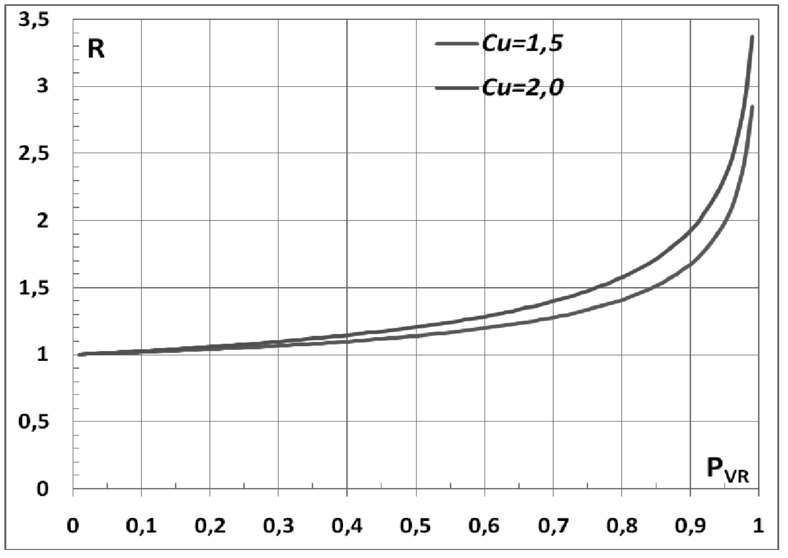

[Torna all'indice del § 3.2](./indice-3.2.md) | [Torna all'indice del capitolo](./indice-cap03.md) | [Torna all'indice generale](../indice-ntc2018.md)

# 3.2.1. STATI LIMITE E RELATIVE PROBABILITÀ DI SUPERAMENTO

<!-- INDICE-INTERNO:INIZIO -->
**Indice interno**

- [Norma](#toc-ntc2018-3-2-1-norma)
- [Circolare](#toc-ntc2018-c3-2-1-circolare)
  - [C3.2.1 STATI LIMITE E RELATIVE PROBABILITÀ DI SUPERAMENTO](#toc-ntc2018-c3-2-1)
<!-- INDICE-INTERNO:FINE -->

## Norma

Nei confronti delle azioni sismiche, sia gli Stati limite di esercizio (SLE) che gli Stati limite ultimi (SLU) sono individuati riferendosi alle prestazioni della costruzione nel suo complesso, includendo gli elementi strutturali, quelli non strutturali e gli impianti.

Gli Stati limite di esercizio (SLE) comprendono:

- **Stato Limite di Operatività (SLO)**: a seguito del terremoto la costruzione nel suo complesso, includendo gli elementi strutturali, quelli non strutturali e le apparecchiature rilevanti in relazione alla sua funzione, non deve subire danni ed interruzioni d'uso significativi;
- **Stato Limite di Danno (SLD)**: a seguito del terremoto la costruzione nel suo complesso, includendo gli elementi strutturali, quelli non strutturali e le apparecchiature rilevanti alla sua funzione, subisce danni tali da non mettere a rischio gli utenti e da non compromettere significativamente la capacità di resistenza e di rigidezza nei confronti delle azioni verticali ed orizzontali, mantenendosi immediatamente utilizzabile pur nell'interruzione d'uso di parte delle apparecchiature.

Gli Stati limite ultimi (SLU) comprendono:

- **Stato Limite di salvaguardia della Vita (SLV)**: a seguito del terremoto la costruzione subisce rotture e crolli dei componenti non strutturali ed impiantistici e significativi danni dei componenti strutturali cui si associa una perdita significativa di rigidezza nei confronti delle azioni orizzontali; la costruzione conserva invece una parte della resistenza e rigidezza per azioni verticali e un margine di sicurezza nei confronti del collasso per azioni sismiche orizzontali;
- **Stato Limite di prevenzione del Collasso (SLC)**: a seguito del terremoto la costruzione subisce gravi rotture e crolli dei componenti non strutturali ed impiantistici e danni molto gravi dei componenti strutturali; la costruzione conserva ancora un margine di sicurezza per azioni verticali ed un esiguo margine di sicurezza nei confronti del collasso per azioni orizzontali.

Le probabilità di superamento nel periodo di riferimento $P_{V_R}$, cui riferirsi per individuare l'azione sismica agente in ciascuno degli stati limite considerati, sono riportate nella Tab. 3.2.I.

**Tab. 3.2.I** - *Probabilità di superamento $P_{V_R}$ in funzione dello stato limite considerato*

| Stati Limite              |              | $P_{V_R}$: Probabilità di superamento nel periodo di riferimento $V_R$ |
| ------------------------- | :----------: | :--------------------------------------------------------------------: |
| Stati limite di esercizio |     SLO      |                                  81%                                   |
| Stati limite di esercizio |     SLD      |                                  63%                                   |
| Stati limite ultimi       |     SLV      |                                  10%                                   |
| Stati limite ultimi       |     SLC      |                                   5%                                   |

Qualora la protezione nei confronti degli stati limite di esercizio sia di prioritaria importanza, i valori di $P_{V_R}$ forniti in tabella devono essere ridotti in funzione del grado di protezione che si vuole raggiungere.

Per ciascuno stato limite e relativa probabilità di eccedenza $P_{V_R}$ nel periodo di riferimento $V_R$ si ricava il periodo di ritorno $T_R$ del sisma utilizzando la relazione:

$$T_R = -V_R / \ln(1 - P_{V_R}) = -C_U \cdot V_N / \ln(1 - P_{V_R}) \tag{3.2.0}$$

---

## Circolare

### C3.2.1 STATI LIMITE E RELATIVE PROBABILITÀ DI SUPERAMENTO

In un quadro operativo finalizzato a sfruttare al meglio la puntuale definizione della pericolosità di cui si dispone, si è ritenuto utile consentire, quando opportuno, il riferimento a 4 stati limite per l'azione sismica.

Ci si riferisce dunque a due Stati Limite di Esercizio (SLE), lo Stato Limite di immediata Operatività (**SLO**), particolarmente utile come riferimento progettuale per le opere che debbono restare operative durante e subito dopo il terremoto (ospedali, caserme, centri della protezione civile, etc.) e lo **Stato Limite di Danno** (**SLD**) – definito come stato limite da rispettare per garantire inagibilità solo temporanee nelle condizioni post-sismiche, in tal modo articolando le prestazioni della struttura in termini di esercizio.

In modo analogo, ci si riferisce a due Stati Limite Ultimi (SLU) facendo seguire allo Stato Limite di salvaguardia della Vita (**SLV**), individuato definendo puntualmente lo stato limite ultimo, lo Stato Limite di prevenzione del Collasso (**SLC**), particolarmente utile come riferimento progettuale per alcune tipologie strutturali (strutture con isolamento e dissipazione di energia) e, più in generale, nel quadro complessivo della progettazione antisismica.

I quattro stati limite così definiti, consentono di individuare quattro situazioni diverse che, al crescere progressivo dell'azione sismica, ed al conseguente progressivo superamento dei quattro stati limite ordinati per azione sismica crescente (**SLO, SLD, SLV, SLC**), fanno corrispondere una progressiva crescita del danneggiamento all'insieme di struttura, elementi non strutturali ed impianti, per individuare così univocamente ed in modo quasi "continuo" le caratteristiche prestazionali richieste alla generica costruzione.

Ai quattro stati limite sono attribuiti (v. Tabella 3.2.I delle NTC) valori della probabilità di superamento $P_{V_R}$ pari rispettivamente a 81%, 63%, 10% e 5%, valori che restano immutati quale che sia la classe d'uso della costruzione considerata; tali probabilità, valutate nel periodo di riferimento $V_R$ proprio della costruzione considerata, consentono di individuare, per ciascuno stato limite, l'azione sismica di progetto corrispondente.

Viene preliminarmente valutato il periodo di riferimento $V_R$ della costruzione (espresso in anni), ottenuto come prodotto tra la vita nominale $V_N$ fissata all'atto della progettazione ed il coefficiente d'uso $C_U$ che compete alla classe d'uso nella quale la costruzione ricade (v. § 2.4 delle NTC). Si ricava poi, per ciascuno stato limite e relativa probabilità di eccedenza $P_{V_R}$ nel periodo di riferimento $V_R$, il periodo di ritorno $T_R$ del sisma. Si utilizza a tal fine la relazione:

$$T_R = -V_R / \ln(1 - P_{V_R}) = -C_U \cdot V_N / \ln(1 - P_{V_R}) \tag{C.3.2.1}$$

ottenendo, per i vari stati limite, le espressioni di $T_R$ in funzione di $V_R$ riportate nella Tabella C.3.2.I.

**Tabella C.3.2.I** — *Valori di $T_R$ espressi in funzione di $V_R$*

| Stati Limite | | Valori in anni del periodo di ritorno $T_R$ al variare del periodo di riferimento $V_R$ |
|---|---|---|
| Stati Limite di Esercizio (SLE) | SLO | $^{(1)}30\ \text{anni} \le T_R = 0{,}60 \cdot V_R$ |
| Stati Limite di Esercizio (SLE) | SLD | $T_R = V_R$ |
| Stati Limite Ultimi (SLU) | SLV | $T_R = 9{,}50 \cdot V_R$ |
| Stati Limite Ultimi (SLU) | SLC | $T_R = 19{,}50 \cdot V_R \le 2475\ \text{anni}^{(1)}$ |

$^{1}$I limiti inferiore e superiore di $T_R$ fissati nell'allegato A al Decreto del Ministro delle Infrastrutture 14 gennaio 2008 pubblicato nel S.O. alla Gazzetta ufficiale del 4 febbraio 2008 ed eventuali successivi aggiornamenti sono dovuti all'*intervallo di riferimento* della pericolosità sismica oggi disponibile; per opere speciali possono considerarsi azioni sismiche riferite a $T_R$ più elevati.

Alla base dei risultati così ottenuti è la strategia progettuale che impone, al variare del periodo di riferimento $V_R$, la costanza della probabilità di superamento $P_{V_R}$ di ciascuno degli stati limite considerati (**strategia progettuale di norma**).

È immediato constatare (v. formula C.3.2.1) che, imponendo $P_{V_R}$ = costante al variare di $C_U$, si ottiene [$T_R = -C_U \cdot V_N / \ln(1-P_{V_R}) = -C_U \cdot V_N / \text{costante}$] e dunque, a parità di $V_N$, $T_R$ varia dello stesso fattore $C_U$ per cui viene moltiplicata $V_N$ per avere $V_R$.

Fissata la vita nominale $V_N$ della costruzione e valutato il periodo di ritorno $T_{R,1}$ corrispondente a $C_U$ = 1, si ricava il $T_R$ corrispondente al generico $C_U$ dal prodotto $C_U \cdot T_{R,1}$. **Al variare di $C_U$, $T_R$ e $V_R$ variano con legge uguale.**

Strategie progettuali alternative a quella ora illustrata, sono ipotizzabili$^{2}$. Al riguardo le NTC, alla fine del § 3.2.1, recitano *"Qualora la protezione nei confronti degli stati limite di esercizio sia di prioritaria importanza, i valori di $P_{V_R}$ forniti in tabella devono essere ridotti in funzione del grado di protezione che si vuole raggiungere."*

$^{2}$Si veda al riguardo EN-1998-1, § 2.1, punto 4.

È evidente che la riduzione delle probabilità di superamento attribuite ai vari stati limite non può essere arbitraria ma deve allinearsi a precisi concetti di teoria della sicurezza; in particolare si possono eventualmente accrescere i livelli di protezione nei confronti degli Stati Limite di Esercizio, mentre i livelli di protezione nei confronti degli Stati Limite Ultimi (più direttamente legati alla sicurezza) possono restare sostanzialmente immutati perché già ritenuti sufficienti dalla normativa.

Per rispettare le limitazioni testé citate, al variare della classe d'uso e del coefficiente $C_U$, si può utilizzare $C_U$ non per aumentare $V_N$, portandola a $V_R$, ma per ridurre $P_{V_R}$.

In tal caso si ha $T_R = -V_N / \ln(1 - P_{V_R} / C_U)$; detto $T_{R,a}$ il periodo di ritorno ottenuto con la strategia progettuale di norma e $T_{R,b}$ il periodo di ritorno ottenuto con la strategia progettuale appena illustrata, il rapporto R tra i due periodi di ritorno varrebbe:

$$R = \frac{T_{R,b}}{T_{R,a}} = \frac{-V_N / \ln(1 - P_{V_R} / C_U)}{-C_U \cdot V_N / \ln(1 - P_{V_R})} = \frac{\ln(1 - P_{V_R})}{C_U \cdot \ln(1 - P_{V_R} / C_U)} \tag{C.3.2.2}$$

ed avrebbe, al variare di $C_U$ e $P_{V_R}$, gli andamenti riportati nel grafico successivo.

*Figura C3.2.2 — Variazione di $R$ con $C_U$ e $P_{V_R}$*

Constatato che, con la strategia ipotizzata, si rispettano le condizioni preliminarmente indicate come irrinunciabili (sostanziale costanza di $T_R$, dunque protezione sostanzialmente immutata, per i valori di $P_{V_R}$ relativi agli SLU ossia per $P_{V_R}$ ≤ 10%, e significativa crescita di $T_R$, dunque protezione significativamente incrementata, per i valori di $P_{V_R}$ relativi agli SLE ossia per $P_{V_R}$ ≥ 60%) si può poi passare a valutare come applicare la indicazione di norma, ossia come modificare le $P_{V_R}$.

Per trovare come modificare, al variare di $C_U$, i valori di $P_{V_R}$ nel periodo di riferimento $V_R$ per ottenere gli stessi valori di $T_R$ suggeriti dalla strategia ipotizzata, basta imporre R=1 nella formula C.3.2.2 ed indicare con $P^*_{V_R}$ i nuovi valori di $P_{V_R}$, così ottenendo:

$$R = 1 = \frac{\ln(1 - P^*_{V_R})}{C_U \cdot \ln(1 - P_{V_R} / C_U)} \Rightarrow \ln(1 - P^*_{V_R}) = C_U \cdot \ln(1 - P_{V_R} / C_U) \Rightarrow P^*_{V_R} = 1 - (1 - P_{V_R} / C_U)^{C_U} \tag{C.3.2.3}$$

È così possibile ricavare, al variare di $C_U$, i valori di $P^*_{V_R}$ a partire dai valori di $P_{V_R}$; tali valori sono riportati, insieme ai valori di $T_R$ corrispondenti, nella Tabella C.3.2.II. Adottando la strategia ipotizzata, al crescere di $C_U$ i valori dei $P^*_{V_R}$ corrispondenti agli Stati Limite di Esercizio (SLE) **si riducono sensibilmente ed i corrispondenti $T_R$ crescono**, mentre i valori dei $P^*_{V_R}$ corrispondenti agli Stati Limite Ultimi (SLU) ed i corrispondenti $T_R$, **sostanzialmente non variano**.

**Tabella C.3.2.II** — *Valori di $P^*_{V_R}$ e $T_R$ al variare di $C_U$*

| Stati Limite | | Valori di $P^*_{V_R}$ ||| Valori di $T_r$ corrispondenti |||
|---|---|:---:|:---:|:---:|:---:|:---:|:---:|
||| $C_U =$ | $C_U =$ | $C_U =$ | $C_U = 1{,}0$ | $C_U = 1{,}5$ | $C_U = 2{,}0$ |
| SLE | SLO | 81,00% | 68,80% | 64,60% | $0{,}60 \cdot V_R$ | $0{,}86 \cdot V_R$ | $0{,}96 \cdot V_R$ |
| SLE | SLD | 63,00% | 55,83% | 53,08% | $V_R$ | $1{,}22 \cdot V_R$ | $1{,}32 \cdot V_R$ |
| SLU | SLV | 10,00% | 9,83% | 9,75% | $9{,}50 \cdot V_R$ | $9{,}66 \cdot V_R$ | $9{,}75 \cdot V_R$ |
| SLU | SLC | 5,00% | 4,96% | 4,94% | $19{,}50 \cdot V_R$ | $19{,}66 \cdot V_R$ | $19{,}75 \cdot V_R$ |

Se dunque la protezione nei confronti degli SLE è di prioritaria importanza, si possono sostituire i valori di $P_{V_R}$ con quelli di $P^*_{V_R}$, così conseguendo una miglior protezione nei confronti degli SLE. La strategia progettuale testé ipotizzata, peraltro, conduce ad un'opera decisamente più costosa *e dunque è lecito adottarla unicamente nei casi in cui gli SLE siano effettivamente di prioritaria importanza*.

Ottenuti i valori di $T_R$ corrispondenti ai quattro stati limite considerati (utilizzando, a seconda dei casi, la **strategia progettuale a o b**) si possono infine ricavare, al variare del sito nel quale la costruzione sorge ed utilizzando i dati riportati negli Allegati A e B al Decreto del Ministro delle Infrastrutture 14 gennaio 2008 e eventuali successivi aggiornamenti, l'accelerazione del suolo $a_g$ e le forme dello spettro di risposta di progetto per ciascun sito, costruzione, situazione d'uso, stato limite.
