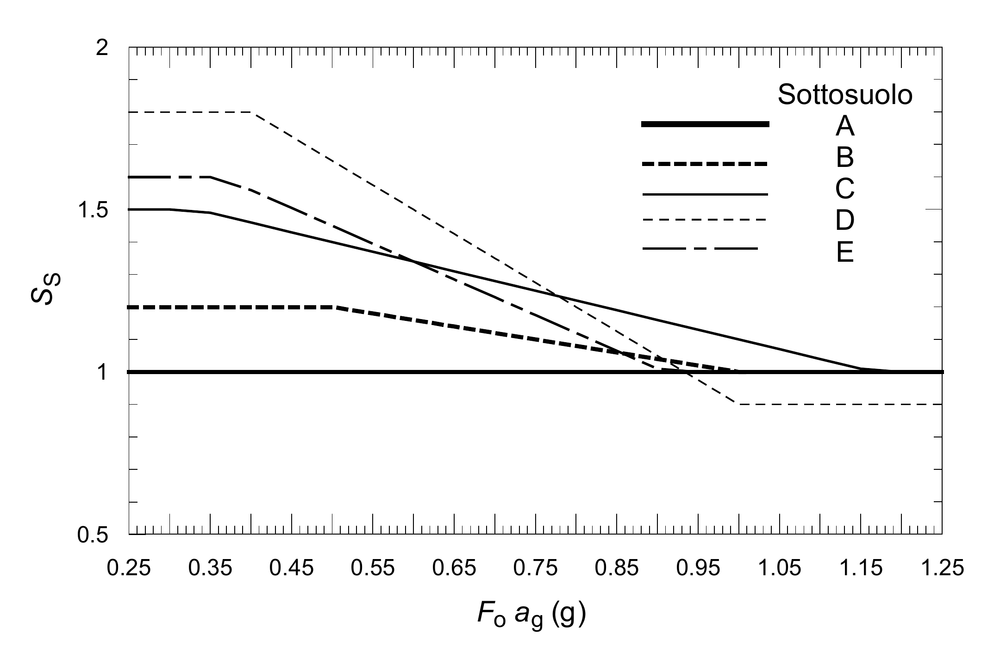
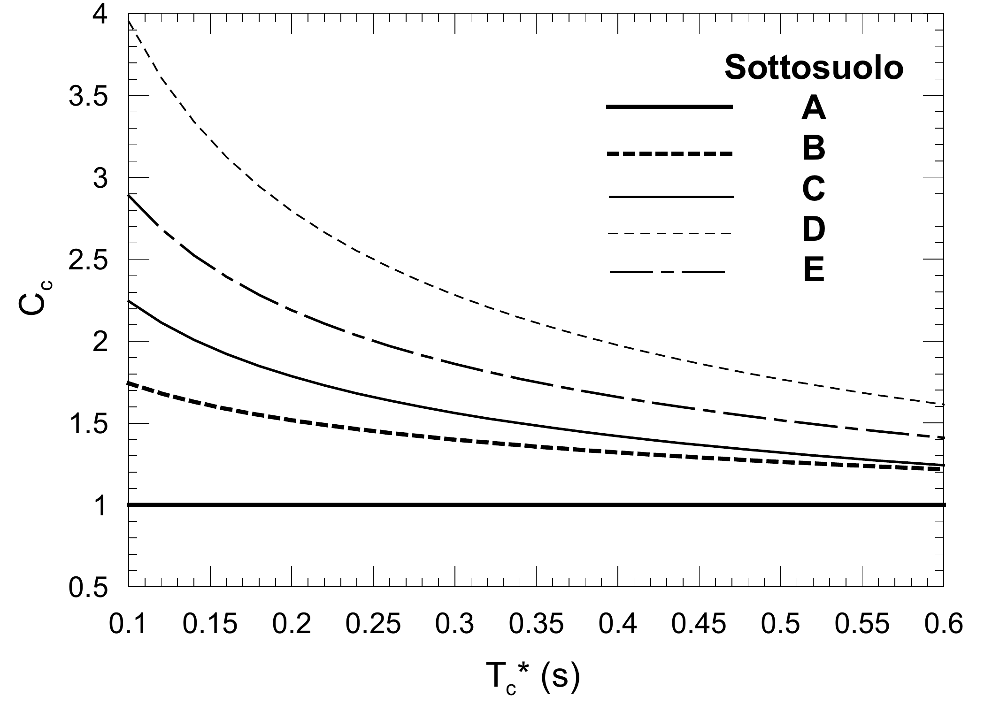

[Torna all'indice del § 3.2](./indice-3.2.md) | [Torna all'indice del capitolo](./indice-cap03.md) | [Torna all'indice generale](../indice-ntc2018.md)

# 3.2.3. VALUTAZIONE DELL’AZIONE SISMICA

<!-- INDICE-INTERNO:INIZIO -->
**Indice interno**

- [Norma](#toc-ntc2018-3-2-3-norma)
  - [3.2.3.1 DESCRIZIONE DEL MOTO SISMICO IN SUPERFICIE E SUL PIANO DI FONDAZIONE](#toc-ntc2018-3-2-3-1)
  - [3.2.3.2 SPETTRO DI RISPOSTA ELASTICO IN ACCELERAZIONE](#toc-ntc2018-3-2-3-2)
    - [3.2.3.2.1 Spettro di risposta elastico in accelerazione delle componenti orizzontali](#toc-ntc2018-3-2-3-2-1)
    - [3.2.3.2.2 Spettro di risposta elastico in accelerazione della componente verticale](#toc-ntc2018-3-2-3-2-2)
    - [3.2.3.2.3 Spettro di risposta elastico in spostamento delle componenti orizzontali](#toc-ntc2018-3-2-3-2-3)
  - [3.2.3.3 SPOSTAMENTO ORIZZONTALE E VELOCITÀ ORIZZONTALE DEL TERRENO](#toc-ntc2018-3-2-3-3)
  - [3.2.3.4 SPETTRI DI RISPOSTA DI PROGETTO PER LO STATO LIMITE DI OPERATIVITÀ (SLO)](#toc-ntc2018-3-2-3-4)
  - [3.2.3.5 SPETTRI DI RISPOSTA DI PROGETTO PER GLI STATI LIMITE DI DANNO (SLD), DI SALVAGUARDIA DELLA VITA (SLV) E DI PREVENZIONE DEL COLLASSO (SLC)](#toc-ntc2018-3-2-3-5)
  - [3.2.3.6 IMPIEGO DI STORIE TEMPORALI DEL MOTO DEL TERRENO](#toc-ntc2018-3-2-3-6)
- [Circolare](#toc-ntc2018-c3-2-3-circolare)
  - [C3.2.3 VALUTAZIONE DELL’AZIONE SISMICA](#toc-ntc2018-c3-2-3)
    - [C3.2.3.1 DESCRIZIONE DEL MOTO SISMICO IN SUPERFICIE E SUL PIANO DI FONDAZIONE](#toc-ntc2018-c3-2-3-1)
    - [C3.2.3.2 SPETTRO DI RISPOSTA ELASTICO IN ACCELERAZIONE](#toc-ntc2018-c3-2-3-2)
    - [C3.2.3.6 IMPIEGO DI STORIE TEMPORALI DEL MOTO DEL TERRENO](#toc-ntc2018-c3-2-3-6)
<!-- INDICE-INTERNO:FINE -->

## Norma

### 3.2.3.1 DESCRIZIONE DEL MOTO SISMICO IN SUPERFICIE E SUL PIANO DI FONDAZIONE

Ai fini delle presenti norme l'azione sismica è caratterizzata da 3 componenti traslazionali, due orizzontali contrassegnate da X ed Y ed una verticale contrassegnata da Z, da considerare tra di loro indipendenti. Salvo quanto specificato nel §7.11 per le opere e i sistemi geotecnici, la componente verticale verrà considerata ove espressamente specificato (Capitolo 7) e purché il sito nel quale sorge la costruzione sia caratterizzato da un'accelerazione al suolo, così come definita nel seguente §3.2.3.2, pari ad $a_g$ ≥ 0,15g.

Le componenti possono essere descritte, in funzione del tipo di analisi adottata, mediante una delle seguenti rappresentazioni:

- accelerazione massima in superficie;
- accelerazione massima e relativo spettro di risposta in superficie;
- storia temporale del moto del terreno.

Sulla base di apposite analisi di risposta sismica locale si può poi passare dai valori in superficie ai valori sui piani di riferimento definiti nel §3.2.2; in assenza di tali analisi l'azione in superficie può essere assunta come agente su tali piani.

Le due componenti ortogonali indipendenti che descrivono il moto orizzontale sono caratterizzate dallo stesso spettro di risposta o dalle due componenti accelerometriche orizzontali del moto sismico.

La componente che descrive il moto verticale è caratterizzata dal suo spettro di risposta o dalla componente accelerometrica verticale. In mancanza di documentata informazione specifica, in via semplificata l'accelerazione massima e lo spettro di risposta della componente verticale attesa in superficie possono essere determinati sulla base dell'accelerazione massima e dello spettro di risposta delle due componenti orizzontali. La componente accelerometrica verticale può essere correlata alle componenti accelerometriche orizzontali del moto sismico.

Quale che sia la probabilità di superamento $P_{V_R}$ nel periodo di riferimento $V_R$, la definizione degli spettri di risposta elastici, degli spettri di risposta di progetto e delle storie temporali del moto del terreno è fornita ai paragrafi successivi.

### 3.2.3.2 SPETTRO DI RISPOSTA ELASTICO IN ACCELERAZIONE

Lo spettro di risposta elastico in accelerazione è espresso da una forma spettrale (spettro normalizzato) riferita ad uno smorzamento convenzionale del 5%, moltiplicata per il valore della accelerazione orizzontale massima $a_g$ su sito di riferimento rigido orizzontale. Sia la forma spettrale che il valore di $a_g$ variano al variare della probabilità di superamento nel periodo di riferimento $P_{V_R}$ (vedi §2.4 e §3.2.1).

Gli spettri così definiti possono essere utilizzati per strutture con periodo fondamentale minore o uguale a 4,0 s. Per strutture con periodi fondamentali superiori lo spettro deve essere definito da apposite analisi oppure l'azione sismica deve essere descritta mediante storie temporali del moto del terreno.

#### 3.2.3.2.1 Spettro di risposta elastico in accelerazione delle componenti orizzontali

Lo spettro di risposta elastico in accelerazione della componente orizzontale del moto sismico, $S_e$, è definito dalle espressioni seguenti:

$$0 \leq T < T_B \qquad S_e(T) = a_g \cdot S \cdot \eta \cdot F_o \left[\frac{T}{T_B} + \frac{1}{\eta \cdot F_o}\left(1 - \frac{T}{T_B}\right)\right] \tag{3.2.2}$$

$$T_B \leq T < T_C \qquad S_e(T) = a_g \cdot S \cdot \eta \cdot F_o$$

$$T_C \leq T < T_D \qquad S_e(T) = a_g \cdot S \cdot \eta \cdot F_o \left(\frac{T_C}{T}\right)$$

$$T_D \leq T \qquad S_e(T) = a_g \cdot S \cdot \eta \cdot F_o \left(\frac{T_C \cdot T_D}{T^2}\right)$$

nelle quali:

- $T$ è il periodo proprio di vibrazione;
- $S$ è il coefficiente che tiene conto della categoria di sottosuolo e delle condizioni topografiche mediante la relazione seguente

$$S = S_S \cdot S_T \tag{3.2.3}$$

essendo $S_S$ il coefficiente di amplificazione stratigrafica (vedi Tab. 3.2.IV) e $S_T$ il coefficiente di amplificazione topografica (vedi Tab. 3.2.V);

- $\eta$ è il fattore che altera lo spettro elastico per coefficienti di smorzamento viscosi convenzionali ξ diversi dal 5%, mediante la relazione

$$\eta = \sqrt{10 / (5 + \xi)} \geq 0{,}55, \tag{3.2.4}$$

dove ξ (espresso in percentuale) è valutato sulla base dei materiali, della tipologia strutturale e del terreno di fondazione;

- $F_o$ è il fattore che quantifica l'amplificazione spettrale massima, su sito di riferimento rigido orizzontale, ed ha valore minimo pari a 2,2;
- $T_C$ è il periodo corrispondente all'inizio del tratto a velocità costante dello spettro, dato dalla relazione

$$T_C = C_C \cdot T_C^*, \tag{3.2.5}$$

dove: $T_C^*$ è definito al §3.2 e $C_C$ è un coefficiente funzione della categoria di sottosuolo (vedi Tab. 3.2.IV);

- $T_B$ è il periodo corrispondente all'inizio del tratto dello spettro ad accelerazione costante, dato dalla relazione

$$T_B = T_C / 3 \tag{3.2.6}$$

- $T_D$ è il periodo corrispondente all'inizio del tratto dello spettro a spostamento costante, espresso in secondi mediante la relazione:

$$T_D = 4{,}0 \cdot \frac{a_g}{g} + 1{,}6. \tag{3.2.7}$$

Per categorie speciali di sottosuolo, per determinati sistemi geotecnici o se si intenda aumentare il grado di accuratezza nella previsione dei fenomeni di amplificazione, le azioni sismiche da considerare nella progettazione possono essere determinate mediante più rigorose analisi di risposta sismica locale. Queste analisi presuppongono un'adeguata conoscenza delle proprietà geotecniche dei terreni e, in particolare, delle relazioni sforzi-deformazioni in campo ciclico, da determinare mediante specifiche indagini e prove.

In mancanza di tali determinazioni, per le componenti orizzontali del moto e per le categorie di sottosuolo di fondazione definite nel §3.2.2, la forma spettrale su sottosuolo di categoria **A** è modificata attraverso il coefficiente stratigrafico $S_S$, il coefficiente topografico $S_T$ e il coefficiente $C_C$ che modifica il valore del periodo $T_C$.

*Amplificazione stratigrafica*

Per sottosuolo di categoria A i coefficienti $S_S$ e $C_C$ valgono 1.

Per le categorie di sottosuolo **B, C, D** ed **E** i coefficienti $S_S$ e $C_C$ possono essere calcolati, in funzione dei valori di $F_o$ e $T_C^*$ relativi al sottosuolo di categoria A, mediante le espressioni fornite nella Tab. 3.2.IV, nelle quali g = 9,81 m/s² è l'accelerazione di gravità e $T_C^*$ è espresso in secondi.

**Tab. 3.2.IV** - *Espressioni di $S_S$ e di $C_C$*

| Categoria sottosuolo | $S_S$ | $C_C$ |
|:--------------------:|-------|-------|
| **A** | 1,00 | 1,00 |
| **B** | $1{,}00 \leq 1{,}40 - 0{,}40 \cdot F_o \cdot \dfrac{a_g}{g} \leq 1{,}20$ | $1{,}10 \cdot (T_C^*)^{-0{,}20}$ |
| **C** | $1{,}00 \leq 1{,}70 - 0{,}60 \cdot F_o \cdot \dfrac{a_g}{g} \leq 1{,}50$ | $1{,}05 \cdot (T_C^*)^{-0{,}33}$ |
| **D** | $0{,}90 \leq 2{,}40 - 1{,}50 \cdot F_o \cdot \dfrac{a_g}{g} \leq 1{,}80$ | $1{,}25 \cdot (T_C^*)^{-0{,}50}$ |
| **E** | $1{,}00 \leq 2{,}00 - 1{,}10 \cdot F_o \cdot \dfrac{a_g}{g} \leq 1{,}60$ | $1{,}15 \cdot (T_C^*)^{-0{,}40}$ |

*Amplificazione topografica*

Per tener conto delle condizioni topografiche e in assenza di specifiche analisi di risposta sismica locale, si utilizzano i valori del coefficiente topografico $S_T$ riportati nella Tab. 3.2.V, in funzione delle categorie topografiche definite nel §3.2.2 e dell'ubicazione dell'opera o dell'intervento.

**Tab. 3.2.V** - *Valori massimi del coefficiente di amplificazione topografica $S_T$*

| Categoria topografica | Ubicazione dell'opera o dell'intervento | $S_T$ |
|:---------------------:|------------------------------------------|:-----:|
| T1 | - | 1,0 |
| T2 | In corrispondenza della sommità del pendio | 1,2 |
| T3 | In corrispondenza della cresta di un rilievo con pendenza media minore o uguale a 30° | 1,2 |
| T4 | In corrispondenza della cresta di un rilievo con pendenza media maggiore di 30° | 1,4 |

La variazione spaziale del coefficiente di amplificazione topografica è definita da un decremento lineare con l'altezza del pendio o del rilievo, dalla sommità o dalla cresta, dove $S_T$ assume il valore massimo riportato nella Tab. 3.2.V, fino alla base, dove $S_T$ assume valore unitario.

#### 3.2.3.2.2 Spettro di risposta elastico in accelerazione della componente verticale

Lo spettro di risposta elastico in accelerazione della componente verticale del moto sismico, $S_{ve}$, è definito dalle espressioni:

$$0 \leq T < T_B \qquad S_{ve}(T) = a_g \cdot S \cdot \eta \cdot F_v \left[\frac{T}{T_B} + \frac{1}{\eta \cdot F_o}\left(1 - \frac{T}{T_B}\right)\right]$$

$$T_B \leq T < T_C \qquad S_{ve}(T) = a_g \cdot S \cdot \eta \cdot F_v$$

$$T_C \leq T < T_D \qquad S_{ve}(T) = a_g \cdot S \cdot \eta \cdot F_v \left(\frac{T_C}{T}\right) \tag{3.2.8}$$

$$T_D \leq T \qquad S_{ve}(T) = a_g \cdot S \cdot \eta \cdot F_v \left(\frac{T_C \cdot T_D}{T^2}\right)$$

nelle quali:

- $T$ è il periodo proprio di vibrazione (in direzione verticale);
- $F_v$ è il fattore che quantifica l'amplificazione spettrale massima, in termini di accelerazione orizzontale massima del terreno $a_g$ su sito di riferimento rigido orizzontale, mediante la relazione:

$$F_v = 1{,}35 \cdot F_o \cdot \left(\frac{a_g}{g}\right)^{0,5} \tag{3.2.9}$$

I valori di $a_g$, $F_o$, S, η sono definiti nel §3.2.3.2.1 per le componenti orizzontali del moto sismico; i valori di $S_S$, $T_B$, $T_C$ e $T_D$, salvo più accurate determinazioni, sono riportati nella Tab. 3.2.VI.

**Tab. 3.2.VI** - *Valori dei parametri dello spettro di risposta elastico della componente verticale*

| Categoria di sottosuolo | $S_S$ | $T_B$ | $T_C$ | $T_D$ |
|:------------------------:|:-----:|:-----:|:-----:|:-----:|
| A, B, C, D, E | 1,0 | 0,05 s | 0,15 s | 1,0 s |

Per tener conto delle condizioni topografiche, in assenza di specifiche analisi si utilizzano i valori del coefficiente topografico $S_T$ riportati in Tab. 3.2.V.

#### 3.2.3.2.3 Spettro di risposta elastico in spostamento delle componenti orizzontali

Lo spettro di risposta elastico in spostamento delle componenti orizzontali $S_{De}$(T) si ricava dalla corrispondente risposta in accelerazione $S_e$(T) mediante la seguente espressione:

$$S_{De}(T) = S_e(T) \times \left(\frac{T}{2\pi}\right)^2 \tag{3.2.10}$$

purché il periodo proprio di vibrazione T non ecceda i valori $T_E$ indicati in Tab. 3.2.VII.

**Tab. 3.2.VII** - *Valori dei parametri $T_E$ e $T_F$*

| Categoria sottosuolo | $T_E$ [s] | $T_F$ [s] |
|:------------------------:|:---------:|:---------:|
| A | 4,5 | 10,0 |
| B | 5,0 | 10,0 |
| C, D, E | 6,0 | 10,0 |

Per periodi di vibrazione eccedenti $T_E$, le ordinate dello spettro possono essere ottenute dalle formule seguenti:

$$T_E < T \leq T_F \qquad S_{De}(T) = 0{,}025 \cdot a_g \cdot S \cdot T_C \cdot T_D \cdot \left[F_o \cdot \eta + (1 - F_o \cdot \eta) \cdot \frac{T - T_E}{T_F - T_e}\right] \tag{3.2.11}$$

$$T > T_F \qquad S_{De}(T) = d_g$$

dove tutti i simboli sono già stati definiti, ad eccezione di $d_g$, definito nel §3.2.3.3.

### 3.2.3.3 SPOSTAMENTO ORIZZONTALE E VELOCITÀ ORIZZONTALE DEL TERRENO

I valori dello spostamento orizzontale $d_g$ e della velocità orizzontale $v_g$ massimi del terreno sono dati dalle seguenti espressioni:

$$d_g = 0{,}025 \cdot a_g \cdot S \cdot T_C \cdot T_D$$

$$v_g = 0{,}16 \cdot a_g \cdot S \cdot T_C \tag{3.2.12}$$

dove $a_g$, S, $T_C$, $T_D$ assumono i valori già utilizzati al §3.2.3.2.1.

### 3.2.3.4 SPETTRI DI RISPOSTA DI PROGETTO PER LO STATO LIMITE DI OPERATIVITÀ (SLO)

Per lo stato limite di operatività lo spettro di risposta di progetto $S_d$(T) da utilizzare, sia per le componenti orizzontali che per la componente verticale, è lo spettro di risposta elastico corrispondente, riferito alla probabilità di superamento nel periodo di riferimento $P_{V_R}$ considerata (v. §§2.4 e 3.2.1).

### 3.2.3.5 SPETTRI DI RISPOSTA DI PROGETTO PER GLI STATI LIMITE DI DANNO (SLD), DI SALVAGUARDIA DELLA VITA (SLV) E DI PREVENZIONE DEL COLLASSO (SLC)

Qualora le verifiche agli stati limite di danno, di salvaguardia della vita e di prevenzione al collasso non vengano effettuate tramite l'uso di opportune storie temporali del moto del terreno ed analisi non lineari dinamiche al passo, ai fini del progetto o della verifica delle costruzioni le capacità dissipative delle strutture possono essere considerate attraverso una riduzione delle forze elastiche, che tenga conto in modo semplificato della capacità dissipativa anelastica della struttura, della sua sovraresistenza, dell'incremento del suo periodo proprio di vibrazione a seguito delle plasticizzazioni. In tal caso, lo spettro di risposta di progetto $S_d$(T) da utilizzare, sia per le componenti orizzontali, sia per la componente verticale, è lo spettro di risposta elastico corrispondente riferito alla probabilità di superamento nel periodo di riferimento $P_{V_R}$ considerata (v. §§2.4 e 3.2.1). Per valutare la domanda verrà utilizzato tale spettro, nel caso di analisi non lineare statica ponendo η = 1, nel caso di analisi lineare, statica o dinamica con le ordinate ridotte sostituendo nelle formule [3.2.2] (per le componenti orizzontali) e nelle formule [3.2.8] (per le componenti verticali) η con 1/q, dove q è il fattore di comportamento definito nel Capitolo 7 (Tabella 7.3.I).

Si assumerà comunque $S_d$(T) ≥ 0,2$a_g$.

### 3.2.3.6 IMPIEGO DI STORIE TEMPORALI DEL MOTO DEL TERRENO

Gli stati limite, ultimi e di esercizio, possono essere verificati mediante l'uso di storie temporali del moto del terreno artificiali o naturali. Ciascuna storia temporale descrive una componente, orizzontale o verticale, dell'azione sismica; l'insieme delle tre componenti (due orizzontali, tra loro ortogonali, ed una verticale) costituisce un gruppo di storie temporali del moto del terreno.

La durata delle storie temporali artificiali del moto del terreno deve essere stabilita sulla base della magnitudo e degli altri parametri fisici che determinano la scelta del valore di $a_g$ e di $S_S$. In assenza di studi specifici, la parte pseudo-stazionaria dell'accelerogramma associato alla storia deve avere durata di 10 s e deve essere preceduta e seguita da tratti di ampiezza crescente da zero e decrescente a zero, in modo che la durata complessiva dell'accelerogramma sia non inferiore a 25 s.

Gli accelerogrammi artificiali devono avere uno spettro di risposta elastico coerente con lo spettro di risposta adottato nella progettazione. La coerenza con lo spettro di risposta elastico è da verificare in base alla media delle ordinate spettrali ottenute con i diversi accelerogrammi, per un coefficiente di smorzamento viscoso equivalente ξ del 5%. L'ordinata spettrale media non deve presentare uno scarto in difetto superiore al 10%, rispetto alla corrispondente componente dello spettro elastico, in alcun punto del maggiore tra gli intervalli 0,15s ÷ 2,0s e 0,15s ÷ 2T, in cui T è il periodo proprio di vibrazione della struttura in campo elastico, per le verifiche agli stati limite ultimi, e 0,15 s ÷ 1,5 T, per le verifiche agli stati limite di esercizio. Nel caso di costruzioni con isolamento sismico, il limite superiore dell'intervallo di coerenza è assunto pari a 1,2 $T_{is}$, essendo $T_{is}$ il periodo equivalente della struttura isolata, valutato per gli spostamenti del sistema d'isolamento prodotti dallo stato limite in esame.

L'uso di storie temporali del moto del terreno artificiali non è ammesso nelle analisi dinamiche di opere e sistemi geotecnici.

L'uso di storie temporali del moto del terreno generate mediante simulazione del meccanismo di sorgente e della propagazione è ammesso a condizione che siano adeguatamente giustificate le ipotesi relative alle caratteristiche sismogenetiche della sorgente e del mezzo di propagazione e che, negli intervalli di periodo sopraindicati, l'ordinata spettrale media non presenti uno scarto in difetto superiore al 20% rispetto alla corrispondente componente dello spettro elastico.

L'uso di storie temporali del moto del terreno naturali o registrate è ammesso a condizione che la loro scelta sia rappresentativa della sismicità del sito e sia adeguatamente giustificata in base alle caratteristiche sismogenetiche della sorgente, alle condizioni del sito di registrazione, alla magnitudo, alla distanza dalla sorgente e alla massima accelerazione orizzontale attesa al sito.

Le storie temporali del moto del terreno registrate devono essere selezionate e scalate in modo tale che i relativi spettri di risposta approssimino gli spettri di risposta elastici nel campo dei periodi propri di vibrazione di interesse per il problema in esame. Nello specifico la compatibilità con lo spettro di risposta elastico deve essere verificata in base alla media delle ordinate spettrali ottenute con i diversi accelerogrammi associati alle storie per un coefficiente di smorzamento viscoso equivalente ξ del 5%. L'ordinata spettrale media non deve presentare uno scarto in difetto superiore al 10% ed uno scarto in eccesso superiore al 30%, rispetto alla corrispondente componente dello spettro elastico in alcun punto dell'intervallo dei periodi propri di vibrazione di interesse per l'opera in esame per i diversi stati limite.

---

## Circolare

### C3.2.3 VALUTAZIONE DELL’AZIONE SISMICA

Il moto sismico di ciascun punto del terreno può essere decomposto in componenti secondo tre direzioni ortogonali; per ciascuna componente dell'azione sismica può essere fornita una rappresentazione puntuale mediante la sola accelerazione massima attesa, mediante l'intero spettro di risposta o mediante storie temporali del moto del terreno (ad esempio accelerogrammi). Qualora la costruzione sia di dimensioni limitate o le sue fondazioni siano sufficientemente rigide e resistenti, si può assumere che il moto sia lo stesso per tutti i punti al di sotto della costruzione, altrimenti si deve tener conto della variabilità spaziale del moto, nei modi definiti nel § 7.3.2.5.

La rappresentazione di riferimento per le componenti dell'azione sismica è lo spettro di risposta elastico in accelerazione per uno smorzamento convenzionale del 5%. Esso fornisce la risposta massima in accelerazione del generico sistema dinamico elementare con periodo di oscillazione T ≤ 4 s ed è espresso come il prodotto di una forma spettrale per l'accelerazione massima del terreno.

La forma spettrale per le componenti orizzontali è definita mediante le stesse espressioni fornite dall'UNI EN 1998 nelle quali, tuttavia, non si è assunto un singolo valore per l'amplificazione massima ma si è fornita tale grandezza, $F_o$, in funzione della pericolosità del sito insieme alle grandezze $a_g$, $T_C$ e, conseguentemente, $T_B$, $T_D$. Per la componente verticale, invece, le uniche grandezze fornite in funzione della pericolosità del sito sono l'accelerazione massima, posta pari alla massima accelerazione orizzontale del suolo $a_g$, e l'amplificazione massima $F_v$, espressa come funzione di $a_g$.

La categoria di sottosuolo e le condizioni topografiche incidono sullo spettro elastico di risposta. Specificamente, l'accelerazione spettrale massima dipende dal coefficiente S = $S_S \cdot S_T$ che comprende gli effetti delle amplificazioni stratigrafica ($S_S$) e topografica ($S_T$). Per le componenti orizzontali dell'azione sismica, il periodo $T_C$ di inizio del tratto a velocità costante dello spettro, è funzione invece del coefficiente $C_C$, dipendente anch'esso dalla categoria di sottosuolo.

Il coefficiente di amplificazione topografica $S_T$ è definito in funzione delle condizioni topografiche riportate nella Tabella 3.2.II ed assume i valori riassunti nella Tabella 3.2.V delle NTC.

Per le componenti orizzontali dell'azione sismica il coefficiente $S_S$ è definito nella Tabella 3.2.IV delle NTC. Esso è il rapporto tra il valore dell'accelerazione massima attesa in superficie e quello su sottosuolo di categoria A ed è definito in funzione della categoria di sottosuolo e del livello di pericolosità sismica di base del sito (descritto dal prodotto $F_o \cdot a_g$).

*Figura C3.2.3 - Andamento del coefficiente $S_S$ per le componenti orizzontali dell'azione sismica*

Nella Figura C.3.2.3 è mostrata, per le cinque categorie di sottosuolo, la variazione di $S_S$ in funzione del prodotto $F_o \cdot a_g$.

A parità di categoria di sottosuolo, l'andamento di $S_S$ con $F_o \cdot a_g$ è caratterizzato da due tratti orizzontali, rispettivamente per bassi ed elevati valori di pericolosità sismica di base; tali tratti sono raccordati da un segmento di retta che descrive il decremento lineare di $S_S$ con $F_o \cdot a_g$.

In genere, per bassi valori di pericolosità sismica di base, a parità di $F_o \cdot a_g$ i valori di $S_S$ si incrementano al decrescere della rigidezza del sottosuolo, passando dal sottosuolo di categoria A al sottosuolo di categoria E. In particolare, per $F_o \cdot a_g$ < 0.78g, il sottosuolo di categoria D mostra amplificazioni maggiori delle altre categorie di sottosuolo. Come conseguenza del comportamento ciclico non lineare e dissipativo del terreno, per valori elevati della pericolosità sismica di base si osserva un'inversione di tendenza. Per 0.78g ≤ $F_o \cdot a_g$ < 1.17g i fenomeni di amplificazione diventano più marcati per il sottosuolo di categoria C mentre per elevati livelli di pericolosità sismica del sito, caratterizzati da valori del prodotto $F_o \cdot a_g$ > 0.93g, le accelerazioni massime su sottosuolo di categoria D sono inferiori a quelle su sottosuolo di categoria A. Si verifica cioè una deamplificazione del moto in termini di accelerazione massima.

Per la componente verticale dell'azione sismica, in assenza di studi specifici, si assume $S_S$=1.

*Figura C3.2.4 - Andamento del coefficiente $C_C$*

Il coefficiente $C_C$ è definito nella Tabella 3.2.IV delle NTC in funzione della categoria di sottosuolo e del valore di $T_C$ riferito a sottosuolo di categoria A, $T_C^*$. Nella Figura C.3.2.4, la variazione di $C_C$ è mostrata, per le cinque categorie di sottosuolo, in funzione di $T_C^*$.

A parità della categoria di sottosuolo, il coefficiente $C_C$ decresce al crescere di $T_C^*$ e, conseguentemente, l'effetto di amplificazione massima si sposta verso periodi più brevi e si riduce l'estensione del tratto orizzontale caratterizzato da ordinata spettrale massima. In genere, a parità di $T_C^*$, i valori di $C_C$ si incrementano al decrescere della rigidezza del sottosuolo, ovvero passando dal sottosuolo di categoria A al sottosuolo di categoria E. Il sottosuolo di categoria D presenta, nell'intervallo di valori di interesse, valori di $T_C$ maggiori di quelli relativi alle altre categorie di sottosuolo.

#### C3.2.3.1 DESCRIZIONE DEL MOTO SISMICO IN SUPERFICIE E SUL PIANO DI FONDAZIONE

Se le azioni sismiche al piano di fondazione sono ricavate mediante analisi di risposta sismica locale, si può procedere nella maniera seguente:

- Si selezionano accelerogrammi rappresentativi delle azioni su affioramento rigido di riferimento, verificandone la compatibilità con lo spettro elastico di risposta secondo quanto disposto al §3.2.3.6 della norma e tenendo conto delle indicazioni fornite al successivo C3.2.3.6 e al C7.11.3.1.2.2.
- Dalle analisi di risposta sismica locale si ottiene, per ciascun accelerogramma, il corrispondente accelerogramma in superficie o sul piano di riferimento (ad esempio il piano di fondazione) e il relativo spettro elastico di risposta.
- Per le analisi con spettro elastico di risposta si adotta lo spettro medio, ottenuto dagli spettri determinati con l'analisi di risposta sismica locale. Per le analisi nel dominio del tempo si utilizzano direttamente gli accelerogrammi ricavati dall'analisi di risposta sismica locale.

#### C3.2.3.2 SPETTRO DI RISPOSTA ELASTICO IN ACCELERAZIONE

**C3.2.3.2.1 Spettro di risposta elastico in accelerazione delle componenti orizzontali**

Il fattore $\eta$ tiene conto delle capacità dissipative delle costruzioni alterando lo spettro di risposta assunto a riferimento, per il quale $\eta$=1, definito come lo spettro elastico con smorzamento viscoso convenzionale $\xi$ = 5%. La relazione [3.2.4] può essere utilizzata per costruzioni che non subiscono significativi danneggiamenti e può essere utilizzata nel campo di smorzamenti convenzionali compresi tra i valori $\xi$ = 5% e $\xi$ = 28%. Al di fuori di questo campo, la scelta del valore del fattore $\eta$ deve essere adeguatamente giustificata.

Nel caso di significativi danneggiamenti, generalmente associati ad azioni riferite agli Stati Limite Ultimi, il fattore $\eta$ può essere calcolato in funzione del fattore di struttura $q$ previsto per lo Stato Limite considerato secondo quanto definito al § 3.2.3.5 delle NTC.

#### C3.2.3.6 IMPIEGO DI STORIE TEMPORALI DEL MOTO DEL TERRENO

Le NTC indicano le caratteristiche delle storie temporali del moto da impiegare nelle analisi non lineari dinamiche delle strutture, definite al § 7.3.4.1, e di opere e sistemi geotecnici definite al § 7.11 consentendo l'uso di storie temporali artificiali o naturali (provenienti da registrazioni di terremoti reali) e, in particolari situazioni, di storie temporali simulate, generate cioè mediante simulazione del meccanismo di sorgente e della propagazione. Le norme specificano altresì che l'uso di segnali artificiali non è ammesso nelle analisi dinamiche di opere e sistemi geotecnici.

Per gli accelerogrammi artificiali e per quelli naturali le NTC definiscono i criteri di coerenza con lo spettro di risposta elastico per lo stato limite considerato (spettro-compatibilità) mentre per gli accelerogrammi simulati le NTC specificano che la loro determinazione si qualifichi in base alle caratteristiche degli accelerogrammi della sorgente e del mezzo di propagazione. Per gli accelerogrammi artificiali le norme prescrivono che essi debbano rispettare vincoli di compatibilità media con lo spettro elastico di riferimento.

Quando l'azione sismica è rappresentata da accelerogrammi naturali, è necessario che la selezione di questi segnali sia coerente con la pericolosità sismica attesa al sito, in particolare, con la magnitudo e la distanza epicentrale rappresentative di uno o più eventi di scenario. Poiché la pericolosità sismica di base è definita sul territorio nazionale in termini probabilistici, gli eventi di scenario, se il sito di costruzione appartiene alle categorie A di sottosuolo (tabella 3.2.II) e T1 topografica (tabella 3.2.III), possono essere definiti a partire dai risultati della disaggregazione della pericolosità sismica disponibili sul sito web dell'INGV (http://esse1-gis.mi.ingv.it). In questo caso, come indicato al C.7.11.3.1.2, i siti di registrazione dovrebbero essere posti su un affioramento rigido (categoria A) con superficie topografica orizzontale (categoria T1). Per i siti di costruzione non appartenenti alle categorie A di sottosuolo e T1 topografica, i segnali naturali testé selezionati sono utilizzati per effettuare analisi di risposta sismica locale.

Le norme stabiliscono per le registrazioni naturali selezionate alcuni vincoli di spettro-compatibilità rispetto allo spettro elastico di risposta per lo stato limite considerato (§3.2.3.6). Occorre, inoltre, tenere conto delle indicazioni fornite al paragrafo C.7.11.3.1.2.2. Al fine di soddisfare i suddetti requisiti di spettro-compatibilità, i segnali registrati possono essere scalati linearmente in ampiezza. È tuttavia opportuno contenere il fattore di scala in un intervallo limitato in modo da non alterare eccessivamente i segnali e renderli incompatibili alla magnitudo e alla distanza dalla sorgente degli eventi sismici a cui sono riferiti. In generale, ciascuna registrazione sismica è costituita da due componenti del moto in direzione orizzontale e una componente in direzione verticale. Mentre in linea di principio è possibile ottenere, differenziando tra loro i fattori di scala, la spettro-compatibilità per ciascuna componente del moto, in pratica può essere opportuno utilizzare un unico fattore di scala per le due componenti orizzontali, selezionato in modo da rendere la risultante delle azioni sismiche nel piano orizzontale compatibile con lo spettro risultante. Uno dei possibili metodi per ottenere questo risultato comprende le seguenti operazioni:

1. per ogni coppia di registrazioni orizzontali, si costruisce uno spettro SRSS, dato dalla radice quadrata della somma dei quadrati degli spettri di ogni componente;
2. lo "spettro medio SRSS" è pari alla media degli spettri SRSS di ciascuna coppia di accelerogrammi, appartenente al medesimo gruppo di storie temporali;
3. le coppie di registrazioni, nel numero indicato dalla norma, devono essere selezionate e scalate in modo tale che lo spettro medio SRSS approssimi, secondo i criteri di coerenza spettrale di norma, lo "spettro di riferimento", dato dal prodotto dello spettro elastico di progetto per un opportuno coefficiente $\alpha$.

Il valore del coefficiente $\alpha$ é in genere non superiore a 1,3 che corrisponde alla risultante di due componenti il cui rapporto è circa pari a 0,85. Tuttavia, nel definire la coerenza spettrale, con particolare riguardo al rapporto fra le componenti accelerometriche, in assenza di studi sismo-tettonici specifici che giustifichino scelte differenti, si deve adottare un valore limite per il coefficiente $\alpha$ pari a $\sqrt{2}$, ovvero la risultante di due componenti uguali tra loro, come specificato al §3.2.3.1 della norma.

Ai fini dell'impiego di accelerogrammi nelle analisi, una descrizione delle azioni sismiche coerente con l'evento di origine può essere ottenuta proiettando ciascuna coppia di registrazioni lungo le direzioni principali del sisma, definite come le direzioni per le quali si annulla la correlazione tra le componenti. Il coefficiente di correlazione tra due componenti accelerometriche $X$ e $Y$ nell'intervallo di tempo $t_1 < t < t_2$, può essere così determinato:

$$\rho_{X,Y} = \frac{\displaystyle\int_{t_1}^{t_2} X(t) \cdot Y(t) \, dt}{\sqrt{\displaystyle\int_{t_1}^{t_2} X^2(t) \, dt \cdot \int_{t_1}^{t_2} Y^2(t) \, dt}} \tag*{[C3.2.5]}$$

dove $t_1$ e $t_2$ rappresentano gli estremi dell'intervallo temporale considerato, che può essere assunto corrispondente alla fase intensa del sisma.
