[Torna all'indice del capitolo](indice-cap03.md) | [Torna all'indice generale](../indice-ntc2018.md)

# 3.3. Azioni del vento

# Norma

[[indice-cap03#§3.3 Azioni del vento|Torna al sommario]]

Il vento, la cui direzione si considera generalmente orizzontale, esercita sulle costruzioni azioni che variano nel tempo e nello spazio provocando, in generale, effetti dinamici.

Per le costruzioni usuali tali azioni sono convenzionalmente ricondotte alle azioni statiche equivalenti definite al §3.3.3. Per le costruzioni di forma o tipologia inusuale, oppure di grande altezza o lunghezza, o di rilevante snellezza e leggerezza, o di notevole flessibilità e ridotte capacità dissipative, il vento può dare luogo ad effetti la cui valutazione richiede l'uso di metodologie di calcolo e sperimentali adeguate allo stato dell'arte.

## 3.3.1. Velocità base di riferimento

[[indice-cap03#§3.3 Azioni del vento|Torna al sommario]]

La velocità base di riferimento $v_b$ è il valore medio su 10 minuti, a 10 m di altezza sul suolo su un terreno pianeggiante e omogeneo di categoria di esposizione II (vedi Tab. 3.3.II), riferito ad un periodo di ritorno $T_R$ = 50 anni.

In mancanza di specifiche ed adeguate indagini statistiche, $v_b$ è data dall'espressione:

$$v_b = v_{b,0} \cdot c_a \tag{3.3.1}$$ [[3.3-note-redazionali#Nota 1|[1]]] ^formula-3-3-1

- $v_{b,0}$ è la velocità base di riferimento al livello del mare, assegnata nella Tab. 3.3.I in funzione della zona in cui sorge la costruzione (Fig. 3.3.1);
- $c_a$ è il coefficiente di altitudine fornito dalla relazione:

*Nota di trascrizione AF-COR-3.3-02 — la fonte, p. fisica 56, stampa «$V_{b,0}$» con la maiuscola nella riga di definizione qui sopra; refuso tipografico per «$v_{b,0}$», attestata alla stessa p. fisica 56 nella formula [3.3.1].*

$$c_a = 1 \qquad \qquad \text{per } a_s \leq a_0$$

$$c_a = 1 + k_s \left(\frac{a_s}{a_0} - 1\right) \qquad \text{per } a_0 < a_s \leq 1500 \text{ m} \tag{3.3.1.b}$$

dove:

- $a_0$, $k_s$ sono parametri forniti nella Tab. 3.3.I in funzione della zona in cui sorge la costruzione (Fig. 3.3.1);
- $a_s$ è l'altitudine sul livello del mare del sito ove sorge la costruzione.

Tale zonazione non tiene conto di aspetti specifici e locali che, se necessario, dovranno essere definiti singolarmente.

**Tab. 3.3.I** - *Valori dei parametri $v_{b,0}$, $a_0$, $k_s$*

| Zona | Descrizione | $v_{b,0}$ [m/s] | $a_0$ [m] | $k_s$ |
|:----:|-------------|:---------------:|:---------:|:-----:|
| 1 | Valle d'Aosta, Piemonte, Lombardia, Trentino Alto Adige, Veneto, Friuli Venezia Giulia (con l'eccezione della provincia di Trieste) | 25 | 1000 | 0,40 |
| 2 | Emilia Romagna | 25 | 750 | 0,45 |
| 3 | Toscana, Marche, Umbria, Lazio, Abruzzo, Molise, Puglia, Campania, Basilicata, Calabria (esclusa la provincia di Reggio Calabria) | 27 | 500 | 0,37 |
| 4 | Sicilia e provincia di Reggio Calabria | 28 | 500 | 0,36 |
| 5 | Sardegna (zona a oriente della retta congiungente Capo Teulada con l'Isola di Maddalena) | 28 | 750 | 0,40 |
| 6 | Sardegna (zona a occidente della retta congiungente Capo Teulada con l'Isola di Maddalena) | 28 | 500 | 0,36 |
| 7 | Liguria | 28 | 1000 | 0,54 |
| 8 | Provincia di Trieste | 30 | 1500 | 0,50 |
| 9 | Isole (con l'eccezione di Sicilia e Sardegna) e mare aperto | 31 | 500 | 0,32 |

Per altitudini superiori a 1500 m sul livello del mare, i valori della velocità base di riferimento possono essere ricavati da opportuna documentazione o da indagini statistiche adeguatamente comprovate, riferite alle condizioni locali di clima e di esposizione. Fatte salve tali valutazioni, comunque raccomandate in prossimità di vette e crinali, i valori utilizzati non dovranno essere minori di quelli previsti per 1500 m di altitudine.

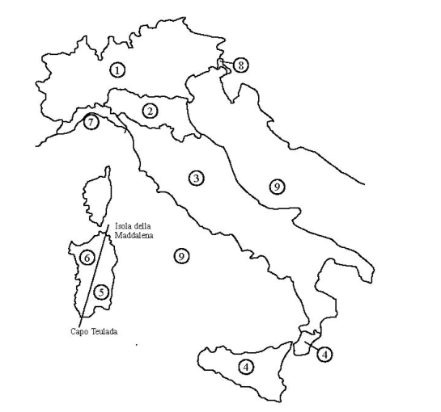

**Fig. 3.3.1** - *Mappa delle zone in cui è suddiviso il territorio italiano*

## 3.3.2. Velocità di riferimento

[[indice-cap03#§3.3 Azioni del vento|Torna al sommario]]

La velocità di riferimento $v_r$ è il valore medio su 10 minuti, a 10 m di altezza dal suolo su un terreno pianeggiante e omogeneo di categoria di esposizione II (vedi Tab. 3.3.II), riferito al periodo di ritorno di progetto $T_R$. Tale velocità è definita dalla relazione:

$$v_r = v_b \cdot c_r \tag{3.3.2}$$ [[3.3-note-redazionali#Nota 2|[2]]] ^formula-3-3-2

dove:

- $v_b$ è la velocità base di riferimento, di cui al §3.3.1;
- $c_r$ è il coefficiente di ritorno, funzione del periodo di ritorno di progetto $T_R$.

In mancanza di specifiche e adeguate indagini statistiche, il coefficiente di ritorno è fornito dalla relazione:

$$c_r = 0.75 \sqrt{1 - 0.2 \times \ln\left[-\ln\left(1 - \frac{1}{T_R}\right)\right]} \tag{3.3.3}$$

dove $T_R$ è il periodo di ritorno espresso in anni.

Ove non specificato diversamente, si assumerà $T_R$ = 50 anni, cui corrisponde $c_r$ = 1. Per un'opera di nuova realizzazione in fase di costruzione o per le fasi transitorie relative ad interventi sulle costruzioni esistenti, il periodo di ritorno dell'azione potrà essere ridotto come di seguito specificato:

- per fasi di costruzione o fasi transitorie con durata prevista in sede di progetto non superiore a tre mesi, si assumerà $T_R$ ≥ 5 anni;
- per fasi di costruzione o fasi transitorie con durata prevista in sede di progetto compresa fra tre mesi ed un anno, si assumerà $T_R$ ≥ 10 anni;

## 3.3.3. Azioni statiche equivalenti

[[indice-cap03#§3.3 Azioni del vento|Torna al sommario]]

Le azioni del vento sono costituite da pressioni e depressioni agenti normalmente alle superfici, sia esterne che interne, degli elementi che compongono la costruzione (§3.3.4).

L'azione del vento sui singoli elementi che compongono la costruzione va determinata considerando la combinazione più gravosa delle pressioni agenti sulle due facce di ogni elemento.

Nel caso di costruzioni di grande estensione, si deve inoltre tenere conto delle azioni tangenti esercitate dal vento (§3.3.4).

L'azione d'insieme esercitata dal vento su una costruzione è data dalla risultante delle azioni sui singoli elementi, considerando come direzione del vento quella corrispondente ad uno degli assi principali della pianta della costruzione; in casi particolari, come ad esempio per le torri a base quadrata o rettangolare, si deve considerare anche l'ipotesi di vento spirante secondo la direzione di una delle diagonali.

## 3.3.4. Pressione del vento

[[indice-cap03#§3.3 Azioni del vento|Torna al sommario]]

La pressione del vento è data dall'espressione:

$$p = q_r \cdot c_e \cdot c_p \cdot c_d \tag{3.3.4}$$

dove:

- $q_r$ è la pressione cinetica di riferimento di cui al §3.3.6;
- $c_e$ è il coefficiente di esposizione di cui al §3.3.7;
- $c_p$ è il coefficiente di pressione di cui al §3.3.8;
- $c_d$ è il coefficiente dinamico di cui al §3.3.9.

## 3.3.5. Azione tangente del vento

[[indice-cap03#§3.3 Azioni del vento|Torna al sommario]]

L'azione tangente per unità di superficie parallela alla direzione del vento è data dall'espressione:

$$p_f = q_r \cdot c_e \cdot c_f \tag{3.3.5}$$

dove:

- $q_r$ è la pressione cinetica di riferimento di cui al §3.3.6;
- $c_e$ è il coefficiente di esposizione di cui al §3.3.7;
- $c_f$ è il coefficiente d'attrito di cui al §3.3.8.

## 3.3.6. Pressione cinetica di riferimento

[[indice-cap03#§3.3 Azioni del vento|Torna al sommario]]

La pressione cinetica di riferimento $q_r$ è data dall'espressione:

$$q_r = \frac{1}{2} \rho v_r^2 \tag{3.3.6}$$

dove:

- $v_r$ è la velocità di riferimento del vento di cui al §3.3.2;
- $\rho$ è la densità dell'aria assunta convenzionalmente costante e pari a 1,25 kg/m³.

Esprimendo ρ in kg/m³ e $v_r$ in m/s, $q_r$ risulta espresso in N/m².

## 3.3.7. Coefficiente di esposizione

[[indice-cap03#§3.3 Azioni del vento|Torna al sommario]]

Il coefficiente di esposizione $c_e$ dipende dall'altezza z sul suolo del punto considerato, dalla topografia del terreno e dalla categoria di esposizione del sito ove sorge la costruzione. In assenza di analisi specifiche che tengano in conto la direzione di provenienza del vento e l'effettiva scabrezza e topografia del terreno che circonda la costruzione, per altezze sul suolo non maggiori di z = 200 m, esso è dato dalla formula:

$$c_e(z) = k_r^2 \cdot c_t \cdot \ln(z/z_0) \left[7 + c_t \cdot \ln(z/z_0)\right] \qquad \text{per } z \geq z_{min}$$

$$c_e(z) = c_e(z_{min}) \qquad \text{per } z < z_{min} \tag{3.3.7}$$

dove:

- $k_r$, $z_0$, $z_{min}$ sono assegnati in Tab. 3.3.II in funzione della categoria di esposizione del sito ove sorge la costruzione;
- $c_t$ è il coefficiente di topografia.

**Tab. 3.3.II** - *Parametri per la definizione del coefficiente di esposizione*

| Categoria di esposizione del sito | $k_r$ | $z_0$ [m] | $z_{min}$ [m] |
|:---------------------------------:|:-----:|:---------:|:------------:|
| I | 0,17 | 0,01 | 2 |
| II | 0,19 | 0,05 | 4 |
| III | 0,20 | 0,10 | 5 |
| IV | 0,22 | 0,30 | 8 |
| V | 0,23 | 0,70 | 12 |

*Nota di trascrizione AF-COR-3.3-01 — la fonte, p. fisica 58, stampa nell'intestazione della tabella «$K_r$» con la maiuscola; refuso tipografico per «$k_r$», attestata alla stessa p. fisica 58, nella definizione che segue la [3.3.7].*

La categoria di esposizione è assegnata nella Fig. 3.3.2 in funzione della posizione geografica del sito ove sorge la costruzione e della classe di rugosità del terreno definita in Tab. 3.3.III. Nelle fasce entro 40 km dalla costa, la categoria di esposizione è indipendente dall'altitudine del sito.

Il coefficiente di topografia $c_t$ è posto generalmente pari a 1, sia per le zone pianeggianti sia per quelle ondulate, collinose e montane. In questo caso, la Fig. 3.3.3 riporta le leggi di variazione di $c_e$ per le diverse categorie di esposizione.

Nel caso di costruzioni ubicate presso la sommità di colline o pendii isolati, il coefficiente di topografia $c_t$ può essere ricavato da dati suffragati da opportuna documentazione.

**Tab. 3.3.III** - *Classi di rugosità del terreno*

| Classe di rugosità del terreno | Descrizione |
|:------------------------------:|-------------|
| A | Aree urbane in cui almeno il 15% della superficie sia coperto da edifici la cui altezza media superi i 15 m |
| B | Aree urbane (non di classe A), suburbane, industriali e boschive |
| C | Aree con ostacoli diffusi (alberi, case, muri, recinzioni, ...); aree con rugosità non riconducibile alle classi A, B, D |
| D | a) Mare e relativa fascia costiera (entro 2 km dalla costa); b) Lago (con larghezza massima pari ad almeno 1 km) e relativa fascia costiera (entro 1 km dalla costa); c) Aree prive di ostacoli o con al più rari ostacoli isolati (aperta campagna, aeroporti, aree agricole, pascoli, zone paludose o sabbiose, superfici innevate o ghiacciate, ...) |

L'assegnazione della classe di rugosità non dipende dalla conformazione orografica e topografica del terreno. Si può assumere che il sito appartenga alla Classe A o B, purché la costruzione si trovi nell'area relativa per non meno di 1 km e comunque per non meno di 20 volte l'altezza della costruzione, per tutti i settori di provenienza del vento ampi almeno 30°. Si deve assumere che il sito appartenga alla Classe D, qualora la costruzione sorga nelle aree indicate con le lettere a) o b), oppure entro un raggio di 1 km da essa vi sia un settore ampio 30°, dove il 90% del terreno sia del tipo indicato con la lettera c). Laddove sussistano dubbi sulla scelta della classe di rugosità, si deve assegnare la classe più sfavorevole (l'azione del vento è in genere minima in Classe A e massima in Classe D).

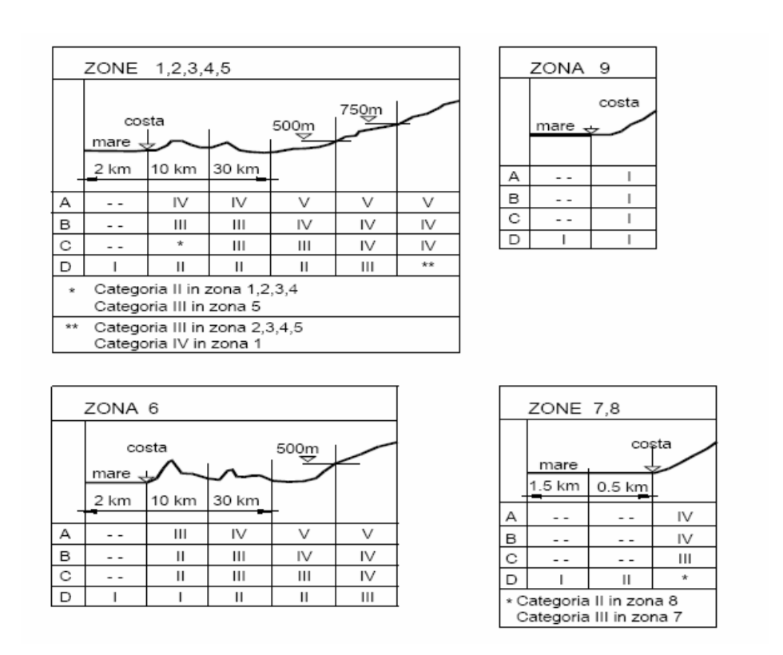

**Fig. 3.3.2** - *Definizione delle categorie di esposizione* [[3.3-note-redazionali#Nota 3|[3]]] ^fig-3-3-2

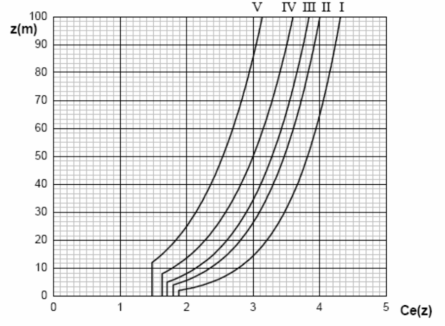

**Fig. 3.3.3** - *Andamento del coefficiente di esposizione $c_e$ in funzione dell'altezza sul suolo (per $c_t$ = 1)*

## 3.3.8. Coefficienti aerodinamici

[[indice-cap03#§3.3 Azioni del vento|Torna al sommario]]

Il coefficiente di pressione $c_p$ dipende dalla tipologia e dalla geometria della costruzione e dal suo orientamento rispetto alla direzione del vento.

Il coefficiente d'attrito $c_f$ dipende dalla scabrezza della superficie sulla quale il vento esercita l'azione tangente.

Entrambi questi coefficienti, definiti coefficienti aerodinamici, possono essere ricavati da dati suffragati da opportuna documentazione o da prove sperimentali in galleria del vento.

## 3.3.9. Coefficiente dinamico

[[indice-cap03#§3.3 Azioni del vento|Torna al sommario]]

Il coefficiente dinamico tiene conto degli effetti riduttivi associati alla non contemporaneità delle massime pressioni locali e degli effetti amplificativi dovuti alla risposta dinamica della struttura.

Esso può essere assunto cautelativamente pari ad 1 nelle costruzioni di tipologia ricorrente, quali gli edifici di forma regolare non eccedenti 80 m di altezza ed i capannoni industriali, oppure può essere determinato mediante analisi specifiche o facendo riferimento a dati di comprovata affidabilità.

## 3.3.10. Avvertenze progettuali

[[indice-cap03#§3.3 Azioni del vento|Torna al sommario]]

Le azioni del vento sui ponti lunghi, sugli edifici alti e più in generale sulle costruzioni di grandi dimensioni o di forma non simmetrica, possono dare luogo a forze trasversali alla direzione del vento e a momenti torcenti di notevoli intensità. Tali azioni possono essere ulteriormente amplificate dalla risposta dinamica della struttura.

Agli ultimi piani degli edifici alti, le azioni del vento possono causare oscillazioni (soprattutto accelerazioni di piano) le cui conseguenze variano, nei riguardi degli occupanti, dalla non percezione sino al fastidio e, in alcuni casi, all'intollerabilità fisiologica.

Per strutture o elementi strutturali snelli di forma cilindrica, quali ciminiere, torri di telecomunicazioni o singoli elementi di carpenteria si deve tenere conto degli effetti dinamici indotti al distacco alternato dei vortici dal corpo investito dal vento. Tali effetti possono essere particolarmente severi quando la frequenza di distacco dei vortici uguaglia una frequenza propria della struttura, dando luogo a un fenomeno di risonanza. In questa situazione le vibrazioni sono tanto maggiori quanto più la struttura è leggera e poco smorzata. L'occorrenza dei fenomeni di risonanza in corrispondenza di velocità del vento relativamente piccole e quindi frequenti richiede particolari attenzioni nei riguardi della fatica.

Per strutture particolarmente deformabili, leggere e poco smorzate, l'interazione del vento con la struttura può dare luogo ad azioni aeroelastiche, i cui effetti modificano le frequenze proprie e/o lo smorzamento della struttura sino a causare fenomeni di instabilità, fra i quali il galoppo, la divergenza torsionale e il flutter. Il galoppo è tipico di cavi ghiacciati o percorsi da rivoli d'acqua, di elementi di carpenteria e più in generale di elementi strutturali di forma non circolare. La divergenza torsionale è tipica in generale di lastre molto sottili. Il flutter è tipico di ponti sospesi o strallati o di profili alari.

Per strutture o elementi strutturali ravvicinati e di analoga forma, ad esempio edifici alti, serbatoi, torri di refrigerazione, ponti, ciminiere, cavi, elementi di carpenteria e tubi, possono manifestarsi fenomeni di interferenza tali da modificare gli effetti che il vento causerebbe se agisse sulle stesse strutture o elementi strutturali isolati. Tali effetti possono incrementare le azioni statiche, dinamiche e aeroelastiche del vento in modo estremamente severo.

In tutti i casi sopra citati si raccomanda di fare ricorso a dati suffragati da opportuna documentazione, o ricavati per mezzo di metodi analitici, numerici e/o sperimentali adeguatamente comprovati.

---

# Circolare

[[indice-cap03#§3.3 Azioni del vento|Torna al sommario]]

## C3.3. Azioni del vento

[[indice-cap03#§3.3 Azioni del vento|Torna al sommario]]

Sparisce nel passaggio dalle NTC 2008 alle NTC 2018 la numerazione del §3.3.1 Generalità, il testo resta praticamente immutato, ma quello che era il paragrafo successivo sulla velocità di riferimento assume ora il numero 3.3.1 contro il numero 3.3.2 delle NTC 2008.

### C3.3.1. Velocità base di riferimento

[[indice-cap03#§3.3 Azioni del vento|Torna al sommario]]

A parte la variazione di numerazione del paragrafo il suo contenuto è sostanzialmente immutato, la zonizzazione del territorio nazionale resta invariata rispetto alle precedenti NTC, così come la velocità base di riferimento del vento nelle varie zone, sia a livello del mare che all'aumentare della quota. La variazione della formula 3.3.1 è infatti solamente apparente e le due formulazioni conducono comunque agli stessi valori, per tutte le 9 zone e per qualunque quota sul livello del mare.

### C3.3.2. Velocità di riferimento

[[indice-cap03#§3.3 Azioni del vento|Torna al sommario]]

In questo paragrafo, vengono introdotte, in mancanza di indagini statistiche adeguate, le seguenti espressioni che forniscono la velocità di riferimento del vento $v_b(T_R)$ riferita ad un generico periodo di ritorno:

$$v_b(T_R) = \alpha_R \cdot v_b \tag{C3.3.1}$$

dove:

- $v_b$ è la velocità di riferimento del vento associata a un periodo di ritorno di 50 anni, $\alpha_R$ è un coefficiente fornito dalla Figura C3.3.1, alla quale corrisponde l'espressione:

$$\alpha_R = 0.75 \sqrt{1 - 0.2 \cdot \ln\left[-\ln\left(1 - \frac{1}{T_R}\right)\right]} \tag*{[C3.3.2].}$$

dove $T_R$ è espresso in anni.

La formula C3.3.2 è generalmente utilizzata per la valutazione della velocità del vento, riferita a tempi di ritorno inferiori a 50 anni per le condizioni transitorie delle costruzioni. Limitatamente alle analisi inerenti il comportamento delle costruzioni nei riguardi dei fenomeni di instabilità aeroelastica, per i quali le verifiche si conducono in termini di velocità media di riferimento e di velocità critica per il fenomeno in esame, si dovranno adottare valori di $T_R$ significativamente maggiori di 50 anni, secondo i criteri specificati in C3.3.11 per il distacco dei vortici e in documenti di comprovata validità per le altre possibili tipologie dei fenomeni instabili.

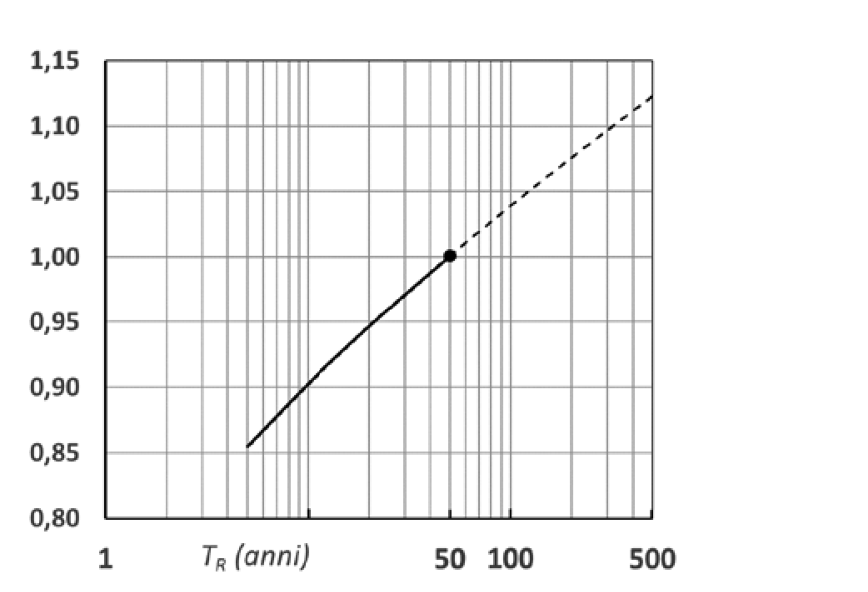

***Figura C3.3.1** — Valori del coefficiente $\alpha_R$ in funzione del periodo di ritorno $T_R$, (asse in scala logaritmica)*

### C3.3.3. Azioni statiche equivalenti

[[indice-cap03#§3.3 Azioni del vento|Torna al sommario]]

Il paragrafo chiarisce che nel valutare i carichi agenti su ciascun elemento della costruzione si deve tenere conto delle pressioni agenti sulle due facce sopravento e sottovento.

### C3.3.4. Pressione del vento

[[indice-cap03#§3.3 Azioni del vento|Torna al sommario]]

Le espressioni 3.3.2 delle NTC 2008 e [3.3.4] delle NTC 2018, sono sostanzialmente equivalenti; il coefficiente $c_P$ viene definito coefficiente di pressione invece che coefficiente di forma (come nelle NTC 2008) ma il suo ruolo e valore, come indicato al §3.3.8, restano immutati.

### C3.3.5. Azione tangente del vento

[[indice-cap03#§3.3 Azioni del vento|Torna al sommario]]

Le espressioni 3.3.3 delle NTC 2008 e [3.3.5] delle NTC 2018, sono sostanzialmente equivalenti.

### C3.3.6. Pressione cinetica di riferimento

[[indice-cap03#§3.3 Azioni del vento|Torna al sommario]]

Le espressioni 3.3.4 delle NTC 2008 e [3.3.6] delle NTC 2018, sono sostanzialmente equivalenti.

### C3.3.7. Coefficiente di esposizione

[[indice-cap03#§3.3 Azioni del vento|Torna al sommario]]

Il paragrafo mostra la dipendenza del coefficiente di esposizione dall'altezza sul suolo del punto considerato, dalla topografia del terreno e dalla categoria di esposizione del sito ove sorge la costruzione. Non presenta significative differenze rispetto alle precedenti NTC.

### C3.3.8. Coefficienti aerodinamici

[[indice-cap03#§3.3 Azioni del vento|Torna al sommario]]

In assenza di valutazioni più precise, suffragate da opportuna documentazione o prove sperimentali in galleria del vento, per i coefficienti di pressione si assumono i valori riportati ai punti seguenti, con l'avvertenza che si intendono positive le pressioni dirette verso l'interno delle costruzioni.

Nel seguito, in riferimento alle costruzioni di forma regolare indicate ai paragrafi da C3.3.8.1 a C3.3.8.4, si forniscono tre distinte serie di coefficienti di pressione esterna:

- coefficienti globali $c_{pe}$, che possono essere utilizzati in tutti i casi in cui la rappresentazione delle azioni aerodinamiche del vento possa essere effettuata in maniera semplificata, rivolta alla valutazione delle azioni globali su porzioni estese di costruzioni o delle risultanti delle azioni indotte dal vento sugli elementi principali della struttura;
- coefficienti locali $c_{pe,10}$ consentono una rappresentazione più realistica dell'effettivo campo di pressione che si instaura sulle superfici delle costruzioni e che possono essere impiegati sia in alternativa ai coefficienti di pressione globali $c_{pe}$, sia per quantificare la pressione locale sugli elementi con area di incidenza maggiore o uguale a 10 m²;
- coefficienti locali $c_{pe,1}$ che consentono la quantificazione della pressione locale su elementi di piccole dimensioni con un'area di incidenza minore o uguale a 1 m² (quali elementi di rivestimento ed i loro fissaggi).

Per i coefficienti di pressione locali relativi ad un'area di incidenza compresa fra 1 e 10 m², il valore è pari a:

$$c_{peA} = c_{pe,1} - (c_{pe,1} - c_{pe,10}) \cdot \log_{10}(A) \tag{C3.3.3}$$

dove:

- A è l'area di incidenza della pressione del vento.

I coefficienti di pressione interna, da considerare se del caso, congiuntamente ai coefficienti di pressione esterna, sono riportati al paragrafo C3.3.8.5.

Per costruzioni di forma non regolare e per i ponti, si dovrà fare riferimento ad indicazioni aggiuntive tratte da documenti di comprovata validità.

#### C3.3.8.1. Edifici a pianta rettangolare con coperture piane, a falde, inclinate e curvilinee

[[indice-cap03#§3.3 Azioni del vento|Torna al sommario]]

Per la valutazione della pressione esterna si assumeranno, nei casi più comuni, gli schemi di seguito riportati; per le forme non contemplate nel presente documento e per ulteriori approfondimenti sui criteri di analisi costituisce utile riferimento l'Eurocodice EN-1991-1-4 e le Istruzioni CNR DT207. Per le forme non contemplate nei documenti citati si potrà ricorrere a dati di letteratura o a prove specifiche in galleria del vento o, infine, a simulazioni di fluidodinamica computazionale utilizzando strumenti di comprovata validità scientifica.

##### C3.3.8.1.1. Pareti verticali

I coefficienti globali $c_{pe}$ da assumere sulle pareti di un edificio a pianta rettangolare sono riportati in Figura C3.3.2 e in Tabella C3.3.I.

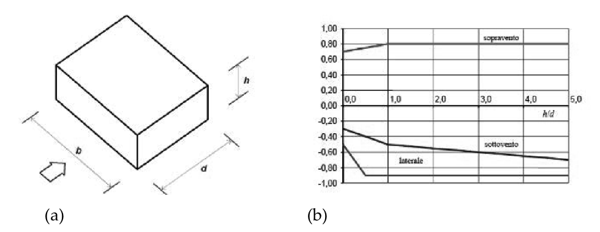

***Figura C3.3.2** — a) Parametri caratteristici di edifici a pianta rettangolare, b) Edifici a pianta rettangolare: $c_{pe}$ per facce sopravento, sottovento e laterali*

**Tabella C3.3.I** — *Edifici a pianta rettangolare: $c_{pe}$ per facce sopravento, sottovento e laterali* [[3.3-note-redazionali#Nota 4|[4]]] ^tab-c3-3-i

| Faccia sopravento | $C_{U}=2{,}0$ | $C_{U}=1{,}5$ |
|---|---|---|
| h/d ≤ 1: $c_{pe}$ = 0,7 + 0,1·h/d | h/d ≤ 0,5: $c_{pe}$ = −0,5 − −0,8·h/d | h/d ≤ 1: $c_{pe}$ = −0,3 − 0,2·h/d |
| h/d > 1: $c_{pe}$ = 0,8 | h/d > 0,5: $c_{pe}$ = −0,9 | 1 < h/d ≤ 5: $c_{pe}$ = −0,5 − 0,05·(h/d−1) |

I coefficienti locali $c_{pe,10}$ e di dettaglio $c_{pe,1}$ da assumere sulle pareti di un edificio a pianta rettangolare sono riportati in Figura C3.3.3 e in Tabella C3.3.II, il valore della dimensione *e* è pari al minimo tra *b* e 2*h*.

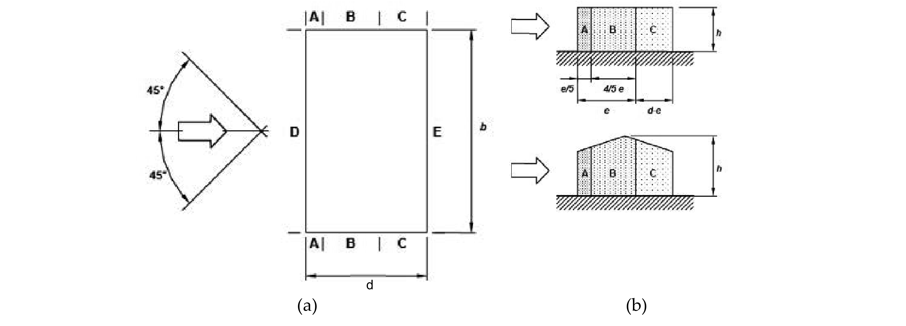

***Figura C3.3.3** — a) Schema planimetrico di riferimento, b) Suddivisione delle pareti verticali di edificio a pianta rettangolare in zone di uguale pressione (prospetti laterali)*

**Tabella C3.3.II** — *Edifici a pianta rettangolare: $c_{pe}$ per facce sopravento, sottovento e laterali* [[3.3-note-redazionali#Nota 5|[5]]] ^tab-c3-3-ii

| Zona | A | | B | | C | | D | | E | |
|:---:|:---:|:---:|:---:|:---:|:---:|:---:|:---:|:---:|:---:|:---:|
| h/d | $c_{pe,10}$ | $c_{pe,1}$ | $c_{pe,10}$ | $c_{pe,1}$ | $c_{pe,10}$ | $c_{pe,1}$ | $c_{pe,10}$ | $c_{pe,1}$ | $c_{pe,10}$ | $c_{pe,1}$ |
| 5 | −1,2 | −1,4 | −0,8 | −1,1 | −0,5 | −0,5 | +0,8 | +1,0 | −0,7 | −0,7 |
| 1 | −1,2 | −1,4 | −0,8 | −1,1 | −0,5 | −0,5 | +0,8 | +1,0 | −0,5 | −0,5 |
| ≤ 0,25 | −1,2 | −1,4 | −0,8 | −1,1 | −0,5 | −0,5 | +0,7 | +1,0 | −0,3 | −0,3 |

###### C3.3.8.1.1.1. Altezza di riferimento per la faccia sopravento

La distribuzione altimetrica della pressione sulle pareti della costruzione è, in generale, diversa dal profilo della pressione cinetica di picco del vento indisturbato, come si ricava attraverso il coefficiente di esposizione (§3.3.7 delle NTC). In conseguenza di ciò, è opportuno calcolare la pressione cinetica di picco in corrispondenza di un punto posto ad una quota detta di riferimento ($\bar{z}_e$), tale da consentire la stima, generalmente a favore di sicurezza, della risultante delle pressioni agenti sulle pareti verticali dell'edificio.

Per gli edifici bassi, ossia con altezza minore o uguale della dimensione in pianta ortogonale al flusso del vento (h ≤ b), l'altezza di riferimento è costante e pari alla quota di sommità dell'edificio ($\bar{z}_e = h$); la pressione del vento è pertanto uniforme.

Per gli edifici alti, ossia con altezza compresa fra la dimensione in pianta ortogonale al flusso del vento e 5 volte la profondità dell'edificio (b < h ≤ 5·d), si definiscono due zone distinte. Nella prima parte dell'edificio, sino alla quota z = b, l'altezza di riferimento è costante e pari a $\bar{z}_e = b$; la pressione del vento è pertanto uniforme. Nella parte superiore dell'edificio, per z compreso fra b e h, la quota di riferimento $\bar{z}_e$ può essere scelta seguendo uno dei due seguenti criteri (figura C3.3.4):

1. L'altezza di riferimento è costante e pari alla sommità dell'edificio ($\bar{z}_e = h$); la pressione del vento è pertanto uniforme fra le quote z=b e z=h. In questo modo il calcolo delle forze aerodinamiche è semplificato, ma la forza totale che ne risulta è generalmente maggiore di quella reale.
2. L'edificio è suddiviso in tronchi di altezza arbitraria, a ciascuno dei quali corrisponde un'altezza di riferimento costante pari alla sommità del tronco; se l'altezza di ciascun tronco coincide con l'interpiano dell'edificio, ed ogni singolo tronco risulta centrato sulla posizione degli elementi orizzontali (solai), è lecito ammettere che l'altezza di riferimento sia pari alla quota del solaio relativo; in entrambi i casi la pressione del vento è uniforme su ogni tronco. In questo modo il calcolo delle forze è più oneroso, ma i valori che si ottengono sono più aderenti alla realtà e non maggiori di quelli che si ottengono applicando la procedura di cui al punto precedente.

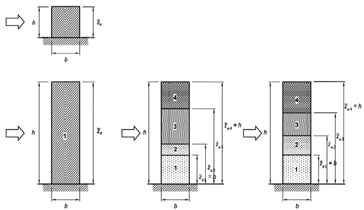

***Figure C3.3.4** — Quote di riferimento negli edifici bassi ed alti*

Particolare attenzione va posta nel caso di edifici particolarmente snelli, il cui rapporto h/d sia maggiore di 5, per i quali potrà farsi utile riferimento a studi specifici di settore.

###### C3.3.8.1.1.2. Altezza di riferimento per le facce sottovento e laterali

La pressione sulle facce sottovento e sulle facce laterali degli edifici può essere considerata, con buona approssimazione, costante con la quota. Di ciò si tiene conto assumendo che l'altezza di riferimento sia costante e pari alla quota di sommità dell'edificio ($\bar{z}_e = h$).

##### C3.3.8.1.2. Coperture piane

Si considerano piane le coperture la cui inclinazione sull'orizzontale sia compresa tra −5° e +5°. L'altezza di riferimento $\bar{z}_e$ per le coperture piane è pari alla quota massima della copertura stessa, inclusa la presenza dei parapetti e di altri analoghi elementi. I coefficienti globali $c_{pe}$ da assumere sulle coperture di un edificio a pianta rettangolare sono riportati in Figura C3.3.5 e in Tabella C3.3.III.

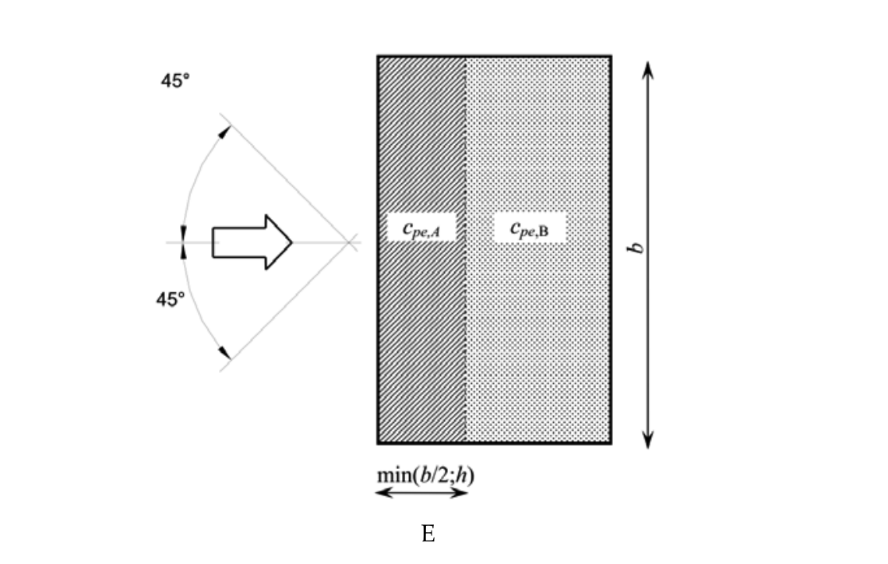

***Figura C3.3.5** — Schema di riferimento per coperture piane*

**Tabella C3.3.III** — *Edifici rettangolari: $c_{pe}$ per coperture piane*

| Fascia sopravento di profondità pari al minimo tra *b*/2 e *h*: | $c_{pe,A}$ = −0,80 |
| --------------------------------------------------------------- | ------------------ |
| Restanti zone                                                   | $c_{pe,B}$ = ±0,20 |

Nella zona sottovento la pressione può assumere sia valori negativi sia valori positivi, per cui si devono considerare entrambi i casi.

I coefficienti locali $c_{pe,10}$ e di dettaglio $c_{pe,1}$ da assumere sulle coperture di un edificio a pianta rettangolare sono riportati in Figura C3.3.6 e in Tabella C3.3.IV. In riferimento alla Figura C3.3.6 e Tabella C3.3.IV, il valore della dimensione *e* è pari al minimo fra *b* e 2*h*.

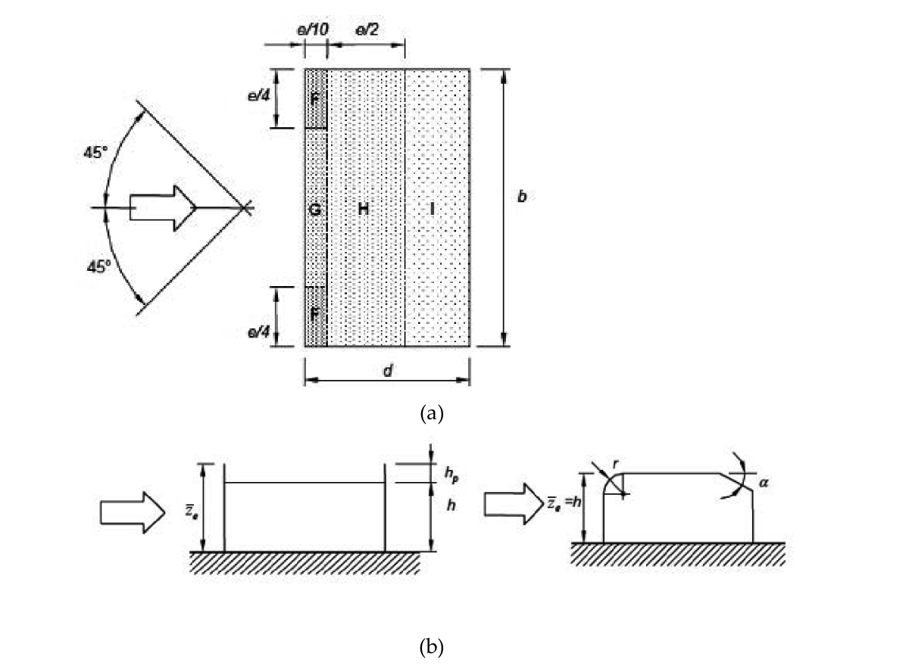

***Figura C3.3.6** — a) Suddivisione delle coperture piane in zone di uguale pressione, b) Altezza di riferimento per coperture piane con parapetti o raccordi (curvi e piani)*

**Tabella C3.3.IV** — *Coefficienti di pressione per coperture piane* [[3.3-note-redazionali#Nota 6|[6]]] ^tab-c3-3-iv

| | | Zona | | | | | | | |
|---|---|:---:|:---:|:---:|:---:|:---:|:---:|:---:|:---:|
| | | F | | G | | H | | I | |
| | | $c_{pe,10}$ | $c_{pe,1}$ | $c_{pe,10}$ | $c_{pe,1}$ | $c_{pe,10}$ | $c_{pe,1}$ | $c_{pe,10}$ | $c_{pe,1}$ |
| Spigoli vivi | Spigoli vivi | −1,8 | −2,5 | −1,2 | −2,0 | −0,7 | −1,2 | ±0,2 | ±0,2 |
| Con parapetti | $h_p/h = 0{,}025$ | −1,6 | −2,2 | −1,1 | −1,8 | −0,7 | −1,2 | ± 0.2 | ± 0.2 |
| Con parapetti | $h_p/h = 0{,}05$ | −1,4 | −2,0 | −0,9 | −1,6 | −0,7 | −1,2 | ± 0.2 | ± 0.2 |
| Con parapetti | $h_p/h = 0{,}10$ | −1,2 | −1,8 | −0,8 | −1,4 | −0,7 | −1,2 | ± 0.2 | ± 0.2 |
| Raccordi curvi | $r/h = 0{,}05$ | −1,0 | −1,5 | −1,2 | −1,8 | −0,4 | −0,4 | ±0,2 | ±0,2 |
| Raccordi curvi | $r/h = 0{,}10$ | −0,7 | −1,2 | −0,8 | −1,4 | −0,3 | −0,3 | ±0,2 | ±0,2 |
| Raccordi curvi | $r/h = 0{,}20$ | −0,5 | −0,8 | −0,5 | −0,8 | −0,3 | −0,3 | ±0,2 | ±0,2 |
| Raccordi piani | $\alpha$ = 30° | −1,0 | −1,5 | −1,0 | −1,5 | −0,3 | −0,3 | ±0,2 | ±0,2 |
| Raccordi piani | $\alpha$ = 45° | −1,2 | −1,8 | −1,3 | −1,9 | −0,4 | −0,4 | ±0,2 | ±0,2 |
| Raccordi piani | $\alpha$ = 60° | −1,3 | −1,9 | −1,3 | −1,9 | −0,5 | −0,5 | ±0,2 | ±0,2 |

##### C3.3.8.1.3. Coperture a falda singola

L'altezza di riferimento $\bar{z}_e$ per le coperture inclinate a semplice falda è pari alla quota massima della copertura stessa. Per le inclinazioni −5° ≤ α ≤ +5° occorre fare riferimento al caso di copertura piana (§C3.3.8.1.2). I coefficienti globali da assumere sulle coperture a singola falda di un edificio a pianta rettangolare, nel caso di vento ortogonale alla direzione del colmo sono riportati in Figura C3.3.8 e in Tabella C3.3.V. Nella zona 5° ≤ α ≤ 45° la pressione può variare rapidamente da valori negativi a valori positivi, per cui vengono forniti valori dei coefficienti di pressione con entrambi i segni; in generale, si considerano ambedue le condizioni di carico, valutando quale può condurre a situazioni più gravose per la struttura o l'elemento strutturale considerato.

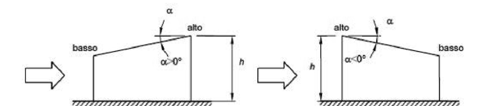

***Figura C3.3.7** — Schema di riferimento per coperture a semplice falda*

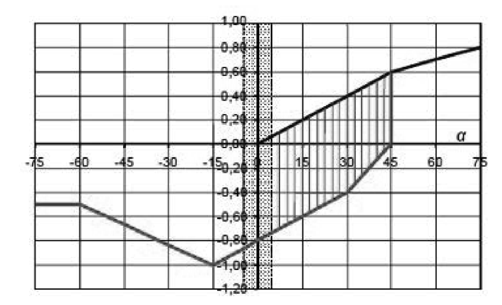

***Figura C3.3.8** — Coperture a semplice falda: valori del coefficiente $c_{pe}$: vento perpendicolare alla direzione del colmo*

**Tabella C3.3.V** — *Coefficienti di pressione per coperture a semplice falda (α in °): vento perpendicolare alla direzione del colmo*

| Valori negativi | | Valori positivi | |
|---|---|---|---|
| α ≤ −60° | $c_{pe}$ = −0,5 | | |
| −60° ≤ α ≤ −15° | $c_{pe}$ = −0,5 − (α+60)/90 | 0° ≤ α ≤ 45° | $c_{pe}$ = +α/75 |
| −15° ≤ α ≤ 30° | $c_{pe}$ = −1,0 + (α+15)/75 | 45° ≤ α ≤ 75° | $c_{pe}$ = +0,6 + (α−45)/150 |
| 30° ≤ α ≤ 45° | $c_{pe}$ = −0,4 + (α−30)/37,5 | | |

I coefficienti globali da assumere sulle coperture a singola falda di un edificio a pianta rettangolare, nel caso di vento parallelo alla direzione del colmo sono riportati in Figura C3.3.9 e in Tabella C3.3.VI.

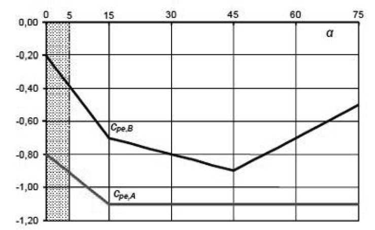

***Figura C3.3.9** — Coefficienti di pressione per coperture a semplice falda: vento parallelo alla direzione del colmo*

**Tabella C3.3.VI** — *Coefficienti di pressione per coperture a semplice falda (α in °): vento parallelo alla direzione del colmo*

| Fascia sopravento di profondità pari al minimo tra *b*/2 ed *h* | 0° ≤ α ≤ 15° | $c_{pe,A}$ = −0,8 − α/50 |
|---|---|---|
| Fascia sopravento di profondità pari al minimo tra *b*/2 ed *h* | 15° < α | $c_{pe,A}$ = −1,10 |
| Restanti zone | 0° ≤ α ≤ 15° | $c_{pe,B}$ = −0,2 − α/30 |
| Restanti zone | 15° ≤ α ≤ 45° | $c_{pe,B}$ = −0,7 − (α−15)/150 |
| Restanti zone | 45° ≤ α | $c_{pe,B}$ = −0,9 + (α−45)/75 |

I coefficienti locali e di dettaglio da assumere sulle coperture a singola falda di un edificio a pianta rettangolare sono riportati in Figura C3.3.10 e in Tabella C3.3.VII e C3.3.VIII, il valore di *e* è pari al minimo fra *b* e 2*h*.

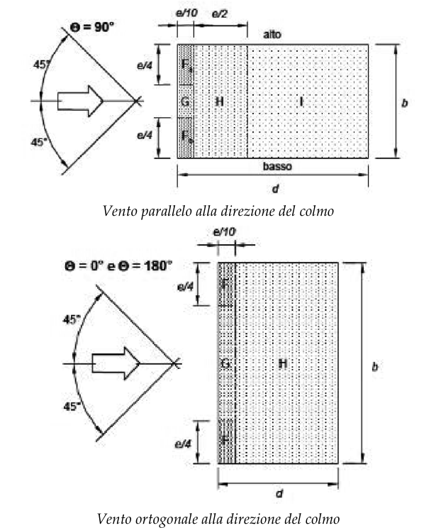

***Figura C3.3.10** — Suddivisione delle coperture a semplice falda in zone di uguale pressione*

**Tabella C3.3.VII** — *Coefficienti di pressione per coperture a semplice falda (α in °): vento ortogonale alla direzione del colmo* [[3.3-note-redazionali#Nota 7|[7]]] ^tab-c3-3-vii

**Direzione del vento Θ = 0°**

| α | F $c_{pe,10}$ | F $c_{pe,1}$ | G $c_{pe,10}$ | G $c_{pe,1}$ | H $c_{pe,10}$ | H $c_{pe,1}$ |
|:---:|:---:|:---:|:---:|:---:|:---:|:---:|
| 5° | −1,7 | −2,5 | −1,2 | −2,0 | −0,6 | −1,2 |
| 5° | 0 | 0 | 0 | 0 | 0 | 0 |
| 15° | −0,9 | −2,0 | −0,8 | −1,5 | −0,3 | −0,3 |
| 15° | +0,2 | +0,2 | +0,2 | +0,2 | +0,2 | +0,2 |
| 30° | −0,5 | −1,5 | −0,5 | −1,5 | −0,2 | −0,2 |
| 30° | +0,7 | +0,7 | +0,7 | +0,7 | +0,4 | +0,4 |
| 45° | 0 | 0 | 0 | 0 | 0 | 0 |
| 45° | +0,7 | +0,7 | +0,7 | +0,7 | +0,6 | +0,6 |
| 60° | +0,7 | +0,7 | +0,7 | +0,7 | +0,7 | +0,7 |
| 75° | +0,8 | +0,8 | +0,8 | +0,8 | +0,8 | +0,8 |

**Direzione del vento Θ = 180°**

| α | F $c_{pe,10}$ | F $c_{pe,1}$ | G $c_{pe,10}$ | G $c_{pe,1}$ | H $c_{pe,10}$ | H $c_{pe,1}$ |
|:---:|:---:|:---:|:---:|:---:|:---:|:---:|
| 5° | −2,3 | −2,5 | −1,3 | −2,0 | −0,8 | −1,2 |
| 15° | −2,5 | −2,8 | −1,3 | −2,0 | −0,9 | −1,2 |
| 30° | −1,1 | −2,3 | −0,8 | −1,5 | −0,8 | −0,8 |
| 45° | −0,6 | −1,3 | −0,5 | −0,5 | −0,7 | −0,7 |
| 60° | −0,5 | −1,0 | −0,5 | −0,5 | −0,5 | −0,5 |
| 75° | −0,5 | −1,0 | −0,5 | −0,5 | −0,5 | −0,5 |

**Tabella C3.3.VIII** — *Coefficienti di pressione per coperture a semplice falda (α in °): vento parallelo alla direzione del colmo*

| | Direzione del vento Θ = 90° | | | | | | | | | |
|:---:|:---:|:---:|:---:|:---:|:---:|:---:|:---:|:---:|:---:|:---:|
| α | $F_a$ | | $F_b$ | | G | | H | | I | |
| | $c_{pe,10}$ | $c_{pe,1}$ | $c_{pe,10}$ | $c_{pe,1}$ | $c_{pe,10}$ | $c_{pe,1}$ | $c_{pe,10}$ | $c_{pe,1}$ | $c_{pe,10}$ | $c_{pe,1}$ |
| 5° | −2,1 | −2,6 | −2,1 | −2,4 | −1,8 | −2,0 | −0,6 | −1,2 | −0,5 | −0,5 |
| 15° | −2,4 | −2,9 | −1,6 | −2,4 | −1,9 | −2,5 | −0,8 | −1,2 | −0,7 | −1,2 |
| 30° | −2,1 | −2,9 | −1,3 | −2,0 | −1,5 | −2,0 | −1,0 | −1,3 | −0,8 | −1,2 |
| 45° | −1,5 | −2,4 | −1,3 | −2,0 | −1,4 | −2,0 | −1,0 | −1,3 | −0,9 | −1,2 |
| 60° | −1,2 | −2,0 | −1,2 | −2,0 | −1,2 | −2,0 | −1,0 | −1,3 | −0,7 | −1,2 |
| 75° | −1,2 | −2,0 | −1,2 | −2,0 | −1,2 | −2,0 | −1,0 | −1,3 | −0,5 | −0,5 |

##### C3.3.8.1.4. Coperture a falda doppia

L'altezza di riferimento $\bar{z}_e$ per le coperture inclinate a doppia falda (Figura C3.3.11) è pari alla quota massima della copertura stessa. Per le inclinazioni −5° ≤ α ≤ +5° occorre fare riferimento al caso di copertura piana.

I coefficienti globali da assumere sulla falda sopravento di coperture a falda doppia di un edificio a pianta rettangolare, nel caso di vento perpendicolare alla direzione del colmo, sono quelli per le coperture a falda singola. Nella zona 0° ≤ α ≤ 45° vale quanto previsto per le coperture a falda singola circa la variazione di segno della pressione.

Per la falda sottovento, si fa riferimento ai valori riportati in Tabella C3.3.IX e Figura C3.3.12.

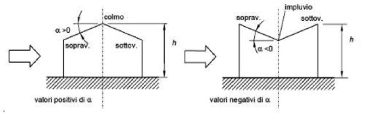

***Figura C3.3.11** — Schema di riferimento per coperture a falda doppia*

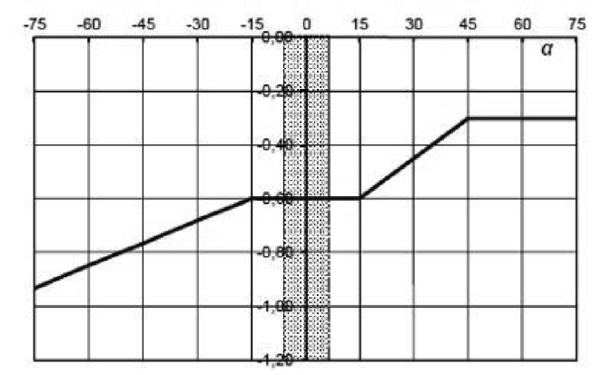

***Figura C3.3.12** — Coefficienti di pressione per coperture a doppia falda: falda sottovento con vento in direzione perpendicolare al colmo*

**Tabella C3.3.IX** — *Coefficienti di pressione per coperture a doppia falda (α in °): vento in direzione parallela al colmo*

| −75° ≤ α ≤ −15° | $c_{pe}$ = −0,85 + (α+60)/180 |
|---|---|
| −15° ≤ α ≤ 15° | $c_{pe}$ = −0,6 |
| 15° ≤ α ≤ 45° | $c_{pe}$ = −0,6 + (α−15)/100 |
| 45° ≤ α | $c_{pe}$ = −0,3 |

Nel caso di vento parallelo alla direzione del colmo, i coefficienti di pressione sono riportati nella Tabella C3.3.X e Figura C3.3.13.

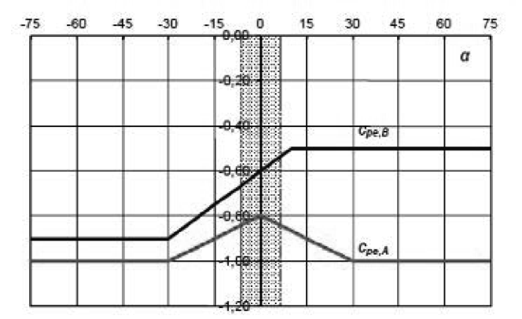

***Figura C3.3.13** — Coefficienti di pressione per coperture a doppia falda: vento in direzione parallela al colmo*

**Tabella C3.3.X** — *Coefficienti di pressione per coperture a doppia falda (α in °): vento in direzione parallela al colmo*

| Fascia sopravento di profondità pari al minimo tra *b*/2 ed *h* | α ≤ −30° | $c_{pe,A}$ = −1,0 |
|---|---|---|
| Fascia sopravento di profondità pari al minimo tra *b*/2 ed *h* | −30° ≤ α ≤ 0° | $c_{pe,A}$ = −0,8 + α/150 |
| Fascia sopravento di profondità pari al minimo tra *b*/2 ed *h* | 0° ≤ α ≤ 30° | $c_{pe,A}$ = −0,8 − α/150 |
| Fascia sopravento di profondità pari al minimo tra *b*/2 ed *h* | 30° ≤ α | $c_{pe,A}$ = −1,0 |
| Restanti zone: | −45° ≤ α ≤ −30° | $c_{pe,B}$ = −0,9 |
| Restanti zone: | −30° ≤ α ≤ 10° | $c_{pe,B}$ = −0,9 + (α+30)/100 |
| Restanti zone: | 10° ≤ α | $c_{pe,B}$ = −0,5 |

I coefficienti locali $c_{pe,10}$ e di dettaglio $c_{pe,1}$ da assumere sulle coperture a doppia falda di un edificio a pianta rettangolare sono riportati in Figura C3.3.14 e in Tabella C3.3.XI e XII, il valore di *e* è pari al minimo fra *b* e 2*h*.

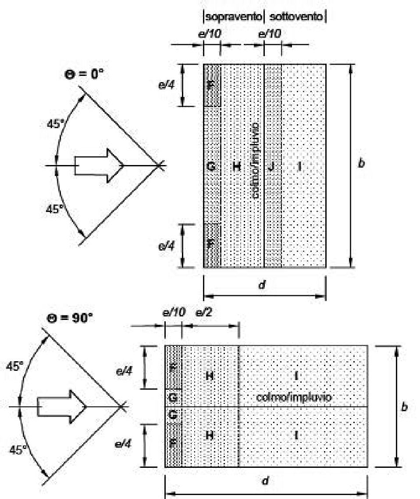

***Figura C3.3.14** — Suddivisione delle coperture a falda doppia in zone di uguale pressione*

**Tabella C3.3.XI** — *Coefficienti di pressione per coperture a doppia falda: vento in direzione ortogonale al colmo* [[3.3-note-redazionali#Nota 8|[8]]] ^tab-c3-3-xi

| | Direzione del vento Θ – 0° | | | | | | | | | |
|:---:|:---:|:---:|:---:|:---:|:---:|:---:|:---:|:---:|:---:|:---:|
| α | F | | G | | H | | I | | J | |
| | $c_{pe,10}$ | $c_{pe,1}$ | $c_{pe,10}$ | $c_{pe,1}$ | $c_{pe,10}$ | $c_{pe,1}$ | $c_{pe,10}$ | $c_{pe,1}$ | $c_{pe,10}$ | $c_{pe,1}$ |
| −45° | −0,6 | −0,6 | −0,6 | −0,6 | −0,8 | −0,8 | −0,7 | −0,7 | −1,0 | −1,5 |
| −30° | −1,1 | −2,0 | −0,8 | −1,5 | −0,8 | −0,8 | −0,6 | −0,6 | −0,8 | −1,4 |
| −15° | −2,5 | −2,8 | −1,3 | −2,0 | −0,9 | −1,2 | −0,5 | −0,5 | −0,7 | −1,2 |
| −5° | −2,3 | −2,5 | −1,2 | −2,0 | −0,8 | −1,2 | −0,6 | −0,6 | −0,6 | −0,6 |
| −5° | −2,3 | −2,5 | −1,2 | −2,0 | −0,8 | −1,2 | +0,2 | +0,2 | +0,2 | +0,2 |
| 5° | −1,7 | −2,5 | −1,2 | −2,0 | −0,6 | −1,2 | −0,6 | −0,6 | −0,6 | −0,6 |
| 5° | 0 | 0 | 0 | 0 | 0 | 0 | −0,6 | −0,6 | +0,2 | +0,2 |
| 15° | −0,9 | −2,0 | −0,8 | −1,5 | −0,3 | −0,3 | −0,4 | −0,4 | −1,0 | −1,5 |
| 15° | +0,2 | +0,2 | +0,2 | +0,2 | +0,2 | +0,2 | 0 | 0 | 0 | 0 |
| 30° | −0,5 | −1,5 | −0,5 | −1,5 | −0,2 | −0,2 | −0,4 | −0,4 | −0,5 | −0,5 |
| 30° | +0,7 | +0,7 | +0,7 | +0,7 | +0,4 | +0,4 | 0 | 0 | 0 | 0 |
| 45° | 0 | 0 | 0 | 0 | 0 | 0 | −0,2 | −0,2 | −0,3 | −0,3 |
| 45° | +0,7 | +0,7 | +0,7 | +0,7 | +0,6 | +0,6 | 0 | 0 | 0 | 0 |
| 60° | +0,7 | +0,7 | +0,7 | +0,7 | +0,7 | +0,7 | −0,2 | −0,2 | −0,3 | −0,3 |
| 75° | +0,8 | +0,8 | +0,8 | +0,8 | +0,8 | +0,8 | −0,2 | −0,2 | −0,3 | −0,3 |

**Tabella C3.3.XII** — *Suddivisione delle coperture a doppia falda in zone di uguale pressione: vento in direzione parallela al colmo*

| | Direzione del vento Θ = 90° | | | | | | | |
|:---:|:---:|:---:|:---:|:---:|:---:|:---:|:---:|:---:|
| α | F | | G | | H | | I | |
| | $c_{pe,10}$ | $c_{pe,1}$ | $c_{pe,10}$ | $c_{pe,1}$ | $c_{pe,10}$ | $c_{pe,1}$ | $c_{pe,10}$ | $c_{pe,1}$ |
| −45° | −1,4 | −2,0 | −1,2 | −2,0 | −1,0 | −1,3 | −0,9 | −1,2 |
| −30° | −1,5 | −2,1 | −1,2 | −2,0 | −1,0 | −1,3 | −0,9 | −1,2 |
| −15° | −1,9 | −2,5 | −1,2 | −2,0 | −0,8 | −1,2 | −0,8 | −1,2 |
| −5° | −1,8 | −2,5 | −1,2 | −2,0 | −0,7 | −1,2 | −0,6 | −1,2 |
| 5° | −1,6 | −2,2 | −1,3 | −2,0 | −0,7 | −1,2 | −0,6 |  −0,6 |
| 15° | −1,3 | −2,0 | −1,3 | −2,0 | −0,6 | −1,2 | −0,5 |  −0,5 |
| 30° | −1,1 | −1,5 | −1,4 | −2,0 | −0,8 | −1,2 | −0,5 |  −0,5 |
| 45° | −1,1 | −1,5 | −1,4 | −2,0 | −0,9 | −1,2 | −0,5 |  −0,5 |
| 60° | −1,1 | −1,5 | −1,2 | −2,0 | −0,8 | −1,0 | −0,5 |  −0,5 |
| 75° | −1,1 | −1,5 | −1,2 | −2,0 | −0,8 | −1,0 | −0,5 |  −0,5 |

##### C3.3.8.1.5. Coperture a padiglione

L'altezza di riferimento $\bar{z}_e$ per le coperture a padiglione (figura C3.3.15) è pari all'altezza massima della copertura stessa.

Per i coefficienti globali sulle coperture a padiglione di un edificio a pianta rettangolare, per le falde sopravento e sottovento, si assumono gli stessi coefficienti previsti per le coperture a falda doppia.

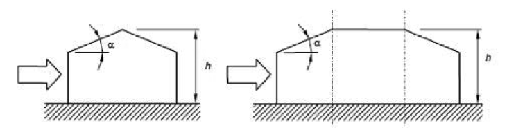

***Figura C3.3.15** — Schema delle coperture a padiglione*

Per le falde laterali, relative alle pareti parallele alla direzione del vento, si considerano i coefficienti riportati i Figura C3.3.16 e Tabella C3.3.XIII.

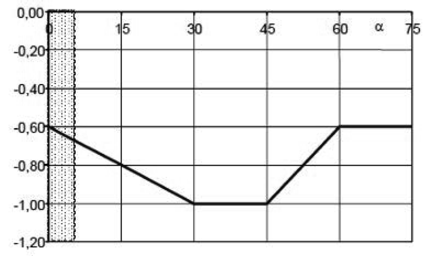

***Figura C3.3.16** — Coefficienti di pressione per coperture a padiglione: falde laterali*

**Tabella C3.3.XIII** — *Suddivisione delle coperture a doppia falda in zone di uguale pressione: vento in direzione parallela al colmo*

| 0° ≤ α ≤ 30° | $c_{pe}$ = −0,6 − α/75 |
|---|---|
| 30° ≤ α ≤ 45° | $c_{pe}$ = −1,0 |
| 45° ≤ α ≤ 60° | $c_{pe}$ = −1,0 + (α−45)/37,5 |
| 60° ≤ α | $c_{pe}$ = −0,6 |

I coefficienti locali $c_{pe,10}$ e di dettaglio $c_{pe,1}$ da assumere sulle coperture a padiglione di un edificio a pianta rettangolare sono riportati in Figura C3.3.17 e in Tabella C3.3.XIV, il valore di *e* è pari al minimo fra *b* e 2*h*.

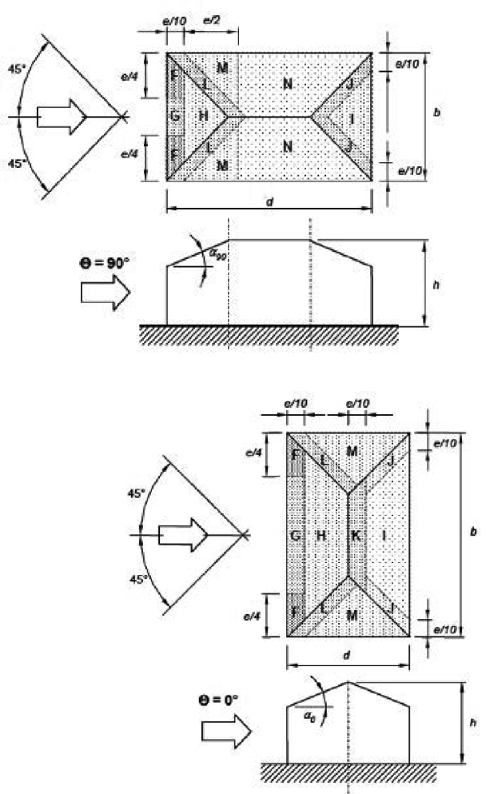

***Figura C3.3.17** — Suddivisione delle coperture a padiglione in zone di uguale pressione*

Per la direzione del vento Θ = 0°, nel caso di inclinazioni di falda 5° ≤ α ≤ 45°, ove è presente un doppio valore del coefficiente di pressione, vanno considerati due casi diversi: nel primo si adottano tutti i valori positivi dei coefficienti di pressione, nel secondo tutti i valori negativi; non occorre prendere in considerazione combinazioni di carico in cui i coefficienti di pressione assumano valori sia positivi sia negativi. È possibile utilizzare un'interpolazione lineare per valori intermedi dell'angolo α, purché questa sia fatta fra valori corrispondenti di segno non opposto. I valori dei coefficienti di pressione sono sempre da valutare in funzione dell'inclinazione della falda sopravento.

**Tabella C3.3.XIV** — *Suddivisione delle coperture a padiglione in zone di uguale pressione: vento in direzione parallela al colmo*

| | Direzione del vento Θ = 0° e Θ = 90° | | | | | | | | | | | | | | | | | |
|:---:|:---:|:---:|:---:|:---:|:---:|:---:|:---:|:---:|:---:|:---:|:---:|:---:|:---:|:---:|:---:|:---:|:---:|:---:|
| $\alpha_0$ per Θ=0°, $\alpha_{90}$ per Θ=90° | F | | G | | H | | I | | J | | K | | L | | M | | N | |
| | $c_{pe,10}$ | $c_{pe,1}$ | $c_{pe,10}$ | $c_{pe,1}$ | $c_{pe,10}$ | $c_{pe,1}$ | $c_{pe,10}$ | $c_{pe,1}$ | $c_{pe,10}$ | $c_{pe,1}$ | $c_{pe,10}$ | $c_{pe,1}$ | $c_{pe,10}$ | $c_{pe,1}$ | $c_{pe,10}$ | $c_{pe,1}$ | $c_{pe,10}$ | $c_{pe,1}$ |
| +5° | −1,7 | −2,5 | −1,2 | −2,0 | −0,6 | −1,2 | −0,3 | −0,3 | −0,6 | −0,6 | −0,6 | −0,6 | −1,2 | −2,0 | −0,6 | −1,2 | −0,4 | −0,4 |
| +5° | 0 | 0 | 0 | 0 | 0 | 0 | −0,3 | −0,3 | −0,6 | −0,6 | −0,6 | −0,6 | −1,2 | −2,0 | −0,6 | −1,2 | −0,4 | −0,4 |
| +15° | −0,9 | −2,0 | −0,8 | −1,5 | −0,3 | −0,3 | −0,5 | −0,5 | −1,0 | −1,5 | −1,2 | −2,0 | −1,4 | −2,0 | −0,6 | −1,2 | −0,3 | −0,3 |
| +15° | +0,2 | +0,2 | +0,2 | +0,2 | +0,2 | +0,2 | −0,5 | −0,5 | −1,0 | −1,5 | −1,2 | −2,0 | −1,4 | −2,0 | −0,6 | −1,2 | −0,3 | −0,3 |
| +30° | −0,5 | −1,5 | −0,5 | −1,5 | −0,2 | −0,2 | −0,4 | −0,4 | −0,7 | −1,2 | −0,5 | −0,5 | −1,4 | −2,0 | −0,8 | −1,2 | −0,2 | −0,2 |
| +30° | +0,5 | +0,5 | +0,7 | +0,7 | +0,4 | +0,4 | −0,4 | −0,4 | −0,7 | −1,2 | −0,5 | −0,5 | −1,4 | −2,0 | −0,8 | −1,2 | −0,2 | −0,2 |
| +45° | 0 | 0 | 0 | 0 | 0 | 0 | −0,3 | −0,3 | −0,6 | −0,6 | −0,3 | −0,3 | −1,3 | −2,0 | −0,8 | −1,2 | −0,2 | −0,2 |
| +45° | +0,7 | +0,7 | +0,7 | +0,7 | +0,6 | +0,6 | −0,3 | −0,3 | −0,6 | −0,6 | −0,3 | −0,3 | −1,3 | −2,0 | −0,8 | −1,2 | −0,2 | −0,2 |
| +60° | +0,7 | +0,7 | +0,7 | +0,7 | +0,7 | +0,7 | −0,3 | −0,3 | −0,6 | −0,6 | −0,3 | −0,3 | −1,2 | −2,0 | −0,4 | −0,4 | −0,2 | −0,2 |
| +75° | +0,8 | +0,8 | +0,8 | +0,8 | +0,8 | +0,8 | −0,3 | −0,3 | −0,6 | −0,6 | −0,3 | −0,3 | −1,2 | −2,0 | −0,4 | −0,4 | −0,2 | −0,2 |

##### C3.3.8.1.6. Coperture a falde multiple

L'altezza di riferimento $\bar{z}_e$ per le coperture a falde multiple, ossia le coperture composte da successioni contigue di coperture a semplice o a doppia falda è pari all'altezza massima h della copertura stessa. In generale, i coefficienti di pressione per le coperture a falde multiple sono gli stessi forniti nei precedenti paragrafi per le coperture corrispondenti a semplice e a doppia falda.

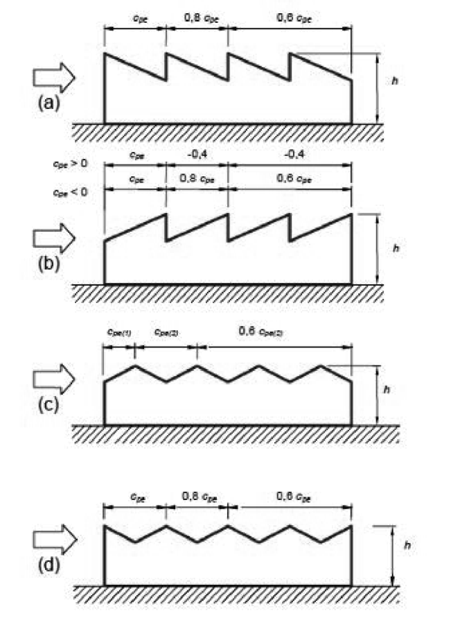

***Figura C3.3.18** — Suddivisione delle coperture a falda multipla*

Limitatamente al caso di vento perpendicolare alla direzione del colmo, e per i soli tipi costruttivi illustrati in Figura C3.3.18, i coefficienti di pressione sopra definiti possono essere moltiplicati per i fattori riduttivi indicati nella stessa figura. In particolare:

- nel caso riportato nella Figura C3.3.18 (a), si applicano ad ogni tratto della copertura i coefficienti di pressione definiti nel paragrafo coperture a falda singola, con inclinazione negativa. Tali coefficienti sono moltiplicati per il fattore riduttivo 0,8 nel secondo tratto, e per il fattore riduttivo 0,6 nei tratti successivi;
- nel caso riportato nella Figura C3.3.18 (b), si applicano ad ogni tratto della copertura i coefficienti di pressione definiti nel paragrafo coperture a falda singola, con inclinazione positiva. Nel caso in cui tali coefficienti siano positivi ($c_{pe}$ > 0), nel secondo tratto e in quelli successivi si assume $c_{pe}$ = −0,4. Nel caso in cui tali coefficienti siano negativi ($c_{pe}$ < 0), essi sono moltiplicati per il fattore riduttivo 0,8 nel secondo tratto, e per il fattore riduttivo 0,6 nei tratti successivi;
- nel caso riportato in Figura C3.3.18 (c), si applicano al primo tratto della copertura (prima falda sopravento) i coefficienti di pressione definiti nel paragrafo coperture a falda singola con inclinazione positiva. Ai tratti successivi della copertura si applicano i coefficienti di pressione riportati nel paragrafo coperture a falda doppia con inclinazione negativa; tali coefficienti sono moltiplicati per il fattore riduttivo 0,6 a partire dal terzo tratto della copertura;
- nel caso riportato in Figura C3.3.18 (d), si applicano ad ogni tratto della copertura i coefficienti di pressione riportati nel paragrafo coperture a falda doppia con inclinazione negativa. Tali coefficienti sono moltiplicati per il fattore riduttivo 0,8 nel secondo tratto, e per il fattore riduttivo 0,6 nei tratti successivi.

##### C3.3.8.1.7. Coperture a volta cilindrica

La quota di riferimento per le coperture a volta cilindrica è pari a $\bar{z}_e = h + f/2$ (in riferimento alla Figura C3.3.19 (a) e (b)).

Nel caso di vento perpendicolare alle generatrici della copertura, la copertura è suddivisa in quattro zone distinte di uguale sviluppo:

- nella prima zona (A, sopravento) si adottano i coefficienti di pressione $c_{pe,A}$;
- nelle due zone intermedie (B) si adottano i coefficienti di pressione $c_{pe,B}$;
- nell'ultima zona (C, sottovento) si adottano i coefficienti di pressione $c_{pe,C}$.

I valori dei coefficienti di pressione $c_{pe,A}$, $c_{pe,B}$ e $c_{pe,C}$ sono forniti nella Figura C3.3.19 (c), in funzione dei rapporti h/d e f/d.

In particolare, per quanto riguarda il coefficiente $c_{pe,A}$:

- nel caso in cui h/d ≥ 0,5, si considerano entrambi i valori riportati nel grafico;
- per valori intermedi tra h/d=0 e h/d=0,5, si possono interpolare linearmente i valori riportati.

Per valori di f/d ≤ 0,05 si possono adottare i coefficienti di pressione delle coperture piane.

Nel caso di vento parallelo alle generatrici della copertura, in prima approssimazione, è lecito applicare i coefficienti di pressione relativi alle coperture piane.

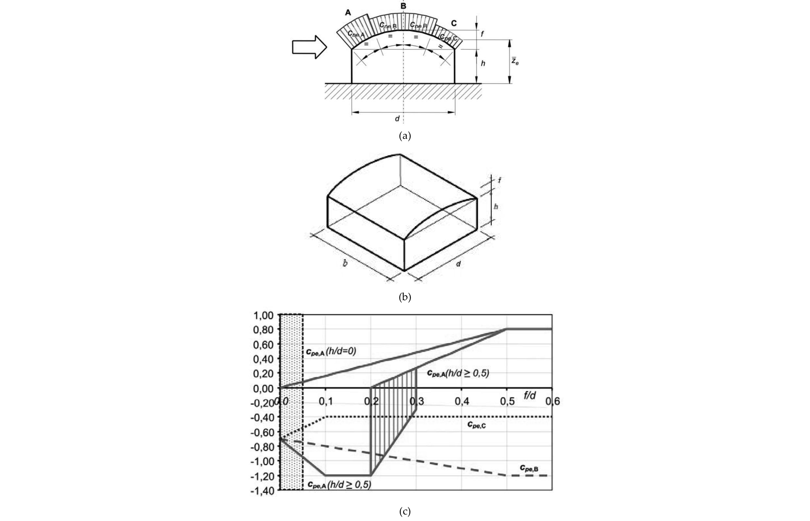

***Figura C3.3.19** — a) e b) Schema di riferimento per coperture a volta cilindrica, c) Coefficienti di pressione per coperture a volta cilindrica*

#### C3.3.8.2. Tettoie

[[indice-cap03#§3.3 Azioni del vento|Torna al sommario]]

Il presente paragrafo fornisce i criteri per valutare le azioni globali del vento sulle coperture in cui lo spazio sottostante non sia delimitato in maniera permanente da pareti.

Si definisce grado di bloccaggio φ, il rapporto tra l'area esposta al vento di un'eventuale ostruzione presente al di sotto della tettoia e l'area totale della superficie ortogonale alla direzione del vento al di sotto della tettoia (Figura C3.3.20). Si identificano due situazioni limite:

- φ=0 corrisponde all'assenza di ostruzioni al di sotto della tettoia (tettoia libera);
- φ=1 corrisponde alla situazione in cui lo spazio al di sotto della tettoia risulti completamente ostruito.

La condizione φ=1 è sostanzialmente diversa da quella prevista per gli edifici in quanto l'eventuale ostruzione può essere offerta anche da elementi che non delimitano completamente e permanentemente lo spazio al di sotto della tettoia.

A valle della massima ostruzione si adotta φ=0.

Le azioni aerodinamiche esercitate dal vento sulle tettoie dipendono fortemente dal grado di bloccaggio in quanto la presenza di un'ostruzione, anche soltanto sul lato sottovento, impedisce il passaggio dell'aria al di sotto della tettoia.

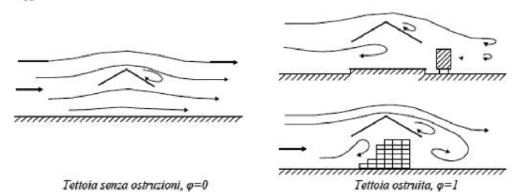

***Figura C3.3.20** — Differenze nel flusso dell'aria per tettoie con φ=0 e φ=1*

Il presente paragrafo schematizza l'azione del vento sulle tettoie attraverso le forze F risultanti dal campo di pressioni sulla superficie della falda della tettoia, dirette ortogonalmente ad essa. Tali forze sono quantificate dal prodotto dei coefficienti di forza, $c_F$, per la superficie della falda in esame e sono applicate nei punti indicati nel seguito per le varie tipologie di tettoia.

Per la valutazione più dettagliata del campo di pressione agente sulle tettoie, al fine di valutare azioni locali su elementi o su porzioni delle tettoie costituite da un singolo strato di copertura, si potrà fare riferimento a documenti di comprovata validità. La valutazione delle pressioni locali sulla faccia superiore e sulla faccia inferiore delle tettoie costituite da un doppio strato di copertura richiede valutazioni specifiche e, se necessario, lo svolgimento di prove in galleria del vento.

##### C3.3.8.2.1. Tettoie a falda singola

La Tabella C3.3.XV e la relativa Figura C.3.3.21 riportano i valori dei coefficienti di forza per le tettoie a semplice falda con vento agente perpendicolarmente alla linea di colmo. I valori dei coefficienti di forza sono espressi in funzione del grado di bloccaggio φ e dell'inclinazione α della falda. Per valori intermedi di φ è ammessa un'interpolazione lineare tra i valori relativi ai casi φ=0 e φ=1. La quota di riferimento $\bar{z}_e$ è pari all'altezza massima h della tettoia. L'area di riferimento L², ossia l'area su cui è applicata la forza risultante, è pari all'area della tettoia.

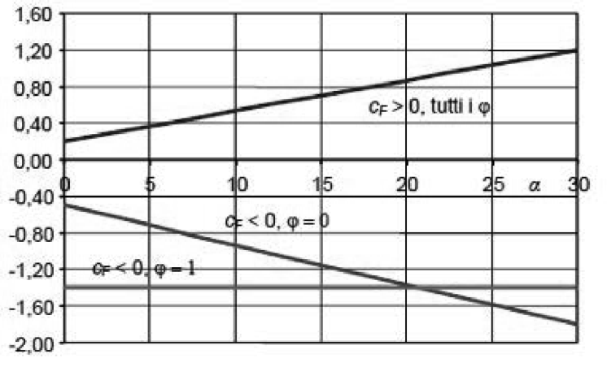

***Figura C3.3.21** — Coefficienti di pressione complessiva per tettoie a semplice falda*

**Tabella C3.3.XV** — *Coefficienti di forza per tettoie a semplice falda (α in °)*

| | | |
|---|---|---|
| Valori positivi | Tutti i valori di φ | $c_F$ = + 0,2 + α/30 |
| Valori negativi | φ = 0 | $c_F$ = −0,5 − 1,3·α/30 |
| Valori negativi | φ = 1 | $c_F$ = −1,4 |

Per il calcolo della tettoia si considerano le condizioni di carico più gravose tra le quattro indicate nella Figura C3.3.22, dove la forza risultante F = $q_p(z)$ · L² · $c_F$.

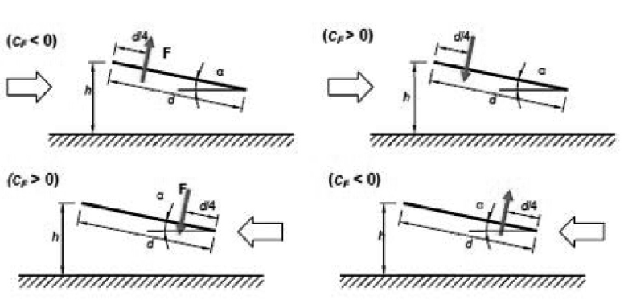

***Figura C3.3.22** — Tettoie a semplice falda: posizione del punto di applicazione della forza risultante in funzione della direzione di provenienza del vento e della direzione della forza*

Le tettoie a semplice falda con vento agente parallelamente alla linea di colmo possono essere analizzate, in prima approssimazione, come tettoie piane a semplice falda (α = 0°).

##### C3.3.8.2.2. Tettoie a falda doppia

La Tabella C3.3.XVI e la relativa Figura C3.3.23 riportano i valori dei coefficienti di forza per le tettoie a doppia falda (di uguale pendenza) con vento agente perpendicolarmente alla linea di colmo. I valori dei coefficienti di forza sono espressi in funzione del grado di bloccaggio φ e dell'inclinazione α delle falde. Per valori intermedi di φ è ammessa un'interpolazione lineare tra i valori relativi ai casi φ=0 e φ=1. La quota di riferimento $\bar{z}_e$ è pari all'altezza massima h della tettoia. L'area di riferimento L², ossia l'area su cui è applicata la forza risultante, è pari all'area di ciascuna falda della tettoia.

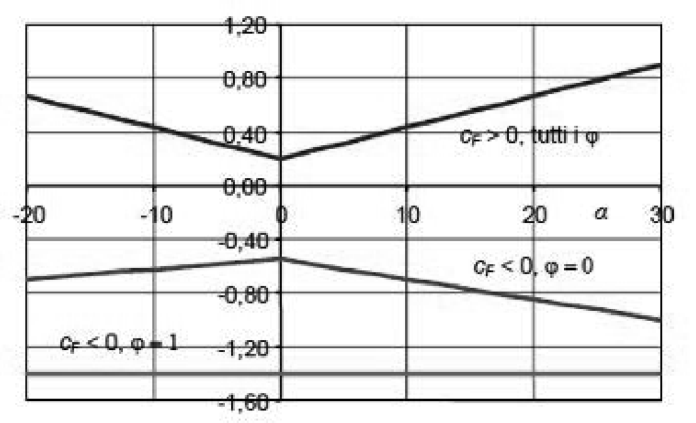

***Figura C3.3.23** — Coefficienti di pressione complessiva per tettoie a falda doppia*

**Tabella C3.3.XVI** — *Coefficienti di forza per tettoie a doppia falda (α in °)*

| | | | |
|---|---|---|---|
| Valori positivi | Tutti i valori di φ | | $c_F = +0{,}2 + 0{,}7 \cdot \lvert \alpha \rvert / 30$ |
| Valori negativi | φ = 0 | α ≤ 0° | $c_F$ = −0,5 + 0,1·α/10 |
| | | α ≥ 0° | $c_F$ = −0,5 − 0,2·α/10 |
| | φ = 1 | tutti i valori di α | $c_F$ = −1,4 |

Per il calcolo della tettoia si considerano le condizioni di carico più gravose tra quelle indicate nella Figura C3.3.24, dove la forza risultante F = $q_p(z)$ · L² · $c_F$ è considerata agente simultaneamente su entrambe le falde oppure soltanto su una di esse. Ciascuna falda delle tettoie a doppia falda con vento agente parallelamente alla linea di colmo può essere analizzata, in prima approssimazione, come una tettoia piana a semplice falda (α = 0°).

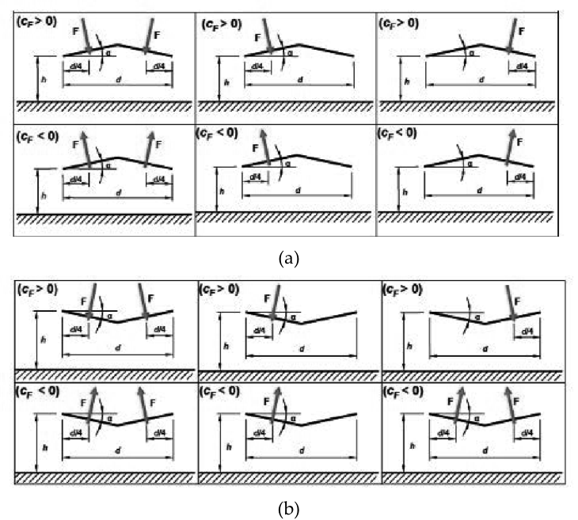

***Figura C3.3.24** — a) Tettoie a doppia falda: posizione del punto di applicazione delle forze risultanti in funzione della direzione della forza — schema per α>0°. b) Tettoie a doppia falda: posizione del punto di applicazione delle forze risultanti in funzione della direzione della forza — schema per α<0°*

##### C3.3.8.2.3. Tettoie a falde multiple

Ciascuna coppia di falde delle tettoie composte da più coppie di falde affiancate (di uguale pendenza) può essere analizzata, in prima approssimazione, come una singola tettoia a doppia falda. Limitatamente al caso di vento perpendicolare alla direzione dei colmi, e per il solo tipo costruttivo illustrato in Figura C3.3.25 i coefficienti di forza sopra definiti possono essere moltiplicati per i fattori riduttivi riportati in Tabella C3.3.XVII, secondo lo schema indicato nella stessa Figura C3.3.25.

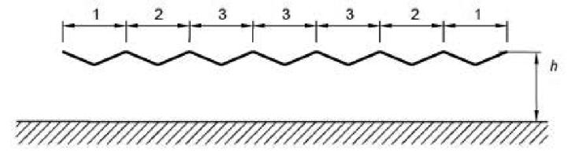

***Figura C3.3.25** — Tettoie a falda multipla: individuazione dei vari elementi*

**Tabella C3.3.XVII** — *Coefficienti di forza per tettoie a semplice falda (α in °)* ^tab-c3-3-xvii

| Elemento n. | Posizione | Fattori riduttivi per tutti i valori di φ | |
|---|---|---|---|
| | | per $c_F$ > 0 | per $c_F$ < 0 |
| 1 | Primo campo | 1,0 | 0,8 |
| 2 | Secondo campo | 0,9 | 0,7 |
| 3 | Altri campi | 0,7 | 0,7 |

#### C3.3.8.3. Coefficienti di pressione per pareti verticali di edifici a pianta circolare

[[indice-cap03#§3.3 Azioni del vento|Torna al sommario]]

Analogamente agli edifici a pianta rettangolare, il comportamento aerodinamico delle costruzioni a pianta circolare e in particolare della loro superficie laterale dipende, sostanzialmente, dal rapporto tra il diametro in pianta e l'altezza. Per le costruzioni tozze si realizza un flusso tridimensionale. Per le costruzioni snelle, con l'esclusione della porzione alla base e di sommità, si realizza un flusso bidimensionale in piani orizzontali.

I coefficienti di pressione forniti in questo paragrafo dipendono dal rapporto h/b, essendo h l'altezza della costruzione e b il suo diametro. Inoltre dipendono dal numero di Reynolds $R_e$ e dalla scabrezza k della superficie. Nel caso di costruzioni particolarmente snelle, il cui il rapporto h/b sia maggiore di 5, si faccia riferimento alle indicazioni riportate in documenti di comprovata validità.

La distribuzione altimetrica della pressione in generale è diversa dal profilo della pressione cinetica di picco del vento indisturbato. Il presente paragrafo fornisce un criterio di valutazione dell'altezza di riferimento, tale da condurre a stime approssimate, generalmente a favore di sicurezza, della risultante delle pressioni.

Per le costruzioni basse, ossia con altezza minore o uguale del diametro in pianta (h ≤ b), l'altezza di riferimento è costante e pari alla quota di sommità della costruzione ($\bar{z}_e = h$); la pressione del vento è pertanto uniforme in altezza.

Per le costruzioni alte, ossia con altezza compresa fra il diametro della pianta e 5 volte l'altezza della costruzione (b < h ≤ 5·b), si definiscono due zone distinte:

- nella prima parte della costruzione, sino alla quota z = b, l'altezza di riferimento è costante e pari a $\bar{z}_e = b$; la pressione del vento è pertanto uniforme in altezza;
- nella parte superiore della costruzione, per z compreso fra b e h, la quota di riferimento $\bar{z}_e$ può essere scelta seguendo uno dei due seguenti criteri:
  1. l'altezza di riferimento è costante e pari alla sommità della costruzione ($\bar{z}_e = h$); la pressione del vento è pertanto uniforme fra le quote z=b e z=h. In questo modo il calcolo delle forze aerodinamiche è semplificato, ma la forza totale che ne risulta è generalmente maggiore di quella reale;
  2. la costruzione viene suddivisa in tronchi di altezza arbitraria, a ciascuno dei quali corrisponde un'altezza di riferimento costante pari alla sommità del tronco; la pressione del vento su ogni tronco è pertanto uniforme in altezza. In questo modo il calcolo delle forze è più oneroso, ma i valori che si ottengono sono più aderenti alla realtà e non maggiori di quelli che si ottengono applicando la procedura di cui al punto precedente.

I coefficienti di pressione esterna $c_{pe}$ sono forniti dalla relazione:

$$c_{pe} = c_{peo} \cdot \psi_{\lambda\alpha} \tag{C3.3.4}$$

dove:

- $c_{peo}$ è il coefficiente di pressione esterna per un cilindro circolare di lunghezza teoricamente infinita;
- $\psi_{\lambda\alpha}$ è un coefficiente che tiene conto della lunghezza finita del cilindro (effetti di bordo).

Il coefficiente di pressione esterna $c_{peo}$ è fornito dalla relazione:

$$c_{peo}(\alpha_p) = 1 - (1 - c_{pm}) \cdot \sin^2\left(\frac{\pi \cdot \alpha_p}{2 \cdot \alpha_m}\right) \qquad \text{per } 0° \leq \alpha_p \leq \alpha_m$$

$$c_{peo}(\alpha_p) = c_{pb} - (c_{pb} - c_{pm}) \cdot \cos^2\left(\frac{\pi}{2} \cdot \frac{\alpha_p - \alpha_m}{\alpha_b - \alpha_m}\right) \qquad \text{per } \alpha_m \leq \alpha_p \leq \alpha_b \tag{C3.3.5}$$

$$c_{peo}(\alpha_p) = c_{pb} \qquad \text{per } \alpha_b \leq \alpha_p \leq 180°$$

dove $\alpha_p$ è l'angolo indicato in Figura C3.3.26, espresso in gradi (°); i parametri $c_{pm}$, $c_{pb}$, $\alpha_m$ e $\alpha_b$ hanno il significato illustrato nella stessa Figura C3.3.26. La Tabella C3.3.XVIII riporta alcuni valori indicativi di tali parametri, corrispondenti a diversi numeri di Reynolds $R_e$ valutati attribuendo alla lunghezza di riferimento il valore del diametro b, e assumendo k/b ≤ 0,5·10⁻³.

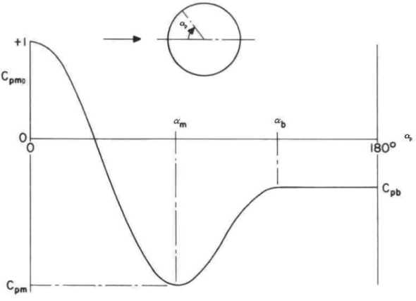

***Figura C3.3.26** — Coefficiente di pressione esterna $c_{peo}$*

**Tabella C3.3.XVIII** — *Valori indicativi dei parametri $c_{pm}$, $c_{pb}$, $\alpha_m$ e $\alpha_b$ per k/b ≤ 0,5·10⁻³*

| $R_e$ | $c_{pm}$ | $c_{pb}$ | $\alpha_m$ [°] | $\alpha_b$ [°] |
|:---:|:---:|:---:|:---:|:---:|
| 5·10⁵ | −2,2 | −0,4 | 85 | 135 |
| 2·10⁶ | −1,9 | −0,7 | 80 | 120 |
| 10⁷ | −1,5 | −0,8 | 75 | 105 |

Il coefficiente $\psi_{\lambda\alpha}$ è fornito dalla relazione:

$$\psi_{\lambda\alpha} = 1 \qquad \text{per } 0° \leq \alpha_p \leq \alpha_m$$

$$\psi_{\lambda\alpha} = \psi_\lambda + (1 - \psi_\lambda) \cdot \cos\left(\frac{\pi}{2} \cdot \frac{\alpha_p - \alpha_m}{\alpha_b - \alpha_m}\right) \qquad \text{per } \alpha_m \leq \alpha_p \leq \alpha_b \tag{C3.3.6}$$

$$\psi_{\lambda\alpha} = \psi_\lambda \qquad \text{per } \alpha_b \leq \alpha_p \leq 180°$$

dove $\alpha_p$ è espresso in gradi (°); $\psi_\lambda$ è un coefficiente di snellezza. Per le costruzioni trattate nel presente paragrafo (h/d ≤ 5), può porsi $\psi_\lambda$ = 2/3.

#### C3.3.8.4. Coefficienti di pressione per coperture sferiche di edifici a pianta circolare

[[indice-cap03#§3.3 Azioni del vento|Torna al sommario]]

Per coperture a cupola sferica, l'altezza di riferimento è pari a $z_e$ = h + f/2. Sulla superficie della copertura si applica una distribuzione di pressione variabile lungo la direzione del vento incidente, mantenendo i valori dei coefficienti di pressione costanti lungo gli archi di cerchio ottenuti dall'intersezione della superficie sferica con i piani ortogonali alla direzione del vento.

I valori dei coefficienti di pressione sono riportati nella Figura C3.3.27 e sono indicati con $c_{pe,A}$, $c_{pe,B}$ e $c_{pe,C}$; essi sono riferiti, rispettivamente, al bordo sopravento (zona A), alla zona centrale della copertura (zona B) e al bordo sottovento (zona C); per la valutazione del valore del coefficiente di pressione lungo lo sviluppo della copertura si può utilizzare un'interpolazione lineare tra i tre valori indicati. Per valori intermedi del rapporto h/d rispetto a quelli riportati nella Figura C3.3.27 si può adottare un'interpolazione lineare.

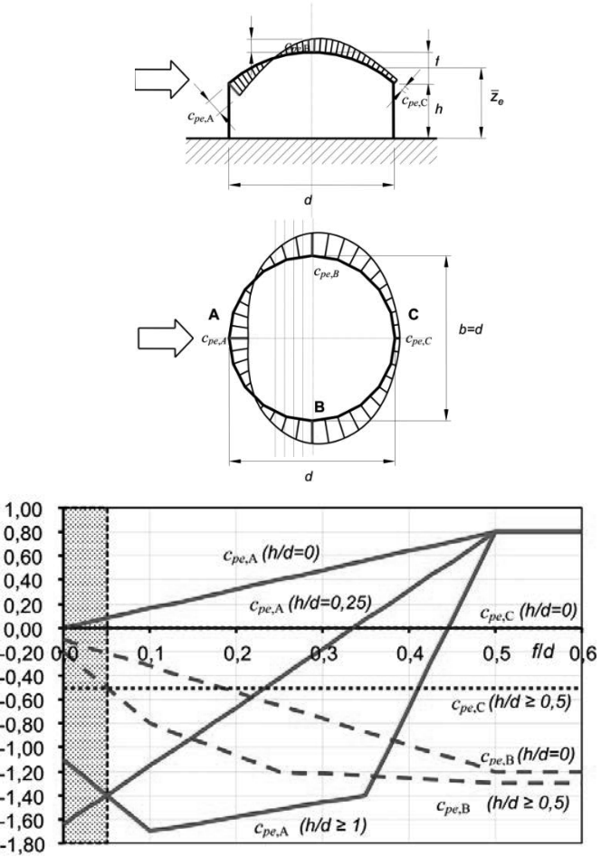

***Figura C3.3.27** — Schema di riferimento per cupole sferiche*

#### C3.3.8.5. Pressioni interne

[[indice-cap03#§3.3 Azioni del vento|Torna al sommario]]

Le pressioni interne agli edifici dipendono dalla superficie delle aperture che questi presentano verso l'esterno. Si possono verificare i tre casi seguenti:

**Caso 1**

Se per almeno due facce dell'edificio l'area totale delle aperture presenti su ciascuna faccia supera il 30% della superficie totale della faccia stessa si applicano le prescrizioni riportate nel §C3.3.8.2 (tettoie).

**Caso 2**

Se l'edificio non rientra nel caso precedente, ma presenta una superficie dotata di un'area totale di aperture pari ad almeno il doppio della somma delle aree delle aperture presenti sulle rimanenti superfici, il coefficiente di pressione interna $c_{pi}$ è pari a 0,75·$c_{pe}$; se invece l'area delle aperture presenti su detta superficie è pari ad almeno il triplo dell'area delle aperture presenti sulle rimanenti superfici, il coefficiente di pressione interna $c_{pi}$ è pari a 0,90·$c_{pe}$.

L'altezza di riferimento $\bar{z}_i$ è pari all'altezza di riferimento $\bar{z}_e$ relativa alla superficie dominante.

**Caso 3**

Se l'edificio non rientra in nessuno dei casi precedenti, ma è dotato di porosità distribuita in maniera circa uniforme, in assenza di determinazioni più dettagliate, per le quali si farà riferimento a documenti di comprovata validità, si possono assumere i valori $c_{pi}$ = +0,2 e $c_{pi}$ = −0,3, considerando il caso che di volta in volta conduce alla situazione maggiormente gravosa.

L'altezza di riferimento $\bar{z}_i$ è pari all'altezza massima dell'edificio.

#### C3.3.8.6. Coefficienti di pressione per travi ad anima piena e reticolari

[[indice-cap03#§3.3 Azioni del vento|Torna al sommario]]

Salvo più approfondite determinazioni, possono essere assunti per i coefficienti $c_p$ i valori seguenti.

##### C3.3.8.6.1. Travi isolate

Indicato con:

- S la superficie delimitata dal contorno della trave;
- $S_p$ la superficie della parte piena della trave;

$$\varphi = \frac{S_p}{S} \tag{C3.3.7}$$

la pressione totale si considera agente solo su $S_p$ e si valuta utilizzando i seguenti valori del coefficiente $c_p$:

$$c_p = 2 - \frac{4}{3} \varphi \qquad \text{per } 0 \leq \varphi < 0{,}3$$

$$c_p = 1{,}6 \qquad \text{per } 0{,}3 \leq \varphi \leq 0{,}8 \tag{C3.3.8}$$

$$c_p = 2{,}4 - \varphi \qquad \text{per } 0{,}8 < \varphi \leq 1$$

##### C3.3.8.6.2. Travi multiple

Nel caso di più travi disposte parallelamente a distanza d non maggiore del doppio dell'altezza h, il valore della pressione sull'elemento successivo sarà pari a quello sull'elemento precedente moltiplicando per un coefficiente di riduzione dato da:

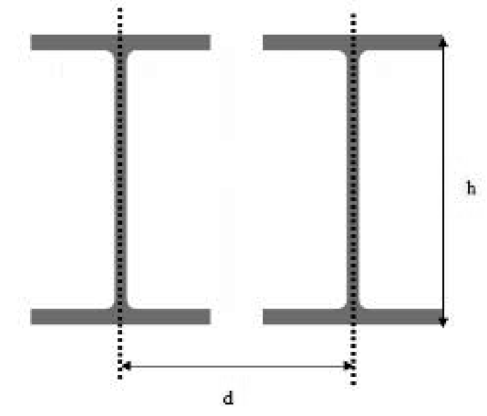

***Figura C3.3.28** — Travi parallele*

Per d/h ≥ 5 gli elementi vengono considerati come isolati.

Per 2 < d/h < 5 si procede all'interpolazione lineare.

#### C3.3.8.7. Coefficienti di pressione per torri e pali a traliccio a sezione rettangolare o quadrata

[[indice-cap03#§3.3 Azioni del vento|Torna al sommario]]

Per torri e pali a traliccio a sezione rettangolare o quadrata e vento diretto normalmente ad una delle pareti, salvo più accurate valutazioni, i $c_p$ sono da valutare nel modo seguente:

- $c_p$ = 2,4 per torri con elementi tubolari a sezione circolare
- $c_p$ = 2,8 per torri con elementi aventi sezione di forma diversa dalla circolare

L'azione di insieme esercitata dal vento spirante normalmente ad una delle pareti va valutata con riferimento alla superficie della parte piena di una sola faccia.

Per vento spirante secondo la bisettrice dell'angolo formato da due pareti, l'azione d'insieme è pari a 1,15 volte quella sopra definita.

Salvo documentazione specifica, i medesimi coefficienti si adottano cautelativamente anche per torri a sezione triangolare, per le quali non è da applicare il coefficiente 1,15 suddetto.

#### C3.3.8.8. Coefficiente di attrito

[[indice-cap03#§3.3 Azioni del vento|Torna al sommario]]

In assenza di più precise valutazioni suffragate da opportuna documentazione o da prove sperimentali in galleria del vento, si assumeranno i valori riportati nella Tabella C3.3.XIX.

**Tabella C3.3.XIX** — *Valori del coefficiente d'attrito*

| Superficie | Coefficiente d'attrito $c_f$ |
|---|:---:|
| Liscia (acciaio, cemento a faccia liscia..) | 0,01 |
| Scabra (cemento a faccia scabra, catrame..) | 0,02 |
| Molto scabra (ondulata, costolata, piegata..) | 0,04 |

### C3.3.9. Coefficiente dinamico

[[indice-cap03#§3.3 Azioni del vento|Torna al sommario]]

A parte il cambio di numerazione (nelle NTC 2008 era il 3.3.8) questo paragrafo rimane immutato nel passaggio dalle NTC 2008 alle NTC 2018.

### C3.3.10. Avvertenze progettuali

[[indice-cap03#§3.3 Azioni del vento|Torna al sommario]]

Questo paragrafo contiene in linea generale le indicazioni precedentemente contenute nel §3.3.9 (particolari precauzioni progettuali) delle NTC 2008, relative alle cautele da adottarsi nei con fronti di strutture particolarmente snelle e deformabili sotto l'azione del vento. Peraltro le indicazioni relative agli effetti del distacco di vortici da strutture cilindriche snelle, precedentemente presenti nelle NTC2008, vengono riportate qui di seguito.

### C3.3.11. Distacco di vortici

[[indice-cap03#§3.3 Azioni del vento|Torna al sommario]]

Per strutture o elementi strutturali snelli di forma cilindrica, quali ciminiere, torri per l'illuminazione, elementi di travi reticolari, ponti ed edifici alti, si deve tener conto dell'effetto dinamico dovuto al distacco alternato dei vortici da un lato e dall'altro del corpo investito dal vento. Esso produce una forza di tipo armonico ortogonale alla direzione del vento e all'asse del corpo cilindrico, la cui frequenza $f_s$ è data dalla formula di Strouhal:

$$n_s = \frac{St \cdot v_m}{b} \tag{C3.3.9}$$

dove:

- b è la dimensione di riferimento della sezione trasversale del corpo;
- $v_m$ è la velocità media del vento;
- St è il numero di Strouhal, funzione della forma della sezione, del suo orientamento rispetto alla direzione del vento e del numero di Reynolds. Il suo valore può essere ricavato da dati suffragati da opportuna documentazione o da prove sperimentali in galleria del vento. A titolo indicativo, St = 0,2 per le sezioni circolari (dove b è il diametro), St = 0,1 per le sezioni quadrate (dove b è il lato).

La velocità critica di distacco dei vortici per l'i-esimo modo di vibrazione della struttura perpendicolare alla direzione del vento, $v_{cr,i}$, è la velocità media del vento $v_m$ che determina una condizione di risonanza $n_s = n_k$ ad una generica quota z della struttura. Dalla [C3.3.9] risulta:

$$v_{cr,i} = \frac{n_i \cdot b}{St} \tag{C3.3.10}$$

Si raccomanda di valutare gli effetti del distacco dei vortici, facendo ricorso a dati suffragati da opportuna documentazione o tramite metodi analitici, numerici e/o sperimentali adeguatamente comprovati, per tutte le velocità critiche che soddisfano la relazione:

$$v_{cr,i} < v_{m,l} \tag{C3.3.11}$$

dove $v_{m,l}$ è la velocità media del vento, valutata alla quota alla quale si attua la velocità critica, per un periodo di ritorno $T_R$ pari a 10 volte il periodo di ritorno di progetto indicato al §3.3.2 per valutare la velocità di riferimento $v_r$.

Si osservi che la condizione critica di risonanza dà luogo ad oscillazioni tanto più grandi quanto più piccolo è il numero di Scruton fornito dall'espressione:

$$Sc = \frac{4\pi \cdot m \cdot \xi}{\rho \cdot b^2} \tag{C3.3.12}$$

dove:

- m è la massa del corpo per unità di lunghezza;
- ξ è il coefficiente di smorzamento strutturale;
- ρ è la densità dell'aria assunta convenzionalmente costante e pari a 1,25 kg/m³.

In termini generali può dirsi che:

- se Sc > 30, il distacco dei vortici non è in generale particolarmente gravoso; tuttavia, si suggerisce di effettuare ugualmente opportune verifiche;
- se 5 < Sc < 30, il distacco dei vortici va analizzato nei riguardi delle verifiche agli SLU e della fatica indotta dalla ripetizione dei cicli di oscillazione;
- se Sc < 5, le vibrazioni indotte dal distacco dei vortici possono essere di grande ampiezza e notevolmente pericolose; si raccomanda pertanto massima cautela.
