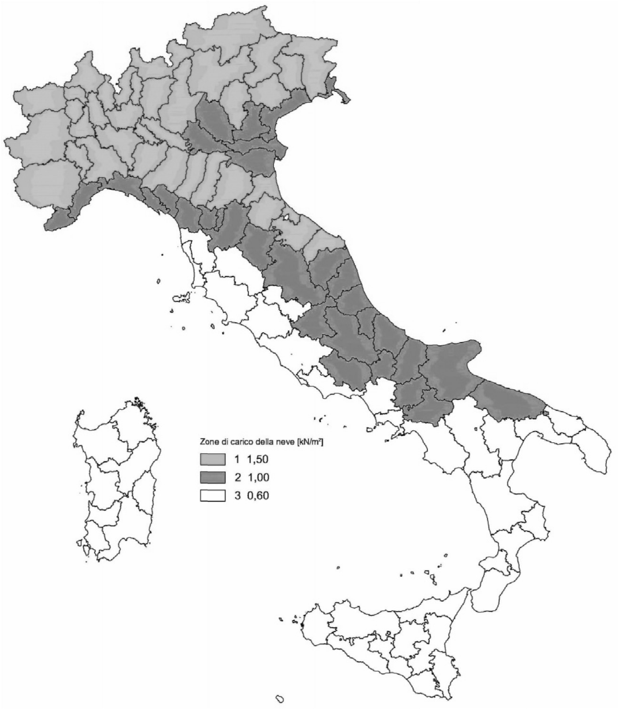
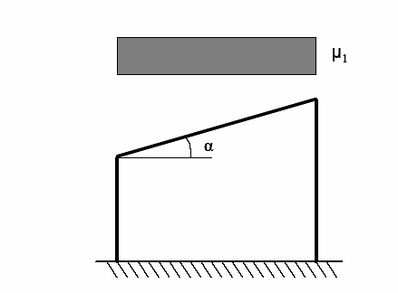
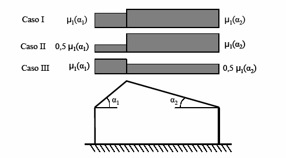
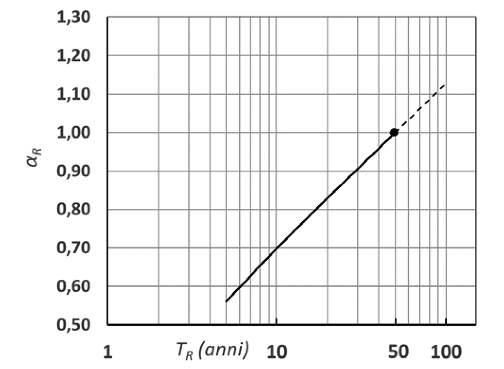
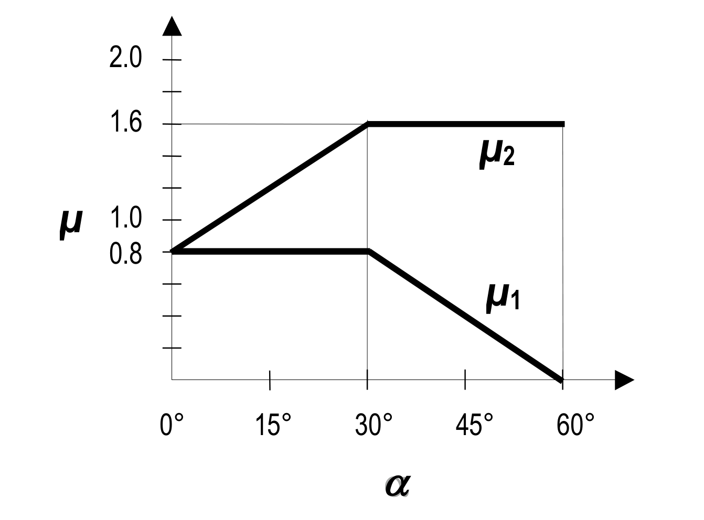
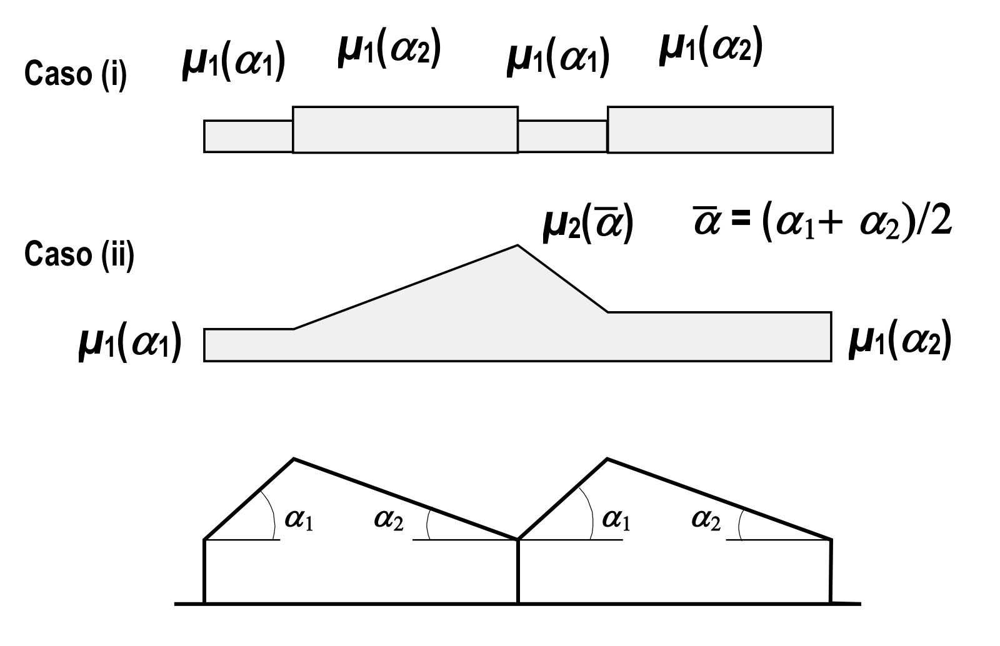
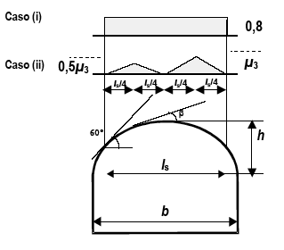
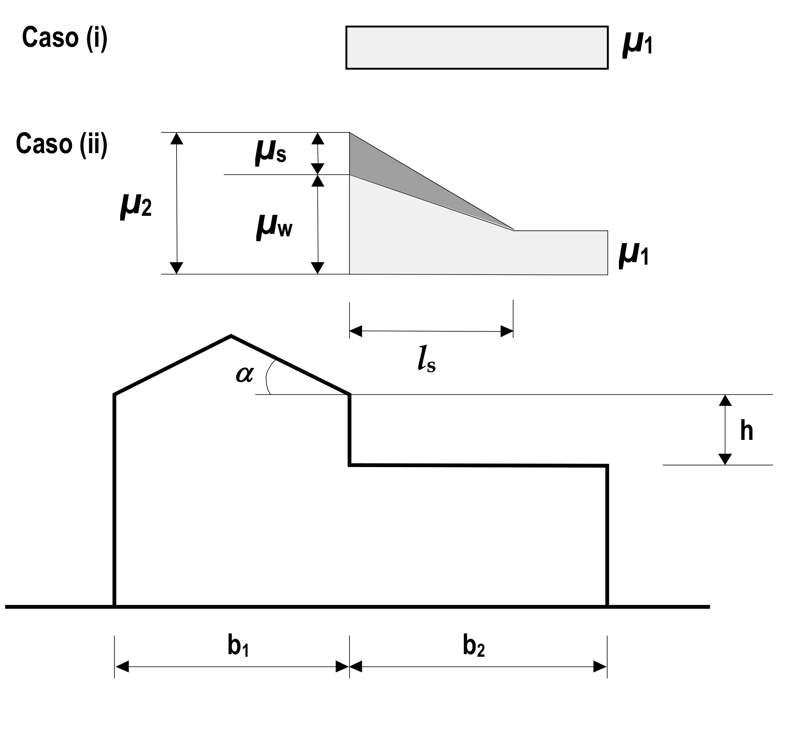
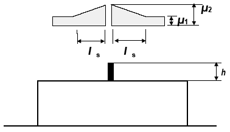
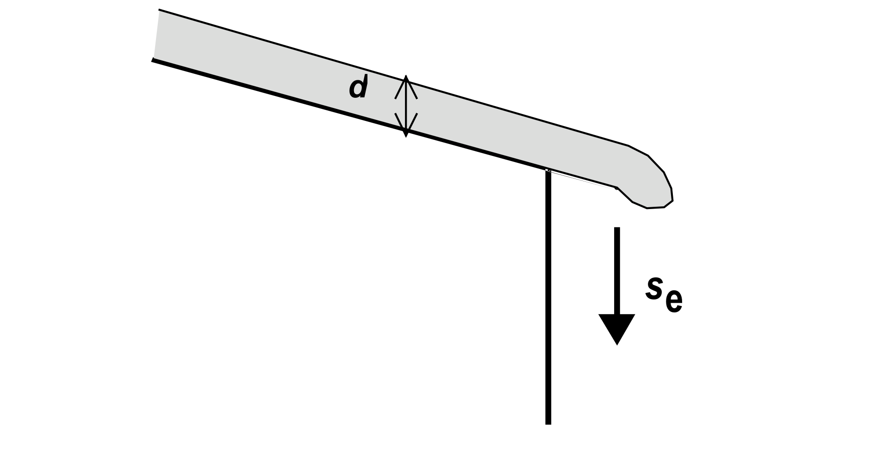

[Torna all'indice del capitolo](indice-cap03.md) | [Torna all'indice generale](../indice-ntc2018.md)

# 3.4. Azioni della neve

## Indice del capitolo

- [[#3.4.1. Carico della neve sulle coperture|3.4.1 Carico neve sulle coperture]]
- [[#3.4.2. Valore di riferimento del carico della neve al suolo|3.4.2 q_sk per zona e altitudine (Fig. 3.4.1)]]
- [[#3.4.3. Coefficiente di forma delle coperture|3.4.3 Coefficiente di forma μ₁ (Tab. 3.4.II)]]
  - [[#3.4.3.1 Generalità|3.4.3.1 Generalità]]
  - [[#3.4.3.2 Copertura ad una falda|3.4.3.2 Copertura ad una falda]]
  - [[#3.4.3.3 Copertura a due falde|3.4.3.3 Copertura a due falde]]
- [[#3.4.4. Coefficiente di esposizione|3.4.4 Coefficiente di esposizione C_E (Tab. 3.4.I)]]
- [[#3.4.5. Coefficiente termico|3.4.5 Coefficiente termico]]
- [[#C3.4. Azioni della neve|C3.4 — Azioni della neve]]
  - [[#C3.4.1. Carico della neve sulle coperture|C3.4.1 Carico neve sulle coperture]]
  - [[#C3.4.2. Valore di riferimento del carico della neve al suolo|C3.4.2 Valore di riferimento al suolo]]
  - [[#C3.4.3. Coefficiente di forma delle coperture|C3.4.3 Coefficiente di forma]]
    - [[#C3.4.3.3. Copertura a due falde (o più)|C3.4.3.3 Coperture a due falde o più]]
      - [[#C3.4.3.3.1. Copertura cilindrica|C3.4.3.3.1 Copertura cilindrica (Fig. C3.4.4)]]
      - [[#C3.4.3.3.2. Copertura adiacente o vicina a costruzioni più alte|C3.4.3.3.2 Copertura adiacente (Fig. C3.4.5)]]
      - [[#C3.4.3.3.4. Accumuli in corrispondenza di sporgenze|C3.4.3.3.4 Sporgenze (Fig. C3.4.6)]]
      - [[#C3.4.3.3.5. Neve aggettante dal bordo di una copertura|C3.4.3.3.5 Neve aggettante (Fig. C3.4.7)]]
  - [[#C3.4.5. Coefficiente termico|C3.4.5 Coefficiente termico]]

---

# Norma

## 3.4.1. Carico della neve sulle coperture

Il carico provocato dalla neve sulle coperture sarà valutato mediante la seguente espressione:

$$q_s = q_{sk} \cdot \mu_i \cdot C_E \cdot C_t \tag{3.4.1}$$

dove:

- $q_{sk}$ è il valore di riferimento del carico della neve al suolo, di cui al §3.4.2;
- $\mu_i$ è il coefficiente di forma della copertura, di cui al §3.4.3;
- $C_E$ è il coefficiente di esposizione di cui al §3.4.4;
- $C_t$ è il coefficiente termico di cui al §3.4.5.

Si assume che il carico della neve agisca in direzione verticale e lo si riferisce alla proiezione orizzontale della superficie della copertura.

## 3.4.2. Valore di riferimento del carico della neve al suolo

Il carico della neve al suolo dipende dalle condizioni locali di clima e di esposizione, considerata la variabilità delle precipitazioni nevose da zona a zona.

In mancanza di adeguate indagini statistiche e specifici studi locali, che tengano conto sia dell'altezza del manto nevoso che della sua densità, il carico di riferimento della neve al suolo, per località poste a quota inferiore a 1500 m sul livello del mare, non dovrà essere assunto minore di quello calcolato in base alle espressioni riportate nel seguito, cui corrispondono valori associati ad un periodo di ritorno pari a 50 anni per le varie zone indicate nella Fig. 3.4.1. Tale zonazione non tiene conto di aspetti specifici e locali che, se necessario, devono essere definiti singolarmente.

**Fig. 3.4.1** - *Zone di carico della neve*

Nelle espressioni seguenti, l'altitudine di riferimento $a_s$ (espressa in m) è la quota del suolo sul livello del mare nel sito dove è realizzata la costruzione.

**Zona I - Alpina**

Aosta, Belluno, Bergamo, Biella, Bolzano, Brescia, Como, Cuneo, Lecco, Pordenone, Sondrio, Torino, Trento, Udine, Verbano-Cusio-Ossola, Vercelli, Vicenza:

$$q_{sk} = 1{,}50 \text{ kN/m}^2 \qquad a_s \leq 200 \text{ m}$$

$$q_{sk} = 1{,}39 \left[1 + (a_s/728)^2\right] \text{ kN/m}^2 \qquad a_s > 200 \text{ m} \tag{3.4.2}$$

**Zona I - Mediterranea**

Alessandria, Ancona, Asti, Bologna, Cremona, Forlì-Cesena, Lodi, Milano, Modena, Monza Brianza, Novara, Parma, Pavia, Pesaro e Urbino, Piacenza, Ravenna, Reggio Emilia, Rimini, Treviso, Varese:

$$q_{sk} = 1{,}50 \text{ kN/m}^2 \qquad a_s \leq 200 \text{ m}$$

$$q_{sk} = 1{,}35 \left[1 + (a_s/602)^2\right] \text{ kN/m}^2 \qquad a_s > 200 \text{ m} \tag{3.4.3}$$

**Zona II**

Arezzo, Ascoli Piceno, Avellino, Bari, Barletta-Andria-Trani, Benevento, Campobasso, Chieti, Fermo, Ferrara, Firenze, Foggia, Frosinone, Genova, Gorizia, Imperia, Isernia, L'Aquila, La Spezia, Lucca, Macerata, Mantova, Massa Carrara, Padova, Perugia, Pescara, Pistoia, Prato, Rieti, Rovigo, Savona, Teramo, Trieste, Venezia, Verona:

$$q_{sk} = 1{,}00 \text{ kN/m}^2 \qquad a_s \leq 200 \text{ m}$$

$$q_{sk} = 0{,}85 \left[1 + (a_s/481)^2\right] \text{ kN/m}^2 \qquad a_s > 200 \text{ m} \tag{3.4.4}$$

**Zona III**

Agrigento, Brindisi, Cagliari, Caltanissetta, Carbonia-Iglesias, Caserta, Catania, Catanzaro, Cosenza, Crotone, Enna, Grosseto, Latina, Lecce, Livorno, Matera, Medio Campidano, Messina, Napoli, Nuoro, Ogliastra, Olbia-Tempio, Oristano, Palermo, Pisa, Potenza, Ragusa, Reggio Calabria, Roma, Salerno, Sassari, Siena, Siracusa, Taranto, Terni, Trapani, Vibo Valentia, Viterbo:

$$q_{sk} = 0{,}60 \text{ kN/m}^2 \qquad a_s \leq 200 \text{ m}$$

$$q_{sk} = 0{,}51 \left[1 + (a_s/481)^2\right] \text{ kN/m}^2 \qquad a_s > 200 \text{ m} \tag{3.4.5}$$

Per altitudini superiori a 1500 m sul livello del mare si deve fare riferimento alle condizioni locali di clima e di esposizione utilizzando comunque valori di carico neve non inferiori a quelli previsti per 1500 m.

Per un'opera di nuova realizzazione in fase di costruzione o per le fasi transitorie relative ad interventi sulle costruzioni esistenti, il periodo di ritorno dell'azione può essere ridotto come di seguito specificato:

- per fasi di costruzione o fasi transitorie con durata prevista in sede di progetto non superiore a tre mesi, si assumerà $T_R$ ≥ 5 anni;
- per fasi di costruzione o fasi transitorie con durata prevista in sede di progetto compresa fra tre mesi ed un anno, si assumerà $T_R$ ≥ 10 anni.

## 3.4.3. Coefficiente di forma delle coperture

### 3.4.3.1 Generalità

I coefficienti di forma delle coperture dipendono dalla forma stessa della copertura e dall'inclinazione sull'orizzontale delle sue parti componenti e dalle condizioni climatiche locali del sito ove sorge la costruzione.

In assenza di dati suffragati da opportuna documentazione, i valori nominali del coefficiente di forma μ₁ delle coperture ad uno o a due falde possono essere ricavati dalla Tab. 3.4.II, essendo α, espresso in gradi sessagesimali, l'angolo formato dalla falda con l'orizzontale.

**Tab. 3.4.II** - *Valori del coefficiente di forma*

| Coefficiente di forma | 0° ≤ α ≤ 30° | 30° < α < 60° | α ≥ 60° |
|:---------------------:|:------------:|:-------------:|:-------:|
| μ₁ | 0,8 | $0{,}8 \cdot \dfrac{(60 - \alpha)}{30}$ | 0,0 |

Si assume che alla neve non sia impedito di scivolare. Se l'estremità più bassa della falda termina con un parapetto, una barriera od altre ostruzioni, allora il coefficiente di forma non potrà essere assunto inferiore a 0,8 indipendentemente dall'angolo α.

Per coperture a più falde, per coperture con forme diverse, così come per coperture contigue a edifici più alti o per accumulo di neve contro parapetti o più in generale per altre situazioni ritenute significative dal progettista si deve fare riferimento a normative o documenti di comprovata validità.

### 3.4.3.2 Copertura ad una falda

Nel caso delle coperture ad una falda, si deve considerare la condizione di carico riportata in Fig. 3.4.2.

**Fig. 3.4.2** - *Condizioni di carico per coperture ad una falda*

### 3.4.3.3 Copertura a due falde

Nel caso delle coperture a due falde, si devono considerare le tre condizioni di carico alternative, denominate *Caso I*, *Caso II* e *Caso III* in Fig. 3.4.3.

**Fig. 3.4.3** - *Condizioni di carico per coperture a due falde*

## 3.4.4. Coefficiente di esposizione

Il coefficiente di esposizione $C_E$ tiene conto delle caratteristiche specifiche dell'area in cui sorge l'opera. Valori consigliati di questo coefficiente sono forniti in Tab. 3.4.I per diverse classi di esposizione. Se non diversamente indicato, si assumerà $C_E$ = 1.

**Tab. 3.4.I** - *Valori di $C_E$ per diverse classi di esposizione*

| Topografia | Descrizione | $C_E$ |
|-----------|-------------|:-----:|
| Battuta dai venti | Aree pianeggianti non ostruite esposte su tutti i lati, senza costruzioni o alberi più alti | 0,9 |
| Normale | Aree in cui non è presente una significativa rimozione di neve sulla costruzione prodotta dal vento, a causa del terreno, altre costruzioni o alberi | 1,0 |
| Riparata | Aree in cui la costruzione considerata è sensibilmente più bassa del circostante terreno o circondata da costruzioni o alberi più alti | 1,1 |

## 3.4.5. Coefficiente termico

Il coefficiente termico tiene conto della riduzione del carico della neve, a causa dello scioglimento della stessa, causata dalla perdita di calore della costruzione. Tale coefficiente dipende dalle proprietà di isolamento termico del materiale utilizzato in copertura. In assenza di uno specifico e documentato studio, deve essere posto $C_t$ = 1.

---

# Circolare

*Circolare 21/01/2019 n. 7 C.S.LL.PP., §C3.4*

## C3.4. Azioni della neve

### C3.4.1. Carico della neve sulle coperture

Nelle NTC 2018 il valore del carico della neve sulle coperture è fornito da una espressione [3.4.1] contenente gli stessi elementi presenti in quella utilizzata nelle NTC 2008 [3.3.7] ma disposti in ordine differente; ciò porta a variare l'ordine dei successivi paragrafi: il coefficiente di forma è perciò descritto al § 3.4.3; il coefficiente di esposizione al § 3.4.4; il coefficiente termico al § 3.4.5.

### C3.4.2. Valore di riferimento del carico della neve al suolo

Nel passaggio dalle precedenti alle attuali NTC si conserva la suddivisione del territorio nazionale in tre zone (viene anche confermata la suddivisione della zona I in due sottozone: alpina e mediterranea) che conservano immutato sia i valori al suolo, sia l'incremento degli stessi con l'altitudine. Vengono però spostate 5 province dalla zona III alla zona II ed introdotte 3 province di nuova creazione (1 in zona I e 2 in zona II). Rispetto alle precedenti NTC nelle attuali vengono anche introdotti i periodi di ritorno da adottare per le fasi transitorie di durata compresa fra 1 e 3 mesi ovvero fra 3 mesi ed 1 anno.

Si può stimare un diverso valore di riferimento $\alpha_n$ corrispondente a $T_n$ anni di periodo di ritorno impiegando l'espressione C.3.4.1.

In esse il coefficiente $\nu$ di variazione della serie dei massimi annuali del carico della neve potrà essere assunto, salvo specifici studi adeguati e documentati, pari a $\nu$ = 0,6.

$$q_{s_n} = q_{s_k} \left\{ \frac{1 - \nu \frac{\sqrt{6}}{\pi} \left[\ln(-\ln(1 - P_n)) + 0{,}57722\right]}{(1 - 2{,}5923 \nu)} \right\} \tag{C.3.4.1}$$

dove:

- $q_{s_k}$ è il valore caratteristico del carico della neve al suolo (con un periodo di ritorno di 50 anni);
- $q_{s_n}$ è il carico della neve al suolo riferito ad un periodo di ritorno di n anni;
- $P_n$ è la probabilità annuale di superamento (approssimativamente equivalente a 1/n, dove n è il corrispondente periodo di ritorno espresso in anni);
- $\nu$ è il coefficiente di variazione della serie dei massimi annuali del carico della neve, stimato per la regione considerata.

*Fig. C3.4.1 — Adattamento del carico della neve al suolo al variare del periodo di ritorno (coefficiente di variazione $\nu$ = 0,6)*

### C3.4.3. Coefficiente di forma delle coperture

Nel § 3.4.3 delle NTC sono indicati i coefficienti di forma per le coperture ad una e a due falde (§§ 3.4.3.2 e 3.4.3.3); qui di seguito sono riportati i coefficienti di forma per le seguenti tipologie di copertura, sia per il carico da neve depositata in assenza di vento che in presenza di vento:

- coperture a più falde;
- coperture cilindriche;
- coperture adiacenti e vicine a costruzioni più alte.

Vengono, poi, fornite indicazioni riguardo agli effetti locali, che si generano in presenza di:

- sporgenze;
- neve aggettante rispetto al bordo della copertura;
- barriere paraneve.

Per numerose tipologie di coperture (a 2 falde, a più falde, cilindriche, ecc.) sono riportate più condizioni di carico alternative per l'azione della neve, che debbono essere tutte considerate, assumendo ovviamente la condizione più severa per la struttura considerata. L'esistenza di più condizioni di carico deriva dalle modalità dell'effetto combinato neve-vento durante la precipitazione nevosa, che può determinare accumuli di neve o riduzione di neve, a seconda della zona di copertura considerata e della direzione del vento. Questo specifico fenomeno è appunto quello che determina le condizioni di carico alternative previste dalle NTC, che debbono essere tutte considerate nelle verifiche, indipendentemente dalla concomitanza nelle combinazioni con l'azione del vento.

#### C3.4.3.1. Generalità

La figura C3.4.2 illustra i valori dei coefficienti di forma per le tipologie di copertura ad una, a due o a più falde, al variare dell'angolo $\alpha$ di inclinazione della falda sull'orizzontale, espresso in gradi sessagesimali. Gli stessi valori sono riportati nella Tabella C3.4.I.

*Fig. C3.4.2 — Coefficienti di forma per il carico neve*

**Tabella C3.4.I** — *Coefficienti di forma per il carico neve*

| Angolo di inclinazione della falda $\alpha$ | 0° ≤ $\alpha$ ≤ 30° | 30° < $\alpha$ < 60° | $\alpha$ ≥ 60° |
|---|:---:|:---:|:---:|
| $\mu_1$ | 0,8 | 0,8(60 - $\alpha$)/30 | 0,0 |
| $\mu_2$ | 0,8 + 0,8 $\alpha$/30 | 1,6 | -- |

#### C3.4.3.2. Copertura ad una falda

Nel caso di edifici con copertura piana la riduzione del manto sulla copertura, operata dal vento, risulta via via meno efficace al crescere delle dimensioni in pianta dell'edificio.

Si raccomanda di tenere conto di questi effetti per coperture estese, attraverso un opportuno incremento del coefficiente $\mu_1$, di cui alla tabella 3.4.II, secondo formulazioni contenute in documenti di comprovata validità.

In assenza di indicazioni più specifiche, definita la dimensione equivalente in pianta $L_c$:

$$L_c = 2W - W^2/L \tag{C.3.4.2}$$

in cui:

- $W$ in m, è la minore delle dimensioni in pianta della copertura;
- $L$ in m, è la maggiore delle dimensioni in pianta della copertura,

si considerano "estese" le coperture aventi $L_c$ > 50 m ed il coefficiente $\mu_1$ potrà essere assunto pari a:

$$\mu_1 = 0{,}8 \; C_{e,F} \tag{C.3.4.3}$$

in cui:

$$C_{e,F} = \begin{cases} 1{,}0 & \text{per } L_c < 50 \text{ m} \\ 1{,}25 - 0{,}25 \; e^{-(L_c - 50\text{m})/200\text{m}} & \end{cases} \tag{C.3.4.4}$$

#### C3.4.3.3. Copertura a due falde (o più)

Si devono considerare, in alternativa, le due condizioni Caso (i) ed Caso (ii) riportate nella Figura C.3.4.3.

*Fig. C3.4.3 — Coefficiente di forma per il carico neve — Coperture a più falde*

Qualora una o entrambe le falde convergenti in un compluvio abbiano una inclinazione superiore a 60°, si dovrà prestare particolare attenzione alla scelta dei coefficienti di forma da utilizzare. In particolare si dovrà tenere presente che l'intensità degli accumuli che si vengono a formare nelle zone di compluvio è funzione dell'azione di redistribuzione della neve operata dal vento e della altezza del compluvio.

L'effetto degli accumuli in presenza di irregolarità del piano di copertura, quali ad esempio coperture con elementi prefabbricati, dovrà essere considerato solo per compluvi nei quali la larghezza delle campate (tratto sotteso dalle due falde adiacenti di inclinazione $\alpha_1$ e $\alpha_2$) sia superiore a 3,5 m e per angoli di inclinazione delle falde superiori o uguali a 30°. Per campate di dimensione e/o di inclinazione inferiore si può assumere, in via semplificativa, che la corrugazione della copertura sia ininfluente per la formazione di accumuli nelle zone di compluvio.

##### C3.4.3.3.1. Copertura cilindrica

Si assume che la neve non sia impedita di scivolare. Si devono considerare in alternativa le due condizioni denominate Caso (i) e Caso (ii), riportate in Figura C.3.4.4.

*Fig. C3.4.4 — Coefficiente di forma per il carico neve — Coperture cilindriche*

I valori dei coefficienti di forma sono dati dalle espressioni seguenti:

- per $\beta$ > 60°: $\mu_3$ = 0
- per $\beta$ ≤ 60°: $\mu_3$ = 0,2 + 10 h/b, con $\mu_3$ ≤ 2,0.

##### C3.4.3.3.2. Copertura adiacente o vicina a costruzioni più alte

Si dovrà considerare la condizione denominata Caso (i) nella Figura C.3.4.5 e si dovranno considerare gli effetti dei possibili accumuli causati dai due fenomeni seguenti:

- scivolamento della neve dalla copertura posta a quota superiore;
- deposito della neve nella zona di *"ombra aerodinamica"*.

*Fig. C3.4.5 — Coefficiente di forma per il carico neve — Coperture adiacenti a costruzioni più alte*

I valori dei coefficienti di forma sono dati dalle espressioni seguenti:

$\mu_1$ = 0,8 (assumendo che la copertura inferiore sia piana)

$\mu_2$ = $\mu_s$ + $\mu_w$

in cui:

$\mu_s$ è il coefficiente di forma per il carico neve dovuto allo scivolamento della neve dalla copertura superiore, che vale:

- per $\alpha$ ≤ 15°: $\mu_s$ = 0
- per $\alpha$ > 15°: $\mu_s$ è calcolato in ragione del 50% del carico totale massimo insistente sulla falda della copertura superiore, valutato con riferimento al valore del coefficiente di forma appropriato per detta falda.

$\mu_w$ è il coefficiente di forma per il carico neve dovuto alla redistribuzione operata dal vento, che vale:

$$\mu_w = (b_1 + b_2)/2h \leq \gamma \cdot h / q_{sk} \tag{C.3.4.5}$$

in cui $\gamma$ è il peso dell'unità di volume della neve [kN/m³], che per i presenti calcoli può essere assunto pari a 2 kN/m³.

Il valore del coefficiente $\mu_w$ dovrà comunque essere compreso tra i limiti seguenti: 0,8 ≤ $\mu_w$ ≤ 4,0.

La lunghezza della zona in cui si forma l'accumulo è data da $l_s$ = 2h, e comunque 5 ≤ $l_s$ ≤ 15 m.

Nel caso in cui $b_2$ ≤ $l_s$ il valore del coefficiente di forma al livello della fine della copertura posta a quota inferiore dovrà essere valutato per interpolazione lineare tra i valori di $\mu_1$ e $\mu_2$.

##### C3.4.3.3.3. Effetti locali

Le indicazioni che seguono sono da intendersi riferite a fenomeni locali, che debbono essere presi in considerazione per la verifica delle membrature da questi direttamente interessate. Le condizioni di carico non dovranno pertanto fare oggetto di specifiche combinazioni di carico che interessino l'intera struttura.

##### C3.4.3.3.4. Accumuli in corrispondenza di sporgenze

La presenza di sporgenze, quali ad esempio i parapetti di bordo presenti su coperture piane, causano la formazione di accumuli nelle zone di *"ombra aerodinamica"* del vento.

Per coperture pseudo-orizzontali si dovrà considerare la condizione di carico illustrata nella Figura C.3.4.6, nella quale si assumerà:

$\mu_1$ = 0,8 e $\mu_2$ = $\gamma \cdot h / q_{sk}$, con la limitazione: 0,8 ≤ $\mu_2$ ≤ 2,0

dove $\gamma$ è il peso dell'unità di volume della neve, che per il presente calcolo può essere assunto pari a 2 kN/m³;

$l_s$ = 2h, con la limitazione: 5 ≤ $l_s$ ≤ 15 m.

*Fig. C3.4.6 — Coefficienti di forma per il carico neve in corrispondenza di sporgenze e ostruzioni*

##### C3.4.3.3.5. Neve aggettante dal bordo di una copertura

In località poste a quota superiore a 800 m sul livello del mare, nella verifica delle parti di copertura a sbalzo sulle murature di facciata si dovrà considerare l'azione della neve sospesa oltre il bordo della copertura, sommato al carico agente su quella parte di tetto, secondo lo schema illustrato nella Figura C.3.4.7.

I carichi dovuti alla neve sospesa in aggetto saranno considerati agenti in corrispondenza del bordo della copertura e si possono calcolare mediante l'espressione:

$$q_{se} = k \; q_s^2 / \gamma \tag{C.3.4.6}$$

dove:

- $q_{se}$ è il carico della neve per unità di lunghezza dovuto alla sospensione (vedasi la Figura C.3.4.7);
- $q_s$ è il carico corrispondente alla distribuzione del manto più sfavorevole per la copertura in esame;
- $\gamma$ è il peso dell'unità di volume della neve, che per il presente calcolo può essere assunto pari a 3,0 kN/m³;
- $k$ è un coefficiente funzione della irregolarità della forma della neve, pari a $k$ = 3/d, con $k$ ≤ d/$t$, essendo $d$ la profondità del manto nevoso sulla copertura in m (vedasi la Figura C.3.4.7).

*Fig. C3.4.7 — Neve aggettante dal bordo di una copertura*

##### C3.4.3.3.6. Carichi della neve su barriere paraneve ed altri ostacoli

In talune condizioni la neve può scivolare via da un tetto a falde o curvo. In questo caso si assume pari a zero il coefficiente di attrito tra la massa di neve e la superficie della copertura.

L'azione statica $F_s$ impressa da una massa di neve che scivola su barriere paraneve o altri ostacoli, nella direzione dello scivolamento, per unità di lunghezza dell'edificio può essere assunta uguale a:

$$F_s = q_s \cdot b \cdot \sin\alpha \tag{C.3.4.7}$$

dove:

- $q_s$ è il carico della neve sulla copertura, relativo alla distribuzione uniforme più sfavorevole tra quelle proprie della zona dalla quale la neve potrebbe scivolare;
- $b$ è la distanza in pianta (misurata in orizzontale) tra il paraneve o l'ostacolo ed il successivo paraneve o il colmo del tetto;
- $\alpha$ angolo di inclinazione del tetto, misurato a partire dall'orizzontale.

### C3.4.5. Coefficiente termico

L'adozione di valori inferiori all'unità del coefficiente termico è da sconsigliarsi in linea generale. Laddove adeguatamente motivato può applicarsi solamente per coperture ricadenti in località nelle quali il carico della neve al suolo è superiore a 1,5 kN/m², e caratterizzate da trasmittanza superiore a 1 W/m²K°.

Per edifici nei quali la temperatura interna è mantenuta intenzionalmente sotto 0°C (edifici frigoriferi, impianti per il pattinaggio su ghiaccio ecc.) si raccomanda di assumere il valore del coefficiente termico pari a 1,2, indipendentemente dal valore del carico neve al suolo.
