[Torna all'indice del capitolo](indice-cap04.md) | [Torna all'indice generale](../indice-ntc2018.md)

# 4.1. Costruzioni di calcestruzzo

## Indice del capitolo

- [4.1.1 Valutazione della sicurezza (analisi elastica/plastica/non lineare)](#411-valutazione-della-sicurezza-e-metodi-di-analisi)
  - [4.1.1.1 Analisi elastica lineare (ridistribuzione)](#4111-analisi-elastica-lineare)
  - [4.1.1.2 Analisi plastica](#4112-analisi-plastica)
  - [4.1.1.3 Analisi non lineare](#4113-analisi-non-lineare)
  - [4.1.1.4 Effetti delle deformazioni](#4114-effetti-delle-deformazioni)
- [4.1.2 Verifiche degli stati limite](#412-verifiche-degli-stati-limite)
  - [4.1.2.1 Materiali (f_cd/f_yd, diagrammi σ-ε)](#4121-materiali)
  - [4.1.2.2 SLE (deformazioni, fessurazione w_k, tensioni)](#4122-stati-limite-di-esercizio)
  - [4.1.2.3 SLU (flessione, taglio, torsione, punzonamento)](#4123-stati-limite-ultimi)
- [4.1.3 Verifiche per situazioni transitorie](#413-verifiche-per-situazioni-transitorie)
- [4.1.4 Verifiche per situazioni eccezionali](#414-verifiche-per-situazioni-eccezionali)
- [4.1.5 Progettazione integrata da prove](#415-progettazione-integrata-da-prove-e-verifica-mediante-prove)
- [4.1.6 Dettagli costruttivi (armature minime travi/pilastri)](#416-dettagli-costruttivi)
- [4.1.7 Esecuzione](#417-esecuzione)
- [4.1.8 Calcestruzzo armato precompresso](#418-norme-ulteriori-per-il-calcestruzzo-armato-precompresso)
- [4.1.9 Solai](#419-norme-ulteriori-per-i-solai)
- [4.1.10 Strutture prefabbricate](#4110-norme-ulteriori-per-le-strutture-prefabbricate)
- [4.1.11 Calcestruzzo non armato](#4111-calcestruzzo-a-bassa-percentuale-di-armatura-o-non-armato)
- [4.1.12 Aggregati leggeri (LC)](#4112-calcestruzzo-di-aggregati-leggeri-lc)
- [4.1.13 Resistenza al fuoco](#4113-resistenza-al-fuoco)
- [C4.1 — Costruzioni di calcestruzzo (Premessa, classi C28/35-C32/40)](#c41-costruzioni-di-calcestruzzo)
  - [C4.1.1 Analisi elastica lineare (ridistribuzione momenti)](#c411-valutazione-della-sicurezza-e-metodi-di-analisi)
  - [C4.1.2 Verifiche stati limite](#c412-verifiche-agli-stati-limite)
  - [C4.1.6 Dettagli costruttivi (copriferro Tab. C4.1.IV)](#c416-dettagli-costruttivi)
  - [C4.1.9 Solai](#c419-norme-ulteriori-per-i-solai)
  - [C4.1.12 Aggregati leggeri LC 16/18 a LC 55/60](#c4112-calcestruzzo-di-aggregati-leggeri-lc)

---

# Norma

Formano oggetto delle presenti norme le strutture di:

- calcestruzzo armato normale (cemento armato)
- calcestruzzo armato precompresso (cemento armato precompresso)
- calcestruzzo a bassa percentuale di armatura o non armato

con riferimento a calcestruzzi di peso normale e con esclusione di quelle opere per le quali vige una regolamentazione apposita a carattere particolare.

Al § 4.1.12 sono date inoltre le norme integrative per le strutture in calcestruzzo di inerte leggero.

Nel seguito si intendono per calcestruzzi ordinari i calcestruzzi conformi al presente § 4.1 ed al § 11.2, con esclusione dei calcestruzzi di aggregati leggeri (LC), di cui al §4.1.12, e di quelli fibrorinforzati (FRC), di cui al §11.2.12.

Ai fini della valutazione del comportamento e della resistenza delle strutture in calcestruzzo, questo viene titolato ed identificato mediante la classe di resistenza contraddistinta dai valori caratteristici delle resistenze cilindrica e cubica a compressione uniassiale, misurate rispettivamente su provini cilindrici (o prismatici) e cubici, espressa in MPa (§ 11.2).

Per le classi di resistenza normalizzate per calcestruzzo normale si può fare utile riferimento a quanto indicato nelle norme UNI EN 206 e nella UNI 11104.

Sulla base della denominazione normalizzata vengono definite le classi di resistenza della Tab. 4.1.I.

**Tab. 4.1.I** – *Classi di resistenza*

| Classe di resistenza |
|:---:|
| C8/10 |
| C12/15 |
| C16/20 |
| C20/25 |
| C25/30 |
| C30/37 |
| C35/45 |
| C40/50 |
| C45/55 |
| C50/60 |
| C55/67 |
| C60/75 |
| C70/85 |
| C80/95 |
| C90/105 |

Oltre alle classi di resistenza riportate in Tab. 4.1.I si possono prendere in considerazione le classi di resistenza già in uso C28/35 e C32/40.

I calcestruzzi delle diverse classi di resistenza trovano impiego secondo quanto riportato nella Tab. 4.1.II, fatti salvi i limiti derivanti dal rispetto della durabilità.

Per classi di resistenza superiore a C70/85 si rinvia al caso C) del § 11.1.

Per le classi di resistenza superiori a C45/55, la resistenza caratteristica e tutte le grandezze meccaniche e fisiche che hanno influenza sulla resistenza e durabilità del conglomerato devono essere accertate prima dell'inizio dei lavori tramite un'apposita sperimentazione preventiva e la produzione deve seguire specifiche procedure per il controllo di qualità.

**Tab. 4.1.II** – *Impiego delle diverse classi di resistenza*

| Strutture di destinazione | Classe di resistenza minima |
|---|:---:|
| Per strutture non armate o a bassa percentuale di armatura (§ 4.1.11) | C8/10 |
| Per strutture semplicemente armate | C16/20 |
| Per strutture precompresse | C28/35 |

---

## 4.1.1. Valutazione della sicurezza e metodi di analisi

La valutazione della sicurezza va condotta secondo i principi fondamentali ed i metodi precisati al Capitolo 2.

In particolare per l'analisi strutturale, volta alla valutazione degli effetti delle azioni, si potranno adottare i metodi seguenti:

*a)* analisi elastica lineare;
*b)* analisi plastica;
*c)* analisi non lineare.

Quando rilevante, nei diversi metodi di analisi sopra citati vanno considerati gli effetti del secondo ordine (§ 4.1.1.4).

Le analisi globali hanno lo scopo di stabilire la distribuzione delle forze interne, delle tensioni, delle deformazioni e degli spostamenti nell'intera struttura o in una parte di essa.

Analisi locali possono essere necessarie nelle zone singolari quali quelle poste:

- in prossimità degli appoggi;
- in corrispondenza di carichi concentrati;
- alle intersezioni travi-colonne;
- nelle zone di ancoraggio;
- in corrispondenza di variazioni della sezione trasversale.

### 4.1.1.1 Analisi elastica lineare

L'analisi elastica lineare può essere usata per valutare gli effetti delle azioni sia per gli stati limite di esercizio sia per gli stati limite ultimi.

Per la determinazione degli effetti delle azioni, le analisi saranno effettuate assumendo:

- sezioni interamente reagenti con rigidezze valutate riferendosi al solo calcestruzzo;
- relazioni tensione deformazione lineari;
- valori medi del modulo d'elasticità.

Per la determinazione degli effetti delle deformazioni termiche, degli eventuali cedimenti e del ritiro, le analisi saranno effettuate assumendo:

- per gli stati limite ultimi, rigidezze ridotte valutate ipotizzando che le sezioni siano fessurate (in assenza di valutazioni più precise la rigidezza delle sezioni fessurate potrà essere assunta pari alla metà della rigidezza delle sezioni interamente reagenti);
- per gli stati limite di esercizio, rigidezze intermedie tra quelle delle sezioni interamente reagenti e quelle delle sezioni fessurate.

Per le sole verifiche agli stati limite ultimi, i risultati dell'analisi elastica possono essere modificati con una ridistribuzione dei momenti, nel rispetto dell'equilibrio e delle capacità di rotazione plastica delle sezioni dove si localizza la ridistribuzione. In particolare la ridistribuzione non è ammessa per i pilastri e per i nodi dei telai, è consentita per le travi continue, le travi di telai in cui possono essere trascurati gli effetti del secondo ordine e le solette, a condizione che le sollecitazioni di flessione siano prevalenti ed i rapporti tra le luci di campate contigue siano compresi nell'intervallo 0,5-2,0.

Per le travi e le solette che soddisfano le condizioni dette, la ridistribuzione dei momenti flettenti può effettuarsi senza esplicite verifiche in merito alla duttilità delle membrature, purché il rapporto $\delta$ tra il momento dopo la ridistribuzione ed il momento prima della ridistribuzione risulti $1 \geq \delta \geq 0{,}70$.

I valori di $\delta$ si ricavano dalle espressioni:

$$\delta \geq 0{,}44 + 1{,}25 \cdot (0{,}6 + 0{,}0014/\varepsilon_{cu}) \cdot x/d \quad \text{per } f_{ck} \leq 50 \text{ MPa} \tag{4.1.1}$$

$$\delta \geq 0{,}54 + 1{,}25 \cdot (0{,}6 + 0{,}0014/\varepsilon_{cu}) \cdot x/d \quad \text{per } f_{ck} > 50 \text{ MPa} \tag{4.1.2}$$

dove x è l'altezza della zona compressa dopo la ridistribuzione, d è l'altezza utile della sezione (Fig.4.1.4) ed $\varepsilon_{cu}$ è definita in § 4.1.2.1.2.1.

Per le travi continue, le travi di telai in cui possono essere trascurati gli effetti del secondo ordine e le solette, il rapporto x/d nelle sezioni critiche non deve comunque superare il valore 0,45 per $f_{ck} \leq 50$ MPa e 0,35 per $f_{ck} > 50$ MPa.

### 4.1.1.2 Analisi plastica

L'analisi plastica può essere usata per valutare gli effetti di azioni statiche e per i soli stati limite ultimi.

Al materiale si può attribuire un diagramma tensioni-deformazioni rigido-plastico verificando che la duttilità delle sezioni dove si localizzano le plasticizzazioni sia sufficiente a garantire la formazione del meccanismo previsto.

Nell'analisi si trascurano gli effetti di precedenti applicazioni del carico e si assume un incremento monotono dell'intensità delle azioni e la costanza del rapporto tra le loro intensità così da pervenire ad un unico moltiplicatore di collasso. L'analisi può essere del primo o del secondo ordine.

### 4.1.1.3 Analisi non lineare

L'analisi non lineare può essere usata per valutare gli effetti di azioni statiche e dinamiche, sia per gli stati limite di esercizio, sia per gli stati limite ultimi, a condizione che siano soddisfatti l'equilibrio e la congruenza.

Al materiale si può attribuire un diagramma tensioni-deformazioni che ne rappresenti adeguatamente il comportamento reale, verificando che le sezioni dove si localizzano le plasticizzazioni siano in grado di sopportare allo stato limite ultimo tutte le deformazioni non elastiche derivanti dall'analisi, tenendo in appropriata considerazione le incertezze.

Nell'analisi si trascurano gli effetti di precedenti applicazioni del carico e si assume un incremento monotono dell'intensità delle azioni e la costanza del rapporto tra le loro intensità. L'analisi può essere del primo o del secondo ordine.

### 4.1.1.4 Effetti delle deformazioni

In generale, è possibile effettuare:

- l'analisi del primo ordine, imponendo l'equilibrio sulla configurazione iniziale della struttura,
- l'analisi del secondo ordine, imponendo l'equilibrio sulla configurazione deformata della struttura.

L'analisi globale può condursi con la teoria del primo ordine nei casi in cui possano ritenersi trascurabili gli effetti delle deformazioni sull'entità delle sollecitazioni, sui fenomeni di instabilità e su qualsiasi altro rilevante parametro di risposta della struttura.

Gli effetti del secondo ordine possono essere trascurati se sono inferiori al 10% dei corrispondenti effetti del primo ordine, oppure se sono rispettate le condizioni di cui al § 4.1.2.3.9.2.

---

## 4.1.2. Verifiche degli stati limite

### 4.1.2.1 Materiali

#### 4.1.2.1.1 Resistenze di progetto dei materiali

##### 4.1.2.1.1.1 Resistenza di progetto a compressione del calcestruzzo

Per il calcestruzzo la resistenza di progetto a compressione, $f_{cd}$, é:

$$f_{cd} = \alpha_{cc} \cdot f_{ck} / \gamma_c \tag{4.1.3}$$

dove:

- $\alpha_{cc}$ è il coefficiente riduttivo per le resistenze di lunga durata;
- $\gamma_c$ è il coefficiente parziale di sicurezza relativo al calcestruzzo;
- $f_{ck}$ è la resistenza caratteristica cilindrica a compressione del calcestruzzo a 28 giorni.

Il coefficiente $\gamma_c$ è pari ad 1,5.

Il coefficiente $\alpha_{cc}$ è pari a 0,85.

Nel caso di elementi piani (solette, pareti, ...) gettati in opera con calcestruzzi ordinari e con spessori minori di 50 mm, la resistenza di progetto a compressione va ridotta a $0{,}80 \cdot f_{cd}$.

Il coefficiente $\gamma_c$ può essere ridotto da 1,5 a 1,4 per produzioni continuative di elementi o strutture, soggette a controllo continuativo del calcestruzzo dal quale risulti un coefficiente di variazione (rapporto tra scarto quadratico medio e valor medio) della resistenza non superiore al 10%. Le suddette produzioni devono essere inserite in un sistema di qualità di cui al § 11.8.3.

##### 4.1.2.1.1.2 Resistenza di progetto a trazione del calcestruzzo

La resistenza di progetto a trazione, $f_{ctd}$, vale:

$$f_{ctd} = f_{ctk} / \gamma_c \tag{4.1.4}$$

dove:

- $\gamma_c$ è il coefficiente parziale di sicurezza relativo al calcestruzzo già definito al § 4.1.2.1.1.1;
- $f_{ctk}$ è la resistenza caratteristica a trazione del calcestruzzo (§ 11.2.10.2).

Il coefficiente $\gamma_c$ assume il valore 1,5.

Nel caso di elementi piani (solette, pareti, ...) gettati in opera con calcestruzzi ordinari e con spessori minori di 50 mm, la resistenza di progetto a trazione va ridotta a $0{,}80 \cdot f_{ctd}$.

Il coefficiente $\gamma_c$ può essere ridotto, da 1,5 a 1,4 nei casi specificati al § 4.1.2.1.1.1.

##### 4.1.2.1.1.3 Resistenza di progetto dell'acciaio

La resistenza di progetto dell'acciaio $f_{yd}$ è riferita alla tensione di snervamento ed il suo valore è dato da:

$$f_{yd} = f_{yk} / \gamma_s \tag{4.1.5}$$

dove:

- $\gamma_s$ è il coefficiente parziale di sicurezza relativo all'acciaio;
- $f_{yk}$ per armatura ordinaria è la tensione caratteristica di snervamento dell'acciaio (§ 11.3.2), per armature da precompressione è la tensione convenzionale caratteristica di snervamento data, a seconda del tipo di prodotto, da $f_{pyk}$ (barre), $f_{p(0,1)k}$ (fili), $f_{p(1)k}$ (trefoli e trecce); si veda in proposito la Tab. 11.3.VIII.

Il coefficiente $\gamma_s$ assume sempre, per tutti i tipi di acciaio, il valore 1,15.

##### 4.1.2.1.1.4 Tensione tangenziale di aderenza acciaio-calcestruzzo

La resistenza tangenziale di aderenza di progetto $f_{bd}$ vale:

$$f_{bd} = f_{bk} / \gamma_c \tag{4.1.6}$$

dove:

- $\gamma_c$ è il coefficiente parziale di sicurezza relativo al calcestruzzo, pari a 1,5;
- $f_{bk}$ è la resistenza tangenziale caratteristica di aderenza data da:

$$f_{bk} = 2{,}25 \cdot \eta_1 \cdot \eta_2 \cdot f_{ctk} \tag{4.1.7}$$

in cui

- $\eta_1 = 1{,}0$ in condizioni di buona aderenza;
- $\eta_1 = 0{,}7$ in condizioni di non buona aderenza, quali nei casi di armature molto addensate, ancoraggi in zona tesa, ancoraggi in zone superiori di getto, in elementi strutturali realizzati con casseforme scorrevoli, a meno che non si adottino idonei provvedimenti;
- $\eta_2 = 1{,}0$ per barre di diametro $\Phi \leq 32$ mm
- $\eta_2 = (132 - \Phi)/100$ per barre di diametro superiore

La lunghezza di ancoraggio di progetto e la lunghezza di sovrapposizione sono influenzate dalla forma delle barre, dal copriferro, dall'effetto di confinamento dell'armatura trasversale, dalla presenza di barre trasversali saldate, dalla pressione trasversale lungo la lunghezza di ancoraggio e dalla percentuale di armatura sovrapposta rispetto all'armatura totale. Per le regole di dettaglio da adottare si potrà fare utile riferimento alla sezione 8 di UNI EN 1992-1-1:2015.

#### 4.1.2.1.2 Diagrammi di progetto dei materiali ‘

##### 4.1.2.1.2.1 Diagrammi di progetto tensione-deformazione del calcestruzzo

Per il diagramma tensione-deformazione del calcestruzzo è possibile adottare opportuni modelli rappresentativi del reale comportamento del materiale, definiti in base alla resistenza di progetto $f_{cd}$ e alla deformazione ultima di progetto $\varepsilon_{cu}$.

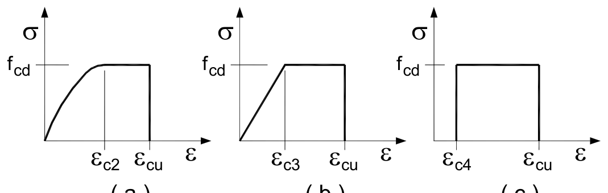

**Fig. 4.1.1** – *Modelli σ-ε per il calcestruzzo*

In Fig. 4.1.1 sono rappresentati i modelli σ-ε per il calcestruzzo:

(a) parabola-rettangolo; (b) triangolo-rettangolo; (c) rettangolo (stress block).

In particolare, per le classi di resistenza pari o inferiore a C50/60 si può porre:

| | |
|---|---|
| $\varepsilon_{c2} = 0{,}20\%$ | $\varepsilon_{cu} = 0{,}35\%$ |
| $\varepsilon_{c3} = 0{,}175\%$ | $\varepsilon_{c4} = 0{,}07\%$ |

Per le classi di resistenza superiore a C50/60 si può porre:

- $\varepsilon_{c2} = 0{,}20\% + 0{,}0085\% \cdot (f_{ck} - 50)^{0,53}$
- $\varepsilon_{cu} = 0{,}26\% + 3{,}5\% \cdot [(90 - f_{ck})/100]^4$
- $\varepsilon_{c3} = 0{,}175\% + 0{,}055\% \cdot [(f_{ck} - 50)/40]$
- $\varepsilon_{c4} = 0{,}2 \cdot \varepsilon_{cu}$

purché si adottino opportune limitazioni quando si usa il modello (c).

Per sezioni o parti di sezioni soggette a distribuzioni di tensione di compressione approssimativamente uniformi, si assume per la deformazione ultima di progetto il valore $\varepsilon_{c2}$ anziché $\varepsilon_{cu}$.

**Calcestruzzo confinato**

Per il diagramma tensione-deformazione del calcestruzzo confinato è possibile adottare opportuni modelli rappresentativi del reale comportamento del materiale in stato triassiale. Questi modelli possono essere adottati nel calcolo sia della resistenza ultima sia della duttilità delle sezioni e devono essere applicati alle sole zone confinate della sezione.

Il confinamento del calcestruzzo è normalmente generato da staffe chiuse e legature interne, che possono raggiungere la tensione di snervamento a causa della dilatazione laterale del calcestruzzo stesso a cui tendono ad opporsi. Il confinamento consente al calcestruzzo di raggiungere tensioni e deformazioni più elevate di quelle proprie del calcestruzzo non confinato. Le altre caratteristiche meccaniche si possono considerare inalterate.

In assenza di più precise determinazioni basate su modelli analitici di comprovata validità, è possibile utilizzare la relazione tensione-deformazione rappresentata in Fig. 4.1.2 (dove le deformazioni di compressione sono assunte positive), in cui la resistenza caratteristica e le deformazioni del calcestruzzo confinato sono valutate secondo le relazioni seguenti:

$$f_{ck,c} = f_{ck} \cdot (1{,}0 + 5{,}0 \cdot \sigma_2 / f_{ck}) \quad \text{per } \sigma_2 \leq 0{,}05 f_{ck} \tag{4.1.8}$$

$$f_{ck,c} = f_{ck} \cdot (1{,}125 + 2{,}5 \cdot \sigma_2 / f_{ck}) \quad \text{per } \sigma_2 > 0{,}05 f_{ck} \tag{4.1.9}$$

$$\varepsilon_{c2,c} = \varepsilon_{c2} \cdot (f_{ck,c} / f_{ck})^2 \tag{4.1.10}$$

$$\varepsilon_{cu2,c} = \varepsilon_{cu} + 0{,}2 \cdot \sigma_2 / f_{ck} \tag{4.1.11}$$

$$f_{cd,c} = \alpha_{cc} \cdot f_{ck,c} / \gamma_c \tag{4.1.12}$$

essendo $\sigma_2$ la pressione laterale efficace di confinamento allo SLV mentre $\varepsilon_{c2}$ ed $\varepsilon_{cu}$ sono valutate in accordo al § 4.1.2.1.2.1.

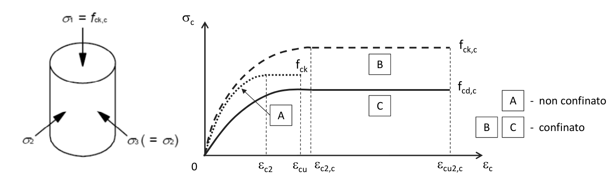

**Fig. 4.1.2** – *Modelli σ-ε per il calcestruzzo confinato*

La pressione efficace di confinamento $\sigma_2$ può essere determinata attraverso la relazione seguente:

$$\sigma_2 = \alpha \cdot \sigma_l \tag{4.1.12.a}$$

dove $\alpha$ è un coefficiente di efficienza ($\leq 1$), definito come rapporto fra il volume $V_{c,eff}$ di calcestruzzo efficacemente confinato ed il volume $V_c$ dell'elemento di calcestruzzo, depurato da quello delle armature longitudinali (generalmente trascurabile) e $\sigma_l$ è la pressione di confinamento esercitata dalle armature trasversali.

La pressione laterale può essere valutata, per ogni direzione principale della sezione, direttamente da considerazioni di equilibrio sul nucleo confinato, in corrispondenza della tensione di snervamento dell'armatura trasversale, come di seguito indicato.

**a) Per sezioni rettangolari**

Per le due direzioni principali della sezione x e y valgono, rispettivamente, le relazioni:

$$\sigma_{l,x} = \frac{A_{st,x} \cdot f_{yk,st}}{b_y \cdot s} \; ; \quad \sigma_{l,y} = \frac{A_{st,y} \cdot f_{yk,st}}{b_x \cdot s} \tag{4.1.12.b}$$

dove $A_{st,x}$ e $A_{st,y}$ sono il quantitativo totale (aree delle sezioni) di armatura trasversale in direzione parallela, rispettivamente, alle direzioni principali x e y, $b_x$ e $b_y$ sono le dimensioni del nucleo confinato nelle direzioni corrispondenti (con riferimento alla linea media delle staffe), $s$ è il passo delle staffe, $f_{yk,st}$ è la tensione caratteristica dell'acciaio delle staffe.

La pressione laterale equivalente $\sigma_l$ può essere determinata attraverso la relazione:

$$\sigma_l = \sqrt{\sigma_{l,x} \cdot \sigma_{l,y}} \tag{4.1.12.c}$$

**b) Per sezioni circolari**

$$\sigma_l = \frac{2 A_{st} \cdot f_{yk,st}}{D_0 \cdot s} \tag{4.1.12.d}$$

dove: $A_{st}$ è l'area della sezione della staffa, $D_0$ è il diametro del nucleo confinato (con riferimento alla linea media delle staffe).

Il coefficiente di efficienza $\alpha$ può essere valutato come prodotto di un termine relativo alla disposizione delle armature trasversali nel piano della sezione e di un termine relativo al passo delle staffe, attraverso la relazione:

$$\alpha = \alpha_n \cdot \alpha_s \tag{4.1.12.e}$$

con:

**a) per sezioni rettangolari**

$$\alpha_n = 1 - \sum_n b_i^2 / (6 \cdot b_x \cdot b_y) \tag{4.1.12.f}$$

$$\alpha_s = [1 - s/(2 \cdot b_x)] \cdot [1 - s/(2 \cdot b_y)] \tag{4.1.12.g}$$

dove: n è il numero totale di barre longitudinali contenute lateralmente da staffe o legature, $b_i$ è la distanza tra barre consecutive contenute.

**b) per sezioni circolari**

$$\alpha_n = 1 \tag{4.1.12.h}$$

$$\alpha_s = [1 - s/(2 \cdot D_0)]^\beta \tag{4.1.12.i}$$

dove: $\beta = 2$ per staffe circolari singole, $\beta = 1$ per staffa a spirale.

Nella valutazione della capacità della sezione il contributo del copriferro non deve essere considerato nelle zone esterne al nucleo confinato in cui la deformazione massima supera la deformazione ultima del calcestruzzo non confinato.

Nel caso di utilizzo di rinforzi appositamente progettati per il confinamento degli elementi è possibile considerare i modelli di comportamento riportati in riferimenti tecnici di comprovata validità.

##### 4.1.2.1.2.2 Diagrammi di progetto tensione-deformazione dell'acciaio

Per il diagramma tensione-deformazione dell'acciaio è possibile adottare opportuni modelli rappresentativi del reale comportamento del materiale, modelli definiti in base al valore di progetto $\varepsilon_{ud} = 0{,}9 \varepsilon_{uk}$ ($\varepsilon_{uk} = (A_{gt})_k$) della deformazione uniforme ultima, al valore di progetto della tensione di snervamento $f_{yd}$ ed al rapporto di sovraresistenza $k = (f_t / f_y)_k$ (Tab. 11.3.Ia-b).

In Fig. 4.1.3 sono rappresentati i modelli σ-ε per l'acciaio:

(a) bilineare finito con incrudimento; (b) elastico-perfettamente plastico indefinito.

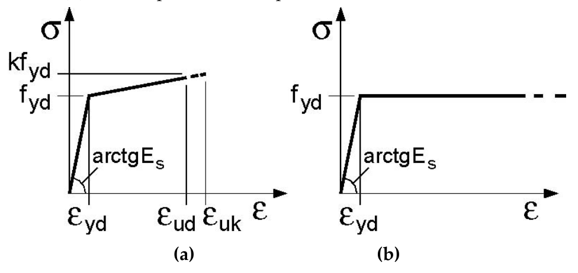

**Fig. 4.1.3** – *Modelli σ-ε per l'acciaio*

### 4.1.2.2 Stati limite di esercizio

#### 4.1.2.2.1 Generalità

Si deve verificare il rispetto dei seguenti stati limite:

- deformazione,
- vibrazione,
- fessurazione,
- tensioni di esercizio,
- fatica per quanto riguarda eventuali danni che possano compromettere la durabilità, per la quale sono definite regole specifiche nei punti seguenti.

#### 4.1.2.2.2 Stato limite di deformazione

I limiti di deformabilità devono essere congruenti con le prestazioni richieste alla struttura anche in relazione alla destinazione d'uso, con riferimento alle esigenze statiche, funzionali ed estetiche.

I valori limite devono essere commisurati a specifiche esigenze e possono essere dedotti da documentazione tecnica di comprovata validità.

#### 4.1.2.2.3 Stato limite per vibrazioni

Quando richiesto, devono essere individuati limiti per vibrazioni:

- al fine di assicurare accettabili livelli di benessere (dal punto di vista delle sensazioni percepite dagli utenti),
- al fine di prevenire possibili danni negli elementi secondari e nei componenti non strutturali,
- al fine di evitare possibili danni che compromettano il funzionamento di macchine e apparecchiature.

#### 4.1.2.2.4 Stato limite di fessurazione

In ordine di severità decrescente, per la combinazione di azioni prescelta, si distinguono i seguenti stati limite:

*a)* stato limite di decompressione, nel quale la tensione normale è ovunque di compressione ed al più uguale a 0;

*b)* stato limite di formazione delle fessure, nel quale la tensione normale di trazione nella fibra più sollecitata è:

$$\sigma_t = \frac{f_{ctm}}{1{,}2} \tag{4.1.13}$$

dove $f_{ctm}$ è definito nel § 11.2.10.2;

*c)* stato limite di apertura delle fessure, nel quale il valore limite di apertura della fessura calcolato al livello considerato è pari ad uno dei seguenti valori nominali:

$w_1 = 0{,}2$ mm $w_2 = 0{,}3$ mm $w_3 = 0{,}4$ mm

Lo stato limite di fessurazione deve essere fissato in funzione delle condizioni ambientali e della sensibilità delle armature alla corrosione, come descritto nel seguito.

##### 4.1.2.2.4.1 Combinazioni di azioni

Si prendono in considerazione le seguenti combinazioni:

- combinazioni quasi permanenti;
- combinazioni frequenti.

##### 4.1.2.2.4.2 Condizioni ambientali

Ai fini della protezione contro la corrosione delle armature metalliche e della protezione contro il degrado del calcestruzzo, le condizioni ambientali possono essere suddivise in ordinarie, aggressive e molto aggressive in relazione a quanto indicato nella Tab. 4.1.III con riferimento alle classi di esposizione definite nelle *Linee Guida per il calcestruzzo strutturale* emesse dal Servizio Tecnico Centrale del Consiglio Superiore dei Lavori Pubblici nonché nella UNI EN 206:2016.

**Tab. 4.1.III** – *Descrizione delle condizioni ambientali*

| Condizioni ambientali | Classe di esposizione |
|---|---|
| Ordinarie | X0, XC1, XC2, XC3, XF1 |
| Aggressive | XC4, XD1, XS1, XA1, XA2, XF2, XF3 |
| Molto aggressive | XD2, XD3, XS2, XS3, XA3, XF4 |

##### 4.1.2.2.4.3 Sensibilità delle armature alla corrosione

Le armature si distinguono in due gruppi:

- armature sensibili;
- armature poco sensibili.

Appartengono al primo gruppo gli acciai da precompresso.

Appartengono al secondo gruppo gli acciai ordinari.

Per gli acciai zincati e per quelli inossidabili, si può tener conto della loro minor sensibilità alla corrosione sulla base di documenti di comprovata validità.

##### 4.1.2.2.4.4 Scelta degli stati limite di fessurazione

Nella Tab. 4.1.IV sono indicati i criteri di scelta dello stato limite di fessurazione con riferimento alle esigenze sopra riportate.

**Tab. 4.1.IV** – *Criteri di scelta dello stato limite di fessurazione*

| Gruppi di Esigenze | Condizioni ambientali | Combinazione di azioni | Armatura Sensibile | | Armatura Poco sensibile | |
|:---:|---|---|---|---|---|---|
| | | | Stato limite | $w_k$ | Stato limite | $w_k$ |
| A | Ordinarie | frequente | apertura fessure | $\leq w_2$ | apertura fessure | $\leq w_3$ |
| A | Ordinarie | quasi permanente | apertura fessure | $\leq w_1$ | apertura fessure | $\leq w_2$ |
| B | Aggressive | frequente | apertura fessure | $\leq w_1$ | apertura fessure | $\leq w_2$ |
| B | Aggressive | quasi permanente | decompressione | - | apertura fessure | $\leq w_1$ |
| C | Molto aggressive | frequente | formazione fessure | - | apertura fessure | $\leq w_1$ |
| C | Molto aggressive | quasi permanente | decompressione | - | apertura fessure | $\leq w_1$ |

$w_1$, $w_2$, $w_3$ sono definiti al § 4.1.2.2.4, il valore $w_k$ è definito al § 4.1.2.2.4.5.

##### 4.1.2.2.4.5 Verifica dello stato limite di fessurazione

**Stato limite di decompressione e di formazione delle fessure**

Le tensioni sono calcolate in base alle caratteristiche geometriche e meccaniche della sezione omogeneizzata non fessurata.

**Stato limite di apertura delle fessure**

Il valore caratteristico di apertura delle fessure ($w_k$) non deve superare i valori nominali $w_1$, $w_2$, $w_3$ secondo quanto riportato nella Tab. 4.1.IV.

L'ampiezza caratteristica delle fessure $w_k$ è calcolata come 1,7 volte il prodotto della deformazione media delle barre d'armatura $\varepsilon_{sm}$ per la distanza media tra le fessure $\Delta_{sm}$:

$$w_k = 1{,}7 \; \varepsilon_{sm} \; \Delta_{sm} \tag{4.1.14}$$

Per il calcolo di $\varepsilon_{sm}$ e $\Delta_{sm}$ vanno utilizzati criteri consolidati riportati in documenti di comprovata validità.

La verifica dell'ampiezza di fessurazione può anche essere condotta senza calcolo diretto, limitando la tensione di trazione nell'armatura, valutata nella sezione parzializzata per la combinazione di carico pertinente, ad un massimo correlato al diametro delle barre ed alla loro spaziatura.

#### 4.1.2.2.5 Stato limite di limitazione delle tensioni

Valutate le azioni interne nelle varie parti della struttura, dovute alle combinazioni caratteristica e quasi permanente delle azioni, si calcolano le massime tensioni sia nel calcestruzzo sia nelle armature; si deve verificare che tali tensioni siano inferiori ai massimi valori consentiti di seguito riportati.

##### 4.1.2.2.5.1 Tensione massima di compressione del calcestruzzo nelle condizioni di esercizio

La massima tensione di compressione del calcestruzzo $\sigma_{c,max}$, deve rispettare la limitazione seguente:

$$\sigma_{c,max} \leq 0{,}60 \; f_{ck} \quad \text{per combinazione caratteristica} \tag{4.1.15}$$

$$\sigma_{c,max} \leq 0{,}45 \; f_{ck} \quad \text{per combinazione quasi permanente.} \tag{4.1.16}$$

Nel caso di elementi piani (solette, pareti, ...) gettati in opera con calcestruzzi ordinari e con spessori di calcestruzzo minori di 50 mm i valori limite sopra prescritti vanno ridotti del 20%.

##### 4.1.2.2.5.2 Tensione massima dell'acciaio in condizioni di esercizio

La tensione massima, $\sigma_{s,max}$, per effetto delle azioni dovute alla combinazione caratteristica deve rispettare la limitazione seguente:

$$\sigma_{s,max} \leq 0{,}8 \; f_{yk} \tag{4.1.17}$$

### 4.1.2.3 Stati limite ultimi

#### 4.1.2.3.1 Generalità

Si deve verificare il rispetto dei seguenti stati limite:

- resistenza,
- duttilità.

#### 4.1.2.3.2 Stato limite di resistenza

Si deve verificare il rispetto dei seguenti stati limite:

- resistenza flessionale in presenza e in assenza di sforzo assiale,
- resistenza a taglio e punzonamento,
- resistenza a torsione,
- resistenza di elementi tozzi,
- resistenza a fatica,
- stabilità di elementi snelli.

#### 4.1.2.3.3 Stato limite di duttilità

Si deve verificare, ove richiesto al § 7.4 delle presenti norme, il rispetto del seguente stato limite:

- duttilità flessionale in presenza e in assenza di sforzo assiale.

#### 4.1.2.3.4 Resistenza flessionale e duttilità massima in presenza e in assenza di sforzo assiale

##### 4.1.2.3.4.1 Ipotesi di base

Per la valutazione della resistenza flessionale in presenza e in assenza di sforzo assiale delle sezioni di elementi monodimensionali, si adottano le seguenti ipotesi:

- conservazione delle sezioni piane;
- perfetta aderenza tra acciaio e calcestruzzo;
- deformazione iniziale dell'armatura di precompressione considerata nelle relazioni di congruenza della sezione.
- resistenza a trazione del calcestruzzo nulla.

##### 4.1.2.3.4.2 Verifiche di resistenza e duttilità

Con riferimento alla sezione pressoinflessa, rappresentata in Fig. 4.1.4, la capacità, in termini di resistenza e duttilità, si determina in base alle ipotesi di calcolo e ai modelli $\sigma$-$\varepsilon$ di cui al § 4.1.2.1.2.

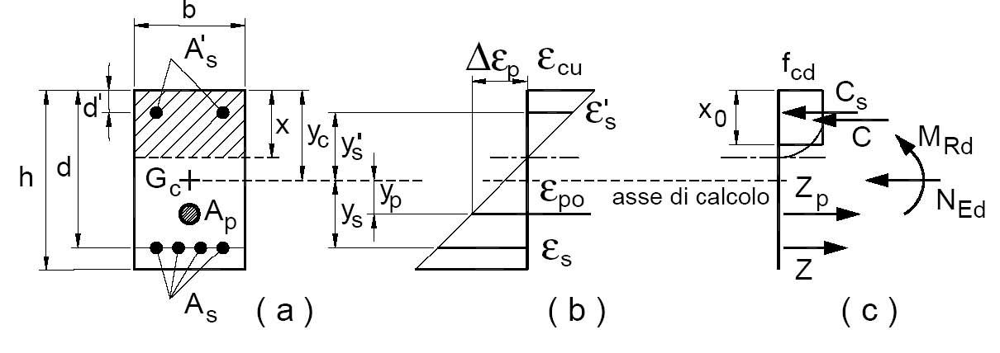

**Fig. 4.1.4** – *Sezione pressoinflessa*

Le verifiche si eseguono confrontando la capacità, espressa in termini di resistenza e, quando richiesto al § 7.4 delle presenti norme, di duttilità, con la corrispondente domanda, secondo le relazioni:

$$M_{Rd} = M_{Rd}(N_{Ed}) \geq M_{Ed} \tag{4.1.18a}$$

$$\mu_\phi = \mu_\phi(N_{Ed}) \geq \mu_{Ed} \tag{4.1.18b}$$

dove

- $M_{Rd}$ è il valore di progetto del momento resistente corrispondente a $N_{Ed}$;
- $N_{Ed}$ è il valore di progetto dello sforzo normale sollecitante;
- $M_{Ed}$ è il valore di progetto del momento di domanda;
- $\mu_\phi$ è il valore di progetto della duttilità di curvatura corrispondente a $N_{Ed}$;
- $\mu_{Ed}$ è la domanda in termini di duttilità di curvatura.

Nel caso di pilastri soggetti a compressione assiale, si deve comunque assumere una componente flettente $M_{Ed} = e \cdot N_{Ed}$ con eccentricità $e$ pari almeno ad 1/200 dell'altezza libera di inflessione del pilastro, e comunque non minore di 20 mm.

*Nota di trascrizione AF-COR-4.1-01 — la fonte, p. fisica 82, stampa $N_{E\phi}$; refuso tipografico per $N_{Ed}$, attestato alla stessa p. fisica 82 nella [4.1.20] e nelle definizioni che la seguono.*

Nel caso di pressoflessione deviata la verifica della sezione può essere posta nella forma

$$\left(\frac{M_{Eyd}}{M_{Ryd}}\right)^\alpha + \left(\frac{M_{Ezd}}{M_{Rzd}}\right)^\alpha \leq 1 \tag{4.1.19}$$

dove

- $M_{Eyd}$, $M_{Ezd}$ sono i valori di progetto delle due componenti di flessione retta della sollecitazione attorno agli assi y e z;
- $M_{Ryd}$, $M_{Rzd}$ sono i valori di progetto dei momenti resistenti di pressoflessione retta corrispondenti a $N_{Ed}$ valutati separatamente attorno agli assi y e z.

L'esponente $\alpha$ può dedursi in funzione della geometria della sezione e dei parametri

$$\nu = N_{Ed}/N_{Rcd} \tag{4.1.20}$$

$$\omega_t = A_t \cdot f_{yd}/N_{Rcd} \tag{4.1.21}$$

con $N_{Rcd} = A_c \cdot f_{cd}$.

In mancanza di una specifica valutazione, può assumersi:

- per sezioni rettangolari:

| $N_{Ed}/N_{Rcd}$ | 0,1 | 0,7 | 1,0 |
|:---:|:---:|:---:|:---:|
| $\alpha$ | 1,0 | 1,5 | 2,0 |

con interpolazione lineare per valori diversi di $N_{Ed}/N_{Rcd}$;

- per sezioni circolari ed ellittiche: $\alpha = 2$.

La capacità in termini di fattore di duttilità in curvatura $\mu_\phi$ può essere calcolata, separatamente per le due direzioni principali di verifica, come rapporto tra la curvatura cui corrisponde una riduzione del 15% della massima resistenza a flessione – oppure il raggiungimento della deformazione ultima del calcestruzzo e/o dell'acciaio – e la curvatura convenzionale di prima plasticizzazione $\phi_{yd}$ espressa dalla relazione seguente:

$$\phi_{yd} = \frac{M_{Rd}}{M'_{yd}} \cdot \phi'_{yd}$$

dove:

- $\phi'_{yd}$ è la minore tra la curvatura calcolata in corrispondenza dello snervamento dell'armatura tesa e la curvatura calcolata in corrispondenza della deformazione di picco ($\varepsilon_{c2}$ se si usa il modello parabola-rettangolo oppure $\varepsilon_{c3}$ se si usa il modello triangolo-rettangolo) del calcestruzzo compresso;
- $M_{Rd}$ è il momento resistente della sezione allo SLU;
- $M'_{yd}$ è il momento corrispondente a $\phi'_{yd}$ e può essere assunto come momento resistente massimo della sezione in campo sostanzialmente elastico.

#### 4.1.2.3.5 Resistenza nei confronti di sollecitazioni taglianti

Senza escludere la possibilità di specifici studi, per la valutazione delle resistenze ultime di elementi monodimensionali nei confronti di sollecitazioni taglianti e delle resistenze ultime per punzonamento, si deve considerare quanto segue.

##### 4.1.2.3.5.1 Elementi senza armature trasversali resistenti a taglio

Se, sulla base del calcolo, non è richiesta armatura al taglio, è comunque necessario disporre un'armatura minima secondo quanto previsto al punto 4.1.6.1.1. È consentito omettere tale armatura minima in elementi quali solai, piastre e membrature a comportamento analogo, purché sia garantita una ripartizione trasversale dei carichi.

La verifica di resistenza (SLU) si pone con

$$V_{Rd} \geq V_{Ed} \tag{4.1.22}$$

dove $V_{Ed}$ è il valore di progetto dello sforzo di taglio agente.

Con riferimento all'elemento fessurato da momento flettente, la resistenza di progetto a taglio si valuta con

$$V_{Rd} = \max\left\{\left[0{,}18 \cdot k \cdot (100 \cdot \rho_1 \cdot f_{ck})^{1/3} / \gamma_c + 0{,}15 \cdot \sigma_{cp}\right] \cdot b_w \cdot d \; ; \; (v_{\min} + 0{,}15 \cdot \sigma_{cp}) \cdot b_w \cdot d\right\} \tag{4.1.23}$$

con

- $f_{ck}$ espresso in MPa
- $k = 1 + (200/d)^{1/2} \leq 2$
- $v_{\min} = 0{,}035 k^{3/2} f_{ck}^{1/2}$

e dove

- $d$ è l'altezza utile della sezione (in mm);
- $\rho_1 = A_{sl} / (b_w \cdot d)$ è il rapporto geometrico di armatura longitudinale tesa ($\leq 0{,}02$) che si estende per non meno di $(l_{bd} + d)$ oltre la sezione considerata, dove $l_{bd}$ è la lunghezza di ancoraggio;
- $\sigma_{cp} = N_{Ed}/A_c$ [MPa] è la tensione media di compressione nella sezione ($\leq 0{,}2 \; f_{cd}$);
- $b_w$ è la larghezza minima della sezione (in mm).

Nel caso di elementi in calcestruzzo armato precompresso disposti in semplice appoggio, nelle zone non fessurate da momento flettente (con tensioni di trazione non superiori a $f_{ctd}$) la resistenza di progetto può valutarsi, in via semplificativa, con la formula:

$$V_{Rd} = 0{,}7 \cdot b_w \cdot d \; (f_{ctd}^2 + \sigma_{cp} \cdot f_{ctd})^{1/2} \tag{4.1.24}$$

In presenza di significativi sforzi di trazione, la resistenza a taglio del calcestruzzo è da considerarsi nulla e, in tal caso, non è possibile adottare elementi sprovvisti di armatura trasversale.

Le armature longitudinali, oltre ad assorbire gli sforzi conseguenti alle sollecitazioni di flessione, devono assorbire quelli provocati dal taglio dovuti all'inclinazione delle fessure rispetto all'asse della trave, inclinazione assunta pari a 45°. In particolare, in corrispondenza degli appoggi, le armature longitudinali devono assorbire uno sforzo pari al taglio sull'appoggio.

##### 4.1.2.3.5.2 Elementi con armature trasversali resistenti al taglio

La resistenza di progetto a taglio $V_{Rd}$ di elementi strutturali dotati di specifica armatura a taglio deve essere valutata sulla base di una adeguata schematizzazione a traliccio. Gli elementi resistenti dell'ideale traliccio sono: le armature trasversali, le armature longitudinali, il corrente compresso di calcestruzzo e i puntoni d'anima inclinati. L'inclinazione $\theta$ dei puntoni di calcestruzzo rispetto all'asse della trave deve rispettare i limiti seguenti:

$$1 \leq \text{ctg} \; \theta \leq 2{,}5 \tag{4.1.25}$$

La verifica di resistenza (SLU) si pone con

$$V_{Rd} \geq V_{Ed} \tag{4.1.26}$$

dove $V_{Ed}$ è il valore di progetto dello sforzo di taglio agente.

Con riferimento all'armatura trasversale, la resistenza di progetto a "taglio trazione" si calcola con:

$$V_{Rsd} = 0{,}9 \cdot d \cdot \frac{A_{sw}}{s} \cdot f_{yd} \cdot (\text{ctg}\alpha + \text{ctg}\theta) \cdot \sin\alpha \tag{4.1.27}$$

Con riferimento al calcestruzzo d'anima, la resistenza di progetto a "taglio compressione" si calcola con

$$V_{Rcd} = 0{,}9 \cdot d \cdot b_w \cdot \alpha_c \cdot \nu \cdot f_{cd} \; (\text{ctg}\alpha + \text{ctg}\theta)/(1 + \text{ctg}^2 \; \theta) \tag{4.1.28}$$

La resistenza di progetto a taglio della trave è la minore delle due sopra definite:

$$V_{Rd} = \min \; (V_{Rsd}, \; V_{Rcd}) \tag{4.1.29}$$

dove $d$, $b_w$ e $\sigma_{cp}$ hanno il significato indicato in § 4.1.2.3.5.1. e inoltre si è posto:

- $A_{sw}$ area dell'armatura trasversale;
- $s$ interasse tra due armature trasversali consecutive;
- $\alpha$ angolo di inclinazione dell'armatura trasversale rispetto all'asse della trave;
- $\nu f_{cd}$ resistenza di progetto a compressione ridotta del calcestruzzo d'anima ($\nu = 0{,}5$);
- $\alpha_c$ coefficiente maggiorativo pari a

| | |
|---|---|
| 1 | per membrature non compresse |
| $1 + \sigma_{cp}/f_{cd}$ | per $0 \leq \sigma_{cp} < 0{,}25 \; f_{cd}$ |
| 1,25 | per $0{,}25 \; f_{cd} \leq \sigma_{cp} \leq 0{,}5 \; f_{cd}$ |
| $2{,}5 \; (1 - \sigma_{cp}/f_{cd})$ | per $0{,}5 \; f_{cd} < \sigma_{cp} < f_{cd}$ |

Le armature longitudinali devono essere dimensionate in base alle sollecitazioni flessionali ottenute traslando il diagramma dei momenti flettenti di

$$a_1 = (0{,}9 \cdot d \cdot \text{ctg} \; \theta) / 2 \tag{4.1.30}$$

lungo l'asse della trave, nel verso meno favorevole.

##### 4.1.2.3.5.3 Casi particolari

**Componenti trasversali**

Nel caso di elementi ad altezza variabile o con cavi da precompressione inclinati, il taglio di progetto viene assunto pari a:

$$V_{Ed} = V_d + V_{md} + V_{pd} \tag{4.1.31}$$

dove:

- $V_d$ = valore di progetto del taglio dovuto ai carichi esterni;
- $V_{md}$ = valore di progetto della componente di taglio dovuta all'inclinazione dei lembi della membratura;
- $V_{pd}$ = valore di progetto della componente di taglio dovuta alla precompressione.

**Carichi in prossimità degli appoggi**

Il taglio all'appoggio determinato da carichi applicati alla distanza $a_v \leq 2d$ dall'appoggio stesso si potrà ridurre del rapporto $a_v/2d$, con l'osservanza delle seguenti prescrizioni:

- nel caso di appoggio di estremità, l'armatura di trazione necessaria nella sezione ove è applicato il carico più vicino all'appoggio deve essere prolungata e ancorata al di là dell'asse teorico di appoggio;
- nel caso di appoggio intermedio, l'armatura di trazione all'appoggio deve essere prolungata sin dove necessario e comunque fino alla sezione ove è applicato il carico più lontano compreso nella zona con $a_v \leq 2d$.

Nel caso di elementi con armature trasversali resistenti al taglio, si deve verificare che lo sforzo di taglio $V_{Ed}$, calcolato in questo modo, soddisfi la condizione

$$V_{Ed} \leq A_s \cdot f_{yd} \cdot \sin\alpha \tag{4.1.32}$$

dove $A_s \cdot f_{yd}$ è la resistenza dell'armatura trasversale contenuta nella zona di lunghezza $0{,}75 \; a_v$ centrata tra carico ed appoggio e che attraversa la fessura di taglio inclinata ivi compresa.

Lo sforzo di taglio $V_{Ed}$, calcolato senza la riduzione $a_v/2d$, deve comunque sempre rispettare la condizione:

$$V_{Ed} \leq 0{,}5 \; b_w \; d \; \nu \; f_{cd} \tag{4.1.33}$$

essendo $\nu = 0{,}5$ un coefficiente di riduzione della resistenza del calcestruzzo fessurato per taglio.

**Carichi appesi o indiretti**

Se per particolari modalità di applicazione dei carichi gli sforzi degli elementi tesi del traliccio risultano incrementati, le armature dovranno essere opportunamente adeguate.

##### 4.1.2.3.5.4 Verifica al punzonamento

Solette piene, solette nervate a sezione piena sopra le colonne, e fondazioni devono essere verificate nei riguardi del punzonamento allo stato limite ultimo, in corrispondenza dei pilastri e di carichi concentrati.

In mancanza di un'armatura trasversale appositamente dimensionata, la resistenza al punzonamento deve essere valutata, utilizzando formule di comprovata affidabilità, sulla base della resistenza a trazione del calcestruzzo, intendendo la sollecitazione distribuita su di un perimetro efficace distante 2d dall'impronta caricata, con d altezza utile (media) della soletta.

Se, sulla base del calcolo, la resistenza a trazione del calcestruzzo sul perimetro efficace non è sufficiente per fornire la richiesta resistenza al punzonamento, vanno inserite apposite armature al taglio. Queste armature vanno estese fino al perimetro più esterno sul quale la resistenza a trazione del calcestruzzo risulta sufficiente. Per la valutazione della resistenza al punzonamento si può fare utile riferimento al § 6.4.4 della norma UNI EN1992-1-1 nel caso di assenza di armature al taglio, al § 6.4.5 della norma UNI EN1992-1-1 nel caso di presenza di armature al taglio.

Nel caso di fondazioni si adotteranno opportuni adattamenti del modello sopra citato.

#### 4.1.2.3.6 Resistenza nei confronti di sollecitazioni torcenti

Qualora l'equilibrio statico di una struttura dipenda dalla resistenza torsionale degli elementi che la compongono, è necessario condurre la verifica di resistenza nei riguardi delle sollecitazioni torcenti. Qualora, invece, in strutture iperstatiche, la torsione insorga solo per esigenze di congruenza e la sicurezza della struttura non dipenda dalla resistenza torsionale, non sarà generalmente necessario condurre le verifiche. La verifica di resistenza (SLU) consiste nel controllare che

$$T_{Rd} \geq T_{Ed} \tag{4.1.34}$$

dove $T_{Ed}$ è il valore di progetto del momento torcente agente.

Per elementi prismatici sottoposti a torsione semplice o combinata con altre sollecitazioni, che abbiano sezione piena o cava, lo schema resistente è costituito da un traliccio periferico in cui gli sforzi di trazione sono affidati alle armature longitudinali e trasversali ivi contenute e gli sforzi di compressione sono affidati alle bielle di calcestruzzo.

Con riferimento al calcestruzzo la resistenza di progetto si calcola con

$$T_{Rcd} = 2 \cdot A \cdot t \cdot f'_{cd} \cdot \text{ctg}\theta / (1 + \text{ctg}^2\theta) \tag{4.1.35}$$

dove t è lo spessore della sezione cava; per sezioni piene $t = A_c/u$ dove $A_c$ è l'area della sezione ed $u$ è il suo perimetro; $t$ deve essere assunta comunque $\geq 2$ volte la distanza fra il bordo e il centro dell'armatura longitudinale.

Le armature longitudinali e trasversali del traliccio resistente devono essere poste entro lo spessore $t$ del profilo periferico. Le barre longitudinali possono essere distribuite lungo detto profilo, ma comunque una barra deve essere presente su tutti i suoi spigoli.

Con riferimento alle staffe trasversali la resistenza di progetto si calcola con

$$T_{Rsd} = 2 \cdot A \cdot \frac{A_s}{s} \cdot f_{yd} \cdot \text{ctg}\theta \tag{4.1.36}$$

Con riferimento all'armatura longitudinale la resistenza di progetto si calcola con

$$T_{Rld} = 2 \cdot A \cdot \frac{\sum A_1}{u_m} \cdot f_{yd}/\text{ctg}\theta \tag{4.1.37}$$

dove si è posto

- $A$ area racchiusa dalla fibra media del profilo periferico;
- $A_s$ area delle staffe;
- $u_m$ perimetro medio del nucleo resistente
- $s$ passo delle staffe;
- $\sum A_1$ area complessiva delle barre longitudinali.

L'inclinazione $\theta$ delle bielle compresse di calcestruzzo rispetto all'asse della trave deve rispettare i limiti seguenti

$$1 \leq \text{ctg} \; \theta \leq 2{,}5 \tag{4.1.38}$$

Entro questi limiti, nel caso di torsione pura, può porsi $\text{ctg} \; \theta = (a_l/a_s)^{1/2}$

con: $a_l = \sum A_1 / u_m$ $a_s = A_s/s$

La resistenza di progetto alla torsione della trave è la minore delle tre sopra definite:

$$T_{Rd} = \min \; (T_{Rcd}, \; T_{Rsd}, \; T_{Rld}) \tag{4.1.39}$$

Nel caso di elementi per i quali lo schema resistente di traliccio periferico non sia applicabile, quali gli elementi a pareti sottili a sezione aperta, dovranno utilizzarsi metodi di calcolo fondati su ipotesi teoriche e risultati sperimentali chiaramente comprovati.

**Sollecitazioni composte**

*a)* Torsione, flessione e sforzo normale

Le armature longitudinali, calcolate come sopra indicato per la resistenza nei riguardi della sollecitazione torcente, devono essere aggiunte a quelle calcolate nei riguardi delle verifiche per flessione.

Si applicano inoltre le seguenti regole:

- nella zona tesa, all'armatura longitudinale richiesta dalla sollecitazione di flessione e sforzo normale, deve essere aggiunta l'armatura richiesta dalla torsione;
- nella zona compressa, se la tensione di trazione dovuta alla torsione è minore della tensione di compressione nel calcestruzzo dovuta alla flessione e allo sforzo normale, non è necessaria armatura longitudinale aggiuntiva per torsione.

*b)* Torsione e taglio

Per quanto riguarda la crisi lato calcestruzzo, la resistenza massima di una membratura soggetta a torsione e taglio è limitata dalla resistenza delle bielle compresse di calcestruzzo. Per non eccedere tale resistenza deve essere soddisfatta la seguente condizione:

$$\frac{T_{Ed}}{T_{Rcd}} + \frac{V_{Ed}}{V_{Rcd}} \leq 1 \tag{4.1.40}$$

*Nota di trascrizione AF-COR-4.1-02 — la fonte, p. fisica 86, stampa $T_{ed}$ e $V_{ed}$ con la e minuscola; refuso tipografico per $T_{Ed}$ e $V_{Ed}$, attestati a p. fisica 85.*

Per l'angolo $\theta$ delle bielle compresse di conglomerato cementizio deve essere assunto un unico valore per le due verifiche di taglio e torsione.

#### 4.1.2.3.7 Resistenza di elementi tozzi, nelle zone diffusive e nei nodi

Per gli elementi per cui non valgono i modelli meccanici semplici, le verifiche di sicurezza possono essere condotte con riferimento a schematizzazioni basate sull'individuazione di tiranti e puntoni.

Le verifiche di sicurezza dovranno necessariamente essere condotte nei riguardi di:

- resistenza dei tiranti costituiti dalle sole armature ($R_s$)
- resistenza dei puntoni di calcestruzzo compresso ($R_c$)
- ancoraggio delle armature ($R_b$)
- resistenza dei nodi ($R_n$)

Deve risultare la seguente gerarchia delle resistenze $R_s < (R_n, R_b, R_c)$

Per la valutazione della resistenza dei puntoni di calcestruzzo, si terrà conto della presenza di stati di sforzo pluriassiali.

Le armature che costituiscono i tiranti devono essere adeguatamente ancorate nei nodi.

Le forze che agiscono sui nodi devono essere equilibrate; si deve tener conto delle forze trasversali perpendicolari al piano del nodo.

I nodi si localizzano nei punti di applicazione dei carichi, agli appoggi, nelle zone di ancoraggio dove si ha una concentrazione di armature ordinarie o da precompressione, in corrispondenza delle piegature delle armature, nelle connessioni e negli angoli delle membrature.

Particolare cautela deve essere usata nel caso di schemi iperstatici, che presentano meccanismi resistenti in parallelo.

#### 4.1.2.3.8 Resistenza a fatica

In presenza di azioni cicliche che, per numero dei cicli e per ampiezza della variazione dello stato tensionale, possono provocare fenomeni di fatica, le verifiche di resistenza devono essere condotte secondo affidabili modelli tratti da documentazione di comprovata validità, verificando separatamente il calcestruzzo e l'acciaio.

#### 4.1.2.3.9 Indicazioni specifiche relative a pilastri e pareti

##### 4.1.2.3.9.1 Pilastri cerchiati

Per elementi prevalentemente compressi, armati con barre longitudinali disposte lungo una circonferenza e racchiuse da una spirale di passo non maggiore di 1/5 del diametro inscritto dal nucleo cerchiato, la resistenza allo stato limite ultimo si calcola sommando i contributi della sezione di calcestruzzo confinato del nucleo e dell'armatura longitudinale, dove la resistenza del nucleo di calcestruzzo confinato può esprimersi come somma di quella del nucleo di calcestruzzo non confinato più il contributo di una armatura fittizia longitudinale di peso eguale alla spirale.

Il contributo dell'armatura fittizia non deve risultare superiore a quello dell'armatura longitudinale, mentre la resistenza globale così valutata non deve superare il doppio di quella del nucleo di calcestruzzo non confinato.

##### 4.1.2.3.9.2 Verifiche di stabilità per elementi snelli

Le verifiche di stabilità degli elementi snelli devono essere condotte attraverso un'analisi del secondo ordine che tenga conto degli effetti flessionali delle azioni assiali sulla configurazione deformata degli elementi stessi.

Si deve tenere adeguatamente conto delle imperfezioni geometriche e delle deformazioni viscose per carichi di lunga durata.

Si devono assumere legami fra azioni interne e deformazioni in grado di descrivere in modo adeguato il comportamento non lineare dei materiali e gli effetti della fessurazione delle sezioni. Cautelativamente il contributo del calcestruzzo teso può essere trascurato.

**Snellezza limite per pilastri singoli**

In via approssimata gli effetti del secondo ordine in pilastri singoli possono essere trascurati se la snellezza $\lambda$ non supera il valore limite

$$\lambda_{lim} = \frac{25}{\sqrt{\nu}} \tag{4.1.41}$$

dove

$\nu = N_{Ed} / (A_c \cdot f_{cd})$ è l'azione assiale adimensionalizzata.

La snellezza è calcolata come rapporto tra la lunghezza libera di inflessione, $l_0$, ed il raggio d'inerzia, $i$, della sezione di calcestruzzo non fessurato:

$$\lambda = l_0 / i \tag{4.1.42}$$

dove in particolare $l_0$ va definita in base ai vincoli d'estremità ed all'interazione con eventuali elementi contigui.

Per le pareti il calcolo di $l_0$ deve tenere conto delle condizioni di vincolo sui quattro lati e del rapporto tra le dimensioni principali nel piano.

**Effetti globali negli edifici**

Gli effetti globali del secondo ordine negli edifici possono essere trascurati se è verificata la seguente condizione:

$$P_{Ed} \leq 0{,}31 \; \frac{n}{n + 1{,}6} \; \sum \frac{(E_{cd} \cdot I_c)}{L^2} \tag{4.1.43}$$

dove:

- $P_{Ed}$ è il carico verticale totale (su elementi controventati e di controvento);
- $n$ è il numero di piani;
- $L$ è l'altezza totale dell'edificio sopra il vincolo ad incastro di base;
- $E_{cd}$ è il valore di progetto del modulo elastico del calcestruzzo definito in § 4.1.2.3.9.3;
- $I_c$ è il momento di inerzia della sezione di calcestruzzo degli elementi di controvento, ipotizzata interamente reagente.

##### 4.1.2.3.9.3 Metodi di verifica

Per la verifica di stabilità si calcolano le sollecitazioni sotto le azioni di progetto risolvendo il sistema delle condizioni di equilibrio comprensive degli effetti del secondo ordine e si verifica la resistenza delle sezioni come precisato ai precedenti punti del presente § 4.1.2.3.

Per i pilastri compressi di telai a nodi fissi, non altrimenti soggetti ad esplicite azioni flettenti, va comunque inserito nel modello di calcolo un difetto di rettilineità pari a 1/300 della loro altezza.

**Analisi elastica lineare**

In via semplificata si può impostare il sistema risolvente in forma pseudolineare, utilizzando i coefficienti elastici corretti con i contributi del 2° ordine e una rigidezza flessionale delle sezioni data da

$$EI = \frac{0{,}3}{1 + 0{,}5\phi} \; E_{cd} \; I_c \tag*{[4.1.44)}$$

dove $I_c$ è il momento d'inerzia della sezione di calcestruzzo interamente reagente e $\phi$ è il coefficiente di viscosità del calcestruzzo (11.2.10.7).

Per i coefficienti elastici corretti si possono utilizzare le espressioni linearizzate nella variabile $N_{Ed}$ (sforzo assiale dell'elemento).

**Analisi non lineare**

Il sistema risolvente si imposta assumendo adeguati modelli non lineari di comportamento dei materiali basati sui seguenti parametri:

- $f_{ck}$ resistenza caratteristica del calcestruzzo;
- $E_{cd} = E_{cm} / \gamma_{CE}$ modulo elastico di progetto del calcestruzzo con $\gamma_{CE} = 1{,}2$;
- $\phi$ coefficiente di viscosità del calcestruzzo (§ 11.2.10.7);
- $f_{yk}$ tensione di snervamento caratteristica dell'armatura;
- $E_s$ modulo elastico dell'armatura.

Oltre al metodo generale basato sull'integrazione numerica delle curvature, si possono utilizzare metodi di elaborazione algebrizzati basati sulla concentrazione dell'equilibrio nelle sezioni critiche (per esempio il metodo della colonna modello), per i quali si rimanda a documenti di comprovata validità.

#### 4.1.2.3.10 Verifica dell'ancoraggio delle barre di acciaio con il calcestruzzo

L'ancoraggio delle barre, sia tese che compresse, deve essere oggetto di specifica verifica.

La verifica di ancoraggio deve tenere conto, qualora necessario, dell'effetto d'insieme delle barre e della presenza di eventuali armature trasversali.

L'ancoraggio delle barre può essere utilmente migliorato mediante uncini terminali. Se presenti, gli uncini dovranno avere raggio interno adeguato, tale da evitare danni all'armatura e, ai fini dell'aderenza, essi possono essere computati nella effettiva misura del loro sviluppo in asse alla barra. In assenza degli uncini la lunghezza di ancoraggio deve essere in ogni caso non minore di 20 diametri, con un minimo di 150 mm.

Particolari cautele devono essere adottate quando si possono prevedere fenomeni di fatica e di sollecitazioni ripetute.

---

## 4.1.3. Verifiche per situazioni transitorie

Per le situazioni costruttive transitorie, come quelle che si hanno durante le fasi della costruzione, dovranno adottarsi tecnologie costruttive e programmi di lavoro che non possano provocare danni permanenti alla struttura o agli elementi strutturali e che comunque non possano riverberarsi sulla sicurezza dell'opera.

Le entità delle azioni ambientali da prendere in conto saranno determinate in relazione al tempo dell'azione transitoria e della tecnologia esecutiva.

---

## 4.1.4. Verifiche per situazioni eccezionali

Le resistenze di progetto dei materiali riferite ad una specifica situazione di verifica si ottengono con i seguenti coefficienti parziali di sicurezza:

- calcestruzzo e aderenza con le armature $\gamma_c = 1{,}0$
- acciaio d'armatura $\gamma_s = 1{,}0$

---

## 4.1.5. Progettazione integrata da prove e verifica mediante prove

La resistenza e la funzionalità di strutture ed elementi strutturali può essere misurata attraverso prove su campioni di adeguata numerosità.

I risultati delle prove eseguite su opportuni campioni devono essere trattati con i metodi dell'analisi statistica, in modo tale da ricavare parametri significativi quali media, deviazione standard e fattore di asimmetria della distribuzione, sì da caratterizzare adeguatamente un modello probabilistico descrittore delle quantità indagate (variabili aleatorie).

Indicazioni più dettagliate al riguardo e metodi operativi completi per la progettazione integrata da prove possono essere reperiti nella Appendice D della UNI EN 1990:2006.

---

## 4.1.6. Dettagli costruttivi

### 4.1.6.1 Elementi monodimensionali: Travi e Pilastri

Con riferimento ai dettagli costruttivi degli elementi strutturali in calcestruzzo vengono fornite le indicazioni applicative necessarie per l'ottenimento delle prescritte prestazioni.

Dette indicazioni si applicano se non sono in contrasto con più restrittive regole relative a costruzioni in zona sismica.

#### 4.1.6.1.1 Armatura delle travi

L'area dell'armatura longitudinale in zona tesa non deve essere inferiore a

$$A_{s,min} = 0{,}26 \; \frac{f_{ctm}}{f_{yk}} \cdot b_t \cdot d \quad \text{e comunque non minore di } 0{,}0013 \cdot b_t \cdot d \tag{4.1.45}$$

dove:

- $b_t$ rappresenta la larghezza media della zona tesa; per una trave a T con piattabanda compressa, nel calcolare il valore di $b_t$ si considera solo la larghezza dell'anima;
- $d$ è l'altezza utile della sezione;
- $f_{ctm}$ è il valore medio della resistenza a trazione assiale definita nel § 11.2.10.2;
- $f_{yk}$ è il valore caratteristico della resistenza a trazione dell'armatura ordinaria.

Negli appoggi di estremità, all'intradosso deve essere disposta un'armatura efficacemente ancorata, calcolata coerentemente con il modello a traliccio adottato per il taglio e quindi applicando la regola della traslazione della risultante delle trazioni dovute al momento flettente, in funzione dell'angolo di inclinazione assunto per le bielle compresse di calcestruzzo.

Al di fuori delle zone di sovrapposizione, l'area di armatura tesa o compressa non deve superare individualmente $A_{s,max} = 0{,}04 \; A_c$, essendo $A_c$ l'area della sezione trasversale di calcestruzzo.

Le travi devono prevedere armatura trasversale costituita da staffe con sezione complessiva non inferiore ad $A_{st} = 1{,}5 \; b$ mm²/m essendo $b$ lo spessore minimo dell'anima in millimetri, con un minimo di tre staffe al metro e comunque passo non superiore a 0,8 volte l'altezza utile della sezione.

In ogni caso almeno il 50% dell'armatura necessaria per il taglio deve essere costituita da staffe.

Eventuali armature longitudinali compresse di diametro $\Phi$ prese in conto nei calcoli di resistenza devono essere trattenute da armature trasversali con spaziatura non maggiore di 15$\Phi$.

#### 4.1.6.1.2 Armatura dei pilastri

Nel caso di elementi sottoposti a prevalente sforzo normale, le barre parallele all'asse devono avere diametro maggiore od uguale a 12 mm e non potranno avere interassi maggiori di 300 mm. Inoltre la loro area non deve essere inferiore a

$$A_{s,min} = (0{,}10 \; N_{Ed} / f_{yd}) \quad \text{e comunque non minore di } 0{,}003 \; A_c \tag{4.1.46}$$

dove:

- $f_{yd}$ è la resistenza di progetto dell'armatura (riferita allo snervamento)
- $N_{Ed}$ è la forza di compressione assiale di progetto
- $A_c$ è l'area di calcestruzzo.

Le armature trasversali devono essere poste ad interasse non maggiore di 12 volte il diametro minimo delle barre impiegate per l'armatura longitudinale, con un massimo di 250 mm. Il diametro delle staffe non deve essere minore di 6 mm e di ¼ del diametro massimo delle barre longitudinali.

Al di fuori delle zone di sovrapposizione, l'area di armatura non deve superare $A_{s,max} = 0{,}04 \; A_c$, essendo $A_c$ l'area della sezione trasversale di calcestruzzo.

#### 4.1.6.1.3 Copriferro e interferro

L'armatura resistente deve essere protetta da un adeguato ricoprimento di calcestruzzo. Gli elementi strutturali devono essere verificati allo stato limite di fessurazione secondo il § 4.1.2.2.4.

Al fine della protezione delle armature dalla corrosione, lo strato di ricoprimento di calcestruzzo (copriferro) deve essere dimensionato in funzione dell'aggressività dell'ambiente e della sensibilità delle armature alla corrosione, tenendo anche conto delle tolleranze di posa delle armature; a tale scopo si può fare utile riferimento alla UNI EN 1992-1-1.

Per consentire un omogeneo getto del calcestruzzo, il copriferro e l'interferro delle armature devono essere rapportati alla dimensione massima degli inerti impiegati.

Il copriferro e l'interferro delle armature devono essere dimensionati anche con riferimento al necessario sviluppo delle tensioni di aderenza con il calcestruzzo.

#### 4.1.6.1.4 Ancoraggio delle barre e loro giunzione

Le armature longitudinali devono essere interrotte oppure sovrapposte preferibilmente nelle zone compresse o di minore sollecitazione.

La continuità fra le barre può effettuarsi mediante:

- sovrapposizione, calcolata in modo da assicurare l'ancoraggio di ciascuna barra. In ogni caso la lunghezza di sovrapposizione nel tratto rettilineo deve essere non minore di quanto prescritto al § 4.1.2.3.10. La distanza mutua (interferro) nella sovrapposizione non deve superare 4 volte il diametro;
- saldatura, eseguita in conformità alla norma UNI EN ISO 17660-1:2007. Devono essere accertate la saldabilità degli acciai che vengono impiegati, nonché la compatibilità fra metallo e metallo di apporto nelle posizioni o condizioni operative previste nel progetto esecutivo;
- giunzioni meccaniche per barre di armatura. Tali giunzioni sono qualificate secondo quanto indicato al § 11.3.2.9.

Per barre di diametro $Ø > 32$ mm occorrerà adottare particolari cautele negli ancoraggi e nelle sovrapposizioni.

Nell'assemblaggio o unione di due barre o elementi di armatura di acciaio per calcestruzzo armato possono essere usate giunzioni meccaniche mediante manicotti che garantiscano la continuità. Le giunzioni meccaniche possono essere progettate con riferimento a normative o documenti di comprovata validità.

---

## 4.1.7. Esecuzione

Tutti i progetti devono contenere la descrizione delle specifiche di esecuzione in funzione della particolarità dell'opera, del clima, della tecnologia costruttiva.

In particolare il documento progettuale deve contenere la descrizione dettagliata delle cautele da adottare per gli impasti, per la maturazione dei getti, per il disarmo e per la messa in opera degli elementi strutturali. Analoga attenzione dovrà essere posta nella progettazione delle armature per quanto riguarda: la definizione delle posizioni, le tolleranze di esecuzione e le modalità di piegatura.

Si potrà a tal fine fare utile riferimento alla norma UNI EN 13670.

---

## 4.1.8. Norme ulteriori per il calcestruzzo armato precompresso

I sistemi di precompressione con armature, previsti dalla presente norma, possono essere a cavi scorrevoli ancorati alle estremità (sistemi post-tesi) o a cavi aderenti (sistemi pre-tesi).

La condizione di carico conseguente alla precompressione si combinerà con le altre (peso proprio, carichi permanenti e variabili...) al fine di avere le più sfavorevoli condizioni di sollecitazione.

Nel caso della post-tensione, se le armature di precompressione non sono rese aderenti al conglomerato cementizio dopo la tesatura mediante opportune iniezioni di malta all'interno delle guaine (cavi non aderenti), si deve tenere conto delle conseguenze dello scorrimento relativo acciaio-calcestruzzo.

Le presenti norme non danno indicazioni su come trattare i casi di precompressione a cavi non aderenti per i quali si potrà fare utile riferimento ad UNI EN 1992-1-1.

Nel caso sia prevista la parzializzazione delle sezioni nelle condizioni di esercizio, particolare attenzione deve essere posta alla resistenza a fatica dell'acciaio in presenza di sollecitazioni ripetute.

### 4.1.8.1 Valutazione della sicurezza - Norme di calcolo

#### 4.1.8.1.1 Stati limite ultimi

Per la valutazione della resistenza degli elementi strutturali vale quanto stabilito al § 4.1.2.3, tenendo presente che per la verifica delle sezioni si assumerà il valore di progetto della forza di precompressione con il coefficiente parziale $\gamma_P = 1$, secondo quanto previsto al punto § 2.6.1.

Per le verifiche di resistenza locale degli ancoraggi delle armature di precompressione, si assumerà, invece, un valore di progetto della forza di precompressione con $\gamma_P = 1{,}2$.

#### 4.1.8.1.2 Stati limite di esercizio

Vale quanto stabilito al § 4.1.2.2. Per la valutazione degli stati di deformazione e di tensione si devono tenere in conto gli effetti delle cadute di tensione per i fenomeni reologici che comportano deformazioni differite dei materiali: ritiro e viscosità del calcestruzzo, rilassamento dell'acciaio.

Nella valutazione della precompressione nel caso di armatura post-tesa la tensione iniziale va calcolata deducendo dalla tensione al martinetto la perdita per rientro degli apparecchi di ancoraggio e scorrimento dei fili e le perdite per attrito lungo il cavo.

Nelle strutture ad armatura pre-tesa si deve considerare la caduta di tensione per deformazione elastica.

Per le limitazioni degli stati tensionali nelle condizioni di esercizio, per tutte le strutture precompresse, valgono le prescrizioni riportate al § 4.1.2.2.5.

#### 4.1.8.1.3 Tensioni di esercizio nel calcestruzzo a cadute avvenute

Vale quanto stabilito al § 4.1.2.2.5.

Non sono ammesse tensioni di trazione ai lembi nelle strutture costruite per conci prefabbricati, quando non sia possibile disporre l'armatura ordinaria che assorbe lo sforzo di trazione.

#### 4.1.8.1.4 Tensioni iniziali nel calcestruzzo

All'atto della precompressione le tensioni di compressione non debbono superare il valore:

$$\sigma_c < 0{,}60 \; f_{ckj} \tag{4.1.47}$$

essendo $f_{ckj}$ la resistenza caratteristica del calcestruzzo all'atto del tiro.

Per elementi con armatura pre-tesa, la tensione del calcestruzzo al momento del trasferimento della pretensione può essere aumentata sino al valore $0{,}70 \; f_{ckj}$.

Nella zona di ancoraggio delle armature di precompressione si possono tollerare compressioni locali $\sigma_c$ prodotte dagli apparecchi di ancoraggio pari a:

$$\sigma_c < c \; f_{cd} \tag{4.1.48}$$

dove

- $\sigma_c = \gamma_P \cdot P / A_0$ è la pressione agente sull'impronta caricata di area $A_0$;
- $P$ è la forza iniziale di tesatura nel cavo ($\gamma_P = 1{,}2$);
- $f_{cd} = f_{ckj} / \gamma_c$ è la resistenza cilindrica del calcestruzzo all'atto della precompressione;
- $c \leq 3$ è un fattore di sovraresistenza che dipende da:
  - il rapporto $A_0/A_1$ tra l'area caricata e quella circostante interessata;
  - la posizione dell'impronta caricata rispetto ai bordi della sezione;
  - le eventuali interferenze con aree interessate vicine.

Per i valori di $c$ si può far utile riferimento al §6.7 della norma UNI EN1992-1-1.

Si raccomanda di disporre idonee armature in grado di equilibrare le forze di trazione trasversali dovute all'effetto del carico. Qualora le aree di influenza di apparecchi vicini si sovrappongano, le azioni vanno sommate e riferite all'area complessiva.

#### 4.1.8.1.5 Tensioni limite per gli acciai da precompressione

Per le tensioni in esercizio a perdite avvenute vale quanto stabilito al § 4.1.2.2.5.2 ove si sostituisca $f_{p(0,1)k}$, $f_{p(1)k}$ o $f_{pyk}$ a $f_{yk}$.

Le tensioni iniziali devono rispettare le più restrittive delle seguenti limitazioni:

$$
\begin{aligned}
\sigma_{spi} &< 0{,}85 \; f_{p(0,1)k} & \sigma_{spi} &< 0{,}75 \; f_{ptk} && \text{per armatura post-tesa} \\
\sigma_{spi} &< 0{,}90 \; f_{p(0,1)k} & \sigma_{spi} &< 0{,}80 \; f_{ptk} && \text{per armatura pre-tesa}
\end{aligned}
\tag{4.1.49}
$$

ove si sostituisca $f_{p(1)k}$ o $f_{pyk}$ a $f_{p(0,1)k}$, se del caso.

In entrambi i casi è ammessa una sovratensione, in misura non superiore a $0{,}05 \; f_{p(0,1)k}$.

### 4.1.8.2 Dettagli costruttivi per il calcestruzzo armato precompresso

Con riferimento ai dettagli costruttivi degli elementi strutturali in calcestruzzo armato precompresso, ai punti seguenti del presente paragrafo vengono fornite le indicazioni applicative necessarie per l'ottenimento delle prescritte prestazioni.

#### 4.1.8.2.1 Armatura longitudinale ordinaria

Nelle travi precompresse con esclusione delle sezioni di giunto delle travi a conci prefabbricati, anche in assenza di tensioni di trazione in combinazione rara, la percentuale di armatura longitudinale ordinaria non dovrà essere inferiore allo 0,1% dell'area complessiva dell'anima e dell'eventuale ringrosso dal lato dei cavi.

Nel caso sia prevista la parzializzazione della sezione in esercizio, le barre longitudinali di armatura ordinaria devono essere disposte nella zona della sezione che risulta parzializzata.

#### 4.1.8.2.2 Staffe

Nelle travi dovranno disporsi staffe aventi sezione complessiva non inferiore a quanto prescritto al punto § 4.1.6.1.1. In prossimità di carichi concentrati o delle zone d'appoggio valgono le prescrizioni di cui al § 4.1.2.3.5.

In presenza di torsione valgono le prescrizioni di cui al § 4.1.2.3.6.

### 4.1.8.3 Esecuzione delle opere in calcestruzzo armato precompresso

Per quanto riguarda lo strato di ricoprimento di calcestruzzo necessario alla protezione delle armature dalla corrosione, si rimanda al § 4.1.6.1.3.

Nel caso di armature pre-tese, nella testata i trefoli devono essere ricoperti con adeguato materiale protettivo, o con getto in opera.

Nel caso di armature post-tese, gli apparecchi d'ancoraggio della testata devono essere protetti in modo analogo.

All'atto della messa in tiro si debbono misurare contemporaneamente la forza applicata e l'allungamento conseguito. Per prodotti marcati CE si applicano le procedure di controllo previste dalle pertinenti norme europee armonizzate.

La distanza minima netta tra le guaine deve essere commisurata sia alla massima dimensione dell'aggregato impiegato sia al diametro delle guaine stesse in relazione rispettivamente ad un omogeneo getto del calcestruzzo fresco ed al necessario sviluppo delle tensioni di aderenza con il calcestruzzo.

I risultati conseguiti nelle operazioni di tiro, le letture ai manometri e gli allungamenti misurati, vanno registrati in apposite tabelle e confrontate con le tensioni iniziali delle armature e gli allungamenti teorici previsti in progetto.

La protezione dei cavi scorrevoli va eseguita mediante l'iniezione di adeguati materiali atti a prevenire la corrosione ed a fornire la richiesta aderenza.

Per la buona esecuzione delle iniezioni è necessario che le stesse vengano eseguite secondo apposite procedure di controllo della qualità.

---

## 4.1.9. Norme ulteriori per i solai

Si intendono come solai le strutture bidimensionali piane caricate ortogonalmente al proprio piano, con prevalente comportamento resistente monodirezionale.

### 4.1.9.1 Solai misti di c.a. e c.a.p. e blocchi forati in laterizio o in calcestruzzo

Nei solai misti in calcestruzzo armato normale e precompresso e blocchi forati in laterizio o in calcestruzzo, i blocchi hanno funzione di alleggerimento e di aumento della rigidezza flessionale del solaio. Essi si suddividono in blocchi collaboranti e non collaboranti.

Nel caso di blocchi non collaboranti la resistenza allo stato limite ultimo è affidata al calcestruzzo ed alle armature ordinarie e/o di precompressione.

Nel caso di blocchi collaboranti questi partecipano alla resistenza in modo solidale con gli altri materiali.

### 4.1.9.2 Solai misti di c.a. e c.a.p. e blocchi diversi dal laterizio o calcestruzzo

Possono utilizzarsi per realizzare i solai misti di calcestruzzo armato e calcestruzzo armato precompresso anche blocchi diversi dal laterizio o dal calcestruzzo, con sola funzione di alleggerimento.

I blocchi in calcestruzzo leggero di argilla espansa, calcestruzzo normale sagomato, polistirolo, materie plastiche, elementi organici mineralizzati, ecc., devono essere dimensionalmente stabili e non fragili, e capaci di seguire le deformazioni del solaio.

### 4.1.9.3 Solai realizzati con l'associazione di componenti prefabbricati in c.a. e c.a.p.

I componenti di questi tipi di solai devono rispettare le norme di cui al presente § 4.1.

Oltre a quanto indicato nei precedenti paragrafi relativamente allo stato limite di deformazione, devono essere tenute presenti le seguenti norme complementari.

I componenti devono essere provvisti di opportuni dispositivi e magisteri che assicurino la congruenza delle deformazioni tra i componenti stessi accostati, sia per i carichi ripartiti che per quelli concentrati. In assenza di soletta collaborante armata o in difformità rispetto alle prescrizioni delle specifiche norme tecniche europee, l'efficacia di tali dispositivi deve essere certificata mediante prove sperimentali.

Quando si voglia realizzare una ridistribuzione trasversale dei carichi è necessario che il solaio così composto abbia dei componenti strutturali ortogonali alla direzione dell'elemento resistente principale.

Qualora il componente venga integrato da un getto di completamento all'estradosso, questo deve avere uno spessore non inferiore a 40 mm ed essere dotato di una armatura di ripartizione a maglia incrociata e si deve verificare la trasmissione delle azioni di taglio fra elementi prefabbricati e getto di completamento, tenuto conto degli stati di coazione che si creano per le diverse caratteristiche reologiche dei calcestruzzi, del componente e dei getti di completamento.

---

## 4.1.10. Norme ulteriori per le strutture prefabbricate

Formano oggetto del presente paragrafo i componenti strutturali prefabbricati in calcestruzzo armato, normale o precompresso (nel seguito detti componenti) che rispondono alle specifiche prescrizioni del presente § 4.1, ai metodi di calcolo di cui al§ 2.6e che, singolarmente o assemblati tra di loro oppure con parti costruite in opera, siano utilizzati per la realizzazione di opere di ingegneria civile.

Rientrano nel campo di applicazione delle presenti norme i componenti prodotti in stabilimenti permanenti o in impianti temporanei allestiti per uno specifico cantiere, oppure realizzati a piè d'opera.

Componenti di serie devono intendersi unicamente quelli prodotti in stabilimenti permanenti, con tecnologia ripetitiva e processi industrializzati, in tipologie predefinite per campi dimensionali e tipi di armature.

Di produzione occasionale si intendono i componenti prodotti senza il presupposto della ripetitività tipologica.

Il componente deve garantire i livelli di sicurezza e prestazione sia come componente singolo, nelle fasi transitorie di sformatura, movimentazione, stoccaggio, trasporto e montaggio, sia come elemento di un più complesso organismo strutturale una volta installato in opera.

Nel caso di prodotti coperti da marcatura CE, devono essere comunque rispettati, laddove applicabili, i §§ 11.8.2, 11.8.3.4 e 11.8.5 delle presenti Norme Tecniche.

### 4.1.10.1 Prodotti prefabbricati non soggetti a marcatura CE

Per gli elementi strutturali prefabbricati qui disciplinati, quando non soggetti a Dichiarazione di Prestazione e conseguente Marcatura CE secondo una specifica tecnica armonizzata elaborata ai sensi del Regolamento UE 305/2011 e i cui riferimenti sono pubblicati sulla Gazzetta Ufficiale dell'Unione Europea, sono previste due categorie di produzione:

- serie dichiarata
- serie controllata

I componenti per i quali non sia applicabile la marcatura CE, ai sensi del Regolamento UE 305/2011, devono essere realizzati attraverso processi sottoposti ad un sistema di controllo della produzione ed i produttori di componenti in serie dichiarata ed in serie controllata, devono altresì provvedere alla preventiva qualificazione del sistema di produzione, con le modalità indicate nel § 11.8.

### 4.1.10.2 Prodotti prefabbricati in serie

Rientrano tra i prodotti prefabbricati in serie:

- i componenti di serie per i quali è stato effettuato il deposito ai sensi dell'articolo 9 della legge 5 novembre 1971 n. 1086;
- i componenti per i quali è stata rilasciata la certificazione di idoneità ai sensi degli articoli 1 e 7 della legge 2 febbraio 1974 n. 64;
- ogni altro componente compreso nella definizione di cui al 3° comma del § 4.1.10.

#### 4.1.10.2.1 Prodotti prefabbricati in serie dichiarata

Rientrano in serie dichiarata i componenti di serie che, pur appartenendo ad una tipologia predefinita, vengono progettati di volta in volta su commessa per dimensioni ed armature (serie tipologica).

Per le tipologie predefinite il produttore dovrà provvedere, nell'ambito delle modalità di qualificazione della produzione di cui al § 11.8, al deposito della documentazione tecnica relativa al processo produttivo ed al progetto tipo presso il Servizio Tecnico Centrale del Consiglio Superiore dei Lavori Pubblici.

Per ogni singolo impiego delle serie tipologiche la specifica documentazione tecnica dei componenti prodotti in serie dovrà essere allegata alla documentazione progettuale depositata presso l'Ufficio regionale competente, ai sensi della vigente legislazione in materia.

Rientrano altresì in serie dichiarata i componenti di serie costituiti da un tipo compiutamente determinato, predefinito in dimensioni ed armature sulla base di un progetto depositato (serie ripetitiva).

Per ogni tipo di componente, o per ogni famiglia omogenea di tipi, il produttore dovrà provvedere, nell'ambito delle modalità di qualificazione della produzione di cui al § 11.8, al deposito della documentazione tecnica relativa al processo produttivo ed al progetto specifico presso il Servizio Tecnico Centrale del Consiglio Superiore dei Lavori Pubblici.

Per ogni singolo impiego delle serie ripetitive, sarà sufficiente allegare alla documentazione progettuale depositata presso l'Ufficio regionale competente, ai sensi della vigente legislazione in materia, gli estremi del deposito presso il Servizio Tecnico Centrale.

#### 4.1.10.2.2 Prodotti prefabbricati in serie controllata

Per serie controllata si intende la produzione di serie che, oltre ad avere i requisiti specificati per la serie dichiarata, sia eseguita con procedure che prevedono verifiche sperimentali su prototipo e controllo permanente della produzione, come specificato al § 11.8.

Devono essere prodotti in serie controllata:

- i componenti costituiti da assetti strutturali non consueti;
- i componenti realizzati con l'impiego di calcestruzzi speciali o di classe > C 45/55;
- i componenti armati o precompressi con spessori, anche locali, inferiori a 40 mm;
- i componenti il cui progetto sia redatto su modelli di calcolo non previsti dalle presenti Norme Tecniche.

Per i componenti ricadenti in uno dei casi sopra elencati, è obbligatorio il rilascio preventivo dell'autorizzazione alla produzione, secondo le procedure di cui al § 11.8.4.3.

### 4.1.10.3 Responsabilità e competenze

Il Progettista e il Direttore tecnico dello stabilimento di prefabbricazione, ciascuno per le proprie competenze, sono responsabili della capacità portante e della sicurezza del componente, sia incorporato nell'opera, sia durante le fasi di trasporto fino a piè d'opera.

È responsabilità del progettista e del Direttore dei lavori del complesso strutturale di cui l'elemento fa parte, ciascuno per le proprie competenze, la verifica del componente durante il montaggio, la messa in opera e l'uso dell'insieme strutturale realizzato.

I componenti prodotti negli stabilimenti permanenti devono essere realizzati sotto la responsabilità di un Direttore tecnico dello stabilimento, dotato di adeguata abilitazione professionale, che assume le responsabilità proprie del Direttore dei lavori.

I componenti di produzione occasionale devono inoltre essere realizzati sotto la vigilanza del Direttore dei lavori dell'opera di destinazione.

I funzionari del Servizio Tecnico Centrale potranno accedere anche senza preavviso agli stabilimenti di produzione dei componenti prefabbricati per l'accertamento del rispetto delle presenti norme.

### 4.1.10.4 Prove su componenti

Per verificare le prestazioni di un nuovo prodotto o di una nuova tecnologia produttiva ed accertare l'affidabilità dei modelli di calcolo impiegati nelle verifiche di resistenza, prima di dare inizio alla produzione corrente è necessario eseguire delle prove di carico su di un adeguato numero di prototipi al vero, portati fino a rottura.

Tali prove sono obbligatorie, in aggiunta alle prove correnti sui materiali di cui al Capitolo 11, per le produzioni in serie controllata.

### 4.1.10.5 Norme complementari

Le verifiche del componente vanno fatte con riferimento al livello di maturazione e di resistenza raggiunto, controllato mediante prove sui materiali di cui al § 11.8.3.1 ed eventuali prove su prototipo prima della movimentazione del componente e del cimento statico dello stesso.

I dispositivi di sollevamento e movimentazione debbono essere esplicitamente previsti nel progetto del componente strutturale e realizzati con materiali appropriati e dimensionati per le sollecitazioni previste.

Il copriferro degli elementi prefabbricati deve rispettare le regole generali di cui al presente § 4.1.

#### 4.1.10.5.1 Appoggi

Per i componenti appoggiati in via definitiva, particolare attenzione va posta alla posizione e dimensione dell'apparecchio d'appoggio, sia rispetto alla geometria dell'elemento di sostegno, sia rispetto alla sezione terminale dell'elemento portato, tenendo nel dovuto conto le tolleranze dimensionali e di montaggio e le deformazioni per fenomeni reologici e/o termici.

I vincoli provvisori o definitivi devono essere progettati con particolare attenzione e, se necessario, validati attraverso prove sperimentali.

Gli appoggi scorrevoli devono essere dimensionati in modo da consentire gli spostamenti relativi previsti senza perdita della capacità portante.

#### 4.1.10.5.2 Realizzazione delle unioni e dei collegamenti

Le unioni ed i collegamenti fra elementi prefabbricati devono avere resistenza e deformabilità coerenti con le ipotesi progettuali e devono essere qualificati secondo quanto previsto al pertinente paragrafo del Cap11.8.

#### 4.1.10.5.3 Tolleranze

Il progetto deve indicare le tolleranze minime di produzione che dovrà rispettare il componente. Il componente che non rispetta tali tolleranze, sarà giudicato non conforme e quindi potrà essere consegnato in cantiere per l'utilizzo nella costruzione solo dopo preventiva accettazione da parte del Direttore dei lavori.

Il progetto dell'opera deve altresì tener conto delle tolleranze di produzione, tracciamento e montaggio assicurando un coerente funzionamento del complesso strutturale.

Il montaggio dei componenti ed il completamento dell'opera devono essere conformi alle previsioni di progetto. Nel caso si verificassero delle non conformità, queste devono essere analizzate dal Direttore dei lavori nei riguardi delle eventuali necessarie misure correttive.

---

## 4.1.11. Calcestruzzo a bassa percentuale di armatura o non armato

Il calcestruzzo a bassa percentuale di armatura è quello per il quale la percentuale di armatura messa in opera è minore di quella minima necessaria per il calcestruzzo armato o la quantità media in peso di acciaio per metro cubo di calcestruzzo è inferiore a 0,3 kN.

Sia il calcestruzzo a bassa percentuale di armatura, sia quello non armato possono essere impiegati solo per elementi secondari o per strutture massicce o estese.

### 4.1.11.1 Valutazione della sicurezza – Norme di calcolo

Per le verifiche di resistenza delle sezioni sotto sforzi normali si adottano le competenti ipotesi tratte dal § 4.1.2.3.4.1. Per una sezione rettangolare di lati $a$ e $b$ soggetta ad una forza normale $N_{Ed}$ con una eccentricità $e$ nella direzione del lato $a$ la verifica di resistenza allo SLU, con il modello (c) di § 4.1.2.1.2.1, si pone con

$$N_{Ed} \leq N_{Rd} = f_{cd} \; b \; x \tag{4.1.50}$$

con $x = a - 2e$.

La verifica di resistenza della stessa sezione rettangolare di lati $a$ e $b$ soggetta anche ad un sforzo di taglio $V_{Ed}$ nella direzione del lato $a$ si pone con

$$V_{Ed} \leq V_{Rd} = f_{cvd} \; b \; x / 1{,}5$$

con

- $f_{cvd} = \sqrt{f_{ct1d}^2 + \sigma_c \cdot f_{ct1d}}$ per $\sigma_c \leq \sigma_{clim}$
- $f_{cvd} = \sqrt{f_{ct1d}^2 + \sigma_c \cdot f_{ct1d} - \delta^2/4}$ per $\sigma_c > \sigma_{clim}$

dove

- $\sigma_c = N_{Ed} / (b \; x)$
- $\delta = \sigma_c - \sigma_{clim}$
- $\sigma_{clim} = f_{cd} - 2\sqrt{f_{ct1d}^2 + f_{cd} \cdot f_{ct1d}}$

dove

$f_{ct1d} = 0{,}85 \; f_{ctd}$

è la resistenza a trazione di progetto per calcestruzzo non armato o debolmente armato.

---

## 4.1.12. Calcestruzzo di aggregati leggeri (LC)

Il presente capitolo si applica ai calcestruzzi di aggregati leggeri minerali, artificiali o naturali, con esclusione dei calcestruzzi aerati.

Per le classi di densità e di resistenza normalizzate può farsi utile riferimento a quanto riportato nella norma UNI EN 206:2016.

Sulla base della denominazione normalizzata come definita in § 4.1 per il calcestruzzo di peso normale, vengono ammesse classi di resistenza fino alla classe LC55/60.

I calcestruzzi delle diverse classi trovano impiego secondo quanto riportato nella Tab. 4.1.II.

Valgono le specifiche prescrizioni sul controllo della qualità date in § 4.1 e in § 11.1.

### 4.1.12.1 Norme di calcolo

Al progetto delle strutture in calcestruzzo di aggregati leggeri si applicano le norme di cui ai §§ da 4.1.1 a 4.1.11, tenuto conto della specificità del materiale e comunque ponendo la resistenza a trazione di progetto pari a:

$$f_{ctd} = 0{,}85 \; f_{ctk} / \gamma_c \tag{4.1.50}$$

Non possono impiegarsi barre di diametro maggiore di 32 mm. Per ogni indicazione applicativa si potrà fare utile riferimento alla sezione 11 di UNI EN 1992-1-1:2005.

---

## 4.1.13. Resistenza al fuoco

Le verifiche di resistenza al fuoco potranno eseguirsi con riferimento a UNI EN 1992-1-2, utilizzando i coefficienti $\gamma_M$ (§ 4.1.4) relativi alle combinazioni eccezionali ed assumendo il coefficiente $\alpha_{cc}$ pari a 1,0.

---

# Circolare

*Riferimento: Circolare 21 gennaio 2019, n. 7 C.S.LL.PP., Capitolo C4 — Costruzioni civili e industriali, §C4.1*

Nel Capitolo 4 le NTC definiscono, per i diversi materiali considerati, le caratteristiche richieste, i metodi di analisi per le rispettive strutture, le verifiche, sia locali che globali, che occorre effettuare per accertare il rispetto dei diversi stati limite fissati, le indicazioni sui particolari costruttivi e sulle modalità esecutive, le specifiche relative alla resistenza al fuoco e alle azioni eccezionali.

Le prescrizioni aggiuntive legate alla presenza di azioni sismiche sono specificate nel Capitolo 7.

## C4.1. Costruzioni di calcestruzzo

Rispetto alle NTC precedenti, la tabella 4.1.I non riporta le classi C28/35 e C32/40, indicando invece la Classe C 30/37; tuttavia le NTC prevedono che le prime possono ancora essere prese in considerazione, sia pur in via residuale. Ai soli fini della valutazione della durabilità, dette classi di resistenza C28/35 e C32/40, possono essere adottate per le classi di esposizione ambientale in cui sono prescritti i valori minimi delle classi di resistenza immediatamente inferiori.

Per l'impiego di calcestruzzi con classi di resistenza superiori alla C45/55 è richiesta una sperimentazione preventiva per accertare le proprietà afferenti a resistenza e durabilità e per predisporre il controllo di qualità della produzione.

Per le Classi di resistenza superiori a C70/85 deve essere richiesta l'autorizzazione ministeriale mediante le procedure già stabilite per altri materiali "innovativi".

Per le verifiche allo Stato Limite Ultimo (SLU), il coefficiente parziale di sicurezza per il calcestruzzo $\gamma_c$ resta fissato a 1,5, in accordo con la UNI EN 1992; il coefficiente $\alpha_{cc}$ resta fissato a 0,85, a differenza di quello proposto dalla UNI EN 1992.

In relazione ai materiali ed ai coefficienti di sicurezza si è stabilito di non penalizzare le tecnologie innovative, accettando ad esempio l'utilizzazione dei calcestruzzi ad alta resistenza, ma mantenendo prudenza sui coefficienti di sicurezza.

Vengono definiti i legami costitutivi parabola-rettangolo, elasto-plastico e stress block per il calcestruzzo e vengono forniti i valori limite per le deformazioni specifiche, che coincidono con quelli tradizionali per i calcestruzzi di classe fino a C50/60, mentre sono opportunamente ridotti per quelli di classe superiore.

Il coefficiente parziale di sicurezza per l'acciaio da armatura $\gamma_s$ rimane, per tutti i tipi, pari a 1,15.

Vengono definiti i legami costitutivi per l'acciaio. È previsto l'utilizzo tanto di un legame elastico-plastico quanto di uno elastico-incrudente.

Per quanto riguarda le pavimentazioni in calcestruzzo può farsi utile riferimento alle CNR-DT 211/2014 "Istruzioni per la Progettazione, l'Esecuzione ed il Controllo delle Pavimentazioni di Calcestruzzo".

### C4.1.1 Valutazione della sicurezza e metodi di analisi

#### C4.1.1.1 Analisi elastica lineare

Nel seguito si forniscono alcune precisazioni integrative in riferimento all'analisi elastica lineare con ridistribuzione dei momenti prevista al § 4.1.1.1 delle NTC.

Cautelativamente, le NTC proibiscono la ridistribuzione dei momenti nei pilastri e nei nodi consentendola nelle travi continue (sia appartenenti che non appartenenti a telai), nelle solette e nei telai, alle condizioni seguenti:

- gli effetti del 2° ordine siano trascurabili;
- le sollecitazioni di flessione siano prevalenti;
- i rapporti tra le luci di campate contigue siano compresi nell'intervallo 0,5-2,0.

Nel seguito, per semplicità, si farà riferimento alle sole travi, restando inteso che le relative considerazioni sono immediatamente estendibili alle solette.

La ridistribuzione dei momenti flettenti deve garantire l'equilibrio sia globale sia locale della struttura, ma prefigura possibili plasticizzazioni nelle zone di estremità delle travi; occorre dunque accompagnare la ridistribuzione con una verifica di duttilità. Tale verifica, peraltro, può essere omessa se si rispettano le limitazioni sull'entità delle ridistribuzioni fornite dalle NTC e meglio precisate nel seguito.

La ridistribuzione dei momenti flettenti può effettuarsi, senza esplicite verifiche in merito alla duttilità delle membrature, purché il rapporto $\delta$ tra il momento dopo la ridistribuzione $\overline{M}_{i,j} = M_{i,j} + \Delta \overline{M}_{i,j}$ ed il momento prima della ridistribuzione $M_{i,j}$ soddisfi quanto riportato all'interno del testo normativo.

Il limite $\delta \ge 0{,}70$ ha lo scopo di evitare che un eccesso di ridistribuzione possa indurre plasticizzazione allo Stato Limite di Esercizio nelle sezioni in cui si riduce il momento resistente.

Ai fini della ridistribuzione dei momenti negli elementi, in ciascun nodo, l'aliquota dei momenti da ridistribuire, $\Delta M$, non può eccedere il 30% del minore tra i due momenti d'estremità concorrenti al nodo, nel caso di momenti di verso opposto. Nel caso di momenti equiversi, il rapporto $\delta$ va riferito al momento che viene ridotto in valore assoluto.

La ridistribuzione dei momenti permette una progettazione strutturale più economica ed efficiente, riducendo i momenti massimi di progetto, e compensando questa diminuzione con l'aumento dei momenti di progetto nelle zone meno sollecitate.

Ciò consente di:

- progettare travi aventi resistenza massima a flessione minore di quella richiesta dall'analisi elastica, grazie ad una più uniforme distribuzione delle resistenze lungo il loro sviluppo;
- utilizzare meglio la resistenza minima a flessione delle sezioni, dovuta al rispetto delle limitazioni costruttive imposte dalle NTC, quando essa ecceda significativamente le sollecitazioni agenti derivanti dall'analisi elastica.

Il diagramma dei momenti flettenti deve risultare staticamente ammissibile, cioè deve essere equilibrato e soddisfare in ogni sezione la condizione:

$$\overline{M}_{Ed} \le M_{Rd} \tag{C4.1.1}$$

dove $\overline{M}_{Ed}$ è il valore di progetto del momento dopo la ridistribuzione e $M_{Rd}$ è il momento resistente di progetto.

##### C4.1.1.1.1 Ridistribuzione nelle travi continue

Nel caso di una trave continua (Figura C4.1.1), i momenti $M_1$ e $M_2$ delle sezioni più sollecitate (in corrispondenza degli appoggi) possono venire ridotti ai valori $M'_1$ e $M'_2$, nel rispetto dei limiti $M'_1 \ge \delta M_1$ e $M'_2 \ge \delta M_2$. Il diagramma del momento flettente sortito dall'analisi elastica lineare della trave continua in esame, rappresentato dalla curva a tratto continuo, va di conseguenza traslato, nel rispetto dell'equilibrio con il carico $p$ applicato, come indicato dalla curva a tratteggio.

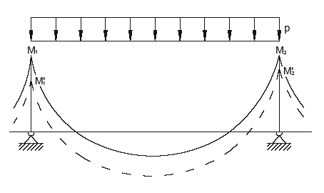

**Figura C4.1.1** — *Ridistribuzione dei momenti per travi continue*

##### C4.1.1.1.2 Ridistribuzione nelle travi continue dei telai

Nei telai i momenti trasmessi dai pilastri ai nodi, non essendo ammessa per tali elementi la ridistribuzione, sono quelli desunti dall'analisi elastica. Poiché tali momenti debbono essere in equilibrio con quelli trasmessi allo stesso nodo dalle travi, la ridistribuzione si effettua applicando, all'estremità delle travi convergenti nel nodo, momenti flettenti di segno opposto ed uguale intensità, lasciando immutato il regime di sollecitazione nei pilastri.

Operativamente, si possono evidenziare due possibili situazioni a seconda che i momenti trasmessi al nodo dalle travi in esso convergenti (momenti d'estremità) abbiano verso discorde (Figura C4.1.2) o concorde (Figura C4.1.3).

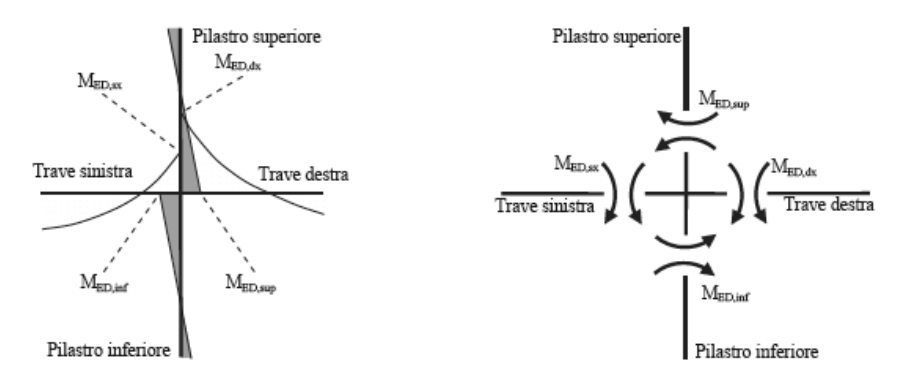

**Figura C4.1.2** — *Diagramma delle sollecitazioni e schema dei momenti trasmessi al nodo con momenti d'estremità discordi*

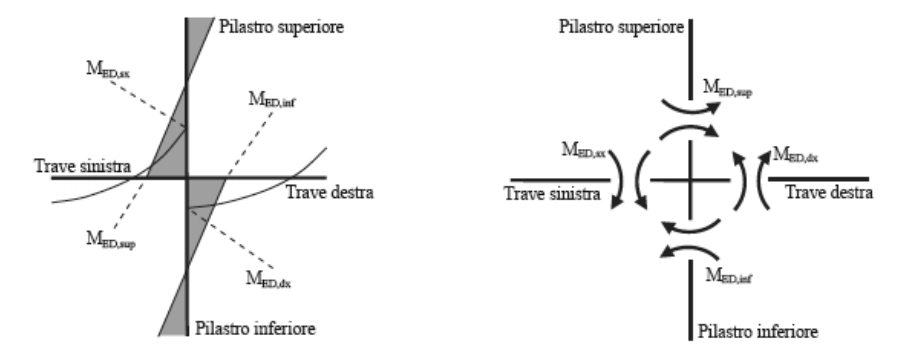

**Figura C4.1.3** — *Diagramma delle sollecitazioni e schema dei momenti trasmessi al nodo con momenti d'estremità concordi*

Il soddisfacimento dell'equilibrio impone che, nel caso in cui i momenti d'estremità delle travi abbiano verso discorde, essi siano entrambi ridotti di $\Delta M$ (Figura C4.1.4) e che, in caso contrario, il momento d'estremità della trave di sinistra sia ridotto di $\Delta M$ e quello della trave destra sia aumentato della stessa quantità $\Delta M$ (Figura C4.1.5).

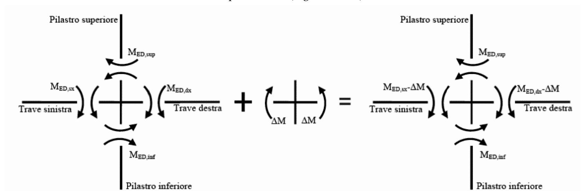

**Figura C4.1.4** — *Momenti d'estremità di verso opposto: ridistribuzione del momento nelle travi*

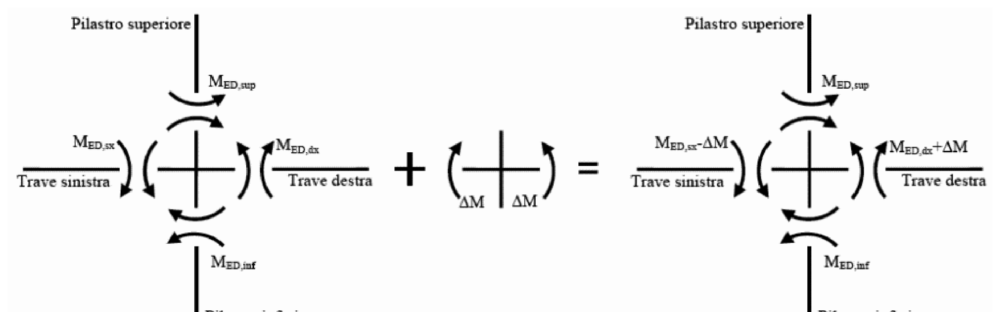

**Figura C4.1.5** — *Momenti d'estremità di verso concorde: ridistribuzione dei momenti nelle travi*

I diagrammi dei momenti ottenuti a seguito della ridistribuzione, per le due diverse situazioni prefigurate, sono rappresentati in Figura C4.1.6.

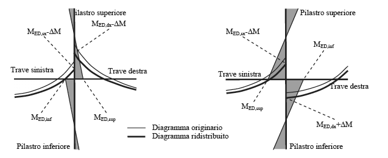

**Figura C4.1.6** — *Diagrammi dei momenti a seguito della ridistribuzione dei momenti nelle travi*

Come già detto, il diagramma dei momenti flettenti su ciascuna trave, ottenuto per effetto della ridistribuzione, deve essere staticamente ammissibile.

### C4.1.2 Verifiche agli stati limite

#### C4.1.2.1 Materiali

##### C4.1.2.1.2 Diagrammi di progetto dei materiali

###### C4.1.2.1.2.1 Diagrammi di progetto tensione-deformazione del calcestruzzo

La principale novità rispetto alle NTC precedenti è costituita dai diagrammi di progetto tensione-deformazione per il calcestruzzo confinato.

Il confinamento del calcestruzzo, che si consegue utilizzando staffe chiuse, legature interne e dettagli costruttivi in accordo con quanto illustrato nel § 7.4.6, ha lo scopo di incrementare la resistenza ultima e la duttilità delle sezioni, per quanto di competenza del calcestruzzo.

Per il diagramma tensione-deformazione del calcestruzzo confinato, la norma consente l'utilizzo di modelli analitici di comprovata validità, che siano rappresentativi del reale comportamento del materiale in stato di tensione triassiale. In assenza di specifiche valutazioni le NTC, in linea con l'UNI EN 1998-2, forniscono un diagramma tensione-deformazione per il calcestruzzo confinato del tipo parabola-rettangolo. Tale legame descrive il comportamento del calcestruzzo confinato in condizioni di assialsimmetria, esprimendo la pressione laterale di confinamento attraverso l'unico parametro $\sigma_2$. Per la sezione circolare tale parametro può essere ricavato in base a considerazioni di equilibrio su una porzione compresa in un passo staffe, come in Figura C4.1.7a.

Per la sezione rettangolare, in maniera analoga, si determinano le pressioni di confinamento lungo le due direzioni principali della sezione, come illustrato in Figura C4.1.7b.

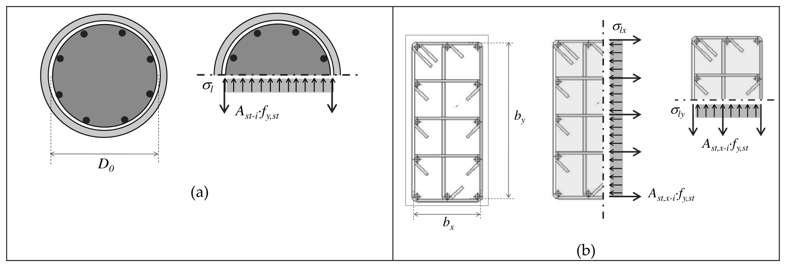

**Figura C4.1.7** — *Pressione laterale di confinamento: (a) sezioni circolari, (b) sezioni rettangolari*

Nel caso di sezione rettangolare, $\sigma_l$ è dato dalla $\sqrt{\sigma_{lx} \cdot \sigma_{ly}}$ (Eq. 4.1.12c) e rappresenta la pressione laterale equivalente, ovvero il valore della pressione di confinamento che, in condizioni assialsimmetriche, produrrebbe gli stessi effetti medi in termini di incremento di resistenza del calcestruzzo confinato.

La pressione efficace di confinamento $\sigma_2$ si ottiene a partire dalla pressione laterale di confinamento, per mezzo di un coefficiente riduttivo espresso dal rapporto tra il volume di calcestruzzo effettivamente confinato e il volume di calcestruzzo racchiuso dalle staffe, come indicato in Figura C4.1.8.

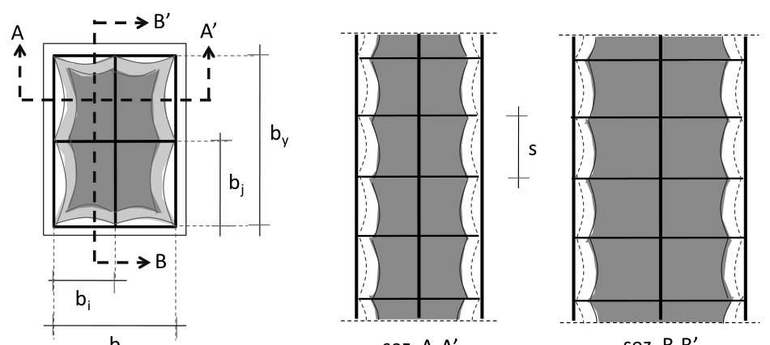

**Figura C4.1.8** — *Rapporto tra il volume di calcestruzzo effettivamente confinato e il volume di calcestruzzo racchiuso dalle staffe.*

Nell'utilizzo del legame tensione-deformazione del calcestruzzo confinato proposto dalle NTC, le resistenze dei materiali sono quelle caratteristiche, a meno di specifiche indicazioni riportate in altri Capitoli delle NTC o della circolare, quali ad esempio quelle relative alle verifiche di resistenza e di duttilità nelle costruzioni esistenti.

In alternativa al legame parabola-rettangolo, in particolare per le verifiche di duttilità nelle quali assume più importanza la descrizione del tratto post-picco del legame, è possibile utilizzare il legame riportato nell'Annex E delle UNI EN 1998-2. Tale legame è rappresentato in Figura C4.1.9 e deve essere utilizzato riferendosi a resistenze caratteristiche, medie o di calcolo, in funzione del tipo di verifica da eseguire, come sopra specificato.

Nella Figura C4.1.9, il pedice "0" dopo la virgola indica il calcestruzzo non confinato, mentre il pedice "c" indica il calcestruzzo confinato.

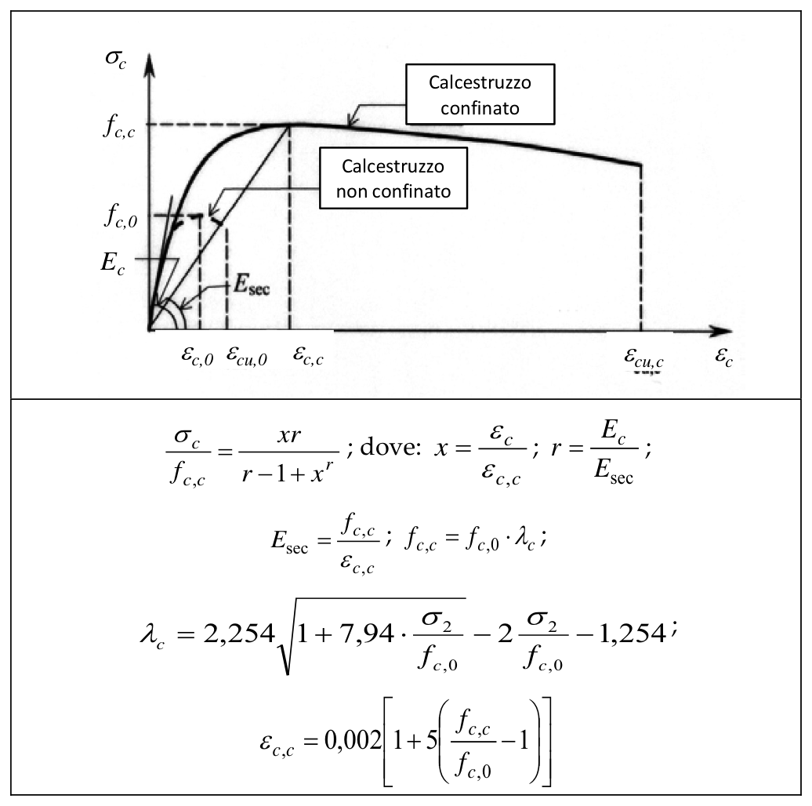

**Figura C4.1.9** — *Legame tensione-deformazione del calcestruzzo confinato con ramo "softening"*

$$\frac{\sigma_c}{f_{c,c}} = \frac{x \, r}{r - 1 + x^r} \; ; \quad \text{dove:} \quad x = \frac{\varepsilon_c}{\varepsilon_{c,c}} \; ; \quad r = \frac{E_c}{E_{sec}} \; ;$$

$$E_{sec} = \frac{f_{c,c}}{\varepsilon_{c,c}} \; ; \quad f_{c,c} = f_{c,0} \cdot \lambda_c \; ;$$

$$\lambda_c = 2{,}254 \sqrt{1 + 7{,}94 \cdot \frac{\sigma_2}{f_{c,0}}} - 2 \, \frac{\sigma_2}{f_{c,0}} - 1{,}254 \; ;$$

$$\varepsilon_{c,c} = 0{,}002 \left[1 + 5 \left(\frac{f_{c,c}}{f_{c,0}} - 1\right)\right]$$

Nella relazioni riportate in Figura C4.1.9, la pressione laterale efficace è determinata attraverso le espressioni [4.1.12.a ÷ 4.1.12.i], utilizzando resistenze coerenti con quelle utilizzate nelle verifiche.

Quando il calcestruzzo è confinato, oltre che da armature trasversali, anche attraverso interventi esterni alla sezione, per descriverne il comportamento possono essere utilizzati modelli di comprovata validità presenti nella letteratura scientifica, in linee guida o normative internazionali, utilizzando resistenze dei materiali coerenti con le NTC. Sia nelle verifiche di resistenza sia in quelle di duttilità, il legame tensione-deformazione per il calcestruzzo confinato deve essere utilizzato solo per le zone confinate; pertanto, nelle analisi devono essere utilizzati legami diversi per il nucleo confinato e per le zone esterne alle staffe (copriferro). Un unico legame può invece essere utilizzato nel caso di confinamento esterno alla sezione.

#### C4.1.2.2 Stati limite di esercizio

##### C4.1.2.2.2 Stato limite di deformazione

Il calcolo della deformazione flessionale di solai e travi si effettua, in genere, mediante integrazione delle curvature, tenendo conto della viscosità del calcestruzzo e, se del caso, degli effetti del ritiro. Si considera lo stato non fessurato (sezione interamente reagente) per tutte le parti della struttura per le quali, nelle condizioni di carico considerate, le tensioni di trazione nel calcestruzzo non superano la sua resistenza media $f_{ctm}$ a trazione. Per le altre parti si fa riferimento allo stato fessurato, potendosi considerare l'effetto irrigidente del calcestruzzo teso fra le fessure.

Al riguardo, detto $p_f$ il valore assunto dal parametro di deformazione nella membratura interamente fessurata e $p$ il valore assunto da detto parametro nella membratura interamente reagente, il valore di calcolo $p^*$ del parametro è dato da

$$p^* = \xi \, p_f + (1 - \xi) \, p \tag{C4.1.2}$$

in cui

$$\xi = 1 - c \, \beta^2 \tag{C4.1.3}$$

Nella [C4.1.3] si assume $\beta = M_f / M$ (rapporto tra il momento di fessurazione $M_f$ e il momento flettente effettivo) o $\beta = N_f / N$ (rapporto tra la forza normale di fessurazione $N_f$ e la forza normale effettiva), a seconda che la membratura sia soggetta a flessione o a trazione, e il coefficiente $c$ assume il valore 1, nel caso di applicazione di un singolo carico di breve durata, o il valore 0,50, nel caso di carichi permanenti o per cicli di carico ripetuti.

Per quanto riguarda la salvaguardia dell'aspetto e della funzionalità dell'opera, le frecce a lungo termine di travi e solai, calcolate sotto la condizione quasi permanente dei carichi, non dovrebbero superare il limite di 1/250 della luce.

In relazione all'integrità delle pareti portate divisorie e di tamponamento, le frecce di travi e solai, sotto la condizione quasi permanente dei carichi, non dovrebbero superare il limite di 1/500 della luce. In tale verifica la freccia totale calcolata può essere depurata della parte presente prima dell'esecuzione delle pareti. Detto valore si riferisce al caso di pareti divisorie in muratura. Per altri tipi di pareti si dovranno valutare specificatamente i limiti di inflessione ammissibili.

Per travi e solai con luci non superiori a 10 m è possibile omettere la verifica delle inflessioni come sopra riportata, ritenendola implicitamente soddisfatta, se il rapporto $l/h$ tra luce e altezza rispetta la limitazione

$$\frac{l}{h} \le K \left[11 + \frac{0.015 \, f_{ck}}{\rho + \rho'}\right] \left[\frac{500 \, A_{s,eff}}{f_{yk} \, A_{s,calc}}\right] \tag{C4.1.4}$$

dove $f_{ck}$ e $f_{yk}$ sono espressi in MPa, $\rho$ e $\rho'$ sono i rapporti tra armatura tesa e compressa, rispettivamente, $A_{s,eff}$ ed $A_{s,calc}$ sono, rispettivamente, l'armatura tesa effettivamente presente nella sezione più sollecitata e l'armatura di progetto nella stessa sezione, e $K$ è un coefficiente correttivo, che dipende dallo schema strutturale.

Per sezioni a T aventi larghezza dell'ala almeno tre volte maggiore dello spessore dell'anima, i valori dati dalla [C4.1.4] devono essere ridotti del 20%.

Per travi e piastre nervate caricate da tramezzi che possano subire danni a causa di inflessioni eccessive, i valori dati dalla [C4.1.4] devono essere moltiplicati per il rapporto $7/l$ essendo $l$ la luce di progetto in m.

Per piastre non nervate la cui luce maggiore $l$ ecceda 8,5 m, caricate da tramezzi che possano subire danni a causa di inflessioni eccessive, i valori dati dalla [C4.1.4] devono essere moltiplicati per il rapporto $8{,}5/l$, con $l$ in m.

I valori da attribuire a $K$ nel caso di calcestruzzo molto sollecitato ($\rho=1{,}5\%$) o poco sollecitato ($\rho=0{,}5\%$) sono riportati in Tabella C4.1.I, insieme con i valori limite di $l/h$ calcolati assumendo $f_{ck}=30$ MPa e $\left[500 \, A_{s,eff} / (f_{yk} \, A_{s,calc})\right] = 1$.

**Tabella C4.1.I** *— Valori di K e snellezze l/h limite per elementi inflessi di c.a. in assenza di compressione assiale*

| Sistema strutturale | K | Calcestruzzo molto sollecitato $\rho=1{,}5\%$ | Calcestruzzo poco sollecitato $\rho=0{,}5\%$ |
|---|:---:|:---:|:---:|
| Travi semplicemente appoggiate, piastre incernierate mono o bidirezionali | 1,0 | 14 | 20 |
| Campate terminali di travi continue o piastre continue monodirezionali o bidirezionali continue sul lato maggiore | 1,3 | 18 | 26 |
| Campate intermedie di travi o piastre continue mono o bidirezionali | 1,5 | 20 | 30 |
| Piastre non nervate sostenute da pilastri (snellezza relativa alla luce maggiore) | 1,2 | 17 | 24 |
| Mensole | 0,4 | 6 | 8 |

*Note: Le snellezze limite sono state valutate ponendo, nella formula C4.1.4, $f_{ck}=30$ MPa e $\left[500 A_{s,eff} / (f_{yk} A_{s,calc})\right] = 1$.*

Per piastre bidirezionali si fa riferimento alla luce minore; per piastre non nervate si considera la luce maggiore.

I limiti per piastre non nervate sostenute da pilastri corrispondono ad una freccia in mezzeria maggiore di 1/250 della luce: l'esperienza ha dimostrato che, comunque, tali limiti sono soddisfacenti.

Nel caso di elementi di c.a.p. si può applicare la tabella C4.1.I moltiplicando il valore di $K$ per 1,2.

##### C4.1.2.2.4 Stato limite di fessurazione

###### C4.1.2.2.4.5 Verifica dello stato limite di fessurazione

**Calcolo dell'ampiezza delle fessure**

L'ampiezza caratteristica di verifica delle fessure, $w_k$ può essere calcolata con l'espressione:

$$w_k = 1{,}7 \, \varepsilon_{sm} \, \Delta_{sm} \tag{C4.1.5 e 4.1.14}$$

dove:

- $\varepsilon_{sm}$ è la deformazione unitaria media delle barre d'armatura;
- $\Delta_{sm}$ è la distanza media tra le fessure.

La deformazione unitaria media delle barre $\varepsilon_{sm}$ può essere calcolata con l'espressione:

$$\varepsilon_{sm} = \frac{\sigma_s - k_t \dfrac{f_{ctm}}{\rho_{eff}}(1 + \alpha_e \, \rho_{eff})}{E_s} \ge 0{,}6 \, \frac{\sigma_s}{E_s} \tag{C4.1.6}$$

in cui:

- $\sigma_s$ è la tensione nell'armatura tesa considerando la sezione fessurata;
- $\alpha_e$ è il rapporto $E_s/E_{cm}$;
- $\rho_{eff}$ è pari a $A_s / A_{c,eff}$;
- $A_{c,eff}$ è l'area efficace di calcestruzzo teso attorno all'armatura, di altezza $h_{c,ef}$, dove $h_{c,ef}$ è il valore minore tra $2{,}5(h-d)$, $(h-x)/3$ o $h/2$ (vedere Figura C4.1.10); nel caso di elementi in trazione, in cui esistono due aree efficaci, l'una all'estradosso e l'altra all'intradosso, entrambe le aree vanno considerate separatamente;
- $k_t$ è un fattore dipendente dalla durata del carico e vale:
  - $k_t = 0{,}6$ per carichi di breve durata,
  - $k_t = 0{,}4$ per carichi di lunga durata.

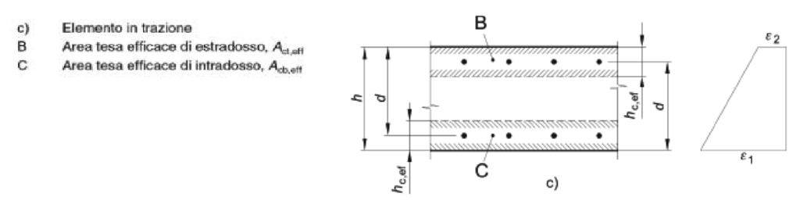

**Figura C4.1.10** — *Area tesa efficace. Casi tipici*

Nei casi in cui l'armatura sia disposta con una spaziatura non superiore a $5(c + \phi/2)$ (vedi Figura C4.1.11), la distanza media tra le fessure, $\Delta_{sm}$, può essere valutata con l'espressione:

$$\Delta_{sm} = \left(k_3 \, c + k_1 \, k_2 \, k_4 \, \frac{\phi}{\rho_{eff}}\right) / 1{,}7 \tag{C4.1.7}$$

in cui:

- $\phi$ è il diametro delle barre. Se nella sezione considerata sono impiegate barre di diametro diverso, si raccomanda di adottare un opportuno diametro equivalente, $\phi_{eq}$. Se $n_1$ è il numero di barre di diametro $\phi_1$ ed $n_2$ è il numero di barre di diametro $\phi_2$, si raccomanda di utilizzare l'espressione seguente:

$$\phi_{eq} = \frac{n_1 \, \phi_1^2 + n_2 \, \phi_2^2}{n_1 \, \phi_1 + n_2 \, \phi_2} \tag{C4.1.8}$$

- $c$ è il ricoprimento dell'armatura;
- $k_1 = 0{,}8$ per barre ad aderenza migliorata, $= 1{,}6$ per barre lisce;
- $k_2 = 0{,}5$ nel caso di flessione, $= 1{,}0$ nel caso di trazione semplice.

In caso di trazione eccentrica, o per singole parti di sezione, si raccomanda di utilizzare valori intermedi di $k_2$, che possono essere calcolati con la relazione:

$$k_2 = (\varepsilon_1 + \varepsilon_2) / (2 \, \varepsilon_1) \tag{C4.1.9}$$

in cui $\varepsilon_1$ ed $\varepsilon_2$ sono rispettivamente la più grande e la più piccola deformazione di trazione alle estremità della sezione considerata, calcolate considerando la sezione fessurata.

- $k_3 = 3{,}4$
- $k_4 = 0{,}425$.

Nelle zone in cui l'armatura è disposta con una spaziatura superiore a $5(c + \phi/2)$ (vedi Figura C4.1.11), per la parte di estensione $5(c + \phi/2)$ nell'intorno delle barre la distanza media tra le fessure, $\Delta_{sm}$, può essere valutata ancora con l'espressione C4.1.7: Nella parte rimanente la distanza media tra le fessure, $\Delta_{sm}$, può, invece, essere valutata con l'espressione:

$$\Delta_{sm} = 0{,}75 \, (h - x) \tag{C4.1.10}$$

*Nota di trascrizione AF-COR-4.1-03 — la fonte, p. fisica 92 della Circolare, stampa $\Delta\sigma\mu$; refuso tipografico per $\Delta_{sm}$, attestato alla stessa p. fisica 92 nel capoverso immediatamente precedente.*

in cui:

- $h$ ed $x$ sono definite in Figura C4.1.10;
- $(h - x)$ è la distanza tra l'asse neutro ed il lembo teso della membratura.

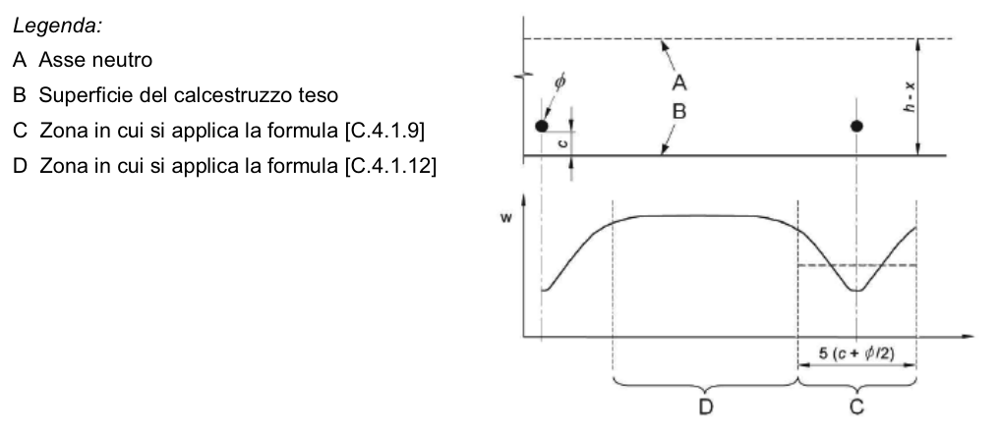

**Figura C4.1.11** — *Ampiezza delle fessure, w, in funzione della posizione rispetto alle barre di armatura*

**Verifica della fessurazione senza calcolo diretto**

La verifica dell'ampiezza di fessurazione per via indiretta può riferirsi ai limiti di tensione nell'acciaio d'armatura definiti nelle Tabelle C4.1.II e C4.1.III. La tensione $\sigma_s$ è quella nell'acciaio d'armatura prossimo al lembo teso della sezione calcolata nella sezione parzializzata per la combinazione di carico pertinente (v. Tabella 4.1.IV delle NTC). Per le armature di pretensione aderenti la tensione $\sigma_s$ si riferisce all'escursione oltre la decompressione del calcestruzzo. Per le sezioni precompresse a cavi post-tesi si fa riferimento all'armatura ordinaria aggiuntiva.

**Tabella C4.1.II** *— Diametri massimi delle barre per il controllo di fessurazione*

| Tensione nell'acciaio $\sigma_s$ [MPa] | Diametro massimo $\phi$ delle barre (mm), $w_3=0{,}4$ mm | Diametro massimo $\phi$ delle barre (mm), $w_2=0{,}3$ mm | Diametro massimo $\phi$ delle barre (mm), $w_1=0{,}2$ mm |
|:---:|:---:|:---:|:---:|
| 160 | 40 | 32 | 25 |
| 200 | 32 | 25 | 16 |
| 240 | 20 | 16 | 12 |
| 280 | 16 | 12 | 8 |
| 320 | 12 | 10 | 6 |
| 360 | 10 | 8 | - |

**Tabella C4.1.III** *— Spaziatura massima delle barre per il controllo di fessurazione*

| Tensione nell'acciaio $\sigma_s$ [MPa] | Spaziatura massima $s$ delle barre (mm), $w_3=0{,}4$ mm | Spaziatura massima $s$ delle barre (mm), $w_2=0{,}3$ mm | Spaziatura massima $s$ delle barre (mm), $w_1=0{,}2$ mm |
|:---:|:---:|:---:|:---:|
| 160 | 300 | 300 | 200 |
| 200 | 300 | 250 | 150 |
| 240 | 250 | 200 | 100 |
| 280 | 200 | 150 | 50 |
| 320 | 150 | 100 | - |
| 360 | 100 | 50 | - |

##### C4.1.2.2.5 Stato Limite di limitazione delle tensioni

La verifica delle tensioni in esercizio si può effettuare nelle usuali ipotesi di comportamento lineare dei materiali, trascurando la resistenza a trazione del calcestruzzo teso.

Nei calcoli per azioni di breve durata può assumersi il valore del modulo di elasticità del calcestruzzo $E_c$ dato dalla [11.2.5] delle NTC, ed un modulo di elasticità dell'acciaio $E_s$ pari a $210.000$ N/mm². Tale valore può essere opportunamente ridotto nel caso di fili, trecce e trefoli da calcestruzzo armato precompresso.

Nel caso di azioni di lunga durata, gli effetti della viscosità del calcestruzzo si possono tenere in conto riducendo opportunamente il modulo di elasticità $E_c$ mediante l'introduzione del coefficiente di viscosità $\varphi$ definito nel § 11.2.10.7 delle NTC.

Nei casi in cui si ritenga possibile effettuare un'unica verifica indipendente dal tempo, si può assumere un coefficiente di omogeneizzazione $n$ fra i moduli di elasticità di acciaio e calcestruzzo, pari a $n = 15$.

#### C4.1.2.3 Stati limite ultimi

##### C4.1.2.3.4 Resistenza flessionale e duttilità massima in presenza e in assenza di sforzo assiale

###### C4.1.2.3.4.2 Verifiche di resistenza e duttilità

Con riferimento alla verifica di resistenza dei pilastri di c.a. soggetti a sola compressione assiale, la prescrizione circa l'eccentricità minima dell'azione assiale da tenere in conto può essere implicitamente soddisfatta valutando $N_{Rd}$ con la formula

$$N_{Rd} = 0{,}8 \, A_c \, f_{cd} + A_{s,tot} \, f_{yd} \tag{C4.1.11}$$

con $A_c$ area del calcestruzzo e $A_{s,tot}$ area totale d'armatura.

Rispetto alle precedenti NTC è fornita una migliore e più esplicita articolazione delle verifiche di duttilità. Tali verifiche sono espressamente richieste al Capitolo 7 della norma per la progettazione in presenza di azioni sismiche; pertanto la norma fornisce la definizione di duttilità di curvatura, indicando le modalità pratiche per il calcolo della corrispondente capacità a livello di sezione. La Figura C4.1.12 esplicita e riassume quanto riportato dalla norma.

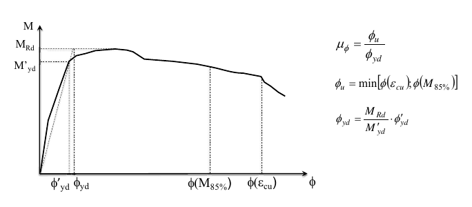

**Figura C4.1.12** — *Relazione momento-curvatura. Fattore di duttilità di curvatura.*

$$\mu_\phi = \frac{\phi_u}{\phi_{yd}}$$

$$\phi_u = \min\left[\phi(\varepsilon_{cu}); \phi(M_{85\%})\right]$$

$$\phi_{yd} = \frac{M_{Rd}}{M'_{yd}} \cdot \phi'_{yd}$$

##### C4.1.2.3.6 Resistenza nei confronti di sollecitazioni torcenti

Nella formula [4.1.35] si intende con $f'_{cd}$ la resistenza di progetto a compressione ridotta del calcestruzzo d'anima valutato come $\nu \, f_{cd}$, assumendo $\nu = 0{,}5$.

##### C4.1.2.3.7 Resistenza di elementi tozzi, nelle zone diffusive e nei nodi

Con riferimento alle zone diffusive si ricorda che i modelli di calcolo di uso corrente operano tutti nell'ipotesi che non vi siano in essi zone diffusive. In presenza di zone diffusive occorre dunque valutare le tensioni dovute alla diffusione e combinarle con quelle fornite dal modello di calcolo.

Per i possibili modelli relativi alle zone diffusive può farsi utile riferimento a documenti di comprovata validità, di cui al § 12 delle NTC.

### C4.1.6 Dettagli costruttivi

#### C4.1.6.1 Elementi monodimensionali: travi e pilastri

##### C4.1.6.1.1 Armatura delle travi

Con riferimento al secondo capoverso del § 4.1.6.1.1 delle NTC, si precisa che detta prescrizione si riferisce anche alle travi senza armatura al taglio.

##### C4.1.6.1.3 Copriferro e interferro

Con riferimento al § 4.1.6.1.3 delle NTC, al fine della protezione delle armature dalla corrosione il valore minimo dello strato di ricoprimento di calcestruzzo (copriferro) deve rispettare quanto indicato in Tabella C4.1.IV, nella quale sono distinte le tre condizioni ambientali di Tabella 4.1.IV delle NTC. I valori sono espressi in mm e sono distinti in funzione dell'armatura, barre da c.a. o cavi aderenti da c.a.p. (fili, trecce e trefoli), e del tipo di elemento, a piastra (solette, pareti,…) o monodimensionale (travi, pilastri,…).

A tali valori di tabella vanno aggiunte le tolleranze di posa, pari a 10 mm o minore, secondo indicazioni di norme di comprovata validità.

I valori della Tabella C4.1.IV si riferiscono a costruzioni con vita nominale di 50 anni (Tipo 2 secondo la Tabella 2.4.I delle NTC). Per costruzioni con vita nominale di 100 anni (Tipo 3 secondo la citata Tabella 2.4.I) i valori della Tabella C4.1.IV vanno aumentati di 10 mm. Per classi di resistenza inferiori a $C_{min}$ i valori della tabella sono da aumentare di 5 mm. Per produzioni di elementi sottoposte a controllo di qualità che preveda anche la verifica dei copriferri, i valori della tabella possono essere ridotti di 5 mm.

Per acciai inossidabili o in caso di adozione di altre misure protettive contro la corrosione e verso i vani interni chiusi di solai alleggeriti (alveolari, predalles, ecc.), i copriferri potranno essere ridotti in base a documentazioni di comprovata validità.

**Tabella C4.1.IV** *— Copriferri minimi in mm*

| $C_{\min}$ | $C_o$ | ambiente | barre da c.a., elementi a piastra, $C \geq C_o$ | barre da c.a., elementi a piastra, $C_{\min} \leq C < C_o$ | barre da c.a., altri elementi, $C \geq C_o$ | barre da c.a., altri elementi, $C_{\min} \leq C < C_o$ | cavi da c.a.p., elementi a piastra, $C \geq C_o$ | cavi da c.a.p., elementi a piastra, $C_{\min} \leq C < C_o$ | cavi da c.a.p., altri elementi, $C \geq C_o$ | cavi da c.a.p., altri elementi, $C_{\min} \leq C < C_o$ |
|:---:|:---:|---|:---:|:---:|:---:|:---:|:---:|:---:|:---:|:---:|
| C25/30 | C35/45 | ordinario | 15 | 20 | 20 | 25 | 25 | 30 | 30 | 35 |
| C30/37 | C40/50 | aggressivo | 25 | 30 | 30 | 35 | 35 | 40 | 40 | 45 |
| C35/45 | C45/55 | molto ag. | 35 | 40 | 40 | 45 | 45 | 50 | 50 | 50 |

La classe di resistenza minima $C_{min}$ indicata in tabella deve comunque intendersi riferita alla pertinente classe di esposizione di cui alla UNI EN 206:2016 richiamata nella Tabella 4.1.III delle NTC.

##### C4.1.6.1.4 Ancoraggio delle barre e loro giunzione

Nella valutazione della lunghezza di sovrapposizione si deve tenere conto dello sforzo in entrambe le barre e considerare la percentuale delle barre sovrapposte nella sezione.

### C4.1.9 Norme ulteriori per i solai

Ai solai, oltre al compito di garantire la resistenza ai carichi verticali, è richiesta anche rigidezza nel proprio piano al fine di distribuire correttamente le azioni orizzontali tra le strutture verticali.

Il progettista deve verificare che le caratteristiche dei materiali, delle sezioni resistenti nonché i rapporti dimensionali tra le varie parti siano coerenti con tali aspettative.

A tale scopo deve verificare che:

1. le deformazioni risultino compatibili con le condizioni di esercizio del solaio e degli elementi costruttivi ed impiantistici ad esso collegati;
2. vi sia, in base alle resistenze meccaniche dei materiali, un rapporto adeguato tra la sezione delle armature di acciaio, la larghezza delle nervature in calcestruzzo, il loro interasse e lo spessore della soletta di completamento in modo che sia assicurata la *rigidezza nel piano* e che sia evitato il pericolo di effetti secondari indesiderati.

#### C4.1.9.1 Solai misti di c.a. e c.a.p. e blocchi forati di laterizio o in calcestruzzo

Al fine di perseguire le esigenze esposte nei punti 1 e 2 del § C.4.1.9, per i solai misti di c.a. e blocchi di laterizio si ritiene necessario che siano verificati i requisiti fissati dalle specifiche Norme Europee armonizzate di prodotto, quando disponibili, e le seguenti condizioni se non previste dalle norme armonizzate. Per gli elementi da solaio non Marcati CE, invece, vanno verificate tutte le condizioni a seguire.

##### C4.1.9.1.1 Regole generali e caratteristiche minime dei blocchi

I blocchi di laterizio sia *collaboranti* che *non collaboranti* devono avere le seguenti caratteristiche minime:

- il profilo delle pareti delimitanti le nervature di calcestruzzo da gettarsi in opera non deve presentare risvolti che ostacolino il deflusso del calcestruzzo e restringano la sezione delle nervature stesse sotto i limiti minimi stabiliti. Nel caso si richieda ai blocchi il concorso alla resistenza agli sforzi tangenziali si devono impiegare elementi monoblocco disposti in modo che nelle file adiacenti, comprendenti una nervatura di calcestruzzo, i giunti risultino sfalsati tra loro. Si devono adottare forme semplici, caratterizzate da setti rettilinei allineati, per lo più continui, particolarmente nella direzione orizzontale, con rapporto spessore/lunghezza il più possibile uniforme. Speciale cura deve essere rivolta al controllo della integrità dei blocchi con particolare riferimento alla eventuale presenza di fessurazioni;
- le pareti esterne sia orizzontali che verticali devono avere uno spessore minimo di 8 mm. Le pareti interne sia orizzontali che verticali devono avere uno spessore minimo di 7 mm. Tutte le intersezioni dovranno essere raccordate con raggio di curvatura, al netto delle tolleranze, maggiore di 3 mm. Il rapporto tra l'area complessiva dei fori e l'area lorda delimitata dal perimetro della sezione dei blocchi non deve risultare maggiore di $0{,}6 + 0{,}625 \cdot h$ (dove $h$ è l'altezza del blocco in metri, $h \le 0{,}32$ m).

##### C4.1.9.1.2 Limiti dimensionali

Le varie parti del solaio devono rispettare i seguenti limiti dimensionali:

a) la larghezza delle nervature deve essere non minore di 1/8 del loro interasse e comunque non inferiore a 80 mm. Nel caso di produzione di serie in stabilimento di pannelli solaio completi, il limite può scendere a 50 mm;
b) l'interasse delle nervature deve essere non maggiore di 15 volte lo spessore della soletta;
c) la dimensione massima del blocco di laterizio non deve essere maggiore di 520 mm.

##### C4.1.9.1.3 Caratteristiche fisico-meccaniche

I blocchi di entrambe le categorie devono garantire una resistenza a punzonamento o punzonamento-flessione (quest'ultimo caso se sono del tipo interposto) per carico concentrato non minore di 1,50 kN. Il carico deve essere applicato su un'impronta quadrata di 50 mm di lato nel punto della superficie orizzontale superiore a cui corrisponde la minore resistenza del blocco.

Per i blocchi collaboranti, la resistenza caratteristica a compressione, riferita alla sezione netta delle pareti e delle costolature, deve risultare non minore di 30 N/mm², nella direzione dei fori, e di 15 N/mm² nella direzione trasversale ai fori, nel piano del solaio. La *resistenza caratteristica a trazione per flessione*, determinata su campioni ricavati dai blocchi mediante opportuno taglio di listelli di dimensioni minime mm 30 × 120 × spessore, deve essere non minore di 10 N/mm².

Per i blocchi non collaboranti, la resistenza caratteristica a compressione, riferita alla sezione netta delle pareti e delle costolature, deve risultare non minore di 15 N/mm², nella direzione dei fori, e di 7 N/mm² nella direzione trasversale ai fori, nel piano del solaio. La *resistenza caratteristica a trazione per flessione*, determinata su campioni ricavati dai blocchi mediante opportuno taglio di listelli di dimensioni minime mm 30 × 120 × spessore, deve essere non minore di 7 N/mm².

Il modulo elastico del laterizio non deve essere superiore a 25 kN/mm².

Il coefficiente di dilatazione termica lineare del laterizio deve essere $\alpha_t \geq 6 \cdot 10^{-6} \, °\text{C}^{-1}$.

Il valore della dilatazione per umidità misurata secondo quanto stabilito dalle UNI 9730-3, deve essere $< 0.4$ mm/m.

Nei solai in cui l'armatura è collocata entro scanalature, qualunque superficie metallica deve essere contornata in ogni direzione da un adeguato spessore di malta cementizia.

Al fine di garantire un'efficace inserimento dell'armatura nelle scanalature, detta armatura non dovrà avere diametro superiore a 12 mm.

### C4.1.12 Calcestruzzo di aggregati leggeri (LC)

Il presente Capitolo si applica ai calcestruzzi di aggregati leggeri di natura minerale, artificiale o naturale, con esclusione dei calcestruzzi aerati.

I calcestruzzi di aggregati leggeri debbono essere specificati in ragione della classe di resistenza e di massa per unità di volume.

Le classi di resistenza ammesse per impieghi strutturali sono dalla LC 16/18 fino alla LC 55/60, secondo la classificazione di cui alla UNI EN 206:2016, riportata nella Tabella C4.1.V.

**Tabella C4.1.V** *— Classi di resistenza a compressione per il calcestruzzo leggero strutturale*

| Classe di resistenza a compressione | Resistenza caratteristica cilindrica minima $f_{lck}$ [N/mm²] | Resistenza caratteristica cubica minima $R_{lck}$ [N/mm²] |
|:---:|:---:|:---:|
| LC 16/18 | 16 | 18 |
| LC 20/22 | 20 | 22 |
| LC 25/28 | 25 | 28 |
| LC 30/33 | 30 | 33 |
| LC 35/38 | 35 | 38 |
| LC 40/44 | 40 | 44 |
| LC 45/50 | 45 | 50 |
| LC 50/55 | 50 | 55 |
| LC 55/60 | 55 | 60 |

Le classi di massa per unità di volume ammesse per impieghi strutturali sono riportate nella Tabella C4.1.VI. Nella stessa tabella, per ciascuna classe, sono indicati i valori nominali della massa per unità di volume del calcestruzzo da adottare nel calcolo del peso proprio delle membrature.

**Tabella C4.1.VI** *— Classi di massa per unità di volume del calcestruzzo di aggregati leggeri ammesse per l'impiego strutturale*

| Classe di massa per unità di volume | D1,5 | D1,6 | D1,7 | D1,8 | D1,9 | D2,0 |
|---|:---:|:---:|:---:|:---:|:---:|:---:|
| Intervallo di massa per unità di volume [kg/m³] | $1400 < \rho \leq 1500$ | $1500 < \rho \leq 1600$ | $1600 < \rho \leq 1700$ | $1700 < \rho \leq 1800$ | $1800 < \rho \leq 1900$ | $1900 < \rho \leq 2000$ |
| Massa per unità di volume calcestruzzo non armato [kg/m³] | 1550 | 1650 | 1750 | 1850 | 1950 | 2050 |
| Massa per unità di volume calcestruzzo armato [kg/m³] | 1650 | 1750 | 1850 | 1950 | 2050 | 2150 |

Oltre ai normali controlli di accettazione in termini di resistenza, per i calcestruzzi di aggregati leggeri si dovranno eseguire controlli di accettazione con riguardo alla massa per unità di volume, da condurre secondo quanto specificato nelle norme UNI EN 206-1 e UNI EN 12390-7.

La resistenza alla frantumazione dell'aggregato leggero influenza la resistenza a compressione del calcestruzzo leggero e, pertanto, deve essere determinata in conformità all'Appendice A delle UNI EN 13055:2016 e dichiarata dal produttore.

#### C4.1.12.1 Norme di calcolo

Per il progetto di strutture di aggregati leggeri si applicano le norme di cui ai §§ da 4.1.1 a 4.1.11 delle NTC, con le seguenti integrazioni e modifiche.

##### C4.1.12.1.1 Caratteristiche meccaniche del calcestruzzo

###### C4.1.12.1.1.1 Resistenza a trazione

Il valore medio della resistenza a trazione semplice (assiale), in mancanza di sperimentazione diretta, può essere assunto pari a:

$$f_{lctm} = 0{,}30 \, f_{lck}^{2/3} \, \eta_1 \qquad \text{per calcestruzzo di classe} \le \text{LC } 50/55 \tag{C4.1.12}$$

$$f_{lctm} = 2{,}12 \, \ln\left[1 + (f_{lcm}/10)\right] \, \eta_1 \qquad \text{per calcestruzzo di classe} > \text{LC } 50/55 \tag{C4.1.13}$$

dove:

- $\eta_1 = 0{,}40 + 0{,}60 \, \rho/2200$;
- $\rho$ = valore limite superiore della massa per unità di volume del calcestruzzo, per la classe di massa per unità di volume di appartenenza in kg/m³;
- $f_{lck}$ = valore della resistenza cilindrica caratteristica a compressione in N/mm².
- $f_{lcm}$ = valore della resistenza media cilindrica a compressione in N/mm²,.

pari a:

- 22 N/mm² per LC16/20
- $f_{lck} + 8$ N/mm² per $f_{lck} > 20$ N/mm²

I valori caratteristici della resistenza a trazione semplice, corrispondenti ai frattili 0,05 e 0,95, possono assumersi pari a:

$$\text{frattile 5\%:} \quad f_{lctk,0{,}05} = 0{,}7 \, f_{lctm} \tag{C4.1.14.a}$$

$$\text{frattile 95\%:} \quad f_{lctk,0{,}95} = 1{,}3 \, f_{lctm} \tag{C4.1.14.b}$$

La resistenza a trazione di calcolo è pari a:

$$f_{lctd} = 0{,}85 \, f_{lctk} / \gamma_C \tag{C4.1.15}$$

###### C4.1.12.1.1.2 Modulo di elasticità

In assenza di sperimentazione diretta, una stima del modulo elastico secante a compressione a 28 giorni può essere ottenuta dall'espressione:

$$E_{lcm} = 22000 \left[\frac{f_{lcm}}{10}\right]^{0{,}3} \eta_E \quad \text{N/mm}^2 \tag{C4.1.16}$$

essendo:

- $f_{lcm}$ = valore della resistenza media cilindrica a compressione in N/mm²;
- $\eta_E = \left(\frac{\rho}{2200}\right)^2$
- $\rho$ = valore limite superiore della massa per unità di volume del calcestruzzo, per la classe di massa per unità di volume di appartenenza in kg/m³.

##### C4.1.12.1.2 Verifiche agli stati limite di esercizio

Le verifiche nei confronti degli stati limite di esercizio si eseguono conformemente alle indicazioni valide per le strutture di calcestruzzo ordinario, adeguate in relazione alle specificità dei calcestruzzi di aggregati leggeri.

###### C4.1.12.1.2.1 Verifiche di deformabilità

Le verifiche di deformabilità possono essere omesse quando le snellezze delle membrature, divise per il coefficiente $\eta_E$ definito al § C4.1.12.1.1.2, soddisfano le limitazioni indicate al § C4.1.2.2.2.

##### C4.1.12.1.3 Verifiche agli stati limite ultimi

###### C4.1.12.1.3.1 Resistenza a sforzo normale e flessione (elementi monodimensionali)

Valgono le ipotesi di base di cui al § 4.1.2.1.2 delle NTC.

Per il diagramma tensione-deformazione del calcestruzzo è possibile adottare il modello parabola-rettangolo (a) o triangolo-rettangolo (b), entrambi raffigurati nella Figura C4.1.13.

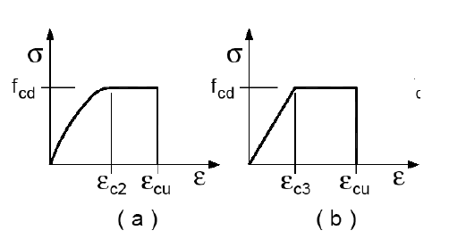

**Figura C4.1.13** — *Modelli σ-ε per il calcestruzzo di aggregati leggeri*

I limiti deformativi $\varepsilon_{c2}$, $\varepsilon_{c3}$ ed $\varepsilon_{cu}$ possono essere assunti

- per calcestruzzi di classe di resistenza inferiore o uguale a LC 50/55 pari a:
  - $\varepsilon_{c2} = 0{,}20\%$
  - $\varepsilon_{c3} = 0{,}175\%$
  - $\varepsilon_{cu} = \eta_1 \cdot 0{,}35\%$, essendo $\eta_1 = 0{,}40 + 0{,}60 \, \rho/2200$
- per calcestruzzi di classe di resistenza pari a LC 55/60 pari a:
  - $\varepsilon_{c2} = 0{,}22\%$
  - $\varepsilon_{c3} = 0{,}18\%$
  - $\varepsilon_{cu} = \eta_1 \cdot 0{,}31\%$

###### C4.1.12.1.3.2 Resistenza nei confronti di sollecitazioni taglianti

###### C4.1.12.1.3.2.1. Elementi senza armature trasversali resistenti al taglio

Valgono le limitazioni di utilizzo di elementi privi di armature resistenti a taglio, stabilite al § 4.1.2.3.5.1 delle NTC per i calcestruzzi ordinari.

La resistenza a taglio (espressa in N) di un elemento fessurato da momento flettente si può valutare attraverso la formula seguente:

$$V_{lRd,c} = \left[0{,}15 \, \eta_1 \, k \, (100 \, \rho_l \, f_{lck})^{1/3} / \gamma_C + 0{,}15 \, \sigma_{cp}\right] b_w \, d \ge \left(v_{l,\min} + 0{,}15 \, \sigma_{cp}\right) b_w \, d \tag{C4.1.17}$$

nella quale:

- $\eta_1 = 0{,}40 + 0{,}60 \, \rho/2200$
- $k = 1 + (200/d)^{1/2} \le 2$
- $v_{l,\min} = 0{,}030 \, k^{3/2} \, f_{lck}^{1/2}$

essendo:

- $d$ l'altezza utile della sezione (in mm);
- $\rho_l = A_{sl}/(b_w \, d)$ il rapporto geometrico di armatura longitudinale ($\le 0{,}02$);
- $\sigma_{cp} = N_{Ed}/A_c$ la tensione media di compressione nella sezione ($\le 0{,}2 \, f_{cd}$);
- $b_w$ la larghezza minima della sezione (in mm).

Nel caso di elementi di calcestruzzo armato precompresso disposti in semplice appoggio, nelle zone non fessurate da momento flettente (con tensioni di trazione non superiori a $f_{lctd}$) la resistenza può valutarsi, in via semplificata, con la formula [4.1.24] delle NTC, sostituendo a $f_{ctd}$ il corrispondente valore $f_{lctd}$ per il calcestruzzo di aggregati leggeri.

In ogni caso il taglio di calcolo $V_{Ed}$ non dovrà superare la limitazione seguente, nella quale la caratteristica resistente è valutata con riferimento alla condizione fessurata del calcestruzzo:

$$V_{Ed} \le 0{,}5 \, \eta_1 \, b_w \, d \, \nu_l \, f_{lcd} \tag{C4.1.18}$$

Nella [C4.1.18] $\nu_l$ è il fattore di riduzione della resistenza del calcestruzzo fessurato per sollecitazioni taglianti dato da:

$$\nu_l = 0{,}5 \, \eta_1 \, (1 - f_{lck}/250) \tag{C4.1.19}$$

dove la resistenza caratteristica a trazione del calcestruzzo leggero $f_{lck}$ è espressa in N/mm².

###### C4.1.12.1.3.2.2. Elementi con armature trasversali resistenti al taglio

Si applicano le regole di calcolo di cui al § 4.1.2.3.5.2 delle NTC, sostituendo nella formula [4.1.28] $\nu_l f_{cd}$ con il valore $0{,}40 \, f_{lcd}$.

###### C4.1.12.1.3.2.3. Resistenza nei confronti di sollecitazioni torcenti

Si applicano le regole di calcolo di cui al § 4.1.2.3.6 delle NTC, sostituendo nella formula [4.1.35] $f'_{cd}$ con il valore $f'_{lcd} = 0{,}40 \, f_{lcd}$.

##### C4.1.12.1.4 Dettagli costruttivi

###### C4.1.12.1.4.1 Diametro massimo delle barre e dei trefoli

Le armature ordinarie ammesse sono barre ad aderenza migliorata o reti elettrosaldate. Il diametro delle barre non può superare 32 mm.

Per barre raggruppate, il diametro equivalente del raggruppamento assunto pari a $\Phi_n = \Phi \sqrt{n}$ non deve eccedere i 45 mm.

Per strutture precompresse a cavi pretesi si dovranno impiegare trefoli con diametro inferiore o uguale a ½".

###### C4.1.12.1.4.2 Raggio di curvatura delle barre

Il diametro dei mandrini per la piegatura delle barre deve essere incrementato del 50% rispetto al valore ammesso per il calcestruzzo ordinario. In particolare, i valori minimi dei diametri dei mandrini da utilizzare in relazione al diametro delle barre è dato da:

| | |
|:---:|:---:|
| per $\phi \le 16$ mm | $D \ge 6 \, \phi$ |
| per $\phi > 16$ mm | $D \ge 11 \, \phi$. |

###### C4.1.12.1.4.3 Ancoraggio delle barre e sovrapposizioni

Il calcolo della tensione ultima di aderenza di barre inserite in getti di calcestruzzo leggero strutturale può essere valutato con riferimento alla formulazione valida per il calcestruzzo ordinario, sostituendo il valore di $f_{ctk}$, che compare nella Formula [4.1.7] delle NTC, con il valore $f_{lctk}$.
