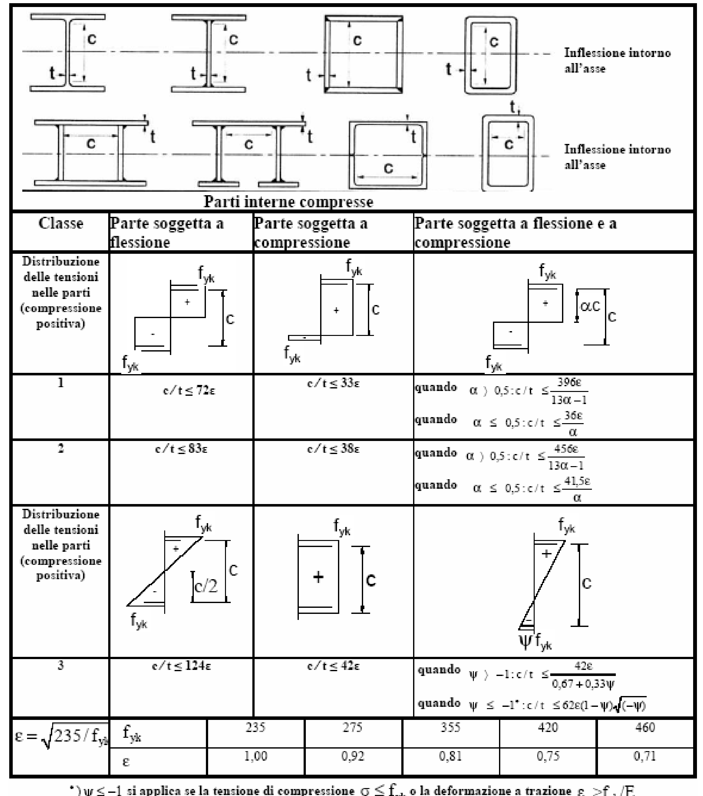
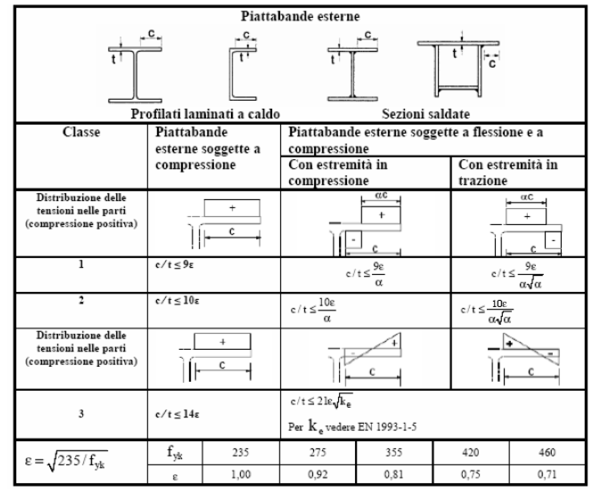
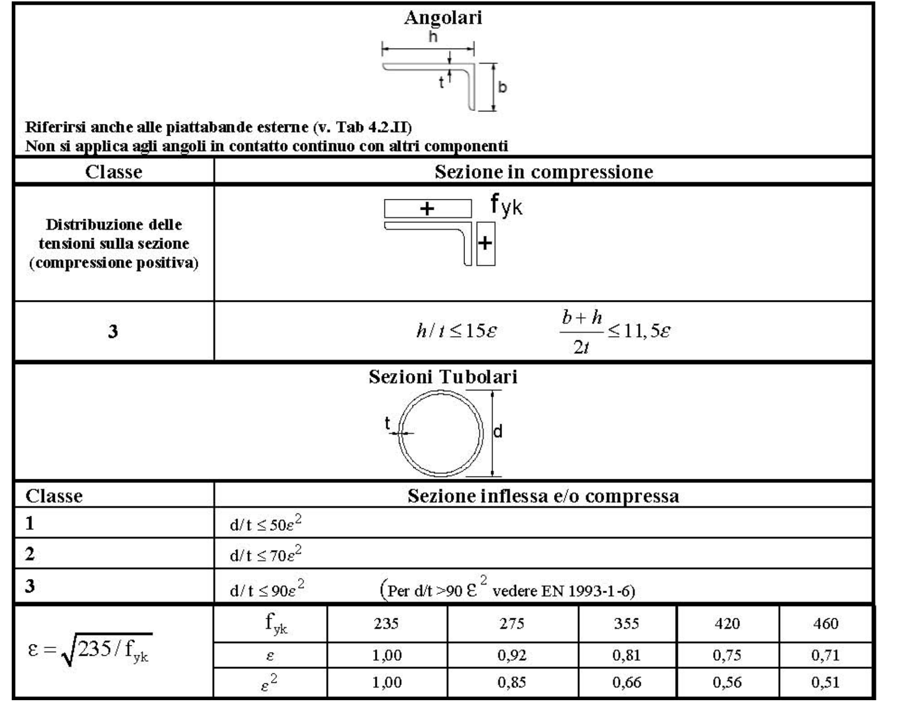
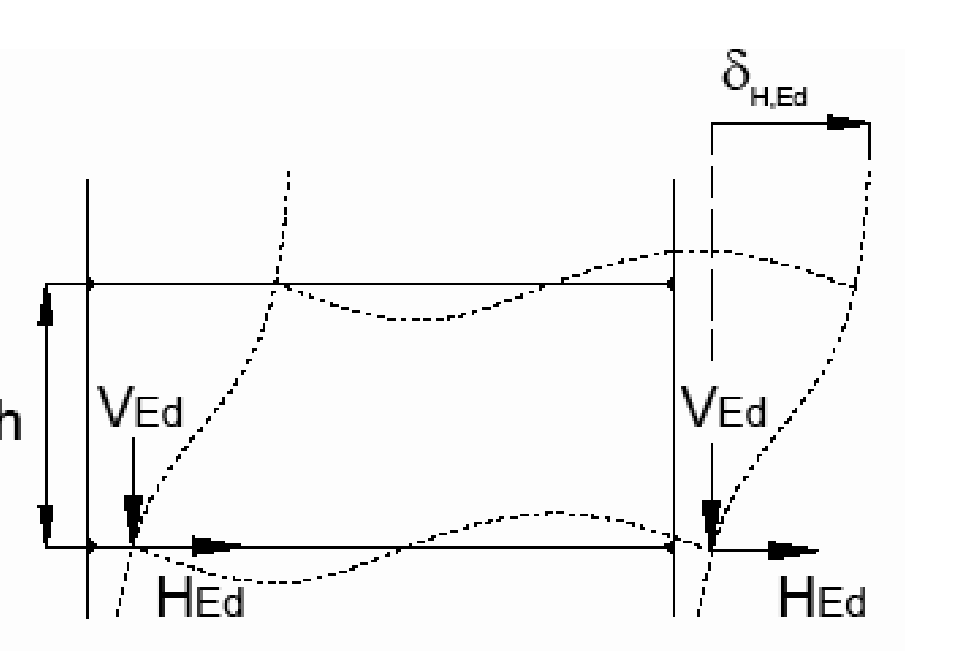
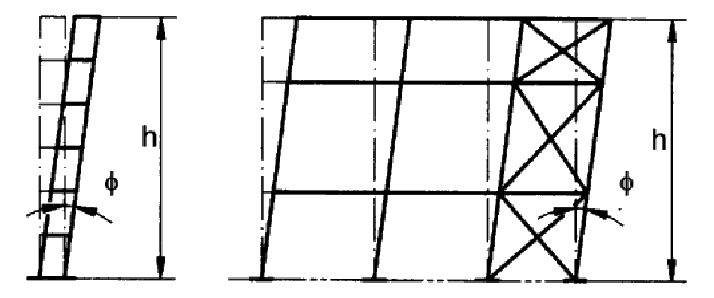
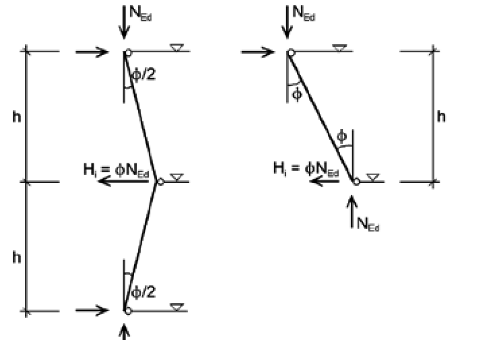
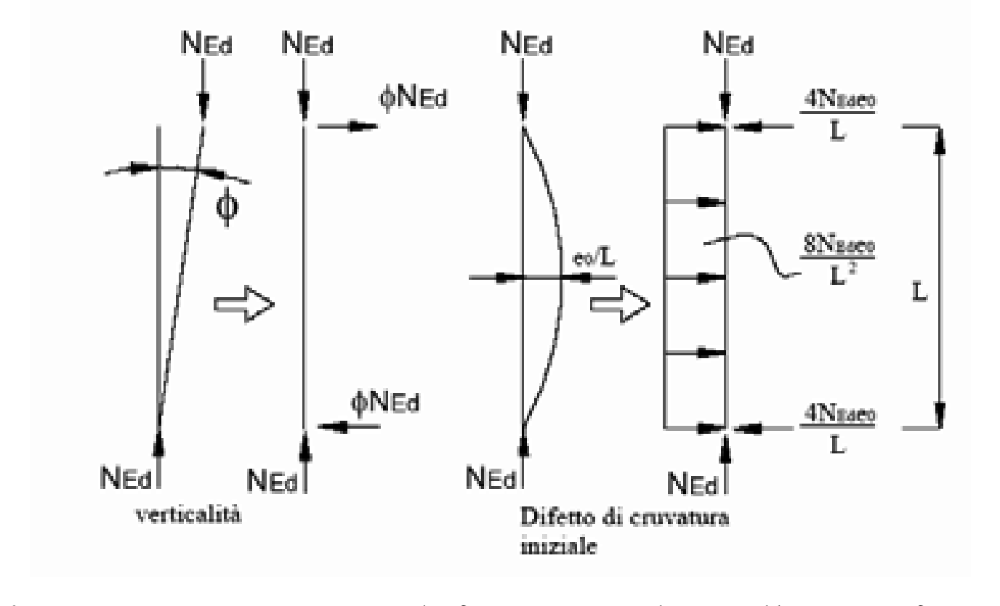
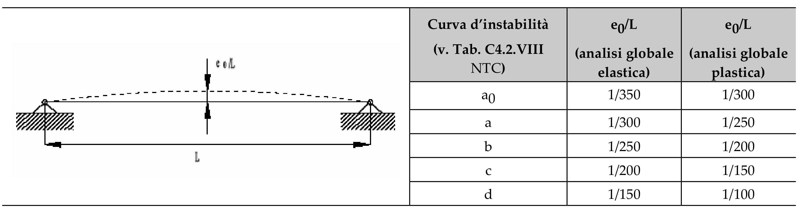
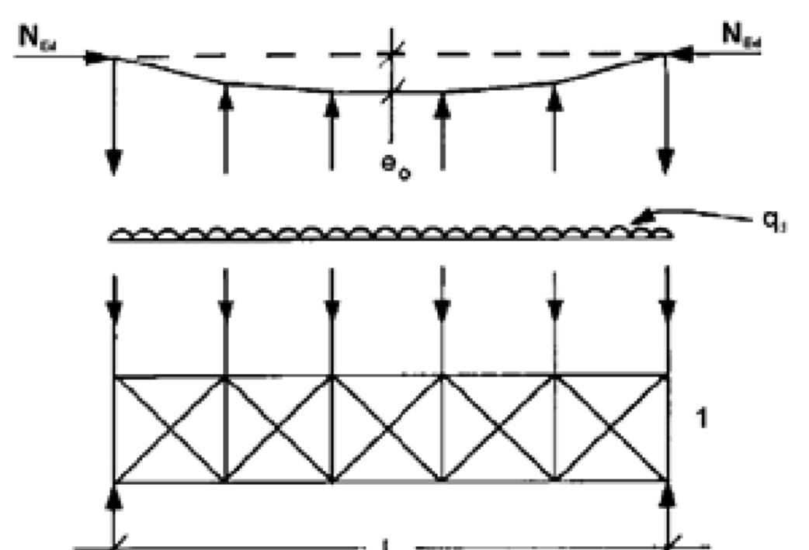
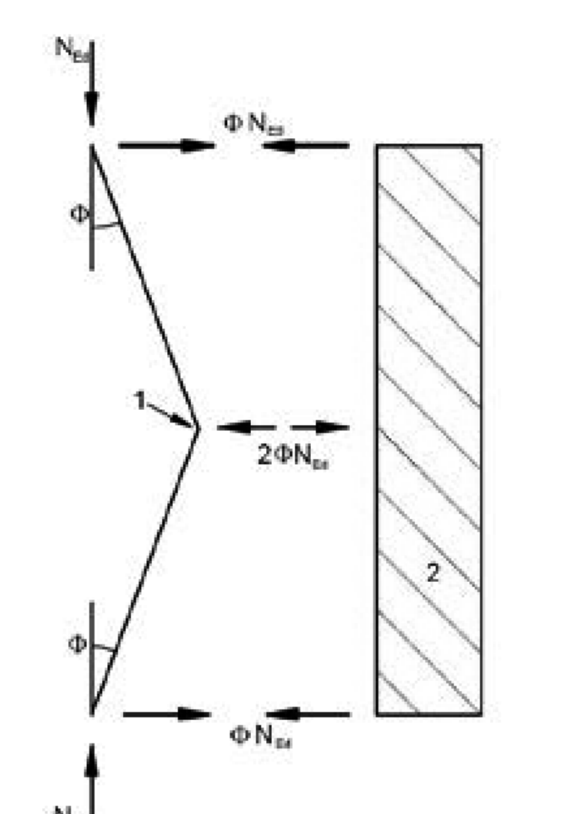

[Torna all'indice del § 4.2](./indice-4.2.md) | [Torna all'indice del capitolo](./indice-cap04.md) | [Torna all'indice generale](../indice-ntc2018.md)

# 4.2.3 Analisi strutturale

<!-- INDICE-INTERNO:INIZIO -->
**Indice interno**

- [Norma](#toc-ntc2018-4-2-3-norma)
  - [4.2.3.1 Classificazione delle sezioni](#toc-ntc2018-4-2-3-1)
  - [4.2.3.2 Capacità resistente delle sezioni](#toc-ntc2018-4-2-3-2)
  - [4.2.3.3 Metodi di analisi globale](#toc-ntc2018-4-2-3-3)
  - [4.2.3.4 Effetti delle deformazioni](#toc-ntc2018-4-2-3-4)
  - [4.2.3.5 Effetto delle imperfezioni](#toc-ntc2018-4-2-3-5)
- [Circolare](#toc-ntc2018-c4-2-3-circolare)
  - [C4.2.3 Analisi strutturale](#toc-ntc2018-c4-2-3)
    - [C4.2.3.1 Classificazione delle sezioni](#toc-ntc2018-c4-2-3-1)
    - [C4.2.3.3 Metodi di analisi globale](#toc-ntc2018-c4-2-3-3)
    - [C4.2.3.4 Effetti delle deformazioni](#toc-ntc2018-c4-2-3-4)
    - [C4.2.3.5 Effetto delle imperfezioni](#toc-ntc2018-c4-2-3-5)
    - [C4.2.3.6 Analisi di stabilità di strutture intelaiate](#toc-ntc2018-c4-2-3-6)
    - [C4.2.3.7 Lunghezza stabile della zona di cerniera plastica](#toc-ntc2018-c4-2-3-7)
<!-- INDICE-INTERNO:FINE -->

## Norma

Il metodo di analisi deve essere coerente con le ipotesi di progetto. L'analisi deve essere basata su modelli strutturali di calcolo appropriati, a seconda dello stato limite considerato.

Le ipotesi scelte ed il modello di calcolo adottato devono essere in grado di riprodurre il comportamento globale della struttura e quello locale delle sezioni adottate, degli elementi strutturali, dei collegamenti e degli appoggi.

Nell'analisi globale della struttura, in quella dei sistemi di controvento e nel calcolo delle membrature si deve tener conto delle imperfezioni geometriche e strutturali di cui al § 4.2.3.5.

### 4.2.3.1 Classificazione delle sezioni

Le sezioni trasversali degli elementi strutturali si classificano in funzione della loro capacità rotazionale $C_\vartheta$ definita come:

$$C_\vartheta = \frac{\vartheta_r}{\vartheta_y} - 1 \tag{4.2.0}$$

essendo $\vartheta_r$ e $\vartheta_y$ le rotazioni corrispondenti rispettivamente al raggiungimento della deformazione ultima ed allo snervamento.

La classificazione delle sezioni trasversali degli elementi strutturali si effettua in funzione della loro capacità di deformarsi in campo plastico. E’ possibile distinguere le seguenti classi di sezioni:

- *classe 1* se la sezione è in grado di sviluppare una cerniera plastica avente la capacità rotazionale richiesta per l'analisi strutturale condotta con il metodo plastico di cui al § 4.2.3.2 senza subire riduzioni della resistenza Possono generalmente classificarsi come tali le sezioni con capacità rotazionale $C_\vartheta \geq 3$;
- *classe 2* se la sezione è in grado di sviluppare il proprio momento resistente plastico, ma con capacità rotazionale limitata. Possono generalmente classificarsi come tali le sezioni con capacità rotazionale $C_\vartheta \geq 1{,}5$;
- *classe 3* se nella sezione le tensioni calcolate nelle fibre estreme compresse possono raggiungere la tensione di snervamento, ma l'instabilità locale impedisce lo sviluppo del momento resistente plastico;
- *classe 4* se, per determinarne la resistenza flettente, tagliante o normale, è necessario tener conto degli effetti dell'instabilità locale in fase elastica nelle parti compresse che compongono la sezione. In tal caso nel calcolo della resistenza la sezione geometrica effettiva può sostituirsi con una *sezione efficace*.

Le sezioni di classe 1 si definiscono duttili, quelle di classe 2 compatte, quelle di classe 3 semi-compatte e quelle di classe 4 snelle.

Per i casi più comuni delle forme delle sezioni e delle modalità di sollecitazione, le seguenti Tabelle 4.2.III, 4.2.IV e 4.2.V forniscono indicazioni per la classificazione delle sezioni.

La classe di una sezione composta corrisponde al valore di classe più alto tra quelli dei suoi elementi componenti.

### 4.2.3.2 Capacità resistente delle sezioni

La capacità resistente delle sezioni deve essere valutata nei confronti delle sollecitazioni di trazione o compressione, flessione, taglio e torsione, determinando anche gli effetti indotti sulla resistenza dalla presenza combinata di più sollecitazioni.

La capacità resistente della sezione si determina con uno dei seguenti metodi.

*Metodo elastico (E)*

Si assume un comportamento elastico lineare del materiale, sino al raggiungimento della condizione di snervamento.

Il metodo può applicarsi a tutte le classi di sezioni, con l'avvertenza di riferirsi al metodo delle sezioni efficaci o a metodi equivalenti, nel caso di sezioni di classe 4.

*Metodo plastico (P)*

Si assume la completa plasticizzazione del materiale. Il metodo può applicarsi solo a sezioni di classe 1 e 2.

*Metodo elasto-plastico (EP)*

Si assumono legami costitutivi tensione-deformazione del materiale di tipo bilineare o più complessi.

Il metodo può applicarsi a qualsiasi tipo di sezione.

### 4.2.3.3 Metodi di analisi globale

L'analisi globale della struttura può essere condotta con uno dei seguenti metodi:

*Metodo elastico (E)*

Si valutano gli effetti delle azioni nell'ipotesi che il legame tensione-deformazione del materiale sia indefinitamente lineare.

Il metodo è applicabile a strutture composte da sezioni di classe qualsiasi.

La resistenza delle sezioni può essere valutata con il metodo elastico, plastico o elasto-plastico per le sezioni duttili o compatte (classe 1 o 2), con il metodo elastico o elasto-plastico per le sezioni semi-compatte o snelle (classe 3 o 4).

*Metodo plastico (P)*

Gli effetti delle azioni si valutano trascurando la deformazione elastica degli elementi strutturali e concentrando le deformazioni plastiche nelle sezioni di formazione delle cerniere plastiche.

Il metodo è applicabile a strutture interamente composte da sezioni di classe 1.

*Metodo elasto-plastico (EP)*

Gli effetti delle azioni si valutano introducendo nel modello il legame momento-curvatura delle sezioni ottenuto considerando un legame costitutivo tensione-deformazione di tipo bilineare o più complesso.

Il metodo è applicabile a strutture composte da sezioni di classe qualsiasi.

Le possibili alternative per i metodi di analisi strutturale e di valutazione della capacità resistente flessionale delle sezioni sono riassunte nella seguente Tab. 4.2.VI.

**Tab. 4.2.VI - Metodi di analisi globali e relativi metodi di calcolo delle capacità e classi di sezioni ammesse**

| Metodo di analisi globale | Metodo di calcolo della capacità resistente della sezione | Tipo di sezione |
|---|---|---|
| (E) | (E) | tutte (*) |
| (E) | (P) | classi 1 e 2 |
| (E) | (EP) | tutte (*) |
| (P) | (P) | classe 1 |
| (EP) | (EP) | tutte (*) |

(*) per le sezioni di classe 4 la capacità resistente può essere calcolata con riferimento alla sezione efficace.

### 4.2.3.4 Effetti delle deformazioni

In generale, è possibile effettuare:

- l'analisi del primo ordine, imponendo l'equilibrio sulla configurazione iniziale della struttura,
- l'analisi del secondo ordine, imponendo l'equilibrio sulla configurazione deformata della struttura.

L'analisi globale può condursi con la teoria del primo ordine nei casi in cui possano ritenersi trascurabili gli effetti delle deformazioni sull'entità delle sollecitazioni, sui fenomeni di instabilità e su qualsiasi altro rilevante parametro di risposta della struttura.

Tale condizione si può assumere verificata se risulta soddisfatta la seguente relazione:

$$
\begin{aligned}
\alpha_{cr} &= \frac{F_{cr}}{F_{Ed}} \geq 10 && \text{per l'analisi elastica} \\
\alpha_{cr} &= \frac{F_{cr}}{F_{Ed}} \geq 15 && \text{per l'analisi plastica}
\end{aligned}
\tag{4.2.1}
$$

dove $\alpha_{cr}$ è il moltiplicatore dei carichi applicati che induce l'instabilità globale della struttura, $F_{Ed}$ è il valore dei carichi di progetto e $F_{cr}$ è il valore del carico instabilizzante calcolato considerando la rigidezza iniziale elastica della struttura.

### 4.2.3.5 Effetto delle imperfezioni

Nell'analisi della struttura, in quella dei sistemi di controvento e nel calcolo delle membrature si deve tener conto degli effetti delle imperfezioni geometriche e strutturali quali la mancanza di verticalità o di rettilineità, la mancanza di accoppiamento e le inevitabili eccentricità minori presenti nei collegamenti reali.

A tal fine possono adottarsi nell'analisi adeguate imperfezioni geometriche equivalenti, di valore tale da simulare i possibili effetti delle reali imperfezioni da esse sostituite, a meno che tali effetti non siano inclusi implicitamente nel calcolo della resistenza degli elementi strutturali.

Si devono considerare nel calcolo:

- le imperfezioni globali per i telai o per i sistemi di controvento;
- le imperfezioni locali per i singoli elementi strutturali.

Gli effetti delle imperfezioni globali per telai sensibili agli effetti del secondo ordine possono essere riprodotti introducendo un errore iniziale di verticalità della struttura ed una curvatura iniziale degli elementi strutturali costituenti.

L'errore iniziale di verticalità in un telaio può essere trascurato quando:

$$H_{Ed} \geq 0{,}15 \cdot Q_{Ed} \tag{4.2.2}$$

dove $H_{Ed}$ è la somma delle reazioni orizzontali alla base delle colonne del piano considerato e $Q_{Ed}$ è la somma delle reazioni verticali alla base delle colonne del piano stesso.

Nel caso di telai non sensibili agli effetti del secondo ordine, nell'esecuzione dell'analisi globale per il calcolo delle sollecitazioni da introdurre nelle verifiche di stabilità degli elementi strutturali, la curvatura iniziale degli elementi strutturali può essere trascurata.

Nell'analisi dei sistemi di controvento che devono garantire la stabilità laterale di travi inflesse o elementi compressi, gli effetti delle imperfezioni globali devono essere riprodotti introducendo, sotto forma di errore di rettilineità iniziale, un'imperfezione geometrica equivalente dell'elemento da vincolare.

Nella verifica di singoli elementi strutturali, quando non occorra tenere conto degli effetti del secondo ordine, gli effetti delle imperfezioni locali sono da considerarsi inclusi implicitamente nelle formule di verifica di stabilità.

---

## Circolare

### C4.2.3 Analisi strutturale

Nell'analisi strutturale si devono considerare, se rilevanti, tutti gli effetti che possono influenzare la resistenza e/o la rigidezza della struttura e il suo comportamento, quali, ad esempio, imperfezioni, effetti del secondo ordine, fenomeni d'instabilità locale, effetti di trascinamento da taglio.

#### C4.2.3.1 Classificazione delle sezioni

La classificazione delle sezioni ricorrenti è riportata nel § 4.2.3.1 delle NTC (Tabella 4.2.III).

Scopo della classificazione delle sezioni di acciaio è quello di quantificare l'influenza dei fenomeni di instabilità locale sulla resistenza e sulla capacità deformativa delle sezioni di acciaio.

Le Tabelle 4.2.III÷V delle NTC forniscono indicazioni per definire se una sezione appartiene alle classi 1, 2 o 3; il metodo di classificazione proposto dipende dal rapporto tra la larghezza e lo spessore delle parti della sezione soggette a compressione, per cui nel procedimento di classificazione devono essere considerate tutte quelle parti completamente o parzialmente compresse.

La sezione è in genere classificata secondo la classe più sfavorevole delle sue parti compresse.

In alternativa, è possibile procedere ad una classificazione separata delle flange e dell'anima della sezione, limitando localmente, all'interno della sezione, le capacità plastiche delle singole parti. Le sezioni che non soddisfano i requisiti imposti per la classe 3 sono di classe 4.

Oltre che mediante il procedimento semplificato proposto nelle Tabelle 4.2.III÷V delle NTC, è possibile classificare una sezione strutturale anche tramite la determinazione della sua capacità rotazionale e quindi delle sue proprietà plastiche complessive, facendo riferimento a metodologie di calcolo di riconosciuta validità.

Ad eccezione delle verifiche di stabilità, che devono essere condotte con stretto riferimento alla classificazione della Tabella 4.2.III delle NTC, una parte di sezione di classe 4 può essere trattata come una parte di sezione di classe 3 se è caratterizzata da un rapporto larghezza/spessore entro il limite previsto per la classe 3, incrementato di $\bar{k}$,

$$\bar{k} = \sqrt{\dfrac{f_{yk}}{\gamma_{M0} \cdot \sigma_{c,Ed}}} \tag{C4.2.1}$$

essendo $\sigma_{c,Ed}$ la massima tensione di compressione indotta nella parte considerata dalle azioni di progetto.

Il calcolo delle sezioni di classe 4 può essere effettuato in riferimento alle metodologie di calcolo descritte nel § C4.2.12.

#### C4.2.3.3 Metodi di analisi globale

I metodi di analisi globale sono indicati al § 4.2.3.3 delle NTC.

I metodi di analisi globale elastico (E) o elastoplastico (EP) possono essere utilizzati per sezioni di classe qualsiasi, come indicato nella Tabella 4.2.VI delle NTC.

Il metodo di analisi globale plastico (P) può essere impiegato se sono soddisfatte alcune condizioni, in particolare se si possono escludere fenomeni di instabilità e se le sezioni in cui sono localizzate le cerniere plastiche, in cui, cioè, il momento flettente è uguale a

$$M_{pl,Rd} = \dfrac{W_{pl} \cdot f_{yk}}{\gamma_{M0}} \tag{C4.2.2}$$

hanno sufficiente capacità di rotazione. Nella [C4.2.2] $W_{pl}$ è il modulo plastico della sezione, $f_{yk}$ è la tensione di snervamento caratteristica e $\gamma_{M0} = 1{,}05$ (v. Tabella 4.2.VII delle NTC).

Le porzioni di trave in corrispondenza ed in prossimità delle cerniere plastiche devono essere assicurate nei confronti dei fenomeni di instabilità flesso-torsionale e dell'equilibrio in generale, disponendo, se necessario, appositi ritegni torsionali e controllando la classificazione della sezione trasversale del profilo lungo tale porzione. In tal modo é possibile garantire la capacità rotazionale in tutte le sezioni in cui si possano formare delle cerniere plastiche sotto i carichi di progetto.

Se la cerniera è localizzata in una membratura, la sezione della membratura deve essere simmetrica rispetto al piano di sollecitazione; se la cerniera è localizzata in una giunzione, la giunzione deve avere una capacità di rotazione, valutata secondo metodologie di riconosciuta validità, maggiore di quella richiesta. Nel caso in cui la cerniera plastica si sviluppi all'interno della membratura, la giunzione deve essere comunque dotata di un livello di sovraresistenza tale da evitare che la cerniera plastica possa interessare la giunzione.

In assenza di più accurate determinazioni,

- in membrature a sezione costante, la capacità di rotazione richiesta si intende assicurata se la sezione in cui si forma la cerniera plastica è di classe 1 secondo il § 4.2.3.1 delle NTC; inoltre, qualora nella sezione il rapporto tra il taglio di progetto e la resistenza plastica a taglio della sezione risulti maggiore di 0,1, si devono disporre irrigidimenti trasversali d'anima a distanza non superiore a $0{,}5\,h$ dalla cerniera, essendo $h$ l'altezza della trave;
- in membrature a sezione variabile, la capacità di rotazione richiesta si intende assicurata se la sezione in cui si forma la cerniera plastica è di classe 1 per un tratto pari ad $a^{*}$,

$$a^{*} = \max\left(2d;\; L_{0{,}8\,M_{pl}}\right) \tag{C4.2.3}$$

da ciascun lato della cerniera, essendo $d$ l'altezza netta dell'anima in corrispondenza della cerniera e $L_{0{,}8\,M_{pl}}$ la distanza tra la cerniera in cui il momento flettente assume il valore plastico di calcolo, $M_{pl,Rd}$, e la sezione in cui il momento flettente vale $0{,}8\,M_{pl,Rd}$, e se, inoltre, risulta che lo spessore dell'anima si mantiene costante nell'intervallo $[-2d,\; 2d]$ centrato sulla cerniera plastica, e che, contemporaneamente, al di fuori delle zone sopra menzionate, la piattabanda compressa è di classe 1 o 2 e l'anima non è di classe 4.

Le zone tese indebolite dai fori, poste a distanza dalla cerniera plastica minore di $a^{*}$, debbono comunque soddisfare il principio di gerarchia delle resistenze indicato al § 4.2.4.1.2 delle NTC

$$\dfrac{A \cdot f_{yk}}{\gamma_{M0}} \leq \dfrac{0{,}9 \cdot A_{net} \cdot f_{tk}}{\gamma_{M2}} \tag{C4.2.4}$$

dove $A$ è l'area lorda, $A_{net}$ è l'area netta, $f_{tk}$ è la resistenza a rottura caratteristica e $\gamma_{M2} = 1{,}25$.

È ammesso il ricorso al metodo di analisi elastico con ridistribuzione purché l'entità dei momenti da ridistribuire sia non superiore a $0{,}15\,M_{pl,Rd}$, il diagramma dei momenti sia staticamente ammissibile, le sezioni delle membrature in cui si attua la ridistribuzione siano di classe 1 o 2 e siano esclusi fenomeni di instabilità.

#### C4.2.3.4 Effetti delle deformazioni

Nel § 4.2.3.4 delle NTC si stabilisce che l'analisi globale della struttura può essere eseguita con la teoria del primo ordine quando il moltiplicatore dei carichi $\alpha_{cr}$ che induce l'instabilità della struttura è maggiore o uguale a 10, se si esegue un'analisi elastica, o a 15, se si esegue un'analisi plastica.

Il coefficiente $\alpha_{cr}$ è il minimo fattore del quale devono essere incrementati i carichi applicati alla struttura per causare il primo fenomeno di instabilità elastica globale, ovvero che coinvolge l'intera struttura. Tali valori possono essere ottenuti da apposite analisi elastiche (o di "buckling") condotte in genere utilizzando programmi di calcolo strutturale od apposite procedure numeriche.

Una forte limitazione al calcolo del moltiplicatore dei carichi $\alpha_{cr}$ con l'analisi plastica deriva dalla significativa influenza che le proprietà non-lineari dei materiali allo stato limite ultimo hanno sul comportamento di alcune tipologie strutturali (ad esempio telai in cui si formino delle cerniere plastiche con ridistribuzione del momento flettente, oppure strutture con un comportamento fortemente non-lineare quali telai con nodi semi-rigidi o strutture con stralli o tiranti). In tali casi l'analisi plastica deve seguire approcci risolutivi molto più accurati che nel caso elastico; inoltre il valore limite di 15 può considerarsi valido solo per tipologie strutturali largamente utilizzate nella pratica e di semplice organizzazione dello schema strutturale. Per strutture più complesse devono essere reperiti valori limite idonei in normative di comprovata validità.

Nel caso di telai multipiano e nel caso di portali con falde poco inclinate, il moltiplicatore critico $\alpha_{cr}$ può essere stimato mediante l'espressione

$$\alpha_{cr} = \dfrac{h \cdot H_{Ed}}{\delta \cdot V_{Ed}} \tag{C4.2.5}$$

in cui $H_{Ed}$ è il valore di progetto del taglio alla base dei pilastri della stilata considerata (taglio di piano), $V_{Ed}$ è il valore di progetto della forza normale alla base dei pilastri della stilata considerata, $h$ è l'altezza d'interpiano e $\delta$ lo spostamento d'interpiano. Nel calcolo di $H_{Ed}$ e di $\delta$ si devono considerare, oltre alle forze orizzontali esplicite, anche quelle fittizie dovute alle imperfezioni, calcolate come indicato al § C4.2.3.5.

**Figura C4.2.1** - *Configurazione deformata di strutture a telaio sotto azioni orizzontali e verticali*

L'applicazione della [C4.2.5] richiede che la forza normale di progetto $N_{Ed}$ nelle travi sia poco significativa. In assenza di valutazioni più precise, questa condizione si intende soddisfatta se la snellezza adimensionale $\bar{\lambda}$ della trave, considerata incernierata alle estremità, soddisfa la condizione

$$\bar{\lambda} \leq 0{,}3 \sqrt{\dfrac{A \cdot f_{yk}}{N_{Ed}}} \tag{C4.2.6}$$

dove $A$ è l'area della trave.

#### C4.2.3.5 Effetto delle imperfezioni

Nell'analisi strutturale le autotensioni, le tensioni residue ed i difetti geometrici, quali errori di verticalità, errori di rettilineità, disallineamenti, eccentricità accidentali dei giunti, possono essere considerati introducendo imperfezioni geometriche equivalenti globali o locali.

Le imperfezioni globali equivalenti intervengono nell'analisi globale di strutture, in particolare telai e sistemi di controvento, mentre le imperfezioni locali si considerano per il calcolo di singoli elementi. Generalmente, la distribuzione delle imperfezioni può essere adottata coerente con quella corrispondente alla deformata critica relativa al modo instabile considerato.

Per telai sensibili alle azioni orizzontali, indicata con $h$ l'altezza totale del telaio, l'imperfezione globale, in termini di errore di verticalità (Figura C4.2.2), può essere assunta pari a

$$\phi = \alpha_h \cdot \alpha_m \cdot \phi_0 \tag{C4.2.7}$$

dove $\phi_0$ è il difetto di verticalità, $\phi_0 = h/200$, e $\alpha_h$ e $\alpha_m$ sono due coefficienti riduttivi dati da

$$
\dfrac{2}{3} \leq \alpha_h = \dfrac{2}{\sqrt{h}} \leq 1{,}0
\qquad \text{e da} \qquad
\alpha_m = \sqrt{\dfrac{1}{2}\left(1 + \dfrac{1}{m}\right)}
\tag{C4.2.8}
$$

essendo $m$ il numero dei pilastri di una stilata soggetti ad uno sforzo assiale di progetto $N_{Ed}$ non minore del 50% della forza normale media di progetto agente sui pilastri della stilata stessa.

**Figura C4.2.2** - *Imperfezioni globali equivalenti*

Per il calcolo degli effetti delle imperfezioni sugli orizzontamenti si può far riferimento agli schemi di Figura C4.2.3, in cui $h$ è l'altezza d'interpiano e $\phi$ il valore dell'imperfezione, calcolato con la [C4.2.7].

Nell'analisi dei telai i difetti di verticalità possono essere trascurati quando

$$H_{Ed} \ge 0{,}15 \cdot V_{Ed} \tag{C4.2.9}$$

con $H_{Ed}$ e $V_{Ed}$ definiti al § C4.2.3.4.

**Figura C4.2.3** - *Effetti delle imperfezioni sugli orizzontamenti*

Nel calcolo gli effetti delle imperfezioni locali possono essere generalmente trascurati. Nelle analisi globali di telai sensibili agli effetti del secondo ordine, tuttavia, può essere necessario considerare anche i difetti di rettilineità delle aste compresse che abbiano un vincolo rotazionale ad almeno un estremo e la cui snellezza adimensionale $\bar{\lambda}$, calcolata considerando l'asta incernierata ad entrambi gli estremi, sia

$$\bar{\lambda} \geq 0{,}5 \cdot \sqrt{\dfrac{A \cdot f_y}{N_{Ed}}} \tag{C4.2.10}$$

Le imperfezioni locali dei singoli elementi possono essere rappresentate considerando i valori degli scostamenti massimi dalla configurazione iniziale $e_0/L$, dove $L$ è la lunghezza dell'elemento, dati in Tabella C4.2.I in funzione della curva d'instabilità (v. Tabella 4.2.VIII delle NTC) e del tipo di analisi globale effettuata.

Le imperfezioni globali possono essere sostituite con le forze concentrate $F_h$, applicate a ciascun orizzontamento e in copertura:

$$F_h = \phi \cdot N_{Ed} \tag{C4.2.11}$$

Le imperfezioni locali possono essere sostituite con forze distribuite $q_h$ equivalenti, applicate a ciascuna colonna, date da

$$q_h = 8 \cdot e_{0,d} N_{Ed}/L^{2} \tag{C4.2.12}$$

come indicato in Figura C4.2.4.

**Figura C4.2.4** - *Sistemi di forze equivalenti alle imperfezioni*

Nell'analisi di un sistema di controvento, le imperfezioni del sistema controventato possono essere tenute in conto considerando uno scostamento di quest'ultimo dalla configurazione iniziale di valor massimo $e_0$ uguale a

$$e_0 = \alpha_m \cdot \dfrac{L}{500} \tag{C4.2.13}$$

dove $L$ è la luce del sistema di controvento e $\alpha_m$ dipende dal numero $m$ di elementi controventati,

$$\alpha_m = \sqrt{\dfrac{1}{2}\left(1 + \dfrac{1}{m}\right)} \tag{C4.2.14}$$

**Tabella C4.2.I** - *Valori massimi delle imperfezioni locali*

| Curva d'instabilità (v. Tab. C4.2.VIII NTC) | $e_0/L$ (analisi globale elastica) | $e_0/L$ (analisi globale plastica) |
|:---:|:---:|:---:|
| $a_0$ | 1/350 | 1/300 |
| $a$   | 1/300 | 1/250 |
| $b$   | 1/250 | 1/200 |
| $c$   | 1/200 | 1/150 |
| $d$   | 1/150 | 1/100 |

Gli effetti delle imperfezioni sul sistema di controvento possono essere tenute in conto anche mediante un carico distribuito equivalente

$$q_d = 8(e_0+\delta_q)N_{Ed}/L^{2} \tag{C4.2.15}$$

dove $\delta_q$ è la freccia massima del sistema di controvento dovuta a $q_d$ e ai carichi esterni, da considerarsi nulla se si effettua un'analisi del second'ordine, e $N_{Ed}$ è la forza normale di compressione nel sistema o quella trasmessa dagli elementi controventati (Figura C4.2.5).

Se il sistema di controventamento è preposto alla stabilizzazione laterale di un elemento inflesso di altezza $h$, la forza $N_{Ed}$, riportata nella [C4.2.15] e rappresentativa degli effetti prodotti dall'instabilità della piattabanda compressa dell'elemento inflesso sul controventamento, è data da

$$N_{Ed} = \dfrac{M_{Ed}}{h} \tag{C4.2.16}$$

dove $M_{Ed}$ è il massimo momento flettente nell'elemento inflesso. Se l'elemento da stabilizzare è soggetto anche a compressione assiale, una quota di tale sollecitazione deve essere considerata per determinare $N_{Ed}$.

**Figura C4.2.5** - *Forze equivalenti in sistemi di controvento*

Le forze che piattabande o elementi compressi giuntati esercitano sul sistema di controvento, in corrispondenza del giunto, possono essere assunte uguali a

$$F_d = \alpha_m \cdot \phi_0 = \dfrac{\alpha_m \cdot N_{Ed}}{100} \tag{C4.2.17}$$

essendo $N_{Ed}$ la forza di compressione nella piattabanda o nell'elemento (Figura C4.2.6).

Le imperfezioni locali non debbono essere considerate nelle verifiche di stabilità, poiché le formule di verifica nella presente sezione e adottate al § 4.2 delle NTC le considerano implicitamente. Se, invece, la verifica della membratura è eseguita mediante un'apposita analisi del secondo ordine, si dovrà considerare un'imperfezione locale dell'asta, che potrà essere assunta uguale a $e_0$ per l'instabilità a compressione e a $0{,}5 \cdot e_0$ per l'instabilità flessotorsionale, essendo $e_0$ dato in Tabella C4.2.I.

**Figura C4.2.6** - *Forze equivalenti nelle giunzioni di elementi o piattabande compresse*

#### C4.2.3.6 Analisi di stabilità di strutture intelaiate

Quando $\alpha_{cr}$ è minore dei limiti ricordati al § C4.2.3.4, l'analisi strutturale deve tener conto delle deformazioni.

Gli effetti del secondo ordine e le imperfezioni possono essere considerati nel calcolo con modalità diverse a seconda del tipo di struttura considerata e del tipo di analisi che può essere adottata.

Il metodo più generale prevede di eseguire un'analisi globale non lineare completa, in cui si verificano contemporaneamente sia la stabilità globale della struttura, sia la stabilità locale dei singoli elementi. Una possibile semplificazione di questo metodo consiste nell'eseguire un'analisi non lineare globale della struttura per verificarne la stabilità globale e determinare le sollecitazioni negli elementi, da verificare individualmente.

Nel caso in cui il modo instabile orizzontale sia predominante e risulti $\alpha_{cr} \ge 3{,}0$, l'analisi può essere semplificata. In questo caso, infatti, si può eseguire un'analisi globale lineare, considerando, per le verifiche degli elementi, le sollecitazioni dovute agli spostamenti orizzontali adeguatamente amplificate mediante un coefficiente $\beta > 1{,}0$. Per i telai multipiano, caratterizzati da distribuzioni di carichi verticali e orizzontali simili ad ogni piano e con distribuzione delle rigidezze orizzontali coerente con i tagli di piano, e per i portali il coefficiente di amplificazione delle sollecitazioni dovute alle azioni orizzontali può essere calcolato come

$$\beta = \dfrac{\alpha_{cr}}{\alpha_{cr} - 1} \tag{C4.2.18}$$

dove il moltiplicatore critico $\alpha_{cr} \ge 3{,}0$ può essere calcolato mediante la [C4.2.5].

#### C4.2.3.7 Lunghezza stabile della zona di cerniera plastica

La verifica nei confronti dell'instabilità torsionale del tratto di membratura compreso tra il ritegno laterale che vincola la cerniera plastica e il ritegno torsionale successivo può essere condotta, in assenza di valutazioni più accurate, controllando che la lunghezza del tratto in esame sia minore della lunghezza stabile $L_s$.

Nel caso di travi a sezione costante aventi sezioni a I o a H, soggette a forza assiale poco significata (v. § C4.2.3.4) e a momento flettente variabile linearmente, caratterizzate da un rapporto tra altezza $h$ e spessore della piattabanda $t_f$,

$$\dfrac{h}{t_f} \le 40 \cdot \varepsilon \tag{C4.2.19}$$

in cui

$$\varepsilon = \sqrt{\dfrac{235\,\mathrm{MPa}}{f_{yk}}}$$

la lunghezza stabile può essere valutata, in via semplificata, come

$$\begin{aligned} L_s &= 35 \cdot \varepsilon \cdot i_z && \text{per } 0{,}625 \leq \psi \leq 1{,}0 \\ L_s &= (60 - 40 \cdot \psi) \cdot \varepsilon \cdot i_z && \text{per } -1 \leq \psi < 0{,}625 \end{aligned} \tag{C4.2.20}$$

essendo $i_z$ il raggio d'inerzia della piattabanda relativo all'asse dell'anima e $\psi$ il rapporto tra i momenti flettenti alle estremità del segmento considerato, $M_{Ed,min}$ e $M_{pl,Rd}$,

$$\psi = \dfrac{M_{Ed,min}}{M_{pl,Rd}}$$
