[Torna all'indice del § 4.2](./indice-4.2.md) | [Torna all'indice del capitolo](./indice-cap04.md) | [Torna all'indice generale](../indice-ntc2018.md)

# 4.2.4. Verifiche

<!-- INDICE-INTERNO:INIZIO -->
**Indice interno**

- [Norma](#toc-ntc2018-4-2-4-norma)
  - [4.2.4.1 Verifiche agli stati limite ultimi](#toc-ntc2018-4-2-4-1)
    - [4.2.4.1.1 Resistenza di progetto](#toc-ntc2018-4-2-4-1-1)
    - [4.2.4.1.2 Resistenza delle membrature](#toc-ntc2018-4-2-4-1-2)
      - [4.2.4.1.2.1 Trazione](#toc-ntc2018-4-2-4-1-2-1)
      - [4.2.4.1.2.2 Compressione](#toc-ntc2018-4-2-4-1-2-2)
      - [4.2.4.1.2.3 Flessione monoassiale (retta)](#toc-ntc2018-4-2-4-1-2-3)
      - [4.2.4.1.2.4 Taglio](#toc-ntc2018-4-2-4-1-2-4)
      - [4.2.4.1.2.5 Torsione](#toc-ntc2018-4-2-4-1-2-5)
      - [4.2.4.1.2.6 Flessione e taglio](#toc-ntc2018-4-2-4-1-2-6)
      - [4.2.4.1.2.7 Presso o tenso-flessione retta](#toc-ntc2018-4-2-4-1-2-7)
      - [4.2.4.1.2.8 Presso o tenso flessione biassiale](#toc-ntc2018-4-2-4-1-2-8)
      - [4.2.4.1.2.9 Flessione, taglio e sforzo assiale](#toc-ntc2018-4-2-4-1-2-9)
    - [4.2.4.1.3 Stabilità delle membrature](#toc-ntc2018-4-2-4-1-3)
      - [4.2.4.1.3.1 Aste compresse](#toc-ntc2018-4-2-4-1-3-1)
      - [4.2.4.1.3.2 Travi inflesse](#toc-ntc2018-4-2-4-1-3-2)
      - [4.2.4.1.3.3 Membrature inflesse e compresse](#toc-ntc2018-4-2-4-1-3-3)
      - [4.2.4.1.3.4 Stabilità dei pannelli](#toc-ntc2018-4-2-4-1-3-4)
    - [4.2.4.1.4 Stato limite di fatica](#toc-ntc2018-4-2-4-1-4)
    - [4.2.4.1.5 Fragilità alle basse temperature](#toc-ntc2018-4-2-4-1-5)
    - [4.2.4.1.6 Resistenza di cavi, barre e funi](#toc-ntc2018-4-2-4-1-6)
    - [4.2.4.1.7 Resistenza degli apparecchi di appoggio](#toc-ntc2018-4-2-4-1-7)
  - [4.2.4.2 Verifiche agli stati limite di esercizio](#toc-ntc2018-4-2-4-2)
    - [4.2.4.2.1 Spostamenti verticali](#toc-ntc2018-4-2-4-2-1)
    - [4.2.4.2.2 Spostamenti laterali](#toc-ntc2018-4-2-4-2-2)
    - [4.2.4.2.3 Stato limite di vibrazioni](#toc-ntc2018-4-2-4-2-3)
      - [4.2.4.2.3.1 Edifici](#toc-ntc2018-4-2-4-2-3-1)
      - [4.2.4.2.3.2 Strutture di elevata flessibilità e soggette a carichi ciclici](#toc-ntc2018-4-2-4-2-3-2)
      - [4.2.4.2.3.3 Oscillazioni prodotte dal vento](#toc-ntc2018-4-2-4-2-3-3)
    - [4.2.4.2.4 Stato limite di plasticizzazioni locali](#toc-ntc2018-4-2-4-2-4)
- [Circolare](#toc-ntc2018-c4-2-4-circolare)
  - [C4.2.4 Verifiche](#toc-ntc2018-c4-2-4)
    - [C4.2.4.1 Verifiche agli stati limiti ultimi](#toc-ntc2018-c4-2-4-1)
      - [C4.2.4.1.3 Stabilità delle membrature](#toc-ntc2018-c4-2-4-1-3)
        - [C4.2.4.1.3.1 Aste compresse](#toc-ntc2018-c4-2-4-1-3-1)
        - [C4.2.4.1.3.1.1 Calcolo della forza normale di progetto agente in un corrente](#toc-ntc2018-c4-2-4-1-3-1-1)
        - [C4.2.4.1.3.1.2 Calcolo della forza di taglio agente negli elementi di collegamento](#toc-ntc2018-c4-2-4-1-3-1-2)
        - [C4.2.4.1.3.1.3 Verifiche di aste composte tralicciate](#toc-ntc2018-c4-2-4-1-3-1-3)
        - [C4.2.4.1.3.1.4 Verifiche di aste composte calastrellate](#toc-ntc2018-c4-2-4-1-3-1-4)
        - [C4.2.4.1.3.1.5 Sezioni composte da elementi ravvicinati collegati con calastrelli o imbottiture](#toc-ntc2018-c4-2-4-1-3-1-5)
        - [C4.2.4.1.3.2 Travi inflesse](#toc-ntc2018-c4-2-4-1-3-2)
        - [C4.2.4.1.3.3 Membrature inflesse e compresse](#toc-ntc2018-c4-2-4-1-3-3)
        - [C4.2.4.1.3.3.1 Metodo A](#toc-ntc2018-c4-2-4-1-3-3-1)
        - [C4.2.4.1.3.3.2 Metodo B](#toc-ntc2018-c4-2-4-1-3-3-2)
        - [C4.2.4.1.3.3.3 Metodo generale per la verifica ad instabilità laterale e flesso-torsionale](#toc-ntc2018-c4-2-4-1-3-3-3)
        - [C4.2.4.1.3.4 Stabilità dei pannelli](#toc-ntc2018-c4-2-4-1-3-4)
        - [C4.2.4.1.3.4.1 Stabilità dei pannelli soggetti a taglio](#toc-ntc2018-c4-2-4-1-3-4-1)
        - [C4.2.4.1.3.4.2 Stabilità dei pannelli soggetti a compressione](#toc-ntc2018-c4-2-4-1-3-4-2)
        - [C4.2.4.1.3.4.3 Larghezza collaborante](#toc-ntc2018-c4-2-4-1-3-4-3)
        - [C4.2.4.1.3.4.4 Pannelli con irrigiditori longitudinali](#toc-ntc2018-c4-2-4-1-3-4-4)
        - [C4.2.4.1.3.4.5 Instabilità di colonna](#toc-ntc2018-c4-2-4-1-3-4-5)
        - [C4.2.4.1.3.4.6 Instabilità di piastra](#toc-ntc2018-c4-2-4-1-3-4-6)
        - [C4.2.4.1.3.4.7 Requisiti minimi per gli irrigiditori trasversali](#toc-ntc2018-c4-2-4-1-3-4-7)
        - [C4.2.4.1.3.4.8 Verifiche semplificate](#toc-ntc2018-c4-2-4-1-3-4-8)
        - [C4.2.4.1.3.4.9 Requisiti minimi per gli irrigiditori longitudinali](#toc-ntc2018-c4-2-4-1-3-4-9)
      - [C4.2.4.1.4 Stato limite di fatica](#toc-ntc2018-c4-2-4-1-4)
        - [C4.2.4.1.4.1 Spettri di carico](#toc-ntc2018-c4-2-4-1-4-1)
        - [C4.2.4.1.4.2 Spettri di tensione e metodi di conteggio](#toc-ntc2018-c4-2-4-1-4-2)
        - [C4.2.4.1.4.3 Curve S-N](#toc-ntc2018-c4-2-4-1-4-3)
        - [C4.2.4.1.4.4 Curva S-N per connettori a piolo](#toc-ntc2018-c4-2-4-1-4-4)
        - [C4.2.4.1.4.5 Metodi di verifica](#toc-ntc2018-c4-2-4-1-4-5)
        - [C4.2.4.1.4.6 Influenza dello spessore](#toc-ntc2018-c4-2-4-1-4-6)
<!-- INDICE-INTERNO:FINE -->

## Norma

Le azioni caratteristiche (carichi, distorsioni, variazioni termiche, ecc.) devono essere definite in accordo con quanto indicato nei Capitoli 3 e 5 delle presenti norme.

Per costruzioni civili o industriali di tipo corrente e per le quali non esistano regolamentazioni specifiche, le azioni di progetto si ottengono, per le verifiche statiche, secondo quanto indicato nel Capitolo 2.

Il calcolo deve condursi con appropriati metodi della meccanica strutturale, secondo i criteri indicati in § 4.2.3.

### 4.2.4.1 Verifiche agli stati limite ultimi

#### 4.2.4.1.1 Resistenza di progetto

La resistenza di progetto delle membrature $R_d$ si pone nella forma:

$$R_d = \frac{R_k}{\gamma_M} \tag{4.2.3}$$

dove:

$R_k$ è il valore caratteristico della resistenza (trazione, compressione, flessione, taglio e torsione) della membratura, determinata dai valori caratteristici delle resistenze dei materiali $f_{yk}$ e dalle caratteristiche geometriche degli elementi strutturali, dipendenti dalla classe della sezione.

$\gamma_M$ è il fattore parziale globale relativo al modello di resistenza adottato.

Nel caso in cui si abbiamo elementi con sezioni di classe 4 può farsi riferimento alle caratteristiche geometriche "efficaci", area efficace $A_{eff}$, modulo di resistenza efficace $W_{eff}$, modulo di inerzia efficace $J_{eff}$, valutati seguendo il procedimento indicato in UNI EN 1993-1-5. Nel caso di elementi strutturali formati a freddo e lamiere sottili, per valutare le caratteristiche "efficaci" si può fare riferimento a quanto indicato in UNI EN 1993-1-3. In alternativa al metodo delle caratteristiche geometriche efficaci si potrà utilizzare il metodo delle tensioni ridotte, indicato in UNI EN 1993-1-5.

Per le verifiche di resistenza delle sezioni delle membrature, con riferimento ai modelli di resistenza esposti nella presente normativa ed utilizzando acciai dal grado S 235 al grado S 460 di cui al § 11.3, si adottano i fattori parziali $\gamma_{M0}$ e $\gamma_{M2}$ indicati nella Tab. 4.2.VII. Il coefficiente di sicurezza $\gamma_{M2}$, in particolare, deve essere impiegato qualora si eseguano verifiche di elementi tesi nelle zone di unione delle membrature indebolite dai fori.

Per valutare la stabilità degli elementi strutturali compressi, inflessi e presso-inflessi, si utilizza il coefficiente parziale di sicurezza $\gamma_{M1}$ indicato nella seguente tabella.

**Tab. 4.2.VII - Coefficienti di sicurezza per la resistenza delle membrature e la stabilità**

| | |
|---|---:|
| Resistenza delle Sezioni di Classe 1-2-3-4 | $\gamma_{M0} = 1{,}05$ |
| Resistenza all'instabilità delle membrature | $\gamma_{M1} = 1{,}05$ |
| Resistenza all'instabilità delle membrature di ponti stradali e ferroviari | $\gamma_{M1} = 1{,}10$ |
| Resistenza, nei riguardi della frattura, delle sezioni tese (indebolite dai fori) | $\gamma_{M2} = 1{,}25$ |

#### 4.2.4.1.2 Resistenza delle membrature

Per la verifica delle travi la resistenza di progetto da considerare dipende dalla classificazione delle sezioni.

La verifica in campo elastico è ammessa per tutti i tipi di sezione, con l'avvertenza di tener conto degli effetti di instabilità locale per le sezioni di classe 4.

Le verifiche in campo elastico, per gli stati di sforzo piani tipici delle travi, si eseguono con riferimento al seguente criterio:

$$\sigma_{x,Ed}^2 + \sigma_{z,Ed}^2 - \sigma_{z,Ed}\sigma_{x,Ed} + 3\tau_{Ed}^2 \leq \left(\frac{f_{yk}}{\gamma_{M0}}\right)^2 \tag{4.2.4}$$

dove:

$\sigma_{x,Ed}$ è il valore di progetto della tensione normale nel punto in esame, agente in direzione parallela all'asse della membratura;

$\sigma_{z,Ed}$ è il valore di progetto della tensione normale nel punto in esame, agente in direzione ortogonale all'asse della membratura;

$\tau_{Ed}$ è il valore di progetto della tensione tangenziale nel punto in esame, agente nel piano della sezione della membratura.

La verifica in campo plastico richiede che si determini una distribuzione di tensioni interne "staticamente ammissibile", cioè in equilibrio con le sollecitazioni applicate (N, M, T, ecc.) e rispettosa della condizione di plasticità.

I modelli resistenti esposti nei paragrafi seguenti definiscono la resistenza delle sezioni delle membrature nei confronti delle sollecitazioni interne, agenti separatamente o contemporaneamente.

Per le sezioni di classe 4, in alternativa alle formule impiegate nel seguito, si possono impiegare altri procedimenti di comprovata validità.

###### 4.2.4.1.2.1 Trazione
L'azione assiale di progetto $N_{Ed}$ deve rispettare la seguente condizione:

$$\frac{N_{Ed}}{N_{t,Rd}} \leq 1 \tag{4.2.5}$$

dove la resistenza di progetto a trazione $N_{t,Rd}$ di membrature con sezioni indebolite da fori per collegamenti bullonati o chiodati deve essere assunta pari al minore dei valori seguenti:

a) la resistenza plastica di progetto della sezione lorda, $A$,

$$N_{pl,Rd} = \frac{A f_{yk}}{\gamma_{M0}} \tag{4.2.6}$$

b) la resistenza di progetto a rottura della sezione netta, $A_{net}$, in corrispondenza dei fori per i collegamenti

$$N_{u,Rd} = \frac{0{,}9 \cdot A_{net} \cdot f_{tk}}{\gamma_{M2}} \tag{4.2.7}.$$

Qualora il progetto preveda la gerarchia delle resistenze, come avviene in presenza di azioni sismiche, la resistenza di progetto plastica della sezione lorda, $N_{pl,Rd}$, deve risultare minore della resistenza di progetto a rottura delle sezioni indebolite dai fori per i collegamenti, $N_{u,Rd}$:

$$N_{pl,Rd} \leq N_{u,Rd} \tag{4.2.8}$$

###### 4.2.4.1.2.2 Compressione
La forza di compressione di progetto $N_{Ed}$ deve rispettare la seguente condizione:

$$\frac{N_{Ed}}{N_{c,Rd}} \leq 1 \tag{4.2.9}$$

dove la resistenza di progetto a compressione della sezione $N_{c,Rd}$ vale:

$$
\begin{aligned}
N_{c,Rd} &= \frac{A f_{yk}}{\gamma_{M0}} && \text{per le sezioni di classe 1, 2 e 3,} \\
N_{c,Rd} &= \frac{A_{eff} f_{yk}}{\gamma_{M0}} && \text{per le sezioni di classe 4.}
\end{aligned}
\tag{4.2.10}
$$

Non è necessario dedurre l'area dei fori per i collegamenti bullonati o chiodati, purché in tutti i fori siano presenti gli elementi di collegamento e non siano presenti fori sovradimensionati o asolati.

###### 4.2.4.1.2.3 Flessione monoassiale (retta)
Il momento flettente di progetto $M_{Ed}$ deve rispettare la seguente condizione:

$$\frac{M_{Ed}}{M_{c,Rd}} \leq 1 \tag{4.2.11}$$

dove la resistenza di progetto a flessione retta della sezione $M_{c,Rd}$ si valuta tenendo conto della presenza di eventuali fori in zona tesa per collegamenti bullonati o chiodati.

La resistenza di progetto a flessione retta della sezione $M_{c,Rd}$ vale:

$$M_{c,Rd} = M_{pl,Rd} = \frac{W_{pl} f_{yk}}{\gamma_{M0}} \quad \text{per le sezioni di classe 1 e 2;} \tag{4.2.12}$$

in cui $W_{pl}$ rappresenta il modulo di resistenza plastico della sezione

$$M_{c,Rd} = M_{el,Rd} = \frac{W_{el,min} f_{yk}}{\gamma_{M0}} \quad \text{per le sezioni di classe 3;} \tag{4.2.13}$$

$$M_{c,Rd} = \frac{W_{eff,min} f_{yk}}{\gamma_{M0}} \quad \text{per le sezioni di classe 4;} \tag{4.2.14}$$

per le sezioni di classe 3, $W_{el,min}$ è il modulo resistente elastico minimo della sezione in acciaio; per le sezioni di classe 4, invece, il modulo $W_{eff,min}$ è calcolato eliminando le parti della sezione inattive a causa dei fenomeni di instabilità locali, secondo il procedimento esposto in UNI EN 1993-1-5, e scegliendo il minore tra i moduli così ottenuti.

Per la flessione biassiale si veda oltre.

Negli elementi inflessi caratterizzati da giunti strutturali bullonati, la presenza dei fori nelle piattabande tese dei profili può essere trascurata nel calcolo del momento resistente se è verificata la relazione

$$\frac{0{,}9 \cdot A_{f,net} \cdot f_{tk}}{\gamma_{M2}} \geq \frac{A_f \cdot f_{yk}}{\gamma_{M0}} \tag{4.2.15}$$

dove $A_f$ è l'area lorda della piattabanda tesa, $A_{f,net}$ è l'area della piattabanda al netto dei fori e $f_{tk}$ è la resistenza ultima dell'acciaio.

###### 4.2.4.1.2.4 Taglio
Il valore di progetto dell'azione tagliante $V_{Ed}$ deve rispettare la condizione

$$\frac{V_{Ed}}{V_{c,Rd}} \leq 1 \tag{4.2.16}$$

dove la resistenza di progetto a taglio $V_{c,Rd}$, in assenza di torsione, vale

$$V_{c,Rd} = \frac{A_v f_{yk}}{\sqrt{3}\,\gamma_{M0}} \tag{4.2.17}$$

dove $A_v$ è l'area resistente a taglio. Per profilati ad I e ad H caricati nel piano dell'anima si può assumere

$$A_v = A - 2 b t_f + (t_w + 2r)t_f \tag{4.2.18}$$

per profilati a C o ad U caricati nel piano dell'anima si può assumere

$$A_v = A - 2 b t_f + (t_w + r)t_f \tag{4.2.19}$$

per profilati ad I e ad H caricati nel piano delle ali si può assumere

$$A_v = A - \sum(h_w t_w) \tag{4.2.20}$$

per profilati a T caricati nel piano dell'anima si può assumere

$$A_v = 0{,}9(A - b t_f) \tag{4.2.21}$$

per profili rettangolari cavi "profilati a caldo" di spessore uniforme si può assumere

$$
\begin{aligned}
A_v &= \frac{Ah}{b+h} && \text{quando il carico è parallelo all'altezza del profilo,} \\
A_v &= \frac{Ab}{b+h} && \text{quando il carico è parallelo alla base del profilo;}
\end{aligned}
\tag{4.2.22}
$$

per sezioni circolari cave e tubi di spessore uniforme:

$$A_v = \frac{2A}{\pi} \tag{4.2.23}$$

dove:

$A$ è l'area lorda della sezione del profilo,

$b$ è la larghezza delle ali per i profilati e la larghezza per le sezioni cave,

$h_w$ è l'altezza dell'anima,

$h$ è l'altezza delle sezioni cave,

$r$ è il raggio di raccordo tra anima ed ala,

$t_f$ è lo spessore delle ali,

$t_w$ è lo spessore dell'anima.

In presenza di torsione, la resistenza a taglio del profilo deve essere opportunamente ridotta. Per le sezioni ad I o H la resistenza di progetto a taglio ridotta è data dalla formula

$$V_{c,Rd,red} = V_{c,Rd}\sqrt{1 - \frac{\tau_{t,Ed}}{1{,}25 \cdot f_{yk}/(\sqrt{3}\,\gamma_{M0})}} \tag{4.2.24}$$

dove $\tau_{t,Ed}$ è la tensione tangenziale massima dovuta alla torsione uniforme. Per sezioni cave, invece, la formula è

$$V_{c,Rd,red} = \left[1 - \frac{\tau_{t,Ed}}{f_{yk}/(\sqrt{3}\,\gamma_{M0})}\right]V_{c,Rd} \tag{4.2.25}$$

La verifica a taglio della sezione può anche essere condotta in termini tensionali (verifica elastica) nel punto più sollecitato della sezione trasversale utilizzando la formula

$$\frac{\tau_{t,Ed}}{f_{yk}/(\sqrt{3}\,\gamma_{M0})} \leq 1{,}0 \tag{4.2.26}$$

dove $\tau_{Ed}$ è valutata in campo elastico lineare.

La verifica all'instabilità dell'anima della sezione soggetta a taglio e priva di irrigidimenti deve essere condotta in accordo con § 4.2.4.1.3.4 se

$$\frac{h_w}{t} > \frac{72}{\eta}\sqrt{\frac{235}{f_{yk}}} \tag{4.2.27}$$

con $\eta$ assunto cautelativamente pari a 1,00 oppure valutato secondo quanto previsto in norme di comprovata validità.

###### 4.2.4.1.2.5 Torsione
Per gli elementi soggetti a torsione, quando possano essere trascurate le distorsioni della sezione, la sollecitazione torcente di progetto, $T_{Ed}$, deve soddisfare la relazione

$$\frac{T_{Ed}}{T_{Rd}} \leq 1{,}0 \tag{4.2.28}$$

essendo $T_{Rd}$ la resistenza torsionale di progetto della sezione trasversale. La torsione agente $T_{Ed}$ può essere considerata come la somma di due contributi

$$T_{Ed} = T_{t,Ed} + T_{w,Ed} \tag{4.2.29}$$

dove $T_{t,Ed}$ è la torsione uniforme e $T_{w,Ed}$ è la torsione per ingobbamento impedito.

###### 4.2.4.1.2.6 Flessione e taglio
Se il taglio di progetto $V_{Ed}$ è inferiore a metà della resistenza di progetto a taglio $V_{c,Rd}$

$$V_{Ed} \leq 0{,}5\,V_{c,Rd} \tag{4.2.30}$$

si può trascurare l'influenza del taglio sulla resistenza a flessione, eccetto nei casi in cui l'instabilità per taglio riduca la resistenza a flessione della sezione. Se il taglio di progetto $V_{Ed}$ è superiore a metà della resistenza di progetto a taglio $V_{c,Rd}$ bisogna tener conto dell'influenza del taglio sulla resistenza a flessione.

Posto

$$\rho = \left[\frac{2V_{Ed}}{V_{c,Rd}} - 1\right]^2 \tag{4.2.31}$$

la resistenza a flessione si determina assumendo per l'area resistente a taglio $A_v$ la tensione di snervamento ridotta $(1-\rho)f_{yk}$.

Per le sezioni ad I o ad H di classe 1 e 2 doppiamente simmetriche, soggette a flessione e taglio nel piano dell'anima, la corrispondente resistenza convenzionale di progetto a flessione retta può essere valutata come:

$$M_{y,V,Rd} = \frac{\left[W_{pl,y} - \dfrac{\rho A_w^2}{4t_w}\right]f_{yk}}{\gamma_{M0}} \leq M_{y,c,Rd} \tag{4.2.32}$$

in cui $A_w$ rappresenta l'area dell'anima del profilo.

###### 4.2.4.1.2.7 Presso o tenso-flessione retta
La presso- o tenso-flessione retta può essere trattata con riferimento a metodi di comprovata validità.

Per le sezioni ad I o ad H di classe 1 e 2 doppiamente simmetriche, soggette a presso o tenso-flessione nel piano dell'anima, la corrispondente resistenza convenzionale di progetto a flessione retta può essere valutata come:

$$M_{N,y,Rd} = M_{pl,y,Rd}\frac{1-n}{1-0{,}5a} \leq M_{pl,y,Rd} \tag{4.2.33}$$

Per le sezioni ad I o ad H di classe 1 e 2 doppiamente simmetriche, soggette a presso o tenso-flessione nel piano delle ali, la corrispondente resistenza convenzionale di progetto a flessione retta può essere valutata come:

$$M_{N,z,Rd} = M_{pl,z,Rd} \quad \text{per } n \leq a \tag{4.2.34}$$

o

$$M_{N,z,Rd} = M_{pl,z,Rd}\left[1 - \left(\frac{n-a}{1-a}\right)^2\right] \quad \text{per } n > a \tag{4.2.35}$$

essendo

$M_{pl,y,Rd}$ il momento resistente plastico di progetto a flessione semplice nel piano dell'anima,

$M_{pl,z,Rd}$ il momento resistente plastico di progetto a flessione semplice nel piano delle ali,

e posto:

$$n = \frac{N_{Ed}}{N_{pl.Rd}} \tag{4.2.36}$$

$$a = \frac{A - 2bt_f}{A} \leq 0{,}5 \tag{4.2.37}$$

dove:

$A$ è l'area lorda della sezione,

$b$ è la larghezza delle ali,

$t_f$ è lo spessore delle ali.

Per sezioni generiche di classe 1 e 2 la verifica si conduce controllando che il momento di progetto sia minore del momento plastico di progetto, ridotto per effetto dello sforzo normale di progetto, $M_{N,y,Rd}$.

###### 4.2.4.1.2.8 Presso o tenso flessione biassiale
La presso- o tenso-flessione biassiale può essere trattata con riferimento a metodi di comprovata validità.

Per le sezioni ad I o ad H di classe 1 e 2 doppiamente simmetriche, soggette a presso o tenso-flessione biassiale, la condizione di resistenza può essere valutata come:

$$\left(\frac{M_{y,Ed}}{M_{N,y,Rd}}\right)^2 + \left(\frac{M_{z,Ed}}{M_{N,z,Rd}}\right)^{5n} \leq 1 \tag{4.2.38}$$

con $n \geq 0{,}2$ essendo $n = N_{Ed}/N_{pl,Rd}$. Nel caso in cui $n < 0{,}2$, e comunque per sezioni generiche di classe 1 e 2, la verifica può essere condotta cautelativamente controllando che:

$$\left(\frac{M_{y,Ed}}{M_{N,y,Rd}}\right) + \left(\frac{M_{z,Ed}}{M_{N,z,Rd}}\right) \leq 1 \tag{4.2.39}$$

Per le sezioni di classe 3, in assenza di azioni di taglio, la verifica a presso o tenso-flessione retta o biassiale è condotta in termini tensionali utilizzando le verifiche elastiche; la tensione agente è calcolata considerando la eventuale presenza dei fori.

Per le sezioni di classe 4, le verifiche devono essere condotte con riferimento alla resistenza elastica (verifica tensionale); si possono utilizzare le proprietà geometriche efficaci della sezione trasversale considerando la eventuale presenza dei fori.

###### 4.2.4.1.2.9 Flessione, taglio e sforzo assiale
Nel calcolo del momento flettente resistente devono essere considerati gli effetti di sforzo assiale e taglio, se presenti.

Nel caso in cui il taglio sollecitante di progetto, $V_{Ed}$, sia inferiore al 50% della resistenza di progetto a taglio, $V_{c,Rd}$, la resistenza a flessione della sezione può essere calcolata con le formule per la tenso/presso flessione. Se la sollecitazione di progetto a taglio supera il 50% della resistenza di progetto a taglio, si assume una tensione di snervamento ridotta per l'interazione tra flessione e taglio: $f_{y,red}=(1-\rho)f_{yk}$ dove:

$$\rho = \left[\frac{2V_{Ed}}{V_{c,Rd}} - 1\right]^2 \tag{4.2.40}$$

Per le sezioni di classe 3 e classe 4 le verifiche devono essere condotte con riferimento alla resistenza elastica (verifica tensionale); per le sezioni di classe 4 si possono utilizzare le proprietà geometriche efficaci della sezione trasversale.

#### 4.2.4.1.3 Stabilità delle membrature

###### 4.2.4.1.3.1 Aste compresse
La verifica di stabilità di un'asta si effettua nell'ipotesi che la sezione trasversale sia uniformemente compressa. Deve essere

$$\frac{N_{Ed}}{N_{b,Rd}} \leq 1 \tag{4.2.41}$$

dove

$N_{Ed}$ è l'azione di compressione di progetto,

$N_{b,Rd}$ è la resistenza di progetto all'instabilità nell'asta compressa, data da

$$N_{b,Rd} = \frac{\chi A f_{yk}}{\gamma_{M1}} \quad \text{per le sezioni di classe 1, 2 e 3,} \tag{4.2.42}$$

e da

$$N_{b,Rd} = \frac{\chi A_{eff} f_{yk}}{\gamma_{M1}} \quad \text{per le sezioni di classe 4.} \tag{4.2.43}$$

I coefficienti $\chi$ dipendono dal tipo di sezione e dal tipo di acciaio impiegato; essi si desumono, in funzione di appropriati valori della snellezza normalizzata $\bar{\lambda}$, dalla seguente formula

$$\chi = \frac{1}{\Phi + \sqrt{\Phi^2 - \bar{\lambda}^2}} \leq 1.0 \tag{4.2.44}$$

dove $\Phi = 0.5\left[1 + \alpha\left(\bar{\lambda} - 0.2\right) + \bar{\lambda}^2\right]$, $\alpha$ è il fattore di imperfezione ricavato dalla Tab. 4.2.VIII e la snellezza normalizzata $\bar{\lambda}$ è pari a

$$\bar{\lambda} = \sqrt{\frac{A \cdot f_{yk}}{N_{cr}}} \quad \text{per le sezioni di classe 1, 2 e 3, e a} \tag{4.2.45}$$

$$\bar{\lambda} = \sqrt{\frac{A_{eff} \cdot f_{yk}}{N_{cr}}} \quad \text{per le sezioni di classe 4.} \tag{4.2.46}$$

**Tab. 4.2.VIII - Curve d'instabilità per varie tipologie di sezioni e classi d'acciaio, per elementi compressi**

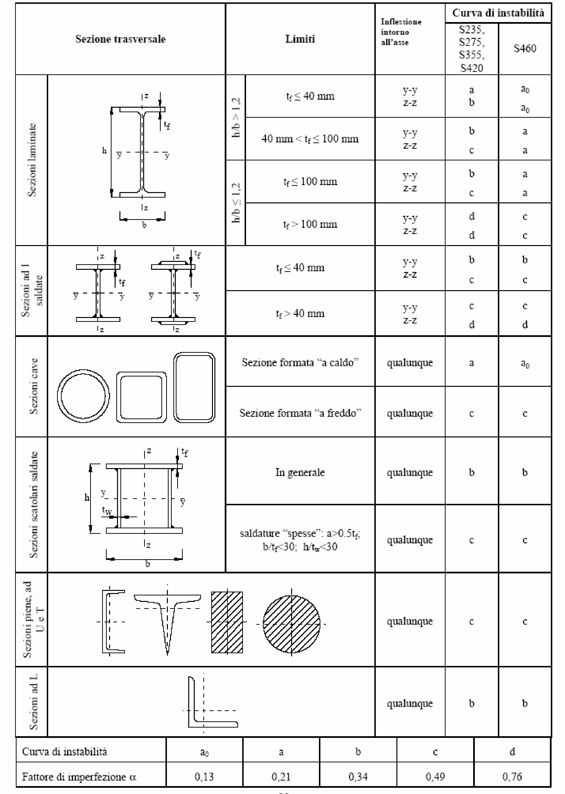

$N_{cr}$ è il carico critico elastico basato sulle proprietà della sezione lorda e sulla lunghezza di libera inflessione $l_0$ dell'asta, calcolato per la modalità di collasso per instabilità appropriata (flessionale, torsionale o flesso-torsionale).

Nel caso in cui $\bar{\lambda}$ sia minore di 0,2 oppure nel caso in cui la sollecitazione di progetto $N_{Ed}$ sia inferiore a $0{,}04N_{cr}$, gli effetti legati ai fenomeni di instabilità per le aste compresse possono essere trascurati.

*Limitazioni della snellezza*

Si definisce lunghezza d'inflessione la lunghezza $l_0 = \beta \cdot l$ da sostituire nel calcolo del carico critico elastico $N_{cr}$ alla lunghezza $l$ dell'asta quale risulta dallo schema strutturale. Il coefficiente $\beta$ deve essere valutato tenendo conto delle effettive condizioni di vincolo dell'asta nel piano di inflessione considerato.

Si definisce snellezza di un'asta nel piano di verifica considerato il rapporto

$$\lambda = l_0/i \tag{4.2.47}$$

dove

$l_0$ è la lunghezza d'inflessione nel piano considerato,

$i$ è il raggio d'inerzia relativo.

È opportuno limitare la snellezza $\lambda$ al valore di 200 per le membrature principali ed a 250 per le membrature secondarie.

###### 4.2.4.1.3.2 Travi inflesse
Le travi inflesse con la piattabanda compressa non sufficientemente vincolata lateralmente, devono essere verificate nei riguardi dell'instabilità flesso-torsionale secondo la formula

$$\frac{M_{Ed}}{M_{b,Rd}} \leq 1 \tag{4.2.48}$$

dove:

$M_{Ed}$ è il massimo momento flettente di progetto

$M_{b,Rd}$ è il momento resistente di progetto per l'instabilità.

Nel caso di profilo inflesso secondo l'asse forte (asse y) il momento resistente di progetto per i fenomeni di instabilità di una trave lateralmente non vincolata può essere assunto pari a

$$M_{b,Rd} = \chi_{LT} \cdot W_y \frac{f_{yk}}{\gamma_{M1}} \tag{4.2.49}$$

dove

$W_y$ è il modulo resistente della sezione, pari al modulo plastico $W_{pl,y}$, per le sezioni di classe 1 e 2, al modulo elastico $W_{el,y}$, per le sezioni di classe 3 e che può essere assunto pari al modulo efficace $W_{eff,y}$, per le sezioni di classe 4.

Il fattore $\chi_{LT}$ è il fattore di riduzione per l'instabilità flessotorsionale, dipendente dal tipo di profilo impiegato e può essere determinato dalla formula

$$
\chi_{LT} = \frac{1}{f}\cdot\frac{1}{\Phi_{LT} + \sqrt{\Phi_{LT}^2 - \beta \cdot \bar{\lambda}_{LT}^2}} \leq K_\chi
\tag{4.2.50}
$$

dove $\Phi_{LT} = 0.5\left[1 + \alpha_{LT}\left(\bar{\lambda}_{LT} - \bar{\lambda}_{LT,0}\right) + \beta \cdot \bar{\lambda}_{LT}^2\right]$

Il coefficiente di snellezza normalizzata $\bar{\lambda}_{LT}$ è dato dalla formula

$$\bar{\lambda}_{LT} = \sqrt{\frac{W_y \cdot f_{yk}}{M_{cr}}} \tag{4.2.51}$$

in cui $M_{cr}$ è il momento critico elastico di instabilità flesso-torsionale, calcolato considerando la sezione lorda del profilo e tenendo in conto, le condizioni di carico ed i vincoli torsionali presenti, nell'ipotesi di diagramma di momento flettente uniforme.

Il fattore di imperfezione $\alpha_{LT}$ è ottenuto dalle indicazioni riportate nella Tab. 4.2.IX (a) in base alle curve di stabilità definita nella tabella Tab. 4.2.IX (b)

Il fattore $f$ considera la reale distribuzione del momento flettente tra i ritegni torsionali dell'elemento inflesso ed è definito dalla formula

$$f = 1 - 0{,}5(1-k_c)\left[1 - 2{,}0\left(\bar{\lambda}_{LT} - 0{,}8\right)^2\right] \tag{4.2.52}$$

in cui il fattore correttivo $k_c$ assume i valori riportati in Tab. 4.2.X. In particolare nel caso di variazione lineare del momento flettente $\psi$ ($-1 \leq \psi \leq 1$) rappresenta il rapporto tra il momento in modulo minimo ed il momento in modulo massimo presi entrambi con il loro segno.

Nel caso generale, si può assume $f=1$, $\beta=1$, $K_\chi=1$ e $\bar{\lambda}_{LT,0}=0{,}2$.

**Tab. 4.2.IX (a) Valori raccomandati di $\alpha_{LT}$ per le differenti curve di stabilità.**

| Curva di stabilità | a | b | c | d |
|---|---:|---:|---:|---:|
| Fattore di imperfezione $\alpha_{LT}$ | 0,21 | 0,34 | 0,49 | 0,76 |

**Tab. 4.2.IX (b) - Definizione delle curve di stabilità per le varie tipologie di sezione e per gli elementi inflessi**

| Sezione trasversale | Limiti | Curva di instabilità da Tab. 4.2.VIII |
|---|---:|---:|
| Sezione laminata ad I | $h/b \leq 2$ | b |
| Sezione laminata ad I | $h/b > 2$ | c |
| Sezione composta saldata | $h/b \leq 2$ | c |
| Sezione composta saldata | $h/b > 2$ | d |
| Altre sezioni trasversali | - | d |

Per i profili a I o a H, laminati o composti saldati, il coefficiente $\bar{\lambda}_{LT,0}$ non può mai essere assunto superiore a 0,4, il coefficiente $\beta$ non può mai essere assunto inferiore a 0,75 e il termine $K_\chi$ è definito come:

$$K_\chi = \min\left(1,\frac{1}{f \cdot \bar{\lambda}_{LT}^2}\right) \tag{4.2.53}$$

###### 4.2.4.1.3.3 Membrature inflesse e compresse
Per elementi strutturali soggetti a compressione e flessione, si debbono studiare i relativi fenomeni di instabilità facendo riferimento a normative di comprovata validità.

###### 4.2.4.1.3.4 Stabilità dei pannelli
Gli elementi strutturali in parete sottile (di classe 4) presentano problemi complessi d'instabilità locale, per la cui trattazione si deve fare riferimento a normative di comprovata validità.

#### 4.2.4.1.4 Stato limite di fatica

Per le strutture soggette a carichi ciclici deve essere verificata la resistenza a fatica imponendo che:

$$\Delta_d \leq \Delta_R/\gamma_{Mf} \tag{4.2.54}$$

essendo

$\Delta_d$ l'escursione di tensione (effettiva o equivalente allo spettro di tensione) prodotta dalle azioni cicliche di progetto che inducono fenomeni di fatica con coefficienti parziali $\gamma_{Mf}=1$;

$\Delta_R$ la resistenza a fatica per la relativa categoria dei dettagli costruttivi, come desumibile dalle curve S-N di resistenza a fatica, per il numero totale di cicli di sollecitazione $N$ applicati durante la vita di progetto richiesta,

$\gamma_{Mf}$ il coefficiente parziale definito nella Tab. 4.2.XI.

Nel caso degli edifici la verifica a fatica delle membrature non è generalmente necessaria, salvo per quelle alle quali sono applicati dispositivi di sollevamento dei carichi o macchine vibranti.

**Tab. 4.2.X - Coefficiente correttivo del momento flettente per la verifica a stabilità delle travi inflesse**

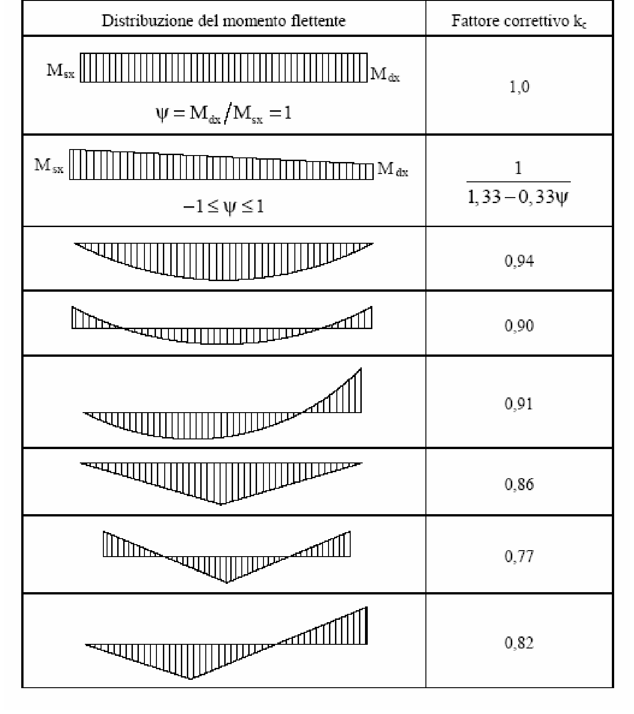

Nel caso dei ponti gli spettri dei carichi da impiegare per le verifiche a fatica sono fissati nel Capitolo 5 delle presenti norme.

Per valutare gli effetti della fatica è innanzitutto necessario classificare le strutture nei confronti della loro sensibilità al fenomeno.

Si definiscono strutture poco sensibili alla rottura per fatica quelle in cui si verifichino tutte le seguenti circostanze:

- dettagli costruttivi, materiali e livelli di tensione tali che le eventuali lesioni presentino bassa velocità di propagazione e significativa lunghezza critica;
- disposizioni costruttive che permettano la ridistribuzione degli sforzi;
- dettagli idonei ad arrestare la propagazione delle lesioni;
- dettagli facilmente ispezionabili e riparabili;
- prestabilite procedure di ispezione e di manutenzione atte a rilevare e riparare le eventuali lesioni.

Si definiscono strutture sensibili alla rottura per fatica quelle che non ricadono nei punti precedenti.

La resistenza a fatica di un dettaglio è individuata mediante una curva caratteristica, detta curva S-N, che esprime il numero di cicli a rottura $N$ in funzione delle variazioni di tensione nel ciclo $\Delta\sigma$ o $\Delta\tau$.

Per indicazioni riguardanti le modalità di realizzazione dei dettagli costruttivi e la loro classificazione, con le rispettive curve S-N si può fare riferimento al documento UNI EN1993-1-9.

**Tab. 4.2.XI - Coefficienti di sicurezza da assumere per le verifiche a fatica.**

| | Conseguenze della rottura | |
|---|---:|---:|
| | Conseguenze moderate | Conseguenze significative |
| Strutture poco sensibili alla rottura per fatica | $\gamma_{Mf}=1{,}00$ | $\gamma_{Mf}=1{,}15$ |
| Strutture sensibili alla rottura per fatica | $\gamma_{Mf}=1{,}15$ | $\gamma_{Mf}=1{,}35$ |

Le verifiche a fatica possono essere a vita illimitata o a danneggiamento.

*Verifica a vita illimitata.*

La verifica a vita illimitata si esegue controllando che sia:

$$\Delta\sigma_{max,d} = \gamma_{Mf} \cdot \Delta\sigma_{max} \leq \Delta\sigma_D \tag{4.2.55}$$

oppure che:

$$\Delta\tau_{max,d} = \gamma_{Mf} \cdot \Delta\tau_{max} \leq \Delta\tau_D = \Delta\tau_L \tag{4.2.56}$$

dove $\Delta\sigma_{max,d}$ e $\Delta\tau_{max,d}$ sono, rispettivamente, i valori di progetto delle massime escursioni di tensioni normali e di tensioni tangenziali indotte nel dettaglio considerato dallo spettro di carico, e $\Delta\sigma_D$ e $\Delta\tau_D$ i limiti di fatica ad ampiezza costante.

La verifica a vita illimitata è esclusa per tutti i dettagli le cui curve S-N non presentino limite di fatica ad ampiezza costante (per es., i connettori a piolo).

*Verifica a danneggiamento*

La verifica a danneggiamento si esegue mediante la formula di Palmgren-Miner, controllando che il danneggiamento $D$ risulti:

$$D = \sum_i \frac{n_i}{N_i} \leq 1{,}0 \tag{4.2.57}$$

dove $n_i$ è il numero dei cicli di ampiezza $\Delta\sigma_{i,d}$ indotti dallo spettro di carico per le verifiche a danneggiamento nel corso della vita prevista per il dettaglio e $N_i$ è il numero di cicli di ampiezza $\Delta\sigma_{i,d}$ a rottura, ricavato dalla curva S-N caratteristica del dettaglio.

La verifica a danneggiamento può essere eseguita anche con il metodo dei coefficienti di danneggiamento equivalente $\lambda$. Per l'impiego di tale metodo si deve fare riferimento a normative di comprovata validità, di cui al capitolo 12.

Nel caso di combinazioni di tensioni normali e tangenziali, la valutazione della resistenza a fatica dovrà considerare i loro effetti congiunti adottando idonei criteri di combinazione del danno.

Nella valutazione della resistenza a fatica dovrà tenersi conto dello spessore del metallo base nel quale può innescarsi una potenziale lesione.

Le curve S-N reperibili nella letteratura consolidata sono riferite ai valori nominali delle tensioni.

Per i dettagli costruttivi dei quali non sia nota la curva di resistenza a fatica, le escursioni tensionali potranno riferirsi alle tensioni geometriche o di picco, cioè alle tensioni principali nel metallo base in prossimità della potenziale lesione, secondo le modalità e le limitazioni specifiche del metodo, nell'ambito della meccanica della frattura.

Nelle verifiche a fatica è consentito tenere conto degli effetti favorevoli di eventuali trattamenti termici o meccanici, purché adeguatamente comprovati.

#### 4.2.4.1.5 Fragilità alle basse temperature

La temperatura minima alla quale l'acciaio per impiego strutturale può essere utilizzato senza pericolo di rottura fragile, in assenza di dati più precisi, deve essere stimata sulla base della temperatura $T$ alla quale per detto acciaio può essere garantita la resilienza $KV$, richiesta secondo le norme europee applicabili.

Per quanto riguarda le caratteristiche di tenacità, nel caso di strutture non protette, si assumono come temperatura di riferimento $T_{Ed}$ quella minima del luogo di installazione della struttura, con un periodo di ritorno di cinquant'anni $T_{min}$ definita al §3.5.2

$$T_{Ed} = T_{min} \tag{4.2.58}$$

Nel caso di strutture protette verrà invece adottata la temperatura $T_{min}$ aumentata di 15 °C

$$T_{Ed} = T_{min} + 15\,\text{°C} \tag{4.2.59}$$

In assenza di dati statistici locali si potrà assumere come temperatura di riferimento il valore $T_{Ed}=-25\,\text{°C}$ per strutture non protette e $T_{Ed}=-10\,\text{°C}$ per strutture protette.

Per la determinazione dei massimi spessori di utilizzo degli acciai in funzione

- della temperatura minima di servizio,
- dei livelli di sollecitazione di progetto $\sigma_{Ed}$ col metodo agli stati limiti,
- del tipo e del grado dell'acciaio,

può essere utilizzato il prospetto 2.1 di UNI EN 1993-1-10:2005.

Per membrature compresse valgono le prescrizioni del prospetto 2.1 della UNI EN 1993-1-10 con $\sigma_{Ed}=0{,}25\,f_y$.

Tale tabella è valida per velocità di deformazione non superiori a $\varepsilon_0 = 4x10^{-4}/s$ e per materiali che non abbiano subito incrudimenti e/o invecchiamenti tali da alterarne le caratteristiche di tenacità.

#### 4.2.4.1.6 Resistenza di cavi, barre e funi

La verifica di cavi, barre e funi dovrà tener conto della specificità di tali elementi sia per quanto riguarda le caratteristiche dei materiali, sia per i dettagli costruttivi e potrà essere condotta con riferimento a specifiche indicazioni contenute in normative di comprovata validità, quali UNI EN 12385, UNI EN 10059 e UNI EN 10060, adottando fattori parziali $\gamma_M$ che garantiscano i livelli di sicurezza stabiliti nelle presenti norme.

#### 4.2.4.1.7 Resistenza degli apparecchi di appoggio

Le verifiche degli apparecchi di appoggio devono essere condotte tenendo conto della specificità dei materiali impiegati e della tipologia delle apparecchiature.

Si può fare riferimento a modelli di calcolo contenuti in normative di comprovata validità, quali le norme della serie UNI EN 1337, adottando fattori parziali $\gamma_M$ che garantiscano i livelli di sicurezza stabiliti nelle presenti norme.

### 4.2.4.2 Verifiche agli stati limite di esercizio

#### 4.2.4.2.1 Spostamenti verticali

Il valore totale dello spostamento ortogonale all'asse dell'elemento (Fig. 4.2.3) è definito come

$$\delta_{tot} = \delta_1 + \delta_2 \tag{4.2.60}$$

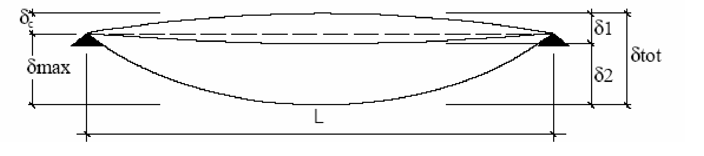

**Fig. 4.2.3** - *Definizione degli spostamenti verticali per le verifiche in esercizio*

essendo:

$\delta_C$ la monta iniziale della trave,

$\delta_1$ lo spostamento elastico dovuto ai carichi permanenti,

$\delta_2$ lo spostamento elastico dovuto ai carichi variabili,

$\delta_{max}$ lo spostamento nello stato finale, depurato della monta iniziale $= \delta_{tot} - \delta_C$.

Nel caso di coperture, solai e travi di edifici ordinari, i valori limite di $\delta_{max}$ e $\delta_2$, riferiti alle combinazioni caratteristiche delle azioni, sono espressi come funzione della luce $L$ dell'elemento.

I valori di tali limiti sono da definirsi in funzione degli effetti sugli elementi portati, della qualità del comfort richiesto alla costruzione, delle caratteristiche degli elementi strutturali e non strutturali gravanti sull'elemento considerato, delle eventuali implicazioni di una eccessiva deformabilità sul valore dei carichi agenti.

In carenza di più precise indicazioni si possono adottare i limiti indicati nella Tab. 4.2.XII, dove $L$ è la luce dell'elemento o, nel caso di mensole, il doppio dello sbalzo.

#### 4.2.4.2.2 Spostamenti laterali

Negli edifici gli spostamenti laterali alla sommità delle colonne per le combinazioni caratteristiche delle azioni devono generalmente limitarsi ad una frazione dell'altezza della colonna e dell'altezza complessiva dell'edificio da valutarsi in funzione degli effetti sugli elementi portati, della qualità del comfort richiesto alla costruzione, delle eventuali implicazioni di una eccessiva deformabilità sul valore dei carichi agenti.

In assenza di più precise indicazioni si possono adottare i limiti per gli spostamenti orizzontali indicati in Tab. 4.2.XIII ($\delta$ spostamento in sommità; $\Delta$ spostamento relativo di piano - Fig. 4.2.4).

**Tab. 4.2.XII - Limiti di deformabilità per gli elementi di impalcato delle costruzioni ordinarie**

| Elementi strutturali | $\delta_{max}/L$ | $\delta_2/L$ |
|---|:---:|:---:|
| Coperture in generale | $1/200$ | $1/250$ |
| Coperture praticabili | $1/250$ | $1/300$ |
| Solai in generale | $1/250$ | $1/300$ |
| Solai o coperture che reggono intonaco o altro materiale di finitura fragile o tramezzi non flessibili | $1/250$ | $1/350$ |
| Solai che supportano colonne | $1/400$ | $1/500$ |
| Nei casi in cui lo spostamento può compromettere l'aspetto dell'edificio | $1/250$ | |

In caso di specifiche esigenze tecniche e/o funzionali tali limiti devono essere opportunamente ridotti.

**Tab. 4.2.XIII - Limiti di deformabilità per costruzioni ordinarie soggette ad azioni orizzontali**

| Tipologia dell'edificio | $\delta/h$ | $\Delta/H$ |
|---|:---:|:---:|
| Edifici industriali monopiano senza carroponte | $1/150$ | / |
| Altri edifici monopiano | $1/300$ | / |
| Edifici multipiano | $1/300$ | $1/500$ |

In caso di specifiche esigenze tecniche e/o funzionali tali limiti devono essere opportunamente ridotti.

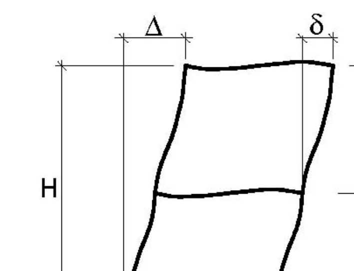

**Fig. 4.2.4** - *Definizione degli spostamenti orizzontali per le verifiche in esercizio*

#### 4.2.4.2.3 Stato limite di vibrazioni

Le verifiche devono essere condotte adottando le combinazioni frequenti di progetto e facendo riferimento a normative per la misura e la valutazione degli effetti indotti dalle vibrazioni quali: la UNI 9614, la UNI 9916 ed altre norme di comprovata validità.

###### 4.2.4.2.3.1 Edifici
Nel caso di solai caricati regolarmente da persone, la frequenza naturale più bassa della struttura del solaio non deve in generale essere minore di 3 Hz.

Nel caso di solai soggetti a eccitazioni cicliche la frequenza naturale più bassa non deve in generale essere inferiore a 5 Hz.

In alternativa a tali limitazioni potrà condursi un controllo di accettabilità della percezione delle vibrazioni.

###### 4.2.4.2.3.2 Strutture di elevata flessibilità e soggette a carichi ciclici
I controlli di accettabilità della percezione devono essere condotti seguendo metodologie e limitazioni suggerite da normative di comprovata validità.

###### 4.2.4.2.3.3 Oscillazioni prodotte dal vento
Le strutture di elevata flessibilità, quali edifici alti e snelli, coperture molto ampie, ecc., devono essere verificate per gli effetti indotti dall'azione dinamica del vento sia per le vibrazioni parallele che per quelle perpendicolari all'azione del vento.

Le verifiche devono condursi per le vibrazioni indotte dalle raffiche e per quelle indotte dai vortici, utilizzando dati suffragati da opportuna documentazione, o tramite metodi analitici, numerici e/o sperimentali adeguatamente comprovati.

#### 4.2.4.2.4 Stato limite di plasticizzazioni locali

Nelle strutture in acciaio è normale che la presenza di tensioni residue (dovute a processi di fabbricazione, tolleranze, particolarità di alcuni dettagli, variazioni localizzate della temperatura) produca concentrazioni di tensioni e conseguenti plasticizzazioni localizzate. Queste non influenzano la sicurezza dell'opera nei confronti degli stati limite ultimi. Inoltre i criteri di cui al § 4.2.4.1.3 tengono conto dell'influenza di questi parametri nei riguardi dell'instabilità delle membrature.

In presenza di fenomeni di fatica a basso numero di cicli ci si deve cautelare mediante specifiche verifiche.

---

## Circolare

### C4.2.4 Verifiche

#### C4.2.4.1 Verifiche agli stati limiti ultimi

##### C4.2.4.1.3 Stabilità delle membrature

###### C4.2.4.1.3.1 Aste compresse

Aste compresse composte a sezione costante realizzate da due elementi (correnti) collegati tra loro con calastrelli o tralicci possono essere verificate con il metodo qui proposto, a condizione che i campi individuati dai calastrelli o dalle aste di parete del traliccio siano uguali e non meno di tre.

I correnti dell'asta composta possono essere a parete piena (Figura C4.2.7) oppure calastrellati o tralicciati a loro volta. Nel caso di correnti a pareti piena le tralicciature delle facce opposte devono corrispondersi ed essere sovrapponibili per traslazione, in caso contrario debbono essere considerati anche gli effetti torsionali sui correnti.

Nel seguito si fa riferimento ad aste di lunghezza $L$, incernierate agli estremi nel piano della calastrellatura o della tralicciatura, equiparando la deformabilità della calastrellatura o della tralicciatura alla deformabilità a taglio di un'asta a parete piena equivalente. Per condizioni di vincolo diverse la trattazione può essere convenientemente adattata.

Le imperfezioni di montaggio possono essere schematizzate considerando un difetto di rettilineità.

$$e_0 = \dfrac{L}{500} \tag{C4.2.21}$$

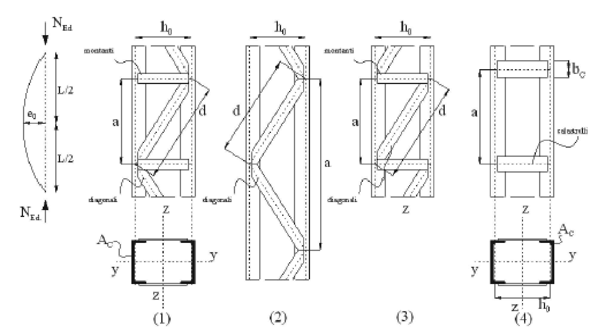

**Figura C4.2.7** - *Aste composte costituite da due correnti uguali*

Oltre alle verifiche di stabilità dell'asta composta si devono eseguire anche le verifiche di stabilità e resistenza dei correnti e delle aste di parete, come specificato nel seguito. Per configurazioni più complesse, non trattate nel presente documento, si può far riferimento a procedimenti di comprovata validità.

###### C4.2.4.1.3.1.1 Calcolo della forza normale di progetto agente in un corrente
Per un elemento costituito da due correnti a parete piena, la forza normale di progetto nei correnti può essere ricavata da

$$N_{C,Ed} = 0{,}5 \cdot N_{Ed} + \dfrac{M_{Ed} \cdot h_0 \cdot A_C}{2 \cdot J_{eff}} \tag{C4.2.22}$$

dove
- $N_{Ed}$ è la forza normale di progetto dell'asta composta;
- $h_0$ è la distanza tra i baricentri dei correnti;
- $A_C$ è l'area della sezione di ciascun corrente;
- $J_{eff}$ è il momento di inerzia efficace della sezione dell'elemento composto;
- $M_{Ed}$ è il momento di progetto dato da

$$M_{Ed} = \dfrac{N_{Ed} \cdot e_0 + M^{I}_{Ed}}{1 - \dfrac{N_{Ed}}{N_{cr}} - \dfrac{N_{Ed}}{S_V}} \tag{C4.2.23}$$

in cui

$$N_{cr} = \dfrac{\pi^2 \, E \, J_{eff}}{L^2}$$

è il carico critico euleriano dell'asta composta; $M^{I}_{Ed}$ è il valore del massimo momento flettente agente in mezzeria dell'asta composta; $S_V$ è la rigidezza a taglio equivalente della tralicciatura o della calastrellatura.

###### C4.2.4.1.3.1.2 Calcolo della forza di taglio agente negli elementi di collegamento
La verifica dei calastrelli e degli elementi di parete dei tralicci nei campi estremi può essere eseguita considerando la forza di taglio nell'asta composta

$$V_{Ed} = \pi \, \dfrac{M_{Ed}}{L} \tag{C4.2.24}$$

Per i calastrelli si devono considerare anche il momento flettente e lo sforzo di taglio dovuto al funzionamento a telaio dell'elemento.

###### C4.2.4.1.3.1.3 Verifiche di aste composte tralicciate
Devono essere verificati nei riguardi dei fenomeni di instabilità sia i diagonali sia i correnti. La verifica si esegue controllando che

$$\dfrac{N_{c,Ed}}{N_{b,Rd}} \le 1{,}0 \tag{C4.2.25}$$

Nel caso dei correnti, $N_{c,Ed}$ è la forza normale di progetto calcolata con la (C4.2.22), mentre $N_{b,Rd}$ è il carico critico, determinato in riferimento alla lunghezza di libera inflessione $L_{ch}$ del corrente. Per correnti ad anima piena si può assumere $L_{ch}=a$ (v. Figura C4.2.7), per correnti tralicciati $L_{ch}$ dipende dallo schema adottato ed è indicato in Figura C4.2.8.

La rigidezza equivalente dell'asta composta tralicciata può essere assunta uguale a

$$J_{eff} = 0{,}5 \cdot h_0^2 \cdot A_C \tag{C4.2.26}$$

mentre la rigidezza equivalente a taglio della tralicciatura, $S_V$, può essere ricavata, in funzione dello schema di tralicciatura adottato, dalla Tabella C4.2.II.

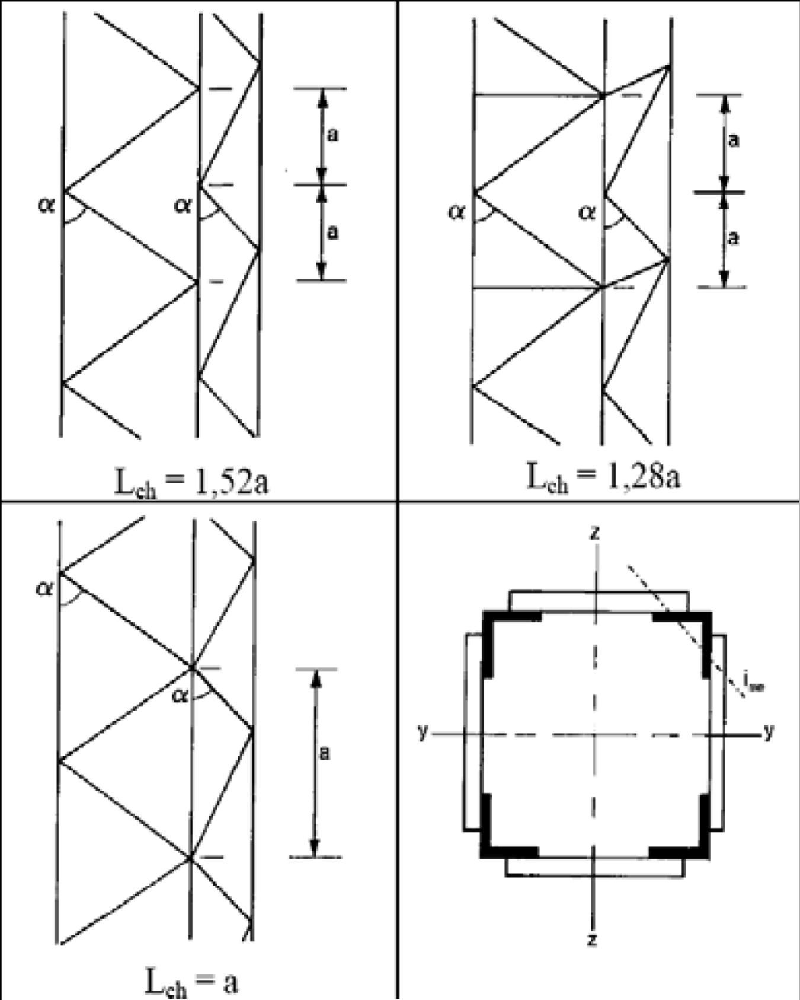

**Figura C4.2.8** - *Lunghezza di libera inflessione dei correnti di aste tralicciate*

**Tabella C4.2.II** - *Rigidezza a taglio equivalenti di aste tralicciate o calastrellate*

| Schema dell'asta composta (v. fig. C4.2.7) | (1) | (2) | (3) | (4) |
|:---:|:---:|:---:|:---:|:---:|
| $S_V$ - rigidezza a taglio | $\dfrac{n \cdot E A_d \cdot a \cdot h_0^2}{d^3}$ | $\dfrac{n \cdot E A_d \cdot a \cdot h_0^2}{2 \cdot d^3}$ | $\dfrac{n \cdot E A_d \cdot a \cdot h_0^2}{d^3 \left[1 + \dfrac{A_d \cdot h_0^3}{A_v \cdot d^3}\right]}$ | $\dfrac{24 \, E J_C}{a^2 \cdot \left[1 + \dfrac{2 \, J_C \cdot h_0}{n \, J_v \cdot a}\right]} \le \dfrac{2 \pi^2 \, E J_C}{a^2}$ |

$A_d$ area dei diagonali, $A_v$: area dei calastrelli, $J_v$: momento di inerzia del calastrello, $A_C$: area di un corrente, $n$ numero di piani di tralicciatura o calastrellatura

\newpage

###### C4.2.4.1.3.1.4 Verifiche di aste composte calastrellate
Nelle aste composte calastrellate le verifiche dei correnti e dei calastrelli possono essere condotte in riferimento alla distribuzione di forze e sollecitazioni indicata in Figura C4.2.9.

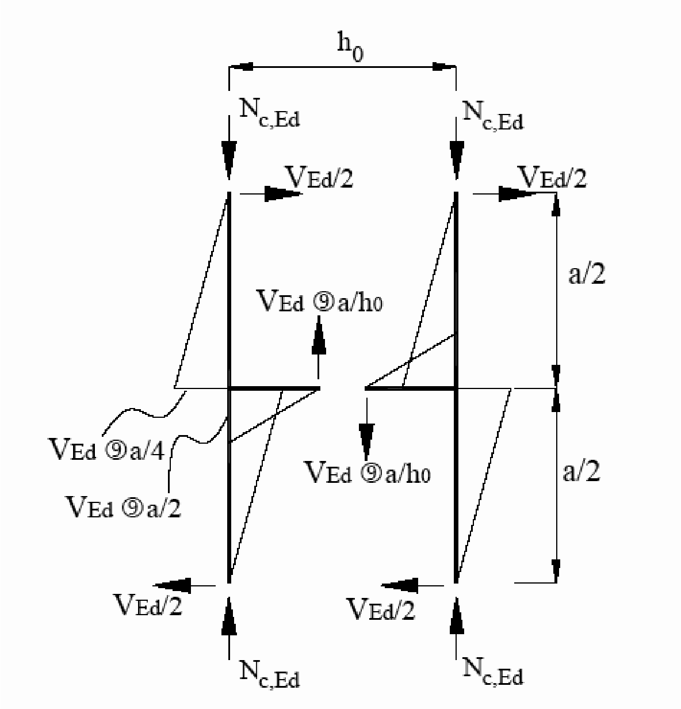

**Figura C4.2.9** - *Schema di calcolo semplificato per un'asta calastrellata*

Cautelativamente, nei correnti, lo sforzo di taglio massimo di progetto $V_{Ed}$ può essere combinato con la forza normale massima di progetto $N_{Ed}$.

La rigidezza a taglio equivalente $S_V$ della parete calastrellata è indicata in Tabella C4.2.II (schema (4)).

Il momento di inerzia effettivo della sezione composta può essere ricavato da

$$J_{eff} = 0{,}5 \cdot h_0^2 \cdot A_C + 2 \cdot \mu \cdot J_C \tag{C4.2.27}$$

dove $J_C$ è il momento di inerzia della sezione del corrente e $\mu$ è un coefficiente di efficienza, uguale a 0 se la snellezza dell'asta composta $\lambda$ è maggiore o uguale a 150, uguale a 1 se la snellezza è minore o uguale a 75 e uguale a $(2 - \lambda/75)$ se la snellezza è compresa tra 75 e 150. La snellezza $\lambda$ dell'asta è definita come:

$$\lambda = \dfrac{L}{i_0} = L \cdot \sqrt{\dfrac{2 \cdot A_C}{0{,}5 \cdot h_0^2 \cdot A_C + 2 \cdot I_C}} \tag{C4.2.28}$$

###### C4.2.4.1.3.1.5 Sezioni composte da elementi ravvicinati collegati con calastrelli o imbottiture
La verifica di aste composte costituite da due o quattro profilati, vedi Figura C4.2.10, posti ad un intervallo pari alle spessore delle piastre di attacco ai nodi e comunque ad una distanza non superiore a 3 volte il loro spessore e collegati con calastrelli o imbottiture, può essere condotta come per un'asta semplice, trascurando la deformabilità a taglio del collegamento, se gli interassi dei collegamenti soddisfano le limitazioni della tabella C4.2.III. Nel caso di angolari a lati disuguali, tipo (6) di Figura C4.2.10, l'instabilità dell'asta con inflessione intorno all'asse $y$ di Figura C4.2.10 può essere verificata considerando un raggio d'inerzia

$$i_y = \dfrac{i_0}{1{,}15} \tag{C4.2.29}$$

dove $i_0$ è il raggio d'inerzia minimo dell'asta composta.

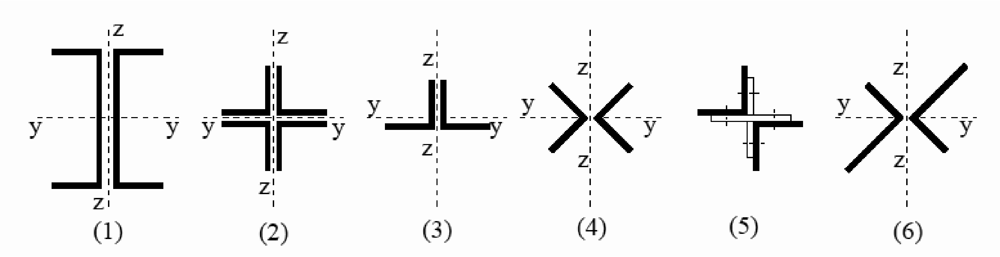

**Figura C4.2.10** - *Tipologie di aste composte costituite da elementi ravvicinati*

**Tabella C4.2.III** - *Disposizione delle imbottiture di connessione tra i profili*

| Tipo di asta composta (Figura C4.2.10) | Spaziatura massima tra i collegamenti (*) |
|---|:---:|
| Tipo (1), (2), (3) o (4) collegati con imbottiture bullonate o saldate | $15 \, i_{\min}$ |
| Tipi (5) o (6) collegati con coppie di calastrelli | $70 \, i_{\min}$ |

(*) La distanza è misurata tra i centri di due collegamenti successivi e $i_{\min}$ è il raggio di inerzia minimo del singolo profilo costituente l'asta.

Nei casi in cui le aste non soddisfino le condizioni della Tabella C4.2.III è possibile determinare un'appropriata snellezza equivalente dell'asta ricorrendo a normative di comprovata validità.

###### C4.2.4.1.3.2 Travi inflesse

Il coefficiente di snellezza adimensionale $\bar{\lambda}_{LT}$, di cui al § 4.2.4.1.3.2 delle NTC, che consente di eseguire la verifica ad instabilità flesso-torsionale dipende dal valore del momento critico elastico di instabilità torsionale, $M_{cr}$, del profilo inflesso in esame. Tale valore può calcolarsi, per profili di qualunque geometria, utilizzando metodi numerici, quali ad esempio metodi agli elementi finiti oppure programmi di calcolo strutturale che consentano di eseguire analisi di "buckling".

In alternativa, per profili standard (sezioni doppiamente simmetriche ad I o H) il momento critico può calcolarsi con la seguente formula

$$M_{cr} = \psi \cdot \dfrac{\pi}{L_{cr}} \cdot \sqrt{E \, J_y \cdot G \, J_T} \cdot \sqrt{1 + \left(\dfrac{\pi}{L_{cr}}\right)^{2} \cdot \dfrac{E \, J_\omega}{G \, J_T}} \tag{C4.2.30}$$

dove $L_{cr}$ è la lunghezza di libera inflessione laterale, misurata tra due ritegni torsionali successivi, $E J_y$ è la rigidezza flessionale laterale del profilo (misurata in genere rispetto all'asse debole), $G J_T$ è la rigidezza torsionale del profilo mentre $E J_\omega$ è la rigidezza torsionale secondaria del profilo. Il coefficiente $\psi$ tiene conto della distribuzione del momento flettente lungo la trave ed è dato dall'espressione

$$\psi = 1.75 - 1.05 \cdot \dfrac{M_B}{M_A} + 0.3 \cdot \left(\dfrac{M_B}{M_A}\right)^{2} \tag{C4.2.31}$$

in cui $M_A$ ed $M_B$ sono i momenti flettenti agenti alle estremità della trave, con $|M_B| < |M_A|$.

###### C4.2.4.1.3.3 Membrature inflesse e compresse

Oltre alle verifiche di resistenza, per elementi pressoinflessi devono essere eseguite, quando rilevanti, anche verifiche di instabilità a pressoflessione.

In assenza di più accurate valutazioni, si possono impiegare, in alternativa, i metodi A e B riportati nel seguito, o anche altre metodi ricavati da normative di comprovata validità.

###### C4.2.4.1.3.3.1 Metodo A
Nel caso di aste prismatiche soggette a compressione $N_{Ed}$ e a momenti flettenti $M_{y,Ed}$ e $M_{z,Ed}$ agenti nei due piani principali di inerzia, in presenza di vincoli che impediscono gli spostamenti torsionali, si dovrà controllare che risulti:

$$\dfrac{N_{Ed} \cdot \gamma_{M1}}{\chi_{\min} \cdot f_{yk} \cdot A} + \dfrac{M_{yeq,Ed} \cdot \gamma_{M1}}{f_{yk} \cdot W_y \cdot \left(1 - \dfrac{N_{Ed}}{N_{cr,y}}\right)} + \dfrac{M_{zeq,Ed} \cdot \gamma_{M1}}{f_{yk} \cdot W_z \cdot \left(1 - \dfrac{N_{Ed}}{N_{cr,z}}\right)} \le 1 \tag{C4.2.32}$$

dove:
- $\chi_{\min}$ è il minimo fattore $\chi$ relativo all'inflessione intorno agli assi principali di inerzia;
- $W_y$ e $W_z$ sono i moduli resistenti elastici per le sezioni di classe 3 e i moduli resistenti plastici per le sezioni di classe 1 e 2,
- $N_{cr,y}$ e $N_{cr,z}$ sono i carichi critici euleriani relativi all'inflessione intorno agli assi principali di inerzia;
- $M_{yeq,Ed}$ e $M_{zeq,Ed}$ sono i valori equivalenti dei momenti flettenti da considerare nella verifica.

Se il momento flettente varia lungo l'asta si assume, per ogni asse principale di inerzia,

$$M_{eq,Ed} = 1{,}3 \cdot M_{m,Ed} \tag{C4.2.33}$$

essendo $M_{m,Ed}$ il valor medio del momento flettente, con la limitazione

$$0{,}75 \cdot M_{\max,Ed} \le M_{eq,Ed} \le M_{\max,Ed} \tag{C4.2.34}$$

Nel caso di asta vincolata agli estremi, soggetta a momento flettente variabile linearmente tra i valori di estremità $M_a$ e $M_b$, $|M_a| \ge |M_b|$, (Figura C4.2.11), si può assumere per $M_{eq,Ed}$ il seguente valore

$$M_{eq,Ed} = 0{,}6 \cdot M_a - 0{,}4 \cdot M_b \ge 0{,}4 \cdot M_a \tag{C4.2.35}$$

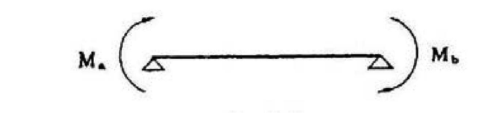

**Figura C4.2.11** - *Trave soggetta a momenti d'estremità*

In presenza di fenomeni di instabilità flesso-torsionali bisogna verificare che sia:

$$\dfrac{N_{Ed} \cdot \gamma_{M1}}{\chi_{\min} \cdot f_{yk} \cdot A} + \dfrac{M_{yeq,Ed} \cdot \gamma_{M1}}{\chi_{LT} \cdot f_{yk} \cdot W_y \cdot \left(1 - \dfrac{N_{Ed}}{N_{cr,y}}\right)} + \dfrac{M_{zeq,Ed} \cdot \gamma_{M1}}{f_{yk} \cdot W_z \cdot \left(1 - \dfrac{N_{Ed}}{N_{cr,z}}\right)} \le 1 \tag{C4.2.36}$$

dove $\chi_{LT}$ è il fattore di riduzione per l'instabilità flesso-torsionale, definito al § 4.2.4.1.3.2 delle NTC e $z$ è l'asse debole.

###### C4.2.4.1.3.3.2 Metodo B
In assenza di più accurate valutazioni, nel caso di membrature a sezione costante con sezioni doppiamente simmetriche aperte o chiuse, soggette a sforzo assiale e momento flettente, la verifica di stabilità a pressoflessione, per sezioni di classe 1, 2 o 3, può essere eseguita controllando che siano soddisfatte le seguenti disuguaglianze

$$\begin{aligned}
& \dfrac{N_{Ed} \cdot \gamma_{M1}}{\chi_y \cdot A \cdot f_{yk}} + k_{yy} \cdot \dfrac{M_{y,Ed} \cdot \gamma_{M1}}{\chi_{LT} \cdot W_y \cdot f_{yk}} + k_{yz} \cdot \dfrac{M_{z,Ed} \cdot \gamma_{M1}}{W_z \cdot f_{yk}} \le 1 \\[4pt]
& \dfrac{N_{Ed} \cdot \gamma_{M1}}{\chi_z \cdot A \cdot f_{yk}} + k_{zy} \cdot \dfrac{M_{y,Ed} \cdot \gamma_{M1}}{\chi_{LT} \cdot W_y \cdot f_{yk}} + k_{zz} \cdot \dfrac{M_{z,Ed} \cdot \gamma_{M1}}{W_z \cdot f_{yk}} \le 1
\end{aligned} \tag{C4.2.37}$$

dove $N_{Ed}$, $M_{y,Ed}$ ed $M_{z,Ed}$ sono, rispettivamente, lo sforzo assiale ed i massimi momenti flettenti agenti sull'elemento nei piani di normale $y$ e $z$, $A$ è l'area e $W_y$ e $W_z$ i moduli resistenti elastici per le sezioni di classe 3 e i moduli resistenti plastici per le sezioni di classe 1 e 2, e $k_{yy}$, $k_{yz}$, $k_{zy}$ e $k_{zz}$ sono opportuni coefficienti di interazione dati nel seguito.

Per sezioni di classe 4 le [C4.2.37] si modificano nelle

$$\begin{aligned}
& \dfrac{N_{Ed} \cdot \gamma_{M1}}{\chi_y \cdot A_{eff} \cdot f_{yk}} + k_{yy} \cdot \dfrac{\left(M_{y,Ed} + \Delta M_{y,Ed}\right) \cdot \gamma_{M1}}{\chi_{LT} \cdot W_{eff,y} \cdot f_{yk}} + k_{yz} \cdot \dfrac{\left(M_{z,Ed} + \Delta M_{y,Ed}\right) \cdot \gamma_{M1}}{W_{eff,z} \cdot f_{yk}} \le 1 \\[4pt]
& \dfrac{N_{Ed} \cdot \gamma_{M1}}{\chi_z \cdot A_{eff} \cdot f_{yk}} + k_{zy} \cdot \dfrac{\left(M_{y,Ed} + \Delta M_{y,Ed}\right) \cdot \gamma_{M1}}{\chi_{LT} \cdot W_{eff,y} \cdot f_{yk}} + k_{zz} \cdot \dfrac{\left(M_{z,Ed} + \Delta M_{y,Ed}\right) \cdot \gamma_{M1}}{W_{eff,z} \cdot f_{yk}} \le 1
\end{aligned} \tag{C4.2.38}$$

dove $A_{eff}$ è l'area efficace della sezione, $W_{eff,y}$ e $W_{eff,z}$ i moduli resistenti efficaci e $\Delta M_{y,Ed}$ e $\Delta M_{z,Ed}$ i momenti della forza normale $N_{Ed}$ rispetto al baricentro della sezione efficace,

$$\Delta M_{y,Ed} = e_{N,z} \cdot N_{Ed} \quad \text{e} \quad \Delta M_{z,Ed} = e_{N,y} \cdot N_{Ed} \tag{C4.2.39}$$

con $e_{N,y}$ ed $e_{N,z}$ distanze del baricentro della sezione efficace dal baricentro della sezione lorda, lungo gli assi $y$ e $z$ rispettivamente.

Nelle [C4.2.37] e [C4.2.38] $\chi_y$, $\chi_z$ sono i coefficienti di riduzione per l'instabilità a compressione e $\chi_{LT}$ è il coefficiente di riduzione per l'instabilità flessotorsionale, dati nel § 4.2.4.1.3.1 e § 4.2.4.1.3.2 delle NTC.

**Tabella C4.2.IV** - *Coefficienti di interazione per la verifica di stabilità a pressoflessione di elementi con modesta deformabilità torsionale*

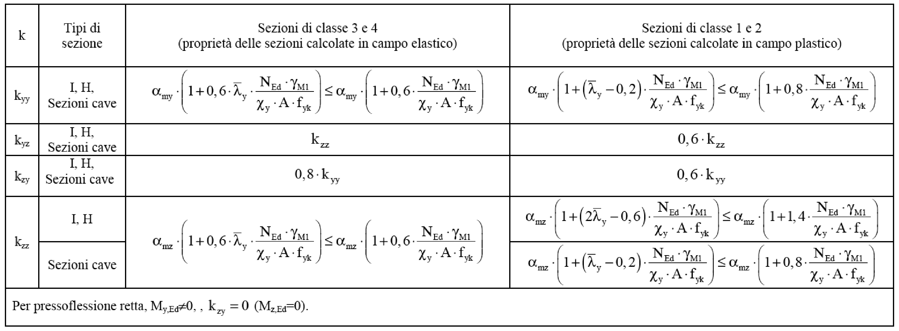

I coefficienti di interazione $k_{yy}$, $k_{yz}$, $k_{zy}$ e $k_{zz}$ sono dati nella Tabella C4.2.IV, per le membrature a sezione chiusa e per quelle a sezione aperta vincolate a torsione, e nella Tabella C4.2.V per le membrature a sezione aperta non vincolate a torsione. I valori riportati dipendono dai coefficienti $\alpha_{my}$, $\alpha_{mz}$ per l'instabilità a compressione con inflessione intorno agli assi $y$ e $z$, rispettivamente, e dal coefficiente $\alpha_{mLT}$, per l'instabilità flessotorsionale, che sono dati, in funzione del tipo di carico e dell'effettiva distribuzione dei momenti flettenti lungo l'elemento strutturale, in Tabella C4.2.VI.

**Tabella C4.2.V** - *Coefficienti d'interazione per la verifica di stabilità a pressoflessione di elementi deformabili torsionalmente*

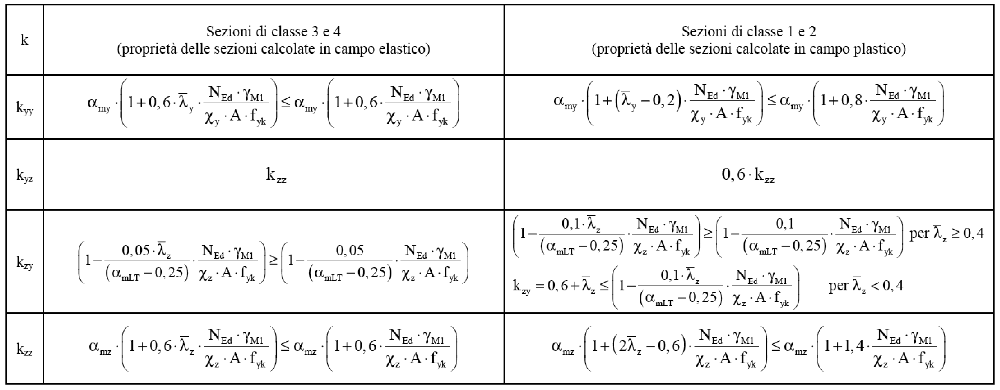

Per la valutazione dei coefficienti $\alpha_{my}$ si farà riferimento ai vincoli allo spostamento lungo $z$; per la valutazione dei coefficienti $\alpha_{mz}$ e $\alpha_{mLT}$ si farà riferimento ai vincoli allo spostamento lungo $y$.

Per elementi con modo instabile per traslazione dei piani, si deve assumere $\alpha_{my} = 0{,}9$ o $\alpha_{mz} = 0{,}9$, rispettivamente.

Per il calcolo dei coefficienti d'interazione si possono adottare metodi alternativi, adeguatamente comprovati.

**Tabella C4.2.VI** - *Coefficienti correttivi del momento flettente per la verifica di stabilità a presso-flessione deviata.*

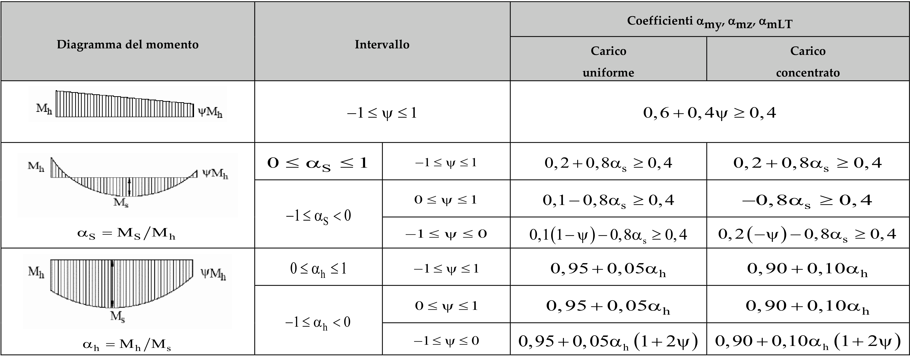

###### C4.2.4.1.3.3.3 Metodo generale per la verifica ad instabilità laterale e flesso-torsionale
Se elementi strutturali o parti di struttura non sono conformi ai requisiti imposti per l'applicazione dei metodi di verifica semplificati esposti nel § 4.2.4.1.3 delle NTC e nei §§ C4.2.4.1.3.1÷C4.2.4.1.3.3, è necessario eseguire delle analisi più accurate per determinare i valori della resistenza nei confronti dei fenomeni di instabilità dell'equilibrio dovute a sollecitazioni di compressione, flessione o combinate. In particolare, è necessario conoscere i moltiplicatori dei carichi applicati all'elemento strutturale che ingenerano fenomeni di instabilità dell'equilibrio, calcolando, per l'elemento strutturale o la struttura o parte di essa:

- $\alpha_{ult,k}$ - moltiplicatore dei carichi di progetto che induce in una sezione del sistema sollecitazioni pari alla sua resistenza caratteristica;
- $\alpha_{cr,op}$ - il minore dei moltiplicatori dei carichi di progetto che produce nell'elemento strutturale o in uno degli elementi del sistema fenomeni di instabilità laterale o torsionale.

Da tali moltiplicatori è possibile ricavare la snellezza adimensionale

$$\bar{\lambda}_{op} = \sqrt{\dfrac{\alpha_{ult,k}}{\alpha_{cr,op}}} \tag{C4.2.40}$$

dalla quale si ottiene il fattore di riduzione della resistenza del sistema

$$\chi_{op} = \min\left\{\chi\left(\bar{\lambda}_{op}\right);\ \chi_{LT}\left(\bar{\lambda}_{op}\right)\right\} \tag{C4.2.41}$$

Tali moltiplicatori dei carichi di progetto, sono ricavati all'interno del § 4.2.4.1.3 delle NTC con formule semplificate valide solo per particolari casi di sollecitazione e per le geometrie delle sezioni più comuni e doppiamente simmetriche. Il calcolo, invece, di tali coefficienti tramite modelli numerici più complessi consente la loro definizione per geometrie e condizioni di carico qualunque, purché convalidato tramite attendibili riscontri sperimentali. Ovviamente tale metodo di analisi è fortemente raccomandato nel caso di strutture speciali e/o caratterizzate da conformazioni strutturali particolarmente complesse, per le quali sia giustificato il riscontro sperimentale.

La verifica complessiva nei confronti dell'instabilità al di fuori del piano per l'elemento strutturale generico (non prismatico, con condizioni al contorno particolari, ecc.) o per la struttura è imposta con la formula seguente

$$\dfrac{\chi_{op} \cdot \alpha_{ult,k}}{\gamma_{M1}} \ge 1{,}0 \tag{C4.2.42}$$

###### C4.2.4.1.3.4 Stabilità dei pannelli

I pannelli d'anima degli elementi strutturali, laminati oppure realizzati in soluzione composta saldata, devono essere verificati nei confronti dei fenomeni di instabilità dell'equilibrio allo stato limite ultimo.

In presenza di fenomeni di instabilità che potrebbero portare a rotture per fenomeni di fatica la verifica deve essere condotta in fase d'esercizio (verifica a *respiro delle anime*): al riguardo si veda § 7.4 del documento UNI EN 1993-2:2007 ed § 4.6 dell'UNI EN 1993-1-5:2007. Inoltre, nel caso di profili in parete sottile e/o sagomati a freddo di classe 4 è necessario fare riferimento ai documenti tecnici specializzati, che trattino le loro problematiche di resistenza e stabilità in maniera più esaustiva. Al riguardo si veda anche il documento UNI EN 1993-1-3.

Per la verifica dei pannelli d'anima è necessario riferirsi in genere a normative e documentazione tecnica di comprovata validità. Nei casi maggiormente ricorrenti è possibile verificare la stabilità dei pannelli d'anima utilizzando le procedure esposte nei paragrafi seguenti.

###### C4.2.4.1.3.4.1 Stabilità dei pannelli soggetti a taglio
I pannelli d'anima rettangolari delle travi a pareti piena devono essere verificati nei riguardi dell'instabilità per taglio quando il rapporto altezza spessore $h_w/t$ supera il valore

$$\dfrac{h_w}{t} \ge \dfrac{72}{\eta} \cdot \varepsilon \tag{C4.2.43}$$

nel caso di pannelli non irrigiditi e

$$\dfrac{h_w}{t} \ge \dfrac{31}{\eta} \cdot \varepsilon \cdot \sqrt{k_\tau} \tag{C4.2.44}$$

per pannelli irrigiditi, dove $h_w$ è l'altezza del pannello, $t$ il suo spessore, $\eta$ è uguale a 1,20, $k_\tau$ è il minimo coefficiente di instabilità per taglio del pannello e

$$\varepsilon = \sqrt{235 / f_y[\text{MPa}]} \tag{C4.2.45}$$

In questo caso devono essere previsti irrigidimenti trasversali in corrispondenza dei vincoli.

La resistenza all'instabilità per taglio di un pannello d'anima privo di irrigidimenti intermedi è espressa da

$$V_{b,Rd} = V_{bw,Rd} + V_{bf,Rd} \le \eta \cdot \dfrac{f_{yw} \cdot h_w \cdot t}{\sqrt{3} \cdot \gamma_{M1}} \tag{C4.2.46}$$

dove $f_{yw}$ è la tensione di snervamento del pannello, $\chi_w$ è un coefficiente che tiene conto dell'instabilità elastica dell'elemento ed è dato nella Tabella C4.2.VII in funzione del coefficiente di snellezza $\bar{\lambda}_w$ e della rigidezza dell'irrigiditore sull'appoggio, $V_{bw,Rd}$ è il contributo resistente dell'anima

$$V_{bw,Rd} = \dfrac{\chi_w \cdot f_{yw} \cdot h_w \cdot t}{\sqrt{3} \cdot \gamma_{M1}} \tag{C4.2.47}$$

e $V_{bf,Rd}$ è il contributo resistente delle piattabande. Il contributo resistente delle piattabande può essere espresso da

$$V_{bf,Rd} = \dfrac{b_f \cdot t_f^2 \cdot f_{yf}}{a\left(0{,}25 + \dfrac{1{,}6 \cdot b_f \cdot t_f^2 \cdot f_{yf}}{t \cdot h_w^2 \cdot f_{yw}}\right)\gamma_{M1}} \cdot \left[1 - \left(\dfrac{M_{Ed}}{M_{f,red}}\right)^2\right] \tag{C4.2.48}$$

in cui $b_f$ è la larghezza efficace dell'anima, non maggiore di $15 \cdot \varepsilon \cdot t_f$ da ciascun lato dell'irrigiditore, $t_f$ lo spessore della piattabanda di resistenza assiale minima e $M_{f,red}$ è il momento resistente di progetto ridotto della sezione costituita dalle aree efficaci, $A_{fi}$ e $A_{fs}$ rispettivamente, delle sole piattabande inferiore e superiore, che tiene conto dell'eventuale presenza dello sforzo normale di progetto $N_{Ed}$,

$$M_{f,red} = \dfrac{M_{fk}}{\gamma_{M0}} \cdot \left[1 - \dfrac{N_{Ed} \cdot \gamma_{M0}}{(A_{fi} + A_{fs}) \cdot f_{yf}}\right] \tag{C4.2.49}$$

Il coefficiente $\chi_w$ (vedi Tabella C4.2.VII) dipende dalla rigidezza del montante d'appoggio: un montante d'appoggio costituito da due coppie di piatti simmetrici rispetto al piano dell'anima, poste a distanza longitudinale $e > 0{,}1 \cdot h_w$, e tali che l'area di ciascuna coppia di piatti sia almeno uguale a $4 \cdot h_w \cdot t^2 / e$, può essere considerato rigido, negli altri casi il montante d'appoggio deve essere considerato non rigido.

**Tabella C4.2.VII** - *Coefficienti $\chi_w$ per il calcolo della resistenza all'instabilità a taglio del pannello*

| Coefficiente di snellezza | Coefficiente $\chi_w$ per montanti d'appoggio rigidi | Coefficiente $\chi_w$ per gli altri casi |
|:---:|:---:|:---:|
| $\bar{\lambda}_w < 0{,}83/\eta$ | $\eta$ | $\eta$ |
| $0{,}83/\eta \le \bar{\lambda}_w < 1{,}08$ | $0{,}83/\bar{\lambda}_w$ | $0{,}83/\bar{\lambda}_w$ |
| $\bar{\lambda}_w \ge 1{,}08$ | $1{,}37 / (0{,}7 + \bar{\lambda}_w)$ | $0{,}83/\bar{\lambda}_w$ |

Il parametro di snellezza $\bar{\lambda}_w$ è dato dalla formula

$$\bar{\lambda}_w = 0{,}76 \sqrt{\dfrac{f_{yw}}{\tau_{cr}}} \tag{C4.2.50}$$

dove $\tau_{cr} = k_\tau \cdot \sigma_E$ è la tensione tangenziale critica e $\sigma_E$ è la tensione critica euleriana, che per un piatto di altezza $h_w$ e spessore $t$ è data da

$$\sigma_E = \dfrac{\pi^2 \cdot E \cdot t^2}{12 \cdot (1 - \nu^2) \cdot h_w^2} = 190000 \cdot \left(\dfrac{t}{h_w}\right)^2 \ [\text{MPa}]$$

In assenza di irrigiditori longitudinali, il parametro $k_\tau$, coefficiente per l'instabilità a taglio, è dato da

$$\begin{aligned}
k_\tau &= 5{,}34 + 4{,}00 \, (h_w/a)^2 && \text{se } a/h_w \ge 1 \\
k_\tau &= 4{,}00 + 5{,}34 \, (h_w/a)^2 && \text{se } a/h_w < 1
\end{aligned} \tag{C4.2.51}$$

dove $a$ è la lunghezza del pannello compreso tra due irrigiditori trasversali rigidi consecutivi. In assenza di irrigidimenti la lunghezza $a$ del pannello si considera coincidente con quella della trave.

Un irrigiditore trasversale può essere considerato rigido quando il suo momento d'inerzia $I_{st}$ soddisfa le relazioni seguenti

$$\begin{aligned}
I_{st} &\ge 1{,}5 \cdot h_w^3 \cdot t^3 / a^2 && \text{se } a/h_w < \sqrt{2} \\
I_{st} &\ge 0{,}75 \cdot h_w \cdot t^3 && \text{se } a/h_w \ge \sqrt{2}
\end{aligned} \tag{C4.2.52}$$

Gli irrigiditori trasversali rigidi devono essere verificati per una forza assiale

$$N_{st,d} = V_{Ed} - \dfrac{f_{yw} \cdot h_w \cdot t}{\sqrt{3} \cdot \bar{\lambda}_w^2 \cdot \gamma_{M1}} \tag{C4.2.53}$$

essendo $V_{Ed}$ è il taglio di calcolo a distanza $0{,}5 \, h_w$ dal bordo del pannello più sollecitato.

Nel caso di pannelli dotati di irrigiditori longitudinali:

se gli irrigiditori longitudinali sono più di due o se il rapporto d'allungamento $\alpha = a/h_w \ge 3$ il coefficiente $k_\tau$ è dato da

$$\begin{aligned}
k_\tau &= 5{,}34 + 4{,}00 (h_w/a)^2 + k_{\tau l} && \text{quando } \alpha = a/h_w \ge 1 \\
k_\tau &= 4{,}00 + 5{,}34 (h_w/a)^2 + k_{\tau l} && \text{quando } \alpha = a/h_w < 1
\end{aligned} \tag{C4.2.54}$$

in cui

$$k_{\tau l} = \max\left[ \left(\dfrac{3}{\alpha}\right)^2 \cdot \sqrt[4]{\left(\dfrac{I_{sl}}{t^3 \cdot h_w}\right)^3};\ \dfrac{2{,}1}{t} \cdot \sqrt[3]{\dfrac{I_{sl}}{h_w}} \right] \tag{C4.2.55}$$

essendo $I_{sl}$ la somma dei momenti d'inerzia degli irrigiditori longitudinali rispetto ai singoli assi baricentrici paralleli al piano dell'anima, considerando una larghezza collaborante pari a $15 \, \varepsilon \, t$ da ciascun lato dell'irrigiditore (Figura C4.2.12); se, invece, gli irrigiditori sono uno o due e $\alpha = a/h_w < 3$, il coefficiente $k_\tau$ è

$$k_\tau = 4{,}1 + \dfrac{1}{\alpha^2} \cdot \left(6{,}3 + 0{,}18 \cdot \dfrac{I_{sl}}{t^3 h_w}\right) + 2{,}2 \cdot \sqrt[3]{\dfrac{I_{sl}}{t^3 h_w}} \tag{C4.2.56}$$

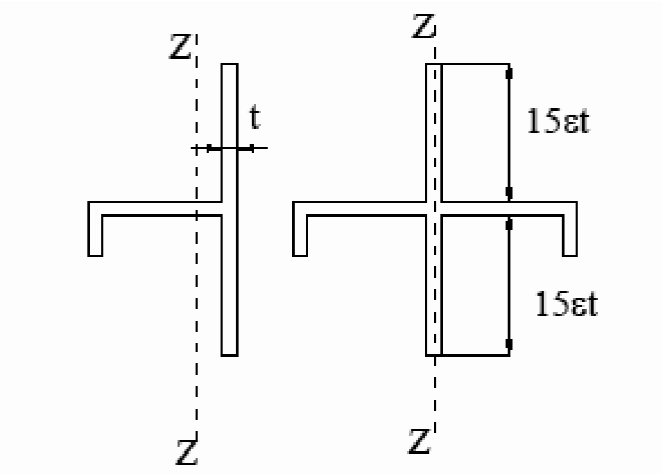

**Figura C4.2.12** - *Irrigidimenti longitudinali dei pannelli d'anima*

###### C4.2.4.1.3.4.2 Stabilità dei pannelli soggetti a compressione
La verifica di stabilità dei pannelli compressi non irrigiditi si conduce considerando la sezione efficace del pannello. L'area della sezione efficace è definita come $A_{c,eff} = \rho \cdot A_c$, dove $\rho$ è il coefficiente di riduzione che tiene conto dell'instabilità della lastra e $A_c$ è l'area lorda della sezione del pannello.

Nel caso dei pannelli irrigiditi su entrambi i lati longitudinali il coefficiente $\rho$ è dato da

$$\begin{aligned}
\rho &= 1{,}0 && \text{se } \bar{\lambda}_p \leq 0{,}673 \\
\rho &= \dfrac{\bar{\lambda}_p - 0{,}055(3 + \psi)}{\bar{\lambda}_p^2} \geq \dfrac{1}{\bar{\lambda}_p} && \text{se } \bar{\lambda}_p > 0{,}673
\end{aligned} \tag{C4.2.57}$$

dove $\psi = \sigma_2 / \sigma_1$ è il rapporto tra le tensioni ai bordi del pannello, essendo $\sigma_1$ la tensione di compressione massima in valore assoluto.

Nel caso di pannelli irrigiditi su un solo lato longitudinale $\rho$ è dato da

$$\begin{aligned}
\rho &= 1{,}0 && \text{se } \bar{\lambda}_p \le 0{,}748 \\
\rho &= \dfrac{\bar{\lambda}_p - 0{,}188}{\bar{\lambda}_p^2} \le 1{,}0 && \text{se } \bar{\lambda}_p > 0{,}748
\end{aligned} \tag{C4.2.58}$$

Nelle espressioni [C4.2.57] e [C4.2.58], la snellezza relativa del pannello $\bar{\lambda}_p$ è

$$\bar{\lambda}_p = \sqrt{\dfrac{f_y}{\sigma_{cr}}} = \dfrac{\bar{b}}{28{,}4 \cdot t \cdot \varepsilon \cdot \sqrt{k_\sigma}} \tag{C4.2.59}$$

dove il coefficiente per l'instabilità per compressione $k_\sigma$, dipendente da $\psi$ e dalle condizioni di vincolo, è dato nella Tabella C4.2.VIII per i pannelli con entrambi i bordi longitudinali irrigiditi e nella Tabella C4.2.IX per i pannelli con un solo bordo longitudinale irrigidito, e $\bar{b}$ è la larghezza del pannello. $\bar{b}$ é uguale a $h_w$ per i pannelli d'anima, è uguale alla larghezza $b$ della piattabanda per le piattabande interne, è uguale a $b - 3 \, t_f$ per le piattabande delle sezioni rettangolari cave di spessore $t_f$ ed è uguale alla lunghezza $c$ dello sbalzo per le piattabande o le ali irrigidite da un sol lato.

**Tabella C4.2.VIII** - *Larghezza efficace di pannelli compressi con entrambi i bordi longitudinali irrigiditi*

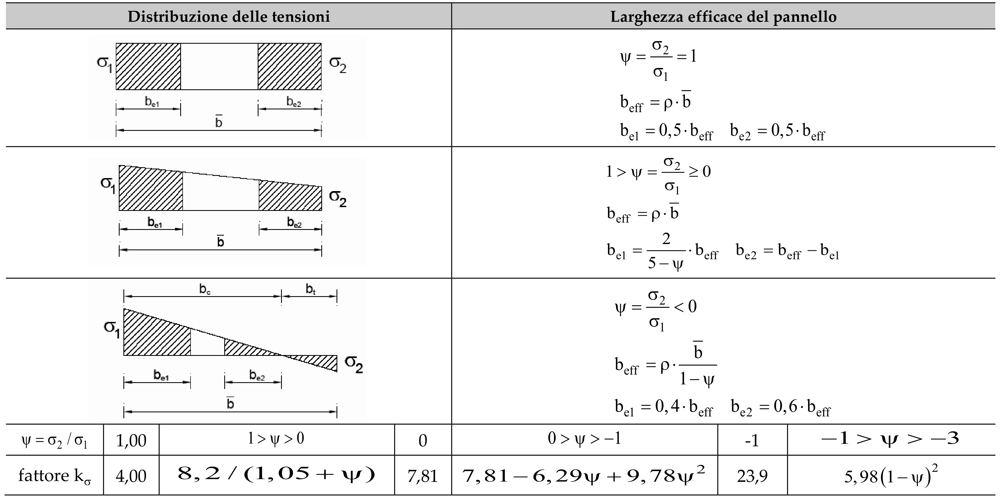

**Tabella C4.2.IX** - *Larghezza efficace di pannelli compressi con un solo bordo longitudinale irrigidito*

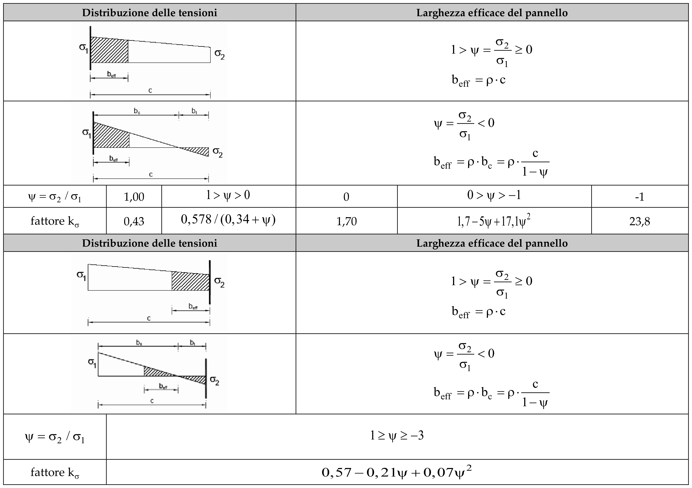

La definizione dei coefficienti $k_\sigma$ e $\psi$ si basa sul valore delle tensioni estreme $\sigma_1$ e $\sigma_2$, per cui, essendo il valore di tali tensioni dipendente dalla sezione efficace considerata, il calcolo di $\psi$ e la determinazione della geometria della sezione efficace necessitano di una procedura iterativa, in cui si considera una geometria inizialmente coincidente con la sezione lorda del pannello.

La sezione efficace del pannello è definita da area, $A_{eff}$, modulo resistente, $W_{eff}$, e momento di inerzia, $J_{eff}$, che tengono conto anche degli effetti da trascinamento da taglio. Poiché la caratteristiche della sollecitazione sono calcolate, in genere, rispetto alle linee d'asse baricentriche dei profili, in fase di verifica il baricentro della sezione efficace potrebbe risultare non più coincidente con il baricentro della sezione lorda, determinando un'eccentricità addizionale $e_N$, che deve essere considerata nel calcolo, aggiungendo al momento flettente di calcolo $M_{Ed}$ il momento flettente addizionale $N_{Ed} \cdot e_N$.prodotto dalla sollecitazione assiale di calcolo $N_{Ed}$.

In tal modo la verifica nei riguardi della stabilità è condotta utilizzando la formula

$$\dfrac{N_{Ed}}{f_y \, A_{eff} / \gamma_{M0}} + \dfrac{M_{Ed} + (N_{Ed} \cdot e_N)}{f_y \, W_{eff} / \gamma_{M0}} \leq 1{,}0 \tag{C4.2.60}$$

Nel caso in cui l'elemento sia soggetto a compressione e a flessione biassiale, l'equazione di verifica dei pannelli è

$$\dfrac{N_{Ed}}{f_y \, A_{eff} / \gamma_{M0}} + \dfrac{M_{y,Ed} + (N_{Ed} \cdot e_{y,N})}{f_y \, W_{y,eff} / \gamma_{M0}} + \dfrac{M_{y,Ed} + (N_{Ed} \cdot e_{z,N})}{f_y \, W_{z,eff} / \gamma_{M0}} \leq 1{,}0 \tag{C4.2.61}$$

dove $M_{y,Ed}$ ed $M_{z,Ed}$ sono i momenti flettenti di calcolo rispetto agli assi $y$ e $z$ della sezione, mentre $e_{y,N}$ ed $e_{z,N}$ sono le eccentricità degli assi neutri e $W_{y,eff}$, $W_{z,eff}$ ed $A_{eff}$ sono i moduli resistenti e l'area della sezione efficace.

In alternativa a quanto detto sopra e in via semplificata, l'area efficace $A_{eff}$ si può determinare considerando la sezione soggetta a compressione semplice e il modulo resistente efficace $W_{eff}$ si può determinare considerando la sezione soggetta a flessione pura.

Nel calcolo si deve tener conto anche degli effetti dovuti al trascinamento da taglio, considerando una larghezza collaborante determinata in accordo con il § C4.2.4.1.3.4.3.

###### C4.2.4.1.3.4.3 Larghezza collaborante
Gli effetti di trascinamento da taglio possono essere trascurati se risulta $b_0 < 0{,}02 \, L_e$, dove $b_0 = 0{,}5 \, b$ per le piattabande interne, essendo $b$ l'interasse delle anime, e $b_0 = c$ per le parti a sbalzo, essendo $c$ la luce dello sbalzo, mentre $L_e$, luce equivalente, è la distanza tra due punti di nullo consecutivi del diagramma dei momenti.

Quando il trascinamento da taglio avviene in campo elastico la larghezza collaborante può essere valutata come

$$b_{eff} = \beta \cdot b_0 \tag{C4.2.62}$$

essendo $\beta$ il fattore riduttivo dato nella Tabella C4.2.X in funzione di $\kappa = \alpha_0 \, b_0 / L_e$.

**Tabella C4.2.X** - *Fattori riduttivi β per la larghezza collaborante*

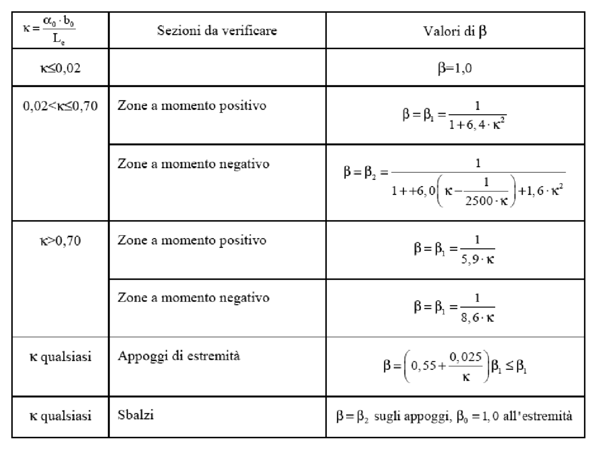

Detta $A_{sl}$ l'area di tutti gli irrigiditori longitudinali compresi nella larghezza $b_0$, il coefficiente $\alpha_0$ è

$$\alpha_0 = \sqrt{1 + \dfrac{A_{sl}}{b_0 \, t}} \tag{C4.2.63}$$

Nel caso di travi continue in cui le luci di due campate adiacenti non differiscono di più del 50% e gli eventuali sbalzi hanno luce non superiore al 50% della campata adiacente, le luci equivalenti $L_e$ ed i coefficienti $\beta$ possono essere calcolati come indicato in Figura C4.2.13.

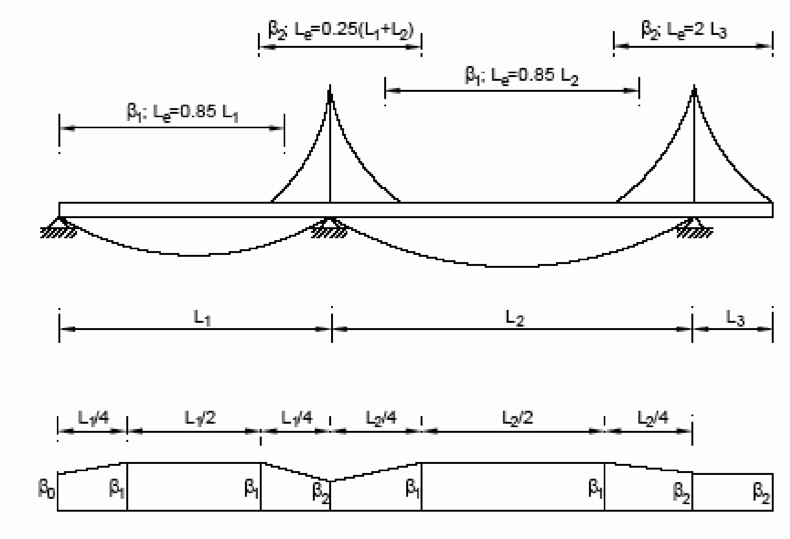

**Figura C4.2.13** - *Luci equivalenti $L_e$ e coefficienti riduttivi β per travi continue*

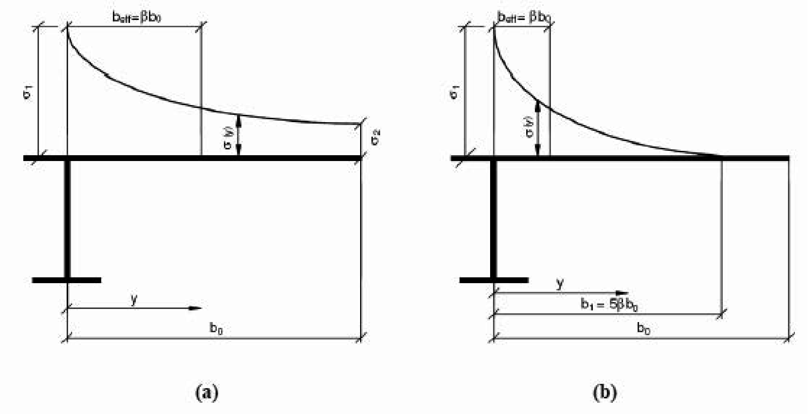

**Figura C4.2.14** - *Distribuzione delle tensioni normali dovute al trascinamento da taglio*

La distribuzione delle tensioni normali nella piattabanda, considerando l'effetto del trascinamento da taglio, è riportata in Figura C4.2.14., con l'andamento delle tensioni nei due casi (a) e (b) descritto rispettivamente da

$$
\begin{aligned}
\text{(a) } \beta > 0{,}20:&\quad
\begin{cases}
\sigma_2 = 1{,}25(\beta - 0{,}20)\sigma_1 \\
\sigma(y) = \sigma_2 + (\sigma_1 - \sigma_2)\left(1 - \dfrac{y}{b_0}\right)^4
\end{cases}\ ;
\\[4pt]
\text{(b) } \beta \leq 0{,}20:&\quad
\begin{cases}
\sigma_2 = 0 \\
\sigma(y) = \sigma_1\left(1 - \dfrac{y}{b_1}\right)^4
\end{cases}
\end{aligned}
\tag{C4.2.64}
$$

Allo stato limite ultimo, gli effetti di trascinamento da taglio delle piattabande compresse possono essere determinati considerando un'area efficace $A_{eff}$ data da

$$A_{eff} = \beta^\kappa \cdot A_{c,eff} \geq \beta \cdot A_{c,eff} \tag{C4.2.65}$$

in cui $\beta$ e $\kappa$ sono ricavati dalla Tabella C.4.2.X e $A_{c,eff}$ è l'area efficace della piattabanda compressa, che tiene conto dell'instabilità ed è definita al § C4.2.4.1.3.4.4.

L'espressione [C4.2.65] è valida anche per le piattabande tese, purché si sostituisca $A_{c,eff}$ con l'area lorda della piattabanda tesa.

###### C4.2.4.1.3.4.4 Pannelli con irrigiditori longitudinali
Nel calcolo dei pannelli con irrigiditori longitudinali si deve tener conto delle aree efficaci delle zone compresse, considerando l'instabilità globale del pannello irrigidito e l'instabilità locale di ciascun sottopannello e le riduzioni per effetto del trascinamento da taglio, se significative. Per le zone tese le aree efficaci si assumono uguali a quelle lorde, con le eventuali riduzioni per effetto del trascinamento da taglio.

Per tener conto dell'instabilità locale l'area effettiva di ciascun sottopannello deve essere valutata considerando il coefficiente di riduzione indicato nel seguito.

Il pannello irrigidito deve essere verificato per l'instabilità globale: il calcolo deve essere effettuato considerando le aree efficaci degli irrigiditori e modellando il pannello come una piastra ortotropa equivalente, in modo da determinare il coefficiente di riduzione $\rho_c$ per l'instabilità globale.

Indicati con $A_{sl,eff}$ la somma delle aree efficaci di tutti gli irrigiditori longitudinali che sono nella zona compressa e con $\rho_{loc}$ il coefficiente di riduzione della larghezza $b_{c,loc}$ della parte compressa di ogni sottopannello, valutati come indicato nel seguito, e detto $t$ lo spessore del sottopannello, l'area efficace $A_{c,eff,loc}$ degli irrigiditori e dei sottopannelli che sono in zona compressa è data da

$$A_{c,eff,loc} = A_{sl,eff} + \sum_c \rho_{loc} \, b_{c,loc} \, t \tag{C4.2.66}$$

essendo la sommatoria estesa a tutta la zona compressa del pannello irrigidito, ad eccezione delle parti, di larghezza $b_{lat,eff}$, vincolati a lastre adiacenti (Figura C4.2.15).

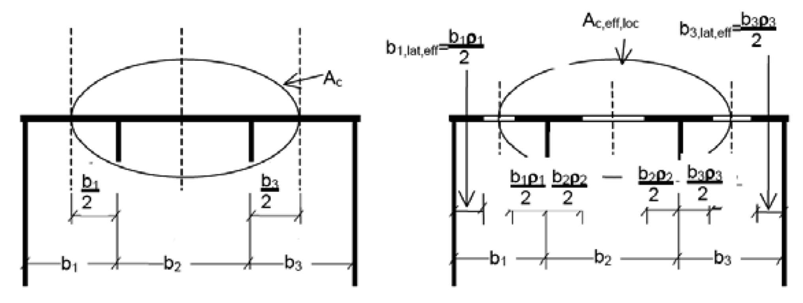

**Figura C4.2.15** - *Lastra irrigidita uniformemente compressa*

L'area efficace della parte compressa del pannello nervato è quindi data da

$$A_{c,eff} = \rho_c A_{c,eff,loc} + \sum b_{lat,eff} \, t \tag{C4.2.67}$$

Nel caso di lastre irrigidite pressoinflesse si può far riferimento alla Figura C4.2.16. In detta figura $b_i$ e $b_{i+1}$ rappresentano le larghezze di lamiera collaboranti con l'irrigiditore, che possono essere ricavate, sempre in riferimento alla Figura C4.2.16, dalla Tabella C4.2.XI.

Il coefficiente di riduzione $\rho_c$ per l'instabilità globale può essere determinato come

$$\rho_c = \xi(\rho - \chi_c)(2 - \xi) + \chi_c \tag{C4.2.68}$$

dove $\chi_c$ è il coefficiente di riduzione per l'instabilità di colonna, $\rho$ il coefficiente di riduzione per l'instabilità di lastra e

$$0 \leq \xi = \dfrac{\sigma_{cr,p}}{\sigma_{cr,c}} - 1 \leq 1 \tag{C4.2.69}$$

essendo $\sigma_{cr,c}$ e $\sigma_{cr,p}$ le tensioni critiche eleuriane per l'instabilità di colonna e l'instabilità di piastra, rispettivamente.

###### C4.2.4.1.3.4.5 Instabilità di colonna
In un pannello di lunghezza $a$, la tensione critica eleuriana $\sigma_{cr,c}$ è data da

$$\sigma_{cr,c} = \dfrac{\pi^2 \, E \cdot t^2}{12 \, (1 - \nu^2) \, a^2} \tag{C4.2.70}$$

se non irrigidito, e da

$$\sigma_{cr,c} = \sigma_{cr,sl} \dfrac{b_c}{b_{sl,1}} \tag{C4.2.71}$$

se irrigidito, essendo $b_c$ e $b_{sl,l}$, rispettivamente, le distanze del lembo e dell'irrigiditore maggiormente compressi dall'asse neutro di pressoflessione (Figura C4.2.16).

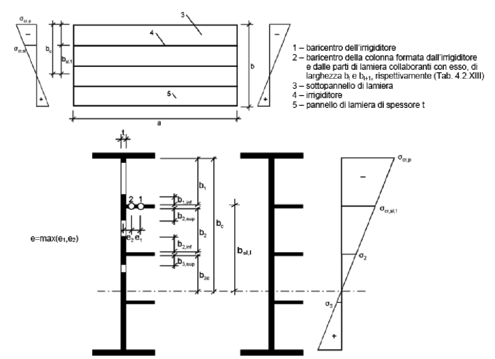

**Figura C4.2.16** - *Lastra irrigidita pressoinflessa*

**Tabella C4.2.XI** - *Calcolo della larghezza di lamiera collaborante in riferimento alla Figura C4.2.16*

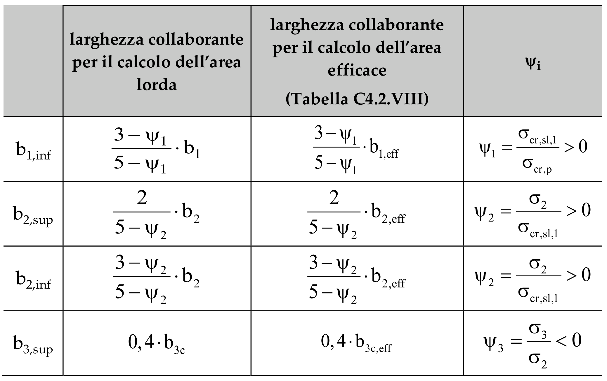

Nella [C4.2.71] $\sigma_{cr,sl}$ rappresenta la tensione critica eleuriana dell'irrigiditore maggiormente compresso

$$\sigma_{cr,sl} = \dfrac{\pi^2 \cdot E \cdot I_{sl,1}}{A_{sl} a^2} \tag{C4.2.72}$$

essendo $A_{sl,1}$ e $I_{sl,1}$ l'area e il momento d'inerzia per l'inflessione fuori piano della sezione lorda dell'irrigiditore e delle parti di pannello ad esso adiacenti, determinate come indicato in Figura C4.2.16.

La snellezza relativa $\bar{\lambda}_c$ è definita da

$$\bar{\lambda}_c = \sqrt{\dfrac{f_y}{\sigma_{cr,c}}} \tag{C4.2.73}$$

per i pannelli non irrigiditi e da

$$\bar{\lambda}_c = \sqrt{\dfrac{A_{sl,1,eff} f_y}{A_{sl} \sigma_{cr,c}}} \tag{C4.2.74}$$

per i pannelli irrigiditi, essendo $A_{sl,1,eff}$ l'area efficace dell'irrigiditore e delle parti di pannello ad esso adiacenti.

Il fattore di riduzione $\chi_c$ può essere ottenuto applicando la formula [4.2.44] del § 4.2.4.1.3.1 delle NTC e considerando un opportuno valore amplificato, $\alpha_e$, del coefficiente $\alpha$. Per pannelli irrigiditi si può assumere

$$\alpha_e = \alpha + \dfrac{0{,}09 \cdot e}{i} \tag{C4.2.75}$$

dove $\alpha = 0{,}34$ (curva $b$ della Tabella 4.2.VIII delle NTC) per irrigiditori a sezione chiusa e $\alpha = 0{,}49$ (curva $c$ della Tabella 4.2.VIII delle NTC) per irrigiditori a sezione aperta. Nella [C4.2.75] $e = \max(e_1, e_2)$, dove $e_1$ e $e_2$ rappresentano le distanze dal baricentro della lamiera e dal baricentro dell'irrigiditore singolo, rispettivamente, (o dei baricentri dei due irrigiditori, in casi di irrigiditori doppi) dal baricentro della sezione efficace dell'irrigiditore (vedi Figura C4.2.16), e $i$ è il raggio d'inerzia della sezione lorda dell'irrigiditore, comprensiva della parte di lamiera collaborante:

$$i = \sqrt{\dfrac{I_{sl,1}}{A_{sl,1}}} \tag{C4.2.76}$$

Per pannelli non irrigiditi si può porre $\alpha_e = \alpha = 0{,}21$ (curva $a$ della Tab. 4.2.VIII delle NTC).

###### C4.2.4.1.3.4.6 Instabilità di piastra
La tensione critica per l'instabilità di piastra può essere determinata come qui indicato, a seconda che, in zona compressa, la piastra abbia tre o più irrigiditori longitudinali o ne abbia meno di tre.

*Piastre con tre o più irrigiditori longitudinali in zona compressa*

Piastre con tre o più irrigiditori longitudinali in zona compressa possono essere trattate come piastre ortotrope equivalenti. La tensione critica euleriana al bordo maggiormente compresso della piastra ortotropa equivalente, $\sigma_{cr,p}$, è data da

$$\sigma_{cr,p} = k_{\sigma,p} \cdot \dfrac{\pi^2 \cdot E}{12 \cdot (1 - \nu^2)} \cdot \left(\dfrac{t}{b}\right)^2 \tag{C4.2.77}$$

dove $t$ e $b$ sono lo spessore e la larghezza della piastra irrigidita (v. Figura C4.2.16) e $k_{\sigma,p}$ è il coefficiente d'instabilità per tensioni normali.

In mancanza di determinazioni più accurate, il coefficiente $k_{\sigma,p}$ per un pannello di lunghezza $a$ può essere assunto uguale a

$$k_{\sigma,p} = \dfrac{2 \cdot \left[(1 + \alpha_1^2)^2 + \gamma - 1\right]}{\alpha_1^2 \cdot (\psi + 1)(1 + \delta)} \qquad \text{se } \alpha_1 \le \sqrt[4]{\gamma} \tag{C4.2.78.a}$$

$$k_{\sigma,p} = \dfrac{4 \cdot (1 + \sqrt{\gamma})}{(\psi + 1)(1 + \delta)} \qquad \text{se } \alpha_1 > \sqrt[4]{\gamma} \tag{C4.2.78.b}$$

in cui $\alpha_1 = a/b \ge 0{,}5$; $\psi$ è il rapporto tra le tensioni ai lembi del pannello, $\psi = \sigma_2 / \sigma_1 \ge 0{,}5$, essendo $\sigma_1$ la tensione al lembo maggiormente compresso; $\gamma$ è il rapporto tra il momento d'inerzia baricentrico dell'intera piastra irrigidita, $I_{sl}$, e il momento d'inerzia della lamiera:

$$\gamma = \dfrac{12 \cdot (1 - \nu^2) \cdot I_{sl}}{b \cdot t^3} \tag{C4.2.79}$$

$\delta$ è il rapporto tra l'area complessiva lorda degli irrigiditori $\sum A_{sl}$ e l'area lorda della lamiera

$$\delta = \dfrac{\sum A_{sl}}{b \cdot t} \tag{C4.2.80}$$

*Piastre con uno o due irrigiditori longitudinali in zona compressa*

Piastre con uno o due irrigiditori longitudinali in zona compressa possono essere trattate con i seguenti metodi semplificati, trascurando il contributo degli eventuali irrigiditori tesi.

*Piastra con un solo irrigiditore longitudinale*

Se la piastra presenta un solo irrigiditore in zona compressa, quest'ultimo può essere considerato come un elemento compresso isolato vincolato elasticamente dalla lamiera, cosicché la tensione critica eleuriana può essere calcolata come

$$\sigma_{cr,sl} = \dfrac{1{,}05 \cdot E}{A_{sl,1}} \cdot \dfrac{\sqrt{I_{sl,1} \cdot t^3 \cdot b}}{b_1 \cdot b_2} \qquad \text{se } a \ge a_c \tag{C4.2.81.a}$$

$$\sigma_{cr,sl} = \dfrac{\pi^2 \cdot E \cdot I_{sl,1}}{A_{sl,1} \cdot a^2} + \dfrac{E b \cdot a^2 \cdot t^3}{4 \cdot \pi^2 \cdot (1 - \nu^2) \cdot A_{sl,1} \cdot b_1^2 \cdot b_2^2} \qquad \text{se } a < a_c \tag{C4.2.81.b}$$

dove $A_{sl,1}$ è l'area lorda dell'irrigiditore, ottenuta come indicato in Figura C4.2.16 e in Tabella C4.2.XI, $I_{sl,1}$ è il momento d'inerzia baricentrico della sezione lorda dell'irrigiditore, $b_1$ e $b_2$ sono le distanze dell'irrigiditore dai bordi longitudinali del pannello ($b_1 + b_2 = b$), e $a_c$ è uguale a

$$a_c = 4{,}33 \cdot \sqrt[4]{\dfrac{I_{sl,1} \cdot b_1^2 \cdot b_2^2}{t^3 \cdot b}} \tag{C4.2.82}$$

*Piastra con due irrigiditori longitudinali*

Se la piastra presenta due irrigiditori longitudinali, di area $A_{sl,1}$ e $A_{sl,2}$, e momenti d'inerzia $I_{sl,1}$ e $I_{sl,2}$, rispettivamente, si possono considerare le tre situazioni limite illustrate in Figura C4.2.17.

Nel caso I il primo irrigiditore si instabilizza e il secondo è considerato rigido; nel caso II il secondo irrigiditore si instabilizza e il primo è considerato rigido; nel caso III, infine, si considera un unico irrigiditore equivalente di area $A_{sl,eq} = A_{sl,1} + A_{sl,2}$ e momento d'inerzia $I_{sl,eq} = I_{sl,1} + I_{sl,2}$, disposto nel punto d'applicazione della risultante delle forze normali incassate dei due irrigiditori.

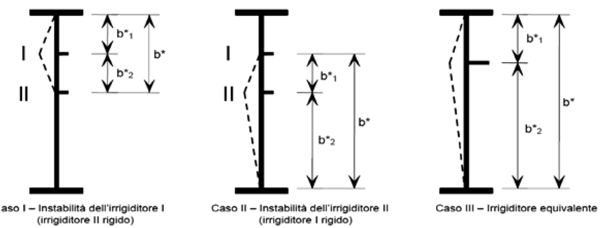

**Figura C4.2.17** - *Lastra irrigidita con due irrigiditori nella parte compressa*

Mediante le formule [C4.2.81], ponendo $b_1 = b_1^*$, $b_2 = b_2^*$, $b = b^*$, si calcolano le tensioni critiche euleriane, $\sigma_{cr,pI}$, $\sigma_{cr,pII}$ e $\sigma_{cr,pIII}$, relative ai tre casi indicati in Figura C4.2.17.

La tensione critica del pannello $\sigma_{cr,p}$ è quella minima tra le tre sopra determinate

$$\sigma_{cr,p} = \min(\sigma_{cr,pI},\ \sigma_{cr,pII},\ \sigma_{cr,pIII}) \tag{C4.2.83}$$

###### C4.2.4.1.3.4.7 Requisiti minimi per gli irrigiditori trasversali
Gli irrigiditori trasversali devono garantire un adeguato vincolo alla lamiera, sia in assenza, sia in presenza di nervature longitudinali.

Gli irrigiditori trasversali possono essere considerati come elementi semplicemente appoggiati soggetti ai carichi laterali e ad un difetto di rettilineità di forma sinusoidale di ampiezza

$$w_0 = \dfrac{\min(a_1;\ a_2;\ b)}{300} \tag{C4.2.84}$$

in cui $a_1$ e $a_2$ sono le lunghezze dei due pannelli adiacenti all'irrigiditore considerato e $b$ è la luce dell'irrigiditore (Figura C4.2.18). Nel calcolo, gli altri irrigiditori si considerano rigidi e rettilinei, come rappresentato in Figura C4.2.18.

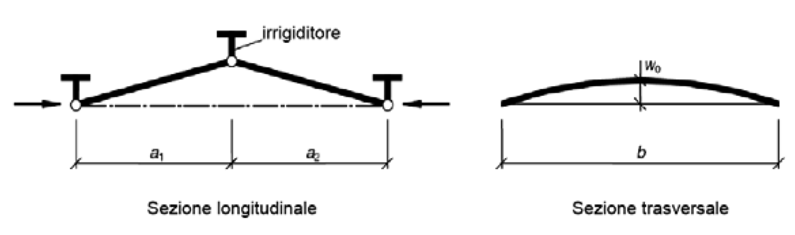

**Figura C4.2.18** - *Schema di calcolo per gli irrigiditori trasversali*

Con le ipotesi sopra dette, si deve verificare, mediante un'analisi elastica del second'ordine che la tensione massima nell'irrigiditore risulti minore di $f_y / \gamma_{M1}$ e che l'incremento massimo di freccia dell'irrigiditore risulti minore di $b/300$.

Nel caso che gli irrigiditori longitudinali siano soggetti a forze trasversali, occorre far riferimento a metodologie di calcolo e a normative di comprovata validità.

###### C4.2.4.1.3.4.8 Verifiche semplificate
Le verifiche possono essere semplificate controllando che, in assenza di sforzo normale, il momento d'inerzia dell'irrigiditore $I_{st}$ soddisfi la disuguaglianza

$$I_{st} \ge \dfrac{\sigma_m}{E} \cdot \left(\dfrac{b}{\pi}\right)^4 \cdot \left(1 + 300 \, \dfrac{w_0}{b} \cdot u\right) \tag{C4.2.85}$$

dove

$$\sigma_m = \dfrac{\sigma_{cr,c}}{\sigma_{cr,p}} \cdot \dfrac{N_{Ed}}{b} \left(\dfrac{1}{a_1} + \dfrac{1}{a_2}\right) \tag{C4.2.86}$$

$$u = \dfrac{\pi^2 \cdot E \cdot e_{\max} \cdot \gamma_{M1}}{300 \cdot b \cdot f_y} \tag{C4.2.87}$$

essendo $e_{\max}$ la massima distanza tra i lembi dell'irrigiditore e il suo baricentro, $N_{Ed}$ la massima forza di compressione nei pannelli adiacenti all'irrigiditore e $\sigma_{cr,c}$ e $\sigma_{cr,p}$ le tensioni critiche per l'instabilità di colonna e l'instabilità di piastra, definite ai §§ C4.2.4.1.3.4.5 e C4.2.4.1.3.4.6. $N_{Ed}$ deve comunque soddisfare la relazione

$$N_d \geq N_d^* = 0{,}5 \cdot \sigma_{\max} \cdot A_{c,eff} \tag{C4.2.88}$$

in cui $A_{c,eff}$ è l'area compressa effettiva del pannello nervato e $\sigma_{\max}$ la massima tensione di compressione nel pannello nervato stesso.

Qualora l'irrigidimento sia anche soggetto a forza normale di compressione $N_{st}$, questa deve essere incrementata ai fini della presente verifica semplificata di

$$\Delta N_{st} = \dfrac{\sigma_m \cdot b^2}{\pi^2} \tag{C4.2.89}$$

In alternativa al metodo appena descritto, in assenza di forza normale, la verifica semplificata può essere effettuata mediante un'analisi elastica lineare, considerando un carico fittizio addizionale uniformemente distribuito sulla lunghezza $b$

$$q = \dfrac{\pi}{4} \cdot \sigma_m \cdot (w_0 + w_{el}) \tag{C4.2.90}$$

dove $w_0$ è l'imperfezione [C4.2.84] e $w_{el}$ la deformazione elastica, che può essere determinata per iterazione, o assunta cautelativamente uguale a $b/300$.

Nel caso di irrigiditori aperti, si deve inoltre effettuare la verifica di stabilità torsionale. In assenza di analisi più rigorose, la verifica può considerarsi soddisfatta se

$$\dfrac{I_T}{I_p} \ge 5{,}3 \cdot \dfrac{f_y}{E} \tag{C4.2.91}$$

i cui $I_T$ è il momento d'inerzia torsionale del solo irrigiditore e $I_p$ è il momento d'inerzia polare del solo irrigiditore, rispetto all'attacco con la lamiera.

Qualora si consideri la rigidezza torsionale da ingobbamento impedito, la verifica di stabilità torsionale può essere effettuata controllando, in alternativa alla [C4.2.91], che risulti soddisfatta la disuguaglianza

$$\sigma_{cr} \geq 6 \cdot f_y \tag{C4.2.92}$$

dove $\sigma_{cr}$ è la tensione critica eleuriana per l'instabilità torsionale dell'irrigiditore considerato incernierato alla lamiera.

###### C4.2.4.1.3.4.9 Requisiti minimi per gli irrigiditori longitudinali
Gli irrigiditori longitudinali dovrebbero essere vincolati ad entrambe le estremità ad irrigiditori trasversali. Irrigiditori longitudinali che non soddisfano questo requisito possono essere impiegati solo per le anime, e non per le piattabande, e non possono essere considerati nell'analisi globale né nel calcolo delle tensioni; possono essere, invece, messi in conto per la determinazione delle tensioni critiche eleuriane e per il calcolo delle larghezze efficaci dei sottopannelli d'anima.

Per le verifiche di stabilità torsionale degli irrigiditori longitudinali si possono adottare le stesse formule fornite al § C4.2.4.1.3.4.7 per gli irrigiditori trasversali.

##### C4.2.4.1.4 Stato limite di fatica
Per le strutture soggette a carichi ciclici deve essere verificata la resistenza a fatica, considerando una distribuzione temporale delle azioni coerente con la tipologia strutturale in esame e con il regime d'impegno previsto nel corso della vita nominale.

###### C4.2.4.1.4.1 Spettri di carico
La distribuzione temporale delle ampiezze delle azioni nel corso della vita della struttura è assegnata mediante il cosiddetto spettro di carico, che fornisce il numero di ripetizioni di ciascun livello delle azioni di progetto in un intervallo di tempo di riferimento, in funzione della destinazione d'uso della struttura e dell'intensità dell'utilizzazione. Quando lo spettro di carico effettivo è complesso al punto da non poter essere impiegato direttamente nelle verifiche, esso può essere sostituito da spettri convenzionali, in grado di riprodurre il danneggiamento a fatica e/o il livello massimo di escursione delle tensioni $\Delta\sigma_{\max}$ prodotti dallo spettro effettivo.

Nel caso degli edifici la verifica a fatica non è generalmente necessaria, salvo che per membrature che sostengono macchine vibranti o dispositivi di sollevamento e trasporto dei carichi.

Gli spettri di carico da impiegare nelle verifiche possono essere determinati mediante studi specifici o anche dedotti da normative di comprovata validità. Gli spettri di carico da impiegare per le verifiche a fatica dei ponti stradali e ferroviari sono assegnati nel § 5.1.4.3 delle NTC.

Nella verifica dei dettagli strutturali metallici, caratterizzati dalla presenza di limite di fatica ad ampiezza costante, spesso è necessario considerare spettri di carico convenzionali differenziati, a seconda che si tratti di verifiche a fatica a vita illimitata o di verifiche a danneggiamento.

###### C4.2.4.1.4.2 Spettri di tensione e metodi di conteggio
Gli spettri di tensione debbono essere ricavati analizzando gli oscillogrammi di tensione $\sigma(t)$, indotti nel dettaglio considerato dalle azioni dello spettro di carico assegnato, con opportuni metodi di identificazione e di conteggio. Per le strutture civili si possono impiegare, in alternativa, il metodo del serbatoio (*reservoir method*) o il metodo del flusso di pioggia (*rainflow method*). Per singole strutture, ad esempio strutture offshore ecc., anche in considerazione della particolare tipologia dello spettro di carico cui sono soggette, si può far ricorso a metodi di conteggio alternativi, previa adeguata giustificazione.

Nel metodo del serbatoio (Figura C4.2.19) si ipotizza che l'oscillogramma delle tensioni rappresenti il profilo di fondo di un serbatoio pieno di liquido, i cui paramenti esterni sono costituiti dal tratto convergente verso il massimo assoluto e da un tratto corrispondente, reale o fittizio. posto al termine del diagramma stesso.

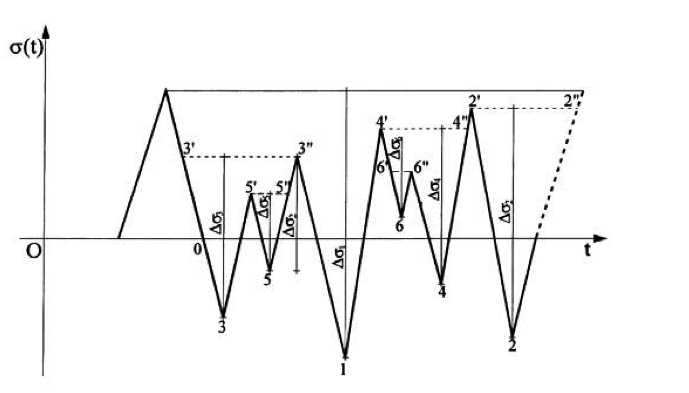

**Figura C4.2.19** - *Metodo del serbatoio*

In riferimento alla Figura C4.2.19, si immagina di svuotare il serbatoio a partire dal minimo assoluto, punto 1 di figura, al vuoto che si forma corrisponde il primo ciclo ed alla differenza di quota tra 1 ed il pelo libero originario il delta di tensione relativo; al termine di questa operazione si formano altri bacini, semplici (2'22") o multipli (3'35'53") e (4'66"44"). L'operazione si ripete procedendo a svuotare in successione dagli altri punti di minimo relativo, ordinati in senso crescente, $\sigma_i < \sigma_{i+1}$, fino a svuotare l'intero serbatoio; ad ogni operazione di svuotamento corrisponde un ciclo, il cui delta di tensione è pari all'altezza d'acqua svuotata.

Il metodo del flusso di pioggia, meno intuitivo ed abbastanza complesso dal punto di vista operativo, individua i cicli mediante il flusso di una goccia d'acqua che scorre sulla traiettoria, immaginato verticale l'asse dei tempi (Figura C4.2.20). Si procede alternativamente da un massimo locale e da un minimo locale, curando che i massimi siano ordinati in senso decrescente e i minimi in senso crescente. Ogni volta che la goccia si distacca dalla traiettoria e cade o incontra un tratto già bagnato viene inizializzato un nuovo semiciclo, in modo che ciascun tratto dell'oscillogramma venga percorso una sola volta. I semicicli di uguale ampiezza vengono poi accoppiati sì da individuare i cicli.

Con riferimento alla Figura C4.2.20 e dopo aver spostato il tratto 0-1 alla fine dell'oscillogramma:

- la prima goccia viene rilasciata dal punto 1, che rappresenta il massimo assoluto del diagramma, percorre il tratto 1-2-2'-6 e cade individuando un semiciclo di ampiezza $\Delta\sigma_1 = \sigma_1 - \sigma_6$;

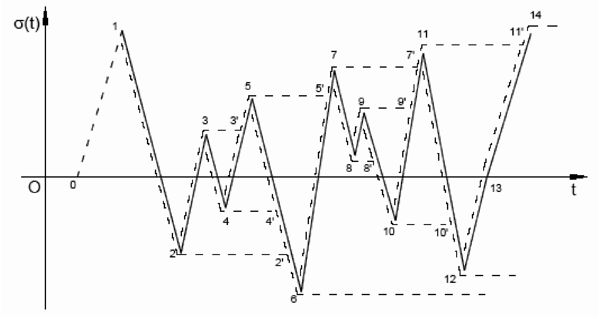

**Figura C4.2.20** - *Metodo del flusso di pioggia*

- la seconda goccia viene rilasciata dal punto 6, che rappresenta il minimo assoluto del diagramma, percorre il tratto 6-7-7'-11-11'-14 e cade individuando un semiciclo di ampiezza $\Delta\sigma_1 = \sigma_{14} - \sigma_6$ ($\sigma_{14} = \sigma_1$);
- la terza goccia viene rilasciata dal punto 11, che rappresenta il secondo massimo locale del diagramma, percorre il tratto 11-12 e cade individuando un semiciclo di ampiezza $\Delta\sigma_2 = \sigma_{11} - \sigma_{12}$;
- la quarta goccia viene rilasciata dal punto 12, che rappresenta il secondo minimo locale del diagramma, percorre il tratto 12-11', incontra il tratto 11'-14, che è già bagnato, e si arresta individuando un semiciclo di ampiezza $\Delta\sigma_2 = \sigma_{11} - \sigma_{12}$ ($\sigma_{11} = \sigma_{11}$);
- la quinta goccia viene rilasciata dal punto 7, che rappresenta il terzo massimo locale del diagramma, percorre il tratto 7-8-8'-10-10' e si arresta perché incontra il tratto 10'-12, già bagnato, individuando un semiciclo di ampiezza $\Delta\sigma_3 = \sigma_7 - \sigma_{10}$ ($\sigma_{10} = \sigma_{10}$);
- la sesta goccia viene rilasciata dal punto 2, che rappresenta il terzo minimo locale del diagramma, percorre il tratto 2-3-3'-5-5' e si arresta perché incontra il tratto 5'-7, già bagnato, individuando un semiciclo di ampiezza $\Delta\sigma_4 = \sigma_5 - \sigma_2$;
- si ripete quindi il procedimento finché tutto l'oscillogramma non è bagnato.

Rispetto al metodo del serbatoio, il metodo del flusso di pioggia ha il vantaggio di poter essere più facilmente implementato su calcolatore.

Nella verifica si impiegheranno i delta di tensione di calcolo $\Delta\sigma_{i,d}$, ricavati moltiplicando i delta di tensione dello spettro $\Delta\sigma_i$ per il coefficiente parziale di sicurezza per le verifiche a fatica $\gamma_{Mf}$, definito nella Tabella 4.2.XI delle NTC

$$\Delta\sigma_{i,d} = \gamma_{Mf} \Delta\sigma_i \tag{C4.2.93}$$

e la curva caratteristica S-N di resistenza a fatica del dettaglio, individuata mediante la classe $\Delta\sigma_C$, anch'essa definita nel seguito.

###### C4.2.4.1.4.3 Curve S-N
La resistenza a fatica di un dettaglio è individuata nel piano bilogaritmico $\log(\Delta\sigma)-\log(N)$ o $\log(\Delta\tau)-\log(N)$, essendo $N$ il numero di cicli a rottura, mediante una curva caratteristica, detta curva S-N. Detta curva è individuata mediante la classe di resistenza a fatica $\Delta\sigma_C$ o $\Delta\tau_C$, che rappresenta la resistenza a fatica del dettaglio, espressa in MPa, per $N = 2 \cdot 10^6$ cicli.

Le curve S-N per tensioni normali sono caratterizzate, oltre che dalla classe $\Delta\sigma_C$, dal limite di fatica ad ampiezza costante $\Delta\sigma_D$, corrispondente a $N = 5 \cdot 10^6$ cicli e dal limite per i calcoli di fatica $\Delta\sigma_L$, che corrisponde all'intersezione del secondo ramo della curva con le verticale per $N = 10^8$ cicli.

L'equazione della curva S-N è

$$
\Delta\sigma =
\begin{cases}
\Delta\sigma_C \left(\dfrac{2 \cdot 10^6}{N}\right)^{1/m} & \text{per } N \le 5 \cdot 10^6 \\
\Delta\sigma_D \left(\dfrac{2 \cdot 10^6}{N}\right)^{1/(m+2)} & \text{per } 5 \cdot 10^6 < N \le 10^8 \\
\Delta\sigma_L & \text{per } N > 10^8
\end{cases}
\tag{C4.2.94}
$$

dove $m = 3$, cosicché risulta

$$\Delta\sigma_D = 0{,}737 \Delta\sigma_C \qquad \Delta\sigma_L = 0{,}549 \Delta\sigma_C \tag{C4.2.95}$$

Le curve S-N per tensioni normali sono rappresentate in Figura C4.2.21.

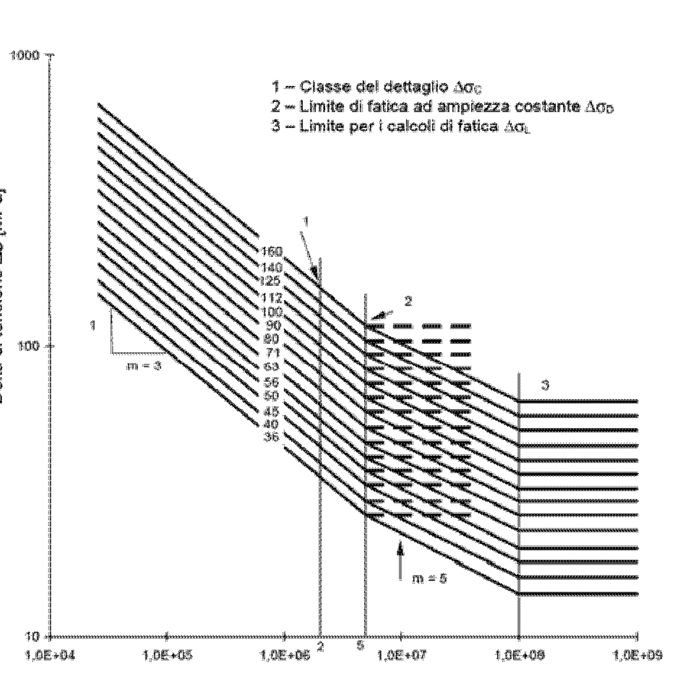

**Figura C4.2.21** - *Curve S-N per dettagli/elementi soggetti a tensioni normali*

Le classi di resistenza a fatica per tensioni normali relative ai dettagli più comuni sono riportate nella Tabelle C4.2.XII.a, C4.2.XII.d, C4.2.XIII, C4.2.XIV, C4.2.XV e C4.2.XVI.a, mentre in Tabella C4.2.XVII sono riportate le classi dei dettagli tipici dei carriponte. Nelle tabelle le classi relative ad alcuni dettagli sono contrassegnate con un asterisco: per questi dettagli è possibile adottare una classificazione superiore di una classe, se si assume come resistenza a fatica ad ampiezza costante quella corrispondente a $10^7$ cicli (vedi Figura C4.2.22).

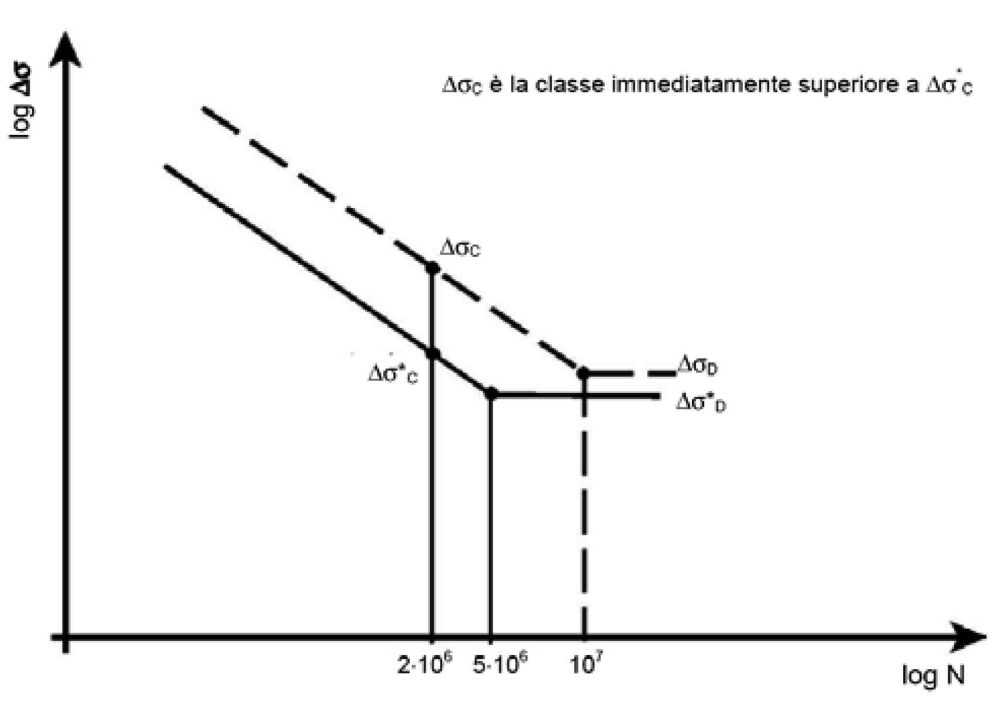

**Figura C4.2.22** - *Classificazione alternativa $\Delta\sigma_C$ per dettagli classificati come $\Delta\sigma_C^*$*

Le curve S-N per tensioni tangenziali sono rappresentate in Figura C4.2.23.

Le curve S-N per tensioni tangenziali sono caratterizzate, oltre che dalla classe $\Delta\tau_C$, dal limite per i calcoli di fatica, $\Delta\tau_L$, corrispondente a $N = 10^8$ cicli. L'equazione della curva S-N è

$$
\Delta\tau =
\begin{cases}
\Delta\tau_C \left(\dfrac{2 \cdot 10^6}{N}\right)^{1/m} & \text{per } N \le 10^8 \\
\Delta\tau_L & \text{per } N > 10^8
\end{cases}
\tag{C4.2.96}
$$

dove $m = 5$, cosicché risulta

$$\Delta\tau_L = 0{,}457 \Delta\tau_C \tag{C4.2.97}$$

Le classi di resistenza a fatica per tensioni tangenziali relative ai dettagli più comuni sono riportate nella Tabelle C4.2.XII.b, C4.2.XII.c e C4.2.XVI.b.

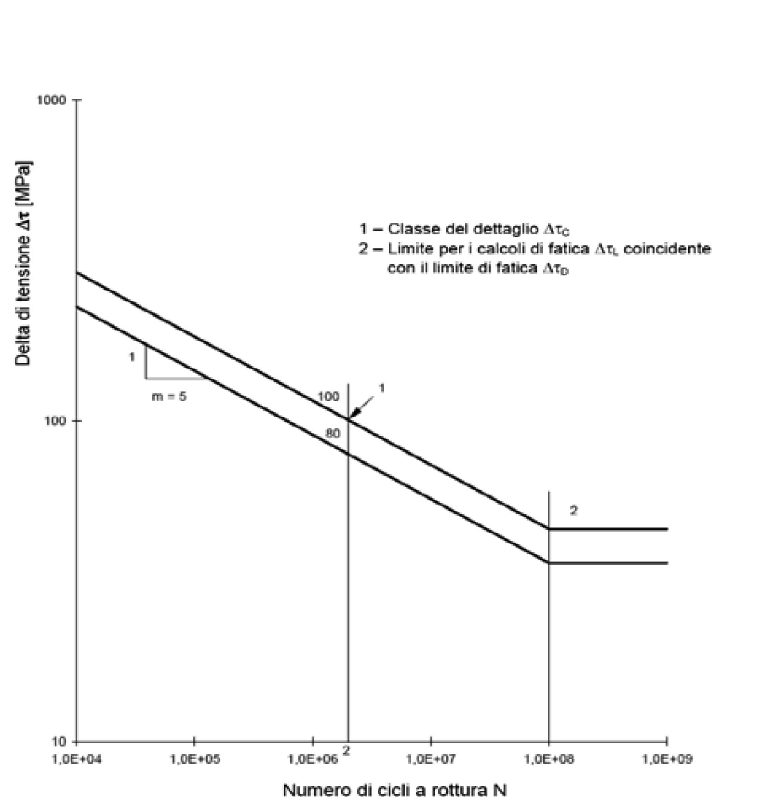

**Figura C4.2.23** - *Curve S-N per dettagli/elementi soggetti a tensioni tangenziali*

Per la resistenza dei dettagli costruttivi tipici degli impalcati a piastra ortotropa, si può far riferimento al documento UNI EN 1993-1-9.

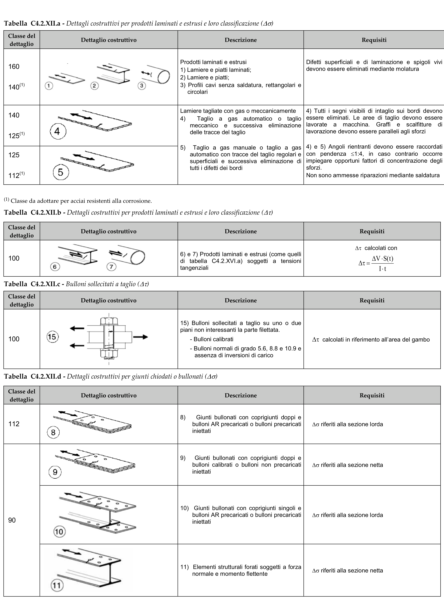

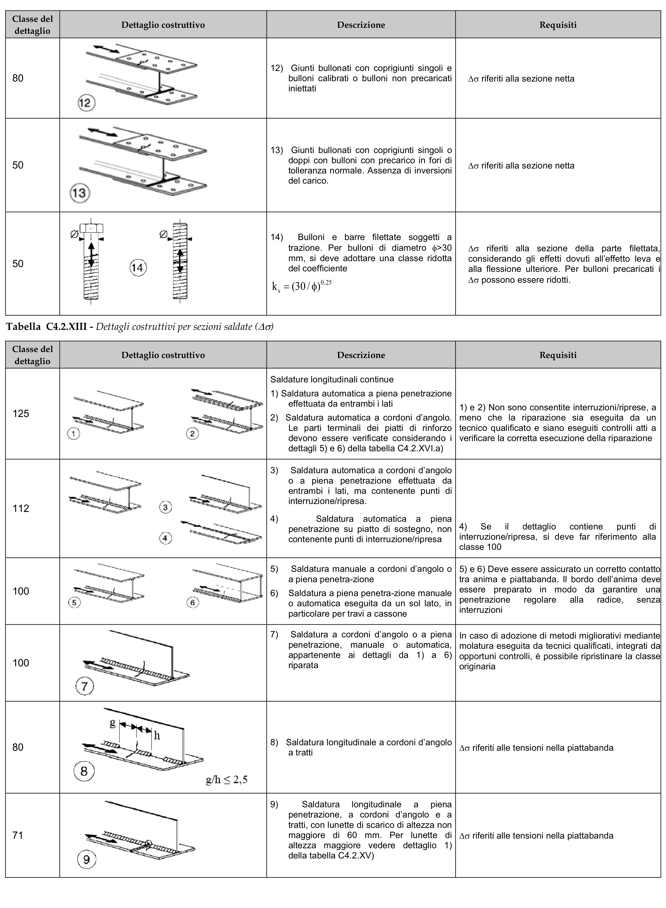

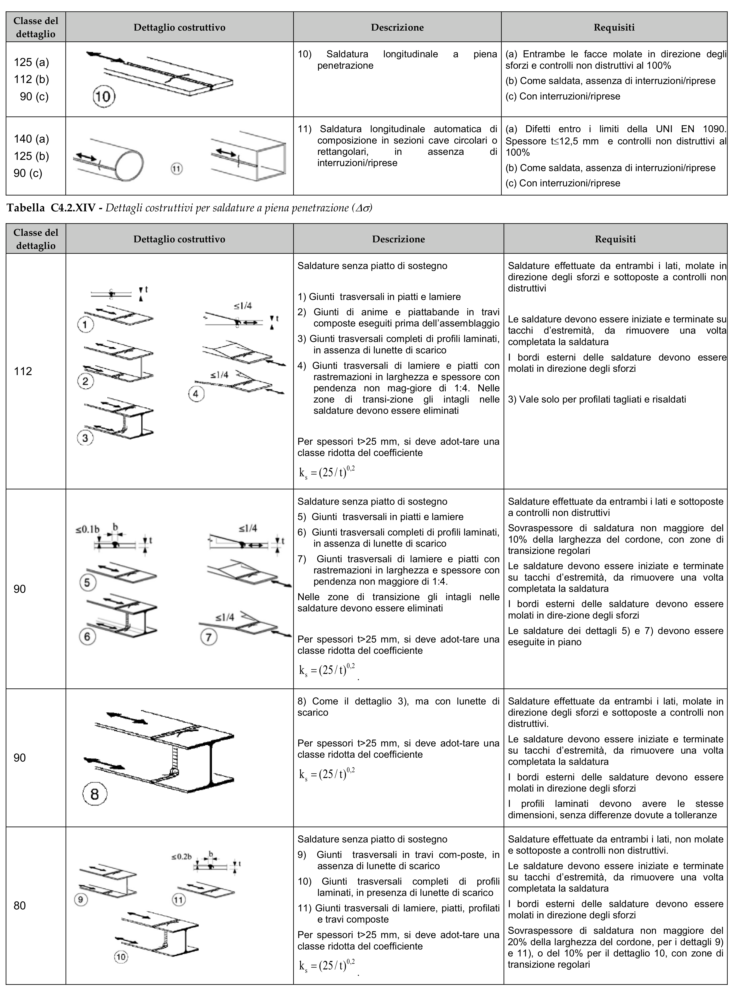

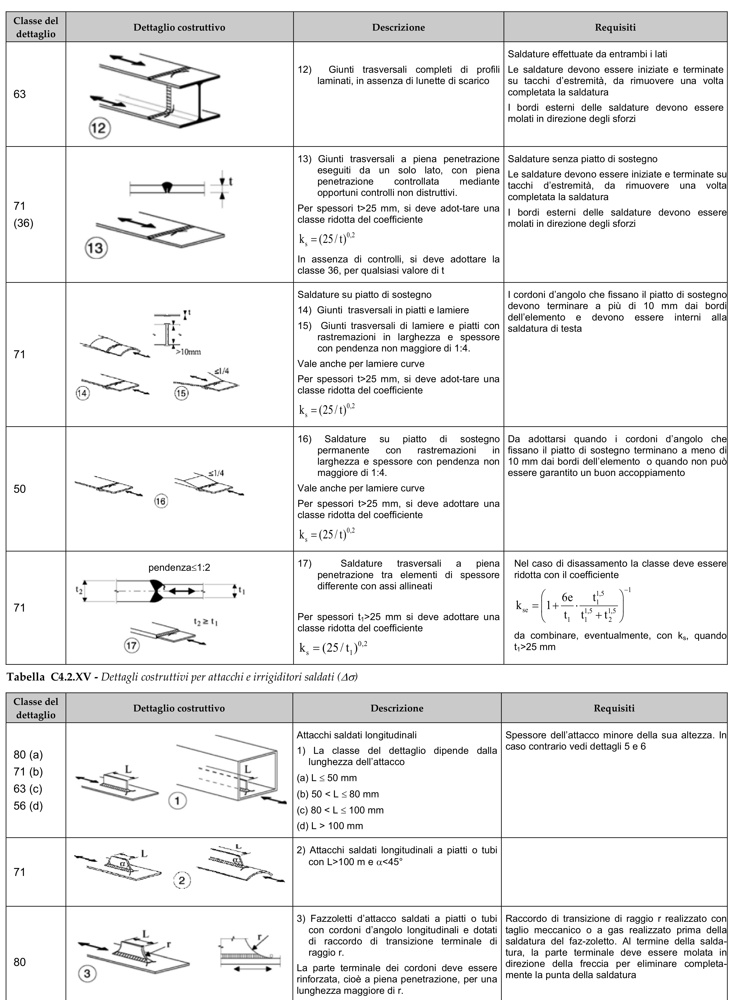

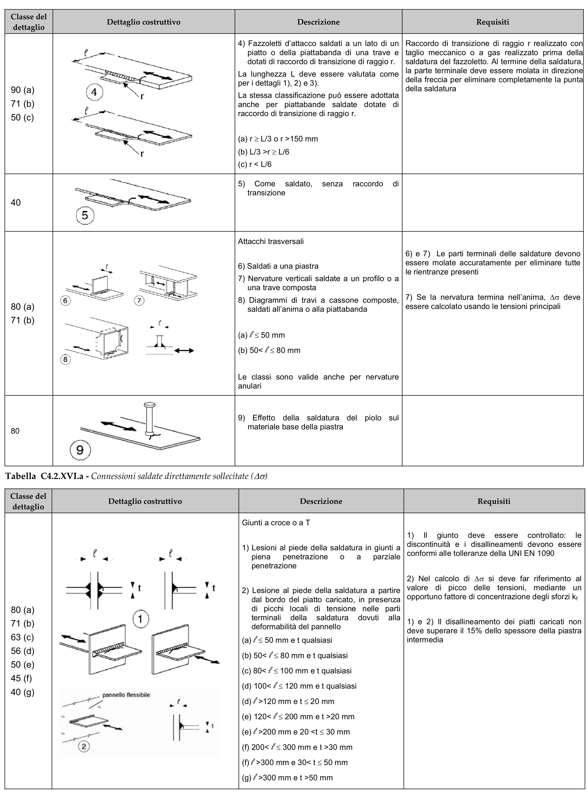

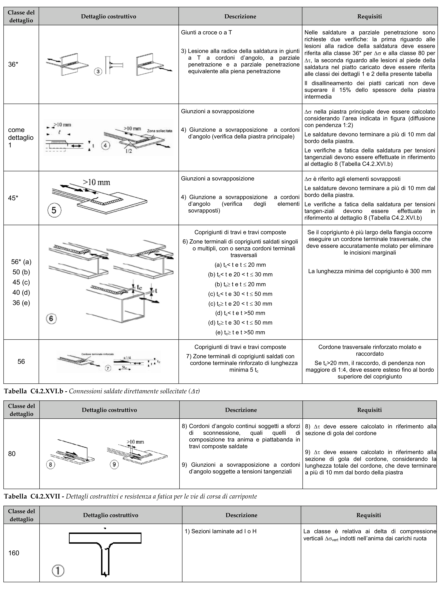

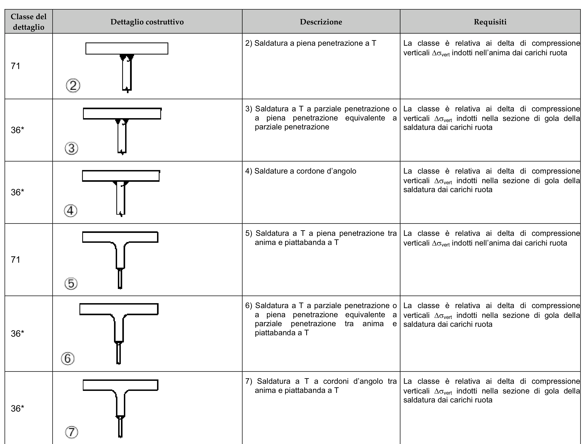

**Tabelle C4.2.XII.a-C4.2.XVII** - *Dettagli costruttivi e resistenza a fatica*

###### C4.2.4.1.4.4 Curva S-N per connettori a piolo
La curva S-N per connettori a piolo sollecitati a taglio delle strutture composte acciaio-calcestruzzo è rappresentata in Figura C4.2.24 ed è caratterizzata dall'assenza di limite di fatica. La pendenza della curva è $m = 8$ e la classe del particolare per calcestruzzo normale è $\Delta\tau_C = 90$ MPa.

Per calcestruzzi leggeri la classe si riduce, in funzione del limite superiore della densità della classe di appartenenza, $\rho$, espresso in kg/m³, a

$$\Delta\tau_C = 90 \left(\dfrac{\rho}{2200}\right)^2 \text{ MPa} \tag{C4.2.98}$$

Le tensioni tangenziali devono essere valutate in riferimento alla sezione nominale del connettore.

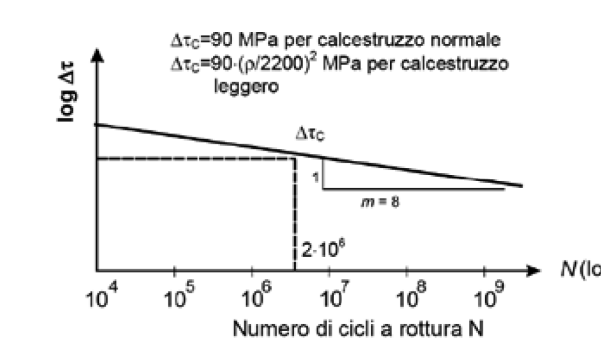

**Figura C4.2.24** - *Curva S-N per connettori a piolo*

###### C4.2.4.1.4.5 Metodi di verifica
Nelle verifiche a fatica le tensioni da considerare devono essere coerenti con quelle alle quali è riferita la curva S-N del dettaglio. Di solito, le curve S-N dei dettagli costruttivi riportate nelle normative sono riferite alle tensioni nominali e pertanto ad esse si deve generalmente far riferimento. Per dettagli costruttivi particolarmente complessi o innovativi, per i quali si proceda ad uno studio *ad hoc*, potrebbe essere necessario riferirsi alle tensioni di picco, misurate o determinate con specifici protocolli sperimentali. In questo caso, le tensioni debbono essere calcolate per via teorica o numerica con le stesse modalità adottate sperimentalmente.

Nell'associare al dettaglio in esame la corrispondente curva S-N di resistenza a fatica è consentito tener conto degli effetti benefici di eventuali trattamenti termici o meccanici di distensione, sulla base della letteratura consolidata o di adeguata sperimentazione.

Per i dettagli costruttivi dei quali non sia nota la curva di resistenza a fatica le escursioni tensionali potranno riferirsi alle tensioni geometriche o di picco, cioè alle tensioni principali nel metallo base in prossimità della potenziale lesione, secondo le modalità e le limitazioni specifiche del metodo, nell'ambito della meccanica della frattura.

Nel caso di verifica a danneggiamento, sulla base del danno $D$ si può definire uno spettro di tensione equivalente, ad ampiezza di tensione costante, $\Delta\sigma_{eq,d}$ (o $\Delta\tau_{eq,d}$), in grado di produrre, nello stesso numero di cicli, $n_{tot} = \sum n_i$, un danneggiamento uguale a quello prodotto dallo spettro di tensione di progetto, oppure, in alternativa, un delta di tensione convenzionale $\Delta\sigma_{E,d}$, in grado di produrre in $2 \cdot 10^6$ cicli, lo stesso danneggiamento prodotto dallo spettro di tensione di progetto.

Nel caso di variazioni simultanee di tensioni normali e tangenziali, la valutazione della resistenza a fatica dovrà considerare i loro effetti congiunti adottando idonei criteri di combinazione del danno.

Nel caso di variazioni non simultanee del campo di tensioni normali e tangenziali si potranno sommare i danneggiamenti $D_\sigma$ e $D_\tau$ prodotti dai cicli di tensione normale e dai cicli di tensione tangenziale, valutati separatamente con la formula [4.2.57] del § 4.2.4.1.4 delle NTC, controllando che

$$D = D_\sigma + D_\tau \le 1{,}0 \tag{C4.2.99}$$

###### C4.2.4.1.4.6 Influenza dello spessore
Nella valutazione della resistenza a fatica dovrà tenersi conto dello spessore del metallo base nel quale può innescarsi una potenziale lesione.

Nel caso che l'influenza dello spessore sulla resistenza a fatica non sia trascurabile, la classe del dettaglio deve essere ridotta secondo la formula

$$\Delta\sigma_{C,red} = k_s \cdot \Delta\sigma_C \tag{C4.2.100}$$

dove il coefficiente riduttivo $k_s$ dipende dal dettaglio strutturale considerato ed i cui valori indicativi sono indicati, per alcuni dettagli costruttivi, nel documento UNI EN 1993-1-9.
