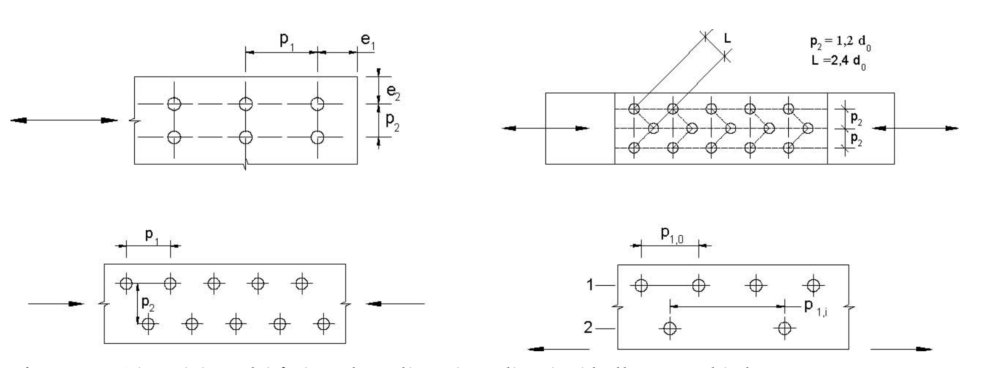
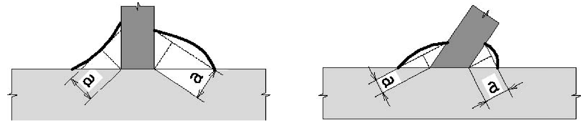
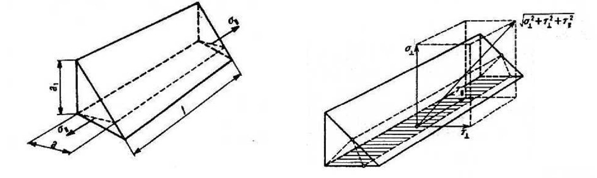

[Torna all'indice del § 4.2](./indice-4.2.md) | [Torna all'indice del capitolo](./indice-cap04.md) | [Torna all'indice generale](../indice-ntc2018.md)

# 4.2.8 Unioni

<!-- INDICE-INTERNO:INIZIO -->
**Indice interno**

- [Norma](#toc-ntc2018-4-2-8-norma)
  - [4.2.8.1 Unioni con bulloni, chiodi e perni soggetti a carichi statici](#toc-ntc2018-4-2-8-1)
    - [4.2.8.1.1 Unioni con bulloni e chiodi](#toc-ntc2018-4-2-8-1-1)
    - [4.2.8.1.2 Collegamenti con perni](#toc-ntc2018-4-2-8-1-2)
  - [4.2.8.2 Unioni saldate](#toc-ntc2018-4-2-8-2)
    - [4.2.8.2.1 Unioni con saldature a piena penetrazione](#toc-ntc2018-4-2-8-2-1)
    - [4.2.8.2.2 Unioni con saldature a parziale penetrazione](#toc-ntc2018-4-2-8-2-2)
    - [4.2.8.2.3 Unioni con saldature a cordoni d'angolo](#toc-ntc2018-4-2-8-2-3)
    - [4.2.8.2.4 Resistenza delle saldature a cordoni d'angolo](#toc-ntc2018-4-2-8-2-4)
  - [4.2.8.3 Unioni soggette a carichi da fatica](#toc-ntc2018-4-2-8-3)
  - [4.2.8.4 Unioni soggette a vibrazioni, urti e/o inversioni di carico](#toc-ntc2018-4-2-8-4)
<!-- INDICE-INTERNO:FINE -->

## Norma

Nel presente paragrafo sono considerati sistemi di unione elementari, in quanto parti costituenti i collegamenti strutturali tra le membrature in acciaio. In particolare, sono presentati metodi per calcolare le prestazioni resistenti e le relative modalità e regole per la realizzazione dei vari tipi di unione esaminati. Le tipologie di unione analizzate sono quelle realizzate tramite bulloni, chiodi, perni e saldature.

Le sollecitazioni agenti nei collegamenti allo stato limite ultimo e allo stato limite di esercizio si devono valutare con i criteri indicati in § 4.2.2.

Le sollecitazioni così determinate possono essere distribuite, con criteri elastici oppure plastici, nei singoli elementi costituenti i collegamenti strutturali tra le membrature a condizione che:

- le azioni così ripartite fra gli elementi di unione elementari (unioni) del collegamento siano in equilibrio con quelle applicate e soddisfino la condizione di resistenza imposta per ognuno di essi;
- le deformazioni derivanti da tale distribuzione delle sollecitazioni all'interno degli elementi di unione non superino la loro capacità di deformazione.

Per il calcolo della resistenza a taglio delle viti e dei chiodi, per il rifollamento delle piastre collegate e per il precarico dei bulloni, si adottano i fattori parziali $\gamma_M$ indicati in Tab. 4.2.XIV.

**Tab. 4.2.XIV - Coefficienti di sicurezza per la verifica delle unioni**

| Verifica | Coefficiente |
|---|:---:|
| Resistenza dei bulloni; resistenza dei chiodi; resistenza delle connessioni a perno; resistenza delle saldature a parziale penetrazione e a cordone d'angolo; resistenza dei piatti a contatto | $\gamma_{M2} = 1{,}25$ |
| Resistenza a scorrimento: per SLU | $\gamma_{M3} = 1{,}25$ |
| Resistenza a scorrimento: per SLE | $\gamma_{M3} = 1{,}10$ |
| Resistenza delle connessioni a perno allo stato limite di esercizio | $\gamma_{M6,ser} = 1{,}0$ |
| Precarico di bullone ad alta resistenza con serraggio controllato | $\gamma_{M7} = 1{,}0$ |
| Precarico di bullone ad alta resistenza con serraggio non controllato | $\gamma_{M7} = 1{,}10$ |

### 4.2.8.1 Unioni con bulloni, chiodi e perni soggetti a carichi statici

Le unioni realizzate con bulloni si distinguono in “non precaricate” e “precaricate”.

Le unioni realizzate con chiodi si considerano sempre “non precaricate” e i chiodi devono essere preferibilmente impegnati a taglio.

I perni delle cerniere sono sollecitati a taglio e flessione.

#### 4.2.8.1.1 Unioni con bulloni e chiodi

Nei collegamenti con bulloni “non precaricati” gli assiemi Vite/Dado/Rondella devono essere conformi a quanto specificato nel § 11.3.4.6.1.

Nei collegamenti con bulloni “precaricati” gli assiemi Vite/Dado/Rondella devono essere conformi a quanto specificato nel § 11.3.4.6.2.

Nelle unioni con bulloni ad alta resistenza delle classi 8.8 e 10.9, precaricati con serraggio controllato, per giunzioni ad attrito, le viti, i dadi e le rondelle devono essere forniti dal medesimo produttore. Il momento di serraggio $M$ per tali unioni è pari a:

$$M = k \cdot d \cdot F_{p,c} = k \cdot d \cdot 0{,}7 \cdot A_{res} \cdot f_{tbk} \tag{4.2.61}$$

dove: $d$ è il diametro nominale della vite, $A_{res}$ è l'area resistente della vite e $f_{tbk}$ è la resistenza a rottura del materiale della vite. Il valore del fattore $k$ è indicato sulle targhette delle confezioni (dei bulloni, oppure delle viti) per le tre classi funzionali specificate nella seguente Tabella 4.2.XV.

**Tabella 4.2.XV - Classi funzionali per i bulloni**

| Classe | Definizione |
|:---:|---|
| K0 | Nessun requisito sul fattore $k$ |
| K1 | Campo di variabilità del fattore $k_i$ del singolo elemento tra minimo e massimo dichiarati sulla confezione |
| K2 | Valore medio $k_m$ del fattore e suo coefficiente di variazione $V_k$ dichiarati sulla confezione |

Nel caso il momento di serraggio non sia riportato sulle targhette delle confezioni, ma compaia il solo fattore $k$ secondo la classe funzionale, si può fare riferimento alle seguenti Tabelle 4.2.XVI e 4.2.XVII, che si riferiscono rispettivamente alle viti di classe 8.8 e 10.9.

**Tabella 4.2.XVI - Coppie di serraggio per i bulloni 8.8**

| Vite | $k=0{,}10$ | $k=0{,}12$ | $k=0{,}14$ | $k=0{,}16$ | $F_{p,C}$ [kN] | $A_{res}$ [mm²] |
|:---:|---:|---:|---:|---:|---:|---:|
| M12 | 56,6 | 68,0 | 79,3 | 90,6 | 47,2 | 84,3 |
| M14 | 90,2 | 108 | 126 | 144 | 64,4 | 115 |
| M16 | 141 | 169 | 197 | 225 | 87,9 | 157 |
| M18 | 194 | 232 | 271 | 310 | 108 | 192 |
| M20 | 274 | 329 | 384 | 439 | 137 | 245 |
| M22 | 373 | 448 | 523 | 597 | 170 | 303 |
| M24 | 474 | 569 | 664 | 759 | 198 | 353 |
| M27 | 694 | 833 | 972 | 1110 | 257 | 459 |
| M30 | 942 | 1131 | 1319 | 1508 | 314 | 561 |
| M36 | 1647 | 1976 | 2306 | 2635 | 457 | 817 |

**Tabella 4.2.XVII Coppie di serraggio per bulloni 10.9**

| Vite | $k=0{,}10$ | $k=0{,}12$ | $k=0{,}14$ | $k=0{,}16$ | $F_{p,C}$ [kN] | $A_{res}$ [mm²] |
|:---:|---:|---:|---:|---:|---:|---:|
| M12 | 70,8 | 85,0 | 99,1 | 113 | 59,0 | 84,3 |
| M14 | 113 | 135 | 158 | 180 | 80,5 | 115 |
| M16 | 176 | 211 | 246 | 281 | 110 | 157 |
| M18 | 242 | 290 | 339 | 387 | 134 | 192 |
| M20 | 343 | 412 | 480 | 549 | 172 | 245 |
| M22 | 467 | 560 | 653 | 747 | 212 | 303 |
| M24 | 593 | 712 | 830 | 949 | 247 | 353 |
| M27 | 868 | 1041 | 1215 | 1388 | 321 | 459 |
| M30 | 1178 | 1414 | 1649 | 1885 | 393 | 561 |
| M36 | 2059 | 2471 | 2882 | 3294 | 572 | 817 |

Nelle tabelle sono riportati: la dimensione della vite MXX, l'area resistente della vite $A_{res}$ in mm², la forza di precarico $F_{p,C} = 0{,}7 \cdot A_{res} \cdot f_{tbk}$ in kN ed i valori del momento di serraggio $M$ in Nm, corrispondenti a differenti valori del fattore $k$. Poiché il momento di serraggio è funzione lineare del fattore $k$, la interpolazione per righe è immediata.

È consigliabile utilizzare, per quanto possibile, lotti di produzione di bulloni omogenei.

Nel caso di carichi dinamici e/o vibrazione è opportuno predisporre sistemi antisvitamento reperibili in norme di comprovata validità tecnica.

Nel caso di utilizzo di bulloneria con classe funzionale K1 o K2, tutti i bulloni “non precaricati” devono essere adeguatamente serrati.

Il serraggio dei bulloni deve essere eseguito in accordo alla norma UNI EN 1090-2:2011.

Nei giunti con bulloni ad alta resistenza “precaricati” la resistenza ad attrito dipende dalle modalità di preparazione delle superfici a contatto, dalle modalità di esecuzione e dal gioco foro-bullone. In via semplificativa la resistenza di progetto allo scorrimento di un bullone ad attrito si calcolerà assumendo una forza di precarico pari al 70% della resistenza ultima a trazione del bullone. Il valore della forza di “precarico” da assumere nelle unioni progettate ad attrito, per lo stato limite di servizio oppure per lo stato limite ultimo è pari quindi a

$$F_{p,Cd} = \dfrac{0{,}7 \cdot f_{tbk} \cdot A_{res}}{\gamma_{M7}} \tag{4.2.62}$$

dove $A_{res}$ è l'area resistente della vite del bullone.

La posizione dei fori per le unioni bullonate o chiodate deve rispettare le limitazioni presentate nella Tab. 4.2.XVIII, che fa riferimento agli schemi di unione riportati nella Fig. 4.2.5.

**Tab. 4.2.XVIII - Posizione dei fori per unioni bullonate e chiodate**

| Distanze e interassi (Fig. 4.2.5) | Minimo | Massimo, unioni esposte a fenomeni corrosivi o ambientali | Massimo, unioni non esposte a fenomeni corrosivi o ambientali | Massimo, unioni di elementi in acciaio resistente alla corrosione (UNI EN 10025-5) |
|:---:|:---:|:---:|:---:|:---:|
| $e_1$ | $1{,}2d_0$ | $4t+40$ mm | - | $\max(8t;12\text{ mm})$ |
| $e_2$ | $1{,}2d_0$ | $4t+40$ mm | - | $\max(8t;125\text{ mm})$ |
| $p_1$ | $2{,}2d_0$ | $\min(14t;200\text{ mm})$ | $\min(14t;200\text{ mm})$ | $\min(14t;175\text{ mm})$ |
| $p_{1,0}$ | - | $\min(14t;200\text{ mm})$ | - | - |
| $p_{1,i}$ | - | $\min(28t;400\text{ mm})$ | - | - |
| $p_2$ | $2{,}4d_0$ | $\min(14t;200\text{ mm})$ | $\min(14t;200\text{ mm})$ | $\min(14t;175\text{ mm})$ |

L'instabilità locale del piatto posto tra i bulloni/chiodi non deve essere considerata se $(p_1/t)<[9(235/f_y)^{0{,}5}]$: in caso contrario si assumerà una lunghezza di libera inflessione pari a $0{,}6 \cdot p_1$.

$t$ è lo spessore minimo degli elementi esterni collegati.

I fori devono avere diametro uguale a quello del bullone maggiorato al massimo di 1 mm, per bulloni sino a 20 mm di diametro, e di 1,5 mm per bulloni di diametro maggiore di 20 mm. Si può derogare da tali limiti quando eventuali assestamenti sotto i carichi di servizio non comportino il superamento dei limiti di deformabilità o di servizio. Quando necessario, è possibile adottare “accoppiamenti di precisione” in cui il gioco foro-bullone non dovrà superare 0,3 mm per bulloni sino a 20 mm di diametro e 0,5 mm per bulloni di diametro superiore, o altri accorgimenti di riconosciuta validità.

Per fori asolati o maggiorati devono essere utilizzate le indicazioni riportate in UNI EN 1993-1-8.

**Fig. 4.2.5** - *Disposizione dei fori per le realizzazione di unioni bullonate o chiodate*

*Unioni con bulloni o chiodi soggette a taglio e/o a trazione*

La resistenza di progetto a taglio dei bulloni e dei chiodi $F_{v,Rd}$, per ogni piano di taglio che interessa il gambo dell'elemento di connessione, può essere assunta pari a:

$$F_{v,Rd} = 0{,}6 \dfrac{f_{tbk} A_{res}}{\gamma_{M2}}, \quad \text{bulloni classe 4.6, 5.6 e 8.8;} \tag{4.2.63}$$

$$F_{v,Rd} = 0{,}5 \dfrac{f_{tbk} A_{res}}{\gamma_{M2}}, \quad \text{bulloni classe 6.8 e 10.9;} \tag{4.2.64}$$

$$F_{v,Rd} = 0{,}6 \dfrac{f_{trk} A_0}{\gamma_{M2}}, \quad \text{per i chiodi.} \tag{4.2.65}$$

$A_{res}$ indica l'area resistente della vite e si adotta quando il piano di taglio interessa la parte filettata della vite. Nei casi in cui il piano di taglio interessa il gambo non filettato della vite si ha

$$F_{v,Rd} = 0{,}6 \dfrac{f_{tbk} A}{\gamma_{M2}}, \quad \text{bulloni - tutte le classi di resistenza,} \tag{4.2.66}$$

dove $A$ indica l'area nominale del gambo della vite e $f_{tbk}$, invece, indica la resistenza a rottura del materiale impiegato per realizzare il bullone. Con $f_{trk}$ è indicata la resistenza caratteristica del materiale utilizzato per i chiodi, mentre $A_0$ indica la sezione del foro.

La resistenza di progetto a rifollamento $F_{b,Rd}$ del piatto dell'unione, bullonata o chiodata, può essere assunta pari a

$$F_{b,Rd} = \dfrac{k \alpha f_{tk} d t}{\gamma_{M2}}, \tag{4.2.67}$$

dove:

$d$ è il diametro nominale del gambo del bullone,

$t$ è lo spessore della piastra collegata,

$f_{tk}$ è la resistenza caratteristica a rottura del materiale della piastra collegata,

$\alpha = \min\{e_1/(3d_0);\ f_{tbk}/f_{tk};\ 1\}$ per bulloni di bordo nella direzione del carico applicato,

$\alpha = \min\{p_1/(3d_0)-0{,}25;\ f_{tbk}/f_{tk};\ 1\}$ per bulloni interni nella direzione del carico applicato,

$k = \min\{2{,}8e_2/d_0-1{,}7;\ 2{,}5\}$ per bulloni di bordo nella direzione perpendicolare al carico applicato,

$k = \min\{1{,}4p_2/d_0-1{,}7,\ 2{,}5\}$ per bulloni interni nella direzione perpendicolare al carico applicato,

essendo $e_1$, $e_2$, $p_1$ e $p_2$ indicati in Fig. 4.2.5 e $d_0$ il diametro nominale del foro di alloggiamento del bullone.

La resistenza di progetto a trazione degli elementi di connessione $F_{t,Rd}$ può essere assunta pari a:

$$F_{t,Rd} = 0{,}9 \dfrac{f_{tbk} A_{res}}{\gamma_{M2}}, \quad \text{per i bulloni;} \tag{4.2.68}$$

$$F_{t,Rd} = 0{,}6 \dfrac{f_{trk} A_{res}}{\gamma_{M2}}, \quad \text{per i chiodi.} \tag{4.2.69}$$

Inoltre, nelle unioni bullonate soggette a trazione è necessario verificare la piastra a punzonamento; ciò non è richiesto per le unioni chiodate. La resistenza di progetto a punzonamento del piatto collegato è pari a

$$B_{p,Rd} = 0{,}6 \dfrac{\pi d_m t_p f_{tk}}{\gamma_{M2}}; \tag{4.2.70}$$

dove $d_m$ è il minimo tra il diametro del dado e il diametro medio della testa del bullone; $t_p$ è lo spessore del piatto e $f_{tk}$ è la tensione di rottura dell'acciaio del piatto.

La resistenza di progetto complessiva della singola unione a taglio è perciò data da $\min(F_{v,Rd}; F_{b,Rd})$, mentre la resistenza di progetto della singola unione a trazione è ottenuta come $\min(B_{p,Rd}; F_{t,Rd})$.

Nel caso di presenza combinata di trazione e taglio si può adottare la formula di interazione lineare:

$$\dfrac{F_{v,Ed}}{F_{v,Rd}} + \dfrac{F_{t,Ed}}{1{,}4 F_{t,Rd}} \leq 1 \tag{4.2.71}$$

con la limitazione $F_{t,Ed}/F_{t,Rd} \leq 1$, dove con $F_{v,Ed}$ ed $F_{t,Ed}$ si sono indicate rispettivamente le sollecitazioni di taglio e di trazione agenti sull'unione; per brevità, le resistenze a taglio ed a trazione dell'unione sono state indicate con $F_{v,Rd}$ ed $F_{t,Rd}$.

*Unioni a taglio per attrito con bulloni ad alta resistenza*

La resistenza di progetto allo scorrimento $F_{s,Rd}$ di un bullone di classe 8.8 o 10.9 precaricato può essere assunta pari a:

$$F_{s,Rd} = \dfrac{n \mu F_{p,Cd}}{\gamma_{M3}}. \tag{4.2.72}$$

dove:

$n$ è il numero delle superfici di attrito,

$\mu$ è il coefficiente di attrito,

$F_{p,Cd}$ è la forza di precarico del bullone data dalla espressione [4.2.62] che, in caso di serraggio controllato, può essere assunta pari a $0{,}7 f_{tbk} A_{res}$, invece che pari a $0{,}7 f_{tbk} A_{res}/\gamma_{M7}$.

Il coefficiente di attrito tra le piastre $\mu$ a contatto nelle unioni “precaricate” è in genere assunto pari a:

- $\mu = 0{,}5$ - superfici sabbiate meccanicamente o a graniglia, esenti da incrostazioni di ruggine e da vaiolature;
- $\mu = 0{,}4$ - superfici sabbiate meccanicamente o a graniglia, e verniciate a spruzzo con prodotti a base di alluminio o di zinco;
- $\mu = 0{,}4$ - superfici sabbiate meccanicamente o a graniglia, e verniciate con silicato di zinco alcalino applicando uno spessore dello strato di 50-80 μm;
- $\mu = 0{,}3$ - superfici pulite mediante spazzolatura o alla fiamma, esenti da incrostazioni di ruggine;
- $\mu = 0{,}2$ - superfici non trattate.

Nel caso un collegamento ad attrito con bulloni ad alta resistenza precaricati sia soggetto a trazione $F_{t,Ed}$ (allo stato limite ultimo) la resistenza di progetto allo scorrimento $F_{s,Rd}$ si riduce rispetto al valore sopra indicato e può essere assunta pari a:

$$F_{s,Rd} = \dfrac{n \mu (F_{p,Cd} - 0{,}8 F_{t,Ed})}{\gamma_{M3}} \tag{4.2.73}$$

Nel caso di verifica allo scorrimento nello stato limite di esercizio, in modo analogo si può assumere:

$$F_{s,Rd,eser} = \dfrac{n \mu (F_{p,Cd} - 0{,}8 F_{t,Ed,eser})}{\gamma_{M3}} \tag{4.2.74}$$

dove $F_{t,Ed,eser}$ è la sollecitazione di progetto ottenuta dalla combinazione dei carichi per le verifiche in esercizio.

#### 4.2.8.1.2 Collegamenti con perni

La resistenza di progetto a taglio del perno è pari a

$$F_{v,Rd} = 0{,}6 \dfrac{f_{upk} A}{\gamma_{M2}} \tag{4.2.75}$$

dove $A$ è l'area della sezione del perno ed $f_{upk}$ è la tensione a rottura del perno.

La resistenza di progetto a rifollamento dell'elemento in acciaio connesso dal perno è pari a

$$F_{b,Rd} = 1{,}5 \dfrac{t d f_y}{\gamma_{M0}} \tag{4.2.76}$$

dove $t$ è lo spessore dell'elemento, $d$ il diametro del perno, $f_y$ è la minore tra la tensione di snervamento del perno ($f_{ypk}$) e quella delle piastre ($f_{yk}$).

Nella concezione delle connessioni con perni si deve aver cura di contenere le azioni flettenti. La resistenza a flessione del perno è data da

$$M_{Rd} = 1{,}5 \dfrac{W_{el} f_{ypk}}{\gamma_{M0}} \tag{4.2.77}$$

dove $W_{el}$ è il modulo (resistente) elastico della sezione del perno.

Qualora si preveda la sostituzione del perno durante la vita della costruzione, bisogna limitare le sollecitazioni di flessione e taglio sul perno e di compressione sul contorno dei fori. Per cui la forza di taglio ed il momento agenti sul perno in esercizio, $F_{b,Ed,ser}$ e $M_{Ed,ser}$, devono essere limitate secondo le seguenti formule:

$$F_{b,Rd,ser} = 0{,}6 \dfrac{t d f_y}{\gamma_{M6,ser}} > F_{b,Ed,ser} \tag{4.2.78}$$

$$M_{Rd,ser} = 0{,}8 \dfrac{W_{el} f_{ypk}}{\gamma_{M6,ser}} > M_{Ed,ser} \tag{4.2.79}$$

Inoltre, affinché il perno possa essere sostituito, è necessario limitare le tensioni di contatto, $\sigma_{h,Ed}$, al valore limite, $f_{h,Ed} = 2{,}5 f_y / \gamma_{M6,ser}$. Le tensioni di contatto possono essere valutate con la formula seguente

$$\sigma_{h,Ed} = 0{,}591 \sqrt{\dfrac{E \cdot F_{Ed,ser} \cdot (d_0-d)}{d^2 \cdot t}} \tag{4.2.80}$$

dove con $d_0$ si è indicato il diametro del foro di alloggiamento del perno, mentre $F_{Ed,ser}$ è la forza di taglio che il perno trasferisce a servizio ed $E$ è il modulo elastico dell'acciaio.

### 4.2.8.2 Unioni saldate

Nel presente paragrafo sono considerate unioni saldate a piena penetrazione, a parziale penetrazione, ed unioni realizzate con cordoni d'angolo. Per i requisiti riguardanti i procedimenti di saldatura, i materiali d'apporto e i controlli idonei e necessari per la realizzazione di saldature dotate di prestazioni meccaniche adeguate ai livelli di sicurezza richiesti dalla presente norma, si faccia riferimento al § 11.3.4.5.

#### 4.2.8.2.1 Unioni con saldature a piena penetrazione

I collegamenti testa a testa, a T e a croce a piena penetrazione sono generalmente realizzati con materiali d'apporto aventi resistenza uguale o maggiore a quella degli elementi collegati. Pertanto la resistenza di progetto dei collegamenti a piena penetrazione si assume eguale alla resistenza di progetto del più debole tra gli elementi connessi. Una saldatura a piena penetrazione è caratterizzata dalla piena fusione del metallo di base attraverso tutto lo spessore dell'elemento da unire con il materiale di apporto.

#### 4.2.8.2.2 Unioni con saldature a parziale penetrazione

I collegamenti testa a testa, a T e a croce a parziale penetrazione vengono verificati con gli stessi criteri dei cordoni d'angolo (di cui al successivo § 4.2.8.2.4.).

L'altezza di gola dei cordoni d'angolo da utilizzare nelle verifiche è quella teorica, corrispondente alla preparazione adottata e specificata nei disegni di progetto, senza tenere conto della penetrazione e del sovrametallo di saldatura, in conformità con la norme UNI EN ISO 9692, parti 1, 2, 3 e 4.

#### 4.2.8.2.3 Unioni con saldature a cordoni d'angolo

La resistenza di progetto, per unità di lunghezza, dei cordoni d'angolo si determina con riferimento all'altezza di gola “a”, cioè all'altezza “a” del triangolo iscritto nella sezione trasversale del cordone stesso (Fig. 4.2.6).

**Fig. 4.2.6** - *Definizione dell'area di gola per le saldature a cordone d'angolo*

La lunghezza di calcolo $L$ è quella intera del cordone, purché questo non abbia estremità palesemente mancanti o difettose.

Eventuali tensioni $\sigma_{//}$ definite al paragrafo successivo agenti nella sezione trasversale del cordone, inteso come parte della sezione resistente della membratura, non devono essere prese in considerazione ai fini della verifica del cordone stesso.

Per il calcolo della resistenza delle saldature con cordoni d'angolo, qualora si faccia riferimento ai modelli di calcolo presentati nel paragrafo seguente, si adottano i fattori parziali $\gamma_M$ indicati in Tab. 4.2.XIV. È possibile utilizzare modelli contenuti in normative di comprovata validità, adottando fattori parziali $\gamma_M$ che garantiscano i livelli di sicurezza stabiliti nelle presenti norme.

Ai fini della durabilità delle costruzioni, le saldature correnti a cordoni intermittenti, realizzati in modo non continuo lungo i lembi delle parti da unire, non sono ammesse in strutture non sicuramente protette contro la corrosione.

Per le verifiche occorre riferirsi alternativamente alla sezione di gola nella effettiva posizione o in posizione ribaltata, come indicato nel paragrafo successivo.

#### 4.2.8.2.4 Resistenza delle saldature a cordoni d'angolo

Allo stato limite ultimo le azioni di progetto sui cordoni d'angolo si distribuiscono uniformemente sulla sezione di gola (definita al § 4.2.8.2.3).

Nel seguito si indicano con $\sigma_\perp$ la tensione normale e con $\tau_\perp$ la tensione tangenziale perpendicolari all'asse del cordone d'angolo, agenti nella sezione di gola nella sua posizione effettiva, e con $\sigma_{//}$ la tensione normale e con $\tau_{//}$ la tensione tangenziale parallele all'asse del cordone d'angolo. La tensione normale $\sigma_{//}$ non influenza la resistenza del cordone.

**Figura 4.2.7**

Considerando la sezione di gola nella sua effettiva posizione, si può assumere la seguente condizione di resistenza

$$\begin{aligned}
\left[\sigma_\perp^2 + 3\left(\tau_\perp^2 + \tau_{//}^2\right)\right]^{0{,}5} &\leq \dfrac{f_{tk}}{\beta \gamma_{M2}} \\
\sigma_\perp &\leq 0{,}9 \dfrac{f_{tk}}{\gamma_{M2}}
\end{aligned} \tag{4.2.81}$$

dove:

$f_{tk}$ è la resistenza caratteristica a trazione ultima nominale della più debole delle parti collegate; $\beta = 0{,}80$ per acciaio S235; 0,85 per acciaio S275; 0,90 per acciaio S355; 1,00 per acciaio S420 e S460.

In alternativa, detta $a$ l'altezza di gola, si può adottare cautelativamente il criterio semplificato

$$\dfrac{F_{w,Ed}}{F_{w,Rd}} \leq 1 \tag{4.2.82}$$

dove $F_{w,Ed}$ è la forza di progetto che sollecita il cordone d'angolo per unità di lunghezza e $F_{w,Rd}$ è la resistenza di progetto del cordone d'angolo per unità di lunghezza

$$F_{w,Rd} = \dfrac{a f_{tk}}{\sqrt{3}\,\beta\gamma_{M2}} \tag{4.2.83}$$

Considerando la sezione di gola in posizione ribaltata, si indicano con $n_\perp$ e con $t_\perp$ la tensione normale e la tensione tangenziale perpendicolari all'asse del cordone.

La verifica dei cordoni d'angolo si effettua controllando che siano soddisfatte simultaneamente le due condizioni

$$\sqrt{n_\perp^2 + t_\perp^2 + t_{//}^2} \leq \beta_1 \cdot f_{yk} \tag{4.2.84}$$

$$|n_\perp| + |t_\perp| \leq \beta_2 \cdot f_{yk} \tag{4.2.85}$$

dove $f_{yk}$ è la tensione di snervamento caratteristica ed i coefficienti $\beta_1$ e $\beta_2$ sono dati, in funzione del grado di acciaio, in Tab. 4.2.XIX.

**Tab. 4.2.XIX - Valori dei coefficienti $\beta_1$ e $\beta_2$**

| Coefficiente | S235 | S275-S355 | S420-S460 |
|:---:|:---:|:---:|:---:|
| $\beta_1$ | 0,85 | 0,70 | 0,62 |
| $\beta_2$ | 1,0 | 0,85 | 0,75 |

### 4.2.8.3 Unioni soggette a carichi da fatica

La resistenza a fatica relativa ai vari dettagli dei collegamenti bullonati e saldati, con le relative curve S-N, può essere reperita in UNI EN 1993-1-9.

In ogni caso si adottano i coefficienti parziali indicati in Tab. 4.2.XI. In alternativa si possono utilizzare modelli contenuti in normative di comprovata validità, adottando fattori parziali $\gamma_M$ che garantiscano i livelli di sicurezza stabiliti nelle presenti norme.

### 4.2.8.4 Unioni soggette a vibrazioni, urti e/o inversioni di carico

Nei collegamenti soggetti a taglio e dinamicamente sollecitati, a causa di vibrazioni indotte da macchinari oppure a causa di improvvise variazioni delle sollecitazioni dovute a urti o altre azioni dinamiche, devono adottarsi apposite soluzioni tecniche che impediscano efficacemente lo scorrimento.

A tal proposito si consiglia l'utilizzo di giunzioni saldate, oppure, nel caso di unioni bullonate, l'utilizzo di dispositivi antisvitamento, bulloni precaricati, bulloni in fori calibrati o altri tipi di bulloni idonei a limitare o eliminare lo scorrimento.
