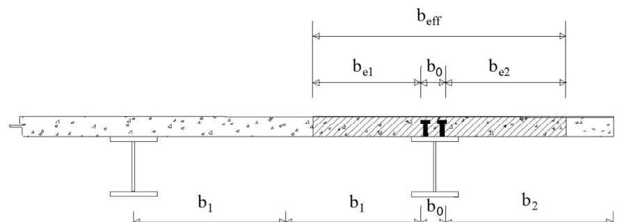
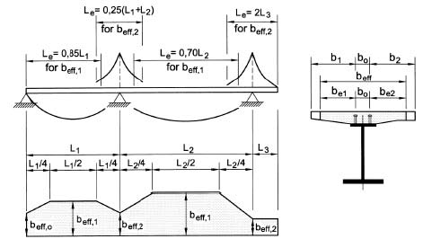
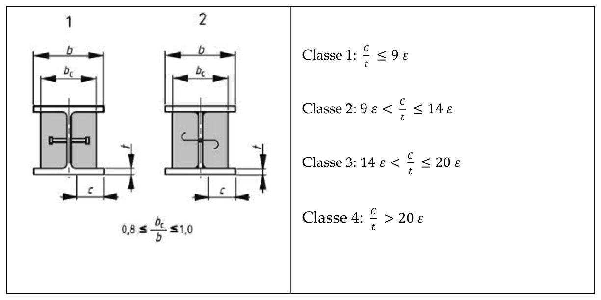

[Torna all'indice del capitolo](indice-cap04.md) | [Torna all'indice generale](../indice-ntc2018.md)

# 4.3. Costruzioni composte di acciaio - calcestruzzo

## Indice del capitolo

- [[#4.3.1 Valutazione della sicurezza|4.3.1 Valutazione della sicurezza (SLU, SLE, fasi costruttive)]]
  - [[#4.3.1.1 Stati limite ultimi|4.3.1.1 Stati limite ultimi]]
  - [[#4.3.1.2 Stati limite di esercizio|4.3.1.2 Stati limite di esercizio]]
  - [[#4.3.1.3 Fasi costruttive|4.3.1.3 Fasi costruttive]]
- [[#4.3.2 Analisi strutturale|4.3.2 Analisi strutturale]]
  - [[#4.3.2.1 Classificazione delle sezioni|4.3.2.1 Classificazione sezioni (B450C)]]
  - [[#4.3.2.2 Metodi di analisi globale|4.3.2.2 Metodi analisi globale (Tab. 4.3.I)]]
  - [[#4.3.2.3 Larghezze efficaci|4.3.2.3 Larghezze efficaci b_eff]]
  - [[#4.3.2.4 Effetti delle deformazioni|4.3.2.4 Effetti delle deformazioni]]
  - [[#4.3.2.5 Effetto delle imperfezioni|4.3.2.5 Effetto delle imperfezioni]]
- [[#4.3.3 Resistenze di progetto|4.3.3 Resistenze di progetto (γ_C=1,5, γ_A=1,05, γ_S=1,15, γ_V=1,25)]]
  - [[#4.3.3.1 Materiali|4.3.3.1 Materiali]]
- [[#4.3.4 Travi con soletta collaborante|4.3.4 Travi con soletta collaborante]]
  - [[#4.3.4.1 Tipologia delle sezioni|4.3.4.1 Tipologia sezioni]]
  - [[#4.3.4.2 Resistenza delle sezioni|4.3.4.2 Resistenza sezioni (flessione, taglio)]]
  - [[#4.3.4.3 Sistemi di connessione acciaio-calcestruzzo|4.3.4.3 Connessione acciaio-calcestruzzo (pioli)]]
  - [[#4.3.4.4 Modalità esecutive|4.3.4.4 Modalità esecutive]]
  - [[#4.3.4.5 Spessori minimi|4.3.4.5 Spessori minimi]]
- [[#4.3.5 Colonne composte|4.3.5 Colonne composte]]
  - [[#4.3.5.1 Generalità e tipologie|4.3.5.1 Generalità e tipologie]]
  - [[#4.3.5.2 Rigidezza, snellezza e contributo meccanico|4.3.5.2 Rigidezza e snellezza]]
  - [[#4.3.5.3 Resistenza delle sezioni|4.3.5.3 Resistenza sezioni]]
  - [[#4.3.5.4 Stabilità delle membrature|4.3.5.4 Stabilità membrature]]
  - [[#4.3.5.5 Trasferimento degli sforzi|4.3.5.5 Trasferimento degli sforzi]]
  - [[#4.3.5.6 Copriferro e minimi di armatura|4.3.5.6 Copriferro e minimi di armatura]]
- [[#4.3.6 Solette composte con lamiera grecata|4.3.6 Solette composte con lamiera grecata]]
  - [[#4.3.6.1 Analisi per il calcolo delle sollecitazioni|4.3.6.1 Calcolo sollecitazioni]]
  - [[#4.3.6.2 Verifiche agli stati limite ultimi|4.3.6.2 Verifiche SLU]]
  - [[#4.3.6.3 Verifiche agli stati limite di esercizio|4.3.6.3 Verifiche SLE]]
  - [[#4.3.6.4 Verifiche della lamiera in fase di getto|4.3.6.4 Verifiche lamiera in getto]]
  - [[#4.3.6.5 Dettagli costruttivi|4.3.6.5 Dettagli costruttivi]]
- [[#4.3.7 Situazioni transitorie|4.3.7 Situazioni transitorie]]
- [[#4.3.8 Situazioni eccezionali|4.3.8 Situazioni eccezionali]]
- [[#4.3.9 Resistenza al fuoco|4.3.9 Resistenza al fuoco (UNI EN 1994-1-2)]]
- [[#4.3.10 Progettazione integrata da prove|4.3.10 Progettazione da prove]]
- [[#C4.3. Costruzioni composte di acciaio-calcestruzzo|C4.3 Costruzioni composte di acciaio-calcestruzzo]]
  - [[#C4.3.1 Valutazione della sicurezza|C4.3.1 Valutazione della sicurezza]]
  - [[#C4.3.2 Analisi strutturale|C4.3.2 Analisi strutturale]]
  - [[#C4.3.4 Travi con soletta collaborante|C4.3.4 Travi con soletta collaborante]]
  - [[#C4.3.4.3 Sistemi di connessione acciaio-calcestruzzo|C4.3.4.3 Connessione acciaio-calcestruzzo]]
  - [[#C4.3.4.3.6 Instabilità flesso-torsionale delle travi composte|C4.3.4.3.6 Instabilità flesso-torsionale]]
  - [[#C4.3.6 Solette composte con lamiera grecata|C4.3.6 Solette composte con lamiera grecata]]

---

# Norma

Le costruzioni composte sono costituite da elementi strutturali in acciaio e calcestruzzo armato, collaboranti attraverso un sistema di connessione che garantisce il trasferimento delle forze di taglio all'interfaccia. Per quanto non specificato nel presente paragrafo si applicano le disposizioni del §4.1 per le parti in calcestruzzo armato e del §4.2 per le parti in acciaio.

---

## 4.3.1 Valutazione della sicurezza

### 4.3.1.1 Stati limite ultimi

La verifica agli stati limite ultimi deve tenere conto della resistenza della connessione acciaio-calcestruzzo. In particolare occorre verificare che la connessione sia in grado di trasmettere le forze di taglio longitudinale senza che si verifichi la perdita dell'azione composta. La verifica deve essere eseguita per tutte le combinazioni di carico rilevanti, considerando sia la resistenza delle sezioni composte sia la stabilità delle membrature.

### 4.3.1.2 Stati limite di esercizio

Per gli stati limite di esercizio occorre limitare lo scorrimento relativo tra la parte in acciaio e la soletta in calcestruzzo in modo da non pregiudicare il comportamento strutturale previsto. Devono inoltre essere verificate la limitazione delle deformazioni e l'ampiezza delle fessure nel calcestruzzo.

### 4.3.1.3 Fasi costruttive

Nella verifica strutturale devono essere prese in considerazione le fasi costruttive, in particolare:

- le condizioni di carico durante la messa in opera del calcestruzzo, quando l'azione composta non è ancora attiva;
- le azioni che si sviluppano prima del completamento del getto e della maturazione del calcestruzzo;
- le tensioni residue derivanti dalla sequenza costruttiva.

---

## 4.3.2 Analisi strutturale

### 4.3.2.1 Classificazione delle sezioni

La classificazione delle sezioni composte si esegue secondo i criteri del §4.2.3, applicati alle singole componenti della sezione. Le sezioni di classe 1 e 2 consentono l'utilizzo di metodi di calcolo plastici; le sezioni di classe 3 e 4 richiedono metodi elastici.

Per le sezioni di classe 1 e 2, affinché sia possibile sviluppare la resistenza plastica, l'armatura $A_s$ disposta nella soletta di calcestruzzo deve essere in acciaio B450C e soddisfare le seguenti condizioni:

$$A_s \geq \rho_s \cdot A_c \tag{4.3.1.a}$$

dove $A_c$ è l'area della sezione di calcestruzzo della soletta, e il rapporto minimo di armatura $\rho_s$ è:

$$\rho_s = \frac{235}{f_{sk}} \cdot 10^{-3} \tag{4.3.1.b}$$

con $f_{sk}$ espressa in MPa.

### 4.3.2.2 Metodi di analisi globale

Per l'analisi globale delle strutture composte può essere utilizzata l'analisi elastica lineare anche quando la resistenza delle sezioni viene valutata con metodi plastici. L'analisi elastica può essere condotta tenendo conto degli effetti della fessurazione del calcestruzzo mediante correzioni opportune.

Per considerare la fessurazione del calcestruzzo si possono utilizzare due metodi:

- **Metodo 1 (semplificato):** si utilizza la rigidezza $EJ_2$ (sezione fessurata, solo armatura) per una lunghezza pari al 15% della luce su ciascun lato degli appoggi interni, e la rigidezza $EJ_1$ (sezione non fessurata) nel resto della struttura.
- **Metodo 2 (iterativo):** si esegue prima un'analisi con rigidezza $EJ_1$ uniforme; nelle zone in cui la tensione di trazione nel calcestruzzo supera $2{,}0 f_{ctm}$, si sostituisce $EJ_1$ con $EJ_2$ e si ripete l'analisi.

**Tabella 4.3.I — Limiti di ridistribuzione dei momenti per analisi elastica**

| Tipo di analisi | Classe 1 | Classe 2 | Classe 3 | Classe 4 |
|---|:---:|:---:|:---:|:---:|
| Analisi non-fessurata | 40 | 30 | 20 | 10 |
| Analisi fessurata | 25 | 15 | 10 | 0 |

#### 4.3.2.2.1 Analisi lineare elastica

Nell'analisi elastica occorre tenere conto della viscosità del calcestruzzo mediante il coefficiente di omogeneizzazione $n$:

$$n = \frac{E_a}{E_{c,eff}}$$

dove $E_a$ è il modulo elastico dell'acciaio strutturale e $E_{c,eff}$ è il modulo elastico efficace del calcestruzzo che tiene conto degli effetti viscosi. Per azioni di lunga durata si può assumere $E_{c,eff} = E_{cm}/3$; per azioni di breve durata $E_{c,eff} = E_{cm}$.

In alternativa si può utilizzare per tutti gli effetti un valore unico:

$$n = 2 \cdot \frac{E_a}{E_{cm}}$$

#### 4.3.2.2.2 Analisi plastica

L'analisi plastica globale può essere utilizzata per strutture che soddisfano contemporaneamente le seguenti condizioni:

- tutti gli elementi strutturali sono in acciaio o composti;
- tutte le sezioni plastiche sono di classe 1;
- le connessioni sono in grado di sviluppare la rotazione plastica richiesta.

#### 4.3.2.2.3 Analisi non lineare

Per l'analisi non lineare si applicano le disposizioni del §4.2.3.3.

### 4.3.2.3 Larghezze efficaci

La larghezza efficace della soletta collaborante per le travi composte è:

$$b_{eff} = b_0 + b_{e1} + b_{e2} \tag{4.3.2}$$

dove $b_0$ è la distanza tra gli assi dei connettori (o la larghezza del profilo per piattabanda superiore), e ciascun contributo laterale vale:

$$b_{ei} = \min\!\left(\frac{L_e}{8},\, b_i\right)$$

con $b_i$ distanza dall'asse dell'anima al bordo libero della soletta (o alla mezzeria dello spazio tra travi adiacenti) e $L_e$ distanza tra i punti di momento nullo.

Per gli appoggi di estremità la larghezza efficace diventa:

$$b_{eff} = b_0 + \beta_1 b_{e1} + \beta_2 b_{e2} \tag{4.3.3}$$

con:

$$\beta_i = \frac{0{,}55 + 0{,}025 \cdot L_e / b_{ei}}{1} \leq 1{,}0$$

### 4.3.2.4 Effetti delle deformazioni

Gli effetti del secondo ordine possono essere trascurati quando il fattore di carico critico elastico soddisfa:

$$\alpha_{cr} \geq 10 \tag{4.3.4}$$

### 4.3.2.5 Effetto delle imperfezioni

Le imperfezioni geometriche equivalenti delle aste composte compresse possono essere trascurate nell'analisi globale quando:

$$\bar{\lambda} \leq 0{,}5 \cdot \sqrt{\frac{N_{pl,Rk}}{N_{Ed}}} \tag{4.3.5}$$

In caso contrario occorre introdurre le imperfezioni geometriche equivalenti secondo le prescrizioni del §4.2.

---

## 4.3.3 Resistenze di progetto

I valori di progetto dei parametri di resistenza dei materiali si ottengono dividendo i valori caratteristici per i rispettivi coefficienti parziali $\gamma_M$:

$$f_d = \frac{f_k}{\gamma_M} \tag{4.3.6}$$

I coefficienti parziali da utilizzare per gli stati limite ultimi sono:

| Materiale | Simbolo | Valore SLU | SLE | Eccezionale |
|-----------|:-------:|:----------:|:---:|:-----------:|
| Calcestruzzo | $\gamma_C$ | 1,50 | 1,00 | 1,00 |
| Acciaio strutturale | $\gamma_A$ | 1,05 | 1,00 | 1,00 |
| Armatura lenta | $\gamma_S$ | 1,15 | 1,00 | 1,00 |
| Connettori a piolo | $\gamma_V$ | 1,25 | 1,00 | 1,00 |

### 4.3.3.1 Materiali

#### 4.3.3.1.1 Acciaio

Per l'acciaio strutturale si applicano le disposizioni del §11.3.4, con i valori caratteristici delle proprietà meccaniche riportati nelle Tabelle 4.2.I e 4.2.II.

#### 4.3.3.1.2 Calcestruzzo

Per il calcestruzzo sono ammesse le classi da **C20/25** a **C60/75** per calcestruzzo a densità normale, e le classi da **LC20/22** a **LC55/60** per calcestruzzo di aggregati leggeri, conformi alle norme del §11.2.

---

## 4.3.4 Travi con soletta collaborante

### 4.3.4.1 Tipologia delle sezioni

Le travi composte possono presentare diverse tipologie di sezione trasversale a seconda della posizione dell'asse neutro plastico e del tipo di soletta. Le tipologie principali comprendono sezioni con asse neutro nella soletta, nell'anima del profilo metallico o nel lembo superiore delle ali.

### 4.3.4.2 Resistenza delle sezioni

#### 4.3.4.2.1 Resistenza a flessione

La resistenza a flessione delle sezioni composte può essere valutata con tre metodi:

**Metodo elastico:** la distribuzione delle tensioni è lineare nelle singole componenti; il calcestruzzo non contribuisce a trazione; si utilizza il coefficiente di omogeneizzazione $n$.

**Metodo plastico (sezioni di classe 1 e 2):** si assume la piena plasticizzazione della sezione. Il contributo di progetto del calcestruzzo compresso è:

$$\sigma_c = 0{,}85\, f_{cd}$$

La resistenza plastica a flessione $M_{pl,Rd}$ si calcola equilibrando le forze di trazione e compressione con le rispettive resistenze di progetto.

**Metodo elasto-plastico (sezioni di classe 3):** la componente metallica è in regime elastico; l'armatura in trazione è plasticizzata.

#### 4.3.4.2.2 Resistenza a taglio

La resistenza a taglio della sezione composta viene assegnata interamente alla sezione metallica, applicando le disposizioni del §4.2.4.1.2. Quando il taglio di progetto $V_{Ed}$ supera il 50% della resistenza a taglio $V_{pl,Rd}$ occorre ridurre la resistenza a flessione tenendo conto dell'interazione.

### 4.3.4.3 Sistemi di connessione acciaio-calcestruzzo

Il sistema di connessione deve essere progettato per trasferire le forze di taglio longitudinale tra l'acciaio strutturale e la soletta in calcestruzzo. Il **grado di connessione** $\eta$ è definito come:

$$\eta = \frac{n_{connettori}}{n_{connettori,\,completo}}$$

dove $n_{connettori,\,completo}$ è il numero di connettori necessari per la connessione completa.

#### 4.3.4.3.1 Connessioni a taglio con pioli

**Disposizione e limitazioni**

I connettori a piolo con testa sono considerati duttili se la loro deformazione ultima non è inferiore a **6 mm**. Il grado di connessione minimo ammesso è:

$$\eta \geq 1 - \frac{355}{f_{yk}} \cdot \left(0{,}75 - 0{,}03 \cdot \frac{L_e}{b_{eff}}\right) \quad \text{con } \eta \geq 0{,}40 \tag{4.3.7}$$

Per travi di luce $L_e \leq 25$ m con sezione uguale o simile simmetrica si può assumere:

$$\eta \geq 0{,}40 \tag{4.3.8}$$

##### 4.3.4.3.1.2 Resistenza dei connettori

La resistenza di progetto di un connettore a piolo con testa è il minore fra:

$$P_{Rd,s} = \frac{0{,}8 \cdot f_{uk} \cdot \pi d^2/4}{\gamma_V} \tag{4.3.9}$$

$$P_{Rd,c} = \frac{0{,}29 \cdot \alpha \cdot d^2 \cdot \sqrt{f_{ck} \cdot E_{cm}}}{\gamma_V} \tag{4.3.10}$$

dove $d$ è il diametro del gambo del piolo, $f_{uk}$ la resistenza caratteristica a trazione dell'acciaio del piolo, $f_{ck}$ la resistenza caratteristica a compressione del calcestruzzo, $E_{cm}$ il modulo elastico del calcestruzzo, e il coefficiente $\alpha$ vale:

$$\alpha = 0{,}2 \cdot \left(\frac{h_{sc}}{d} + 1\right) \quad \text{per } 3 \leq h_{sc}/d \leq 4 \tag{4.3.11a}$$

$$\alpha = 1{,}0 \quad \text{per } h_{sc}/d > 4 \tag{4.3.11b}$$

con $h_{sc}$ altezza totale del connettore.

**Riduzione per solette con lamiera grecata**

Per connettori saldati attraverso la lamiera, con nervature parallele alla trave:

$$k_t = \frac{0{,}6 \cdot b_0}{h_p} \cdot \frac{h_{sc} - h_p}{h_p} \leq 1{,}0 \tag{4.3.13}$$

Per nervature trasversali alla trave:

$$k_t = \frac{0{,}7}{\sqrt{n_r}} \cdot \frac{b_0}{h_p} \cdot \frac{h_{sc} - h_p}{h_p} \leq k_{t,\max} \tag{4.3.14}$$

dove $b_0$ è la larghezza media della nervatura, $h_p$ l'altezza della lamiera profilata, $h_{sc}$ l'altezza del connettore e $n_r$ il numero di connettori per nervatura.

**Tabella 4.3.II — Valori massimi di $k_{t,max}$ per connettori su lamiera profilata, nervature trasversali**

| Numero di pioli per greca | Spessore lamiera | Connettori con $\phi \leq 20$ mm saldati attraverso la lamiera | Lamiera con fori e pioli saldati sul profilo, diametro pioli 19 o 22 mm |
|:---:|:---:|:---:|:---:|
| $N_r = 1$ | $\leq 1{,}0$ | 0,85 | 0,75 |
| $N_r = 1$ | $> 1{,}0$ | 1,00 | 0,75 |
| $N_r = 2$ | $\leq 1{,}0$ | 0,70 | 0,60 |
| $N_r = 2$ | $> 1{,}0$ | 0,80 | 0,60 |

#### 4.3.4.3.2 Altri tipi di connettori

Per connettori diversi dai pioli con testa la resistenza di progetto deve essere determinata sperimentalmente o mediante calcolo, conformemente alle procedure indicate nel §4.3.10 e nelle pertinenti norme di prodotto.

#### 4.3.4.3.3 Valutazione delle sollecitazioni di taglio

Le forze di taglio longitudinale da trasferire tra l'acciaio e il calcestruzzo possono essere valutate con la **teoria elastica** oppure con la **teoria plastica** (per sezioni di classe 1 e 2 con connessione duttile).

La forza di taglio longitudinale di progetto $V_{l,d}$ per unità di lunghezza è:

- In campo elastico: $v_{l,d} = V_{Ed} \cdot S_{eff}/(I_{eff})$
- In campo plastico: si distribuisce uniformemente la forza di taglio totale tra il punto di momento massimo e gli appoggi.

#### 4.3.4.3.4 Dettagli costruttivi

I connettori a piolo devono rispettare i seguenti requisiti dimensionali e di posizione:

- copriferro laterale minimo: **20 mm**
- altezza minima del piolo: $h_{sc} \geq 3d$
- dimensioni della testa: diametro $\geq 1{,}5d$, spessore $\geq 0{,}4d$
- passo longitudinale massimo: $\min(6\,h_{soletta},\, 800\,\text{mm})$
- passo longitudinale minimo: $5d$
- passo trasversale minimo: $2{,}5d$ per pioli saldati nelle ali, $4d$ per altri casi
- il piolo non deve interferire con l'armatura della soletta

#### 4.3.4.3.5 Armatura trasversale

L'armatura trasversale deve essere progettata per resistere alle forze di trazione che si sviluppano lungo le superfici di rottura potenziale della soletta. Le superfici di rottura da considerare sono indicate in figura.

### 4.3.4.4 Modalità esecutive

Le modalità esecutive devono garantire la corretta messa in opera del sistema di connessione e dell'armatura della soletta. La sequenza costruttiva deve essere coerente con le ipotesi dell'analisi strutturale. In particolare:

- i puntelli provvisori, ove previsti, devono essere mantenuti fino al raggiungimento della resistenza prevista del calcestruzzo;
- le deformazioni della struttura metallica durante il getto devono essere considerate nel progetto architettonico e strutturale.

### 4.3.4.5 Spessori minimi

Per le travi composte si applicano i seguenti spessori minimi:

- spessore minimo della soletta di calcestruzzo: **50 mm** sopra la lamiera grecata (se presente) oppure riferito allo spessore totale
- spessore minimo dell'ala del profilo metallico in corrispondenza dei connettori: **5 mm** (per saldatura diretta)

---

## 4.3.5 Colonne composte

### 4.3.5.1 Generalità e tipologie

Le colonne composte sono elementi compressi costituiti da profili metallici e calcestruzzo armato collaboranti. Le tipologie principali sono:

Le colonne composte devono soddisfare contemporaneamente i seguenti requisiti:

1. La sezione trasversale deve essere **doppiamente simmetrica** e costante per tutta la lunghezza della colonna.
2. Il contributo meccanico dell'acciaio strutturale deve soddisfare: $0{,}2 \leq \delta \leq 0{,}9$.
3. La snellezza adimensionale deve essere $\bar{\lambda} \leq 2{,}0$.
4. Per le sezioni parzialmente incamiciate, le ali del profilo devono sporgere in modo da garantire un adeguato copriferro e ancoraggio delle staffe.
5. Il calcestruzzo deve essere almeno di classe C20/25 (o LC20/22 per alleggerito).
6. L'armatura longitudinale minima deve essere conforme alle prescrizioni del §4.3.5.6.
7. La percentuale di acciaio strutturale deve essere computata rispetto alla sezione totale composta.

### 4.3.5.2 Rigidezza, snellezza e contributo meccanico

Il **contributo meccanico** dell'acciaio strutturale è:

$$\delta = \frac{A_a \cdot f_{yk}/\gamma_A}{N_{pl,Rd}} \tag{4.3.15}$$

La **rigidezza flessionale efficace** per il calcolo della snellezza è:

$$(EJ)_{eff} = E_a \cdot I_a + E_s \cdot I_s + K_e \cdot E_{c,eff} \cdot I_c \tag{4.3.16}$$

con $K_e = 0{,}6$ e modulo efficace del calcestruzzo:

$$E_{c,eff} = E_{cm} / \left(1 + \frac{N_{G,Ed}}{N_{Ed}} \cdot \varphi_t\right) \tag{4.3.17}$$

dove $N_{G,Ed}$ è la parte permanente del carico assiale e $\varphi_t$ il coefficiente di viscosità finale.

La **snellezza adimensionale** è:

$$\bar{\lambda} = \sqrt{\frac{N_{pl,Rk}}{N_{cr}}} \tag{4.3.18}$$

Il **carico plastico caratteristico** è:

$$N_{pl,Rk} = A_a \cdot f_{yk} + A_c \cdot f_{ck} + A_s \cdot f_{sk} \tag{4.3.19}$$

La **rigidezza flessionale efficace per l'analisi di secondo ordine** vale:

$$(EI)_{eff,II} = 0{,}9 \cdot \left(E_a \cdot I_a + E_s \cdot I_s + K_{e,II} \cdot E_{c,eff} \cdot I_c\right) \tag{4.3.20}$$

con $K_{e,II} = 0{,}5$.

### 4.3.5.3 Resistenza delle sezioni

#### 4.3.5.3.1 Tensioni normali

La **resistenza plastica di progetto** a compressione pura della sezione composta è:

$$N_{pl,Rd} = A_a \cdot \frac{f_{yk}}{\gamma_A} + A_c \cdot 0{,}85 \cdot \frac{f_{ck}}{\gamma_C} + A_s \cdot \frac{f_{sk}}{\gamma_S} \tag{4.3.21}$$

**Effetto del confinamento per sezioni cave circolari riempite**

Per sezioni cave circolari riempite, quando la snellezza $\bar{\lambda} \leq 0{,}5$, si può tener conto dell'incremento di resistenza del calcestruzzo dovuto al confinamento:

$$N_{pl,Rd} = \eta_a \cdot A_a \cdot \frac{f_{yk}}{\gamma_A} + A_c \cdot f_{ck} \cdot \frac{1 + \eta_c \cdot t \cdot f_{yk}}{d \cdot f_{ck} \cdot \gamma_C} + A_s \cdot \frac{f_{sk}}{\gamma_S} \tag{4.3.22}$$

con i coefficienti $\eta_a$ ed $\eta_c$ dipendenti dall'eccentricità relativa $e/d$:

$$\eta_{a0} = 0{,}25\,(3 + 2\bar{\lambda}) \leq 1{,}0 \tag{4.3.23a}$$

$$\eta_{c0} = 4{,}9 - 18{,}5\bar{\lambda} + 17\bar{\lambda}^2 \geq 0 \tag{4.3.23b}$$

Per eccentricità $e > 0$:

$$\eta_a = \eta_{a0} + (1 - \eta_{a0}) \cdot \frac{10e}{d} \tag{4.3.24a}$$

$$\eta_c = \eta_{c0} \cdot \left(1 - \frac{10e}{d}\right) \tag{4.3.24b}$$

**Interazione N-M**

Il **momento resistente di progetto** per un dato sforzo normale $N_{Ed}$ è:

$$N_{pl,Rd,\,semplificato} = N_{pl,Rd} \tag{4.3.25}$$

$$M_{pl,Rd}(N_{Ed}) = \mu_d \cdot M_{pl,Rd} \tag{4.3.26}$$

dove $\mu_d$ è il coefficiente ricavato dal diagramma di interazione adimensionale $N/N_{pl,Rd}$–$M/M_{pl,Rd}$.

Per la verifica a pressoflessione biassiale:

$$\frac{M_{y,Ed}}{M_{pl,y,Rd}(N_{Ed})} + \frac{M_{z,Ed}}{M_{pl,z,Rd}(N_{Ed})} \leq 1{,}0 \tag{4.3.27}$$

#### 4.3.5.3.2 Resistenza al taglio

Il taglio di progetto è ripartito tra la sezione metallica e il nucleo di calcestruzzo armato. La quota assegnata alla sezione metallica $V_{a,Ed}$ e quella assegnata al calcestruzzo $V_{c,Ed}$ si determinano in proporzione alle rispettive rigidezze flessurali:

$$\frac{V_{a,Ed}}{V_{c,Ed}} = \frac{E_a \cdot I_a}{E_{c,eff} \cdot I_c} \tag{4.3.28}$$

La resistenza a taglio della sezione metallica si verifica secondo il §4.2.4.1.2 e quella della sezione di calcestruzzo armato secondo il §4.1.2.3.2.

### 4.3.5.4 Stabilità delle membrature

#### 4.3.5.4.1 Colonne compresse

La **resistenza di progetto a compressione con instabilità** è:

$$N_{b,Rd} = \chi \cdot N_{pl,Rd} \tag{4.3.29}$$

Il fattore di riduzione $\chi$ per l'instabilità si ricava in funzione di $\bar{\lambda}$:

$$\chi = \frac{1}{\Phi + \sqrt{\Phi^2 - \bar{\lambda}^2}} \leq 1{,}0 \tag{4.3.30}$$

con $\Phi = 0{,}5 \cdot [1 + \alpha_I(\bar{\lambda} - 0{,}2) + \bar{\lambda}^2]$.

**Tabella 4.3.III — Curve di instabilità e imperfezioni geometriche equivalenti per colonne composte**

**Tabella 4.3.III** - *Curve di instabilità e fattori di imperfezione*

#### 4.3.5.4.2 Instabilità locale

Per garantire l'efficacia del confinamento e prevenire l'instabilità locale delle pareti metalliche, occorre rispettare i seguenti limiti sul rapporto diametro/spessore o larghezza/spessore:

Per **sezioni cave circolari** riempite:

$$\frac{d}{t} \leq 90 \cdot \frac{235}{f_{yk}} \tag{4.3.31}$$

Per **sezioni cave rettangolari** riempite:

$$\frac{h}{t} \leq 52 \cdot \sqrt{\frac{235}{f_{yk}}} \tag{4.3.32}$$

Per **ali di sezioni parzialmente incamiciate**:

$$\frac{b}{2t_f} \leq 44 \cdot \sqrt{\frac{235}{f_{yk}}} \tag{4.3.33}$$

Per **anime di sezioni parzialmente incamiciate**:

$$\frac{h_w}{t_w} \leq 124 \cdot \sqrt{\frac{235}{f_{yk}}} \tag{4.3.34}$$

#### 4.3.5.4.3 Colonne pressoinflesse

Per colonne soggette a pressoflessione la verifica di stabilità si esegue con:

$$M_{Ed} \leq \alpha_M \cdot M_{pl,Rd}(N_{Ed}) \tag{4.3.35}$$

dove il momento amplificato tiene conto degli effetti di secondo ordine mediante il fattore $k$:

$$k = \frac{\beta}{1 - N_{Ed}/N_{cr,eff}} \tag{4.3.36}$$

con:

$$\beta = \max\!\left(1 - \frac{N_{Ed}}{N_{cr}},\; 0{,}66\right) \tag{4.3.37}$$

Il coefficiente $\alpha_M$ vale 0,9 per acciaio S235 e S355 e 0,8 per acciaio S420 e S460.

### 4.3.5.5 Trasferimento degli sforzi

Il trasferimento delle forze dalla testa della colonna alla sezione composta deve avvenire attraverso l'interfaccia acciaio-calcestruzzo. Le tensioni di aderenza limite ammesse sull'interfaccia sono:

| Tipo di sezione | $\tau_{Rd}$ (MPa) |
|----------------|:-----------------:|
| Completamente incamiciata | 0,30 |
| Cava circolare riempita | 0,55 |
| Cava rettangolare riempita | 0,40 |
| Parzialmente incamiciata — ali | 0,20 |
| Parzialmente incamiciata — anima | 0,00 |

Quando le tensioni di aderenza sono insufficienti, occorre disporre connettori a piolo per il trasferimento delle forze di interfaccia.

#### 4.3.5.5.1 Resistenza allo scorrimento fra i componenti

La resistenza allo scorrimento deve essere verificata nelle zone di introduzione dei carichi e agli estremi della colonna. La forza di taglio longitudinale $V_{l,Ed}$ da trasferire deve essere inferiore alla resistenza di contatto $\tau_{Rd} \cdot A_{contatto}$ oppure alla resistenza dei connettori.

### 4.3.5.6 Copriferro e minimi di armatura

Il copriferro minimo dell'armatura longitudinale deve essere:

- **40 mm** per la sezione completamente o parzialmente incamiciata;
- non superiore a **1/6 della larghezza dell'ala** del profilo metallico.

Il rapporto minimo di armatura longitudinale rispetto all'area del calcestruzzo è **0,3%**. Il rapporto massimo è **6%** (o **9%** in zone di sovrapposizione).

---

## 4.3.6 Solette composte con lamiera grecata

Le solette composte con lamiera grecata sfruttano la lamiera profilata come cassaforma durante il getto e come armatura a trazione nella fase definitiva. Il collegamento tra lamiera e calcestruzzo può essere realizzato mediante:

- **ingranamento meccanico** (indentature, rilievi o perforazioni nella lamiera);
- **connettori a piolo** saldati attraverso la lamiera;
- **deformazione terminale** (piegatura dei bordi della lamiera).

### 4.3.6.1 Analisi per il calcolo delle sollecitazioni

Per il calcolo delle sollecitazioni nella soletta composta si possono utilizzare:

- analisi **elastica lineare**, con o senza ridistribuzione;
- analisi **plastica**, per sezioni di classe 1 e 2;
- analisi **elasto-plastica**.

#### 4.3.6.1.1 Larghezza efficace

Per la distribuzione trasversale dei carichi concentrati, la larghezza efficace è:

$$b_m = b_p + 2(h_c + h_f) \tag{4.3.38}$$

dove $b_p$ è la larghezza del piede del piolo (o larghezza della zona caricata), $h_c$ è lo spessore della soletta sopra la lamiera e $h_f$ lo spessore del pavimento.

### 4.3.6.2 Verifiche agli stati limite ultimi

Le verifiche agli stati limite ultimi comprendono:

**Resistenza a flessione:** si determina in modo analogo alle travi composte, assumendo la lamiera come armatura a trazione con la resistenza di progetto $f_{yp,d}$. Per sezioni di classe 1 e 2 si utilizza il metodo plastico.

**Resistenza allo scorrimento longitudinale (metodo $m$-$k$ o connessione parziale):** la resistenza al taglio longitudinale si valuta tramite i parametri $\tau_{u,Rd}$ ricavati da prove conformi al Capitolo 11. La verifica richiede:

$$V_{Ed} \leq \tau_{u,Rd} \cdot b \cdot d_p$$

**Resistenza a punzonamento e taglio trasversale:** devono essere verificate nelle zone di applicazione di carichi concentrati.

### 4.3.6.3 Verifiche agli stati limite di esercizio

**Fessurazione:** nelle zone in appoggio continuo la percentuale minima di armatura trasversale è compresa tra **0,2%** e **0,4%** dell'area di calcestruzzo sopra la lamiera, in accordo con le prescrizioni del §4.1.2.2.4.

**Deformazione:** la freccia finale deve tener conto sia del contributo elastico sia dello scorrimento all'interfaccia acciaio-calcestruzzo.

### 4.3.6.4 Verifiche della lamiera in fase di getto

Durante la fase di getto, la lamiera agisce come cassaforma; la verifica di resistenza deve essere condotta secondo la **UNI EN 1993-1-3** per i profili formati a freddo.

La freccia massima ammessa per la lamiera sotto il peso proprio del calcestruzzo fresco e dei carichi di costruzione è:

$$\delta \leq \min\!\left(\frac{L}{180},\; 20\,\text{mm}\right)$$

### 4.3.6.5 Dettagli costruttivi

Per le solette composte con lamiera grecata si applicano i seguenti requisiti:

- spessore minimo della lamiera: **0,8 mm** (in presenza di connettori saldati) oppure **0,7 mm** (senza connettori);
- altezza minima della soletta composta: $h \geq 80$ mm;
- spessore minimo della soletta di calcestruzzo sopra la lamiera: $h_c \geq 40$ mm;
- in presenza di travi composte: $h_c \geq 50$ mm;
- la dimensione massima degli inerti non deve superare il minore fra $0{,}4\,h_c$, $b_0/3$ e **31,5 mm**;
- lunghezza minima di appoggio della lamiera: **75 mm** su acciaio o calcestruzzo, **50 mm** su altri materiali.

---

## 4.3.7 Situazioni transitorie

Per le strutture composte in situazioni transitorie (fasi costruttive, eventi eccezionali reversibili) le verifiche si eseguono secondo le regole generali del §2.5, applicando le appropriati combinazioni di carico e i coefficienti parziali per situazioni transitorie.

---

## 4.3.8 Situazioni eccezionali

Per le situazioni eccezionali (urti, esplosioni, incendi) si applicano le disposizioni del §2.5.4 e le specifiche norme di riferimento. I coefficienti parziali dei materiali sono ridotti a $\gamma_M = 1{,}0$ per tutte le componenti.

---

## 4.3.9 Resistenza al fuoco

La verifica della resistenza al fuoco delle strutture composte acciaio-calcestruzzo si esegue in conformità alla **UNI EN 1994-1-2** (Eurocodice 4 — Progettazione delle strutture composte acciaio-calcestruzzo — Parte 1-2: Regole generali — Progettazione strutturale per la resistenza al fuoco). Il grado di resistenza al fuoco richiesto è determinato in base alla destinazione d'uso e alla normativa antincendio applicabile.

---

## 4.3.10 Progettazione integrata da prove

Quando le caratteristiche di resistenza del sistema di connessione o della soletta composta non sono determinabili analiticamente, è consentita la progettazione sulla base di prove sperimentali secondo i criteri della **UNI EN 1990:2006 Appendice D**. Le prove devono essere condotte su campioni rappresentativi delle condizioni reali di impiego e i risultati devono essere elaborati con metodi statistici conformi all'Appendice D citata.

---

# Circolare

*Riferimento: Circolare 21 gennaio 2019, n. 7 C.S.LL.PP., Capitolo C4 — Costruzioni civili e industriali, §C4.3*

## C4.3. Costruzioni composte di acciaio-calcestruzzo

Per le costruzioni composte acciaio-calcestruzzo, la gamma degli acciai da carpenteria normalmente impiegabili è estesa dall'acciaio S235 fino all'acciaio S460, come nel caso dell'acciaio.

Il calcestruzzo ordinario deve avere classe non inferiore a C20/25 né superiore a C60/75, mentre il calcestruzzo con aggregati leggeri, la cui densità non può essere inferiore a 1800 kg/m³, deve avere classe non inferiore a LC20/22 e non superiore a LC55/60. Calcestruzzi di classe di resistenza superiori a C45/55 e LC 40/44, rispettivamente, richiedono comunque uno studio adeguato e specifiche procedure per il controllo di qualità.

Particolare attenzione deve essere posta al sistema di connessione, che determina il comportamento di queste strutture.

La classificazione delle sezioni è analoga a quella delle strutture metalliche, ma è possibile tenere conto del favorevole effetto irrigidente della soletta che può impedire alcuni fenomeni di instabilità locale consentendo una collocazione delle sezioni in classi caratterizzate da maggiore duttilità.

Oltre agli usuali stati limite, devono essere considerati anche lo SLU di resistenza e lo SLE della connessione acciaio-calcestruzzo.

Analogamente a quanto previsto per le strutture metalliche, anche per l'analisi globale delle strutture composte è possibile impiegare, in alternativa, il metodo plastico, il metodo elastico con ridistribuzione o il metodo non-lineare.

Per l'ulteriore approfondimento di elementi non trattati o non completamente trattati nelle NTC e nella presente Circolare si può fare utile riferimento a normative di comprovata validità, in particolare agli Eurocodici.

## C4.3.1 Valutazione della sicurezza

Oltre a quanto indicato per le strutture di calcestruzzo armato e per quelle in carpenteria metallica, le NTC richiedono di considerare ulteriori stati limite, ed in particolare:

- stato limite di resistenza della connessione acciaio-calcestruzzo;
- stato limite di esercizio della connessione acciaio-calcestruzzo.

È inoltre richiesta l'esplicita considerazione delle fasi costruttive.

## C4.3.2 Analisi strutturale

### C4.3.2.1 Classificazione delle sezioni

La classificazione di una sezione composta acciaio-calcestruzzo può farsi con riferimento alla sola sezione metallica, adottando quindi come classe quella meno favorevole delle parti metalliche.

In ogni caso, una piattabanda metallica, efficacemente collegata ad una soletta di calcestruzzo mediante connettori soddisfacenti alle condizioni date nel § 4.3.4.1 delle NTC, può essere classificata in classe 1.

Una piattabanda metallica di una sezione parzialmente rivestita di calcestruzzo può essere classificata in accordo con la Tabella C4.3.I. In una sezione parzialmente rivestita di calcestruzzo, il calcestruzzo che circonda l'anima dovrebbe essere efficacemente collegato alla sezione metallica e dovrebbe impedire l'instabilità dell'anima o della piattabanda compressa verso l'anima.

**Tabella C4.3.I** - *Classificazione di piattabande compresse in profilati o in sezioni saldate parzialmente rivestiti*

---

## C4.3.4 Travi con soletta collaborante

### C4.3.4.2 Resistenza delle sezioni

Il momento resistente, $M_{pl,Rd}$, di una sezione composta di classe 1 o 2 si valuta nell'ipotesi di conservazione delle sezioni piane, assumendo un diagramma equilibrato delle tensioni nella sezione, come indicato in Figura C4.3.1, e considerando nullo il contributo del calcestruzzo teso.

L'armatura longitudinale in soletta si ipotizza plasticizzata, sia in trazione sia in compressione, così come l'acciaio strutturale. A momento positivo, la parte compressa della sezione efficace della soletta di calcestruzzo si considera uniformemente compressa con tensione di compressione pari a $0{,}85 f_{cd}$, e la risultante di compressione è detta $N_{cf}$.

**Figura C4.3.1** - *Distribuzione delle tensioni plastiche allo SLU per il calcolo del momento resistente positivo*

Si definisce, in questo paragrafo, grado di connessione il rapporto $N_c/N_{cf}$ tra il massimo sforzo trasmissibile dalla connessione $N_c$ e la risultante delle compressioni in soletta $N_{cf}$.

In via approssimata tale rapporto si può assumere pari al grado di connessione $\eta$ definito al § 4.3.4.3 delle NTC come il rapporto tra il numero effettivo di connettori a taglio presenti e il numero di connettori che assicurano il completo sviluppo del momento resistente plastico della sezione composta.

Nel caso di connessione a pieno ripristino si ha $N_c = N_{cf}$.

La resistenza del calcestruzzo a trazione è trascurata ed in caso di momento negativo la connessione a taglio in genere è sufficiente a trasferire la risultante di trazione delle barre d'armatura in soletta, calcolata ipotizzando le barre d'armatura completamente snervate e soggette ad una tensione $f_{sd}$ (vedi Figura C4.3.2).

**Figura C4.3.2** - *Distribuzione delle tensioni plastiche allo SLU per il calcolo del momento resistente negativo*

Quando la connessione a taglio è a parziale ripristino di resistenza ($N_c/N_{cf}<1$) e realizzata con connettori duttili, il momento resistente, $M_{Rd}$, è calcolato utilizzando il metodo rigido-plastico ed il valore ridotto della risultante delle compressioni in soletta, $N_c$. In particolare, può assumersi una relazione lineare tra il grado di connessione $\eta$ ed il momento resistente ottenibile, vedi Figura C4.3.3, rappresentata dalla formula:

$$M_{Rd} = M_{pl,a,Rd} + \left(M_{pl,Rd} - M_{pl,a,Rd}\right)\eta \tag{C4.3.1}$$

dove $M_{pl,a,Rd}$ è il momento plastico della sola sezione di acciaio.

**Figura C4.3.3** - *Relazione tra il momento resistente della trave e il grado di connessione per connettori a taglio duttili*

### C4.3.4.3 Sistemi di connessione acciaio-calcestruzzo

Nelle NTC, in linea con la UNI EN 1994 e con le CNR 10016/2000, per le travi con soletta collaborante, sono considerate sia connessioni complete a taglio, sia connessioni parziali a taglio.

Nel seguito viene più dettagliatamente illustrato il concetto di connessione a taglio, completa o parziale, e vengono illustrate le limitazioni applicative.

Si ha una connessione a taglio completa quando i connettori, nel loro insieme, sono così robusti che la capacità portante limite della struttura è determinata dalla massima resistenza flessionale. Ad esempio, la capacità portante limite della trave di acciaio con soletta collaborante rappresentata in Figura C4.3.4, semplicemente appoggiata agli estremi e soggetta ad un carico uniformemente distribuito, nel caso di connessione a taglio completa lungo la sezione III si raggiunge quando nella sezione II si stabilisce la distribuzione di tensioni normali che corrisponde al momento plastico.

**Figura C4.3.4** - *Trave d'acciaio con soletta collaborante*

Nel caso di connessione completa a taglio, pertanto, un eventuale incremento del numero dei connettori a taglio nella sezione III non si tradurrebbe in aumento della capacità portante, essendo determinante la resistenza flessionale.

**Figura C4.3.5** - *Legame tra resistenza della trave e resistenza della connessione*

Per contro, disponendo connettori in minor numero si avrà una capacità portante ridotta, che dipende dalla numerosità dei connettori disposti nella sezione III, perché si riduce la risultante delle tensioni normali, di trazione e compressione, e quindi il momento limite nella sezione II: in questo caso si parla di connessione parziale a taglio.

In Figura C4.3.5 è schematizzato quanto sopra esposto: in ascisse è riportata la resistenza della connessione a taglio nella sezione III, in ordinate la capacità portante ultima della trave composta.

Al limite, quando mancassero del tutto i connettori, la resistenza della soletta può essere trascurata rispetto a quella della trave di acciaio.

L'applicazione della connessione parziale a taglio ha interesse per le travi composte acciaio-calcestruzzo nelle quali non è necessario sfruttare a fondo la collaborazione tra i due materiali per ottenere la resistenza richiesta.

Questo concetto si applica alle travi composte quando, ad esempio, le solette vengono gettate su casseri non puntellati, ma sostenuti direttamente dalle travi di acciaio. Le sezioni di acciaio devono essere dimensionate per sostenere il peso del getto cosicché, dopo l'indurimento del calcestruzzo, la connessione completa può portare a travi composte più prestazionali del richiesto.

Un altro caso in cui questo concetto si applica è quello in cui la progettazione delle travi composte è governata dalle limitazioni di deformabilità negli stati limite di esercizio; in tal caso, infatti, la resistenza ultima della sezione che ne consegue risulta sovrabbondante.

Situazione analoga si ha quando, per ragioni tecniche o economiche, il progettista è portato a preferire una sezione maggiore delle travi metalliche e un numero minore di connettori, piuttosto che travi con sezione di acciaio ridotta e maggior numero di connettori, come potrebbe accadere quando la soletta è gettata su una lamiera grecata, che limita posizione e numero dei connettori a causa della posizione e larghezza delle onde.

#### C4.3.4.3.1 Connessioni a taglio con pioli

##### C4.3.4.3.1.1 Disposizioni e limitazioni

Le regole di progetto contenute nel § 4.3.4 delle NTC per la verifica delle travi composte acciaio-calcestruzzo riguardano elementi strutturali realizzati con connettori a taglio dotati di comportamento duttile. In particolare, tale condizione è imprescindibile allorquando si applichi il calcolo plastico per la definizione del momento resistente della trave. Nelle NTC (§ 4.3.4.3.1.1) sono indicate le condizioni che si devono verificare per assumere l'ipotesi di connettori duttili.

La spaziatura massima tra i connettori deve essere pari a:

$$s_{MAX} = 22\,t_f \sqrt{\frac{235}{f_{yk}}}$$

per le travi collaboranti con solette piene o solette gettate su lamiere con greche parallele all'asse della trave, e pari a:

$$s_{MAX} = 15\,t_f \sqrt{\frac{235}{f_{yk}}}$$

nel caso in cui le greche della lamiera siano ortogonali all'asse della trave, dove con $t_f$ si è indicato lo spessore della piattabanda del profilo e con $f_{yk}$ la tensione di snervamento della piattabanda del profilo. In ogni caso la spaziatura massima deve essere inferiore ad 800 mm. La spaziatura minima dei connettori a pioli deve essere non minore di 5 volte il diametro del gambo del connettore. In direzione ortogonale alla forza di scorrimento l'interasse dei pioli non deve essere inferiore a 2,5 volte il diametro del gambo per le solette di calcestruzzo piene ed a 4 volte il diametro del gambo per tutti gli altri tipi di soletta.

I connettori possono essere disposti uniformemente tra i punti di momento massimo e minimo della trave solo nel caso di sezioni di classe 1 e classe 2 e se il fattore di connessione $\eta$ rispetta le limitazioni indicate. Se l'azione composta della connessione è tale da definire una sezione con un momento plastico resistente maggiore di 2,5 volte quello della sola sezione di acciaio è necessario eseguire verifiche supplementari nelle sezioni intermedie tra quelle di massimo e minimo momento perché in tale caso il sistema di connessione potrebbe avere un comportamento non duttile.

##### C4.3.4.3.1.2 Resistenza dei connettori a sollecitazioni combinate

Quando i connettori a taglio disposti sul profilo di acciaio sono simultaneamente considerati efficaci per due elementi ortogonali, come ad esempio nel caso di una trave composta longitudinale e di una soletta composta, si deve considerare la combinazione delle forze di connessione provenienti dai due elementi strutturali e la verifica di resistenza del connettore può essere eseguita con la formula:

$$\frac{F_l^2}{P_{l,Rd}^2} + \frac{F_t^2}{P_{t,Rd}^2} \leq 1{,}0 \tag{C4.3.2}$$

dove $F_l$ è l'azione longitudinale di progetto derivante dall'elemento principale, mentre $F_t$ è la forza di progetto trasversale derivante dall'elemento secondario e $P_{l,Rd}$ e $P_{t,Rd}$ sono le resistenze a taglio del singolo connettore in direzione longitudinale e trasversale. La resistenza del connettore nelle due direzioni può assumere valori differenti a causa del diverso grado di ricoprimento offerto dal calcestruzzo al connettore a piolo nelle due direzioni, longitudinale e trasversale.

#### C4.3.4.3.3 Valutazione delle sollecitazioni di taglio agenti sul sistema di connessione

Il calcolo della forza di scorrimento a taglio necessaria per il progetto dei connettori può essere condotta utilizzando sia la teoria elastica sia la teoria plastica. Per le connessioni a completo ripristino di resistenza, in sezioni progettate utilizzando il calcolo plastico, la forza totale di scorrimento con cui progettare la connessione tra la sezione di massimo momento positivo e un appoggio di estremità è data da:

$$V_{ld} = F_{cf} = \min\left\{\frac{A_a f_{yk}}{\gamma_a};\; 0{,}85\,\frac{f_{ck} A_c}{\gamma_c} + \frac{A_{se} f_{sk}}{\gamma_s}\right\} \tag{C4.3.3}$$

dove $A_a$, $A_c$ ed $A_{se}$ sono le aree, rispettivamente, del profilo di acciaio, della soletta di calcestruzzo e dell'armatura compressa. La forza di scorrimento tra una sezione soggetta al minimo momento flettente e la sezione soggetta al massimo momento flettente, appoggio intermedio e campata, è pari a:

$$V_{ld} = F_{cf} + \frac{A_s f_{sk}}{\gamma_s} + \frac{A_{ap} f_{yp}}{\gamma_{ap}} = \min\left\{\frac{A_a f_{yk}}{\gamma_a};\; 0{,}85\,\frac{f_{ck} A_c}{\gamma_c} + \frac{A_{se} f_{sk}}{\gamma_s}\right\} + \frac{A_s f_{sk}}{\gamma_s} + \frac{A_{ap} f_{yp}}{\gamma_{ap}} \tag{C4.3.4}$$

dove $A_{ap}$ è l'area della lamiera grecata, da considerarsi solo se è dimostrata la sua efficacia, $f_{yp}$ la sua tensione di snervamento e $A_s$ e $f_{sk}$ sono, rispettivamente, l'area e la tensione di snervamento delle barre d'armatura in soletta.

Nel caso di connessione a parziale ripristino di resistenza con connettori duttili, si può assumere che allo stato limite ultimo si sviluppino scorrimenti sufficienti per ottenere nelle sezioni critiche i momenti resistenti calcolati sulla base della teoria plastica. In tal caso, la forza di scorrimento agente tra la sezione di estremità della trave e la sezione a momento flettente massimo si assume pari a:

$$V_{ld} = F_c = \eta F_{cf} = \frac{M_{Rd} - M_{a,pl,Rd}}{M_{pl,Rd} - M_{a,pl,Rd}}\,F_{cf} \tag{C4.3.5}$$

mentre la forza di scorrimento tra la sezione a massimo momento flettente positivo e la sezione a minimo momento flettente negativo è pari a:

$$V_{ld} = F_c + \frac{A_s f_{sk}}{\gamma_s} + \frac{A_{ap} f_{yp}}{\gamma_{ap}} \tag{C4.3.6}$$

Se si utilizza per le sezioni trasversali la teoria elastica, anche la forza di scorrimento per unità di lunghezza deve essere calcolata utilizzando la teoria elastica, considerando l'aliquota di taglio che agisce dopo che la connessione si è attivata. Le proprietà statiche della sezione trasversale devono essere uguali a quelle utilizzate nel calcolo delle tensioni normali.

Per le travate da ponte, nello stato limite di esercizio, il taglio longitudinale per ciascun connettore non deve eccedere il 60% della resistenza di progetto.

#### C4.3.4.3.5 Armatura trasversale

La disposizione dell'armatura trasversale in soletta secondo le tipologie mostrate nelle Figure 4.3.5a, 4.3.5b e 4.3.5c delle NTC è necessaria per l'eliminazione di possibili rotture fragili nel calcestruzzo a causa degli elevati sforzi di taglio che si concentrano in prossimità della connessione piolata. Le superfici interessate dai maggiori sforzi di taglio sono differenti in relazione alla tipologia di soletta considerata nel progetto della trave composta e comunque l'armatura trasversale deve essere disposta in modo tale da rinforzare e cucire tali superfici di scorrimento potenziali.

La sollecitazione di taglio agente lungo tali superfici critiche, $v_{Ed}$, è determinata, sulla base delle ipotesi di calcolo seguite per la definizione del momento resistente plastico della sezione, dalla forza di compressione massima sviluppata in soletta. Per cui la sollecitazione di taglio per unità di lunghezza si ricava, vedi Figura C4.3.6, dalla formula:

$$v_{Ed} = \frac{\Delta F_s}{\Delta x\,h_f} \tag{C4.3.7}$$

dove $h_f$ è lo spessore della piattabanda di calcestruzzo e $\Delta x$ la distanza tra la sezione di momento massimo o minimo e la sezione di momento nullo.

**Figura C4.3.6** - *Distribuzione della sollecitazione di taglio longitudinale nella piattabanda di calcestruzzo*

L'area dell'armatura minima necessaria all'assorbimento della sollecitazione $v_{Ed}$ è data da:

$$\frac{A_{sf} f_{sk}}{\gamma_s s_f} \geq v_{Ed}\,h_f \tag{C4.3.8}$$

dove $A_{sf}$ è l'area della singola barra d'armatura disposta ad un interasse $s_f$. Per evitare la rottura del calcestruzzo compresso è necessario imporre che:

$$v_{Ed} \leq 0{,}3\left(1-\frac{f_{ck}}{250}\right)\frac{f_{ck}}{\gamma_c} \tag{C4.3.9}$$

Se le tensioni $v_{Ed}$ sono inferiori a $0{,}4 f_{ctd}$, dove $f_{ctd}$ è la resistenza a trazione di progetto del calcestruzzo, non è necessario disporre apposita armatura trasversale.

#### C4.3.4.3.6 Instabilità flesso-torsionale delle travi composte

Nel caso in cui la soletta di calcestruzzo collaborante sia garantita nei riguardi dell'instabilità laterale, è possibile assumere che la piattabanda superiore del profilo d'acciaio connesso a taglio alla soletta sia stabile lateralmente. In tutti gli altri casi è necessario verificare la sicurezza delle ali dei profili nei riguardi della stabilità.

In generale è possibile verificare l'instabilità flesso-torsionale dei profili di acciaio trascurando il ritegno torsionale costituito dalla soletta di calcestruzzo ed utilizzando le formule ed i metodi proposti nel § C4.2 e nelle NTC.

In alternativa è possibile considerare il contributo alla stabilità laterale fornito dalla soletta. Il momento resistente di progetto nei confronti dell'instabilità flesso-torsionale è pari a:

$$M_{b,Rd} = \chi_{LT} M_{Rd} \tag{C4.3.10}$$

dove $\chi_{LT}$ è il fattore riduttivo della resistenza flessionale $M_{Rd}$ espresso, tramite la formula 4.2.51 delle NTC, in funzione della snellezza relativa $\lambda_{LT}$:

$$\lambda_{LT} = \sqrt{\frac{M_{Rk}}{M_{cr}}} \tag{C4.3.11}$$

dove $M_{Rk}$ è il momento resistente della sezione composta, calcolato utilizzando i valori caratteristici delle resistenze, e $M_{cr}$ è il momento critico corrispondente all'instabilità flesso-torsionale, calcolato per la trave di maggior luce e con il maggiore momento sollecitante negativo.

Se sono verificate le seguenti ipotesi:

- la flangia superiore del profilo è connessa alla soletta;
- la soletta è composta e fissata su due profili contigui a formare una sezione ad "U invertita" (v. Figura C4.3.7);
- in ogni punto di appoggio l'elemento di acciaio ha la flangia inferiore bloccata lateralmente e l'anima irrigidita.

**Figura C4.3.7** - *Telaio ad U invertita: A-B-C-D*

Il contributo stabilizzante da considerare nel calcolo di $M_{cr}$ si può valutare definendo la rigidezza rotazionale $k_S$ per unità di lunghezza della soletta d'impalcato come:

$$k_S = \frac{1}{\frac{1}{k_1}+\frac{1}{k_2}} \tag{C4.3.12}$$

dove $k_1$, rigidezza flessionale in fase fessurata della soletta di calcestruzzo o composta ed in direzione trasversale ai profili d'acciaio, è definita come $k_1 = \alpha(EJ)_2/a$, in cui $\alpha=2$ per le travi esterne ed $\alpha=3$ per le travi interne; per un telaio con più di 4 travi $\alpha=4$ per le travi più interne. $a$ è la distanza tra due profili consecutivi; $(EJ)_2$ è il modulo di rigidezza fessurato per unità di larghezza della soletta; $k_2$ è la rigidezza flessionale dell'anima del profilo d'acciaio, che vale:

$$k_2 = \frac{E_a t_w^3}{4(1-\nu^2)h_S} \tag{C4.3.13}$$

dove $\nu$ è il coefficiente di Poisson, $h_S$ è l'altezza del profilo di acciaio e $t_w$ è lo spessore dell'anima.

Se la trave composta è continua su più appoggi o fa parte di un telaio a più campate ed è di classe 1, 2 o 3, la sezione può essere progettata senza un sistema di stabilizzazione laterale se sono soddisfatte le seguenti condizioni:

- le luci di campate adiacenti non differiscono tra loro di più del 20%, o del 15% nel caso di una campata esterna a sbalzo e della campata adiacente;
- il carico su ogni campata è uniformemente distribuito ed i carichi permanenti costituiscono più del 40% dei carichi di progetto;
- la piattabanda superiore è collegata alla soletta;
- la soletta è connessa ad un altro profilo di acciaio che la supporta e che è parallelo alla trave composta considerata;
- se la soletta è composta, questa connette due profili di acciaio a formare un telaio ad U invertita;
- in ogni punto di appoggio l'elemento di acciaio ha la piattabanda inferiore lateralmente bloccata e l'anima irrigidita;
- se la sezione di acciaio non è rivestita di calcestruzzo, rispetta i limiti imposti, sull'altezza della sezione, nella Tabella C4.3.II;
- se l'elemento della sezione è parzialmente rivestito di calcestruzzo, l'altezza $h$ della sua sezione di acciaio non eccede l'altezza fornita in Tabella C4.3.II di più di 200 mm, per le classi d'acciaio S235, S275 ed S355, e di più di 150 mm, per le classi S420 ed S460.

**Tabella C4.3.II** - *Altezza massima in mm dell'elemento di acciaio non rivestito*

| Elemento di acciaio | S235 | S275 | S355 | S420 e S460 |
|---|:---:|:---:|:---:|:---:|
| IPE | 600 | 550 | 400 | 270 |
| HE | 800 | 700 | 650 | 500 |

## C4.3.6 Solette composte con lamiera grecata

### C4.3.6.2 Verifiche di resistenza allo stato limite ultimo (solette composte)

La resistenza a flessione delle sezioni trasversali di una soletta composta realizzata con una soletta armata di calcestruzzo gettata su una lamiera grecata collaborante può essere determinata con la teoria plastica, in accordo a quanto esposto in § 4.3.4.2.1.2 delle NTC ed in § C4.3.4.2, se sono soddisfatte le seguenti condizioni:

- sussiste la piena interazione tra lamiera e calcestruzzo;
- la sezione efficace della lamiera è valutata al netto di bugnature o dentelli;
- la lamiera nelle zone soggette a momento negativo è considerata attiva solo se continua sul profilo di acciaio;
- la stabilità delle parti compresse della lamiera è assicurata.

In tal caso si assume per il calcestruzzo un modello stress-block con tensione massima $0{,}85 f_{ck}/\gamma_c$ mentre le tensioni normali nella lamiera e nelle barre d'armatura sono assunte pari al limite plastico; vedi Figure C4.3.8(a) e C4.3.8(b).

**Figura C4.3.8** - *Distribuzione plastica delle tensioni: (a) asse neutro nel calcestruzzo sopra la lamiera; (b) asse neutro che taglia la lamiera grecata*

La resistenza allo scorrimento tra lamiera grecata e soletta deve essere verificata nelle zone in cui sono localizzate le massime sollecitazioni di taglio, in generale le sezioni prossime agli appoggi, poiché in caso di connessione parziale tra i due elementi non è possibile sviluppare il momento resistente plastico così come al § 4.3.6.2 delle NTC. A tal riguardo, è possibile definire una relazione lineare che rappresenta l'interazione parziale tra la lamiera grecata ed il calcestruzzo, basata sulla resistenza allo scorrimento offerta dalla lamiera, $\tau_{u,Rd}$, che consente di ricavare il momento resistente massimo ottenibile prima del raggiungimento della crisi per flessione (vedi Figura C4.3.9). Tale relazione, basandosi sulla capacità $\tau_{u,Rd}$ della lamiera grecata, dipende dal tipo di lamiera utilizzata.

Altre tipologie di connessione e differenti condizioni di carico definiscono differenti diagrammi di interazione parziale, come presentato in § 7.4.3 della CNR 10016.

Metodi per il calcolo della resistenza allo scorrimento di sistemi di connessione a pioli, illustrati nella Figura 4.3.4(a,b) delle NTC, sono basati sulle resistenze fornite nel § 4.3.4.3.1 delle NTC; ulteriori informazioni e metodi per il calcolo sono riportati in § 9.7.3 e § 9.7.4 della UNI EN 1994-1-1:2005.

**Figura C4.3.9** - *Diagramma di interazione parziale calcestruzzo lamiera*
