[Torna all'indice del § 4.3](./indice-4.3.md) | [Torna all'indice del capitolo](./indice-cap04.md) | [Torna all'indice generale](../indice-ntc2018.md)

# 4.3.4 Travi con soletta collaborante

<!-- INDICE-INTERNO:INIZIO -->
**Indice interno**

- [Norma](#toc-ntc2018-4-3-4-norma)
  - [4.3.4.1 Tipologia delle sezioni](#toc-ntc2018-4-3-4-1)
  - [4.3.4.2 Resistenza delle sezioni](#toc-ntc2018-4-3-4-2)
    - [4.3.4.2.1 Resistenza a flessione](#toc-ntc2018-4-3-4-2-1)
    - [4.3.4.2.2 Resistenza a taglio](#toc-ntc2018-4-3-4-2-2)
  - [4.3.4.3 Sistemi di connessione acciaio-calcestruzzo](#toc-ntc2018-4-3-4-3)
    - [4.3.4.3.1 Connessioni a taglio con pioli](#toc-ntc2018-4-3-4-3-1)
      - [4.3.4.3.1.2 Resistenza dei connettori](#toc-ntc2018-4-3-4-3-1-2)
    - [4.3.4.3.2 Altri tipi di connettori](#toc-ntc2018-4-3-4-3-2)
    - [4.3.4.3.3 Valutazione delle sollecitazioni di taglio](#toc-ntc2018-4-3-4-3-3)
    - [4.3.4.3.4 Dettagli costruttivi](#toc-ntc2018-4-3-4-3-4)
    - [4.3.4.3.5 Armatura trasversale](#toc-ntc2018-4-3-4-3-5)
  - [4.3.4.4 Modalità esecutive](#toc-ntc2018-4-3-4-4)
  - [4.3.4.5 Spessori minimi](#toc-ntc2018-4-3-4-5)
- [Circolare](#toc-ntc2018-c4-3-4-circolare)
- [C4.3.4 Travi con soletta collaborante](#toc-ntc2018-c4-3-4)
  - [C4.3.4.2 Resistenza delle sezioni](#toc-ntc2018-c4-3-4-2)
  - [C4.3.4.3 Sistemi di connessione acciaio-calcestruzzo](#toc-ntc2018-c4-3-4-3)
    - [C4.3.4.3.1 Connessioni a taglio con pioli](#toc-ntc2018-c4-3-4-3-1)
      - [C4.3.4.3.1.1 Disposizioni e limitazioni](#toc-ntc2018-c4-3-4-3-1-1)
      - [C4.3.4.3.1.2 Resistenza dei connettori a sollecitazioni combinate](#toc-ntc2018-c4-3-4-3-1-2)
    - [C4.3.4.3.3 Valutazione delle sollecitazioni di taglio agenti sul sistema di connessione](#toc-ntc2018-c4-3-4-3-3)
    - [C4.3.4.3.5 Armatura trasversale](#toc-ntc2018-c4-3-4-3-5)
    - [C4.3.4.3.6 Instabilità flesso-torsionale delle travi composte](#toc-ntc2018-c4-3-4-3-6)
<!-- INDICE-INTERNO:FINE -->

## Norma

### 4.3.4.1 Tipologia delle sezioni

Le travi composte possono presentare diverse tipologie di sezione trasversale a seconda della posizione dell'asse neutro plastico e del tipo di soletta. Le tipologie principali comprendono sezioni con asse neutro nella soletta, nell'anima del profilo metallico o nel lembo superiore delle ali.

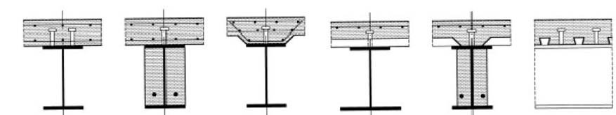

### 4.3.4.2 Resistenza delle sezioni

#### 4.3.4.2.1 Resistenza a flessione

La resistenza a flessione delle sezioni composte può essere valutata con tre metodi:

**Metodo elastico:** la distribuzione delle tensioni è lineare nelle singole componenti; il calcestruzzo non contribuisce a trazione; si utilizza il coefficiente di omogeneizzazione $n$.

**Metodo plastico (sezioni di classe 1 e 2):** si assume la piena plasticizzazione della sezione. Il contributo di progetto del calcestruzzo compresso è:

$$\sigma_c = 0{,}85\, f_{cd}$$

La resistenza plastica a flessione $M_{pl,Rd}$ si calcola equilibrando le forze di trazione e compressione con le rispettive resistenze di progetto.

**Metodo elasto-plastico (sezioni di classe 3):** la componente metallica è in regime elastico; l'armatura in trazione è plasticizzata.

#### 4.3.4.2.2 Resistenza a taglio

La resistenza a taglio della sezione composta viene assegnata interamente alla sezione metallica, applicando le disposizioni del §4.2.4.1.2. Quando il taglio di progetto $V_{Ed}$ supera il 50% della resistenza a taglio $V_{pl,Rd}$ occorre ridurre la resistenza a flessione tenendo conto dell'interazione.

### 4.3.4.3 Sistemi di connessione acciaio-calcestruzzo

Il sistema di connessione deve essere progettato per trasferire le forze di taglio longitudinale tra l'acciaio strutturale e la soletta in calcestruzzo. Il **grado di connessione** $\eta$ è definito come:

$$\eta = \frac{n_{connettori}}{n_{connettori,\,completo}}$$

dove $n_{connettori,\,completo}$ è il numero di connettori necessari per la connessione completa.

#### 4.3.4.3.1 Connessioni a taglio con pioli

**Disposizione e limitazioni**

I connettori a piolo con testa sono considerati duttili se la loro deformazione ultima non è inferiore a **6 mm**. Il grado di connessione minimo ammesso è:

$$\eta \geq 1 - \frac{355}{f_{yk}} \cdot \left(0{,}75 - 0{,}03 \cdot \frac{L_e}{b_{eff}}\right) \quad \text{con } \eta \geq 0{,}40 \tag{4.3.7}$$

Per travi di luce $L_e \leq 25$ m con sezione uguale o simile simmetrica si può assumere:

$$\eta \geq 0{,}40 \tag{4.3.8}$$

##### 4.3.4.3.1.2 Resistenza dei connettori

La resistenza di progetto di un connettore a piolo con testa è il minore fra:

$$P_{Rd,s} = \frac{0{,}8 \cdot f_{uk} \cdot \pi d^2/4}{\gamma_V} \tag{4.3.9}$$

$$P_{Rd,c} = \frac{0{,}29 \cdot \alpha \cdot d^2 \cdot \sqrt{f_{ck} \cdot E_{cm}}}{\gamma_V} \tag{4.3.10}$$

dove $d$ è il diametro del gambo del piolo, $f_{uk}$ la resistenza caratteristica a trazione dell'acciaio del piolo, $f_{ck}$ la resistenza caratteristica a compressione del calcestruzzo, $E_{cm}$ il modulo elastico del calcestruzzo, e il coefficiente $\alpha$ vale:

$$\alpha = 0{,}2 \cdot \left(\frac{h_{sc}}{d} + 1\right) \quad \text{per } 3 \leq h_{sc}/d \leq 4 \tag{4.3.11a}$$

$$\alpha = 1{,}0 \quad \text{per } h_{sc}/d > 4 \tag{4.3.11b}$$

con $h_{sc}$ altezza totale del connettore.

**Riduzione per solette con lamiera grecata**

Per connettori saldati attraverso la lamiera, con nervature parallele alla trave:

$$k_t = \frac{0{,}6 \cdot b_0}{h_p} \cdot \frac{h_{sc} - h_p}{h_p} \leq 1{,}0 \tag{4.3.13}$$

Per nervature trasversali alla trave:

$$k_t = \frac{0{,}7}{\sqrt{n_r}} \cdot \frac{b_0}{h_p} \cdot \frac{h_{sc} - h_p}{h_p} \leq k_{t,\max} \tag{4.3.14}$$

dove $b_0$ è la larghezza media della nervatura, $h_p$ l'altezza della lamiera profilata, $h_{sc}$ l'altezza del connettore e $n_r$ il numero di connettori per nervatura.

**Tabella 4.3.II — Valori massimi di $k_{t,max}$ per connettori su lamiera profilata, nervature trasversali**

| Numero di pioli per greca | Spessore lamiera | Connettori con $\phi \leq 20$ mm saldati attraverso la lamiera | Lamiera con fori e pioli saldati sul profilo, diametro pioli 19 o 22 mm |
|:---:|:---:|:---:|:---:|
| $N_r = 1$ | $\leq 1{,}0$ | 0,85 | 0,75 |
| $N_r = 1$ | $> 1{,}0$ | 1,00 | 0,75 |
| $N_r = 2$ | $\leq 1{,}0$ | 0,70 | 0,60 |
| $N_r = 2$ | $> 1{,}0$ | 0,80 | 0,60 |

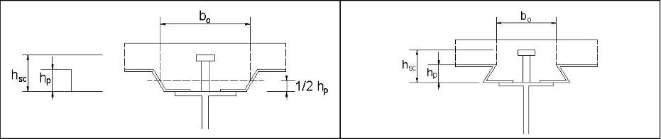

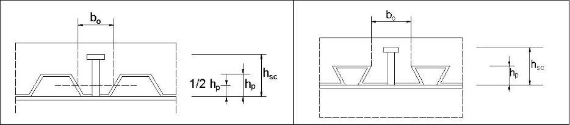

#### 4.3.4.3.2 Altri tipi di connettori

Per connettori diversi dai pioli con testa la resistenza di progetto deve essere determinata sperimentalmente o mediante calcolo, conformemente alle procedure indicate nel §4.3.10 e nelle pertinenti norme di prodotto.

#### 4.3.4.3.3 Valutazione delle sollecitazioni di taglio

Le forze di taglio longitudinale da trasferire tra l'acciaio e il calcestruzzo possono essere valutate con la **teoria elastica** oppure con la **teoria plastica** (per sezioni di classe 1 e 2 con connessione duttile).

La forza di taglio longitudinale di progetto $V_{l,d}$ per unità di lunghezza è:

- In campo elastico: $v_{l,d} = V_{Ed} \cdot S_{eff}/(I_{eff})$
- In campo plastico: si distribuisce uniformemente la forza di taglio totale tra il punto di momento massimo e gli appoggi.

#### 4.3.4.3.4 Dettagli costruttivi

I connettori a piolo devono rispettare i seguenti requisiti dimensionali e di posizione:

- copriferro laterale minimo: **20 mm**
- altezza minima del piolo: $h_{sc} \geq 3d$
- dimensioni della testa: diametro $\geq 1{,}5d$, spessore $\geq 0{,}4d$
- passo longitudinale massimo: $\min(6\,h_{soletta},\, 800\,\text{mm})$
- passo longitudinale minimo: $5d$
- passo trasversale minimo: $2{,}5d$ per pioli saldati nelle ali, $4d$ per altri casi
- il piolo non deve interferire con l'armatura della soletta

#### 4.3.4.3.5 Armatura trasversale

L'armatura trasversale deve essere progettata per resistere alle forze di trazione che si sviluppano lungo le superfici di rottura potenziale della soletta. Le superfici di rottura da considerare sono indicate in figura.

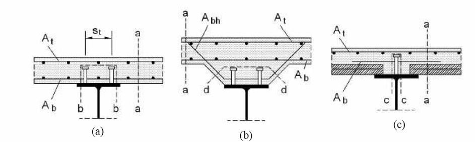

### 4.3.4.4 Modalità esecutive

Le modalità esecutive devono garantire la corretta messa in opera del sistema di connessione e dell'armatura della soletta. La sequenza costruttiva deve essere coerente con le ipotesi dell'analisi strutturale. In particolare:

- i puntelli provvisori, ove previsti, devono essere mantenuti fino al raggiungimento della resistenza prevista del calcestruzzo;
- le deformazioni della struttura metallica durante il getto devono essere considerate nel progetto architettonico e strutturale.

### 4.3.4.5 Spessori minimi

Per le travi composte si applicano i seguenti spessori minimi:

- spessore minimo della soletta di calcestruzzo: **50 mm** sopra la lamiera grecata (se presente) oppure riferito allo spessore totale
- spessore minimo dell'ala del profilo metallico in corrispondenza dei connettori: **5 mm** (per saldatura diretta)

---

## Circolare

## C4.3.4 Travi con soletta collaborante

### C4.3.4.2 Resistenza delle sezioni

Il momento resistente, $M_{pl,Rd}$, di una sezione composta di classe 1 o 2 si valuta nell'ipotesi di conservazione delle sezioni piane, assumendo un diagramma equilibrato delle tensioni nella sezione, come indicato in Figura C4.3.1, e considerando nullo il contributo del calcestruzzo teso.

L'armatura longitudinale in soletta si ipotizza plasticizzata, sia in trazione sia in compressione, così come l'acciaio strutturale. A momento positivo, la parte compressa della sezione efficace della soletta di calcestruzzo si considera uniformemente compressa con tensione di compressione pari a $0{,}85 f_{cd}$, e la risultante di compressione è detta $N_{cf}$.

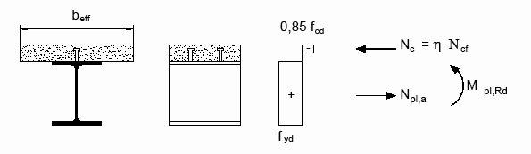

**Figura C4.3.1** - *Distribuzione delle tensioni plastiche allo SLU per il calcolo del momento resistente positivo*

Si definisce, in questo paragrafo, grado di connessione il rapporto $N_c/N_{cf}$ tra il massimo sforzo trasmissibile dalla connessione $N_c$ e la risultante delle compressioni in soletta $N_{cf}$.

In via approssimata tale rapporto si può assumere pari al grado di connessione $\eta$ definito al § 4.3.4.3 delle NTC come il rapporto tra il numero effettivo di connettori a taglio presenti e il numero di connettori che assicurano il completo sviluppo del momento resistente plastico della sezione composta.

Nel caso di connessione a pieno ripristino si ha $N_c = N_{cf}$.

La resistenza del calcestruzzo a trazione è trascurata ed in caso di momento negativo la connessione a taglio in genere è sufficiente a trasferire la risultante di trazione delle barre d'armatura in soletta, calcolata ipotizzando le barre d'armatura completamente snervate e soggette ad una tensione $f_{sd}$ (vedi Figura C4.3.2).

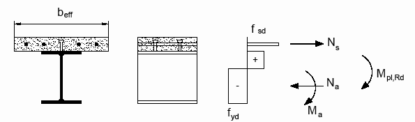

**Figura C4.3.2** - *Distribuzione delle tensioni plastiche allo SLU per il calcolo del momento resistente negativo*

Quando la connessione a taglio è a parziale ripristino di resistenza ($N_c/N_{cf}<1$) e realizzata con connettori duttili, il momento resistente, $M_{Rd}$, è calcolato utilizzando il metodo rigido-plastico ed il valore ridotto della risultante delle compressioni in soletta, $N_c$. In particolare, può assumersi una relazione lineare tra il grado di connessione $\eta$ ed il momento resistente ottenibile, vedi Figura C4.3.3, rappresentata dalla formula:

$$M_{Rd} = M_{pl,a,Rd} + \left(M_{pl,Rd} - M_{pl,a,Rd}\right)\eta \tag{C4.3.1}$$

dove $M_{pl,a,Rd}$ è il momento plastico della sola sezione di acciaio.

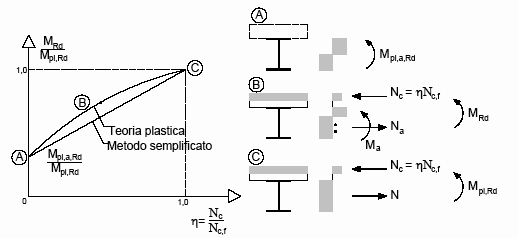

**Figura C4.3.3** - *Relazione tra il momento resistente della trave e il grado di connessione per connettori a taglio duttili*

### C4.3.4.3 Sistemi di connessione acciaio-calcestruzzo

Nelle NTC, in linea con la UNI EN 1994 e con le CNR 10016/2000, per le travi con soletta collaborante, sono considerate sia connessioni complete a taglio, sia connessioni parziali a taglio.

Nel seguito viene più dettagliatamente illustrato il concetto di connessione a taglio, completa o parziale, e vengono illustrate le limitazioni applicative.

Si ha una connessione a taglio completa quando i connettori, nel loro insieme, sono così robusti che la capacità portante limite della struttura è determinata dalla massima resistenza flessionale. Ad esempio, la capacità portante limite della trave di acciaio con soletta collaborante rappresentata in Figura C4.3.4, semplicemente appoggiata agli estremi e soggetta ad un carico uniformemente distribuito, nel caso di connessione a taglio completa lungo la sezione III si raggiunge quando nella sezione II si stabilisce la distribuzione di tensioni normali che corrisponde al momento plastico.

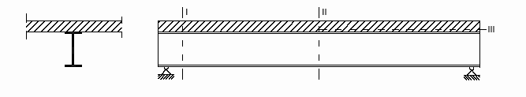

**Figura C4.3.4** - *Trave d'acciaio con soletta collaborante*

Nel caso di connessione completa a taglio, pertanto, un eventuale incremento del numero dei connettori a taglio nella sezione III non si tradurrebbe in aumento della capacità portante, essendo determinante la resistenza flessionale.

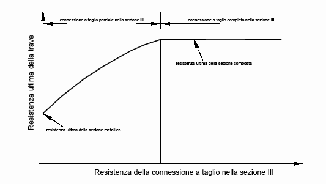

**Figura C4.3.5** - *Legame tra resistenza della trave e resistenza della connessione*

Per contro, disponendo connettori in minor numero si avrà una capacità portante ridotta, che dipende dalla numerosità dei connettori disposti nella sezione III, perché si riduce la risultante delle tensioni normali, di trazione e compressione, e quindi il momento limite nella sezione II: in questo caso si parla di connessione parziale a taglio.

In Figura C4.3.5 è schematizzato quanto sopra esposto: in ascisse è riportata la resistenza della connessione a taglio nella sezione III, in ordinate la capacità portante ultima della trave composta.

Al limite, quando mancassero del tutto i connettori, la resistenza della soletta può essere trascurata rispetto a quella della trave di acciaio.

L'applicazione della connessione parziale a taglio ha interesse per le travi composte acciaio-calcestruzzo nelle quali non è necessario sfruttare a fondo la collaborazione tra i due materiali per ottenere la resistenza richiesta.

Questo concetto si applica alle travi composte quando, ad esempio, le solette vengono gettate su casseri non puntellati, ma sostenuti direttamente dalle travi di acciaio. Le sezioni di acciaio devono essere dimensionate per sostenere il peso del getto cosicché, dopo l'indurimento del calcestruzzo, la connessione completa può portare a travi composte più prestazionali del richiesto.

Un altro caso in cui questo concetto si applica è quello in cui la progettazione delle travi composte è governata dalle limitazioni di deformabilità negli stati limite di esercizio; in tal caso, infatti, la resistenza ultima della sezione che ne consegue risulta sovrabbondante.

Situazione analoga si ha quando, per ragioni tecniche o economiche, il progettista è portato a preferire una sezione maggiore delle travi metalliche e un numero minore di connettori, piuttosto che travi con sezione di acciaio ridotta e maggior numero di connettori, come potrebbe accadere quando la soletta è gettata su una lamiera grecata, che limita posizione e numero dei connettori a causa della posizione e larghezza delle onde.

#### C4.3.4.3.1 Connessioni a taglio con pioli

##### C4.3.4.3.1.1 Disposizioni e limitazioni

Le regole di progetto contenute nel § 4.3.4 delle NTC per la verifica delle travi composte acciaio-calcestruzzo riguardano elementi strutturali realizzati con connettori a taglio dotati di comportamento duttile. In particolare, tale condizione è imprescindibile allorquando si applichi il calcolo plastico per la definizione del momento resistente della trave. Nelle NTC (§ 4.3.4.3.1.1) sono indicate le condizioni che si devono verificare per assumere l'ipotesi di connettori duttili.

La spaziatura massima tra i connettori deve essere pari a:

$$s_{MAX} = 22\,t_f \sqrt{\frac{235}{f_{yk}}}$$

per le travi collaboranti con solette piene o solette gettate su lamiere con greche parallele all'asse della trave, e pari a:

$$s_{MAX} = 15\,t_f \sqrt{\frac{235}{f_{yk}}}$$

nel caso in cui le greche della lamiera siano ortogonali all'asse della trave, dove con $t_f$ si è indicato lo spessore della piattabanda del profilo e con $f_{yk}$ la tensione di snervamento della piattabanda del profilo. In ogni caso la spaziatura massima deve essere inferiore ad 800 mm. La spaziatura minima dei connettori a pioli deve essere non minore di 5 volte il diametro del gambo del connettore. In direzione ortogonale alla forza di scorrimento l'interasse dei pioli non deve essere inferiore a 2,5 volte il diametro del gambo per le solette di calcestruzzo piene ed a 4 volte il diametro del gambo per tutti gli altri tipi di soletta.

I connettori possono essere disposti uniformemente tra i punti di momento massimo e minimo della trave solo nel caso di sezioni di classe 1 e classe 2 e se il fattore di connessione $\eta$ rispetta le limitazioni indicate. Se l'azione composta della connessione è tale da definire una sezione con un momento plastico resistente maggiore di 2,5 volte quello della sola sezione di acciaio è necessario eseguire verifiche supplementari nelle sezioni intermedie tra quelle di massimo e minimo momento perché in tale caso il sistema di connessione potrebbe avere un comportamento non duttile.

##### C4.3.4.3.1.2 Resistenza dei connettori a sollecitazioni combinate

Quando i connettori a taglio disposti sul profilo di acciaio sono simultaneamente considerati efficaci per due elementi ortogonali, come ad esempio nel caso di una trave composta longitudinale e di una soletta composta, si deve considerare la combinazione delle forze di connessione provenienti dai due elementi strutturali e la verifica di resistenza del connettore può essere eseguita con la formula:

$$\frac{F_l^2}{P_{l,Rd}^2} + \frac{F_t^2}{P_{t,Rd}^2} \leq 1{,}0 \tag{C4.3.2}$$

dove $F_l$ è l'azione longitudinale di progetto derivante dall'elemento principale, mentre $F_t$ è la forza di progetto trasversale derivante dall'elemento secondario e $P_{l,Rd}$ e $P_{t,Rd}$ sono le resistenze a taglio del singolo connettore in direzione longitudinale e trasversale. La resistenza del connettore nelle due direzioni può assumere valori differenti a causa del diverso grado di ricoprimento offerto dal calcestruzzo al connettore a piolo nelle due direzioni, longitudinale e trasversale.

#### C4.3.4.3.3 Valutazione delle sollecitazioni di taglio agenti sul sistema di connessione

Il calcolo della forza di scorrimento a taglio necessaria per il progetto dei connettori può essere condotta utilizzando sia la teoria elastica sia la teoria plastica. Per le connessioni a completo ripristino di resistenza, in sezioni progettate utilizzando il calcolo plastico, la forza totale di scorrimento con cui progettare la connessione tra la sezione di massimo momento positivo e un appoggio di estremità è data da:

$$V_{ld} = F_{cf} = \min\left\{\frac{A_a f_{yk}}{\gamma_a};\; 0{,}85\,\frac{f_{ck} A_c}{\gamma_c} + \frac{A_{se} f_{sk}}{\gamma_s}\right\} \tag{C4.3.3}$$

dove $A_a$, $A_c$ ed $A_{se}$ sono le aree, rispettivamente, del profilo di acciaio, della soletta di calcestruzzo e dell'armatura compressa. La forza di scorrimento tra una sezione soggetta al minimo momento flettente e la sezione soggetta al massimo momento flettente, appoggio intermedio e campata, è pari a:

$$V_{ld} = F_{cf} + \frac{A_s f_{sk}}{\gamma_s} + \frac{A_{ap} f_{yp}}{\gamma_{ap}} = \min\left\{\frac{A_a f_{yk}}{\gamma_a};\; 0{,}85\,\frac{f_{ck} A_c}{\gamma_c} + \frac{A_{se} f_{sk}}{\gamma_s}\right\} + \frac{A_s f_{sk}}{\gamma_s} + \frac{A_{ap} f_{yp}}{\gamma_{ap}} \tag{C4.3.4}$$

dove $A_{ap}$ è l'area della lamiera grecata, da considerarsi solo se è dimostrata la sua efficacia, $f_{yp}$ la sua tensione di snervamento e $A_s$ e $f_{sk}$ sono, rispettivamente, l'area e la tensione di snervamento delle barre d'armatura in soletta.

Nel caso di connessione a parziale ripristino di resistenza con connettori duttili, si può assumere che allo stato limite ultimo si sviluppino scorrimenti sufficienti per ottenere nelle sezioni critiche i momenti resistenti calcolati sulla base della teoria plastica. In tal caso, la forza di scorrimento agente tra la sezione di estremità della trave e la sezione a momento flettente massimo si assume pari a:

$$V_{ld} = F_c = \eta F_{cf} = \frac{M_{Rd} - M_{a,pl,Rd}}{M_{pl,Rd} - M_{a,pl,Rd}}\,F_{cf} \tag{C4.3.5}$$

mentre la forza di scorrimento tra la sezione a massimo momento flettente positivo e la sezione a minimo momento flettente negativo è pari a:

$$V_{ld} = F_c + \frac{A_s f_{sk}}{\gamma_s} + \frac{A_{ap} f_{yp}}{\gamma_{ap}} \tag{C4.3.6}$$

Se si utilizza per le sezioni trasversali la teoria elastica, anche la forza di scorrimento per unità di lunghezza deve essere calcolata utilizzando la teoria elastica, considerando l'aliquota di taglio che agisce dopo che la connessione si è attivata. Le proprietà statiche della sezione trasversale devono essere uguali a quelle utilizzate nel calcolo delle tensioni normali.

Per le travate da ponte, nello stato limite di esercizio, il taglio longitudinale per ciascun connettore non deve eccedere il 60% della resistenza di progetto.

#### C4.3.4.3.5 Armatura trasversale

La disposizione dell'armatura trasversale in soletta secondo le tipologie mostrate nelle Figure 4.3.5a, 4.3.5b e 4.3.5c delle NTC è necessaria per l'eliminazione di possibili rotture fragili nel calcestruzzo a causa degli elevati sforzi di taglio che si concentrano in prossimità della connessione piolata. Le superfici interessate dai maggiori sforzi di taglio sono differenti in relazione alla tipologia di soletta considerata nel progetto della trave composta e comunque l'armatura trasversale deve essere disposta in modo tale da rinforzare e cucire tali superfici di scorrimento potenziali.

La sollecitazione di taglio agente lungo tali superfici critiche, $v_{Ed}$, è determinata, sulla base delle ipotesi di calcolo seguite per la definizione del momento resistente plastico della sezione, dalla forza di compressione massima sviluppata in soletta. Per cui la sollecitazione di taglio per unità di lunghezza si ricava, vedi Figura C4.3.6, dalla formula:

$$v_{Ed} = \frac{\Delta F_s}{\Delta x\,h_f} \tag{C4.3.7}$$

dove $h_f$ è lo spessore della piattabanda di calcestruzzo e $\Delta x$ la distanza tra la sezione di momento massimo o minimo e la sezione di momento nullo.

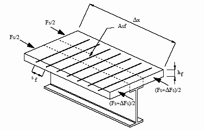

**Figura C4.3.6** - *Distribuzione della sollecitazione di taglio longitudinale nella piattabanda di calcestruzzo*

L'area dell'armatura minima necessaria all'assorbimento della sollecitazione $v_{Ed}$ è data da:

$$\frac{A_{sf} f_{sk}}{\gamma_s s_f} \geq v_{Ed}\,h_f \tag{C4.3.8}$$

dove $A_{sf}$ è l'area della singola barra d'armatura disposta ad un interasse $s_f$. Per evitare la rottura del calcestruzzo compresso è necessario imporre che:

$$v_{Ed} \leq 0{,}3\left(1-\frac{f_{ck}}{250}\right)\frac{f_{ck}}{\gamma_c} \tag{C4.3.9}$$

Se le tensioni $v_{Ed}$ sono inferiori a $0{,}4 f_{ctd}$, dove $f_{ctd}$ è la resistenza a trazione di progetto del calcestruzzo, non è necessario disporre apposita armatura trasversale.

#### C4.3.4.3.6 Instabilità flesso-torsionale delle travi composte

Nel caso in cui la soletta di calcestruzzo collaborante sia garantita nei riguardi dell'instabilità laterale, è possibile assumere che la piattabanda superiore del profilo d'acciaio connesso a taglio alla soletta sia stabile lateralmente. In tutti gli altri casi è necessario verificare la sicurezza delle ali dei profili nei riguardi della stabilità.

In generale è possibile verificare l'instabilità flesso-torsionale dei profili di acciaio trascurando il ritegno torsionale costituito dalla soletta di calcestruzzo ed utilizzando le formule ed i metodi proposti nel § C4.2 e nelle NTC.

In alternativa è possibile considerare il contributo alla stabilità laterale fornito dalla soletta. Il momento resistente di progetto nei confronti dell'instabilità flesso-torsionale è pari a:

$$M_{b,Rd} = \chi_{LT} M_{Rd} \tag{C4.3.10}$$

dove $\chi_{LT}$ è il fattore riduttivo della resistenza flessionale $M_{Rd}$ espresso, tramite la formula 4.2.51 delle NTC, in funzione della snellezza relativa $\lambda_{LT}$:

$$\lambda_{LT} = \sqrt{\frac{M_{Rk}}{M_{cr}}} \tag{C4.3.11}$$

dove $M_{Rk}$ è il momento resistente della sezione composta, calcolato utilizzando i valori caratteristici delle resistenze, e $M_{cr}$ è il momento critico corrispondente all'instabilità flesso-torsionale, calcolato per la trave di maggior luce e con il maggiore momento sollecitante negativo.

Se sono verificate le seguenti ipotesi:

- la flangia superiore del profilo è connessa alla soletta;
- la soletta è composta e fissata su due profili contigui a formare una sezione ad "U invertita" (v. Figura C4.3.7);
- in ogni punto di appoggio l'elemento di acciaio ha la flangia inferiore bloccata lateralmente e l'anima irrigidita.

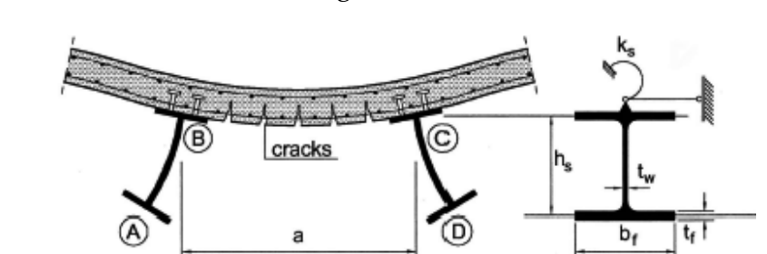

**Figura C4.3.7** - *Telaio ad U invertita: A-B-C-D*

Il contributo stabilizzante da considerare nel calcolo di $M_{cr}$ si può valutare definendo la rigidezza rotazionale $k_S$ per unità di lunghezza della soletta d'impalcato come:

$$k_S = \frac{1}{\frac{1}{k_1}+\frac{1}{k_2}} \tag{C4.3.12}$$

dove $k_1$, rigidezza flessionale in fase fessurata della soletta di calcestruzzo o composta ed in direzione trasversale ai profili d'acciaio, è definita come $k_1 = \alpha(EJ)_2/a$, in cui $\alpha=2$ per le travi esterne ed $\alpha=3$ per le travi interne; per un telaio con più di 4 travi $\alpha=4$ per le travi più interne. $a$ è la distanza tra due profili consecutivi; $(EJ)_2$ è il modulo di rigidezza fessurato per unità di larghezza della soletta; $k_2$ è la rigidezza flessionale dell'anima del profilo d'acciaio, che vale:

$$k_2 = \frac{E_a t_w^3}{4(1-\nu^2)h_S} \tag{C4.3.13}$$

dove $\nu$ è il coefficiente di Poisson, $h_S$ è l'altezza del profilo di acciaio e $t_w$ è lo spessore dell'anima.

Se la trave composta è continua su più appoggi o fa parte di un telaio a più campate ed è di classe 1, 2 o 3, la sezione può essere progettata senza un sistema di stabilizzazione laterale se sono soddisfatte le seguenti condizioni:

- le luci di campate adiacenti non differiscono tra loro di più del 20%, o del 15% nel caso di una campata esterna a sbalzo e della campata adiacente;
- il carico su ogni campata è uniformemente distribuito ed i carichi permanenti costituiscono più del 40% dei carichi di progetto;
- la piattabanda superiore è collegata alla soletta;
- la soletta è connessa ad un altro profilo di acciaio che la supporta e che è parallelo alla trave composta considerata;
- se la soletta è composta, questa connette due profili di acciaio a formare un telaio ad U invertita;
- in ogni punto di appoggio l'elemento di acciaio ha la piattabanda inferiore lateralmente bloccata e l'anima irrigidita;
- se la sezione di acciaio non è rivestita di calcestruzzo, rispetta i limiti imposti, sull'altezza della sezione, nella Tabella C4.3.II;
- se l'elemento della sezione è parzialmente rivestito di calcestruzzo, l'altezza $h$ della sua sezione di acciaio non eccede l'altezza fornita in Tabella C4.3.II di più di 200 mm, per le classi d'acciaio S235, S275 ed S355, e di più di 150 mm, per le classi S420 ed S460.

**Tabella C4.3.II** - *Altezza massima in mm dell'elemento di acciaio non rivestito*

| Elemento di acciaio | S235 | S275 | S355 | S420 e S460 |
|---|:---:|:---:|:---:|:---:|
| IPE | 600 | 550 | 400 | 270 |
| HE | 800 | 700 | 650 | 500 |
