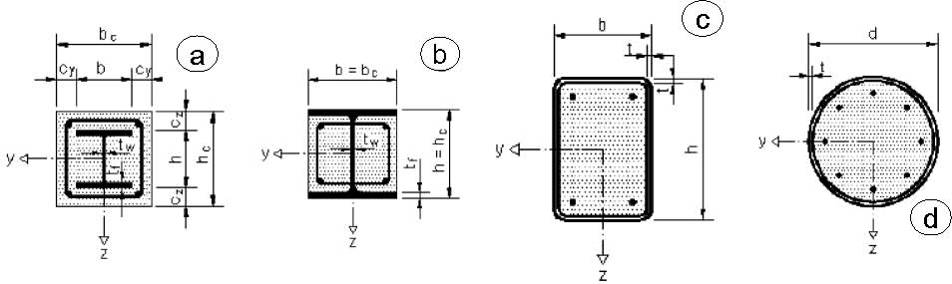
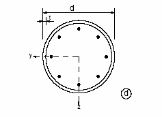
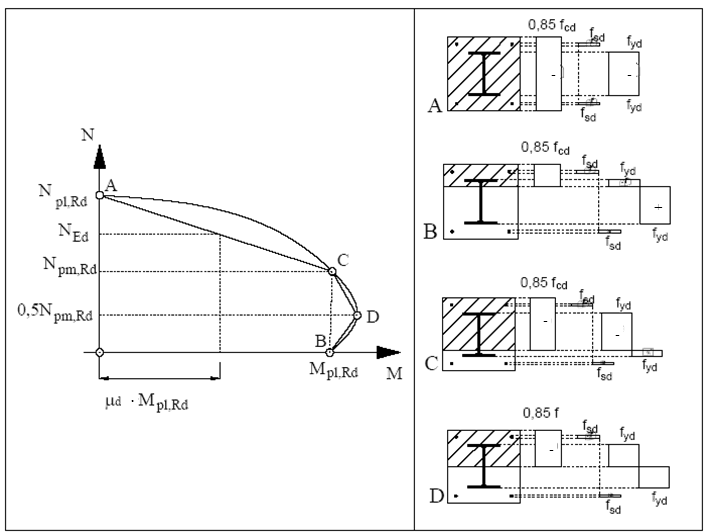
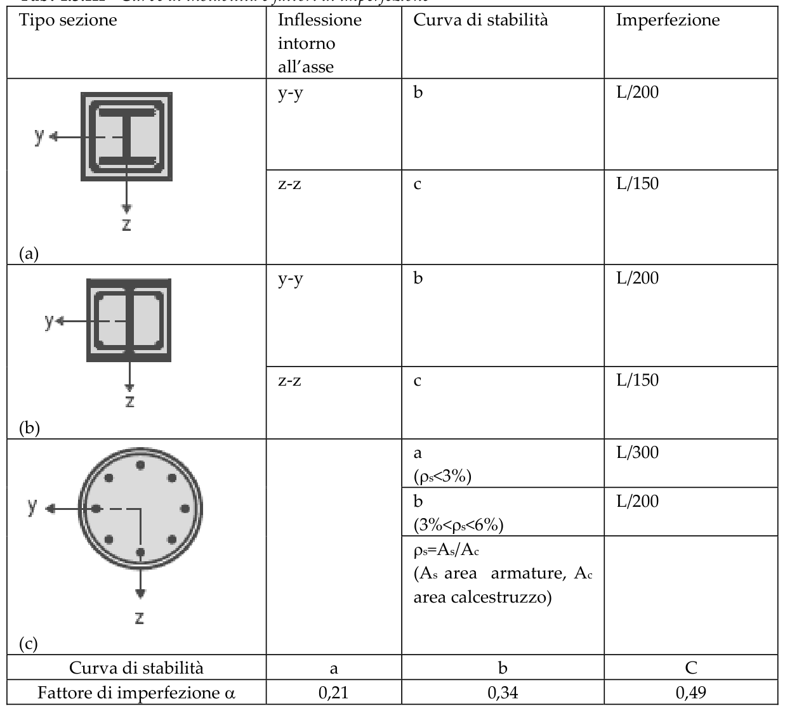
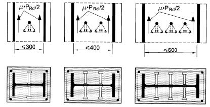
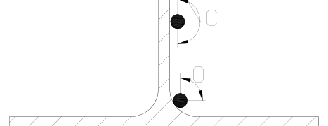

[Torna all'indice del § 4.3](./indice-4.3.md) | [Torna all'indice del capitolo](./indice-cap04.md) | [Torna all'indice generale](../indice-ntc2018.md)

# 4.3.5 Colonne composte

<!-- INDICE-INTERNO:INIZIO -->
**Indice interno**

- [Norma](#toc-ntc2018-4-3-5-norma)
  - [4.3.5.1 Generalità e tipologie](#toc-ntc2018-4-3-5-1)
  - [4.3.5.2 Rigidezza, snellezza e contributo meccanico](#toc-ntc2018-4-3-5-2)
  - [4.3.5.3 Resistenza delle sezioni](#toc-ntc2018-4-3-5-3)
    - [4.3.5.3.1 Tensioni normali](#toc-ntc2018-4-3-5-3-1)
    - [4.3.5.3.2 Resistenza al taglio](#toc-ntc2018-4-3-5-3-2)
  - [4.3.5.4 Stabilità delle membrature](#toc-ntc2018-4-3-5-4)
    - [4.3.5.4.1 Colonne compresse](#toc-ntc2018-4-3-5-4-1)
    - [4.3.5.4.2 Instabilità locale](#toc-ntc2018-4-3-5-4-2)
    - [4.3.5.4.3 Colonne pressoinflesse](#toc-ntc2018-4-3-5-4-3)
  - [4.3.5.5 Trasferimento degli sforzi](#toc-ntc2018-4-3-5-5)
    - [4.3.5.5.1 Resistenza allo scorrimento fra i componenti](#toc-ntc2018-4-3-5-5-1)
  - [4.3.5.6 Copriferro e minimi di armatura](#toc-ntc2018-4-3-5-6)
<!-- INDICE-INTERNO:FINE -->

## Norma

### 4.3.5.1 Generalità e tipologie

Le colonne composte sono elementi compressi costituiti da profili metallici e calcestruzzo armato collaboranti. Le tipologie principali sono:

Le colonne composte devono soddisfare contemporaneamente i seguenti requisiti:

1. La sezione trasversale deve essere **doppiamente simmetrica** e costante per tutta la lunghezza della colonna.
2. Il contributo meccanico dell'acciaio strutturale deve soddisfare: $0{,}2 \leq \delta \leq 0{,}9$.
3. La snellezza adimensionale deve essere $\bar{\lambda} \leq 2{,}0$.
4. Per le sezioni parzialmente incamiciate, le ali del profilo devono sporgere in modo da garantire un adeguato copriferro e ancoraggio delle staffe.
5. Il calcestruzzo deve essere almeno di classe C20/25 (o LC20/22 per alleggerito).
6. L'armatura longitudinale minima deve essere conforme alle prescrizioni del §4.3.5.6.
7. La percentuale di acciaio strutturale deve essere computata rispetto alla sezione totale composta.

### 4.3.5.2 Rigidezza, snellezza e contributo meccanico

Il **contributo meccanico** dell'acciaio strutturale è:

$$\delta = \frac{A_a \cdot f_{yk}/\gamma_A}{N_{pl,Rd}} \tag{4.3.15}$$

La **rigidezza flessionale efficace** per il calcolo della snellezza è:

$$(EJ)_{eff} = E_a \cdot I_a + E_s \cdot I_s + K_e \cdot E_{c,eff} \cdot I_c \tag{4.3.16}$$

con $K_e = 0{,}6$ e modulo efficace del calcestruzzo:

$$E_{c,eff} = E_{cm} / \left(1 + \frac{N_{G,Ed}}{N_{Ed}} \cdot \varphi_t\right) \tag{4.3.17}$$

dove $N_{G,Ed}$ è la parte permanente del carico assiale e $\varphi_t$ il coefficiente di viscosità finale.

La **snellezza adimensionale** è:

$$\bar{\lambda} = \sqrt{\frac{N_{pl,Rk}}{N_{cr}}} \tag{4.3.18}$$

Il **carico plastico caratteristico** è:

$$N_{pl,Rk} = A_a \cdot f_{yk} + A_c \cdot f_{ck} + A_s \cdot f_{sk} \tag{4.3.19}$$

La **rigidezza flessionale efficace per l'analisi di secondo ordine** vale:

$$(EI)_{eff,II} = 0{,}9 \cdot \left(E_a \cdot I_a + E_s \cdot I_s + K_{e,II} \cdot E_{c,eff} \cdot I_c\right) \tag{4.3.20}$$

con $K_{e,II} = 0{,}5$.

### 4.3.5.3 Resistenza delle sezioni

#### 4.3.5.3.1 Tensioni normali

La **resistenza plastica di progetto** a compressione pura della sezione composta è:

$$N_{pl,Rd} = A_a \cdot \frac{f_{yk}}{\gamma_A} + A_c \cdot 0{,}85 \cdot \frac{f_{ck}}{\gamma_C} + A_s \cdot \frac{f_{sk}}{\gamma_S} \tag{4.3.21}$$

**Effetto del confinamento per sezioni cave circolari riempite**

Per sezioni cave circolari riempite, quando la snellezza $\bar{\lambda} \leq 0{,}5$, si può tener conto dell'incremento di resistenza del calcestruzzo dovuto al confinamento:

$$N_{pl,Rd} = \eta_a \cdot A_a \cdot \frac{f_{yk}}{\gamma_A} + A_c \cdot f_{ck} \cdot \frac{1 + \eta_c \cdot t \cdot f_{yk}}{d \cdot f_{ck} \cdot \gamma_C} + A_s \cdot \frac{f_{sk}}{\gamma_S} \tag{4.3.22}$$

con i coefficienti $\eta_a$ ed $\eta_c$ dipendenti dall'eccentricità relativa $e/d$:

$$\eta_{a0} = 0{,}25\,(3 + 2\bar{\lambda}) \leq 1{,}0 \tag{4.3.23a}$$

$$\eta_{c0} = 4{,}9 - 18{,}5\bar{\lambda} + 17\bar{\lambda}^2 \geq 0 \tag{4.3.23b}$$

Per eccentricità $e > 0$:

$$\eta_a = \eta_{a0} + (1 - \eta_{a0}) \cdot \frac{10e}{d} \tag{4.3.24a}$$

$$\eta_c = \eta_{c0} \cdot \left(1 - \frac{10e}{d}\right) \tag{4.3.24b}$$

**Interazione N-M**

Il **momento resistente di progetto** per un dato sforzo normale $N_{Ed}$ è:

$$N_{pl,Rd,\,semplificato} = N_{pl,Rd} \tag{4.3.25}$$

$$M_{pl,Rd}(N_{Ed}) = \mu_d \cdot M_{pl,Rd} \tag{4.3.26}$$

dove $\mu_d$ è il coefficiente ricavato dal diagramma di interazione adimensionale $N/N_{pl,Rd}$–$M/M_{pl,Rd}$.

Per la verifica a pressoflessione biassiale:

$$\frac{M_{y,Ed}}{M_{pl,y,Rd}(N_{Ed})} + \frac{M_{z,Ed}}{M_{pl,z,Rd}(N_{Ed})} \leq 1{,}0 \tag{4.3.27}$$

#### 4.3.5.3.2 Resistenza al taglio

Il taglio di progetto è ripartito tra la sezione metallica e il nucleo di calcestruzzo armato. La quota assegnata alla sezione metallica $V_{a,Ed}$ e quella assegnata al calcestruzzo $V_{c,Ed}$ si determinano in proporzione alle rispettive rigidezze flessurali:

$$\frac{V_{a,Ed}}{V_{c,Ed}} = \frac{E_a \cdot I_a}{E_{c,eff} \cdot I_c} \tag{4.3.28}$$

La resistenza a taglio della sezione metallica si verifica secondo il §4.2.4.1.2 e quella della sezione di calcestruzzo armato secondo il §4.1.2.3.2.

### 4.3.5.4 Stabilità delle membrature

#### 4.3.5.4.1 Colonne compresse

La **resistenza di progetto a compressione con instabilità** è:

$$N_{b,Rd} = \chi \cdot N_{pl,Rd} \tag{4.3.29}$$

Il fattore di riduzione $\chi$ per l'instabilità si ricava in funzione di $\bar{\lambda}$:

$$\chi = \frac{1}{\Phi + \sqrt{\Phi^2 - \bar{\lambda}^2}} \leq 1{,}0 \tag{4.3.30}$$

con $\Phi = 0{,}5 \cdot [1 + \alpha_I(\bar{\lambda} - 0{,}2) + \bar{\lambda}^2]$.

**Tabella 4.3.III — Curve di instabilità e imperfezioni geometriche equivalenti per colonne composte**

**Tabella 4.3.III** - *Curve di instabilità e fattori di imperfezione*

#### 4.3.5.4.2 Instabilità locale

Per garantire l'efficacia del confinamento e prevenire l'instabilità locale delle pareti metalliche, occorre rispettare i seguenti limiti sul rapporto diametro/spessore o larghezza/spessore:

Per **sezioni cave circolari** riempite:

$$\frac{d}{t} \leq 90 \cdot \frac{235}{f_{yk}} \tag{4.3.31}$$

Per **sezioni cave rettangolari** riempite:

$$\frac{h}{t} \leq 52 \cdot \sqrt{\frac{235}{f_{yk}}} \tag{4.3.32}$$

Per **ali di sezioni parzialmente incamiciate**:

$$\frac{b}{2t_f} \leq 44 \cdot \sqrt{\frac{235}{f_{yk}}} \tag{4.3.33}$$

Per **anime di sezioni parzialmente incamiciate**:

$$\frac{h_w}{t_w} \leq 124 \cdot \sqrt{\frac{235}{f_{yk}}} \tag{4.3.34}$$

#### 4.3.5.4.3 Colonne pressoinflesse

Per colonne soggette a pressoflessione la verifica di stabilità si esegue con:

$$M_{Ed} \leq \alpha_M \cdot M_{pl,Rd}(N_{Ed}) \tag{4.3.35}$$

dove il momento amplificato tiene conto degli effetti di secondo ordine mediante il fattore $k$:

$$k = \frac{\beta}{1 - N_{Ed}/N_{cr,eff}} \tag{4.3.36}$$

con:

$$\beta = \max\!\left(1 - \frac{N_{Ed}}{N_{cr}},\; 0{,}66\right) \tag{4.3.37}$$

Il coefficiente $\alpha_M$ vale 0,9 per acciaio S235 e S355 e 0,8 per acciaio S420 e S460.

### 4.3.5.5 Trasferimento degli sforzi

Il trasferimento delle forze dalla testa della colonna alla sezione composta deve avvenire attraverso l'interfaccia acciaio-calcestruzzo. Le tensioni di aderenza limite ammesse sull'interfaccia sono:

| Tipo di sezione | $\tau_{Rd}$ (MPa) |
|----------------|:-----------------:|
| Completamente incamiciata | 0,30 |
| Cava circolare riempita | 0,55 |
| Cava rettangolare riempita | 0,40 |
| Parzialmente incamiciata — ali | 0,20 |
| Parzialmente incamiciata — anima | 0,00 |

Quando le tensioni di aderenza sono insufficienti, occorre disporre connettori a piolo per il trasferimento delle forze di interfaccia.

#### 4.3.5.5.1 Resistenza allo scorrimento fra i componenti

La resistenza allo scorrimento deve essere verificata nelle zone di introduzione dei carichi e agli estremi della colonna. La forza di taglio longitudinale $V_{l,Ed}$ da trasferire deve essere inferiore alla resistenza di contatto $\tau_{Rd} \cdot A_{contatto}$ oppure alla resistenza dei connettori.

### 4.3.5.6 Copriferro e minimi di armatura

Il copriferro minimo dell'armatura longitudinale deve essere:

- **40 mm** per la sezione completamente o parzialmente incamiciata;
- non superiore a **1/6 della larghezza dell'ala** del profilo metallico.

Il rapporto minimo di armatura longitudinale rispetto all'area del calcestruzzo è **0,3%**. Il rapporto massimo è **6%** (o **9%** in zone di sovrapposizione).

