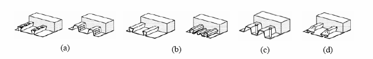
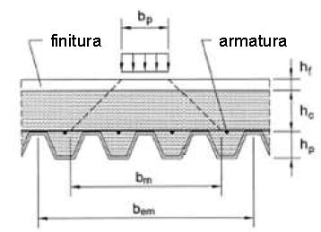
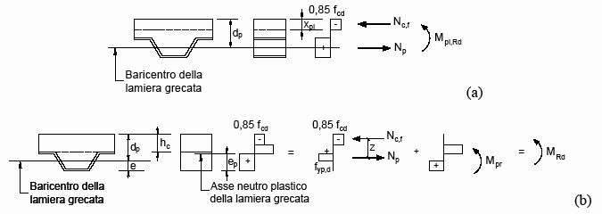
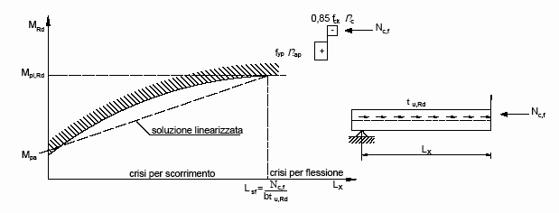

[Torna all'indice del § 4.3](./indice-4.3.md) | [Torna all'indice del capitolo](./indice-cap04.md) | [Torna all'indice generale](../indice-ntc2018.md)

# 4.3.6 Solette composte con lamiera grecata

<!-- INDICE-INTERNO:INIZIO -->
**Indice interno**

- [Norma](#toc-ntc2018-4-3-6-norma)
  - [4.3.6.1 Analisi per il calcolo delle sollecitazioni](#toc-ntc2018-4-3-6-1)
    - [4.3.6.1.1 Larghezza efficace](#toc-ntc2018-4-3-6-1-1)
  - [4.3.6.2 Verifiche agli stati limite ultimi](#toc-ntc2018-4-3-6-2)
  - [4.3.6.3 Verifiche agli stati limite di esercizio](#toc-ntc2018-4-3-6-3)
  - [4.3.6.4 Verifiche della lamiera in fase di getto](#toc-ntc2018-4-3-6-4)
  - [4.3.6.5 Dettagli costruttivi](#toc-ntc2018-4-3-6-5)
- [Circolare](#toc-ntc2018-c4-3-6-circolare)
- [C4.3.6 Solette composte con lamiera grecata](#toc-ntc2018-c4-3-6)
  - [C4.3.6.2 Verifiche di resistenza allo stato limite ultimo (solette composte)](#toc-ntc2018-c4-3-6-2)
<!-- INDICE-INTERNO:FINE -->

## Norma

Le solette composte con lamiera grecata sfruttano la lamiera profilata come cassaforma durante il getto e come armatura a trazione nella fase definitiva. Il collegamento tra lamiera e calcestruzzo può essere realizzato mediante:

- **ingranamento meccanico** (indentature, rilievi o perforazioni nella lamiera);
- **connettori a piolo** saldati attraverso la lamiera;
- **deformazione terminale** (piegatura dei bordi della lamiera).

### 4.3.6.1 Analisi per il calcolo delle sollecitazioni

Per il calcolo delle sollecitazioni nella soletta composta si possono utilizzare:

- analisi **elastica lineare**, con o senza ridistribuzione;
- analisi **plastica**, per sezioni di classe 1 e 2;
- analisi **elasto-plastica**.

#### 4.3.6.1.1 Larghezza efficace

Per la distribuzione trasversale dei carichi concentrati, la larghezza efficace è:

$$b_m = b_p + 2(h_c + h_f) \tag{4.3.38}$$

dove $b_p$ è la larghezza del piede del piolo (o larghezza della zona caricata), $h_c$ è lo spessore della soletta sopra la lamiera e $h_f$ lo spessore del pavimento.

### 4.3.6.2 Verifiche agli stati limite ultimi

Le verifiche agli stati limite ultimi comprendono:

**Resistenza a flessione:** si determina in modo analogo alle travi composte, assumendo la lamiera come armatura a trazione con la resistenza di progetto $f_{yp,d}$. Per sezioni di classe 1 e 2 si utilizza il metodo plastico.

**Resistenza allo scorrimento longitudinale (metodo $m$-$k$ o connessione parziale):** la resistenza al taglio longitudinale si valuta tramite i parametri $\tau_{u,Rd}$ ricavati da prove conformi al Capitolo 11. La verifica richiede:

$$V_{Ed} \leq \tau_{u,Rd} \cdot b \cdot d_p$$

**Resistenza a punzonamento e taglio trasversale:** devono essere verificate nelle zone di applicazione di carichi concentrati.

### 4.3.6.3 Verifiche agli stati limite di esercizio

**Fessurazione:** nelle zone in appoggio continuo la percentuale minima di armatura trasversale è compresa tra **0,2%** e **0,4%** dell'area di calcestruzzo sopra la lamiera, in accordo con le prescrizioni del §4.1.2.2.4.

**Deformazione:** la freccia finale deve tener conto sia del contributo elastico sia dello scorrimento all'interfaccia acciaio-calcestruzzo.

### 4.3.6.4 Verifiche della lamiera in fase di getto

Durante la fase di getto, la lamiera agisce come cassaforma; la verifica di resistenza deve essere condotta secondo la **UNI EN 1993-1-3** per i profili formati a freddo.

La freccia massima ammessa per la lamiera sotto il peso proprio del calcestruzzo fresco e dei carichi di costruzione è:

$$\delta \leq \min\!\left(\frac{L}{180},\; 20\,\text{mm}\right)$$

### 4.3.6.5 Dettagli costruttivi

Per le solette composte con lamiera grecata si applicano i seguenti requisiti:

- spessore minimo della lamiera: **0,8 mm** (in presenza di connettori saldati) oppure **0,7 mm** (senza connettori);
- altezza minima della soletta composta: $h \geq 80$ mm;
- spessore minimo della soletta di calcestruzzo sopra la lamiera: $h_c \geq 40$ mm;
- in presenza di travi composte: $h_c \geq 50$ mm;
- la dimensione massima degli inerti non deve superare il minore fra $0{,}4\,h_c$, $b_0/3$ e **31,5 mm**;
- lunghezza minima di appoggio della lamiera: **75 mm** su acciaio o calcestruzzo, **50 mm** su altri materiali.

---

## Circolare

## C4.3.6 Solette composte con lamiera grecata

### C4.3.6.2 Verifiche di resistenza allo stato limite ultimo (solette composte)

La resistenza a flessione delle sezioni trasversali di una soletta composta realizzata con una soletta armata di calcestruzzo gettata su una lamiera grecata collaborante può essere determinata con la teoria plastica, in accordo a quanto esposto in § 4.3.4.2.1.2 delle NTC ed in § C4.3.4.2, se sono soddisfatte le seguenti condizioni:

- sussiste la piena interazione tra lamiera e calcestruzzo;
- la sezione efficace della lamiera è valutata al netto di bugnature o dentelli;
- la lamiera nelle zone soggette a momento negativo è considerata attiva solo se continua sul profilo di acciaio;
- la stabilità delle parti compresse della lamiera è assicurata.

In tal caso si assume per il calcestruzzo un modello stress-block con tensione massima $0{,}85 f_{ck}/\gamma_c$ mentre le tensioni normali nella lamiera e nelle barre d'armatura sono assunte pari al limite plastico; vedi Figure C4.3.8(a) e C4.3.8(b).

**Figura C4.3.8** - *Distribuzione plastica delle tensioni: (a) asse neutro nel calcestruzzo sopra la lamiera; (b) asse neutro che taglia la lamiera grecata*

La resistenza allo scorrimento tra lamiera grecata e soletta deve essere verificata nelle zone in cui sono localizzate le massime sollecitazioni di taglio, in generale le sezioni prossime agli appoggi, poiché in caso di connessione parziale tra i due elementi non è possibile sviluppare il momento resistente plastico così come al § 4.3.6.2 delle NTC. A tal riguardo, è possibile definire una relazione lineare che rappresenta l'interazione parziale tra la lamiera grecata ed il calcestruzzo, basata sulla resistenza allo scorrimento offerta dalla lamiera, $\tau_{u,Rd}$, che consente di ricavare il momento resistente massimo ottenibile prima del raggiungimento della crisi per flessione (vedi Figura C4.3.9). Tale relazione, basandosi sulla capacità $\tau_{u,Rd}$ della lamiera grecata, dipende dal tipo di lamiera utilizzata.

Altre tipologie di connessione e differenti condizioni di carico definiscono differenti diagrammi di interazione parziale, come presentato in § 7.4.3 della CNR 10016.

Metodi per il calcolo della resistenza allo scorrimento di sistemi di connessione a pioli, illustrati nella Figura 4.3.4(a,b) delle NTC, sono basati sulle resistenze fornite nel § 4.3.4.3.1 delle NTC; ulteriori informazioni e metodi per il calcolo sono riportati in § 9.7.3 e § 9.7.4 della UNI EN 1994-1-1:2005.

**Figura C4.3.9** - *Diagramma di interazione parziale calcestruzzo lamiera*
