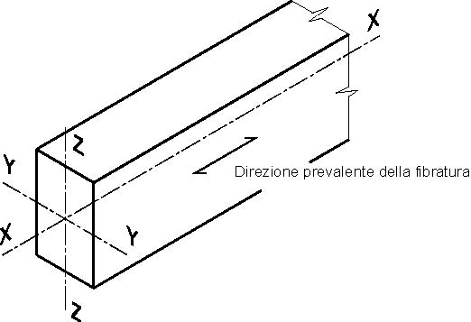

[Torna all'indice del capitolo](indice-cap04.md) | [Torna all'indice generale](../indice-ntc2018.md)

# 4.4. Costruzioni di legno

## Indice del capitolo

- [[#4.4.1 Valutazione della sicurezza|4.4.1 Valutazione della sicurezza (metodo stati limite)]]
- [[#4.4.2 Analisi strutturale|4.4.2 Analisi strutturale (elastica lineare, reologico)]]
- [[#4.4.3 Azioni e loro combinazioni|4.4.3 Azioni e combinazioni]]
- [[#4.4.4 Classi di durata del carico|4.4.4 Classi di durata del carico (Tab. 4.4.I)]]
- [[#4.4.5 Classi di servizio|4.4.5 Classi di servizio (Tab. 4.4.II, classi 1-3)]]
- [[#4.4.6 Resistenza di progetto|4.4.6 Resistenza di progetto X_d = k_mod·X_k/γ_M (Tab. 4.4.III-IV)]]
- [[#4.4.7 Stati limite di esercizio|4.4.7 SLE (k_def Tab. 4.4.V, frecce L/300, L/200)]]
- [[#4.4.8 Stati limite ultimi|4.4.8 SLU]]
  - [[#4.4.8.1 Verifiche di resistenza|4.4.8.1 Verifiche di resistenza (trazione, compressione, flessione, taglio)]]
  - [[#4.4.8.2 Verifiche di stabilità|4.4.8.2 Verifiche di stabilità (instabilità trave/colonna)]]
- [[#4.4.9 Collegamenti|4.4.9 Collegamenti]]
- [[#4.4.10 Elementi strutturali|4.4.10 Elementi strutturali]]
- [[#4.4.11 Sistemi strutturali|4.4.11 Sistemi strutturali (reticolari, controventi, archi)]]
- [[#4.4.12 Robustezza|4.4.12 Robustezza]]
- [[#4.4.13 Durabilità|4.4.13 Durabilità]]
- [[#4.4.14 Resistenza al fuoco|4.4.14 Resistenza al fuoco (UNI EN 1995-1-2)]]
- [[#4.4.15 Regole per l'esecuzione|4.4.15 Regole esecuzione (tolleranze L/500, L/300)]]
- [[#4.4.16 Verifiche per situazioni transitorie, controlli e prove di carico|4.4.16 Situazioni transitorie e prove di carico]]
- [[#4.4.17 Verifiche per situazioni eccezionali|4.4.17 Situazioni eccezionali]]
- [[#4.4.18 Progettazione integrata da prove|4.4.18 Progettazione da prove]]
- [[#C4.4. Costruzioni di legno|C4.4 Costruzioni di legno]]
  - [[#C4.4.1 Valutazione della sicurezza|C4.4.1 Valutazione della sicurezza]]
  - [[#C4.4.2 Analisi strutturale|C4.4.2 Analisi strutturale]]
  - [[#C4.4.7 Stati limite di esercizio|C4.4.7 Stati limite di esercizio]]
  - [[#C4.4.8 Stati limite ultimi|C4.4.8 Stati limite ultimi]]
  - [[#C4.4.9 Collegamenti|C4.4.9 Collegamenti]]
  - [[#C4.4.10 Elementi strutturali|C4.4.10 Elementi strutturali]]
  - [[#C4.4.11 Sistemi strutturali|C4.4.11 Sistemi strutturali]]
  - [[#C4.4.13 Durabilità|C4.4.13 Durabilità]]
  - [[#C4.4.14 Resistenza al fuoco|C4.4.14 Resistenza al fuoco]]
  - [[#C4.4.15 Regole per l'esecuzione|C4.4.15 Regole per l'esecuzione]]
  - [[#C4.4.16 Verifiche per situazioni transitorie, controlli e prove di carico|C4.4.16 Controlli e prove di carico]]

---

# Norma

Le costruzioni di legno sono realizzate con elementi strutturali in legno massiccio o con prodotti a base di legno. I materiali impiegati devono essere conformi a quanto prescritto nel §11.7. Tutto il legno strutturale deve essere classificato prima dell'impiego in base alle caratteristiche meccaniche.

È consentito verificare la sicurezza di strutture esistenti in legno attraverso una valutazione adeguata delle caratteristiche meccaniche dei materiali presenti.

## 4.4.1 Valutazione della sicurezza

La valutazione della sicurezza delle costruzioni di legno è condotta in conformità al Cap. 2, mediante il metodo degli stati limite. Si verificano le prestazioni in termini di:

- **Resistenza**: capacità di sopportare le azioni senza raggiungere stati limite ultimi (SLU);
- **Rigidezza**: limitazione delle deformazioni a valori compatibili con la funzionalità (SLE);
- **Funzionalità**: mantenimento delle condizioni di servizio previste;
- **Durabilità**: conservazione delle prestazioni nel tempo di vita nominale;
- **Robustezza**: capacità di non subire danni sproporzionati rispetto alla causa.

Le verifiche sono eseguite agli SLU e agli SLE secondo le combinazioni di azioni di cui al Cap. 2 e al §4.4.3.

## 4.4.2 Analisi strutturale

Nell'analisi strutturale si assume un comportamento elastico lineare del materiale. I calcoli vengono effettuati con modelli adeguati, sufficientemente accurati a rappresentare il comportamento reale della struttura.

L'analisi globale tiene conto delle imperfezioni geometriche e materiali significative ai fini della risposta strutturale.

Per strutture composte da parti con diverso comportamento reologico (ad esempio elementi in legno massiccio e in legno lamellare incollato), la verifica è condotta sia nelle condizioni iniziali (al tempo $t = 0$) sia alle condizioni di lungo periodo (al tempo $t = \infty$), per tener conto degli effetti del creep e delle variazioni di umidità.

## 4.4.3 Azioni e loro combinazioni

Le azioni e le loro combinazioni sono definite al Cap. 3 e al Cap. 2. Nella definizione delle combinazioni si tiene conto della classe di durata del carico (§4.4.4) e della classe di servizio (§4.4.5), che influenzano i valori di calcolo delle resistenze tramite il coefficiente $k_{mod}$.

## 4.4.4 Classi di durata del carico

I carichi sono classificati in funzione della durata cumulativa di applicazione durante la vita nominale della struttura. Le classi di durata del carico sono definite nella Tabella 4.4.I.

**Tabella 4.4.I — Classi di durata del carico**

| Classe di durata del carico | Durata del carico |
|---|---|
| Permanente | più di 10 anni |
| Lunga durata | 6 mesi - 10 anni |
| Media durata | 1 settimana - 6 mesi |
| Breve durata | meno di 1 settimana |
| Istantaneo | -- |

Quando più carichi di diversa classe di durata agiscono contemporaneamente, si utilizza il valore di $k_{mod}$ corrispondente al carico di durata più breve presente nella combinazione.

Per i carichi variabili, la classe di durata è determinata in base alla natura del carico e alle condizioni di utilizzo della struttura. I carichi da neve e vento sono generalmente considerati di breve durata o istantanei; i carichi da esercizio possono essere classificati come di media o lunga durata a seconda dell'utilizzo specifico.

## 4.4.5 Classi di servizio

Le strutture in legno sono suddivise in classi di servizio in funzione delle condizioni ambientali di umidità, in quanto il contenuto di umidità del legno influisce significativamente sulle proprietà meccaniche. Le classi di servizio sono definite nella Tabella 4.4.II.

**Tabella 4.4.II — Classi di servizio**

| Classe di servizio | Descrizione |
|---|---|
| Classe di servizio 1 | È caratterizzata da un'umidità del materiale in equilibrio con l'ambiente a una temperatura di 20 °C e un'umidità relativa dell'aria circostante che non superi il 65%, se non per poche settimane all'anno. |
| Classe di servizio 2 | È caratterizzata da un'umidità del materiale in equilibrio con l'ambiente a una temperatura di 20 °C e un'umidità relativa dell'aria circostante che superi l'85% solo per poche settimane all'anno. |
| Classe di servizio 3 | È caratterizzata da umidità più elevata di quella della classe di servizio 2. |

La classe di servizio 1 comprende tipicamente strutture al chiuso in edifici riscaldati (strutture di copertura, solai, pareti).

La classe di servizio 2 comprende strutture al chiuso in edifici non riscaldati o in ambienti coperti ma non chiusi (pensiline, ponti coperti).

La classe di servizio 3 comprende strutture esposte direttamente alle intemperie (ponti scoperti, strutture all'aperto).

## 4.4.6 Resistenza di progetto

Il valore di progetto di una proprietà di resistenza del legno è determinato con la formula:

$$X_d = \frac{k_{mod} \cdot X_k}{\gamma_M} \tag{4.4.1}$$

dove:

- $X_k$ è il valore caratteristico della proprietà di resistenza;
- $k_{mod}$ è il coefficiente correttivo che tiene conto dell'effetto della durata del carico e dell'umidità (Tab. 4.4.IV);
- $\gamma_M$ è il coefficiente parziale di sicurezza sul materiale (Tab. 4.4.III).

Il coefficiente $\gamma_M$ è valutato secondo la colonna A della Tabella 4.4.III. Si possono assumere i valori riportati nella colonna B per produzioni continuative di elementi o strutture, soggette a controllo continuativo del materiale dal quale risulti un coefficiente di variazione della resistenza non superiore al 15%; tali produzioni devono essere inserite in un sistema di qualità di cui al § 11.7.

Il valore di progetto di una proprietà di rigidezza (modulo elastico, modulo di scorrimento) è determinato come:

$$E_d = \frac{E_{mean}}{\gamma_M}$$

Per le verifiche agli SLE si utilizza il modulo elastico medio $E_{mean}$, mentre per le verifiche agli SLU si utilizza il valore di calcolo $E_d$.

**Tabella 4.4.III — Coefficienti parziali di sicurezza $\gamma_M$ per le proprietà dei materiali**

| Stati limite ultimi | Colonna A $\gamma_M$ | Colonna B $\gamma_M$ |
|---|:---:|:---:|
| Combinazioni fondamentali | | |
| Legno massiccio | 1,50 | 1,45 |
| Legno lamellare incollato | 1,45 | 1,35 |
| Pannelli di tavole incollate a strati incrociati | 1,45 | 1,35 |
| Pannelli di particelle o di fibre | 1,50 | 1,40 |
| LVL, compensato, pannelli di scaglie orientate | 1,40 | 1,30 |
| Unioni | 1,50 | 1,40 |
| Combinazioni eccezionali | 1,00 | 1,00 |

Per i materiali non compresi nella Tabella si potrà fare riferimento ai pertinenti valori riportati nei riferimenti tecnici di comprovata validità indicati nel Capitolo 12, nel rispetto dei livelli di sicurezza delle presenti norme.

**Tabella 4.4.IV** - *Valori di $k_{mod}$ per legno e prodotti strutturali a base di legno*

Trascrizione testuale controllata della Tabella 4.4.IV, per ricerca e consultazione da parte degli LLM:

| Materiale | Riferimento | Tipo / parte | Classe di servizio | Permanente | Lunga | Media | Breve | Istantanea |
|---|---|---|:---:|:---:|:---:|:---:|:---:|:---:|
| Legno massiccio | UNI EN 14081-1 | - | 1 | 0,60 | 0,70 | 0,80 | 0,90 | 1,10 |
| Legno massiccio | UNI EN 14081-1 | - | 2 | 0,60 | 0,70 | 0,80 | 0,90 | 1,10 |
| Legno massiccio | UNI EN 14081-1 | - | 3 | 0,50 | 0,55 | 0,65 | 0,70 | 0,90 |
| Legno lamellare incollato (*) | UNI EN 14080 | - | 1 | 0,60 | 0,70 | 0,80 | 0,90 | 1,10 |
| Legno lamellare incollato (*) | UNI EN 14080 | - | 2 | 0,60 | 0,70 | 0,80 | 0,90 | 1,10 |
| Legno lamellare incollato (*) | UNI EN 14080 | - | 3 | 0,50 | 0,55 | 0,65 | 0,70 | 0,90 |
| LVL | UNI EN 14374, UNI EN 14279 | - | 1 | 0,60 | 0,70 | 0,80 | 0,90 | 1,10 |
| LVL | UNI EN 14374, UNI EN 14279 | - | 2 | 0,60 | 0,70 | 0,80 | 0,90 | 1,10 |
| LVL | UNI EN 14374, UNI EN 14279 | - | 3 | 0,50 | 0,55 | 0,65 | 0,70 | 0,90 |
| Compensato | UNI EN 636:2015 | - | 1 | 0,60 | 0,70 | 0,80 | 0,90 | 1,10 |
| Compensato | UNI EN 636:2015 | - | 2 | 0,60 | 0,70 | 0,80 | 0,90 | 1,10 |
| Compensato | UNI EN 636:2015 | - | 3 | 0,50 | 0,55 | 0,65 | 0,70 | 0,90 |
| Pannello di scaglie orientate (OSB) | UNI EN 300:2006 | OSB/2 | 1 | 0,30 | 0,45 | 0,65 | 0,85 | 1,10 |
| Pannello di scaglie orientate (OSB) | UNI EN 300:2006 | OSB/3 | 1 | 0,40 | 0,50 | 0,70 | 0,90 | 1,10 |
| Pannello di scaglie orientate (OSB) | UNI EN 300:2006 | OSB/4 | 2 | 0,30 | 0,40 | 0,55 | 0,70 | 0,90 |
| Pannello di particelle (truciolare) | UNI EN 312:2010 | Parti 4, 5 | 1 | 0,30 | 0,45 | 0,65 | 0,85 | 1,10 |
| Pannello di particelle (truciolare) | UNI EN 312:2010 | Parte 5 | 2 | 0,20 | 0,30 | 0,45 | 0,60 | 0,80 |
| Pannello di particelle (truciolare) | UNI EN 312:2010 | Parti 6, 7 | 1 | 0,40 | 0,50 | 0,70 | 0,90 | 1,10 |
| Pannello di particelle (truciolare) | UNI EN 312:2010 | Parte 7 | 2 | 0,30 | 0,40 | 0,55 | 0,70 | 0,90 |
| Pannello di fibre, pannelli duri | UNI EN 622-2:2005 | HB.LA, HB.HLA 1 o 2 | 1 | 0,30 | 0,45 | 0,65 | 0,85 | 1,10 |
| Pannello di fibre, pannelli duri | UNI EN 622-2:2005 | HB.HLA 1 o 2 | 2 | 0,20 | 0,30 | 0,45 | 0,60 | 0,80 |
| Pannello di fibre, pannelli semiduri | UNI EN 622-3:2005 | MBH.LA1 o 2 | 1 | 0,20 | 0,40 | 0,60 | 0,80 | 1,10 |
| Pannello di fibre, pannelli semiduri | UNI EN 622-3:2005 | MBH.HLS1 o 2 | 1 | 0,20 | 0,40 | 0,60 | 0,80 | 1,10 |
| Pannello di fibre, pannelli semiduri | UNI EN 622-3:2005 | MBH.HLS1 o 2 | 2 | - | - | - | 0,45 | 0,80 |
| Pannello di fibra di legno, ottenuto per via secca (MDF) | UNI EN 622-5:2010 | MDF.LA, MDF.HLS | 1 | 0,20 | 0,40 | 0,60 | 0,80 | 1,10 |
| Pannello di fibra di legno, ottenuto per via secca (MDF) | UNI EN 622-5:2010 | MDF.HLS | 2 | - | - | - | 0,45 | 0,80 |

Per i materiali non compresi nella Tabella si potrà fare riferimento ai pertinenti valori riportati nei riferimenti tecnici di comprovata validità indicati nel Capitolo 12, nel rispetto dei livelli di sicurezza delle presenti norme.

(*) I valori indicati si possono adottare anche per i pannelli di tavole incollate a strati incrociati, ma limitatamente alle classi di servizio 1 e 2.

## 4.4.7 Stati limite di esercizio

Le deformazioni devono essere mantenute entro limiti accettabili in relazione alla funzionalità e all'aspetto della struttura. Si tiene conto della deformabilità dei collegamenti, che può contribuire significativamente alla deformazione complessiva dell'elemento.

La deformazione totale si compone di:

- **Deformazione istantanea** $u_{inst}$: dovuta al carico applicato nella condizione iniziale;
- **Deformazione a lungo termine** $u_{creep}$: deformazione differita per effetto del creep;
- **Deformazione finale** $u_{fin}$: somma delle due precedenti.

La deformazione finale si calcola come:

$$u_{fin} = u_{inst} \cdot (1 + k_{def})$$

dove $k_{def}$ è il coefficiente di deformazione viscosa (creep), i cui valori sono riportati nella Tabella 4.4.V.

**Tabella 4.4.V** - *Valori di $k_{def}$ per legno e prodotti strutturali a base di legno*

Trascrizione testuale controllata della Tabella 4.4.V, per ricerca e consultazione da parte degli LLM:

| Materiale | Riferimento | Tipo / parte | Classe di servizio 1 | Classe di servizio 2 | Classe di servizio 3 |
|---|---|---|:---:|:---:|:---:|
| Legno massiccio | UNI EN 14081-1 | - | 0,60 | 0,80 | 2,00 |
| Legno lamellare incollato (*) | UNI EN 14080 | - | 0,60 | 0,80 | 2,00 |
| LVL | UNI EN 14374, UNI EN 14279 | - | 0,60 | 0,80 | 2,00 |
| Compensato | UNI EN 636:2015 | riga 1, come da tabella fonte | 0,80 | - | - |
| Compensato | UNI EN 636:2015 | riga 2, come da tabella fonte | 0,80 | 1,00 | - |
| Compensato | UNI EN 636:2015 | riga 3, come da tabella fonte | 0,80 | 1,00 | 2,50 |
| Pannello di scaglie orientate (OSB) | UNI EN 300:2006 | OSB/2 | 2,25 | - | - |
| Pannello di scaglie orientate (OSB) | UNI EN 300:2006 | OSB/3 OSB/4 | 1,50 | 2,25 | - |
| Pannello di particelle (truciolare) | UNI EN 312:2010 | Parte 4 | 2,25 | - | - |
| Pannello di particelle (truciolare) | UNI EN 312:2010 | Parte 5 | 2,25 | 3,00 | - |
| Pannello di particelle (truciolare) | UNI EN 312:2010 | Parte 6 | 1,50 | - | - |
| Pannello di particelle (truciolare) | UNI EN 312:2010 | Parte 7 | 1,50 | 2,25 | - |
| Pannello di fibre, pannelli duri | UNI EN 622-2:2005 | HB.LA | 2,25 | - | - |
| Pannello di fibre, pannelli duri | UNI EN 622-2:2005 | HB.HLA1, HB.HLA2 | 2,25 | 3,00 | - |
| Pannello di fibre, pannelli semiduri | UNI EN 622-3:2005 | MBH.LA1, MBH.LA2 | 3,00 | - | - |
| Pannello di fibre, pannelli semiduri | UNI EN 622-3:2005 | MBH.HLS1, MBH.HLS2 | 3,00 | 4,00 | - |
| Pannello di fibra di legno, ottenuto per via secca (MDF) | UNI EN 622-5:2010 | MDF.LA | 2,25 | - | - |
| Pannello di fibra di legno, ottenuto per via secca (MDF) | UNI EN 622-5:2010 | MDF.HLS | 2,25 | 3,00 | - |

Per materiale posto in opera con umidità prossima al punto di saturazione delle fibre, e che possa essere soggetto a essiccazione sotto carico, il valore di $k_{def}$ dovrà, in assenza di idonei provvedimenti, essere aumentato a seguito di opportune valutazioni, sommando ai termini della tabella un valore comunque non inferiore a 2,0.

Per i materiali non compresi nella Tabella si potrà fare riferimento ai pertinenti valori riportati nei riferimenti tecnici di comprovata validità indicati nel Capitolo 12, nel rispetto dei livelli di sicurezza delle presenti norme.

(*) I valori indicati si possono adottare anche per i pannelli di tavole incollate a strati incrociati, ma limitatamente alle classi di servizio 1 e 2.

Per combinazioni di carichi comprendenti più effetti con diverso $k_{def}$, si applica il valore $k_{def}$ relativo a ciascun contributo.

**Limiti di freccia:**

- Per le deformazioni dovute ai carichi variabili (combinazione rara): $u \leq L/300$;
- Per la freccia finale (deformazione totale al netto della controfreccia): $u_{fin} \leq L/200$;
- Per i carichi permanenti in assenza di controfreccia: $u_{inst,G} \leq L/300$.

Per elementi a sbalzo, la luce di riferimento è assunta pari al doppio della luce del sbalzo.

I limiti sopra indicati sono da considerare come valori guida; per strutture particolari (serramenti, rivestimenti fragili, impianti sensibili) possono essere necessari limiti più restrittivi.

## 4.4.8 Stati limite ultimi

### 4.4.8.1 Verifiche di resistenza

Le verifiche di resistenza si applicano a elementi strutturali con direzione della fibratura coincidente con l'asse longitudinale e sezione trasversale costante.

**Fig. 4.4.1** — Sistema di assi di riferimento per gli elementi in legno: asse $x$ parallelo alla fibratura (asse longitudinale), assi $y$ e $z$ nelle direzioni principali della sezione trasversale.

Il legno è un materiale anisotropo con proprietà significativamente diverse in direzione parallela e perpendicolare alla fibratura. Per sollecitazioni agenti con direzione inclinata rispetto alla fibratura, la verifica tiene conto dell'anisotropia attraverso le relazioni di interazione appropriate.

#### 4.4.8.1.1 Trazione parallela alla fibratura

La verifica a trazione parallela alla fibratura è:

$$\sigma_{t,0,d} \leq f_{t,0,d} \tag{4.4.2}$$

dove $\sigma_{t,0,d}$ è la tensione di trazione di progetto parallela alla fibratura e $f_{t,0,d}$ è la resistenza di progetto a trazione parallela alla fibratura.

#### 4.4.8.1.2 Trazione perpendicolare alla fibratura

La trazione perpendicolare alla fibratura è particolarmente critica per il legno a causa della bassa resistenza in tale direzione. Le verifiche tengono conto dell'effetto volume: la resistenza diminuisce al crescere del volume di legno sollecitato a trazione trasversale.

La resistenza a trazione perpendicolare di progetto è determinata con le apposite relazioni normative, che tengono conto del volume dell'elemento e del tipo di sollecitazione (trazione uniforme, gradiente di tensione in sezioni intagliate o curve).

#### 4.4.8.1.3 Compressione parallela alla fibratura

La verifica a compressione parallela alla fibratura è:

$$\sigma_{c,0,d} \leq f_{c,0,d} \tag{4.4.3}$$

dove $\sigma_{c,0,d}$ è la tensione di compressione di progetto parallela alla fibratura e $f_{c,0,d}$ è la resistenza di progetto a compressione parallela alla fibratura.

Per gli elementi compressi si deve eseguire anche la verifica di stabilità a instabilità di colonna secondo il §4.4.8.2.2.

#### 4.4.8.1.4 Compressione perpendicolare alla fibratura

La verifica a compressione perpendicolare alla fibratura è:

$$\sigma_{c,90,d} \leq f_{c,90,d} \tag{4.4.4}$$

dove $\sigma_{c,90,d}$ è la tensione di compressione di progetto perpendicolare alla fibratura e $f_{c,90,d}$ è la resistenza di progetto a compressione perpendicolare alla fibratura.

Per le zone di appoggio è possibile considerare una larghezza efficace maggiore di quella geometrica dell'area di contatto, tenendo conto della distribuzione della pressione nel legno e della lunghezza dell'appoggio, secondo le indicazioni normative.

#### 4.4.8.1.5 Compressione inclinata rispetto alla fibratura

Per la compressione agente con direzione inclinata di un angolo $\alpha$ rispetto alla fibratura, la resistenza di progetto $f_{c,\alpha,d}$ è determinata mediante la formula di Hankinson o le relazioni normative equivalenti, che interpolano tra la resistenza parallela $f_{c,0,d}$ e quella perpendicolare $f_{c,90,d}$.

#### 4.4.8.1.6 Flessione

Per elementi soggetti a flessione retta o deviata, le verifiche di resistenza sono:

$$\frac{\sigma_{m,y,d}}{f_{m,y,d}} + k_m \cdot \frac{\sigma_{m,z,d}}{f_{m,z,d}} \leq 1 \tag{4.4.5a}$$

$$k_m \cdot \frac{\sigma_{m,y,d}}{f_{m,y,d}} + \frac{\sigma_{m,z,d}}{f_{m,z,d}} \leq 1 \tag{4.4.5b}$$

dove:

- $\sigma_{m,y,d}$, $\sigma_{m,z,d}$ sono le tensioni di flessione di progetto rispetto agli assi $y$ e $z$;
- $f_{m,y,d}$, $f_{m,z,d}$ sono le resistenze di progetto a flessione rispetto agli assi $y$ e $z$;
- $k_m = 0{,}7$ per sezioni rettangolari; $k_m = 1{,}0$ per sezioni di forma diversa.

Per gli elementi inflessi si deve eseguire anche la verifica di stabilità all'instabilità laterale (svergolamento) secondo il §4.4.8.2.1.

#### 4.4.8.1.7 Tensoflessione

Per elementi soggetti a trazione e flessione combinati, le verifiche sono:

$$\frac{\sigma_{t,0,d}}{f_{t,0,d}} + \frac{\sigma_{m,y,d}}{f_{m,y,d}} + k_m \cdot \frac{\sigma_{m,z,d}}{f_{m,z,d}} \leq 1 \tag{4.4.6a}$$

$$\frac{\sigma_{t,0,d}}{f_{t,0,d}} + k_m \cdot \frac{\sigma_{m,y,d}}{f_{m,y,d}} + \frac{\sigma_{m,z,d}}{f_{m,z,d}} \leq 1 \tag{4.4.6b}$$

#### 4.4.8.1.8 Pressoflessione

Per elementi soggetti a compressione e flessione combinati, le verifiche sono:

$$\left(\frac{\sigma_{c,0,d}}{f_{c,0,d}}\right)^2 + \frac{\sigma_{m,y,d}}{f_{m,y,d}} + k_m \cdot \frac{\sigma_{m,z,d}}{f_{m,z,d}} \leq 1 \tag{4.4.7a}$$

$$\left(\frac{\sigma_{c,0,d}}{f_{c,0,d}}\right)^2 + k_m \cdot \frac{\sigma_{m,y,d}}{f_{m,y,d}} + \frac{\sigma_{m,z,d}}{f_{m,z,d}} \leq 1 \tag{4.4.7b}$$

Per gli elementi in pressoflessione si deve eseguire anche la verifica di stabilità secondo il §4.4.8.2.

#### 4.4.8.1.9 Taglio

La verifica a taglio è:

$$\tau_d \leq f_{v,d} \tag{4.4.8}$$

dove $\tau_d$ è la tensione tangenziale di progetto e $f_{v,d}$ è la resistenza di progetto a taglio.

La tensione tangenziale si calcola con la formula di Jourawski, considerando una larghezza efficace della sezione ridotta per tener conto delle fessurazioni da ritiro che si possono formare parallelamente alla fibratura. La larghezza efficace è determinata secondo le indicazioni normative.

Per il taglio rotolante (rolling shear) nei pannelli a base di legno, la resistenza di progetto è al massimo pari al doppio della resistenza di progetto a trazione perpendicolare alla fibratura.

#### 4.4.8.1.10 Torsione

La verifica a torsione è:

$$\tau_{tor,d} \leq k_{sh} \cdot f_{v,d} \tag{4.4.9}$$

dove $\tau_{tor,d}$ è la tensione tangenziale di progetto per torsione e $k_{sh}$ è un coefficiente di forma della sezione:

- $k_{sh} = 1{,}2$ per sezioni circolari;
- $k_{sh} = 1 + 0{,}15 \cdot h/b \leq 2{,}0$ per sezioni rettangolari (con $h \geq b$);
- $k_{sh} = 1{,}0$ per sezioni di altra forma.

#### 4.4.8.1.11 Taglio e torsione

In presenza di taglio e torsione agenti simultaneamente, la verifica di interazione è:

$$\left(\frac{\tau_{tor,d}}{k_{sh} \cdot f_{v,d}}\right)^2 + \left(\frac{\tau_d}{f_{v,d}}\right)^2 \leq 1 \tag{4.4.10}$$

### 4.4.8.2 Verifiche di stabilità

Oltre alle verifiche di resistenza, gli elementi strutturali devono essere verificati contro i fenomeni di instabilità, in particolare lo svergolamento (instabilità laterale degli elementi inflessi) e l'instabilità di colonna (elementi compressi).

#### 4.4.8.2.1 Elementi inflessi — instabilità laterale (svergolamento)

Per gli elementi inflessi non adeguatamente ritegati lateralmente, si deve verificare l'instabilità laterale (lateral-torsional buckling). La verifica è:

$$\frac{\sigma_{m,d}}{k_{crit,m} \cdot f_{m,d}} \leq 1 \tag{4.4.11}$$

Il coefficiente di riduzione $k_{crit,m}$ dipende dalla snellezza relativa a flessione $\lambda_{rel,m}$:

$$\lambda_{rel,m} = \sqrt{\frac{f_{m,k}}{\sigma_{m,crit}}}$$

dove $\sigma_{m,crit}$ è la tensione critica di svergolamento, calcolata con le formule dell'instabilità elastica in funzione della geometria dell'elemento e delle condizioni di vincolo.

Il coefficiente $k_{crit,m}$ è determinato come:

$$k_{crit,m} = \begin{cases} 1{,}0 & \text{se } \lambda_{rel,m} \leq 0{,}75 \\ 1{,}56 - 0{,}75 \cdot \lambda_{rel,m} & \text{se } 0{,}75 < \lambda_{rel,m} \leq 1{,}4 \\ \dfrac{1}{\lambda_{rel,m}^2} & \text{se } \lambda_{rel,m} > 1{,}4 \end{cases} \tag{4.4.12}$$

#### 4.4.8.2.2 Elementi compressi — instabilità di colonna

Per gli elementi compressi assialmente (colonne), si verifica l'instabilità di colonna (column buckling) considerando i piani di flessione principali. La verifica è condotta separatamente nei due piani:

$$\frac{\sigma_{c,0,d}}{k_{crit,c,y} \cdot f_{c,0,d}} \leq 1 \tag{4.4.13}$$

e analoga verifica per il piano $z$.

La snellezza relativa a compressione è:

$$\lambda_{rel,c} = \frac{\lambda}{\pi} \cdot \sqrt{\frac{f_{c,0,k}}{E_{0,05}}} \tag{4.4.14}$$

dove $\lambda = l_0/i$ è la snellezza geometrica ($l_0$ lunghezza libera di inflessione, $i$ raggio di inerzia), $f_{c,0,k}$ è la resistenza caratteristica a compressione parallela e $E_{0,05}$ è il modulo elastico al frattile 5%.

Il coefficiente di riduzione $k_{crit,c}$ è determinato attraverso il fattore intermedio $k_c$:

$$k_c = 0{,}5 \cdot \left[1 + \beta_c \cdot (\lambda_{rel,c} - 0{,}3) + \lambda_{rel,c}^2\right] \tag{4.4.15}$$

$$k_{crit,c} = \frac{1}{k_c + \sqrt{k_c^2 - \lambda_{rel,c}^2}} \leq 1{,}0 \tag{4.4.16}$$

dove $\beta_c$ è un coefficiente che dipende dal tipo di materiale:

- $\beta_c = 0{,}2$ per legno massiccio;
- $\beta_c = 0{,}1$ per legno lamellare incollato e LVL.

Per $\lambda_{rel,c} \leq 0{,}3$ non è necessaria la verifica di instabilità (si adotta $k_{crit,c} = 1{,}0$).

Per elementi in pressoflessione con rischio di instabilità, le verifiche di resistenza (§4.4.8.1.8) sono integrate con le verifiche di stabilità sostituendo $f_{c,0,d}$ con $k_{crit,c} \cdot f_{c,0,d}$.

## 4.4.9 Collegamenti

I collegamenti tra elementi strutturali in legno devono essere progettati per numero, posizione, resistenza e rigidezza adeguati, tenendo conto degli effetti di gruppo e della deformabilità nel calcolo delle strutture.

La capacità portante dei collegamenti è determinata mediante prove meccaniche eseguite in conformità alle seguenti norme:

- **UNI EN 1075** — Strutture di legno. Prove. Connessioni con elementi di fissaggio a piastra;
- **UNI EN 1380** — Strutture di legno. Prove. Connessioni portanti con elementi metallici;
- **UNI EN 1381** — Strutture di legno. Prove. Connessioni con graffette;
- **UNI EN 26891** — Strutture di legno. Connessioni realizzate con elementi meccanici di fissaggio. Principi generali per la determinazione della resistenza e della deformazione;
- **ISO 8970** — Strutture di legno. Prove di connessioni con elementi meccanici di fissaggio.

Sono ammessi connettori cilindrici (bulloni, chiodi, viti, spinotti, perni), connettori a piastra dentata e altri connettori speciali, purché il loro comportamento sia comprovato con prove o da consolidata esperienza tecnica.

I giunti con denti fresati (finger joints) non sono ammessi in classe di servizio 3.

La deformabilità dei collegamenti (scorrimento) è considerata nell'analisi strutturale, in particolare per gli elementi compositi (§4.4.10).

## 4.4.10 Elementi strutturali

Gli elementi strutturali possono avere sezione semplice o composta. Per gli elementi a sezione composta (travi composte con connessione deformabile), la verifica tiene conto dello scorrimento nelle connessioni.

L'analisi degli elementi composti con connessione deformabile (gamma method o metodo del modulo efficace) valuta la riduzione dell'efficacia della sezione rispetto alla sezione pienamente collaborante, in funzione della rigidezza delle connessioni.

Le proprietà geometriche efficaci (momento di inerzia efficace, posizione del baricentro efficace) sono determinate considerando il grado di collaborazione tra le parti.

## 4.4.11 Sistemi strutturali

### Strutture reticolari

Le strutture reticolari (capriate e tralicci in legno) sono analizzate considerando la presenza di eccentricità dei nodi e la rigidezza dei collegamenti. Le membrature compresse delle capriate sono verificate a instabilità secondo §4.4.8.2.2, con lunghezza libera di inflessione determinata in funzione delle condizioni di vincolo nel piano della capriata e fuori piano.

### Controventi

I sistemi di controvento (pannelli irrigidenti, controventi diagonali) sono progettati per resistere alle azioni orizzontali (vento, sisma) e per garantire la stabilità fuori piano degli elementi compressi. I pannelli irrigidenti in legno sono verificati a taglio nel piano.

### Archi

Le strutture ad arco in legno lamellare sono verificate tenendo conto della forma geometrica, del comportamento di membrana e delle instabilità fuori piano. La lunghezza libera di inflessione fuori piano è determinata in funzione del sistema di controvento.

## 4.4.12 Robustezza

La robustezza delle costruzioni di legno è garantita in conformità ai §§2.1 e 3.1.1 mediante:

- **Protezione dall'umidità**: dettagli costruttivi che prevengono l'imbibizione e i cicli di umidità eccessivi, che degradano le proprietà meccaniche del legno;
- **Connessioni duttili**: uso preferenziale di connessioni con elementi meccanici cilindrici (chiodi, bulloni, spinotti), che presentano comportamento duttile e ridistribuzione delle forze;
- **Elementi compositi duttili**: strutture capaci di ridistribuire le sollecitazioni in caso di sovraccarico locale;
- **Limitazione delle zone a trazione perpendicolare**: ridurre al minimo le zone soggette a trazione trasversale, che ha bassa resistenza e comportamento fragile, evitando intagli, fori e forme geometriche che causano concentrazioni di tensioni trasversali.

Le strutture in legno devono essere progettate in modo che un danno locale non provochi il collasso di ampie porzioni della struttura.

## 4.4.13 Durabilità

La durabilità delle costruzioni di legno dipende dalla classe di servizio, dalla specie legnosa, dalla classe di rischio biologico e dai trattamenti preservanti applicati.

Il progettista redige un piano di manutenzione che comprende:

- Ispezioni periodiche per verificare lo stato degli elementi strutturali e dei collegamenti;
- Misure di contenuto di umidità per verificare il mantenimento della classe di servizio prevista;
- Interventi di protezione (ritinteggiatura, ripristino delle guaine di tenuta, riparazione dei dettagli di drenaggio);
- Sostituzione o rinforzo di elementi degradati.

La classe di rischio biologico (UNI EN 335) è determinata in funzione della classe di servizio e del rischio di attacco biologico. Nelle classi di rischio 3, 4 e 5 è obbligatorio l'uso di specie naturalmente durabili o di legno trattato con preservanti idonei.

## 4.4.14 Resistenza al fuoco

La verifica della resistenza al fuoco delle strutture in legno è condotta in conformità alla norma **UNI EN 1995-1-2** (Eurocodice 5 — Parte 1-2: Progettazione strutturale in caso di incendio).

Per le verifiche in situazione di incendio si utilizzano i coefficienti parziali di sicurezza sul materiale $\gamma_M$ corrispondenti alle combinazioni eccezionali riportati nella Tabella 4.4.III (§4.4.6), ossia $\gamma_M = 1{,}0$.

I metodi di verifica consentiti dalla UNI EN 1995-1-2 includono:

- Metodo della sezione ridotta (charring rate method): si calcola la profondità carbonizzata in funzione del tempo e si verifica la sezione residua;
- Metodo della resistenza ridotta: si applicano coefficienti di riduzione alle proprietà meccaniche per tener conto dell'effetto del calore sulla zona non carbonizzata.

## 4.4.15 Regole per l'esecuzione

L'esecuzione delle strutture in legno è condotta nel rispetto delle tolleranze dimensionali e geometriche previste dalle norme di prodotto e dalle specifiche di progetto.

**Controllo dell'umidità**: il contenuto di umidità del legno al momento della posa in opera deve essere il più possibile prossimo al contenuto di umidità in esercizio (in equilibrio con la classe di servizio prevista). Carichi permanenti non devono essere applicati prima che il legno abbia raggiunto l'equilibrio igroscopico, per evitare deformazioni eccessive da ritiro differenziale.

**Tolleranze geometriche**: la deviazione geometrica dell'asse di elementi compressi rispetto alla retta che congiunge i punti di appoggio non deve superare:

- $L/500$ per il legno lamellare incollato;
- $L/300$ per il legno massiccio.

**Connessioni**: non sono ammesse distorsioni permanenti nei collegamenti durante le fasi di montaggio. Le connessioni devono essere eseguite con gli elementi in posizione corretta, senza forzature che possano presolecitare i connettori.

## 4.4.16 Verifiche per situazioni transitorie, controlli e prove di carico

Le fasi di costruzione (montaggio, trasporto, stoccaggio) costituiscono situazioni di progetto transitorie che devono essere verificate. In particolare:

- Le classi di durata del carico adottate nelle verifiche devono essere congruenti con la durata effettiva delle azioni transitorie;
- I carichi di montaggio (peso delle coperture parzialmente completate, carichi da ponteggi) sono classificati come carichi di breve durata o istantanei;
- La resistenza degli elementi nelle fasi transitorie può beneficiare di valori di $k_{mod}$ più elevati se la durata del carico è inferiore a quella in esercizio.

Le prove di carico, quando eseguite, sono pianificate e condotte in modo da non causare danni alla struttura. Le sollecitazioni indotte dalle prove sono classificate come istantanee.

## 4.4.17 Verifiche per situazioni eccezionali

Per le verifiche in situazioni eccezionali (sisma, esplosione, urto) si adottano i coefficienti parziali di sicurezza sul materiale $\gamma_M = 1{,}0$ (combinazioni eccezionali, Tab. 4.4.III).

Le azioni eccezionali e le loro combinazioni sono definite al Cap. 2 e al Cap. 3 delle NTC 2018.

## 4.4.18 Progettazione integrata da prove

Quando la progettazione si basa su prove sperimentali per la determinazione delle proprietà meccaniche o delle prestazioni strutturali, si applicano le procedure dell'**UNI EN 1990:2006, Appendice D** (Progettazione assistita da prove).

La determinazione dei valori caratteristici da campioni sperimentali tiene conto della dimensione del campione, della variabilità dei risultati e del livello di affidabilità richiesto. I coefficienti parziali di sicurezza $\gamma_M$ da applicare ai valori caratteristici così determinati sono quelli indicati nel §4.4.6.

---

# Circolare

*Riferimento: Circolare 21 gennaio 2019, n. 7 C.S.LL.PP., Capitolo C4 — Costruzioni civili e industriali, §C4.4*

## C4.4. Costruzioni di legno

L'impostazione generale relativa alla valutazione della sicurezza delle strutture di legno di nuova costruzione può essere utilizzata anche per le strutture di legno esistenti, purché si provveda ad una attenta valutazione delle caratteristiche fisiche e meccaniche del legno con metodi di prova diretti o indiretti. I calcoli, riferiti alle reali dimensioni geometriche degli elementi in sito, terranno opportunamente conto dei difetti del legno, degli eventuali stati di degrado, delle condizioni effettive dei vincoli e dei collegamenti.

Con riferimento anche a quanto previsto nel § 8.5 delle NTC, particolare attenzione va posta inoltre per le costruzioni antiche di rilevante interesse storico per le quali risulti opportuno il mantenimento dei materiali originali e per le quali si giustifica l'impiego di prove e criteri di valutazione che tengano conto anche delle prestazioni dimostrate dagli elementi strutturali nel corso della storia dell'opera.

## C4.4.1 Valutazione della sicurezza

Il legno è un materiale di origine biologica e pertanto le sue caratteristiche fisiche e il suo comportamento meccanico sono strettamente legati all'anatomia della pianta di provenienza.

All'interno del tronco, idealmente cilindrico, si individuano tre direzioni principali, longitudinale, radiale e circonferenziale, cui corrispondono tre sezioni, trasversale, radiale e tangenziale, per ognuna delle quali è possibile definire caratteristiche morfologiche differenziate e caratteristiche fisiche e meccaniche molto variabili, che conferiscono al materiale uno spiccato comportamento anisotropo.

Le caratteristiche naturali del legno, presenza di nodi, inclinazione della fibratura, presenza di cretti, presenza di legno di reazione, ecc., possono rappresentare da un punto di vista strutturale dei difetti che vanno debitamente considerati procedendo ad una accurata selezione e classificazione secondo quanto indicato nel § 11.7 delle NTC.

Una delle principali caratteristiche fisiche che influenza le prestazioni del legno è rappresentata dal comportamento igroscopico, connesso alla capacità di assorbire e rilasciare umidità all'atmosfera circostante. La definizione degli stati limite, sia in condizioni ultime che nelle condizioni di esercizio, tiene perciò conto di tali specifiche caratteristiche che sono influenzate dall'umidità del materiale e dalle sue variazioni.

Per quanto riguarda la durabilità, dovrà essere tenuta in considerazione la sensibilità del legno al biodegrado, principalmente per azione di funghi ed insetti xilofagi.

## C4.4.2 Analisi strutturale

La individuazione degli schemi strutturali non può prescindere dal reale comportamento delle singole membrature e dei collegamenti nelle varie fasi costruttive, anche in relazione alle imperfezioni geometriche e strutturali, la cui definizione quantitativa può essere effettuata anche sulla base di indicazioni di altre normative pertinenti di consolidata validità.

L'analisi della struttura terrà conto non solo delle caratteristiche di resistenza e di rigidezza dei materiali impiegati, ma anche della loro duttilità e delle loro caratteristiche reologiche, in relazione alle condizioni ambientali definite al § 4.4.5 delle NTC e C4.4.5.

Generalmente, l'analisi della struttura può essere condotta con riferimento a un comportamento elastico lineare del materiale e dei collegamenti; tuttavia, qualora sia quantificabile un comportamento duttile dei collegamenti, il loro effetto può essere tenuto in conto mediante una analisi lineare con ridistribuzione o, più in generale, con analisi non lineari.

I collegamenti generalmente utilizzati nelle costruzioni lignee, per i quali la rigidezza flessionale è trascurabile, possono essere schematizzati, da un punto di vista cinematico, come cerniere. Qualora la rigidezza flessionale non sia trascurabile si adotteranno schematizzazioni dei vincoli più realistiche.

Particolare attenzione andrà posta nella individuazione del reale meccanismo di trasmissione degli sforzi conseguente alla conformazione geometrica del collegamento, al fine di individuare eventuali disassamenti o possibili eccentricità.

Le analisi dovranno tener conto della evoluzione nel tempo delle caratteristiche del legno, con riferimento non solo alle condizioni iniziali, ma anche al loro sviluppo fino alle condizioni a lungo termine di cui al § 4.4.7 delle NTC.

I coefficienti di dilatazione termica riportati in Tab. 3.5.III del § 3.5.7 delle NTC si riferiscono al materiale legno in condizioni ideali anidre. Nelle condizioni reali di umidità, classi di servizio 1, 2, 3, tali valori dovranno essere valutati adeguatamente, tenendo presente che per gli elementi strutturali di legno o materiali derivati dal legno, le variazioni dimensionali per effetto termico sono generalmente trascurabili. Deve essere sempre considerato l'effetto del ritiro e/o rigonfiamento del legno causato dalle variazioni della sua umidità. Nel caso di strutture miste o composte con legno e altri materiali non derivati dal legno, l'interazione tra i due materiali dovrà essere esplicitamente verificata.

## C4.4.3 Azioni e loro combinazioni

I valori delle azioni e le loro combinazioni devono essere valutati con riferimento a quanto previsto per le altre costruzioni nei § 2, § 3 e § 5 delle NTC.

È opportuno evitare, per quanto possibile, gli stati di coazione longitudinali o trasversali alla fibratura. In ogni caso i loro effetti saranno valutati, caso per caso, con particolare cautela, mettendo esplicitamente in conto l'evoluzione nel tempo delle deformazioni del legno.

## C4.4.4 Classi di durata del carico

Il comportamento reologico del materiale ha un effetto diretto sulla resistenza e sulla deformabilità degli elementi di legno. È quindi di fondamentale importanza tener conto della correlazione esistente tra il tempo di permanenza dell'azione sulla struttura e le caratteristiche di resistenza e deformabilità del materiale secondo quanto previsto nei § 4.4.4, § 4.4.6 e § 4.4.7 delle NTC.

Il carico provocato dalla neve, valutato secondo il § 3.4 delle NTC per uno specifico sito ad una certa altitudine di riferimento $a_s$, deve essere considerato almeno di media durata per altitudini $a_s$ superiori a 1000 m; per altitudini inferiori la classe di durata dovrà essere scelta in funzione delle caratteristiche del sito, e comunque almeno di breve durata.

## C4.4.5 Classi di servizio

Per tener conto dell'influenza della variazione di umidità del materiale sulle sue caratteristiche di resistenza e sul suo comportamento reologico, si definiscono le tre classi di servizio indicate.

In prima approssimazione, si propone il seguente criterio di assegnazione:

- classe di servizio 1: elementi in ambiente chiuso e riscaldato;
- classe di servizio 2: elementi in ambiente interno non riscaldato, elementi in ambiente esterno protetti dall'esposizione diretta agli agenti atmosferici;
- classe di servizio 3: elementi in ambiente esterno esposti direttamente agli agenti atmosferici.

Elementi posti in ambienti particolarmente umidi, ivi compresi ambienti interni quali piscine, palaghiacci, depuratori e simili, saranno di regola assegnati alla classe di servizio 3. Scelte diverse da quelle sopra proposte dovranno essere giustificate da adeguati dati previsionali relativi alle condizioni termo-igrometriche previste in opera durante l'intero intervallo di vita della struttura.

## C4.4.6 Resistenza di progetto

Nella Tab. 4.4.III delle NTC sono forniti i valori del coefficiente parziale di sicurezza relativo al materiale. I valori appartenenti alla colonna A possono essere sempre adottati; i valori riportati nella colonna B possono essere adottati purché i materiali utilizzati siano prodotti secondo un sistema di qualità e quindi siano certificati secondo la lettera A) o C) (ETA) di cui al § 11.1 delle NTC.

## C4.4.7 Stati limite di esercizio

Considerando il particolare comportamento reologico del legno e dei materiali derivati dal legno, si devono valutare sia la deformazione istantanea $u_{inst}$ sia la deformazione finale $u_{fin}$.

La deformazione istantanea, $u_{inst}$, deve essere calcolata sotto la combinazione caratteristica, o rara, di azioni di cui al § 2.5.3 delle NTC, utilizzando il valore medio dei moduli di elasticità normale e tangenziale del materiale per le membrature, ed il valore istantaneo del modulo di scorrimento ($K_{ser}$) per le unioni.

In generale la deformazione finale $u_{fin}$ provocata dal generico carico può essere valutata come segue:

$$u_{fin}=u_{inst}+u_{dif} \tag{C4.4.1}$$

dove:

- $u_{fin}$ è la deformazione finale data dalla somma della deformazione istantanea e della deformazione differita;
- $u_{inst}$ è la deformazione istantanea;
- $u_{dif}$ è la deformazione differita.

La freccia netta, $u_{net}$, per un elemento inflesso, riferita alla corda congiungente i punti della trave in corrispondenza degli appoggi, è data da:

$$u_{net}=u_1+u_2-u_0 \tag{C4.4.2}$$

dove:

- $u_0$ è la controfreccia iniziale, qualora presente;
- $u_1$ è la freccia dovuta ai soli carichi permanenti;
- $u_2$ è la freccia dovuta ai soli carichi variabili.

**Figura C4.4.1** - *Deformazione per un elemento inflesso*

Nel caso di strutture costituite da elementi o componenti aventi lo stesso comportamento viscoelastico, in via semplificata, la deformazione totale finale $u_{tot,fin}$ relativa ad una certa condizione di carico, si può quindi valutare come segue:

$$u_{tot,fin}=u_{1,inst}(1+k_{def})+u_{21,inst}(1+\psi_{21}k_{def})+\sum_{i=2}^{n}\left[u_{2i,inst}(\psi_{0i}+\psi_{2i}k_{def})\right] \tag{C4.4.3}$$

dove:

- $u_{1,inst}$ è la deformazione istantanea del carico permanente;
- $u_{21,inst}$ è la deformazione istantanea del carico variabile prevalente;
- $u_{2i,inst}$ è la deformazione istantanea dell'i-esimo carico variabile della combinazione considerata.

I valori delle deformazioni totali finali, calcolate mediante le formulazioni precedenti, richiedono una più accurata valutazione nel caso di impalcati sottoposti in esercizio a un carico permanente tale di indurre tensioni massime da flessione indicativamente superiori al 30% del corrispondente valore caratteristico di resistenza.

In aggiunta alla verifica di freccia istantanea dovuta ai soli carichi variabili nella combinazione di carico rara riportata nel § 4.4.7 delle NTC, si consiglia, per la medesima combinazione di carico, di limitare opportunamente anche la freccia istantanea totale, derivante cioè dai carichi permanenti e dai carichi variabili, in particolare nel caso degli impalcati che sopportano elementi portati fragili, quali tramezzature in laterizio, pavimentazioni ceramiche ecc.

Lo scorrimento delle unioni può essere determinato mediante prove sperimentali eseguite nel rispetto dei pertinenti documenti di comprovata validità o può essere calcolato, in funzione delle caratteristiche dei materiali e del tipo di unione, con riferimento a normative di comprovata validità.

Per il calcolo della deformazione istantanea delle membrature si fa riferimento al valore medio dei moduli di elasticità normale e tangenziale del materiale; per le deformazioni istantanee delle unioni si fa riferimento al valore istantaneo del modulo di scorrimento.

La deformazione a lungo termine può essere calcolata utilizzando i valori medi dei moduli elastici ridotti opportunamente mediante il fattore $1/(1+k_{def})$ per le membrature e utilizzando un valore ridotto con lo stesso fattore del modulo di scorrimento dei collegamenti.

Si dovrà verificare che le azioni previste sulla struttura non producano vibrazioni che ne possano compromettere la normale utilizzazione o comunque ridurre il comfort degli utenti.

Si raccomanda che gli effetti provocati sui solai da vibrazioni e urti indotti dal calpestio siano limitati, in modo da garantire un accettabile livello di comfort per gli utilizzatori. Per solai aventi una frequenza fondamentale maggiore o uguale a 8 Hz, le verifiche devono essere effettuate limitando il valore massimo di freccia verticale indotto da un carico concentrato $F$ agente su qualsiasi punto del solaio, nonché limitando il valore di velocità iniziale derivante da un carico impulsivo agente nel punto del solaio che fornisce la massima risposta. A tal proposito è possibile fare riferimento a quanto proposto all'interno della UNI EN 1995-1-1.

Nel caso in cui la frequenza fondamentale del solaio risulti inferiore a 8 Hz, si raccomanda, al fine di scongiurare possibili fenomeni di amplificazione, di limitare opportunamente la massima accelerazione verticale indotta da un carico dinamico rappresentativo del fenomeno di calpestio lungo il solaio, anche facendo utile riferimento a documenti di comprovata validità.

Nel calcolo dei parametri necessari alle verifiche sopra riportate, si raccomanda di tenere in conto la collaborazione laterale dipendente dalla rigidezza trasversale del solaio. Si suggerisce inoltre di adottare un valore di massa del solaio corrispondente alla combinazione di carico quasi-permanente.

Nel caso si ritenga opportuno svolgere analisi più dettagliate si può far riferimento ai metodi di verifica proposti all'interno di normative di comprovata validità.

## C4.4.8 Stati limite ultimi

### C4.4.8.1 Verifiche di resistenza

#### C4.4.8.1.1 Trazione parallela alla fibratura

Nel caso di giunzioni di elementi lignei mediante coprigiunti è possibile computare in maniera semplificata l'azione flettente nel coprigiunto indotta dall'eccentricità della trazione parallela alla fibratura, riducendo al 60% la resistenza a trazione nel medesimo coprigiunto.

È possibile trascurare queste azioni di flessione qualora si prevedano idonei dispositivi di contenimento atti a prevenire eventuali aperture del giunto, che generalmente non si considerano partecipanti alla trasmissione dell'azione di trazione nel coprigiunto salvo valutazioni più accurate (si veda il § C4.4.9).

#### C4.4.8.1.2 Trazione perpendicolare alla fibratura

Nel caso di elementi soggetti a trazione trasversale alla fibratura, quali travi a doppia rastremazione, travi centinate ecc., particolare attenzione dovrà essere posta nei casi in cui tali elementi risultino parzialmente o totalmente esposti alla pioggia o alla radiazione solare, a causa della possibilità di innesco di lesioni che possono compromettere la capacità di resistenza. In tali casi si deve valutare la opportunità di introdurre appropriati elementi di contenimento trasversale.

#### C4.4.8.1.4 Compressione perpendicolare alla fibratura

Nella determinazione della resistenza a compressione perpendicolare alla fibratura è ammesso assumere un valore incrementato rispetto al valore caratteristico, facendo utile riferimento a documenti di comprovata validità.

#### C4.4.8.1.9 Taglio

Le fessurazioni, che possono instaurarsi anche in tempi successivi alla messa in opera, determinano una riduzione della larghezza della trave che si ripercuote sullo stato tensionale. Pertanto, ai fini del calcolo della tensione massima di taglio $\tau_d$ dovrà essere presa in considerazione una larghezza di trave ridotta secondo il fattore $k_{cr}$ che assume i valori seguenti:

- $k_{cr}=2{,}0/f_{v,k}$ per legno massiccio;
- $k_{cr}=2{,}5/f_{v,k}$ per legno lamellare;
- $k_{cr}=1{,}0$ per gli altri prodotti a base legno secondo le UNI EN 13986 e UNI EN 14374;

essendo $f_{v,k}$ il valore della resistenza caratteristica a taglio dell'elemento considerato, in MPa.

In assenza di certificazioni, la resistenza a taglio per rotolamento delle fibre (rolling shear) si può approssimativamente assumere non maggiore di due volte la resistenza a trazione ortogonale. In presenza di valori di resistenza certificati si dovrà fare riferimento ai valori caratteristici riportati nelle certificazioni di prodotto, ETA, Valutazione Tecnica Europea, o CIT, Certificato di Idoneità Tecnica.

Nel caso di pannelli di tavole incollate a strati incrociati, nella verifica a taglio delle tavole disposte parallelamente alla direzione dell'azione sollecitante si dovrà fare riferimento al valore della resistenza a taglio $f_{v,d}$ mentre nella verifica a taglio delle tavole disposte ortogonalmente alla direzione dell'azione sollecitante si dovrà fare riferimento al valore della resistenza a taglio per rotolamento delle fibre $f_{R,d}$.

### C4.4.8.2 Verifiche di stabilità

Considerata la complessità del fenomeno dell'instabilità connessa alle peculiarità del materiale ligneo, anisotropia, difettosità, igroscopicità, comportamento reologico, ecc., ed alle difficoltà di schematizzazione, le verifiche possono essere svolte in modo convenzionale utilizzando formulazioni semplificate, che possono essere reperite in normative di comprovata validità.

## C4.4.9 Collegamenti

I collegamenti di carpenteria sono quelli tipici delle tradizionali costruzioni storiche, realizzati per lavorazione delle superfici di contatto. Di regola sono in grado di trasmettere solamente sforzi di compressione per contatto, e quindi in grado di esplicare unicamente la funzione di vincoli monolateri, a meno che non vengano opportunamente integrati con altre tipologie di unioni.

Particolare attenzione dovrà essere posta nei confronti dei collegamenti di carpenteria detti a "coda di rondine", a causa del comportamento igroscopico del legno nonché della elevata precisione richiesta per l'accoppiamento degli elementi. Resistenza e deformabilità di tali collegamenti devono essere attentamente valutate, tenendo in debito conto gli angoli di contatto tra elementi secondari e principali e considerando inoltre l'interruzione della fibratura e la riduzione della sezione causate dagli intagli negli elementi. Nell'eventualità che si debbano prevedere rinforzi meccanici per garantire la trasmissione della reazione verticale all'appoggio, è necessario affidare in toto la trasmissione della stessa a tali dispositivi.

I collegamenti meccanici sono caratterizzati dalla trasmissione delle sollecitazioni attraverso opportuni mezzi di unione, generalmente metallici, o mediante adesivi. I metodi di calcolo per la valutazione della resistenza e della deformazione dei singoli mezzi di unione non riportati in documenti di comprovata validità, devono essere convalidati sulla base di idonee prove sperimentali.

La valutazione della capacità portante di collegamenti con mezzi di unione multipli, tutti dello stesso tipo e dimensione, terrà conto della ridotta efficienza dovuta alla presenza di più mezzi di unione.

La capacità portante di collegamenti con piani di taglio multipli va valutata con riferimento a una opportuna combinazione di unioni con uno e/o due piani di taglio.

Per i collegamenti meccanici realizzati con mezzi di unione a gambo cilindrico, come chiodi, bulloni, perni, viti e cambre, la capacità portante dipende dal contributo della resistenza allo snervamento dell'acciaio, della resistenza al rifollamento del legno, nonché della resistenza all'estrazione del mezzo di unione. È sempre da evitare che, prima del raggiungimento della resistenza dell'unione, si attivino meccanismi di rottura di tipo fragile come spacco, espulsione di tasselli di legno in corrispondenza dei singoli connettori, strappo lungo il perimetro del gruppo di mezzi di unione.

La resistenza a trazione della sezione netta dell'elemento ligneo o dell'eventuale piastra metallica va comunque verificata. In generale, si dovranno sempre tenere in considerazione le eccentricità locali presenti nei sistemi di collegamento, in particolare prevedendo idonei dispositivi di chiusura atti a prevenire eventuali aperture del giunto. In generale, tali dispositivi non potranno essere considerati nel calcolo della resistenza del collegamento (si veda anche C4.4.8.1.1).

Per collegamenti meccanici realizzati con pannelli di tavole incrociate incollate, la determinazione dei valori caratteristici di portata può essere eseguita sulla base delle indicazioni contenute nelle certificazioni di prodotto o nella norma UNI EN 1995-1-1.

Nel caso di connettori inseriti nelle facce laterali dei pannelli, superfici parallele al piano del pannello, la resistenza a rifollamento può essere determinata in accordo con le indicazioni contenute nelle certificazioni di prodotto o, in alternativa, in accordo alla norma UNI EN 1995-1-1, facendo riferimento alla direzione della fibratura nello strato superficiale del pannello.

Nel caso di connettori inseriti sui bordi dei pannelli, superfici ortogonali al piano del pannello, la resistenza a rifollamento può essere determinata in accordo con le indicazioni contenute nelle certificazioni di prodotto o, in alternativa, in accordo alla norma UNI EN 1995-1-1 applicando, per i connettori inseriti con un angolo inferiore a 30° tra asse del connettore e direzione della fibratura, una riduzione del 50% della resistenza di rifollamento. A causa dell'incertezza di montaggio, si deve assumere che il connettore venga inserito nello strato con direzione della fibratura più sfavorevole.

Per i collegamenti meccanici realizzati con mezzi di unione di superficie, come anelli, caviglie, piastre dentate, la capacità portante è la minore tra la capacità portante del gruppo di mezzi di unione costituente il collegamento stesso, tenendo conto della loro disposizione e del loro numero, e la resistenza della sezione residua indebolita dalla presenza degli stessi elementi di unione.

Per i collegamenti meccanici realizzati con mezzi di unione di acciaio incollati, si utilizzano barre o piastre inserite in apposite sedi ricavate negli elementi di legno da unire e solidarizzate ad essi mediante adesivi strutturali. Tali unioni potranno essere impiegate per strutture in classe di servizio 1 e 2 su legno già in equilibrio igrometrico con l'ambiente. Particolare attenzione dovrà essere posta nel garantire che le caratteristiche dell'adesivo e la sua adesione all'acciaio e al legno siano compatibili con la durabilità della struttura, sulla base di evidenze sperimentali o specifici test di laboratorio, nelle condizioni di temperatura e umidità che saranno presenti per tutta la vita in esercizio della struttura.

La resistenza delle singole unioni dovrà essere valutata con riferimento a normative di comprovata validità.

Il progetto riporterà espressamente le specifiche relative alle modalità di realizzazione e di messa in opera dei sistemi di connessione.

## C4.4.10 Elementi strutturali

Nel caso di travi ad altezza variabile e di travi curve lo stato tensionale viene determinato tenendo conto opportunamente della particolare forma dell'elemento strutturale. Le verifiche di resistenza terranno conto della presenza contemporanea di tensioni normali parallele alla fibratura, di tensioni ortogonali alla fibratura e di tensioni tangenziali. Formulazioni specifiche per vari casi potranno essere reperite in normative di comprovata validità. Si veda anche quanto contenuto nel paragrafo C4.4.8.1.2.

La verifica a taglio delle sezioni terminali di travi con intagli di estremità sarà svolta tenendo conto dello stato tensionale causato dall'intaglio, con riferimento all'altezza effettiva ridotta della sezione trasversale. Sono da evitare travi con intagli senza rastremazione o con rastremazione ridotta, eventualmente potranno essere presi opportuni provvedimenti per contrastare l'apertura delle fessure del materiale in zona tesa.

Nelle travi, gli eventuali fori passanti con dimensione massima maggiore di 50 mm vanno, per quanto possibile, centrati rispetto all'asse longitudinale, e devono essere rispettate distanze e dimensioni minime reperite in normative di comprovata validità.

Particolare attenzione dovrà essere posta alla verifica nei confronti di eventuali tensioni di trazione ortogonale alla fibratura, in particolar modo nella classe di servizio 2 e 3, come riportato nel paragrafo C4.4.8.1.2.

Nel caso di travi aventi la sezione trasversale composta da più parti unite mediante connettori meccanici, occorre tener conto dello scorrimento nelle unioni ai fini della determinazione delle tensioni nelle varie parti nonché per la valutazione delle deformazioni della trave.

Nel caso di travi aventi la sezione trasversale composta da elementi incollati con anime sottili, realizzate con materiali di legno o derivati dal legno, è possibile valutare lo stato tensionale nel materiale nell'ipotesi di conservazione delle sezioni piane. Se i materiali, legno o derivati dal legno, costituenti le ali e le anime sono diversi si può omogeneizzare la sezione in relazione ai moduli di elasticità medi.

Nel caso di travi aventi la sezione trasversale composta da elementi incollati con ali sottili, realizzate con materiali di legno o derivati dal legno, anche con più anime, è possibile valutare gli sforzi nel materiale nell'ipotesi di conservazione delle sezioni piane, tenendo conto di una distribuzione non uniforme delle tensioni nelle ali.

L'utilizzo di travi incollate secondo tipologie diverse e con materiali non derivati dal legno va valutato con particolare cautela e comunque dopo un'attenta analisi sia tecnologica che statica. In ogni caso si terrà conto del comportamento reologico dei materiali accoppiati e degli incollaggi utilizzati, in relazione alla resistenza, alla deformabilità e alla durabilità, valutando attentamente i rischi legati a fenomeni di delaminazione.

Nel caso di colonne composte, ottenute assemblando due o più elementi resi collaboranti da idonei sistemi di collegamento, la valutazione della snellezza terrà conto in modo appropriato della deformabilità dei collegamenti.

Nel caso di pannelli strutturali realizzati con tavole incollate a strati incrociati, le verifiche di resistenza e le verifiche di deformabilità dovranno tenere conto della reale stratigrafia dell'elemento strutturale. Il calcolo del comportamento flessionale fuori piano di tali elementi deve essere eseguito considerando, ai fini della resistenza a flessione, le sole tavole disposte parallelamente alla direzione dell'azione sollecitante, trascurando le tavole disposte ortogonalmente.

Sia nel calcolo delle tensioni che nel calcolo dell'inerzia della sezione, si deve tener conto della deformabilità tagliante per rotolamento delle fibre degli strati disposti ortogonalmente alla direzione dell'azione sollecitante. Il calcolo degli elementi può essere eseguito sulla base delle indicazioni contenute nella norma UNI EN 1995-1-1, con riferimento alle travi giuntate meccanicamente, schematizzando tali pannelli come elementi composti formati dagli strati di tavole disposte parallelamente alla direzione dell'azione sollecitante, collegate da una connessione deformabile costituita dagli strati di tavole disposte ortogonalmente.

Formulazioni specifiche per i vari casi potranno essere reperite in documenti di comprovata validità e nelle certificazioni di prodotto.

Per quanto non espressamente specificato e per altri elementi strutturali si può fare riferimento a normative di comprovata validità.

## C4.4.11 Sistemi strutturali

La stabilità dei telai potrà essere verificata con un'analisi non lineare, tenendo conto delle imperfezioni geometriche della struttura.

La stabilità degli archi nel proprio piano va verificata adottando un'analisi del secondo ordine, tenendo conto di imperfezioni iniziali proporzionali alle prime possibili forme d'onda di instabilità. Si possono adottare modalità approssimate di verifica riferendosi ad un elemento compresso equivalente. Per tutte le strutture spingenti l'equilibrio strutturale potrà essere garantito dai vincoli esterni verificando l'assenza di significativi cedimenti, oppure dovranno essere previsti idonei elementi preposti specificamente all'assorbimento delle spinte.

Le strutture che non risultino adeguatamente rigide devono essere controventate. Le azioni di progetto sui controventi e/o diaframmi verranno determinate tenendo conto anche delle imperfezioni geometriche strutturali, nonché delle deformazioni indotte dai carichi applicati, se significative.

Le strutture di tetti e solai, che esplicano la funzione di diaframma, devono in generale includere elementi controventanti specifici, strutture reticolari, pannellature strutturali ecc.

Nelle strutture la cui tipologia strutturale può essere ricondotta a quella di pannelli di parete a telaio leggero, qualora gli elementi di parete svolgano anche funzione di controventamento nel loro piano, è necessario escludere dalle verifiche il contributo della porzione di parete contenente un'apertura di porta o finestra. Nel caso di pareti a telaio leggero tutti i bordi dei rivestimenti strutturali devono essere collegati agli elementi del telaio: i rivestimenti che non terminano su elementi del telaio, ad esempio fogli di rivestimento giuntati in altezza, devono essere sostenuti e collegati da appositi elementi di bloccaggio taglio-resistenti. La valutazione della rigidezza della parete dovrà tener conto della cedevolezza di tali connessioni.

Per assicurare un'adeguata resistenza nei confronti della instabilità, deve essere assicurata la continuità flessionale della porzione di parete compresa tra due impalcati successivi.

Qualora gli elementi di parete non svolgano anche funzione di controvento allora tali elementi e i loro ancoraggi devono essere realizzati in modo da offrire una limitata rigidezza e resistenza nei confronti delle azioni orizzontali, mentre devono essere realizzati in modo da resistere ai carichi verticali seguendo gli spostamenti della struttura senza perdere capacità portante.

## C4.4.12 Robustezza

In aggiunta a quanto riportato nelle NTC si terrà anche conto di quanto segue:

- scelta di sistemi statici poco sensibili a collassi parziali;
- scelta e disposizione corretta dei sistemi di controventamento;
- scelta di sistemi di collegamento poco sensibili all'azione dell'incendio;
- utilizzazione di più elementi funzionanti in parallelo o di collegamenti realizzati con un numero elevato di mezzi elementari di unione a comportamento non fragile.

## C4.4.13 Durabilità

La durabilità delle strutture lignee deve essere sempre assicurata, prevedendo in sede di progetto adeguati particolari costruttivi ed opportuni accorgimenti di protezione dagli agenti atmosferici e dagli attacchi biologici di funghi e/o insetti xilofagi, ed utilizzando le specie legnose più idonee per durabilità naturale o per possibilità di impregnazione, in relazione alle condizioni ambientali di esercizio.

È possibile anche prevedere elementi sacrificali, da sostituire periodicamente secondo il piano di manutenzione da allegare obbligatoriamente al progetto esecutivo come previsto nel § 10.1, che comprende comunque tutte le altre operazioni di manutenzione ordinaria e straordinaria da mettere in atto durante la vita utile della struttura.

I mezzi di unione metallici strutturali devono, generalmente, essere intrinsecamente resistenti alla corrosione, oppure devono essere protetti contro la corrosione.

L'utilizzo di pannelli di tavole incollate a strati incrociati in ambienti le cui condizioni di esercizio sono attribuibili alla classe di servizio 3 secondo § 4.4.5 delle NTC non è in generale ammesso, a meno che non sia esplicitamente previsto nella certificazione di prodotto.

## C4.4.14 Resistenza al fuoco

A completamento di quanto previsto nel pertinente paragrafo § 3.6 delle NTC, e con riferimento a una prefissata resistenza al fuoco, espressa come grandezza temporale, per una generica sezione trasversale di un elemento ligneo si definisce:

- linea di carbonizzazione: il confine tra lo strato carbonizzato e la sezione trasversale residua;
- sezione trasversale residua: la sezione trasversale originaria ridotta dello strato carbonizzato;
- sezione trasversale efficace: la sezione trasversale originaria ridotta, oltre che dello strato carbonizzato, anche di un successivo strato in cui si considerano nulli i valori di resistenza e di rigidezza.

La resistenza al fuoco può essere valutata sotto l'ipotesi che le proprietà meccaniche della sezione trasversale efficace non risultino ridotte rispetto alle condizioni a temperatura di normale utilizzo.

Il calcolo della capacità portante allo stato limite ultimo di collasso, per rottura o per instabilità, di ogni singolo elemento strutturale dovrà essere effettuato con riferimento ai documenti normativi di comprovata validità di cui al § 12, e in particolare alla norma UNI EN 1995-1-2. Si ricorda che la resistenza della struttura lignea non coincide, in generale, con quella delle singole membrature componenti, essendo determinanti le prestazioni dei collegamenti e degli altri componenti, come ad esempio i sistemi di stabilizzazione, che, nella pratica, sono spesso realizzati con elementi metallici.

Ai fini del calcolo della resistenza al fuoco della struttura lignea è necessario quindi valutare la resistenza al fuoco offerta dagli eventuali collegamenti presenti, sulla base dei documenti sopra citati o di idonea sperimentazione.

## C4.4.15 Regole per l'esecuzione

Si raccomanda che, in fase di progetto, particolare attenzione sia posta nella individuazione e nella definizione delle tolleranze di lavorazione, esecuzione e montaggio, soprattutto per le membrature sensibili a fenomeni di instabilità. Le limitazioni sull'arcuatura, contenute nella maggior parte delle regole di classificazione secondo la resistenza meccanica, sono inadeguate ai fini della selezione del materiale per questi elementi, e pertanto si raccomanda che sia posta una particolare attenzione al controllo di rettilineità.

Si raccomanda che siano adottati i necessari provvedimenti in fase di stoccaggio, trasporto e costruzione affinché i componenti e gli elementi strutturali, di legno e a base di legno, non subiscano variazioni di umidità conseguenti ad esposizioni climatiche più severe di quelle attese per la struttura finita.

Prima di essere utilizzato nella costruzione, si raccomanda che il legno sia stagionato fino al valore di umidità appropriato alle condizioni climatiche di esercizio della struttura finita. Limitatamente ai casi previsti al § 4.4.15 delle NTC per i quali siano accettate umidità maggiori durante la messa in opera, specifica attenzione verrà posta nella definizione delle condizioni necessarie per una corretta stagionatura in opera prevedendo, in fase progettuale, gli effetti del processo di essiccamento sul comportamento strutturale.

Nelle zone di materiale interessate dai collegamenti di carpenteria e di quelli meccanici dovrà essere limitata la presenza di nodi, cretti, smussi o altri difetti, che possano ridurre la capacità portante del collegamento.

Se non diversamente previsto in sede progettuale ed espressamente specificato, si raccomanda che i chiodi siano infissi ortogonalmente rispetto alla fibratura e fino a una profondità tale che le superfici delle teste risultino a filo della superficie del legno. Si raccomanda, inoltre, che il diametro delle preforature non sia maggiore di $0{,}8d$, essendo $d$ il diametro del chiodo.

Si raccomanda che, nel legno, i fori per i bulloni abbiano un diametro che non sia più grande di 1 mm rispetto al diametro $d$ del bullone. Si raccomanda che, nelle piastre di acciaio, i fori per i bulloni abbiano un diametro che non sia più grande di $\max(2\,\text{mm}; 0{,}1d)$ rispetto al diametro $d$ del bullone.

Al di sotto della testa del bullone e del dado dovranno essere utilizzate rondelle aventi lunghezza del lato o diametro pari ad almeno $3d$ e spessore pari ad almeno $0{,}3d$ e che le rondelle appoggino per intero sul legno.

Si raccomanda che bulloni e tirafondi siano serrati in modo tale che gli elementi siano perfettamente accostati. Qualora il legno raggiunga l'umidità di equilibrio in fase di costruzione, si deve procedere ad un ulteriore controllo del serraggio al fine di assicurare il mantenimento della capacità portante e della rigidezza della struttura.

Per le unioni con spinotti si raccomanda che il diametro dello spinotto non sia minore di 6 mm, che le tolleranze sul suo diametro siano entro 0/+0,1 mm, che le preforature negli elementi di legno abbiano un diametro non maggiore di quello dello spinotto e che i fori delle eventuali piastre di acciaio abbiano un diametro non superiore a 1 mm rispetto al diametro dello spinotto.

Considerate le numerose tipologie di viti sul mercato, si raccomanda di fare riferimento alle certificazioni del prodotto effettivamente utilizzato, ETA, Valutazione Tecnica Europea, o CIT, Certificato di Idoneità Tecnica, soprattutto per quanto attiene la necessità e le modalità di effettuazione delle preforature nel legno. In mancanza di specifiche indicazioni, per viti infisse in legno di conifera, con diametro del gambo liscio $d \leq 6$ mm, non è richiesta la preforatura. In mancanza di specifiche indicazioni, per tutte le viti infisse in legno di latifoglie e per viti in legno di conifere aventi un diametro $d>6$ mm, è richiesta una preforatura tale che:

- il foro-guida per il gambo abbia diametro uguale a quello del gambo stesso e profondità uguale alla lunghezza del gambo;
- il foro-guida per la porzione filettata abbia un diametro pari approssimativamente al 70% del diametro del gambo.

Per legno con massa volumica maggiore di 500 kg/m³, si raccomanda che il diametro di preforatura sia determinato tramite prove.

Nel caso si utilizzino viti, le cui certificazioni di prodotto, ETA, Valutazione Tecnica Europea, o CIT, Certificato di Idoneità Tecnica, attestino la capacità di auto-foratura, non è necessario eseguire il preforo.

Nei casi in cui la resistenza dell'incollaggio sia un requisito limitativo per la verifica agli stati limite ultimi, si raccomanda che la produzione delle unioni incollate sia sottoposta a controllo di qualità, per assicurare che l'affidabilità e la qualità dell'unione siano conformi alle specifiche tecniche pertinenti.

Si raccomanda che siano seguite le prescrizioni del produttore dell'adesivo, in relazione alla conservazione, miscelazione e applicazione, alle condizioni ambientali necessarie, sia in fase di applicazione sia in fase di indurimento, all'umidità degli elementi e a tutti i fattori pertinenti al corretto utilizzo dell'adesivo.

Per gli adesivi per i quali il raggiungimento della piena resistenza richiede un periodo di tempo dopo l'indurimento iniziale, si raccomanda che l'applicazione di carichi, pesi propri, permanenti, variabili, non avvenga prima della conclusione di tale periodo.

In fase di montaggio della struttura si raccomanda di evitare sovraccarichi sugli elementi o sulle connessioni, di porre particolare attenzione alla rispondenza degli elementi strutturali alle prescrizioni progettuali con riferimento alle condizioni di umidità, alla presenza di distorsione, di spaccature, difetti o imprecisioni di lavorazione in corrispondenza dei giunti, prevedendo eventualmente la sostituzione degli elementi difettosi.

Nelle fasi di immagazzinamento, trasporto o messa in opera si raccomanda che il sovraccarico degli elementi sia accuratamente evitato. Se la struttura è caricata o vincolata provvisoriamente durante la costruzione in maniera differente da quella prevista nelle condizioni di esercizio in opera, si raccomanda che la condizione temporanea sia considerata come uno specifico caso di carico, includendo ogni possibile azione dinamica. Nel caso di strutture a telaio, archi intelaiati, portali intelaiati, si raccomanda di porre particolare cura nell'evitare distorsioni durante il sollevamento dalla posizione orizzontale a quella verticale.

## C4.4.16 Verifiche per situazioni transitorie, controlli e prove di carico

In considerazione delle specifiche caratteristiche del legno e materiali da esso derivati, in aggiunta a quanto previsto per le costruzioni realizzate con altri materiali è opportuno, fin dalla fase di progetto, predisporre un dettagliato piano di controlli che comprenda:

- controlli in fase di costruzione;
- controlli sulla struttura completa;
- controlli della struttura in esercizio.

### C4.4.16.1 Controlli in fase di costruzione

Per quanto riguarda i controlli obbligatori di accettazione sul materiale in cantiere, ci si deve riferire a quanto riportato nel paragrafo 11.7 delle NTC.

I controlli in fase di costruzione potranno essere realizzati sia in cantiere sia fuori cantiere, quindi sia in fase di produzione che di esecuzione. Essi potranno comprendere:

- prove preliminari, per verificare l'idoneità di materiali e dei metodi di produzione (si veda il pertinente punto in C11.7);
- verifica di materiali e della loro identificazione: specie legnosa, classificazione, marcatura, trattamenti e umidità, tipo di adesivo, processo di produzione degli elementi incollati, qualità della linea di colla; tipologia dei mezzi di unione, protezione dalla corrosione degli elementi metallici; modalità di trasporto, deposito e conservazione in cantiere; movimentazione dei materiali (si veda il pertinente punto in C11.7);
- verifiche dimensionali;
- verifica del montaggio e della messa in opera;
- verifica dei dettagli strutturali e in particolare dei collegamenti: numero degli elementi costituenti il collegamento, chiodi, bulloni, dimensioni di fori, caratteristiche dei fori, spaziature e distanze dalle estremità e dai bordi degli elementi lignei, presenza di rotture per spacco ecc.;
- controllo finale del risultato del processo di produzione, per esempio tramite ispezione visuale o prova di carico.

### C4.4.16.2 Controlli sulla struttura completa

I controlli sulla costruzione ultimata sono quelli previsti anche per le altre costruzioni. Le eventuali prove di carico da eseguire a struttura ultimata, così come quelle sui singoli elementi strutturali, anche in fase di costruzione verranno eseguite con riferimento, generalmente, a carichi di prova tali da indurre le sollecitazioni massime di esercizio per combinazioni rare. Le procedure da seguire saranno pertanto limitate alla procedura 1 e/o alla procedura 2 della UNI EN 380, in relazione al tipo della struttura ed alla natura dei carichi.

L'esito della prova potrà essere valutato sulla base dei seguenti elementi:

- dopo la fase iniziale di assestamento, le deformazioni si accrescano all'incirca proporzionalmente ai carichi, tenuto conto del comportamento reologico del legno;
- nel corso della prova non si siano prodotte lesioni, deformazioni o dissesti che compromettano la sicurezza e la conservazione dell'opera;
- la deformazione elastica risulti compatibile con le previsioni di calcolo;
- la deformazione residua dopo la prima applicazione del carico massimo non superi una quota parte di quella totale tenuto conto degli assestamenti iniziali e dei fenomeni reologici.

### C4.4.16.3 Controlli della struttura in esercizio

Il programma di controllo della struttura in esercizio specificherà le caratteristiche e l'intervallo temporale delle ispezioni, dei controlli e delle manutenzioni, adottando quelle misure atte ad assicurare con sufficiente adeguatezza che le condizioni ambientali, strutturali e di utilizzazione permangano e siano conformi alle ipotesi assunte a base del progetto.

Tutte le informazioni necessarie per il corretto utilizzo in esercizio e per la manutenzione della struttura saranno messe a disposizione degli utilizzatori.
