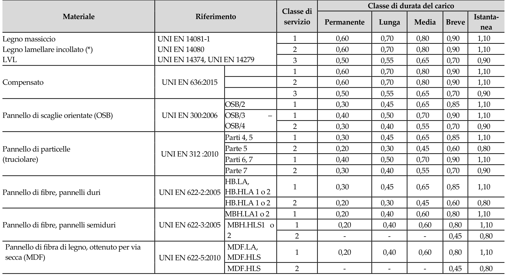

[Torna all'indice del § 4.4](./indice-4.4.md) | [Torna all'indice del capitolo](./indice-cap04.md) | [Torna all'indice generale](../indice-ntc2018.md)

# 4.4.6 Resistenza di progetto

<!-- INDICE-INTERNO:INIZIO -->
**Indice interno**

- [Norma](#toc-ntc2018-4-4-6-norma)
- [Circolare](#toc-ntc2018-c4-4-6-circolare)
- [C4.4.6 Resistenza di progetto](#toc-ntc2018-c4-4-6)
<!-- INDICE-INTERNO:FINE -->

## Norma

Il valore di progetto di una proprietà di resistenza del legno è determinato con la formula:

$$X_d = \frac{k_{mod} \cdot X_k}{\gamma_M} \tag{4.4.1}$$

dove:

- $X_k$ è il valore caratteristico della proprietà di resistenza;
- $k_{mod}$ è il coefficiente correttivo che tiene conto dell'effetto della durata del carico e dell'umidità (Tab. 4.4.IV);
- $\gamma_M$ è il coefficiente parziale di sicurezza sul materiale (Tab. 4.4.III).

Il coefficiente $\gamma_M$ è valutato secondo la colonna A della Tabella 4.4.III. Si possono assumere i valori riportati nella colonna B per produzioni continuative di elementi o strutture, soggette a controllo continuativo del materiale dal quale risulti un coefficiente di variazione della resistenza non superiore al 15%; tali produzioni devono essere inserite in un sistema di qualità di cui al § 11.7.

Il valore di progetto di una proprietà di rigidezza (modulo elastico, modulo di scorrimento) è determinato come:

$$E_d = \frac{E_{mean}}{\gamma_M}$$

Per le verifiche agli SLE si utilizza il modulo elastico medio $E_{mean}$, mentre per le verifiche agli SLU si utilizza il valore di calcolo $E_d$.

**Tabella 4.4.III — Coefficienti parziali di sicurezza $\gamma_M$ per le proprietà dei materiali**

| Stati limite ultimi | Colonna A $\gamma_M$ | Colonna B $\gamma_M$ |
|---|:---:|:---:|
| Combinazioni fondamentali | | |
| Legno massiccio | 1,50 | 1,45 |
| Legno lamellare incollato | 1,45 | 1,35 |
| Pannelli di tavole incollate a strati incrociati | 1,45 | 1,35 |
| Pannelli di particelle o di fibre | 1,50 | 1,40 |
| LVL, compensato, pannelli di scaglie orientate | 1,40 | 1,30 |
| Unioni | 1,50 | 1,40 |
| Combinazioni eccezionali | 1,00 | 1,00 |

Per i materiali non compresi nella Tabella si potrà fare riferimento ai pertinenti valori riportati nei riferimenti tecnici di comprovata validità indicati nel Capitolo 12, nel rispetto dei livelli di sicurezza delle presenti norme.

**Tabella 4.4.IV** - *Valori di $k_{mod}$ per legno e prodotti strutturali a base di legno*

Trascrizione testuale controllata della Tabella 4.4.IV, per ricerca e consultazione da parte degli LLM:

| Materiale | Riferimento | Tipo / parte | Classe di servizio | Permanente | Lunga | Media | Breve | Istantanea |
|---|---|---|:---:|:---:|:---:|:---:|:---:|:---:|
| Legno massiccio | UNI EN 14081-1 | - | 1 | 0,60 | 0,70 | 0,80 | 0,90 | 1,10 |
| Legno massiccio | UNI EN 14081-1 | - | 2 | 0,60 | 0,70 | 0,80 | 0,90 | 1,10 |
| Legno massiccio | UNI EN 14081-1 | - | 3 | 0,50 | 0,55 | 0,65 | 0,70 | 0,90 |
| Legno lamellare incollato (*) | UNI EN 14080 | - | 1 | 0,60 | 0,70 | 0,80 | 0,90 | 1,10 |
| Legno lamellare incollato (*) | UNI EN 14080 | - | 2 | 0,60 | 0,70 | 0,80 | 0,90 | 1,10 |
| Legno lamellare incollato (*) | UNI EN 14080 | - | 3 | 0,50 | 0,55 | 0,65 | 0,70 | 0,90 |
| LVL | UNI EN 14374, UNI EN 14279 | - | 1 | 0,60 | 0,70 | 0,80 | 0,90 | 1,10 |
| LVL | UNI EN 14374, UNI EN 14279 | - | 2 | 0,60 | 0,70 | 0,80 | 0,90 | 1,10 |
| LVL | UNI EN 14374, UNI EN 14279 | - | 3 | 0,50 | 0,55 | 0,65 | 0,70 | 0,90 |
| Compensato | UNI EN 636:2015 | - | 1 | 0,60 | 0,70 | 0,80 | 0,90 | 1,10 |
| Compensato | UNI EN 636:2015 | - | 2 | 0,60 | 0,70 | 0,80 | 0,90 | 1,10 |
| Compensato | UNI EN 636:2015 | - | 3 | 0,50 | 0,55 | 0,65 | 0,70 | 0,90 |
| Pannello di scaglie orientate (OSB) | UNI EN 300:2006 | OSB/2 | 1 | 0,30 | 0,45 | 0,65 | 0,85 | 1,10 |
| Pannello di scaglie orientate (OSB) | UNI EN 300:2006 | OSB/3 | 1 | 0,40 | 0,50 | 0,70 | 0,90 | 1,10 |
| Pannello di scaglie orientate (OSB) | UNI EN 300:2006 | OSB/4 | 2 | 0,30 | 0,40 | 0,55 | 0,70 | 0,90 |
| Pannello di particelle (truciolare) | UNI EN 312:2010 | Parti 4, 5 | 1 | 0,30 | 0,45 | 0,65 | 0,85 | 1,10 |
| Pannello di particelle (truciolare) | UNI EN 312:2010 | Parte 5 | 2 | 0,20 | 0,30 | 0,45 | 0,60 | 0,80 |
| Pannello di particelle (truciolare) | UNI EN 312:2010 | Parti 6, 7 | 1 | 0,40 | 0,50 | 0,70 | 0,90 | 1,10 |
| Pannello di particelle (truciolare) | UNI EN 312:2010 | Parte 7 | 2 | 0,30 | 0,40 | 0,55 | 0,70 | 0,90 |
| Pannello di fibre, pannelli duri | UNI EN 622-2:2005 | HB.LA, HB.HLA 1 o 2 | 1 | 0,30 | 0,45 | 0,65 | 0,85 | 1,10 |
| Pannello di fibre, pannelli duri | UNI EN 622-2:2005 | HB.HLA 1 o 2 | 2 | 0,20 | 0,30 | 0,45 | 0,60 | 0,80 |
| Pannello di fibre, pannelli semiduri | UNI EN 622-3:2005 | MBH.LA1 o 2 | 1 | 0,20 | 0,40 | 0,60 | 0,80 | 1,10 |
| Pannello di fibre, pannelli semiduri | UNI EN 622-3:2005 | MBH.HLS1 o 2 | 1 | 0,20 | 0,40 | 0,60 | 0,80 | 1,10 |
| Pannello di fibre, pannelli semiduri | UNI EN 622-3:2005 | MBH.HLS1 o 2 | 2 | - | - | - | 0,45 | 0,80 |
| Pannello di fibra di legno, ottenuto per via secca (MDF) | UNI EN 622-5:2010 | MDF.LA, MDF.HLS | 1 | 0,20 | 0,40 | 0,60 | 0,80 | 1,10 |
| Pannello di fibra di legno, ottenuto per via secca (MDF) | UNI EN 622-5:2010 | MDF.HLS | 2 | - | - | - | 0,45 | 0,80 |

Per i materiali non compresi nella Tabella si potrà fare riferimento ai pertinenti valori riportati nei riferimenti tecnici di comprovata validità indicati nel Capitolo 12, nel rispetto dei livelli di sicurezza delle presenti norme.

(*) I valori indicati si possono adottare anche per i pannelli di tavole incollate a strati incrociati, ma limitatamente alle classi di servizio 1 e 2.

---

## Circolare

## C4.4.6 Resistenza di progetto

Nella Tab. 4.4.III delle NTC sono forniti i valori del coefficiente parziale di sicurezza relativo al materiale. I valori appartenenti alla colonna A possono essere sempre adottati; i valori riportati nella colonna B possono essere adottati purché i materiali utilizzati siano prodotti secondo un sistema di qualità e quindi siano certificati secondo la lettera A) o C) (ETA) di cui al § 11.1 delle NTC.
