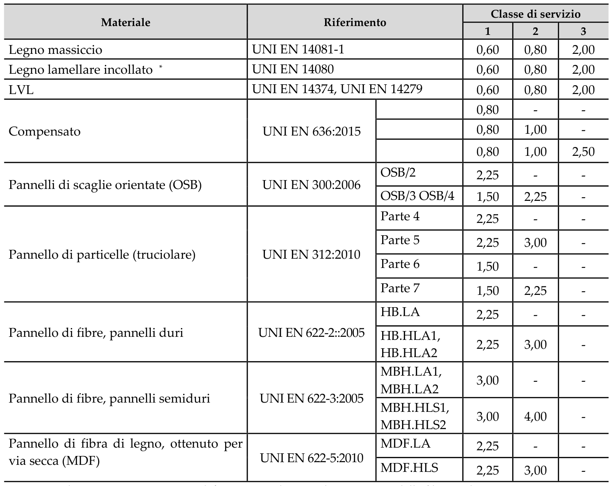
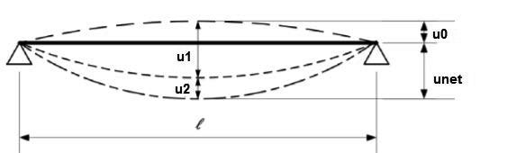

[Torna all'indice del § 4.4](./indice-4.4.md) | [Torna all'indice del capitolo](./indice-cap04.md) | [Torna all'indice generale](../indice-ntc2018.md)

# 4.4.7 Stati limite di esercizio

<!-- INDICE-INTERNO:INIZIO -->
**Indice interno**

- [Norma](#toc-ntc2018-4-4-7-norma)
- [Circolare](#toc-ntc2018-c4-4-7-circolare)
- [C4.4.7 Stati limite di esercizio](#toc-ntc2018-c4-4-7)
<!-- INDICE-INTERNO:FINE -->

## Norma

Le deformazioni devono essere mantenute entro limiti accettabili in relazione alla funzionalità e all'aspetto della struttura. Si tiene conto della deformabilità dei collegamenti, che può contribuire significativamente alla deformazione complessiva dell'elemento.

La deformazione totale si compone di:

- **Deformazione istantanea** $u_{inst}$: dovuta al carico applicato nella condizione iniziale;
- **Deformazione a lungo termine** $u_{creep}$: deformazione differita per effetto del creep;
- **Deformazione finale** $u_{fin}$: somma delle due precedenti.

La deformazione finale si calcola come:

$$u_{fin} = u_{inst} \cdot (1 + k_{def})$$

dove $k_{def}$ è il coefficiente di deformazione viscosa (creep), i cui valori sono riportati nella Tabella 4.4.V.

**Tabella 4.4.V** - *Valori di $k_{def}$ per legno e prodotti strutturali a base di legno*

Trascrizione testuale controllata della Tabella 4.4.V, per ricerca e consultazione da parte degli LLM:

| Materiale | Riferimento | Tipo / parte | Classe di servizio 1 | Classe di servizio 2 | Classe di servizio 3 |
|---|---|---|:---:|:---:|:---:|
| Legno massiccio | UNI EN 14081-1 | - | 0,60 | 0,80 | 2,00 |
| Legno lamellare incollato (*) | UNI EN 14080 | - | 0,60 | 0,80 | 2,00 |
| LVL | UNI EN 14374, UNI EN 14279 | - | 0,60 | 0,80 | 2,00 |
| Compensato | UNI EN 636:2015 | riga 1, come da tabella fonte | 0,80 | - | - |
| Compensato | UNI EN 636:2015 | riga 2, come da tabella fonte | 0,80 | 1,00 | - |
| Compensato | UNI EN 636:2015 | riga 3, come da tabella fonte | 0,80 | 1,00 | 2,50 |
| Pannello di scaglie orientate (OSB) | UNI EN 300:2006 | OSB/2 | 2,25 | - | - |
| Pannello di scaglie orientate (OSB) | UNI EN 300:2006 | OSB/3 OSB/4 | 1,50 | 2,25 | - |
| Pannello di particelle (truciolare) | UNI EN 312:2010 | Parte 4 | 2,25 | - | - |
| Pannello di particelle (truciolare) | UNI EN 312:2010 | Parte 5 | 2,25 | 3,00 | - |
| Pannello di particelle (truciolare) | UNI EN 312:2010 | Parte 6 | 1,50 | - | - |
| Pannello di particelle (truciolare) | UNI EN 312:2010 | Parte 7 | 1,50 | 2,25 | - |
| Pannello di fibre, pannelli duri | UNI EN 622-2:2005 | HB.LA | 2,25 | - | - |
| Pannello di fibre, pannelli duri | UNI EN 622-2:2005 | HB.HLA1, HB.HLA2 | 2,25 | 3,00 | - |
| Pannello di fibre, pannelli semiduri | UNI EN 622-3:2005 | MBH.LA1, MBH.LA2 | 3,00 | - | - |
| Pannello di fibre, pannelli semiduri | UNI EN 622-3:2005 | MBH.HLS1, MBH.HLS2 | 3,00 | 4,00 | - |
| Pannello di fibra di legno, ottenuto per via secca (MDF) | UNI EN 622-5:2010 | MDF.LA | 2,25 | - | - |
| Pannello di fibra di legno, ottenuto per via secca (MDF) | UNI EN 622-5:2010 | MDF.HLS | 2,25 | 3,00 | - |

Per materiale posto in opera con umidità prossima al punto di saturazione delle fibre, e che possa essere soggetto a essiccazione sotto carico, il valore di $k_{def}$ dovrà, in assenza di idonei provvedimenti, essere aumentato a seguito di opportune valutazioni, sommando ai termini della tabella un valore comunque non inferiore a 2,0.

Per i materiali non compresi nella Tabella si potrà fare riferimento ai pertinenti valori riportati nei riferimenti tecnici di comprovata validità indicati nel Capitolo 12, nel rispetto dei livelli di sicurezza delle presenti norme.

(*) I valori indicati si possono adottare anche per i pannelli di tavole incollate a strati incrociati, ma limitatamente alle classi di servizio 1 e 2.

Per combinazioni di carichi comprendenti più effetti con diverso $k_{def}$, si applica il valore $k_{def}$ relativo a ciascun contributo.

**Limiti di freccia:**

- Per le deformazioni dovute ai carichi variabili (combinazione rara): $u \leq L/300$;
- Per la freccia finale (deformazione totale al netto della controfreccia): $u_{fin} \leq L/200$;
- Per i carichi permanenti in assenza di controfreccia: $u_{inst,G} \leq L/300$.

Per elementi a sbalzo, la luce di riferimento è assunta pari al doppio della luce del sbalzo.

I limiti sopra indicati sono da considerare come valori guida; per strutture particolari (serramenti, rivestimenti fragili, impianti sensibili) possono essere necessari limiti più restrittivi.

---

## Circolare

## C4.4.7 Stati limite di esercizio

Considerando il particolare comportamento reologico del legno e dei materiali derivati dal legno, si devono valutare sia la deformazione istantanea $u_{inst}$ sia la deformazione finale $u_{fin}$.

La deformazione istantanea, $u_{inst}$, deve essere calcolata sotto la combinazione caratteristica, o rara, di azioni di cui al § 2.5.3 delle NTC, utilizzando il valore medio dei moduli di elasticità normale e tangenziale del materiale per le membrature, ed il valore istantaneo del modulo di scorrimento ($K_{ser}$) per le unioni.

In generale la deformazione finale $u_{fin}$ provocata dal generico carico può essere valutata come segue:

$$u_{fin}=u_{inst}+u_{dif} \tag{C4.4.1}$$

dove:

- $u_{fin}$ è la deformazione finale data dalla somma della deformazione istantanea e della deformazione differita;
- $u_{inst}$ è la deformazione istantanea;
- $u_{dif}$ è la deformazione differita.

La freccia netta, $u_{net}$, per un elemento inflesso, riferita alla corda congiungente i punti della trave in corrispondenza degli appoggi, è data da:

$$u_{net}=u_1+u_2-u_0 \tag{C4.4.2}$$

dove:

- $u_0$ è la controfreccia iniziale, qualora presente;
- $u_1$ è la freccia dovuta ai soli carichi permanenti;
- $u_2$ è la freccia dovuta ai soli carichi variabili.

**Figura C4.4.1** - *Deformazione per un elemento inflesso*

Nel caso di strutture costituite da elementi o componenti aventi lo stesso comportamento viscoelastico, in via semplificata, la deformazione totale finale $u_{tot,fin}$ relativa ad una certa condizione di carico, si può quindi valutare come segue:

$$u_{tot,fin}=u_{1,inst}(1+k_{def})+u_{21,inst}(1+\psi_{21}k_{def})+\sum_{i=2}^{n}\left[u_{2i,inst}(\psi_{0i}+\psi_{2i}k_{def})\right] \tag{C4.4.3}$$

dove:

- $u_{1,inst}$ è la deformazione istantanea del carico permanente;
- $u_{21,inst}$ è la deformazione istantanea del carico variabile prevalente;
- $u_{2i,inst}$ è la deformazione istantanea dell'i-esimo carico variabile della combinazione considerata.

I valori delle deformazioni totali finali, calcolate mediante le formulazioni precedenti, richiedono una più accurata valutazione nel caso di impalcati sottoposti in esercizio a un carico permanente tale di indurre tensioni massime da flessione indicativamente superiori al 30% del corrispondente valore caratteristico di resistenza.

In aggiunta alla verifica di freccia istantanea dovuta ai soli carichi variabili nella combinazione di carico rara riportata nel § 4.4.7 delle NTC, si consiglia, per la medesima combinazione di carico, di limitare opportunamente anche la freccia istantanea totale, derivante cioè dai carichi permanenti e dai carichi variabili, in particolare nel caso degli impalcati che sopportano elementi portati fragili, quali tramezzature in laterizio, pavimentazioni ceramiche ecc.

Lo scorrimento delle unioni può essere determinato mediante prove sperimentali eseguite nel rispetto dei pertinenti documenti di comprovata validità o può essere calcolato, in funzione delle caratteristiche dei materiali e del tipo di unione, con riferimento a normative di comprovata validità.

Per il calcolo della deformazione istantanea delle membrature si fa riferimento al valore medio dei moduli di elasticità normale e tangenziale del materiale; per le deformazioni istantanee delle unioni si fa riferimento al valore istantaneo del modulo di scorrimento.

La deformazione a lungo termine può essere calcolata utilizzando i valori medi dei moduli elastici ridotti opportunamente mediante il fattore $1/(1+k_{def})$ per le membrature e utilizzando un valore ridotto con lo stesso fattore del modulo di scorrimento dei collegamenti.

Si dovrà verificare che le azioni previste sulla struttura non producano vibrazioni che ne possano compromettere la normale utilizzazione o comunque ridurre il comfort degli utenti.

Si raccomanda che gli effetti provocati sui solai da vibrazioni e urti indotti dal calpestio siano limitati, in modo da garantire un accettabile livello di comfort per gli utilizzatori. Per solai aventi una frequenza fondamentale maggiore o uguale a 8 Hz, le verifiche devono essere effettuate limitando il valore massimo di freccia verticale indotto da un carico concentrato $F$ agente su qualsiasi punto del solaio, nonché limitando il valore di velocità iniziale derivante da un carico impulsivo agente nel punto del solaio che fornisce la massima risposta. A tal proposito è possibile fare riferimento a quanto proposto all'interno della UNI EN 1995-1-1.

Nel caso in cui la frequenza fondamentale del solaio risulti inferiore a 8 Hz, si raccomanda, al fine di scongiurare possibili fenomeni di amplificazione, di limitare opportunamente la massima accelerazione verticale indotta da un carico dinamico rappresentativo del fenomeno di calpestio lungo il solaio, anche facendo utile riferimento a documenti di comprovata validità.

Nel calcolo dei parametri necessari alle verifiche sopra riportate, si raccomanda di tenere in conto la collaborazione laterale dipendente dalla rigidezza trasversale del solaio. Si suggerisce inoltre di adottare un valore di massa del solaio corrispondente alla combinazione di carico quasi-permanente.

Nel caso si ritenga opportuno svolgere analisi più dettagliate si può far riferimento ai metodi di verifica proposti all'interno di normative di comprovata validità.
