[Torna all'indice del § 4.2](./indice-4.2.md) | [Torna all'indice del capitolo](./indice-cap04.md) | [Torna all'indice generale](../indice-ntc2018.md)

# C4.2.12 Profilati formati a freddo e lamiere grecate

<!-- INDICE-INTERNO:INIZIO -->
**Indice interno**

- [Circolare](#toc-ntc2018-c4-2-12-circolare)
  - [C4.2.12.1 Materiali](#toc-ntc2018-c4-2-12-1)
    - [C4.2.12.1.1 Effetto della formatura a freddo sulla resistenza dell'acciaio](#toc-ntc2018-c4-2-12-1-1)
    - [C4.2.12.1.2 Valori limite dei rapporti larghezza - spessore](#toc-ntc2018-c4-2-12-1-2)
    - [C4.2.12.1.3 Inflessione trasversale delle ali](#toc-ntc2018-c4-2-12-1-3)
    - [C4.2.12.1.4 Classificazione delle sezioni, instabilità locale e distorsione delle sezioni trasversali](#toc-ntc2018-c4-2-12-1-4)
    - [C4.2.12.1.5 Verifiche di resistenza](#toc-ntc2018-c4-2-12-1-5)
      - [C4.2.12.1.5.1 Verifiche di resistenza a trazione](#toc-ntc2018-c4-2-12-1-5-1)
      - [C4.2.12.1.5.2 Verifiche di resistenza a compressione](#toc-ntc2018-c4-2-12-1-5-2)
      - [C4.2.12.1.5.3 Verifiche di resistenza a flessione](#toc-ntc2018-c4-2-12-1-5-3)
      - [C4.2.12.1.5.4 Verifiche di resistenza a presso-tenso flessione](#toc-ntc2018-c4-2-12-1-5-4)
      - [C4.2.12.1.5.4.1 Verifiche di resistenza a taglio](#toc-ntc2018-c4-2-12-1-5-4-1)
    - [C4.2.12.1.6 Verifiche di stabilità](#toc-ntc2018-c4-2-12-1-6)
      - [C4.2.12.1.6.1 Verifiche di stabilità di aste compresse](#toc-ntc2018-c4-2-12-1-6-1)
      - [C4.2.12.1.6.2 Verifiche di stabilità di aste inflesse](#toc-ntc2018-c4-2-12-1-6-2)
      - [C4.2.12.1.6.3 Verifiche di stabilità di aste presso-inflesse](#toc-ntc2018-c4-2-12-1-6-3)
    - [C4.2.12.1.7 Unioni](#toc-ntc2018-c4-2-12-1-7)
      - [C4.2.12.1.7.1 Chiodi ciechi](#toc-ntc2018-c4-2-12-1-7-1)
      - [C4.2.12.1.7.1.1 Chiodi ciechi soggetti a taglio](#toc-ntc2018-c4-2-12-1-7-1-1)
      - [C4.2.12.1.7.2 Viti autofilettanti e automaschianti](#toc-ntc2018-c4-2-12-1-7-2)
      - [C4.2.12.1.7.2.1 Viti autofilettanti o automaschianti soggette a taglio](#toc-ntc2018-c4-2-12-1-7-2-1)
      - [C4.2.12.1.7.2.2 Viti autofilettanti o automaschianti soggette a trazione](#toc-ntc2018-c4-2-12-1-7-2-2)
      - [C4.2.12.1.7.3 Chiodi sparati](#toc-ntc2018-c4-2-12-1-7-3)
      - [C4.2.12.1.7.3.1 Chiodi sparati soggetti a taglio](#toc-ntc2018-c4-2-12-1-7-3-1)
      - [C4.2.12.1.7.4 Bulloni (per impiego con spessori minori di 4 mm)](#toc-ntc2018-c4-2-12-1-7-4)
      - [C4.2.12.1.7.4.1 Bulloni soggetti a taglio](#toc-ntc2018-c4-2-12-1-7-4-1)
      - [C4.2.12.1.7.4.2 Bulloni soggetti a trazione](#toc-ntc2018-c4-2-12-1-7-4-2)
      - [C4.2.12.1.7.5 Cordoni d'angolo (per impiego con spessori minori di 4 mm)](#toc-ntc2018-c4-2-12-1-7-5)
      - [C4.2.12.1.7.6 Saldature per punti (a resistenza o per fusione)](#toc-ntc2018-c4-2-12-1-7-6)
      - [C4.2.12.1.7.6.1 Saldature per punti soggette a taglio](#toc-ntc2018-c4-2-12-1-7-6-1)
      - [C4.2.12.1.7.7 Bottoni di saldatura](#toc-ntc2018-c4-2-12-1-7-7)
      - [C4.2.12.1.7.7.1 Bottoni di saldatura soggetti a taglio](#toc-ntc2018-c4-2-12-1-7-7-1)
<!-- INDICE-INTERNO:FINE -->

## Circolare

#### C4.2.12.1 Materiali
Per i profilati di acciaio profilati a freddo e le lamiere grecate, l'acciaio deve essere conforme a quanto previsto al § C11.3.4.11.2.1.

##### C4.2.12.1.1 Effetto della formatura a freddo sulla resistenza dell'acciaio
Per effetto del processo di formatura a freddo si verifica un innalzamento della tensione di snervamento dell'acciaio che può essere considerato nei calcoli.

Ove il fenomeno non sia valutato sperimentalmente sulla membratura nel suo complesso, il valore della tensione di snervamento media dopo formatura $f_{myk}$ può essere valutata nel modo seguente:

$$f_{myk} = f_{yk} + \dfrac{(f_{tk} - f_{yk}) \cdot k \cdot n \cdot t^2}{A_g} \le 0{,}5 \cdot (f_{tk} + f_{yk}) \tag{C4.2.101}$$

in cui

- $k = 7$ per formatura continua con rulli,
- $k = 5$ per gli altri metodi di formatura,
- $A_g$ è l'area lorda della sezione trasversale della membratura,
- $n$ è il numero di pieghe a 90° con raggio interno $r \le 5 \cdot t$ (pieghe con angolo diverso da 90° sono tenute in conto con frazioni di $n$),
- $t$ è lo spessore (al netto dei rivestimenti) del piatto o nastro prima della formatura.

Il valore medio della tensione di snervamento $f_{myk}$ può essere tenuto in conto nei calcoli nei casi seguenti:

- verifiche di resistenza di aste tese;
- verifiche di resistenza e verifiche di stabilità di aste compresse aventi sezione di classe 1, 2 e 3 (cioè sezioni completamente reagenti),
- verifiche di resistenza e verifiche di stabilità di travi inflesse le parti compresse delle quali siano di classe 1, 2 e 3 (cioè parti compresse completamente reagenti).

Il valore medio della tensione di snervamento $f_{myk}$ non deve essere tenuto in conto nei calcoli nei casi seguenti:

- determinazione dell'area efficace;
- calcolo di membrature che, dopo il processo di formatura a freddo, siano sottoposte ad un trattamento termico di distensione.

##### C4.2.12.1.2 Valori limite dei rapporti larghezza - spessore
Nella Tabella C4.2.XIX sono riportati i valori limite dei rapporti larghezza - spessore per i quali è applicabile la presente Circolare.

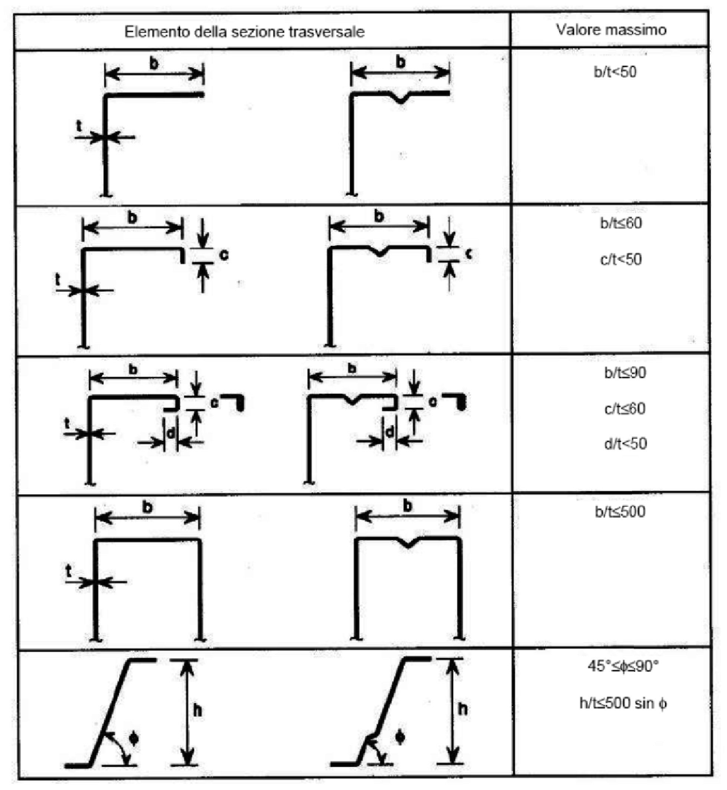

**Tabella C4.2.XIX** - *Valori limite dei rapporti larghezza-spessore di profili formati a freddo*

Tali limiti rappresentano il campo dei valori per i quali è disponibile probante esperienza costruttiva e valida sperimentazione.

Inoltre, per garantire sufficiente rigidezza degli irrigidimenti di bordo, devono essere rispettate le seguenti limitazioni:

$$0{,}2 \le \dfrac{c}{b} \le 0{,}6 \qquad 0{,}1 \le \dfrac{d}{b} \le 0{,}3 \tag{C4.2.102}$$

##### C4.2.12.1.3 Inflessione trasversale delle ali
Negli elementi soggetti a flessione le ali molto larghe (sia tese sia compresse) tendono ad incurvarsi in direzione dell'asse neutro (*curling*). Tale fenomeno può essere considerato, in assenza ed in presenza di irrigidimenti (purché non ravvicinati tra loro), nel modo seguente.

Per una trave con asse rettilineo ed in riferimento alla Figura C4.2.25, si ha:

$$u = 2 \cdot \dfrac{\sigma_a^2 \cdot b_s^4}{E^2 \cdot t^2 \cdot z} \tag{C4.2.103}$$

dove $u$ è la massima inflessione trasversale verso l'asse neutro dell'ala, $z$ è la distanza nominale dell'ala dall'asse neutro, $t$ è lo spessore della membratura, $b_s$ è la metà della distanza tra le anime (per sezioni a cassone o sezioni ad U) o la lunghezza della parte a sbalzo, $\sigma_a$ è la tensione normale media nelle ali calcolata con riferimento all'area lorda.

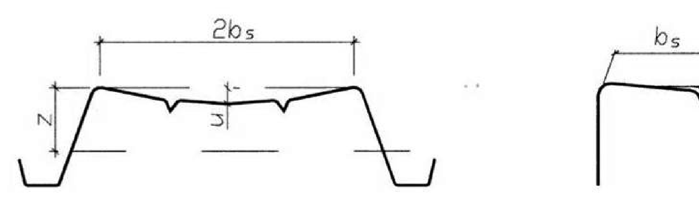

**Figura C4.2.25** - *Incurvamento delle piattabande*

Bisogna tener conto di questo fenomeno nel calcolo della resistenza flessionale quando $u \ge 0{,}05 \cdot h$, essendo $h$ l'altezza della trave.

##### C4.2.12.1.4 Classificazione delle sezioni, instabilità locale e distorsione delle sezioni trasversali
Nelle membrature formate a freddo e nelle lamiere grecate, al fine della utilizzazione delle Tabelle 4.2.III, IV e V delle NTC per la classificazione delle sezioni, la larghezza $b_p$ degli elementi piani deve essere determinata a partire dai punti medi di raccordo di due lati adiacenti, secondo le indicazioni di Figura C4.2.26.

In Figura C4.2.26 il punto $P$ è il punto medio del raccordo da considerare per determinare la larghezza dell'elemento piano; $X$ è l'intersezione degli assi degli elementi piani.

Il raggio medio di piega del raccordo $r_m$ si determina a partire dal raggio interno di piega $r$, con $r_m = r + 0{,}5 \cdot t$, mentre la proiezione $g_r$ del segmento $PX$ sull'asse dell'elemento piano è uguale a

$$g_r = r_m \cdot \left[\tan\left(\dfrac{\Phi}{2}\right) - \sin\left(\dfrac{\Phi}{2}\right)\right] \tag{C4.2.104}$$

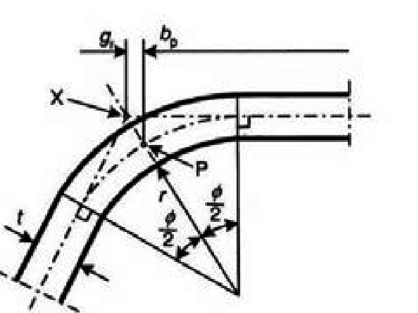

**Figura C4.2.26** - *Determinazione del punto X per la valutazione della larghezza di elementi piani*

Alcuni esempi applicativi sono riportati in Figura C4.2.27.

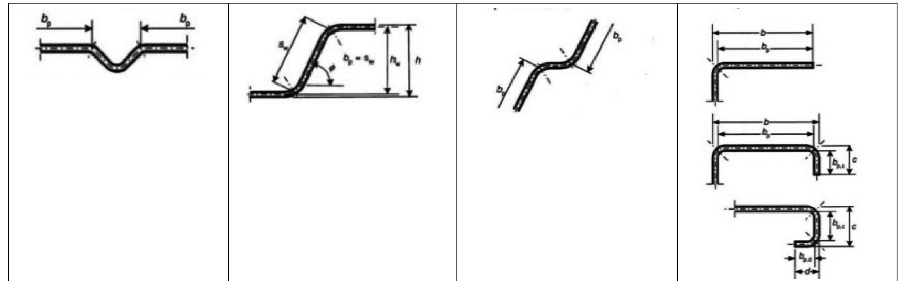

**Figura C4.2.27** - *Esempi di determinazione della larghezza $b_p$*

Nel caso di parti compresse appartenenti alla classi 3 e 4 si possono verificare fenomeni di instabilità locale e distorsione della sezione trasversale che interagiscono tra loro ed insieme alla inflessione trasversale delle aste compresse e/o inflesse. Questi fenomeni possono essere studiati mediante una specifica modellazione matematica. In alternativa si possono applicare i metodi semplificati indicati nel seguito.

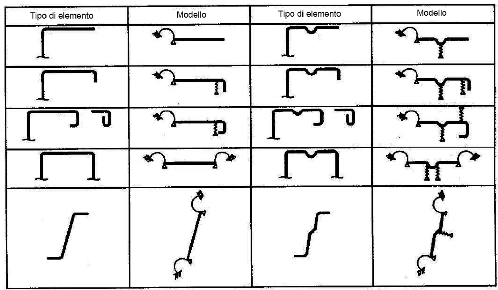

**Figura C4.2.28** - *Modelli statici per diverse tipologie di elementi piani*

I vari tipi di elementi piani possono essere schematizzati con i modelli riportati in Figura C4.2.28.

Le parti piane compresse che, con la definizione di larghezza data sopra, non rispettano le limitazioni per la classe 3 sono soggette a fenomeni di ingobbamento locale i quali si possono considerare con il metodo delle larghezze efficaci per la determinazione delle quali si devono seguire i criteri esposti al § C4.2.4.1.3.4.

Tenendo presenti le larghezze efficaci degli elementi piani compressi si possono determinare le grandezze geometriche efficaci che tengono conto dei fenomeni di instabilità locale e che sono richiamate al § 4.2.4.1 delle NTC, nell'ipotesi che non intervenga la distorsione della sezione trasversale considerata più oltre.

Per discutere i fenomeni di distorsione della sezione trasversale si distinguono:

- elementi piani, con o senza irrigidimenti intermedi, delimitati da un'anima e da un irrigidimento di bordo (Figura C4.2.29);
- elementi piani compresi tra due anime con uno o più irrigidimenti intermedi (Figura C4.2.30).

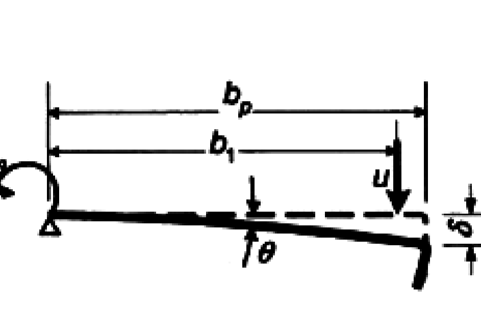

**Figura C4.2.29** - *Elementi piani delimitati da un'anima e da un irrigidimento di bordo*

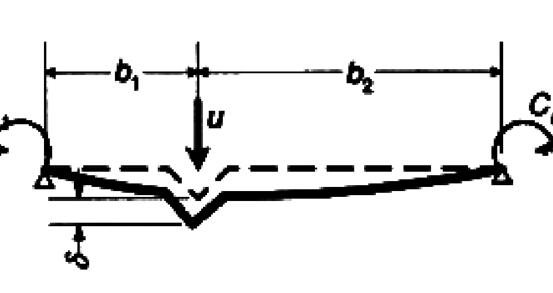

**Figura C4.2.30** - *Elementi piani delimitati da due anime con irrigidimenti intermedi*

L'irrigidimento, insieme alla larghezza collaborante che gli compete (Figura C4.2.31) viene studiato come trave compressa su letto elastico alla Winkler. Il letto elastico ha costante elastica dipendente dall'elemento piano e dalle altre parti della sezione della trave alle quali l'elemento è collegato.

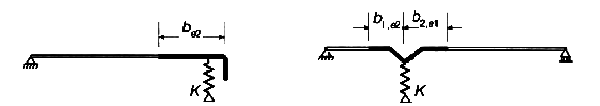

**Figura C4.2.31** - *Schematizzazione degli irrigidimenti*

In Figura C4.2.32 sono riportati alcuni schemi statici di riferimento per il calcolo della costante $k$ del letto elastico.

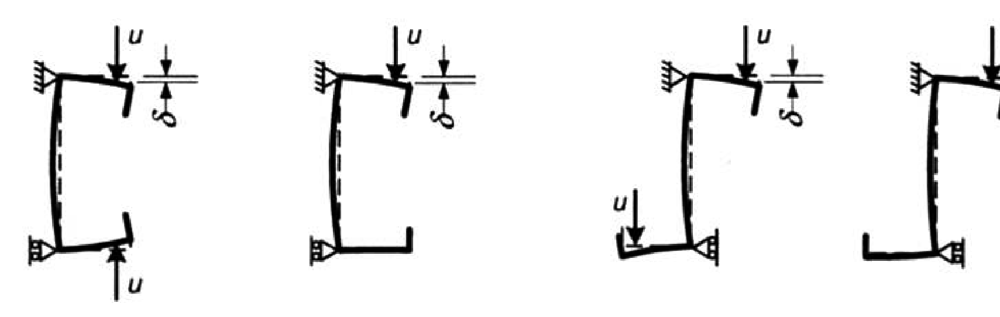

**Figura C4.2.32** - *Schemi di calcolo per la determinazione della costante elastica*

Detti $A_s$ l'area efficace dell'irrigidimento con la larghezza collaborante che gli compete e $I_s$ il momento di inerzia dell'irrigidimento con la larghezza collaborante che gli compete, calcolato rispetto al suo asse baricentrico parallelo all'elemento piano collaborante, la tensione critica euleriana dell'irrigidimento compresso su letto elastico $\sigma_{cr,s}$, salvo più precise determinazioni teorico-numeriche, può essere assunta pari a

$$\sigma_{cr,s} = 2 \cdot \dfrac{\sqrt{k \cdot E \cdot I_s}}{A_s} \tag{C4.2.105}$$

La resistenza all'instabilità distorsionale dell'irrigidimento compresso $\sigma_{d,Rd}$ dipende dalla snellezza adimensionale $\lambda_d$

$$\lambda_d = \sqrt{\dfrac{f_{yk}}{\sigma_{cr,s}}} \tag{C4.2.106}$$

tramite il fattore di riduzione $\chi_d$, per cui risulta

$$\sigma_{d,Rd} = \chi_d(\lambda_d) \, f_{yk} \tag{C4.2.107}$$

essendo

$$
\chi_d =
\begin{cases}
1 & \text{per } \lambda_d < 0{,}65 \\
1{,}47 - 0{,}723 \cdot \lambda_d & \text{per } 0{,}65 \le \lambda_d \le 1{,}38 \\
\dfrac{0{,}66}{\lambda_d} & \text{per } \lambda_d > 1{,}38
\end{cases}
\tag{C4.2.108}
$$

Per semplicità ed in prima approssimazione si può assumere l'area ridotta dello irrigidimento, che tiene conto dell'instabilità distorsionale, pari a $A_{s,rid} = \chi_d \cdot A_s$.

Nel caso $\chi_d < 1$, per migliorare l'approssimazione si può far ricorso ad un processo iterativo che comporta le seguenti fasi:

- nuova definizione della larghezza efficace del pannello piano, riferita alla tensione massima di compressione,

$$\sigma_{com,Ed,I} = \chi_d \cdot \dfrac{f_{yk}}{\gamma_{M0}} \tag{C4.2.109}$$

- nuova determinazione delle caratteristiche geometriche dell'irrigidimento, $A_s$ e $I_s$;
- determinazione della nuova tensione critica euleriana $\sigma'_{cr,s}$, della nuova snellezza $\lambda'_d$ e della nuova resistenza all'instabilità distorsionale dell'irrigidimento compresso

$$\sigma'_{d,Rd} = \chi_d(\lambda'_d) \, f_{yk} \tag{C4.2.110}$$

e così via iterando, fino a convergenza.

Una volta raggiunta la convergenza, l'area ridotta dell'irrigidimento, che tiene conto dell'instabilità distorsionale, è data da:

$$A_{s,rid} = \dfrac{\chi_d \cdot f_{yk} \cdot A_s}{\gamma_{M0} \cdot \sigma_{com,Ed}} \tag{C4.2.111}$$

Per la determinazione delle caratteristiche geometriche della sezione trasversale della membratura l'area ridotta dell'irrigidimento $A_{s,rid}$ può essere utilmente rappresentata mediante lo spessore ridotto dello stesso

$$t_{rid} = t \cdot \dfrac{A_{s,rid}}{A_s} \tag{C4.2.112}$$

##### C4.2.12.1.5 Verifiche di resistenza

###### C4.2.12.1.5.1 Verifiche di resistenza a trazione
La resistenza di calcolo a trazione centrata della sezione lorda è:

$$N_{t,Rd} = \dfrac{A \cdot f_{myk}}{\gamma_{M0}} \tag{C4.2.113}$$

dove $A$ è l'area lorda della sezione trasversale e $f_{myk}$ è il valore della tensione di snervamento media dopo formatura.

La resistenza di calcolo a trazione centrata della sezione lorda $N_{t,Rd}$ è limitata dalla resistenza di calcolo della sezione netta, indebolita dai fori per i collegamenti di estremità $F_{n,Rd}$:

$$N_{t,Rd} \le F_{n,Rd} = \dfrac{A_{net} \cdot f_{tk}}{\gamma_{M2}} \tag{C4.2.114}$$

essendo $A_{net}$ l'area netta della sezione trasversale indebolita dai fori per i collegamenti di estremità e $f_{tk}$ la resistenza a rottura dell'acciaio.

###### C4.2.12.1.5.2 Verifiche di resistenza a compressione
La resistenza di calcolo a compressione centrata della sezione lorda è data da

$$N_{c,Rd} = \dfrac{A_{eff} \cdot f_{yk}}{\gamma_{M0}} \tag{C4.2.115}$$

se l'area efficace $A_{eff}$ della sezione traversale è minore dell'area lorda $A$, e da

$$N_{c,Rd} = \dfrac{A \cdot f_{myk}}{\gamma_{M0}} \tag{C4.2.116}$$

se l'area efficace $A_{eff}$ della sezione traversale è uguale all'area lorda $A$.

###### C4.2.12.1.5.3 Verifiche di resistenza a flessione
La resistenza di calcolo a flessione rispetto ad un asse principale di inerzia è:

$$M_{c,Rd} = \dfrac{W_{eff} \cdot f_{yk}}{\gamma_{M0}} \tag{C4.2.117}$$

se il modulo di resistenza della sezione efficace, $W_{eff}$, è minore di quello dell'area lorda $W$, e da

$$M_{c,Rd} = \dfrac{W \cdot f_{yk}}{\gamma_{M0}} \tag{C4.2.118}$$

se $W_{eff} = W$, salvo più favorevoli indicazioni fornite da normative di comprovata validità.

###### C4.2.12.1.5.4 Verifiche di resistenza a presso-tenso flessione
Nel caso di pressoflessione, la condizione di resistenza è

$$\dfrac{M_{y,Ed} + \Delta M_{y,Ed}}{M_{cy,Rd}} + \dfrac{M_{z,Ed} + \Delta M_{z,Ed}}{M_{cz,Rd}} \pm \dfrac{N_{Ed}}{N_{c,Rd}} \le 1 \tag{C4.2.119}$$

in cui $\Delta M_{y,Ed}$ e $\Delta M_{z,Ed}$ sono gli eventuali momenti flettenti addizionali dovuti allo spostamento del baricentro della sezione efficace rispetto al baricentro della sezione lorda.

Nella [C4.2.119] si considera il segno $+$ quando la condizione più sfavorevole per la resistenza a flessione è dettata dalle fibre compresse; si considera il segno $-$ quando la condizione più sfavorevole per la resistenza a flessione è dettata dalle fibre tese (di questa differenza si deve tener conto anche nella determinazione di $M_{cy,Rd}$ e di $M_{cz,Rd}$).

Nel caso di tensoflessione, la condizione di resistenza è

$$\dfrac{M_{y,Ed}}{M_{cy,Rd}} + \dfrac{M_{z,Ed}}{M_{cz,Rd}} \pm \dfrac{N_{Ed}}{N_{t,Rd}} \le 1 \tag{C4.2.120}$$

Si applica il segno $+$ quando la condizione più sfavorevole per la resistenza a flessione è dettata dalle fibre tese; si applica il segno $-$ quando la condizione più sfavorevole per la resistenza a flessione è dettata dalle fibre compresse (di questa differenza si deve tener conto anche nella determinazione di $M_{cy,Rd}$ e di $M_{cz,Rd}$).

###### C4.2.12.1.5.4.1 Verifiche di resistenza a taglio
La resistenza di calcolo a taglio di un'anima senza irrigidimenti (Figura C4.2.33) è

$$V_{b,Rd} = \dfrac{h_w \cdot t \cdot f_{bv}}{\gamma_{M0} \cdot \sin\phi} \tag{C4.2.121}$$

dove $t$ è lo spessore dell'anima, $h_w$ è l'altezza dell'anima, $\phi$ è l'angolo di inclinazione dell'anima e $f_{bv}$ è la resistenza alle tensioni tangenziali dell'anima, che tiene conto dell'instabilità locale.

La resistenza alle tensioni tangenziali è data da

$$f_{bv} = f_{yk} \cdot \chi(\lambda_w) \tag{C4.2.122}$$

essendo $\chi$ un coefficiente riduttivo, dipendente dalla snellezza adimensionale $\lambda_w$ dell'anima,

$$\lambda_w = 0{,}346 \cdot \dfrac{s_w}{t} \sqrt{\dfrac{f_{yk}}{E}} \tag{C4.2.123}$$

dove $s_w$ è la lunghezza dell'anima (Figura C4.2.33).

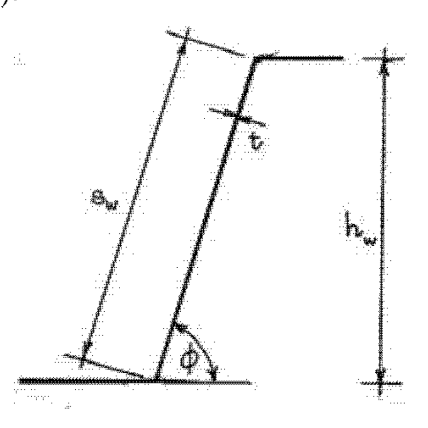

**Figura C4.2.33** - *Anime di profili sottili*

In presenza di irrigidimenti agli appoggi, atti ad incassare la reazione vincolare e a prevenire distorsioni dell'anima, si può assumere

$$
\chi =
\begin{cases}
0{,}58 & \text{per } \lambda_w \le 0{,}83 \\
\dfrac{0{,}48}{\lambda_w} & \text{per } \lambda_w > 0{,}83
\end{cases}
\tag{C4.2.124}
$$

in assenza di tali irrigidimenti si ha, invece,

$$
\chi =
\begin{cases}
0{,}58 & \text{per } \lambda_w \le 0{,}83 \\
\dfrac{0{,}48}{\lambda_w} & \text{per } 0{,}83 < \lambda_w < 1{,}40 \\
\dfrac{0{,}67}{\lambda_w^2} & \text{per } \lambda_w \ge 1{,}40
\end{cases}
\tag{C4.2.125}
$$

Si rimanda a normative di comprovata validità per problemi particolari, quali:

- la resistenza a taglio di anime con irrigidimenti intermedi;
- la resistenza a carichi concentrati, intermedi o di estremità;
- la interazione tra taglio e flessione quando l'azione tagliante di calcolo $V_{Ed} > 0{,}5 V_{b,Rd}$;
- la interazione tra carichi concentrati e flessione.

##### C4.2.12.1.6 Verifiche di stabilità

###### C4.2.12.1.6.1 Verifiche di stabilità di aste compresse
La resistenza delle aste compresse si valuta con i criteri di cui al § 4.2.4.1.3 delle NTC adottando le curve di stabilità specificate nella Tabella C4.2.XX.

Si richiama l'attenzione sul fatto che per aste con sezione aperta a simmetria polare, profilati a Z e simili, i carichi critici torsionali possono essere inferiori a quelli flessionali; similmente, per aste con sezione aperta con un solo asse di simmetria i carichi critici flessotorsionali possono essere inferiori a quelli puramente flessionali.

###### C4.2.12.1.6.2 Verifiche di stabilità di aste inflesse
La verifica di stabilità di una trave inflessa soggetta a fenomeni di instabilità flessotorsionali si effettua con i criteri di cui al § 4.2.4.1.3 delle NTC adottando la curva di stabilità b.

Tuttavia, quando l'area efficace ha assi principali di inerzia sensibilmente discosti da quelli dell'area lorda, quei criteri non sono applicabili e devono essere effettuate specifiche indagini numeriche.

###### C4.2.12.1.6.3 Verifiche di stabilità di aste presso-inflesse
Si tratta di problemi specifici per i quali si rinvia alla normativa di comprovata validità.

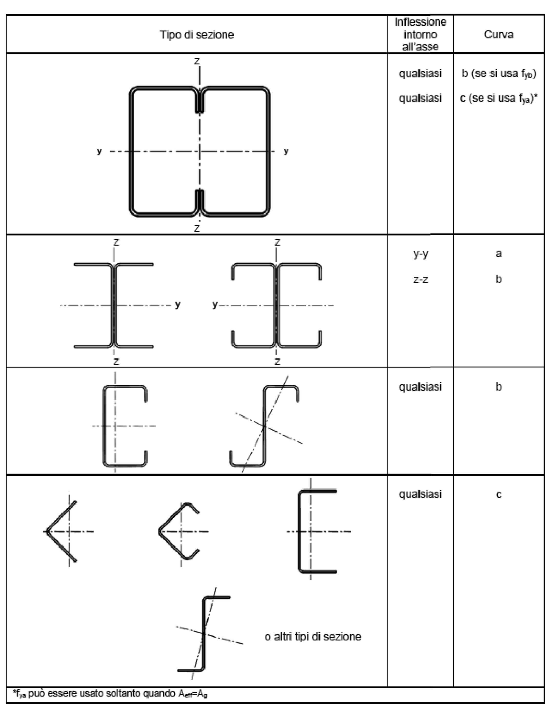

**Tabella C4.2.XX** - *Curve di stabilità per profili sottili compressi*

##### C4.2.12.1.7 Unioni
Nelle unioni dei profilati formati a freddo e delle lamiere grecate si possono impiegare, oltre ai mezzi d'unione classici, bulloni e saldature a cordoni d'angolo, trattati nelle NTC, altri mezzi di collegamento quali viti auto filettanti o automaschianti, chiodi sparati, chiodi ciechi, saldature per punti (a resistenza o per fusione) e bottoni di saldatura.

Poiché nelle unioni che interessano i profilati formati a freddo e le lamiere grecate possono intervenire elementi strutturali aventi spessori inferiori a 4 mm (minimo ammesso nelle NTC per gli elementi delle strutture di acciaio) sono necessari alcuni adattamenti ai piccoli spessori delle indicazioni delle Norme Tecniche anche per l'impiego dei bulloni e delle saldature.

Data la varietà delle soluzioni tecnologiche disponibili per i mezzi di unione quali viti autofilettanti o automaschianti, chiodi sparati, chiodi ciechi, bottoni di saldatura, alcune grandezze della resistenza delle unioni sono basate su attendibili risultati sperimentali, disponibili in letteratura, altre sono invece da determinarsi sperimentalmente (con procedure EOTA) per le applicazioni specifiche.

*Simboli adottati nel seguito*

- $t$: spessore minimo delle membrature interessate nel collegamento;
- $t_1$: spessore massimo delle membrature interessate nel collegamento;
- $t^*$: spessore del materiale base nel quale sono ancorate le viti autofilettanti oppure i bottoni di saldatura;
- $d_0$: diametro del foro per il mezzo di collegamento (Figura C4.2.34);
- $d$: diametro del mezzo di collegamento (chiodo, vite, ecc.);
- $d_w$: diametro della testa della vite di collegamento o diametro della rondella sotto testa o diametro visibile del punto di saldatura (Figura C4.2.35);
- $d_s$: diametro efficace del punto o bottone di saldatura,

$$d_s = 0{,}7 \cdot d_w - 1{,}5 \sum t \ge 0{,}55 \cdot d_w \tag{C4.2.126}$$

- $d_p$: diametro della saldatura del bottone;
- $s$: passo della filettatura delle viti autofilettanti o automaschianti.

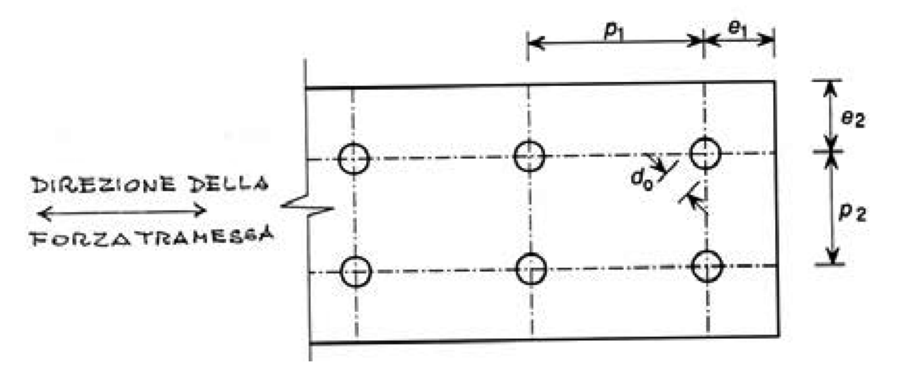

**Figura C4.2.34** - *Parametri significativi per i collegamenti*

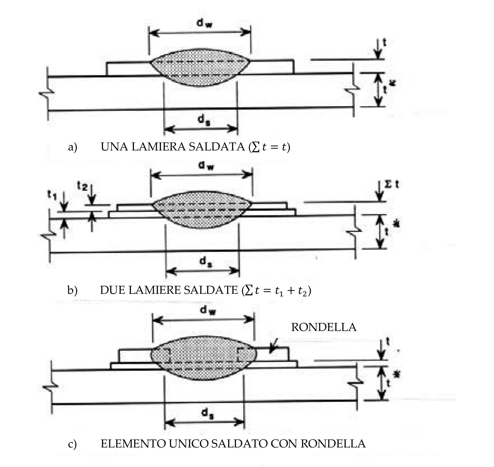

**Figura C4.2.35** - *Saldature a bottone*

In Figura C4.2.34 sono indicati gli interassi e le varie distanze che interessano il dimensionamento dei collegamenti; in Figura C4.2.35 sono indicati i diametri dei punti e bottoni di saldatura.

###### C4.2.12.1.7.1 Chiodi ciechi

###### C4.2.12.1.7.1.1 Chiodi ciechi soggetti a taglio
La resistenza a rifollamento è data da

$$F_{b,Rd} = \dfrac{\alpha \cdot f_{tk} \cdot d \cdot t}{\gamma_{M2}} \tag{C4.2.127}$$

dove

$$
\begin{aligned}
\alpha &= 3{,}6 \sqrt{\dfrac{t}{d}} \le 2{,}1 && \text{per } t_1 = t \\
\alpha &= 2{,}1 && \text{per } t_1 \ge 2{,}5 \cdot t
\end{aligned}
\tag{C4.2.128}
$$

nei casi intermedi $(t \le t_1 < 2{,}5 \cdot t)$ $\alpha$ può essere determinato per interpolazione lineare.

La resistenza allo strappo della lamiera collegata è data da

$$F_{t,Rd} = \dfrac{f_{tk} \cdot e_1 \cdot t}{1{,}2 \cdot \gamma_{M2}} \tag{C4.2.129}$$

essendo $e_1$ indicato in Figura C4.2.34.

La resistenza a trazione della sezione netta è data da

$$F_{n,Rd} = \dfrac{A_{net} \cdot f_{tk}}{\gamma_{M2}} \tag{C4.2.130}$$

Le formule [C4.2.127], [C4.2.129] e [C4.2.130] per chiodi ciechi sono valide per diametri $d$ compresi nell'intervallo

$$1/10'' \ (\phi 2{,}6 \text{ mm}) \le d \le 1/4'' \ (\phi 6{,}4 \text{ mm}) \tag{C4.2.131}$$

e per geometrie del collegamento che rispettino le condizioni

$$e_1 \ge 1{,}5 \cdot d \ ; \qquad p_1 \ge 3 \cdot d \ ; \qquad e_2 \ge 1{,}5 \cdot d \ ; \qquad p_2 \ge 3 \cdot d \tag{C4.2.132}$$

Informazioni sulla resistenza a taglio, a trazione, ecc. dei chiodi ciechi devono essere dedotte sperimentalmente, con adeguata base statistica (al riguardo potrà farsi utile riferimento a documenti resi disponibili dall'EOTA), sulle specifiche produzioni.

###### C4.2.12.1.7.2 Viti autofilettanti e automaschianti

###### C4.2.12.1.7.2.1 Viti autofilettanti o automaschianti soggette a taglio
La resistenza a rifollamento è data da

$$F_{b,Rd} = \dfrac{\alpha \cdot f_{tk} \cdot d \cdot t}{\gamma_{M2}} \tag{C4.2.133}$$

dove

$$
\begin{aligned}
\alpha &= 3{,}6 \sqrt{\dfrac{t}{d}} \le 2{,}1 && \text{per } t_1 = t \text{ oppure per } t_1 \ge 2{,}5 \cdot t \text{ e } t < 1 \text{ mm} \\
\alpha &= 2{,}1 && \text{per } t_1 \ge 2{,}5 \cdot t \text{ e } t \ge 1 \text{ mm}
\end{aligned}
\tag{C4.2.134}
$$

nei casi intermedi $(t \le t_1 < 2{,}5 \cdot t)$ $\alpha$ può essere determinato per interpolazione lineare.

La resistenza allo strappo della lamiera collegata è data da

$$F_{t,Rd} = \dfrac{f_{tk} \cdot e_1 \cdot t}{1{,}2 \cdot \gamma_{M2}} \tag{C4.2.135}$$

essendo $e_1$ indicato in Figura C4.2.34.

La resistenza a trazione della sezione netta è data da

$$F_{n,Rd} = \dfrac{A_{net} \cdot f_{tk}}{\gamma_{M2}} \tag{C4.2.136}$$

###### C4.2.12.1.7.2.2 Viti autofilettanti o automaschianti soggette a trazione
La resistenza all'imbutitura delle lamiere collegate è data da

$$F_{p,Rd} = \dfrac{f_{tk} \cdot d_w \cdot t}{\gamma_{M2}} \tag{C4.2.137}$$

Questo valore è da ridurre al 50% quando queste viti sono adottate per collegamenti impegnati dagli effetti del vento.

La resistenza allo spanamento, strappo della filettatura, è data, infine, da

$$
F_{0,Rd} =
\begin{cases}
\dfrac{0{,}45 \cdot t^* \cdot d \cdot f_{tk}}{\gamma_{M2}} & \text{per } t_1 < s \\
\dfrac{0{,}65 \cdot t^* \cdot d \cdot f_{tk}}{\gamma_{M2}} & \text{per } t_1 \ge s
\end{cases}
\tag{C4.2.138}
$$

Le formule [C4.2.133], [C4.2.135], [C4.2.136], [C4.2.137] e [C4.2.138] per viti autofilettanti e automaschianti sono valide per diametri $d$ compresi nell'intervallo

$$3 \text{ mm} \le d \le 8 \text{ mm} \tag{C4.2.139}$$

e per geometrie del collegamento che rispettino le condizioni

$$e_1 \ge 3{,}0 \cdot d \ ; \qquad p_1 \ge 3 \cdot d \ ; \qquad e_2 \ge 1{,}5 \cdot d \ ; \qquad p_2 \ge 3 \cdot d \tag{C4.2.140}$$

I collegamenti con viti tese devono soddisfare, inoltre,

$$0{,}5 \text{ mm} \le t \le 1{,}5 \text{ mm} \quad \text{e} \quad t_1 \ge 0{,}9 \text{ mm} \tag{C4.2.141}$$

Informazioni sulla resistenza a taglio, a trazione, ecc. delle viti autofilettanti o auto-maschianti devono essere dedotte sperimentalmente, con adeguata base statistica (EOTA), sulle specifiche produzioni.

###### C4.2.12.1.7.3 Chiodi sparati

###### C4.2.12.1.7.3.1 Chiodi sparati soggetti a taglio
La resistenza a rifollamento è data da

$$F_{b,Rd} = \dfrac{3{,}2 \cdot f_{tk} \cdot d \cdot t}{\gamma_{M2}} \tag{C4.2.142}$$

La resistenza a trazione della sezione netta è data da

$$F_{n,Rd} = \dfrac{A_{net} \cdot f_{tk}}{\gamma_{M2}} \tag{C4.2.143}$$

La resistenza all'imbutitura delle lamiere collegate è data da

$$F_{p,Rd} = \dfrac{f_{tk} \cdot d_w \cdot t}{\gamma_{M2}} \tag{C4.2.144}$$

Questo valore è da ridurre al 50% quando questi chiodi sono adottati per collegamenti impegnati dagli effetti del vento.

Le formule [C4.2.142], [C4.2.143] e [C4.2.144] per chiodi sparati sono valide per diametri $d$ compresi nell'intervallo

$$3{,}7 \text{ mm} \le d \le 6 \text{ mm} \tag{C4.2.145}$$

e per geometrie del collegamento che rispettino le condizioni

$$
\begin{aligned}
e_1 &\ge 4{,}5 \cdot d \ ; \qquad p_1 \ge 4{,}5 \cdot d \ ; \qquad e_2 \ge 4{,}5 \cdot d \ ; \qquad p_2 \ge 4{,}5 \cdot d \\
&\text{per } d = 3{,}7 \text{ mm} \quad t^* \ge 4 \text{ mm}; \quad \text{per } d = 4{,}5 \text{ mm} \quad t^* \ge 6 \text{ mm}; \quad \text{per } d = 5{,}2 \text{ mm} \quad t^* \ge 8 \text{ mm}
\end{aligned}
\tag{C4.2.146}
$$

I collegamenti con chiodi tesi devono soddisfare, inoltre,

$$0{,}5 \text{ mm} \le t \le 1{,}5 \text{ mm} \quad \text{e} \quad t^* \ge 6 \text{ mm} \tag{C4.2.147}$$

Informazioni sulla resistenza a taglio, a trazione, allo sfilamento ecc. dei chiodi sparati devono essere dedotte sperimentalmente, con adeguata base statistica (EOTA), sulle specifiche produzioni.

###### C4.2.12.1.7.4 Bulloni (per impiego con spessori minori di 4 mm)
Per le classi dei bulloni si veda il § 11.3.4.6 delle NTC.

###### C4.2.12.1.7.4.1 Bulloni soggetti a taglio
La resistenza a rifollamento è data da

$$F_{b,Rd} = \dfrac{2{,}5 \cdot \alpha_b \cdot k_t \cdot f_{tk} \cdot d \cdot t}{\gamma_{M2}} \tag{C4.2.148}$$

dove

$$\alpha_b = \min\left[1 \ ; \ \dfrac{e_1}{3 \cdot d}\right] \tag{C4.2.149}$$

e

$$k_t = \dfrac{0{,}8 \cdot t + 1{,}5}{2{,}5} \quad \text{per } t \le 1{,}25 \text{ mm} \ ; \qquad k_t = 1{,}0 \quad \text{per } t > 1{,}25 \text{ mm} \tag{C4.2.150}$$

La resistenza a trazione della sezione netta è data da

$$F_{n,Rd} = \dfrac{\beta \cdot A_{net} \cdot f_{tk}}{\gamma_{M2}} \tag{C4.2.151}$$

in cui, detto $r$ il rapporto tra il numero di bulloni nella sezione netta e il numero totale di bulloni impiegati ed $u$ il minimo tra $2 \cdot e_2$ e $p_2$, è

$$\beta = 1 + 3 \cdot r \cdot \left(\dfrac{d_0}{u} - 0{,}3\right) \le 1 \tag{C4.2.152}$$

Per il calcolo della resistenza a taglio dei bulloni si applicano le formule [4.2.63] e [4.2.64] di cui al § 4.2.8 delle NTC: con piccoli spessori di serraggio i piani di rescissione interessano sempre la parte filettata della vite.

###### C4.2.12.1.7.4.2 Bulloni soggetti a trazione
Per il calcolo della resistenza a trazione dei bulloni si applica la formula [4.2.68] di cui al § 4.2.8 delle Norme Tecniche.

Le formule per i bulloni sono valide per bulloni di dimensione minima M6, per spessori $t$ degli elementi da collegare compresi nell'intervallo $0{,}75$ mm $\le t \le 3$ mm, e per geometrie del collegamento che rispettino le condizioni

$$e_1 \ge d_0 \ ; \qquad p_1 \ge 3{,}0 \cdot d_0 \ ; \qquad e_2 \ge 1{,}5 \cdot d_0 \ ; \qquad p_2 \ge 3{,}0 \cdot d_0 \tag{C4.2.153}$$

###### C4.2.12.1.7.5 Cordoni d'angolo (per impiego con spessori minori di 4 mm)
Vale quanto riportato al § 4.2.8 delle NTC.

###### C4.2.12.1.7.6 Saldature per punti (a resistenza o per fusione)

###### C4.2.12.1.7.6.1 Saldature per punti soggette a taglio
La resistenza a rifollamento è data da

$$
\begin{aligned}
F_{b,Rd} &= \dfrac{2{,}7 \cdot f_{tk} \cdot d_s \cdot \sqrt{t}}{\gamma_{M2}} && \text{per } t \le t_1 \le 2{,}5 \cdot t \\
F_{b,Rd} &= \min\left(
\dfrac{2{,}7 \cdot f_{tk} \cdot d_s \cdot \sqrt{t}}{\gamma_{M2}} \ ; \
\dfrac{0{,}7 \cdot f_{tk} \cdot d_s^2}{\gamma_{M2}} \ ; \
\dfrac{3{,}1 \cdot f_{tk} \cdot d_s \cdot t}{\gamma_{M2}}
\right) && \text{per } t_1 > 2{,}5 \cdot t
\end{aligned}
\tag{C4.2.154}
$$

con $t$ espresso in mm.

La resistenza allo strappamento della lamiera collegata è data da

$$F_{t,Rd} = \dfrac{1{,}4 \cdot f_{tk} \cdot e_1 \cdot t}{\gamma_{M2}} \tag{C4.2.155}$$

La resistenza a trazione della sezione netta è data da

$$F_{n,Rd} = \dfrac{A_{net} \cdot f_{tk}}{\gamma_{M2}} \tag{C4.2.156}$$

La resistenza a taglio dei punti è data da

$$F_{v,Rd} = \dfrac{0{,}25 \cdot \pi \cdot d_s^2 \cdot f_{tk}}{\gamma_{M2}} \tag{C4.2.157}$$

Le formule [C4.2.154], [C4.2.155], [C4.2.156], e [C4.2.157] per saldature per punti sono valide per geometrie del collegamento che rispettino le condizioni

$$2 \cdot d_s \le e_1 \le 6 \cdot d_s \ ; \qquad 3 \cdot d_s \le p_1 \le 8 \cdot d_s \ ; \qquad 1{,}5 \cdot d_s \le e_2 \le 4 \cdot d_s \ ; \qquad 3 \cdot d_s \le p_2 \le 6 \cdot d_s \tag{C4.2.158}$$

dove $d_s = 0{,}5 \cdot t + 5$ mm per punti di fusione e $d_s = 5 \cdot t^{0{,}5}$, $t$ in mm, per punti a resistenza.

###### C4.2.12.1.7.7 Bottoni di saldatura
I bottoni di saldatura sono previsti per solo impiego a taglio.

###### C4.2.12.1.7.7.1 Bottoni di saldatura soggetti a taglio
I bottoni possono essere circolari oppure oblunghi (Figura C4.2.36).

L'applicazione del procedimento è limitata a lamiere aventi spessore totale $\sum t \le 4$ mm.

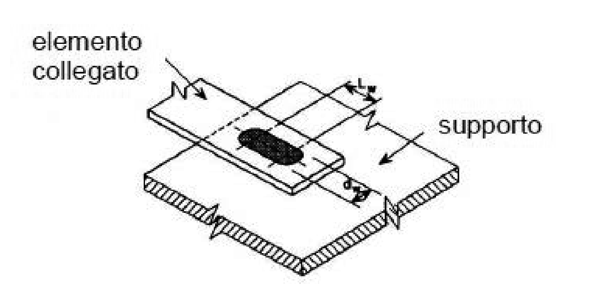

**Figura C4.2.36** - *Saldature oblunghe a bottone*

Secondo la direzione della forza trasmessa, la distanza minima tra il centro del bottone ed il bordo libero deve soddisfare la relazione

$$e_1 \ge \dfrac{2{,}1 \cdot F_{w,Sd} \cdot \gamma_{M2}}{f_{tk} \cdot t} \tag{C4.2.159}$$

dove $F_{w,Sd}$ è la resistenza a taglio del bottone, che per i bottoni circolari è data da

$$F_{w,Sd} = \dfrac{0{,}25 \cdot \pi \cdot d_s^2 \cdot 0{,}625 \cdot f_{tk}}{\gamma_{M2}} \tag{C4.2.160}$$

Il diametro effettivamente resistente della saldatura a bottone $d_s$,(fig. C4.2.35), viene determinato con la seguente espressione:

$$d_s = 0{,}7 d_w - 1{,}5 \sum t \tag{C4.2.161}$$

con la limitazione $d_s \ge 0{,}55 d_w$, con $d_w$ diametro di saldatura visibile (figg. C4.2.35 e C4.2.36), con le seguenti limitazioni

$$
\begin{aligned}
F_{w,Sd} &\le \dfrac{1{,}5 \cdot d_p \cdot f_{tk} \cdot \sum t}{\gamma_{M2}} && \text{per } \dfrac{d_p}{\sum t} \le 18 \sqrt{\dfrac{420}{f_{tk}}} \\
F_{w,Sd} &\le \dfrac{27 \cdot f_{tk} \cdot \left(\sum t\right)^2}{\gamma_{M2}} \sqrt{\dfrac{420}{f_{tk}}} && \text{per } 18 \sqrt{\dfrac{420}{f_{tk}}} < \dfrac{d_p}{\sum t} \le 30 \sqrt{\dfrac{420}{f_{tk}}} \\
F_{w,Sd} &\le \dfrac{0{,}9 \cdot d_p \cdot f_{tk} \cdot \sum t}{\gamma_{M2}} && \text{per } \dfrac{d_p}{\sum t} > 30 \sqrt{\dfrac{420}{f_{tk}}}
\end{aligned}
\tag{C4.2.162}
$$

e che per i bottoni oblunghi è data da

$$F_{w,Sd} = \dfrac{\left(0{,}25 \cdot \pi \cdot d_s^2 + L_w \cdot d_s\right) \cdot 0{,}625 \cdot f_{tk}}{\gamma_{M2}} \tag{C4.2.163}$$

con la limitazione

$$F_{w,Sd} \le \dfrac{\left(0{,}5 \cdot L_w + 1{,}67 \cdot d_p\right) \cdot f_{tk} \cdot \sum t}{\gamma_{M2}} \tag{C4.2.164}$$

essendo $L_w$ indicato in Figura C4.2.36 e l'effettivo diametro periferico $d_p$ di una saldatura a bottone si ottiene con le seguenti espressioni:

- per un unione a due piastre di spessore minimo $t$:

$$d_p = d_w - t \tag{C4.2.165}$$

- per unione di di piastre multipla con spessore totale $\sum t$:

$$d_p = d_w - 2 \sum t \tag{C4.2.166}$$
