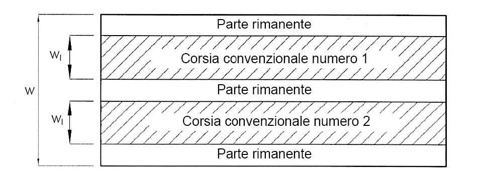
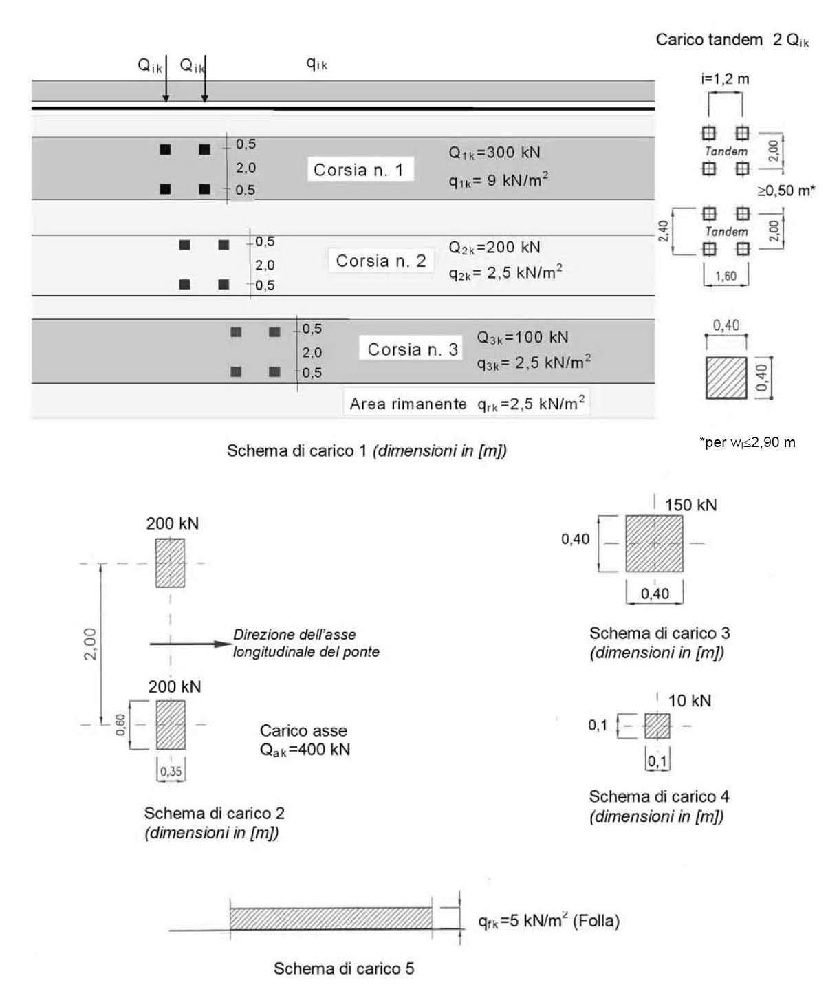
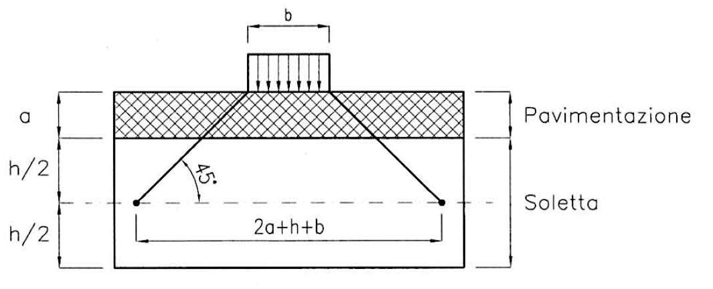
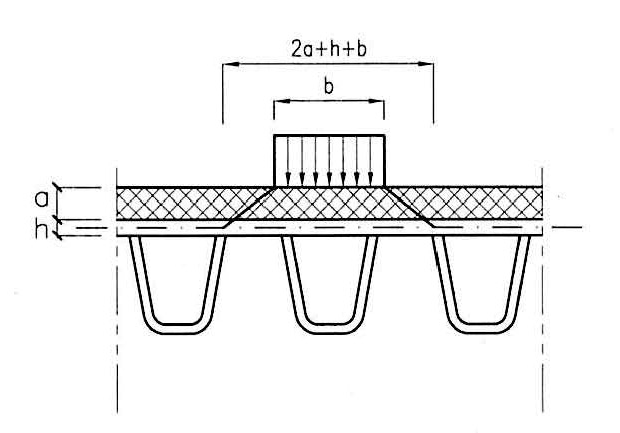
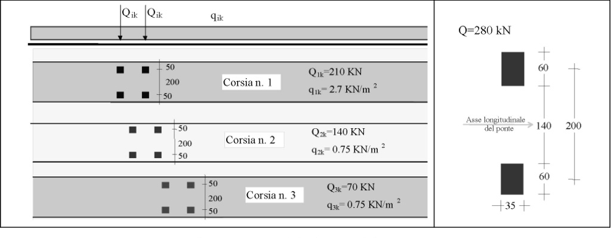
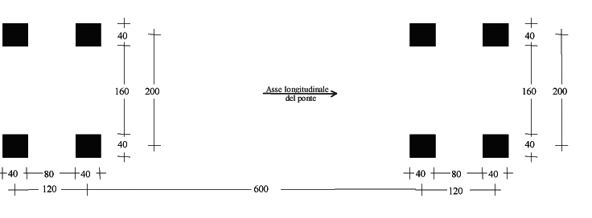
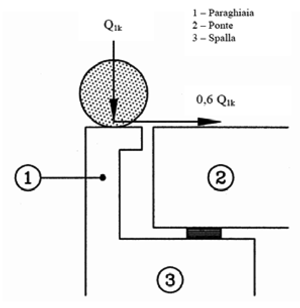
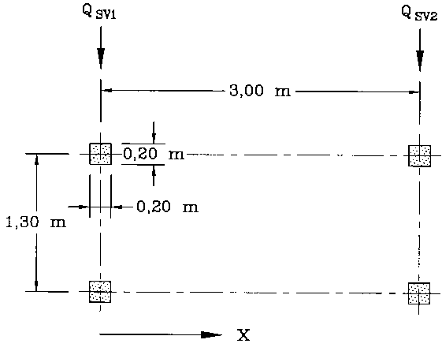

[Torna all'indice del capitolo](indice-cap05.md) | [Torna all'indice generale](../indice-ntc2018.md)

# 5.1. Ponti stradali

## Indice del capitolo

- [[#5.1.1. Oggetto|5.1.1 Oggetto (viadotti, cavalcavia, sovrappassi, mobili)]]
- [[#5.1.2. Prescrizioni generali|5.1.2 Prescrizioni generali]]
  - [[#5.1.2.1. Geometria della sede stradale|5.1.2.1 Geometria sede stradale]]
  - [[#5.1.2.2. Altezza libera|5.1.2.2 Altezza libera (≥5 m, deroghe)]]
  - [[#5.1.2.3. Compatibilità idraulica|5.1.2.3 Compatibilità idraulica (T_R=200 anni)]]
- [[#5.1.3. Azioni sui ponti stradali|5.1.3 Azioni sui ponti stradali]]
  - [[#5.1.3.1. Azioni permanenti|5.1.3.1 Azioni permanenti (g₁, g₂, g₃)]]
  - [[#5.1.3.2. Distorsioni e deformazioni impresse|5.1.3.2 Distorsioni e deformazioni]]
  - [[#5.1.3.3. Azioni variabili da traffico. Carichi verticali: $q_1$|5.1.3.3 Carichi verticali q₁ (Schemi 1-6)]]
  - [[#5.1.3.4. Azioni variabili da traffico. Incremento dinamico addizionale: $q_2$|5.1.3.4 Incremento dinamico q₂]]
  - [[#5.1.3.5. Azioni variabili da traffico. Azione longitudinale di frenamento o di accelerazione: $q_3$|5.1.3.5 Frenamento q₃]]
  - [[#5.1.3.6. Azioni variabili da traffico. Azione centrifuga: $q_4$|5.1.3.6 Centrifuga q₄ (Tab. 5.1.III)]]
  - [[#5.1.3.7. Azioni di neve e di vento: $q_5$|5.1.3.7 Neve e vento q₅]]
  - [[#5.1.3.8. Azioni idrodinamiche: $q_6$|5.1.3.8 Azioni idrodinamiche q₆]]
  - [[#5.1.3.9. Azioni della temperatura: $q_7$|5.1.3.9 Temperatura q₇]]
  - [[#5.1.3.10. Azioni sui parapetti e urto di veicolo in svio: $q_8$|5.1.3.10 Parapetti e urto q₈]]
  - [[#5.1.3.11. Resistenze passive dei vincoli: $q_9$|5.1.3.11 Resistenze passive vincoli q₉]]
  - [[#5.1.3.12. Azioni sismiche: $E$|5.1.3.12 Azioni sismiche E]]
  - [[#5.1.3.13. Azioni eccezionali: $A$|5.1.3.13 Azioni eccezionali A]]
  - [[#5.1.3.14. Combinazioni di carico|5.1.3.14 Combinazioni di carico (Tab. 5.1.IV-VI)]]
- [[#5.1.4. Verifiche di sicurezza|5.1.4 Verifiche di sicurezza]]
  - [[#5.1.4.1. Verifiche agli stati limite ultimi|5.1.4.1 Verifiche SLU]]
  - [[#5.1.4.2. Stati limite di esercizio|5.1.4.2 Stati limite di esercizio]]
  - [[#5.1.4.3. Verifiche allo stato limite di fatica|5.1.4.3 Stato limite di fatica (modelli 1-4)]]
  - [[#5.1.4.4. Verifiche allo stato limite di fessurazione|5.1.4.4 Stato limite di fessurazione]]
  - [[#5.1.4.5. Verifiche allo stato limite di deformazione|5.1.4.5 Stato limite di deformazione]]
  - [[#5.1.4.6. Verifiche delle azioni sismiche|5.1.4.6 Verifiche azioni sismiche]]
  - [[#5.1.4.7. Verifiche in fase di costruzione|5.1.4.7 Verifiche in fase di costruzione]]
- [[#5.1.5. Strutture portanti|5.1.5 Strutture portanti (impalcato, pile)]]
- [[#5.1.6. Vincoli|5.1.6 Vincoli (protezione, manutenzione, zona sismica)]]
- [[#5.1.7. Opere accessorie|5.1.7 Opere accessorie (impermeabilizzazione, pavimentazioni, giunti)]]
- [[#C5.1 Ponti stradali|C5.1 — Ponti stradali]]
  - [[#C5.1.2 Prescrizioni generali|C5.1.2 Prescrizioni generali (compatibilità idraulica)]]
  - [[#C5.1.3 Azioni sui ponti stradali|C5.1.3 Azioni (corsie convenzionali, schemi)]]
  - [[#C5.1.4 Verifiche di sicurezza|C5.1.4 Verifiche (fatica, deformazione, sismica)]]
  - [[#C5.1.8 Ponti pedonali|C5.1.8 Ponti pedonali (modelli dinamici)]]

---

# Norma

## 5.1.1. Oggetto

Il presente capitolo contiene i criteri generali e le indicazioni tecniche per la progettazione e l'esecuzione dei ponti stradali.

Nel seguito col termine "ponti" si intendono anche tutte quelle opere che, in relazione alle loro diverse destinazioni, vengono normalmente indicate con nomi particolari, quali: viadotti, sottovia o cavalcavia, sovrappassi, sottopassi, strade sopraelevate, ecc.

Le prescrizioni fornite, per quanto applicabili, riguardano anche i ponti mobili.

---

## 5.1.2. Prescrizioni generali

### 5.1.2.1. Geometria della sede stradale

Ai fini della presente normativa, per larghezza della sede stradale del ponte si intende la distanza misurata ortogonalmente all'asse stradale tra i punti più esterni dell'impalcato.

La sede stradale sul ponte è composta dalla piattaforma, eventualmente divisa da uno spartitrafico e composta dalle corsie e dalle banchine, dai cordoli e laddove previsti dai marciapiedi, a seconda dell'importanza, della funzione e delle caratteristiche della strada.

La superficie carrabile del ponte è composta dalla piattaforma e da eventuali marciapiedi sormontabili, di altezza inferiore a 20 cm e non protetti da barriere di sicurezza stradale o da altri dispositivi di ritenuta.

### 5.1.2.2. Altezza libera

Nel caso di un ponte che scavalchi una strada ordinaria, l'altezza libera al di sotto del ponte non deve essere in alcun punto minore di 5 m, tenendo conto anche delle pendenze della strada sottostante.

Nei casi di strada a traffico selezionato è ammesso, per motivi validi e comprovati, derogare da quanto sopra, purché l'altezza minima non sia minore di 4 m.

Eccezionalmente, ove l'esistenza di vincoli non eliminabili imponesse di scendere al di sotto di tale valore, si può adottare un'altezza minima, in ogni caso non inferiore a 3,20 m. Tale deroga è vincolata al parere favorevole dei Comandi Militare e dei Vigili del Fuoco competenti per territorio.

I ponti sui corsi d'acqua classificati navigabili devono avere il tirante corrispondente alla classe dei natanti previsti.

Per tutti i casi in deroga all'altezza minima prescritta di 5 m, si devono adottare opportuni dispositivi segnaletici di sicurezza (ad es. controsagome), collocati a conveniente distanza dall'imbocco dell'opera.

Nel caso di sottopassaggi pedonali l'altezza libera non deve essere inferiore a 2,50 m.

### 5.1.2.3. Compatibilità idraulica

Quando il ponte interessa un corso d'acqua naturale o artificiale, il progetto deve essere corredato da uno studio di compatibilità idraulica costituito da una relazione idrologica e da una relazione idraulica riguardante le scelte progettuali, la costruzione e l'esercizio del ponte.

La piena di progetto è quella con tempo di ritorno $T_r$ pari a 200 anni ($T_r = 200$).

Lo studio deve riportare:

- analisi idrologica degli eventi di massima piena;
- definizione della scala delle portate;
- valutazione dello scavo localizzato;
- esame di urti e abrasioni da natanti e corpi flottanti.

Il manufatto non dovrà interessare con spalle, pile e rilevati la sezione del corso d'acqua interessata dalla piena di progetto e, se arginata, i corpi arginali.

La luce netta minima tra pile contigue, o fra pila e spalla, deve essere non inferiore a 40 m, misurata ortogonalmente al filone principale della corrente.

Il franco idraulico deve essere non inferiore a 1,50 m.

Lo scalzamento e le azioni idrodinamiche associate al livello idrico massimo ($T_r \approx 1\,001$) devono essere combinati con le altre azioni variabili adottando valori del coefficiente $\psi_0$ unitario.

Lo scalzamento e le azioni idrodinamiche associati all'evento di piena di progetto devono essere combinati esclusivamente con le altre azioni variabili da traffico, adottando per queste ultime i coefficienti di combinazione $\psi_1$.

---

## 5.1.3. Azioni sui ponti stradali

Le azioni da considerare sono:

- azioni permanenti;
- distorsioni e deformazioni impresse;
- azioni variabili da traffico;
- azioni variabili (variazioni termiche, spinte idrodinamiche, vento, neve e azioni sui parapetti);
- resistenze passive dei vincoli;
- urti sulle barriere di sicurezza stradale di veicoli in svio;
- azioni sismiche;
- azioni eccezionali.

### 5.1.3.1. Azioni permanenti

1. Peso proprio degli elementi strutturali: $g_1$.
2. Carichi permanenti portati: $g_2$ (pavimentazione stradale, marciapiedi, barriere acustiche, barriere di sicurezza stradale, parapetti, finiture, sistema di smaltimento acque, attrezzature stradali, rinfianchi e simili).
3. Altre azioni permanenti: $g_3$ (spinta delle terre, spinte idrauliche, ecc.).

### 5.1.3.2. Distorsioni e deformazioni impresse

1. Distorsioni e presollecitazioni di progetto: $\varepsilon_1$.
2. Effetti reologici: ritiro $\varepsilon_2$ e viscosità $\varepsilon_3$.
3. Cedimenti vincolari: $\varepsilon_4$.

### 5.1.3.3. Azioni variabili da traffico. Carichi verticali: $q_1$

#### 5.1.3.3.1. Premessa

I carichi verticali da traffico sono definiti dagli Schemi di Carico descritti nel § 5.1.3.3.3, disposti su corsie convenzionali.

#### 5.1.3.3.2. Definizione delle corsie convenzionali

Le larghezze $w$ delle corsie convenzionali e il massimo numero possibile di corsie sono indicati in Fig. 5.1.1 e Tab. 5.1.I.

**Tab. 5.1.I** – *Numero e larghezza delle corsie*

| Larghezza della superficie carrabile $w$ | Numero di corsie convenzionali | Larghezza di una corsia convenzionale [m] | Larghezza della zona rimanente [m] |
|---|---|---|---|
| $w < 5{,}40$ m | $n_1 = 1$ | 3,00 | $(w - 3{,}00)$ |
| $5{,}40 \leq w < 6{,}00$ m | $n_1 = 2$ | $w/2$ | 0 |
| $w \geq 6{,}00$ m | $n_1 = \text{Int}(w/3)$ | 3,00 | $w - 3{,}00 \times n_1$ |

La disposizione e la numerazione delle corsie va determinata in modo da indurre le più sfavorevoli condizioni di progetto.

#### 5.1.3.3.3. Schemi di Carico

Le azioni variabili del traffico, comprensive degli effetti dinamici, sono definite dai seguenti Schemi di Carico:

- **Schema di Carico 1**: carichi concentrati su due assi in tandem (impronte quadrate di lato 0,40 m) e carichi uniformemente distribuiti. Schema di riferimento sia per verifiche globali sia locali.
- **Schema di Carico 2**: singolo asse, impronte rettangolari $0{,}60 \times 0{,}35$ m. Solo per verifiche locali. Singola ruota più gravosa: 200 kN.
- **Schema di Carico 3**: carico isolato di 150 kN con impronta quadrata di lato 0,40 m. Verifiche locali su marciapiedi non protetti da sicurvia.
- **Schema di Carico 4**: carico isolato di 10 kN con impronta quadrata di lato 0,10 m. Verifiche locali su marciapiedi protetti da sicurvia e su passerelle pedonali.
- **Schema di Carico 5**: folla compatta, intensità nominale $5{,}0$ kN/m², valore di combinazione $2{,}5$ kN/m².
- **Schemi di Carico 6.a, 6.b, 6.c**: per opere di luce > 300 m, i carichi $q_{L,a}$, $q_{L,b}$ e $q_{L,c}$ sono definiti dalle seguenti espressioni:

$$q_{L,a} = 128{,}95 \left(\frac{1}{L}\right)^{0,25} \text{ [kN/m]}$$ \tag{5.1.1}

$$q_{L,b} = 88{,}71 \left(\frac{1}{L}\right)^{0,38} \text{ [kN/m]}$$ \tag{5.1.2}

$$q_{L,c} = 77{,}12 \left(\frac{1}{L}\right)^{0,38} \text{ [kN/m]}$$ \tag{5.1.3}

essendo $L$ la lunghezza della zona caricata in m.

#### 5.1.3.3.4. Categorie Stradali

Si distinguono due categorie:

- ponti per transito dei carichi mobili con il loro intero valore;
- ponti per il transito dei soli carichi associati allo Schema 5 (ponti pedonali).

#### 5.1.3.3.5. Disposizione dei carichi mobili per realizzare le condizioni di carico più gravose

Il numero delle colonne di carichi mobili da considerare è il massimo compatibile con la larghezza della superficie carrabile.

**Tab. 5.1.II** – *Intensità dei carichi $Q_{ik}$ e $q_{ik}$ per le diverse corsie*

| Posizione | Carico asse $Q_{ik}$ [kN] | $q_{ik}$ [kN/m²] |
|---|---|---|
| Corsia Numero 1 | 300 | 9,00 |
| Corsia Numero 2 | 200 | 2,50 |
| Corsia Numero 3 | 100 | 2,50 |
| Altre corsie | 0,00 | 2,50 |

#### 5.1.3.3.6. Strutture secondarie di impalcato

*Diffusione dei carichi locali*: la diffusione avviene a 45° attraverso la pavimentazione e lo spessore della soletta fino al piano medio della struttura della soletta sottostante.

*Calcolo delle strutture secondarie di impalcato*: si prendano in considerazione i carichi già definiti. Per marciapiedi non protetti: Schema 3. Per marciapiedi protetti e ponti pedonali: Schema 4.

### 5.1.3.4. Azioni variabili da traffico. Incremento dinamico addizionale: $q_2$

I carichi mobili includono gli effetti dinamici per pavimentazioni di media rugosità. In casi particolari (prossimità di giunti di dilatazione) può essere necessario un coefficiente dinamico addizionale $q_2$.

### 5.1.3.5. Azioni variabili da traffico. Azione longitudinale di frenamento o di accelerazione: $q_3$

$$180 \text{ kN} \leq q_3 = 0{,}6 \cdot (2 \, Q_{1k}) + 0{,}10 \cdot q_{1k} \cdot w_1 \cdot L \leq 900 \text{ kN}$$ \tag{5.1.4}

essendo $w_1$ la larghezza della corsia e $L$ la lunghezza della zona caricata.

### 5.1.3.6. Azioni variabili da traffico. Azione centrifuga: $q_4$

**Tab. 5.1.III** – *Valori caratteristici delle forze centrifughe*

| Raggio di curvatura [m] | $q_4$ [kN] |
|---|---|
| $R < 200$ | $0{,}2 \, Q_v$ |
| $200 \leq R \leq 1\,500$ | $40 \, Q_v / R$ |
| $R > 1\,500$ | 0 |

### 5.1.3.7. Azioni di neve e di vento: $q_5$

Per le azioni da neve e vento vale quanto specificato al Capitolo 3.

L'azione del vento va considerata agente su una superficie piana continua di 3 m di altezza a partire dal piano stradale.

Il carico di neve si considera non concomitante con i carichi da traffico, salvo che per ponti coperti.

### 5.1.3.8. Azioni idrodinamiche: $q_6$

Le azioni idrodinamiche sulle pile sono calcolate secondo § 5.1.2.3, tenendo conto dell'orientamento e della forma della pila, e degli effetti di scalzamento.

### 5.1.3.9. Azioni della temperatura: $q_7$

Il calcolo degli effetti delle variazioni termiche va condotto in accordo al Capitolo 3.

### 5.1.3.10. Azioni sui parapetti e urto di veicolo in svio: $q_8$

L'altezza dei parapetti non deve essere inferiore a 1,10 m.

L'azione orizzontale sui parapetti è pari a 1,5 kN/m applicata al corrimano.

Le barriere di sicurezza devono essere dimensionate in funzione della classe di contenimento.

Nel progetto dell'impalcato si adotta una combinazione di carico equivalente all'effetto dell'urto, associata ad un carico verticale isolato (Schema 2) disposto in adiacenza alla barriera.

Le forze orizzontali determinate devono essere amplificate di un fattore 1,50.

Il coefficiente parziale di sicurezza per urto di veicolo in svio è unitario.

### 5.1.3.11. Resistenze passive dei vincoli: $q_9$

Si devono considerare le forze parassite dei vincoli. Nel caso di appoggi in gomma, tali forze devono essere valutate sulla base delle caratteristiche dell'appoggio e degli spostamenti previsti.

### 5.1.3.12. Azioni sismiche: $E$

Per le azioni sismiche valgono i §§ 2.5.3 e 3.2.

Per ponti in zona urbana di intenso traffico: $\psi_2 = 0{,}2$.

### 5.1.3.13. Azioni eccezionali: $A$

Le azioni eccezionali devono essere valutate sulla base del § 3.6, in particolare § 3.6.3.

I piedritti dei ponti ubicati a distanza non superiore a 5,0 m dalla sede stradale devono essere protetti.

### 5.1.3.14. Combinazioni di carico

Le combinazioni devono garantire la sicurezza in conformità al Capitolo 2.

**Tab. 5.1.IV** – *Valori caratteristici delle azioni dovute al traffico*

I gruppi di azioni sono i seguenti:

| Gruppo | Schema di Carico 1 (tandem) | Schema di Carico 1 (distrib.) | Schema di Carico 2 | Schema di Carico 3 / 4 | Schema di Carico 5 / 6 | Frenamento | Azione centrifuga |
|---|---|---|---|---|---|---|---|
| 1 | Valori caratteristici | Valori caratteristici | — | — | — | Valore caratteristico | Valore caratteristico |
| 2a | — | — | Valore caratteristico | — | — | — | — |
| 2b | — | — | — | Valore caratteristico | — | — | — |
| 3 | — | — | — | — | Valore caratteristico | Valore caratteristico | — |
| 4 | Valori frequenti | Valori frequenti | — | — | — | — | — |
| 5 | — | Valore caratteristico | — | — | — | — | — |

**Tab. 5.1.V** – *Coefficienti parziali di sicurezza per le combinazioni di carico agli SLU*

| | Coefficiente | EQU | A1 | A2 |
|---|---|---|---|---|
| Azioni permanenti $g_1$ e $g_3$ | $\gamma_{G1}$, $\gamma_{G3}$ | fav. 0,90 / sfav. 1,10 | 1,00 / 1,35 | 1,00 / 1,00 |
| Azioni permanenti non strutturali $g_2$ | $\gamma_{G2}$ | 0,00 / 1,50 | 0,00 / 1,50 | 0,00 / 1,30 |
| Azioni variabili da traffico | $\gamma_Q$ | 0,00 / 1,35 | 0,00 / 1,35 | 0,00 / 1,15 |
| Azioni variabili | $\gamma_{Qi}$ | 0,00 / 1,50 | 0,00 / 1,50 | 0,00 / 1,30 |
| Distorsioni e presollecitazioni | $\gamma_{\varepsilon 1}$ | 0,90 / 1,00 ⁽³⁾ | 1,00 / 1,00 ⁽⁴⁾ | 1,00 / 1,00 |
| Ritiro e viscosità, cedimenti vincolari | $\gamma_{\varepsilon 2}$, $\gamma_{\varepsilon 3}$, $\gamma_{\varepsilon 4}$ | 0,00 / 1,20 | 0,00 / 1,20 | 0,00 / 1,00 |

Note:
⁽¹⁾ EQU: equilibrio come corpo rigido.
⁽²⁾ Carichi permanenti non strutturali.
⁽³⁾ 1,30 per instabilità in strutture con precompressione esterna.
⁽⁴⁾ 1,20 per effetti locali.

**Tab. 5.1.VI** – *Coefficienti $\psi$ per le azioni variabili per ponti stradali e pedonali*

| Azioni | Gruppo di azioni (Tab. 5.1.IV) | $\psi_0$ | $\psi_1$ | $\psi_2$ |
|---|---|---|---|---|
| Schema 1 (carichi tandem) | | 0,75 | 0,75 | 0,0 |
| Schemi 1, 5 e 6 (carichi distribuiti) | | 0,40 | 0,40 | 0,0 |
| Schemi 3 e 4 (carichi concentrati) | | 0,40 | 0,40 | 0,0 |
| Schema 2 | | 0,0 | 0,75 | 0,0 |
| Vento a ponte scarico SLU e SLE | 2 | 0,6 | 0,2 | 0,0 |
| Vento in esecuzione | | 0,8 | 0,0 | 0,0 |
| Neve a ponte carico SLU e SLE | 3 | 0,6 | 0,0 | 0,0 |
| Neve SLU e SLE | | 0,0 | 0,0 | 0,0 |
| Neve in esecuzione | | 0,8 | 0,6 | 0,5 |
| Temperatura SLU e SLE | | 0,6 | 0,6 | 0,5 |

Per opere di luce superiore a 300 m è possibile modificare i coefficienti $\psi$ previa autorizzazione del Servizio tecnico centrale.

---

## 5.1.4. Verifiche di sicurezza

### 5.1.4.1. Verifiche agli stati limite ultimi

Si deve verificare che sia:

$$E_d \leq R_d$$

dove $E_d$ è il valore di progetto degli effetti delle azioni ed $R_d$ è la corrispondente resistenza di progetto.

### 5.1.4.2. Stati limite di esercizio

Si dovrà verificare che sia:

$$E_d \leq C_d$$

dove $C_d$ è un valore nominale o una funzione di certe proprietà dei materiali.

### 5.1.4.3. Verifiche allo stato limite di fatica

Le verifiche devono essere condotte considerando spettri di carico differenziati, a seconda che si conduca una verifica per vita illimitata o una verifica a danneggiamento.

*Verifiche per vita illimitata*: l'escursione di tensione $\Delta\sigma_{\max} = (\sigma_{\max} - \sigma_{\min})$ deve risultare minore del limite di fatica del dettaglio. Si utilizzano i Modelli di carico di fatica 1 e 2.

- **Modello 1**: 70% dei carichi concentrati e 30% dei carichi distribuiti dello Schema 1.
- **Modello 2**: veicoli frequenti di cui alla Tab. 5.1.VII, applicati al centro della corsia n. 1.

*Verifiche a danneggiamento*: si deve verificare $D \leq 1$ con la legge di Palmgren-Miner.

- **Modello 3**: veicolo di fatica simmetrico a 4 assi da 120 kN ciascuno.
- **Modello 4**: veicoli equivalenti di cui alla Tab. 5.1.VIII.

**Tab. 5.1.VII** – *Modello di carico di fatica 2 – veicoli frequenti*

Tabella con sagome dei veicoli, distanze tra gli assi, carichi frequenti per asse e tipo di ruota (A, B, C).

**Tab. 5.1.VIII** – *Modello di carico di fatica 4 – veicoli equivalenti*

Tabella con sagome dei veicoli, tipo di pneumatico, interassi, valori equivalenti dei carichi e composizione del traffico.

**Tab. 5.1.IX** – *Dimensioni degli assi e delle impronte per i veicoli equivalenti*

Figure con i tipi A, B, C e relative dimensioni.

**Tab. 5.1.X** – *Flusso annuo di veicoli pesanti sulla corsia di marcia lenta*

| Categorie di traffico | Flusso annuo di veicoli > 100 kN |
|---|---|
| 1 — Strade ed autostrade con 2 o più corsie, intenso traffico pesante | $2{,}0 \times 10^6$ |
| 2 — Strade ed autostrade, traffico pesante di media intensità | $0{,}5 \times 10^6$ |
| 3 — Strade principali, traffico pesante di modesta intensità | $0{,}125 \times 10^6$ |
| 4 — Strade locali, traffico pesante di intensità molto ridotta | $0{,}05 \times 10^6$ |

### 5.1.4.4. Verifiche allo stato limite di fessurazione

Per c.a. ordinario si fa riferimento alla Tab. 4.1.IV, con armatura poco sensibile. Per c.a.p. si adottano le indicazioni per armature sensibili.

### 5.1.4.5. Verifiche allo stato limite di deformazione

Le deformazioni non devono arrecare disturbo al transito dei carichi mobili alle velocità di progetto della strada.

### 5.1.4.6. Verifiche delle azioni sismiche

Le verifiche vanno condotte secondo i criteri delle relative sezioni delle presenti Norme.

### 5.1.4.7. Verifiche in fase di costruzione

Le verifiche devono essere condotte anche per le singole fasi di costruzione, tenendo conto dell'evoluzione dello schema statico e degli effetti differiti nel tempo.

---

## 5.1.5. Strutture portanti

### 5.1.5.1. Impalcato

#### 5.1.5.1.1. Spessori minimi

Si deve tener conto dell'influenza dei fattori ambientali sulla durabilità dell'opera.

#### 5.1.5.1.2. Strutture ad elementi prefabbricati

Si deve garantire la compatibilità geometrica e le tolleranze costruttive. Gli elementi di connessione devono essere conformati per la corretta trasmissione degli sforzi.

### 5.1.5.2. Pile

#### 5.1.5.2.1. Spessori minimi

Come per le strutture dell'impalcato.

#### 5.1.5.2.2. Schematizzazione e calcolo

Per pile snelle occorre prestare attenzione alle effettive condizioni di vincolo, specialmente riguardo l'interazione con le opere di fondazione. Si devono verificare gli effetti locali delle azioni concentrate degli apparecchi di appoggio e gli spostamenti consentiti.

---

## 5.1.6. Vincoli

I dispositivi di vincolo dell'impalcato alle sottostrutture devono possedere le caratteristiche previste dallo schema statico e cinematico assunto. Il margine di sicurezza deve essere maggiore rispetto ad altri elementi strutturali.

### 5.1.6.1. Protezione dei vincoli

I vincoli devono essere dotati di adeguata protezione per il periodo di esercizio previsto.

### 5.1.6.2. Controllo, manutenzione e sostituzione

I vincoli devono essere accessibili per il controllo, la manutenzione e la sostituzione senza eccessiva difficoltà.

### 5.1.6.3. Vincoli in zona sismica

I vincoli devono essere progettati per trasmettere le azioni sismiche, evitare sconnessioni ed evitare la fuoriuscita dei vincoli dalle sedi.

---

## 5.1.7. Opere accessorie

### 5.1.7.1. Impermeabilizzazione

Si deve evitare che infiltrazioni d'acqua arrechino danno alle strutture portanti.

### 5.1.7.2. Pavimentazioni

La pavimentazione stradale deve sottrarre all'usura e alla diretta azione del traffico l'estradosso del ponte e gli strati di impermeabilizzazione.

### 5.1.7.3. Giunti

I dispositivi di giunto devono assicurare la continuità del piano viabile e impedire la percolazione delle acque attraverso i giunti.

### 5.1.7.4. Smaltimento dei liquidi provenienti dall'impalcato

Lo smaltimento non deve arrecare danni o pregiudizio all'opera stessa, alla sicurezza del traffico e ad eventuali opere sottostanti.

### 5.1.7.5. Dispositivi per l'ispezionabilità e la manutenzione delle opere

Si devono prevedere opere di camminamento (piattaforme, scale, passi d'uomo, ecc.) commisurate all'importanza del ponte.

### 5.1.7.6. Vani per condotte e cavidotti

Si deve prevedere la possibilità di passaggio di cavi e condotte di acquedotto.

---

# Circolare

Il Capitolo 5 delle NTC tratta i criteri generali e le indicazioni tecniche per la progettazione e l'esecuzione dei ponti stradali e ferroviari.

In particolare, per quanto riguarda i ponti stradali, oltre alle principali caratteristiche geometriche, vengono definite le diverse possibili azioni agenti ed assegnati gli schemi di carico corrispondenti alle azioni variabili da traffico.

Gli schemi di carico stradali e ferroviari da impiegare per le verifiche statiche e a fatica sono generalmente coerenti con gli schemi delle UNI EN 1991-2, cui si può far riferimento per aspetti di dettaglio non trattati nelle NTC.

I carichi da traffico per ponti stradali del modello principale sono indipendenti dall'estensione della zona caricata, includono gli effetti dinamici e sono indifferenziati per le verifiche locali e le verifiche globali, cosicché le possibili ambiguità e/o difficoltà applicative sono minimizzate.

Per i ponti stradali sono anche forniti appositi modelli di carico per il calcolo degli effetti globali in ponti di luce superiore a 300 m.

Per i ponti ferroviari particolare attenzione viene posta sui carichi ed i relativi effetti dinamici. Particolari e dettagliate prescrizioni vengono fornite per le verifiche, sia agli SLU sia agli SLE.

I modelli di carico assegnati, sia per i ponti stradali che per i ponti ferroviari, sono modelli ideali, intesi a riprodurre gli effetti del traffico reale caratterizzati da assegnato periodo di ritorno. Essi non sono pertanto rappresentativi di veicoli o convogli reali.

Si segnala ancora che i coefficienti parziali di sicurezza relativi ai sovraccarichi da traffico sono minori di quelli pertinenti ad altri sovraccarichi; infatti, il coefficiente $\gamma_Q$ per le azioni da traffico stradale vale 1,35 per le combinazioni EQU e STR e 1,15 per la combinazione GEO, e il coefficiente $\gamma_Q$ per le azioni da traffico ferroviario vale 1,45 per le combinazioni EQU e STR e 1,25 per la combinazione GEO.

## C5.1 Ponti stradali

### C5.1.2 Prescrizioni generali

#### C5.1.2.3 Compatibilità idraulica

Ai fini dell'applicazione del punto 5.1.2.3 della Norma, s'intende per alveo la sezione occupata dal deflusso della portata di piena di progetto. Quest'ultima è a sua volta caratterizzata da un tempo di ritorno pari a $T_R$ = 200 anni, dovendosi intendere tale valore quale il più appropriato da scegliere, non escludendo tuttavia valori anche maggiori che devono però essere adeguatamente motivati e giustificati.

Gli elementi del ponte, quali le opere strutturali, di difesa ed accessorie, quando interessino l'alveo di un corso d'acqua, fanno parte di un progetto unitario corredato dallo studio di compatibilità idraulica di cui al punto 5.1.2.3 delle NTC. Il progetto sarà impostato tenendo in considerazione la necessità di garantire l'accesso per il ripristino dell'officiosità idraulica degli attraversamenti parzialmente o totalmente intasati dai detriti durante gli eventi di piena.

Fermo restando quanto previsto dalla Norma, nello studio di compatibilità idraulica, in funzione delle diverse situazioni, è opportuno siano tra l'altro illustrati i seguenti aspetti:
- analisi degli eventi di massima piena; esame dei principali eventi verificatisi nel corso d'acqua; raccolta dei valori estremi in quanto disponibili, e loro elaborazione in termini di frequenza probabile del verificarsi; per i ponti in sezioni di un corso d'acqua che abbiano a monte manufatti artificiali che limitino il naturale deflusso delle piene, queste sono da valutarsi anche nell'ipotesi che tali manufatti siano dismessi;
- ricerca e raccolta, presso gli Uffici ed Enti competenti, delle notizie e dei rilievi esistenti, anche storici, utili per lo studio idraulico da svolgere;
- giustificazione della soluzione proposta per: l'ubicazione del ponte, le sue dimensioni e le sue strutture in pianta, in elevazione ed in fondazione, tenuto conto del regime del corso d'acqua, dell'assetto morfologico attuale e della sua possibile evoluzione, nonché delle caratteristiche geotecniche della zona interessata;
- allontanamento delle acque dall'impalcato e prevenzione del loro scolo incontrollato sulle strutture del ponte stesso o su infrastrutture sottostanti.

Inoltre è di interesse stimare i valori della frequenza probabile (1/$T_R$) di ipotetici eventi che diano luogo a riduzioni del franco stesso.

Nello studio idraulico, in funzione delle diverse situazioni, sono inoltre considerati, ove applicabili, i seguenti problemi:
- classificazione del corso d'acqua ai fini dell'esercizio della navigazione interna;
- valutazione dell'influenza dello scavo localizzato in corrispondenza delle pile e delle spalle, sulla stabilità di argini e sponde e delle fondazioni di altri manufatti presenti nelle vicinanze;
- esame delle conseguenze della presenza di corpi flottanti, considerando anche il possibile disormeggio dei natanti;
- sollecitazioni indotte dall'acqua per evento sismico quando sia di qualche rilievo la superficie immersa delle pile.

Per la stima del livello idrico massimo che si verifica mediamente ogni anno, in assenza di dati che garantiscano una robusta caratterizzazione statistica degli eventi, è da utilizzarsi il minimo fra i valori di portata massimi annuali registrati. Scalzamento e azioni idrodinamiche devono in tal caso essere combinate con tutte le altre azioni variabili, mentre nella situazione corrispondente all'evento di piena di progetto, nella combinazione con le altre azioni variabili sono da considerare solo quelle variabili da traffico.

Quando, per caratteristiche del territorio e del corso d'acqua, si possa verificare il transito di tronchi di rilevanti dimensioni, in aggiunta alla prescrizione di un franco normale minimo di 1,50 m, è da raccomandare che il dislivello fra fondo e sottotrave sia indicativamente non inferiore a 6÷7 m. Nel caso di corsi di acqua arginati, la quota di sottotrave sarà comunque non inferiore alla quota della sommità arginale per l'intera luce.

Le limitazioni alle modifiche delle pile o delle spalle e relative fondazioni di ponti esistenti previste al punto 5.1.2.3 della Norma, sono da riferirsi agli elementi che interessano l'alveo o i corpi arginali. La possibilità di deroga è relativa alle sole pile.

Per i ponti esistenti sono ammessi gli interventi per l'incremento della sicurezza strutturale in analogia a quanto prescritto al § 8.4 della Norma, solo nel caso in cui siano esclusi incrementi del livello di traffico di progetto e gli stessi interventi non vadano a peggiorare le condizioni di sicurezza idraulica esistenti.

Nelle Relazioni idrologica e idraulica sarà valutato il sistema di smaltimento delle acque meteoriche, tenendo in considerazione: analisi degli eventi pluviometrici, disposizione delle caditoie, influenza del trasporto solido, posizione e lunghezza dei tubi di eduzione.

Nelle strutture a cassone va considerata l'opportunità di praticare, nei punti di possibili accumulo, fori di evacuazione di eventuali acque di infiltrazione.

Restano esclusi dal punto 5.1.2.3 della Norma i tombini, intendendosi per tombino un manufatto totalmente rivestito in sezione, in grado di condurre complessivamente portate fino a 50 m³/s. L'evento da assumere a base del progetto di un tombino ha comunque tempo di ritorno uguale a quello da assumere per i ponti.

### C5.1.3 Azioni sui ponti stradali

#### C5.1.3.3 Azioni variabili da traffico. Carichi verticali: q1

##### C5.1.3.3.2 Definizione delle corsie convenzionali

Ai fini del calcolo, la carreggiata deve essere suddivisa in corsie convenzionali, ciascuna di larghezza 3,00 m, in modo da individuare le condizioni di carico più severe per la verifica in esame. Le corsie convenzionali possono essere adiacenti oppure no, a seconda del dettaglio considerato e della forma della superficie d'influenza. Le corsie convenzionali sono indipendenti dalle corsie fisiche.

##### C5.1.3.3.3 Schemi di carico

Gli schemi di carico specificati al § 5.1.3.3.3 delle NTC includono gli effetti dinamici determinati con riferimento alla rugosità di pavimentazioni stradali di media qualità secondo la norma ISO 8685:1995. Lo schema di carico 1 vale per ponti di luce non maggiore di 300 m. Per ponti di luce superiore a 300 m si può utilizzare lo schema di carico 6.

##### C5.1.3.3.5 Disposizioni dei carichi mobili per le condizioni più gravose

Gli assi tandem si considerano viaggianti secondo l'asse longitudinale del ponte e sono generalmente disposti in asse alle rispettive corsie. Per ponti con carreggiata di larghezza minore di 5,80 m, la minima distanza trasversale tra due tandem affiancati si può considerare uguale a 50 cm.

###### C5.1.3.3.5.1 Carichi verticali da traffico su rilevati e su terrapieni adiacenti al ponte

I carichi tandem possono essere sostituiti da carichi uniformemente distribuiti equivalenti, applicati su una superficie rettangolare larga 3,0 m e lunga 2,20 m. In un rilevato correttamente consolidato, si può assumere una diffusione del carico con angolo di 30°.

###### C5.1.3.3.5.2 Carichi orizzontali da traffico su rilevati e su terrapieni adiacenti al ponte

I carichi orizzontali da traffico sui rilevati o sui terrapieni possono essere considerati assenti. Per il calcolo dei muri paraghiaia si deve considerare un'azione orizzontale longitudinale di frenamento pari al 60% del carico asse $Q_{1k}$ (180 kN orizzontale + 300 kN verticale).

***Fig. C5.1.1** — Carichi da traffico su muri paraghiaia*

#### C5.1.3.10 Azioni sui parapetti e urti di veicolo in svio: $Q_8$

Le barriere di sicurezza stradali devono essere dimensionate in funzione della classe di contenimento richiesta dalle normative nazionali applicabili. Si potranno utilizzare solo dispositivi di ritenuta stradale in possesso di idonea qualificazione ai sensi della normativa comunitaria o nazionale applicabile.

Nella progettazione dell'impalcato si dovrà tenere conto della tipologia di barriera prescelta, dello spazio di lavoro necessario, delle modalità di ancoraggio e di funzionamento della barriera e della sua compatibilità.

### C5.1.4 Verifiche di sicurezza

#### C5.1.4.3 Verifiche allo stato limite di fatica

Per le verifiche a fatica si può far riferimento ai quattro modelli di carico a fatica assegnati al §5.1.4.3 delle NTC. I modelli includono gli effetti dinamici calcolati con riferimento alla rugosità di pavimentazioni stradali di qualità buona secondo la norma ISO 8685:1995.

Il modello di carico a fatica n. 1 va disposto sul ponte in modo da massimizzare il delta di tensione:

$$\Delta\sigma = \sigma_{max} - \sigma_{min}$$ \tag{C5.1.1}

Il modello di carico di fatica 3 può essere utilizzato per le verifiche col metodo dei coefficienti di danneggiamento equivalente, metodo $\lambda$ (norme UNI EN1992-2, UNI EN1993-2 ed UNI EN1994-2).

In prossimità di un giunto d'espansione, il fattore di amplificazione dinamica addizionale è:

$$\Delta\varphi_{fat} = 1{,}30 \cdot \left(1 - \frac{d}{26}\right) \geq 1{,}0$$ \tag{C5.1.2}

dove d è la distanza dalla sezione di giunto in m.

#### C5.1.4.5 Verifiche allo stato limite di deformazione

I valori di progetto della variazione termica uniforme per la massima espansione/contrazione:

$$\Delta T_{exp,d} = \Delta T_{exp} + \Delta T_0$$ \tag{C5.1.3}

$$\Delta T_{con,d} = \Delta T_{con} + \Delta T_0$$ \tag{C5.1.4}

dove:

$$\Delta T_{exp} = +T_{e,max} - T_0$$ \tag{C5.1.5}

$$\Delta T_{con} = -T_{e,min} + T_0$$ \tag{C5.1.6}

$\Delta T_0$ dipende dalle condizioni di installazione:

| Condizione | $\Delta T_0$ |
|:-----------|:----------:|
| c.a./c.a.p./acciaio-cls, con misurazione e preregolazione | 5°C |
| acciaio, con misurazione e preregolazione | 5°C |
| acciaio, con stima e preregolazione | 15°C |
| c.a./c.a.p./acciaio-cls, con stima e preregolazione | 10°C |
| c.a./c.a.p./acciaio-cls, senza preregolazione | 20°C |
| acciaio, senza preregolazione | 30°C |

I valori caratteristici:

$$\Delta T_{exp,k} = \Delta T_{exp}$$ \tag{C5.1.7}

$$\Delta T_{con,k} = \Delta T_{con}$$ \tag{C5.1.8}

#### C5.1.4.6 Verifica delle azioni sismiche

Nella progettazione sismica di manufatti all'intersezione di due infrastrutture lineari con valori non coincidenti di $V_N$ e $C_U$, occorrerà progettare assumendo il più alto valore di $V_R$ fra quelli determinati considerando l'opera appartenente a ciascuna delle infrastrutture interferenti.

### C5.1.8 Ponti pedonali

Per i ponti pedonali si deve considerare lo schema di carico 4, folla compatta, con intensità di 5,0 kN/m². In zone scarsamente abitate il carico può essere ridotto a:

$$2{,}50 \text{ kN/m}^2 \leq q_{f,r} = 2{,}0 + \frac{120}{L + 30} \leq 5{,}00 \text{ kN/m}^2$$ \tag{C5.1.9}

dove L è la lunghezza della stesa di carico in m.

Per veicolo di servizio/soccorso si può considerare lo schema di Figura C5.1.2: due assi di peso $Q_{sv1}$ = 40 kN e $Q_{sv2}$ = 80 kN, carreggiata 1,3 m, interasse 3,0 m. Forza orizzontale di frenamento pari al 60% del carico verticale.

***Fig. C5.1.2** — Veicolo di servizio per ponti di 3ª categoria*

#### C5.1.8.1 Modelli dinamici per ponti pedonali

Vibrazioni nei ponti pedonali possono essere indotte da varie cause. Ai fini delle verifiche allo stato limite di vibrazione può essere necessario considerare appropriati modelli dinamici e definire opportuni criteri di comfort.

A titolo informativo: una persona che cammina eccita il ponte con azione periodica verticale di frequenza 1-3 Hz e orizzontale simultanea di 0,5-1,5 Hz; un gruppo in leggera corsa eccita con frequenza verticale di circa 3 Hz.
