[Torna all'indice del § 5.2](./indice-5.2.md) | [Torna all'indice del capitolo](./indice-cap05.md) | [Torna all'indice generale](../indice-ntc2018.md)

# 5.2.2. Azioni sulle opere

<!-- INDICE-INTERNO:INIZIO -->
**Indice interno**

- [Norma](#toc-ntc2018-5-2-2-norma)
  - [5.2.2.1. Azioni permanenti](#toc-ntc2018-5-2-2-1)
    - [5.2.2.1.1. Carichi permanenti portati](#toc-ntc2018-5-2-2-1-1)
  - [5.2.2.2. Azioni variabili verticali](#toc-ntc2018-5-2-2-2)
    - [5.2.2.2.1. Modelli di carico](#toc-ntc2018-5-2-2-2-1)
      - [5.2.2.2.1.1. Modello di carico LM 71](#toc-ntc2018-5-2-2-2-1-1)
      - [5.2.2.2.1.2. Modelli di carico SW](#toc-ntc2018-5-2-2-2-1-2)
      - [5.2.2.2.1.3. Treno scarico](#toc-ntc2018-5-2-2-2-1-3)
      - [5.2.2.2.1.4. Ripartizione locale dei carichi](#toc-ntc2018-5-2-2-2-1-4)
      - [5.2.2.2.1.5. Distribuzione dei carichi verticali per i rilevati a tergo delle spalle](#toc-ntc2018-5-2-2-2-1-5)
    - [5.2.2.2.2. Carichi sui marciapiedi](#toc-ntc2018-5-2-2-2-2)
    - [5.2.2.2.3. Effetti dinamici](#toc-ntc2018-5-2-2-2-3)
  - [5.2.2.3. Azioni variabili orizzontali](#toc-ntc2018-5-2-2-3)
    - [5.2.2.3.1. Forza centrifuga](#toc-ntc2018-5-2-2-3-1)
    - [5.2.2.3.2. Azione laterale (Serpeggio)](#toc-ntc2018-5-2-2-3-2)
    - [5.2.2.3.3. Azioni di avviamento e frenatura](#toc-ntc2018-5-2-2-3-3)
  - [5.2.2.4. Azioni variabili ambientali](#toc-ntc2018-5-2-2-4)
    - [5.2.2.4.1. Azione del vento](#toc-ntc2018-5-2-2-4-1)
    - [5.2.2.4.2. Temperatura](#toc-ntc2018-5-2-2-4-2)
  - [5.2.2.5. Effetti di interazione statica Treno-Binario-Struttura](#toc-ntc2018-5-2-2-5)
  - [5.2.2.6. Effetti aerodinamici associati al passaggio dei convogli ferroviari](#toc-ntc2018-5-2-2-6)
    - [5.2.2.6.1. Superfici verticali parallele al binario](#toc-ntc2018-5-2-2-6-1)
    - [5.2.2.6.2. Superfici orizzontali al di sopra del binario](#toc-ntc2018-5-2-2-6-2)
    - [5.2.2.6.3. Superfici orizzontali adiacenti il binario](#toc-ntc2018-5-2-2-6-3)
    - [5.2.2.6.4. Strutture con superfici multiple](#toc-ntc2018-5-2-2-6-4)
    - [5.2.2.6.5. Superfici che circondano integralmente il binario per lunghezze inferiori a 20 m](#toc-ntc2018-5-2-2-6-5)
  - [5.2.2.7. Azioni idrodinamiche](#toc-ntc2018-5-2-2-7)
  - [5.2.2.8. Azioni sismiche](#toc-ntc2018-5-2-2-8)
  - [5.2.2.9. Azioni eccezionali](#toc-ntc2018-5-2-2-9)
    - [5.2.2.9.1. Rottura della catenaria](#toc-ntc2018-5-2-2-9-1)
    - [5.2.2.9.2. Deragliamento al di sopra del ponte](#toc-ntc2018-5-2-2-9-2)
    - [5.2.2.9.3. Deragliamento al di sotto del ponte](#toc-ntc2018-5-2-2-9-3)
  - [5.2.2.10. Azioni indirette](#toc-ntc2018-5-2-2-10)
    - [5.2.2.10.1. Distorsioni](#toc-ntc2018-5-2-2-10-1)
    - [5.2.2.10.2. Ritiro e viscosità](#toc-ntc2018-5-2-2-10-2)
    - [5.2.2.10.3. Resistenze parassite nei vincoli](#toc-ntc2018-5-2-2-10-3)
- [Circolare](#toc-ntc2018-c5-2-2-circolare)
  - [C5.2.2 Azioni sulle opere](#toc-ntc2018-c5-2-2)
    - [C5.2.2.4 Azioni variabili ambientali](#toc-ntc2018-c5-2-2-4)
      - [C5.2.2.4.2 Temperatura](#toc-ntc2018-c5-2-2-4-2)
    - [C5.2.2.5 Effetti di interazione statica treno-binario-struttura](#toc-ntc2018-c5-2-2-5)
    - [C5.2.2.8 Azioni sismiche](#toc-ntc2018-c5-2-2-8)
<!-- INDICE-INTERNO:FINE -->

## Norma

Nell'ambito della presente norma sono indicate tutte le azioni da considerare nella progettazione dei ponti ferroviari, secondo le combinazioni indicate nei successivi paragrafi.

Le azioni si applicano alle linee ferroviarie a scartamento normale e ridotto.

### 5.2.2.1. Azioni permanenti

Pesi propri, carichi permanenti portati, spinte idrauliche, ecc.

#### 5.2.2.1.1. Carichi permanenti portati

Convenzionalmente: peso di volume pari a 18,0 kN/m³ applicato su tutta la larghezza media compresa fra i muretti paraballast, per un'altezza media fra piano del ferro (P.F.) ed estradosso impalcato pari a 0,80 m.

Per ponti su linee in curva: aggiungere il peso del sovralzo, con peso di volume pari a 20 kN/m³.

Per armamento senza massicciata: valutare i pesi dei singoli componenti e le relative distribuzioni.

Considerare anche barriere antirumore.

### 5.2.2.2. Azioni variabili verticali

#### 5.2.2.2.1. Modelli di carico

Rappresentativi delle diverse tipologie di traffico ferroviario: normale e pesante.

I valori dei carichi dovranno essere moltiplicati per un coefficiente di adattamento "$\alpha$". Per ferrovie ordinarie il valore di $\alpha$ è definito nei paragrafi specifici; per ferrovie leggere, metropolitane, ecc., il valore di "$\alpha$" è definito in funzione della specificità dell'infrastruttura stessa.

##### 5.2.2.2.1.1. Modello di carico LM 71

Quattro assi da 250 kN disposti ad interasse di 1,60 m; carico distribuito di 80 kN/m in entrambe le direzioni, a partire da 0,80 m dagli assi d'estremità, per una lunghezza illimitata.

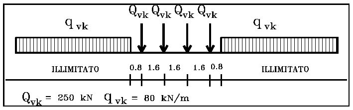

Eccentricità:

$$\frac{Q_{v2}}{Q_{v1}} = 1{,}25 \tag{5.2.1}$$

Il coefficiente di adattamento "$\alpha$" per il modello LM71 nella progettazione di ferrovie ordinarie è pari a 1,1.

##### 5.2.2.2.1.2. Modelli di carico SW

Due configurazioni: SW/0 e SW/2.

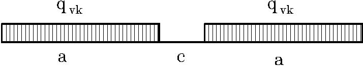

**Tab. 5.2.I** — *Caratteristiche Modelli di Carico SW*

| Tipo di Carico | $q_{vk}$ [kN/m] | $a$ [m] | $c$ [m] |
|---|---|---|---|
| SW/0 | 133 | 15,0 | 5,3 |
| SW/2 | 150 | 25,0 | 7,0 |

Il coefficiente "$\alpha$" da adottarsi: rispettivamente 1,1 per SW/0 e 1,0 per SW/2.

##### 5.2.2.2.1.3. Treno scarico

Carico uniformemente distribuito pari a 10,0 kN/m.

##### 5.2.2.2.1.4. Ripartizione locale dei carichi

*Distribuzione longitudinale del carico per mezzo del binario*: carico assiale $Q_{vk}$ distribuito su tre traverse consecutive, ripartendolo nelle proporzioni 25%, 50%, 25%.

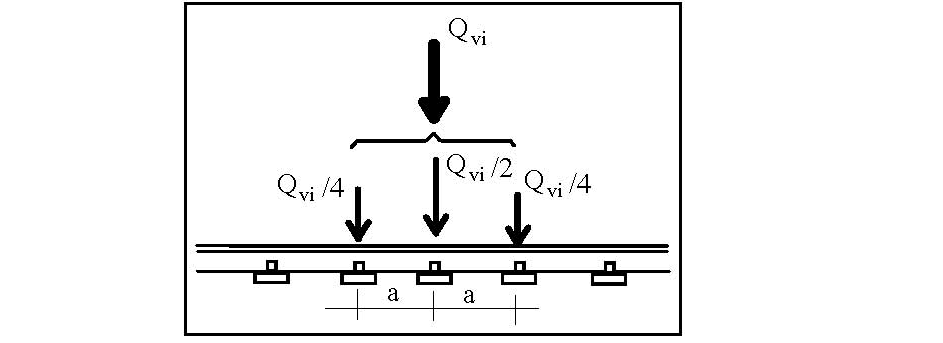

*Distribuzione longitudinale del carico per mezzo delle traverse e del ballast*: i carichi assiali del modello LM71 possono essere distribuiti uniformemente nel senso longitudinale. Per solette: distribuzione longitudinale secondo Fig. 5.2.4, ripartizione a 45° dalla superficie di estradosso fino al piano medio delle stesse.

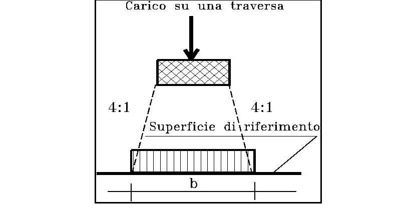

*Distribuzione trasversale delle azioni per mezzo delle traverse e del ballast*: per ponti su rettifilo secondo Fig. 5.2.5; per ponti in curva con sovralzo secondo Fig. 5.2.6.

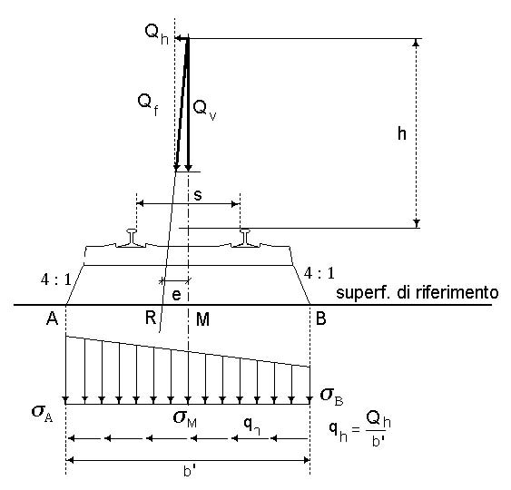

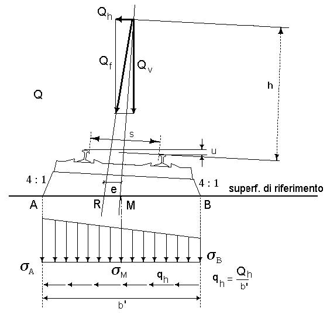

##### 5.2.2.2.1.5. Distribuzione dei carichi verticali per i rilevati a tergo delle spalle

Carico verticale a livello del piano di regolamento, uniformemente distribuito su una larghezza di 3,0 m. Non applicare l'incremento dinamico.

#### 5.2.2.2.2. Carichi sui marciapiedi

Marciapiedi non aperti al pubblico, utilizzati solo dal personale autorizzato.

Carico uniformemente ripartito: 10 kN/m². Non contemporaneo al transito dei convogli ferroviari. Non applicare incremento dinamico.

#### 5.2.2.2.3. Effetti dinamici

Per le usuali tipologie di ponti e per velocità di percorrenza $\leq$ 200 km/h, quando la frequenza propria della struttura ricade all'interno del fuso indicato in Fig. 5.2.7, è sufficiente utilizzare i coefficienti dinamici $\Phi$.

Per velocità > 200 km/h o quando la frequenza propria della struttura non ricade nel fuso: analisi dinamica con convogli "reali".

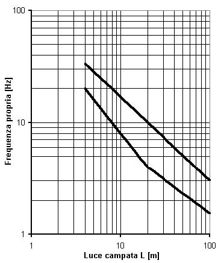

Limiti del fuso in Fig. 5.2.7:

- limite superiore:

$$n_0 = 94{,}76 \cdot L^{-0{,}748} \tag{5.2.2}$$

- limite inferiore:

$$n_0 = \frac{80}{L} \quad \text{per } 4 \text{ m} \leq L \leq 20 \text{ m} \tag{5.2.3}$$

$$n_0 = 23{,}58 \cdot L^{-0{,}592} \quad \text{per } 20 \text{ m} \leq L \leq 100 \text{ m} \tag{5.2.4}$$

Per una trave semplicemente appoggiata:

$$n_0 = \frac{17{,}75}{\sqrt{\delta_0}} \text{ [Hz]} \tag{5.2.5}$$

dove $\delta_0$ è la freccia in mm, in mezzeria, dovuta alle azioni permanenti.

**Coefficienti di incremento dinamico** $\Phi$:

(a) per linee con elevato standard manutentivo:

$$\Phi_2 = \frac{1{,}44}{\sqrt{L_\Phi - 0{,}2}} + 0{,}82 \quad \text{con la limitazione } 1{,}00 \leq \Phi_2 \leq 1{,}67 \tag{5.2.6}$$

(b) per linee con ridotto standard manutentivo:

$$\Phi_3 = \frac{2{,}16}{\sqrt{L_\Phi - 0{,}2}} + 0{,}73 \quad \text{con la limitazione } 1{,}00 \leq \Phi_3 \leq 2{,}00 \tag{5.2.7}$$

dove $L_\Phi$ è la lunghezza "caratteristica" in metri, definita in Tab. 5.2.II.

**Tab. 5.2.II** — *Lunghezza caratteristica $L_\Phi$*

| Caso | Elemento strutturale | $L_\Phi$ |
|---|---|---|
| 1 | Travi semplicemente appoggiate | Luce della campata |
| 2 | Travi continue — momento in campata | Media delle luci adiacenti alla campata considerata |
| 3 | Travi continue — momento sugli appoggi | Media delle luci adiacenti all'appoggio considerato |
| 4 | Mensole (a sbalzo) | Due volte la lunghezza della mensola |
| 5 | Solette con vincolo incastro su uno o due lati | Metà della luce libera |
| 6 | Elementi trasversali (traversi, solette trasversali) | Due volte la lunghezza dell'elemento trasversale |

Per ponti metallici con armamento diretto: coefficiente $\beta$ aggiuntivo ($\beta = 1{,}0$ per $L_\Phi \leq 8$ m e $L_\Phi > 90$ m; $\beta = 1{,}1$ per $8 \text{ m} < L_\Phi \leq 90$ m).

Per ponti ad arco o scatolari con copertura $h > 1{,}0$ m, il coefficiente dinamico può essere ridotto:

$$\Phi_{rid} = \Phi - \frac{h - 1{,}00}{10} \geq 1{,}0 \tag{5.2.8}$$

Pile con snellezza $\lambda \leq 30$, spalle, fondazioni, muri di sostegno e spinte del terreno: coefficienti dinamici unitari.

### 5.2.2.3. Azioni variabili orizzontali

#### 5.2.2.3.1. Forza centrifuga

Nei ponti con tracciato in curva. Applicata a 1,80 m al di sopra del P.F., in direzione orizzontale verso l'esterno della curva.

$$Q_{tk} = \frac{v^2}{g \cdot r} \cdot (f \cdot \alpha \, Q_{vk}) = \frac{V^2}{127 \cdot r} \cdot (f \cdot \alpha \, Q_{vk}) \tag{5.2.9.a}$$

$$q_{tk} = \frac{v^2}{g \cdot r} \cdot (f \cdot \alpha \, q_{vk}) = \frac{V^2}{127 \cdot r} \cdot (f \cdot \alpha \, q_{vk}) \tag{5.2.9.b}$$

dove $v$ è in m/s, $V$ in km/h, $f$ è il fattore di riduzione, $g$ l'accelerazione di gravità, $r$ il raggio di curvatura.

$f$ è un fattore di riduzione dato in funzione della velocità $V$ e della lunghezza $L_f$ di binario carico:

$$f = \left[1 - \frac{V - 120}{1000} \left(\frac{814}{V} + 1{,}75\right)\right] \cdot \left(1 - \sqrt{\frac{2{,}88}{L_f}}\right) \tag{5.2.10}$$

$f = 1$ per $V \leq 120$ km/h o $L_f \leq 2{,}88$ m; $f < 1$ per $120 \leq V \leq 300$ km/h e $L_f > 2{,}88$ m; $f(V) = f(300)$ per $V > 300$ km/h.

**Tab. 5.2.II.b** — *Parametri per determinazione della forza centrifuga*

| Modello di carico | $\alpha$ | $f$ |
|---|---|---|
| LM 71 | 1,1 | Secondo eq. [5.2.10] |
| SW/0 | 1,1 | Secondo eq. [5.2.10] |
| SW/2 | 1,0 | Secondo eq. [5.2.10] |
| Treno scarico | 1,0 | 1,0 |

#### 5.2.2.3.2. Azione laterale (Serpeggio)

Forza concentrata orizzontale: $Q_{sk} = 100$ kN, applicata alla sommità della rotaia più alta, perpendicolarmente all'asse del binario.

Da moltiplicare per $\alpha$ (se $\alpha > 1$), ma non per $\Phi$.

Deve sempre essere combinata con i carichi verticali.

#### 5.2.2.3.3. Azioni di avviamento e frenatura

Sulla sommità del binario, nella direzione longitudinale.

- Avviamento: $Q_{la,k} = 33 \text{ [kN/m]} \cdot L \text{ [m]} \leq 1000 \text{ kN}$ (per LM 71, SW/0, SW/2)
- Frenatura: $Q_{lb,k} = 20 \text{ [kN/m]} \cdot L \text{ [m]} \leq 6000 \text{ kN}$ (per LM 71, SW/0)
- Frenatura: $Q_{lb,k} = 35 \text{ [kN/m]} \cdot L \text{ [m]}$ (per SW/2)

Per ponti a doppio binario: due treni in transito in versi opposti, uno in fase di avviamento, l'altro in fase di frenatura.

Per ponti a più di due binari: un primo con la massima forza di frenatura, un secondo con la massima forza di avviamento, un terzo e quarto con il 50% della frenatura, altri binari privi di forze orizzontali.

Per il treno scarico: frenatura e avviamento trascurate.

I valori caratteristici devono essere moltiplicati per $\alpha$ e NON devono essere moltiplicati per $\Phi$.

### 5.2.2.4. Azioni variabili ambientali

#### 5.2.2.4.1. Azione del vento

Definite al § 3.3 delle presenti Norme Tecniche. Il treno come superficie piana continua convenzionalmente alta 4 m dal P.F., indipendentemente dal numero dei convogli presenti sul ponte.

#### 5.2.2.4.2. Temperatura

Definite al § 3.5. Variazione termica non uniforme:

- Gradiente di temperatura di 5 °C fra estradosso ed intradosso di impalcato
- Per impalcati a cassone in calcestruzzo: 5 °C con andamento lineare nello spessore delle pareti
- Per ponti a struttura mista acciaio-calcestruzzo: 5 °C tra soletta in calcestruzzo e trave in acciaio
- Per pile cave: differenza di temperatura tra interno ed esterno pari a 10 °C (con modulo $E$ non ridotto); variazione uniforme tra fusto, pila e zattera interrata pari a 5 °C

### 5.2.2.5. Effetti di interazione statica Treno-Binario-Struttura

Da considerare quando c'è continuità delle rotaie tra il ponte e il rilevato a tergo delle spalle. Effetti da: frenatura/avviamento, variazioni termiche, deformazioni da carichi verticali.

La verifica di sicurezza del binario in combinazione SLE con $\psi_q = 1{,}0$.

### 5.2.2.6. Effetti aerodinamici associati al passaggio dei convogli ferroviari

Azioni di pressione e depressione sulle superfici in prossimità della linea ferroviaria.

#### 5.2.2.6.1. Superfici verticali parallele al binario

Valori di $\pm q_{1k}$ in funzione della distanza $a_g$ dall'asse del binario.

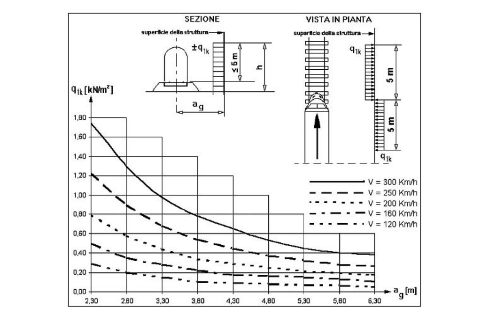

Fattori correttivi: $k_1 = 0{,}85$ per carrozze con sagoma arrotondata; $k_1 = 0{,}60$ per treni aerodinamici.

Se altezza $\leq 1{,}0$ m o larghezza $\leq 2{,}50$ m: incrementare di $k_2 = 1{,}3$.

#### 5.2.2.6.2. Superfici orizzontali al di sopra del binario

Valori di $\pm q_{2k}$ in funzione di $h_g$ (distanza dalla superficie inferiore della struttura al P.F.).

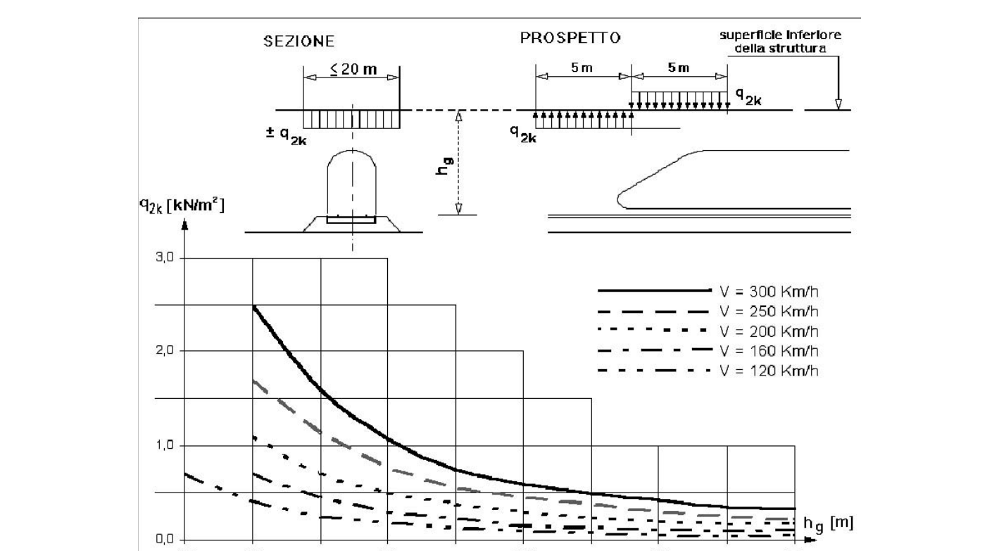

Larghezza applicazione: fino a 10 m da ciascun lato a partire dalla mezzeria del binario.

Anche ridotta del fattore $k_1$.

#### 5.2.2.6.3. Superfici orizzontali adiacenti il binario

Valori di $\pm q_{3k}$ in funzione di $a_g$ (distanza dall'asse del binario).

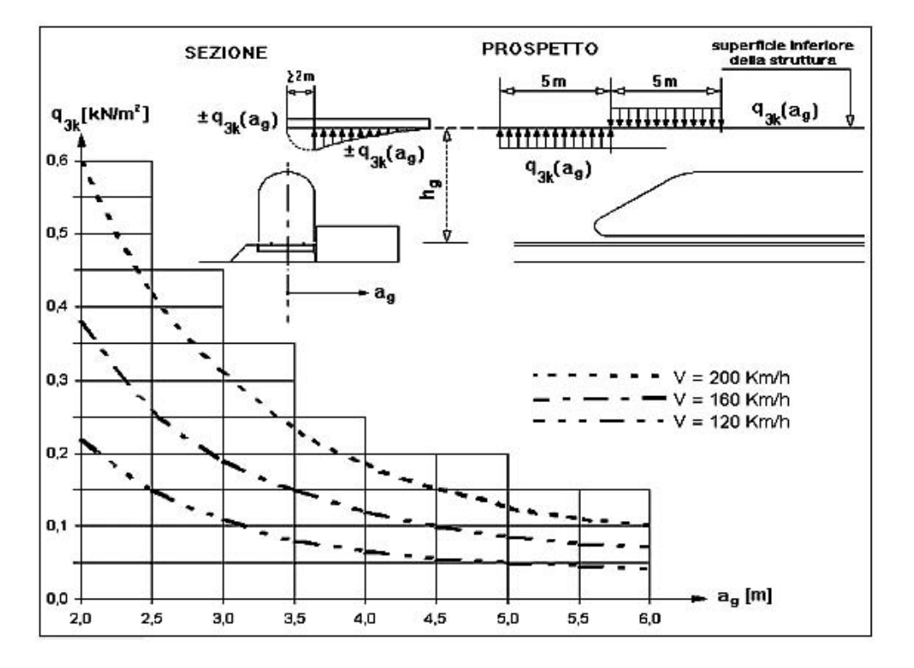

Se $h_g > 3{,}80$ m: fattore riduttivo $k_3 = (7{,}5 - h_g) / 3{,}7$ per $3{,}8 \text{ m} < h_g < 7{,}5$ m; $k_3 = 0$ per $h_g \geq 7{,}5$ m.

#### 5.2.2.6.4. Strutture con superfici multiple

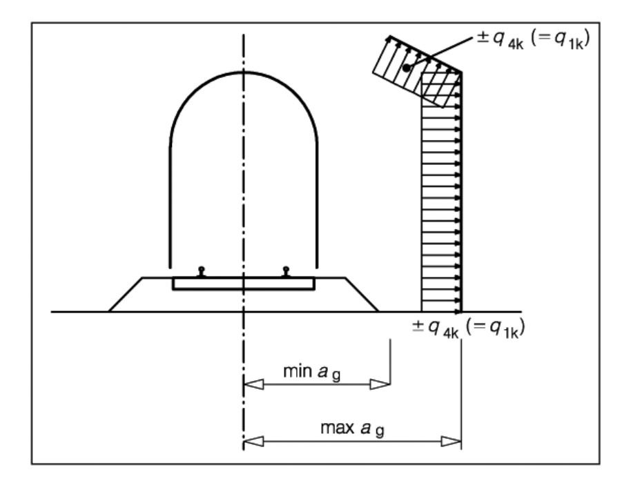

Distanza fittizia:

$$a'_g = 0{,}6 \min a_g + 0{,}4 \max a_g$$

#### 5.2.2.6.5. Superfici che circondano integralmente il binario per lunghezze inferiori a 20 m

Applicare tutte le azioni con $k_1 = 2$; $k_5 = 2{,}5$ (un binario) o $k_5 = 3{,}5$ (due binari).

### 5.2.2.7. Azioni idrodinamiche

Calcolate secondo § 5.2.1.2, tenendo conto di orientamento, forma della pila, scalzamento.

### 5.2.2.8. Azioni sismiche

Secondo §§ 3.2 e 7.9. $\Psi_2 = 0{,}2$, valore quasi permanente delle masse da traffico ferroviario.

### 5.2.2.9. Azioni eccezionali

Secondo § 3.6 e § 3.6.3 in particolare.

Piedritti a distanza $\leq 5{,}0$ m dalla sede stradale: protetti.

#### 5.2.2.9.1. Rottura della catenaria

Forza di $\pm 20$ kN, parallela all'asse dei binari, alla quota del filo.

1 catenaria per 1 binario; 2 per 2-6 binari; 3 per > 6 binari.

#### 5.2.2.9.2. Deragliamento al di sopra del ponte

- **Caso 1**: due carichi verticali lineari $q_{A1d} = 60$ kN/m, distanti dello scartamento del binario. Danni locali tollerati se facilmente riparabili.

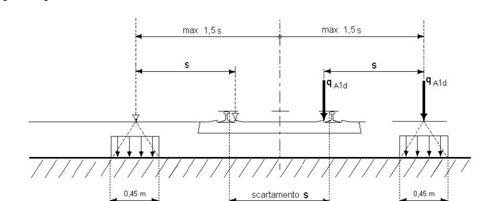

- **Caso 2**: carico lineare $q_{A2d} = 80$ kN/m / 1,4 esteso per 20 m, eccentricità massima 1,5 $s$. Verifica stabilità globale.

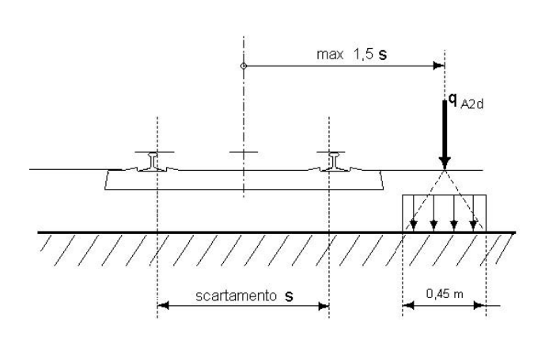

#### 5.2.2.9.3. Deragliamento al di sotto del ponte

Zona di divieto di edificabilità di 3,5 m dall'asse del binario più vicino.

A distanze > 4,50 m: consentiti pilastri isolati, con rigidezza crescente al diminuire della distanza.

### 5.2.2.10. Azioni indirette

#### 5.2.2.10.1. Distorsioni

Cedimenti vincolari: azioni permanenti. Valutati tenendo conto dei fenomeni di viscosità.

#### 5.2.2.10.2. Ritiro e viscosità

Coefficienti finali: §§ 11.2.10.6 e 11.2.10.7. Per il plinto: ritiro differenziale fusto-pulvino al 50%. Valore convenzionale di $E$ pari a 1/3 del misurato.

#### 5.2.2.10.3. Resistenze parassite nei vincoli

Considerare le forze indotte dalla resistenza parassita in funzione del tipo di appoggio.

---

## Circolare

### C5.2.2 Azioni sulle opere

Le azioni variabili da traffico assegnate ai §§ 5.2.2.2 e 5.2.2.3 delle NTC sono relativi alla rete ferroviaria con scartamento standard e alle linee principali.

Per ferrovie a scartamento ridotto, tramvie e linee ferroviarie leggere, metropolitane e funicolari non valgono le prescrizioni di cui sopra e le azioni debbono essere determinate caso per caso, in riferimento alle peculiarità della linea servita, sulla base di studi specifici o a normative di comprovata validità.

#### C5.2.2.4 Azioni variabili ambientali

##### C5.2.2.4.2 Temperatura

Le azioni della temperatura sono definite al § 3.5 delle NTC. Nelle stesse norme sono individuate le metodologie per valutare l'effetto dell'azione. Le strutture andranno progettate e verificate nel rispetto di queste azioni.

Per le opere direttamente esposte alle azioni atmosferiche le variazioni termiche uniformi da considerare, in mancanza di studi approfonditi, rispetto alla temperatura media del sito, sono da assumersi pari a quanto indicato nello stesso § 3.5.

Per la valutazione della domanda relativa alla componente cinematica dei vincoli e per il calcolo della dimensione dei varchi vale quanto indicato al punto C.5.1.4.5.

#### C5.2.2.5 Effetti di interazione statica treno-binario-struttura

Ai fini della determinazione degli effetti di interazione statica treno-binario-struttura, di cui al § 5.2.2.5 delle NTC, si possono utilizzare i legami tra la resistenza longitudinale allo scorrimento e lo scorrimento longitudinale per metro di binario singolo, riportati nelle figure C5.2.1, C5.2.2 e C5.2.3 e relativi ai casi di posa su ballast, posa diretta con attacco tradizionale indiretto di tipo K e posa diretta con attacco elastico, rispettivamente.

Nel caso di posa su ballast, la forza di scorrimento longitudinale q, in assenza di carico verticale da traffico, è assunta pari a 12,5 kN/m su rilevato e a 20 kN/m su ponte, mentre in presenza di un carico verticale da traffico di 80 kN/m, è assunta pari a 60 kN/m. Per carichi diversi i valori della resistenza si otterranno per interpolazione o estrapolazione lineare. In tutti i casi si assume uno spostamento di soglia di 2 mm, per cui risulta univocamente definita la rigidezza iniziale.

Nel caso di binario con posa diretta, la resistenza allo scorrimento q dipende dal tipo di attacco e dalla forza di serraggio, oltre che dal carico verticale applicato, come descritto nel seguito. Dette norme non si applicano alle opere d'arte con armamento di tipo innovativo.

Per l'attacco tradizionale indiretto di tipo K, la forza di scorrimento longitudinale q è assunta, per interasse fra le traverse di 0,6 m, 50 kN/m in assenza di carico verticale da traffico, 80 kN/m in presenza di un carico verticale da traffico di 80 kN/m.

Per l'attacco elastico, la forza di scorrimento longitudinale q è assunta pari a 13 kN/m in assenza di carico verticale da traffico e a 35 kN/m in presenza di un carico verticale da traffico di 80 kN/m.

Nel caso di posa diretta e per carichi verticali da traffico diversi, i valori della resistenza si otterranno per interpolazione o estrapolazione lineare. In tutti i casi si assume uno spostamento di soglia di 0,5 mm, per cui risulta univocamente definita la rigidezza iniziale.

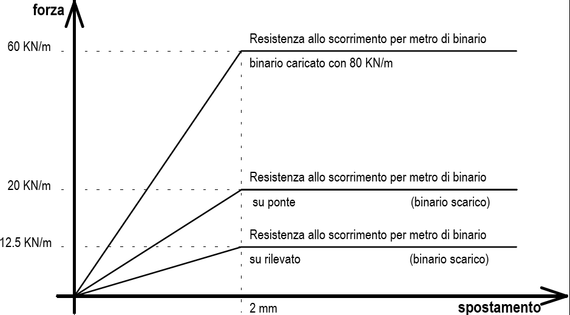

***Fig. C5.2.1** — Legame tra resistenza allo scorrimento e scorrimento longitudinale per metro di singolo binario (posa su ballast)*

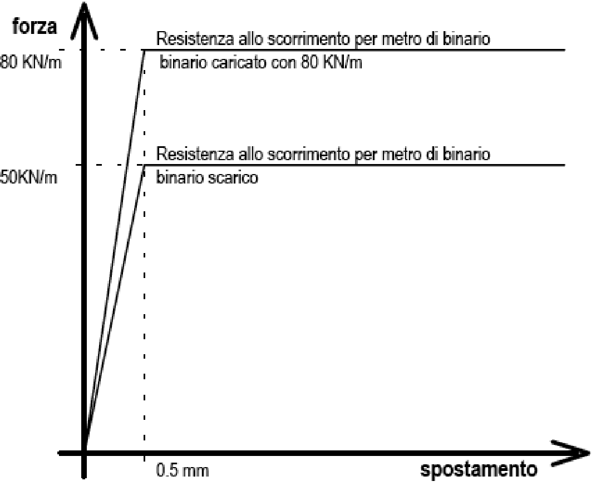

***Fig. C5.2.2** — Legame tra resistenza allo scorrimento e scorrimento longitudinale per metro di singolo binario (posa diretta con attacco tradizionale indiretto di tipo K)*

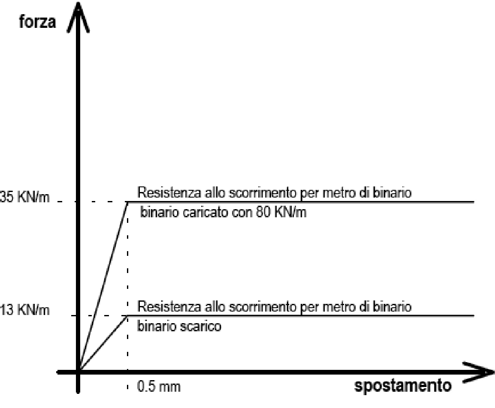

***Fig. C5.2.3** — Legame tra resistenza allo scorrimento e scorrimento longitudinale per metro di singolo binario (posa diretta con attacco elastico)*

#### C5.2.2.8 Azioni sismiche

Nella progettazione sismica di manufatti che si collocano sull'intersezione di due infrastrutture lineari, caratterizzate da valori non coincidenti di $V_N$ e $C_U$, per non pregiudicare il livello di sicurezza dell'infrastruttura più rilevante occorrerà progettare gli elementi strutturali delle opere di intersezione assumendo il più alto valore di $V_R$ fra quelli determinati considerando l'opera appartenente a ciascuna delle infrastrutture interferenti.
