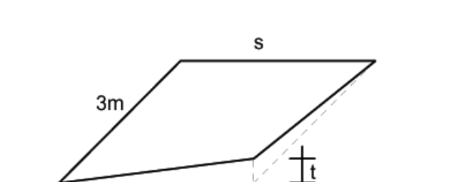

[Torna all'indice del § 5.2](./indice-5.2.md) | [Torna all'indice del capitolo](./indice-cap05.md) | [Torna all'indice generale](../indice-ntc2018.md)

# 5.2.3. Particolari prescrizioni per le verifiche

<!-- INDICE-INTERNO:INIZIO -->
**Indice interno**

- [Norma](#toc-ntc2018-5-2-3-norma)
  - [5.2.3.1. Combinazione dei treni di carico e delle azioni da essi derivate per più binari](#toc-ntc2018-5-2-3-1)
    - [5.2.3.1.1. Numero di binari](#toc-ntc2018-5-2-3-1-1)
    - [5.2.3.1.2. Numero di treni contemporanei](#toc-ntc2018-5-2-3-1-2)
    - [5.2.3.1.3. Simultaneità delle azioni da traffico](#toc-ntc2018-5-2-3-1-3)
    - [5.2.3.1.4. Valori rari e frequenti delle azioni da traffico ferroviario](#toc-ntc2018-5-2-3-1-4)
    - [5.2.3.1.5. Valori quasi-permanenti delle azioni da traffico ferroviario](#toc-ntc2018-5-2-3-1-5)
    - [5.2.3.1.6. Azioni da traffico ferroviario in situazioni transitorie](#toc-ntc2018-5-2-3-1-6)
  - [5.2.3.2. Verifiche agli SLU e SLE](#toc-ntc2018-5-2-3-2)
    - [5.2.3.2.1. Requisiti concernenti gli SLU](#toc-ntc2018-5-2-3-2-1)
    - [5.2.3.2.2. Requisiti concernenti gli SLE](#toc-ntc2018-5-2-3-2-2)
      - [5.2.3.2.2.1. Stati limite di esercizio per la sicurezza del traffico ferroviario](#toc-ntc2018-5-2-3-2-2-1)
    - [5.2.3.2.3. Verifiche allo stato limite di fatica](#toc-ntc2018-5-2-3-2-3)
    - [5.2.3.2.4. Verifiche allo stato limite di fessurazione](#toc-ntc2018-5-2-3-2-4)
- [Circolare](#toc-ntc2018-c5-2-3-circolare)
  - [C5.2.3 Particolari prescrizioni per le verifiche](#toc-ntc2018-c5-2-3)
    - [C5.2.3.2 Verifiche agli SLU e SLE](#toc-ntc2018-c5-2-3-2)
      - [C5.2.3.2.1 Requisiti concernenti gli SLU](#toc-ntc2018-c5-2-3-2-1)
      - [C5.2.3.2.3 Verifiche allo stato limite di fatica](#toc-ntc2018-c5-2-3-2-3)
<!-- INDICE-INTERNO:FINE -->

## Norma

### 5.2.3.1. Combinazione dei treni di carico e delle azioni da essi derivate per più binari

#### 5.2.3.1.1. Numero di binari

Progettare per il maggior numero geometricamente compatibile con la larghezza dell'impalcato.

#### 5.2.3.1.2. Numero di treni contemporanei

**Tab. 5.2.III** — *Carichi mobili in funzione del numero di binari presenti sul ponte*

| Numero di binari | Binari carichi | Traffico normale caso a | Traffico normale caso b | Traffico pesante |
|---|---|---|---|---|
| 1 | Primo | 1,0 (LM 71 "+" SW/0) | — | 1,0 SW/2 |
| 2 | Primo | 1,0 (LM 71 "+" SW/0) | — | 1,0 SW/2 |
|   | Secondo | — | — | 1,0 (LM 71 "+" SW/0) |
| $\geq 3$ | Primo | 1,0 (LM 71 "+" SW/0) | 0,75 (LM 71 "+" SW/0) | 1,0 SW/2 |
|   | Secondo | 1,0 (LM 71 "+" SW/0) | 0,75 (LM 71 "+" SW/0) | 1,0 (LM 71 "+" SW/0) |
|   | Altri | — | 0,75 (LM 71 "+" SW/0) | — |

LM 71 "+" SW/0 significa considerare il più sfavorevole fra i treni LM 71 e SW/0.

#### 5.2.3.1.3. Simultaneità delle azioni da traffico

**Tab. 5.2.IV** — *Valutazione dei carichi da traffico*

| Gruppo | Azioni verticali | Azioni orizzontali | Commento |
|---|---|---|---|
| gr1 | LM 71 "+" SW/0 (o SW/2) con $\Phi$ | — | Solo carichi verticali |
| gr2 | LM 71 "+" SW/0 (o SW/2) con $\Phi$ | Forza centrifuga, serpeggio | Verticali + orizzontali trasversali |
| gr3 | LM 71 "+" SW/0 (o SW/2) con $\Phi$ | Avviamento / Frenatura | Verticali + orizzontali longitudinali |
| gr4 | LM 71 "+" SW/0 (o SW/2) (senza $\Phi$) | — | Verifica a fatica e fessurazione |

#### 5.2.3.1.4. Valori rari e frequenti delle azioni da traffico ferroviario

Come da Tab. 5.2.IV.

#### 5.2.3.1.5. Valori quasi-permanenti delle azioni da traffico ferroviario

Uguali a zero, ad eccezione delle combinazioni sismiche.

#### 5.2.3.1.6. Azioni da traffico ferroviario in situazioni transitorie

Valori caratteristici da concordarsi con l'autorità ferroviaria.

### 5.2.3.2. Verifiche agli SLU e SLE

#### 5.2.3.2.1. Requisiti concernenti gli SLU

**Tab. 5.2.V** — *Coefficienti parziali di sicurezza per le combinazioni di carico agli SLU*

| Verifica | $\gamma_{G1}$ | $\gamma_{G2}$ | $\gamma_B$ | $\gamma_Q$ | $\gamma_{Qi}$ | $\gamma_P$ | $\gamma_{Ced}$ |
|---|---|---|---|---|---|---|---|
| EQU | 1,10 / 0,90 | 1,50 / 0,00 | 1,30 / 0,00 | 1,35 | 1,50 | 1,20 / 0,90 | — |
| A1 | 1,35 / 1,00 | 1,50 / 0,00 | 1,30 / 0,00 | 1,35 | 1,50 | 1,20 / 0,90 | — |
| A2 | 1,00 / 1,00 | 1,30 / 0,00 | 1,00 / 0,00 | 1,15 | 1,30 | — | 1,00 |

**Tab. 5.2.VI** — *Coefficienti di combinazione $\Psi$ delle azioni*

| Azione | $\psi_0$ | $\psi_1$ | $\psi_2$ |
|---|---|---|---|
| Azioni singole da traffico | 0,80 | 0,80 | 0,00 |
| Gruppo di carico gr1 | 0,80 | 0,80 | 0,00 |
| Gruppo di carico gr2 | 0,80 | 0,80 | 0,00 |
| Gruppo di carico gr3 | 0,80 | 0,80 | 0,00 |
| Gruppo di carico gr4 | 0,80 | 0,60 | 0,00 |
| Vento | 0,60 | 0,20 | 0,00 |
| Neve | 0,80 | — | 0,00 |
| Temperatura | 0,60 | 0,60 | 0,50 |

#### 5.2.3.2.2. Requisiti concernenti gli SLE

Assetto della struttura compatibile con la geometria in relazione alle esigenze dei convogli ferroviari.

**Tab. 5.2.VII** — *Ulteriori coefficienti di combinazione $\psi$ delle azioni*

| Azione | $\psi_0$ | $\psi_1$ | $\psi_2$ |
|---|---|---|---|
| LM 71 | 1,00 | 0,80 | 0,00 |
| SW/0 | 1,00 | 0,80 | 0,00 |
| SW/2 | 1,00 | 0,80 | 0,00 |
| Treno scarico | 1,00 | 1,00 | 0,00 |
| Centrifuga | 1,00 | 0,80 | 0,00 |
| Azione laterale (serpeggio) | 1,00 | 0,80 | 0,00 |

##### 5.2.3.2.2.1. Stati limite di esercizio per la sicurezza del traffico ferroviario

*Accelerazioni verticali dell'impalcato*: massimo 3,5 m/s² nel campo di frequenze da 0 a 20 Hz.

*Deformazioni torsionali dell'impalcato*: calcolate con LM 71 incrementato con $\Phi$.

*Sghembo ammissibile*: misurato su lunghezza di 3 m, non deve eccedere:

- $V \leq 120$ km/h: $t \leq 4{,}5$ mm/3m
- $120 < V \leq 200$ km/h: $t \leq 3{,}0$ mm/3m
- $V > 200$ km/h: $t \leq 1{,}5$ mm/3m
- Sghembo complessivo mai > 6 mm/3 m.

*Inflessione nel piano orizzontale dell'impalcato*:

**Tab. 5.2.VIII** — *Massima variazione angolare e minimo raggio di curvatura*

| Velocità [km/h] | Variazione angolare massima | Raggio minimo (campata singola) | Raggio minimo (più campate) |
|---|---|---|---|
| $V \leq 120$ | 0,0035 rd | 1700 m | 3500 m |
| $120 < V \leq 200$ | 0,0020 rd | 6000 m | 9500 m |
| $V > 200$ | 0,0015 rd | 14000 m | 17500 m |

Il raggio di curvatura per impalcato a semplice appoggio:

$$R = \frac{l^2}{8 \, \delta_h} \tag{5.2.11}$$

dove $\delta_h$ è la freccia orizzontale.

#### 5.2.3.2.3. Verifiche allo stato limite di fatica

Considerando idonei spettri di carico, in base alle caratteristiche funzionali e d'uso dell'infrastruttura ferroviaria.

#### 5.2.3.2.4. Verifiche allo stato limite di fessurazione

Per le azioni da traffico gruppo 4, Tab. 5.2.IV. Valori tra parentesi: (0,6) per 2 binari caricati, (0,4) per $\geq 3$ binari.

---

## Circolare

### C5.2.3 Particolari prescrizioni per le verifiche

#### C5.2.3.2 Verifiche agli SLU e SLE

##### C5.2.3.2.1 Requisiti concernenti gli SLU

Al §5.2.3.2.1 delle NTC, il carico permanente dovuto al ballast è trattato, se sfavorevole, come un carico variabile non da traffico (v. Tabella 5.2.V delle NTC) ed è precisato che qualora se ne prevedano variazioni significative, queste dovranno essere esplicitamente considerate nelle verifiche. In quest'ultimo caso dovranno essere aumentate di conseguenza anche le masse sismiche.

##### C5.2.3.2.3 Verifiche allo stato limite di fatica

Per la definizione dei modelli di carico a fatica, si può far riferimento agli spettri e ai coefficienti dinamici riportati nella norma UNI EN 1991-2.

Per le verifiche col metodo dei coefficienti di danneggiamento equivalente, metodo $\lambda$, si può utilizzare il modello di carico LM71, associato ad un appropriato coefficiente dinamico.

Per la determinazione dei coefficienti di danneggiamento equivalente, che devono essere specificamente calibrati sul predetto modello LM71, si può far riferimento alle norme UNI EN 1992-2, UNI EN 1993-2 ed UNI EN 1994-2.

La determinazione dell'effettivo spettro di carico da considerare nella verifica del ponte dovrà essere effettuata in base alle caratteristiche funzionali e d'uso della infrastruttura ferroviaria cui l'opera appartiene.
