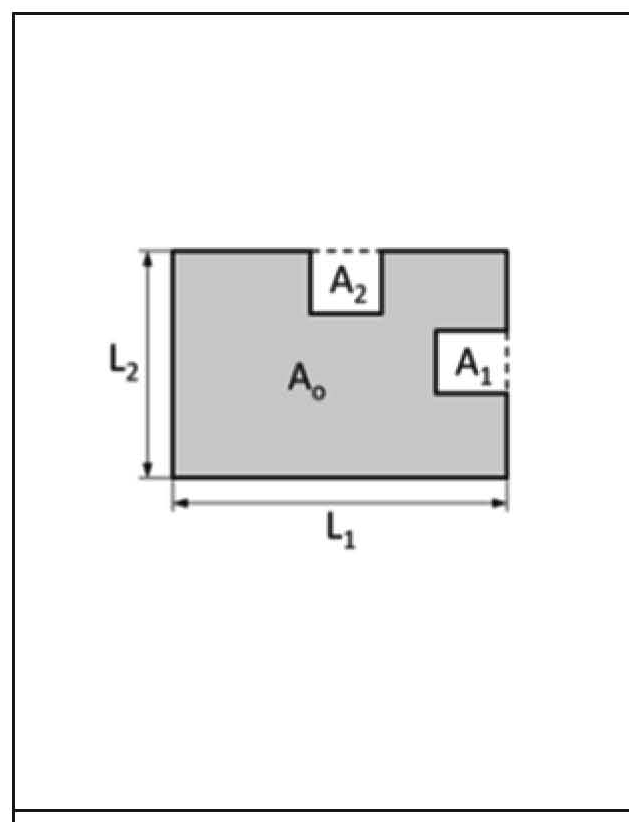
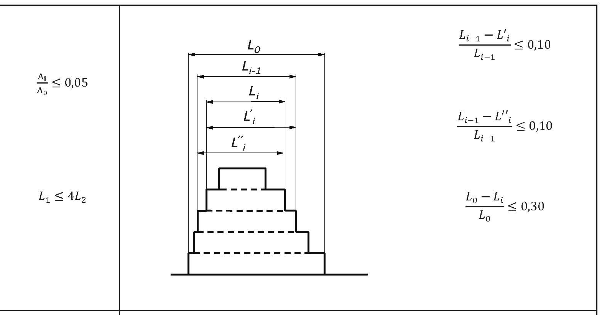
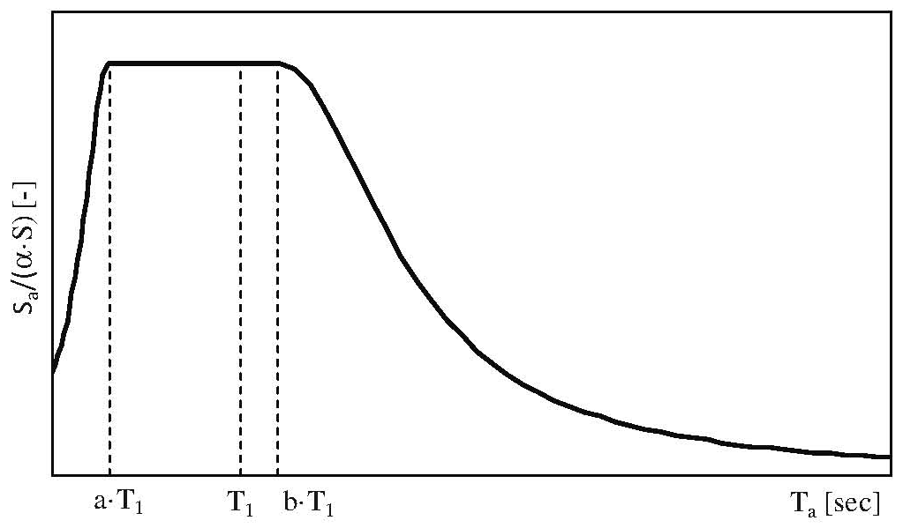
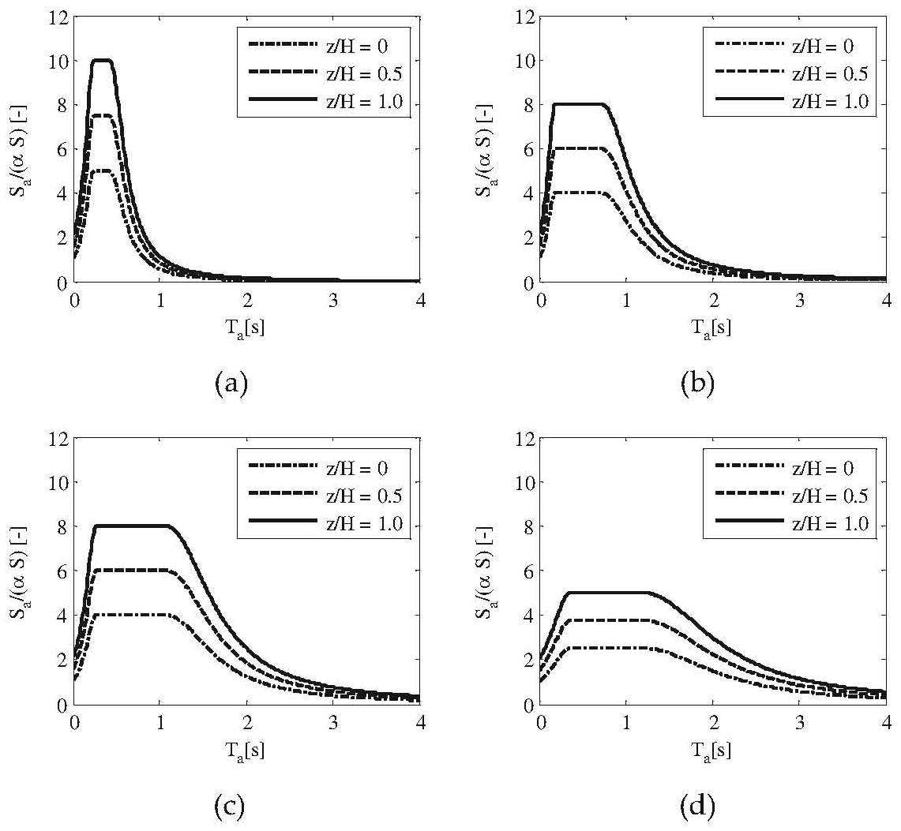
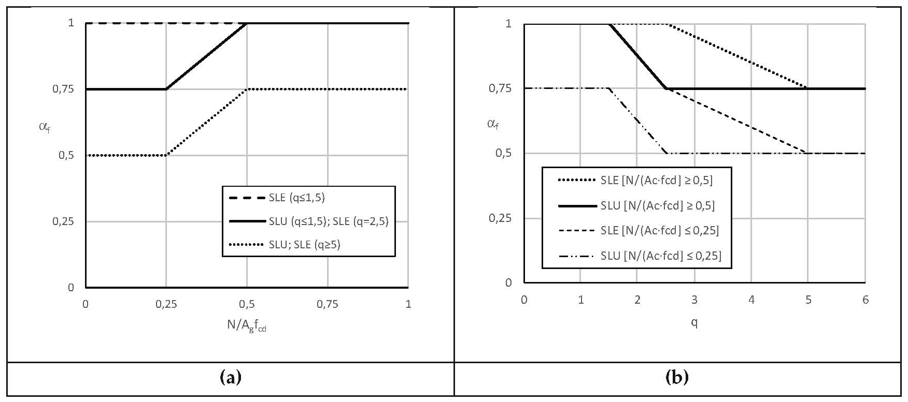

[Torna all'indice del capitolo](indice-cap07.md) | [Torna all'indice generale](../indice-ntc2018.md)

# 7.0. Generalità e criteri generali di progettazione

## Indice del capitolo

- [7.1 Requisiti stati limite (capacità e domanda)](#71-requisiti-nei-confronti-degli-stati-limite)
- [7.2 Criteri generali di progettazione e modellazione](#72-criteri-generali-di-progettazione-e-modellazione)
  - [7.2.1 Regolarità (pianta, altezza, distanza)](#721-caratteristiche-generali-delle-costruzioni)
  - [7.2.2 Sistemi strutturali (CD"A"/CD"B", Tab. 7.2.I)](#722-criteri-generali-di-progettazione-dei-sistemi-strutturali)
  - [7.2.3 Elementi non strutturali (F_a)](#723-criteri-di-progettazione-di-elementi-strutturali-secondari-ed-elementi-costruttivi-non-strutturali)
  - [7.2.4 Criteri progettazione impianti](#724-criteri-di-progettazione-degli-impianti)
  - [7.2.5 Fondazioni (platee, travi, pali)](#725-requisiti-strutturali-degli-elementi-di-fondazione)
  - [7.2.6 Modellazione (rigidezze, eccentricità accidentale)](#726-criteri-di-modellazione-della-struttura-e-dellazione-sismica)
- [C7.1 — Requisiti SL (capacità/domanda, RIG/RES/DUT)](#c71-requisiti-nei-confronti-degli-stati-limite)
- [C7.2 — Criteri generali di progettazione e modellazione](#c72-criteri-generali-di-progettazione-e-modellazione)
  - [C7.2.1 Regolarità (Fig. C7.2.1-2)](#c721-caratteristiche-generali-delle-costruzioni)
  - [C7.2.2 Sistemi (CD"A"/CD"B", γ_Rd)](#c722-criteri-generali-di-progettazione-dei-sistemi-strutturali)
  - [C7.2.3 Secondari/non strutturali (Spettri di piano)](#c723-criteri-di-progettazione-di-elementi-strutturali-secondari-ed-elementi-costruttivi-non-strutturali)
  - [C7.2.6 Modellazione (α_f, Fig. C7.2.5)](#c726-criteri-di-modellazione-della-struttura-e-dellazione-sismica)

---

# Norma

Il presente capitolo disciplina la progettazione e la costruzione delle nuove opere soggette anche all'azione sismica. Le regole in esso indicate sono aggiuntive e non sostitutive di quelle riportate nei Capitoli 4, 5 e 6 e sono tra loro complementari.

Per le costruzioni esistenti si applicano le indicazioni del Cap. 8.

Per le costruzioni con valori di $a_g \cdot S \leq 0{,}075\text{g}$, le verifiche agli stati limite ultimi e di esercizio potranno essere soddisfatte applicando le sole regole valide per le situazioni non sismiche a condizione che siano rispettate le seguenti condizioni:

- il valore della forza orizzontale, applicata a ciascun livello, sia assunto pari a:

$$F_h = 0{,}10 \cdot W \cdot \lambda$$

dove $W$ è il peso della costruzione e $\lambda$ è la quota parte del peso di ciascun livello;

- si effettui la sola verifica allo SLV;
- la progettazione sia svolta per comportamento strutturale non dissipativo oppure dissipativo con Classe di Duttilità Bassa CD"B";
- gli edifici abbiano struttura scatolare rigida e siano composti da non più di due piani fuori terra.

---

## 7.1. Requisiti nei confronti degli stati limite

Per gli stati limite di esercizio le verifiche di sicurezza consistono nel confronto fra la capacità e la domanda, in termini di rigidezza per gli elementi strutturali e in termini di stabilità e funzionalità per gli elementi non strutturali e gli impianti (v. § 7.3.6).

Per gli stati limite ultimi le verifiche di sicurezza consistono nel confronto fra la capacità e la domanda in termini di resistenza e di duttilità per gli elementi strutturali e in termini di stabilità per gli elementi non strutturali e di funzionalità per gli impianti (v. § 7.3.6).

---

## 7.2. Criteri generali di progettazione e modellazione

### 7.2.1. Caratteristiche generali delle costruzioni

Ai fini di un buon comportamento delle costruzioni in zona sismica è opportuno che la struttura possieda, per quanto possibile, requisiti di semplicità, simmetria, iperstaticità, regolarità in pianta e in altezza, fondazione unica.

#### Regolarità in pianta

Un edificio è regolare in pianta se soddisfa tutte le seguenti condizioni:

*a)* la configurazione in pianta è compatta e approssimativamente simmetrica rispetto a due direzioni ortogonali, in relazione alla distribuzione di masse e rigidezze;

*b)* il rapporto tra i lati del rettangolo in cui la costruzione risulta inscritta è inferiore a 4;

*c)* nessuna dimensione di eventuali rientri o sporgenze supera il 25% della dimensione totale della costruzione nella corrispondente direzione;

*d)* i solai possono essere considerati infinitamente rigidi nel loro piano rispetto agli elementi verticali e sufficientemente resistenti;

*e)* i sistemi resistenti verticali (telai e pareti) si estendono per tutta l'altezza dell'edificio;

*f)* la rigidezza laterale e la resistenza dei singoli piani non presentano brusche variazioni rispetto ai piani adiacenti;

*g)* in ciascuna delle due direzioni, l'eccentricità strutturale $e_0$ non è superiore al 30% del raggio torsionale $r$ e il raggio torsionale $r$ è non inferiore al raggio d'inerzia $l_s$ delle masse del piano:

$$e_0 \leq 0{,}30 \cdot r$$

$$r \geq l_s$$

#### Regolarità in altezza

Un edificio è regolare in altezza se soddisfa tutte le seguenti condizioni:

*d)* tutti i sistemi resistenti verticali dell'edificio (telai, pareti, ecc.) si estendono per tutta l'altezza della costruzione;

*e)* massa e rigidezza rimangono costanti o variano gradualmente, senza bruschi cambiamenti, dalla base alla sommità della costruzione (le variazioni di massa da un piano all'altro non superano il 25%);

*f)* negli edifici intelaiati, il rapporto tra resistenza effettiva e resistenza richiesta dal calcolo non è significativamente diverso per piani diversi (il rapporto fra la resistenza effettiva e quella richiesta, calcolato per un generico piano, non deve differire più del 20% dall'analogo rapporto determinato per un altro piano; può fare eccezione l'ultimo piano di edifici intelaiati di almeno tre piani);

*g)* eventuali restringimenti della sezione orizzontale della costruzione avvengano in modo graduale da un piano al successivo, rispettando i seguenti limiti: ad ogni piano il rientro non supera il 30% della dimensione corrispondente al primo piano, né il 20% della dimensione corrispondente al piano immediatamente sottostante. Fa eccezione l'ultimo piano di edifici di almeno quattro piani per il quale non sono previste limitazioni di restringimento.

#### Distanza tra costruzioni contigue

Le costruzioni adiacenti devono essere separate da giunti sufficientemente ampi. In assenza di analisi più accurate, la distanza tra due punti delle due costruzioni contigue allo stesso livello non deve essere inferiore alla somma degli spostamenti massimi determinati per ciascuna costruzione allo SLV.

#### Altezza massima degli edifici

L'altezza massima degli edifici e le limitazioni in altezza in funzione della larghezza stradale sono definite, in relazione alla tipologia strutturale e alla zona sismica, dalla normativa urbanistica vigente.

### 7.2.2. Criteri generali di progettazione dei sistemi strutturali

La progettazione può essere svolta per:

- **comportamento strutturale non dissipativo**: la struttura è progettata per resistere alle azioni sismiche senza sfruttare la capacità dissipativa della struttura. Le sollecitazioni di progetto si calcolano assumendo il fattore di comportamento $q = 1$;

- **comportamento strutturale dissipativo**: la struttura è progettata per resistere alle azioni sismiche sfruttando la risposta non lineare dei materiali e la capacità dissipativa della struttura. Le sollecitazioni di progetto si calcolano assumendo un fattore di comportamento $q > 1$.

Nel caso di comportamento strutturale dissipativo, si distinguono due livelli di Classe di Duttilità:

- **Classe di Duttilità Alta** (CD"A");
- **Classe di Duttilità Bassa** (CD"B").

La differenza fra le due classi risiede nella entità delle plasticizzazioni che si intendono sviluppare nella struttura sotto le azioni sismiche e nel valore del fattore di comportamento $q$ adottato.

#### Progettazione in capacità

Per le strutture progettate per comportamento dissipativo, si adotta il criterio della gerarchia delle resistenze (progettazione in capacità), secondo cui si conferisce alle zone non dissipative una sovraresistenza sufficiente a consentire lo sviluppo delle cerniere plastiche nelle sole zone dissipative. A tal fine si amplificano le sollecitazioni negli elementi non dissipativi mediante il fattore di sovraresistenza $\gamma_{Rd}$.

I valori del fattore di sovraresistenza $\gamma_{Rd}$ per le diverse tipologie strutturali sono riportati nella Tab. 7.2.I.

**Tab. 7.2.I** – *Fattori di sovraresistenza* $\gamma_{Rd}$

| Tipologia strutturale | $\gamma_{Rd}$ CD"B" | $\gamma_{Rd}$ CD"A" |
|---|:---:|:---:|
| Strutture in c.a. — elementi duttili (travi, pilastri) | 1,0 | 1,3 |
| Strutture in c.a. — elementi fragili (nodi, taglio) | 1,1 | 1,3 |
| Strutture prefabbricate — elementi duttili | 1,0 | 1,3 |
| Strutture prefabbricate — elementi fragili | 1,1 | 1,3 |
| Strutture in acciaio — concentricamente controvento | 1,1 | 1,1 |
| Strutture in acciaio — eccentricamente controvento | 1,1 | 1,1 |
| Strutture in acciaio — a telaio | 1,1 | 1,3 |
| Strutture composte acciaio-calcestruzzo — a telaio | 1,1 | 1,3 |
| Strutture composte acciaio-calcestruzzo — controvento | 1,1 | 1,1 |
| Strutture in legno | 1,3 | 1,3 |
| Strutture in muratura | – | – |
| Ponti | 1,3 | – |

#### Zone dissipative

Le zone dissipative devono essere progettate in modo tale da possedere la duttilità e la resistenza necessarie a sviluppare i meccanismi dissipativi previsti. I dettagli costruttivi nelle zone dissipative devono essere tali da consentire la formazione di cerniere plastiche, assicurando che non si verifichino rotture fragili prima del raggiungimento della capacità deformativa ultima.

#### Spostamenti relativi in appoggi mobili

Per le strutture con appoggi mobili, lo spostamento relativo di progetto $\Delta$ si calcola come:

$$\Delta = d_{Es} + d_{Eg}$$

dove $d_{Es}$ è lo spostamento relativo fra le parti della struttura dovuto alla deformabilità della struttura stessa e $d_{Eg}$ è lo spostamento relativo al suolo.

### 7.2.3. Criteri di progettazione di elementi strutturali secondari ed elementi costruttivi non strutturali

Gli elementi costruttivi senza funzione strutturale e gli impianti di cui sia necessario garantire il funzionamento a seguito del terremoto devono essere verificati, insieme alle loro connessioni alla struttura, per l'azione sismica corrispondente a ciascuno degli stati limite considerati.

L'azione sismica sugli elementi non strutturali deve essere determinata applicando ad essi una forza orizzontale $F_a$ definita come:

$$F_a = \frac{S_a \cdot W_a}{q_a}$$ \tag{7.2.1}

dove:

- $S_a$ è l'accelerazione massima, adimensionalizzata rispetto a quella di gravità, che l'elemento non strutturale subisce durante il sisma e corrisponde allo stato limite in esame; essa tiene conto del comportamento dinamico sia dell'edificio sia dell'elemento;
- $W_a$ è il peso dell'elemento;
- $q_a$ è il fattore di comportamento dell'elemento, da porre pari a:
  - $q_a = 1$ per elementi fragili (tramezzature non armate, ecc.);
  - $q_a = 2$ per altri elementi.

Il valore di $S_a$ può essere ricavato dal §7.2.3 della Circolare.

### 7.2.4. Criteri di progettazione degli impianti

Gli impianti che debbano garantire la propria funzionalità a seguito del terremoto devono essere progettati per resistere alle azioni sismiche.

La responsabilità della verifica sismica degli impianti è del produttore e/o installatore che dovrà fornire al progettista gli elementi utili per valutare la compatibilità degli impianti con la struttura. Il progettista della struttura è responsabile della verifica degli ancoraggi e delle connessioni degli impianti alla struttura stessa.

### 7.2.5. Requisiti strutturali degli elementi di fondazione

#### Fondazioni superficiali

Per le fondazioni a platea l'armatura deve essere disposta in due direzioni ortogonali e in ciascuna direzione non deve essere inferiore allo 0,1% dell'area della sezione trasversale.

Per le travi di fondazione l'armatura longitudinale deve essere non inferiore allo 0,2% dell'area della sezione trasversale.

In zona sismica, le travi di fondazione devono essere verificate per le sollecitazioni derivanti dall'azione sismica di progetto. Il dimensionamento deve essere eseguito adottando la combinazione delle azioni sismiche più sfavorevole.

#### Fondazioni su pali

L'armatura longitudinale dei pali di fondazione non deve essere inferiore allo 0,3% dell'area della sezione trasversale del palo.

Nei pali devono essere individuate le zone dissipative, costituite dai tratti di palo in cui possono formarsi cerniere plastiche. Tali zone, normalmente localizzate in testa al palo e nelle zone di interfaccia tra strati a rigidezza molto diversa, devono essere dotate di adeguata armatura trasversale di confinamento.

### 7.2.6. Criteri di modellazione della struttura e dell'azione sismica

#### Modello della struttura

Il modello della struttura deve essere tridimensionale, dotato di un numero di gradi di libertà sufficiente a descriverne la distribuzione spaziale di massa, rigidezza e resistenza, con particolare attenzione nei casi in cui siano prevedibili importanti effetti torsionali.

Per le strutture in c.a. e per le strutture in muratura si devono adottare, in assenza di analisi specifiche, rigidezze pari al 50% di quelle dei corrispondenti elementi non fessurati. Analogamente, per strutture composte acciaio-calcestruzzo, la rigidezza della sezione composta va ridotta al 50% in assenza di analisi più dettagliate.

#### Orizzontamenti rigidi

I solai possono essere considerati infinitamente rigidi nel loro piano, a condizione che siano realizzati in cemento armato ovvero in latero-cemento con soletta in c.a. di spessore non inferiore a 40 mm, purché le aperture presenti non ne riducano significativamente la rigidezza.

#### Eccentricità accidentale

Per tenere conto della variabilità spaziale del moto sismico, nonché delle incertezze nella localizzazione delle masse, al centro di massa deve essere attribuita un'eccentricità accidentale rispetto alla sua posizione quale deriva dal calcolo. Per le costruzioni di tipo "edificio", l'eccentricità accidentale in ogni direzione non può essere considerata inferiore a 0,05 volte la dimensione media dell'edificio misurata perpendicolarmente alla direzione di applicazione dell'azione sismica.

#### Azione sismica

L'azione sismica può essere modellata mediante:

*a)* forze statiche equivalenti (analisi statica lineare o non lineare);

*b)* spettri di risposta (analisi dinamica modale);

*c)* storie temporali di accelerazione del terreno (analisi dinamica al passo).

Per le analisi lineari, lo spettro di risposta di progetto si ottiene dividendo lo spettro di risposta elastico per il fattore di comportamento $q$ (v. § 7.3.1).

Le condizioni di applicabilità dei diversi metodi di analisi sono indicate al § 7.3.

---

# Circolare

Il Capitolo 7 delle NTC illustra, per ciascuna delle tipologie costruttive considerate nei Capitoli 4, 5 e 6, i provvedimenti specifici da adottare, in presenza di azioni sismiche, finalizzandoli alla progettazione e costruzione delle nuove opere (per le opere esistenti si rimanda ai Capitoli 8 delle NTC e C8).

Le indicazioni relative ai modelli di calcolo, alle sollecitazioni e alle resistenze degli elementi strutturali **sono additive e non sostitutive** di quelle riportate nei Capitoli 4 e 5 delle NTC. Si deve inoltre fare riferimento al Capitolo 2 delle NTC, per le azioni e le loro combinazioni, e al Capitolo 3 delle NTC, per le modalità di rappresentazione dell'azione sismica e la definizione della sua entità in relazione ai diversi stati limite che occorre considerare. Particolare attenzione richiedono, infine, le indicazioni geotecniche specificamente antisismiche (§ 7.11 delle NTC), al solito, additive e non sostitutive di quelle già riportate nel Capitolo 6 delle NTC.

Ampio spazio è stato riservato, sia nelle NTC sia nel presente documento, alle costruzioni e ai ponti con isolamento e dissipazione di energia (§ 7.10 delle NTC e C7.10); tale attenzione è giustificata dalla indiscutibile efficacia che tali tecniche hanno manifestato nel garantire i livelli prestazionali richiesti alle costruzioni antisismiche, particolarmente quando si vogliano perseguire strategie progettuali atte a minimizzare i danni, sia ai componenti strutturali, sia alle componenti non strutturali e agli impianti.

La norma fa sistematico riferimento alla UNI EN 1998, risultando in sostanziale accordo con essa. Con tale finalità, particolare attenzione è stata dedicata a raccogliere, in una trattazione sintetica iniziale valida per tutte le tipologie costruttive, i requisiti comuni nei confronti degli stati limite (§ 7.1 delle NTC), i criteri generali di progettazione e modellazione (§ 7.2 delle NTC), i metodi di analisi e i criteri di verifica (§ 7.3 delle NTC). I paragrafi successivi (dal 7.4 al 7.11 delle NTC) sono poi dedicati alle diverse tipologie costruttive e a problemi specifici.

Le novità del Capitolo 7 delle NTC rispetto alla precedente versione sono più di carattere organizzativo che di carattere concettuale e verranno esaurientemente illustrate nei successivi paragrafi; tra le poche novità di carattere concettuale le principali sono:

- la scomparsa di qualunque riferimento alla zonazione sismica, sostituita dalla indicazione dei livelli di accelerazione $a_g S$, attesa allo SLV;
- la chiara distinzione tra progettazione in capacità (approccio concettuale con cui si persegue la duttilità) e gerarchia delle resistenze (strumento operativo impiegato per conseguirla);
- la sistematica adozione di tavole sinottiche di riepilogo dei diversi coefficienti, finalizzata a facilitare i confronti sistematici tra le diverse tipologie e i diversi stati limite.

## C7.1. Requisiti nei confronti degli stati limite

La norma indica, per ciascuno stato limite, l'insieme delle verifiche da eseguire attraverso il confronto tra capacità e domanda, così come definite al §7.1 delle NTC.

Ciò prevede una strategia progettuale basata su livelli crescenti dell'azione sismica e dei danni ad essa corrispondenti; non è possibile basarsi unicamente su verifiche in termini di resistenza ma occorre effettuare verifiche anche in termini di duttilità. Riferendosi agli Stati Limite definiti al § 3.2.1 delle NTC, occorre anche garantire l'operatività della costruzione o il controllo dei danni, per gli Stati Limite di Esercizio, la salvaguardia della vita o la prevenzione del collasso, per gli Stati Limite Ultimi.

Scelta la tipologia strutturale e definite le caratteristiche generali della struttura, da cui dipende il comportamento sismico e dunque l'azione sismica stessa (legata alle proprietà dinamiche e di duttilità), la prestazione associata a ciascuno Stato Limite può essere assicurata progettando gli elementi strutturali e non strutturali in modo da garantire loro che una o più delle grandezze proprie della capacità (rigidezza, resistenza, duttilità) siano adeguate alla corrispondente domanda, secondo i criteri di verifica dettagliati nelle NTC.

Il controllo del danneggiamento strutturale e non strutturale, ad esempio, si consegue essenzialmente attraverso la limitazione degli spostamenti rigidi di interpiano; la relativa capacità, pertanto, si quantizza in termini di rigidezza, tenendo opportunamente conto delle non linearità di materiale che si manifestano, in genere, già per livelli di azione sismica legati agli Stati Limite di Esercizio. D'altro canto, per garantire le prestazioni associate allo Stato Limite di Salvaguardia della Vita, è necessario un confronto capacità/domanda in termini di resistenza; mentre nello Stato Limite di Prevenzione del Collasso il confronto capacità/domanda si effettua in termini di duttilità.

L'insieme delle verifiche da eseguire per gli elementi strutturali e non strutturali e per gli impianti è sintetizzato al § 7.3.6 delle NTC, commentato e ulteriormente dettagliato nel corrispondente paragrafo della presente circolare.

## C7.2. Criteri generali di progettazione e modellazione

Questo paragrafo della norma illustra i criteri generali di progettazione e modellazione, indicando le caratteristiche generali che le costruzioni devono possedere per conseguire un comportamento dinamico ottimale in presenza di azioni sismiche, con particolare riguardo alle condizioni di regolarità (§7.2.1). La norma tratta, con le modalità in essa specificate, gli elementi strutturali, gli elementi non strutturali e gli impianti, dedicando attenzione specifica a ciascuno delle tre componenti, per ciascuno stato limite e, dunque, per il corrispondente valore dell'azione sismica, così da consentire il raggiungimento dei rispettivi livelli prestazionali definiti in fase di progettazione.

Per quanto riguarda i sistemi strutturali (§7.2.2), la norma distingue, preliminarmente, tra comportamento dissipativo e comportamento non dissipativo, lasciando libero il progettista di scegliere fra i due e, nel caso in cui opti per il comportamento dissipativo, fornendo i principi, le modalità operative e le regole pratiche per conseguire i livelli di duttilità prefissati.

### C7.2.1. Caratteristiche generali delle costruzioni

#### Regolarità

La regolarità strutturale è finalizzata a favorire, anche in campo inelastico, un comportamento della costruzione e delle sue membrature il più possibile uniforme e tale da evitare concentrazioni di sforzi.

In generale, un edificio può dirsi regolare in pianta e in altezza quando il suo comportamento dinamico sia governato principalmente da modi di vibrare traslazionali lungo le sue direzioni principali e quando tali modi siano caratterizzati da spostamenti crescenti, all'incirca linearmente, con l'altezza.

Con riferimento al §7.2.1 delle NTC le condizioni a) e b) di regolarità in pianta sono sintetizzate nella figura C7.2.1, la condizione g) di regolarità in elevazione è sintetizzata nella figura C7.2.2 e riferita al caso in cui, in una stessa direzione, siano presenti restringimenti in elevazione ad entrambe le estremità; in tal caso il limite del 10% della dimensione corrispondente all'orizzontamento immediatamente sottostante è da intendersi per ciascuno dei due rientri, mentre il limite del 30% della dimensione corrispondente al primo orizzontamento è da intendersi per la somma dei due.

*Figura C7.2.1 — Condizioni di regolarità in pianta.*

*Figura C7.2.2 — Condizioni di regolarità in elevazione.*

Nel caso in cui in un edificio, immediatamente al di sopra della fondazione, sia presente un basamento, di uno o più piani, con caratteristiche tali da poter essere considerato alla stregua di una struttura scatolare rigida, le NTC specificano che, per valutare la regolarità in altezza, si può far riferimento alla sola parte della struttura che si sviluppa al di sopra del basamento. Tale indicazione tende a escludere la fondazione scatolare rigida dall'individuazione del comportamento strutturale, a condizione che ad essa venga assicurato un comportamento non dissipativo, indipendentemente dallo stato limite considerato.

#### Distanza tra costruzioni contigue

Tra costruzioni contigue la norma impone la verifica degli spostamenti massimi per evitare fenomeni di martellamento; tale verifica deve essere eseguita attraverso un calcolo diretto degli spostamenti assicurando, in ogni caso, che la distanza tra le costruzioni non risulti inferiore al valore minimo stabilito dalla norma.

L'eventualità in cui non si possano eseguire calcoli specifici va riferita al solo caso di progettazione di nuova costruzione in adiacenza a costruzioni esistenti.

### C7.2.2. Criteri generali di progettazione dei sistemi strutturali

Le prescrizioni normative servono a garantire che l'organismo strutturale sia dotato di sistemi resistenti disposti almeno secondo due direzioni distinte, capaci di garantire un'adeguata resistenza e rigidezza nei confronti sia dei moti traslazionali, sia dei moti torsionali, dovuti all'eccentricità tra il centro di massa ed il centro di rigidezza dell'intera struttura o anche solo di una sua porzione, che tendono a sollecitare i diversi elementi strutturali in maniera non uniforme.

Al riguardo, nel caso degli edifici, sono da preferirsi configurazioni strutturali in cui i principali elementi resistenti all'azione sismica sono distribuiti nelle zone perimetrali, così da massimizzare la rigidezza torsionale della costruzione. Per sfruttare al meglio la rigidezza torsionale conseguita nel modo suddetto è necessario che gli orizzontamenti, ai fini della ripartizione degli effetti delle componenti orizzontali dell'azione sismica, tra gli elementi verticali che li sostengono, funzionino da diaframma rigido nei modi specificati al § 7.2.6 delle NTC.

Per quanto riguarda gli effetti della componente verticale dell'azione sismica, le tipologie costruttive che maggiormente risentono delle accelerazioni verticali indotte dal sisma, nonché i livelli di pericolosità per i quali tale componente deve essere considerata nel progetto, sono indicati al § 7.2.2 delle NTC. Per gli elementi soggetti a tali azioni e per quelli di supporto dei medesimi è ammesso l'uso di modelli parziali che tengano conto della rigidezza degli elementi adiacenti.

In generale non si tiene conto della variabilità spaziale del moto sismico e si adotta per esso una rappresentazione di tipo "puntuale", quale è quella che prevede l'utilizzo degli spettri di risposta adottando un unico valore di accelerazione del suolo per tutti i punti di contatto tra esso e la struttura.

Quando, per l'estensione del sistema di fondazione, non è realistica l'ipotesi che l'intera costruzione sia soggetta ad una eccitazione sismica uniforme, è necessario considerare la variabilità spaziale del moto di cui al § 3.2.4 delle NTC.

Le NTC distinguono due tipi di comportamento strutturale:

a) non dissipativo;
b) dissipativo.

Specificando, per ciascun comportamento, i corrispondenti criteri di modellazione dell'azione sismica e della struttura.

Le NTC consentono al progettista di optare per uno dei due comportamenti, in relazione al particolare problema progettuale. Il comportamento strutturale non dissipativo (a) richiede che la struttura abbia resistenza tale da rimanere in campo sostanzialmente elastico per tutti gli stati limite considerati. Il comportamento strutturale dissipativo (b) si basa sulla duttilità e presuppone dunque l'accettazione del danneggiamento strutturale come strategia di protezione passiva per i terremoti di progetto agli stati limite ultimi.

Nel caso di comportamento strutturale non dissipativo (a) la risposta sismica della struttura dipende, essenzialmente, dalle sue caratteristiche di rigidezza e resistenza; in caso di comportamento strutturale dissipativo (b), dalle caratteristiche di rigidezza, resistenza e dalla capacità di sviluppare deformazioni cicliche in campo plastico (duttilità).

L'insieme delle prescrizioni contenute nelle NTC, finalizzate al conseguimento dei prefissati livelli di duttilità, costituisce la *"progettazione in capacità"*.

Quando si opta per il comportamento non dissipativo (a) le azioni sismiche di progetto sono più elevate, ma la duttilità necessaria è molto contenuta e dunque non è richiesta la progettazione in capacità e l'adozione dei dettagli costruttivi riportati al Capitolo 7; quando, invece, si opta per il comportamento dissipativo (b), le azioni sismiche di progetto sono minori, ma la duttilità necessaria è più elevata e dunque è richiesta la progettazione in capacità e di dettagli costruttivi specifici.

Il comportamento dissipativo (b), ammette, in generale, un danneggiamento della costruzione, eventualmente anche esteso ma controllato, per i livelli di azione relativi a SLV e SLC e un possibile danneggiamento, di entità comunque limitata, per lo SLD.

A ciò fanno eccezione le strutture dotate di isolamento alla base, per le quali anche i requisiti riferiti agli stati limite ultimi vengono conseguiti evitando significative escursioni in campo plastico degli elementi strutturali della sovrastruttura e della sottostruttura (si veda al § 7.10.2 delle NTC).

Nelle costruzioni dissipative e prive di specifici dispositivi antisismici o di controllo delle vibrazioni, ai fini di un buon comportamento dissipativo d'insieme, le deformazioni inelastiche devono essere distribuite nel maggior numero possibile di elementi duttili per contenere l'entità delle plasticizzazioni.

In funzione della tecnologia costruttiva e dei materiali utilizzati, è dunque possibile separare i meccanismi deformativi fragili o scarsamente dissipativi, dai meccanismi duttili ai quali è invece possibile associare, mediante adeguati accorgimenti, significativa capacità di dissipare energia.

La progettazione del comportamento dissipativo, effettuata secondo le NTC, è mirata a garantire l'attivazione di meccanismi deformativi, locali e globali, che concentrino la domanda di duttilità negli elementi più duttili (ad es. le travi) invece che negli elementi meno duttili (ad es. le pareti o i pilastri, particolarmente quelli soggetti a sforzi normali di compressione rilevanti) e che impediscano l'attivazione di meccanismi fragili (ad es. rottura a taglio di pareti, travi o pilastri, rottura di nodi trave-pilastro), sia locali sia globali, o globalmente instabili.

La duttilità d'insieme della costruzione si ottiene, in definitiva, individuando gli elementi ed i meccanismi resistenti ai quali affidare le capacità dissipative e localizzando, all'interno del sistema strutturale, le zone in cui ammettere la plasticizzazione, in modo da ottenere un meccanismo deformativo d'insieme stabile, che coinvolga il maggior numero possibile di fonti di duttilità locale.

Nell'ambito del comportamento strutturale dissipativo, il progettista può decidere di conseguire la Classe di Duttilità Alta (CD"A"), a *elevata capacità dissipativa*, oppure la Classe di Duttilità Media (CD"B"), a *media capacità dissipativa*, rappresentando, dunque, le lettere "A" e "B" una mera tipizzazione.

La scelta della CD"A" rispetto alla CD"B" si traduce in un'ulteriore riduzione delle azioni di progetto, ma implica richieste di duttilità più elevate e, in generale, un maggiore onere in termini di dettagli costruttivi.

La norma definisce i criteri progettuali per conseguire il livello di duttilità prefissato; l'insieme di tali criteri costituisce la *"progettazione in capacità"*.

In particolare, al fine di garantire il comportamento duttile locale e globale, fatta la distinzione tra elementi/meccanismi fragili e duttili, per ciascun elemento si determina:

- la domanda in termini di resistenza, stabilendo, in base a considerazioni di equilibrio, una "gerarchia delle resistenze" tra elementi/meccanismi fragili (più resistenti) e elementi/meccanismi duttili (meno resistenti);
- la domanda in termini di duttilità nelle zone destinate a plasticizzarsi, cui deve essere garantito un comportamento inelastico dissipativo e stabile in condizioni cicliche.

Si progettano quindi, in termini di resistenza e/o duttilità, le corrispondenti capacità.

Per conseguire gli obiettivi insiti nella progettazione in capacità, si impiegano fattori di sovra resistenza $\gamma_{Rd}$ opportunamente differenziati tra le due classi di duttilità.

Le NTC prescrivono che il comportamento duttile vada perseguito sia a livello locale sia a livello globale. A tal fine viene prescritto un fattore di sovra resistenza $\gamma_{Rd} \geq 1{,}25$ per i meccanismi globali fragili rispetto ai meccanismi globali duttili.

Per una struttura alla quale si richiede un comportamento duttile e che abbia al suo interno pareti di controventamento tozze (particolarmente suscettibili di rottura a taglio) e telai duttili, ciò comporta l'assunzione di $\gamma_{Rd}$ locali sulle pareti tali da assicurare che, per attivare un meccanismo globale che veda la rottura a taglio delle pareti, occorrano azioni sismiche maggiori, almeno di un fattore 1,25, delle azioni richieste per attivare il meccanismo a telaio.

Al riguardo è bene chiarire che, nel caso di strutture a telaio, l'applicazione della progettazione in capacità è finalizzata, a livello globale, ad impedire l'attivazione di meccanismi instabili di piano, a livello locale, a controllare le plasticizzazioni nei pilastri senza escluderle in assoluto.

Proprio per questa ragione, in accordo con la UNI EN1998, per la pressoflessione di pilastri o colonne si adotta un fattore di sovraresistenza $\gamma_{Rd}$ unico e pari a 1,3, sia per la CD"A" sia per la CD"B". Per lo stesso motivo, non essendo possibile escludere che, durante l'evento sismico, si abbiano plasticizzazioni in alcuni pilastri, alle zone di estremità di tutti i pilastri primari deve essere garantito un comportamento dissipativo.

I valori dei fattori di sovra resistenza $\gamma_{Rd}$, distinti per tipologia strutturale e Classi di Duttilità, sono riportati nella Tabella 7.2.I delle NTC.

I principi della progettazione in capacità sono alla base della progettazione antisismica e si applicano ogni qual volta si voglia favorire un determinato comportamento strutturale a livello locale sia globale.

Analogamente, se si vuole valutare la massima domanda a taglio in un elemento strutturale, si determina, in base a semplici considerazioni di equilibrio, il valore del taglio in equilibrio con le azioni esterne (ad es. il carico verticale distribuito in una trave) e con la capacità a flessione (momenti resistenti) nelle sezioni di estremità, analizzando, per quanto riguarda i versi delle sollecitazioni, le diverse situazioni possibili in condizioni sismiche.

### C7.2.3. Criteri di progettazione di elementi strutturali secondari ed elementi costruttivi non strutturali

#### Elementi Secondari

Gli elementi strutturali secondari devono essere in grado, nella configurazione deformata più sfavorevole, di mantenere la loro capacità portante nei confronti dei carichi verticali tenendo conto, quando necessario, delle non linearità geometriche nei modi specificati nel § 7.3.6 delle NTC. Quando gli elementi secondari soggetti a spostamenti causati dalle più sfavorevoli condizioni sismiche di progetto allo SLC, valutati come previsto nel § 7.2.3 delle NTC, non subiscono plasticizzazioni, per questi ultimi possono essere adottati i particolari costruttivi prescritti al Capitolo 4; in caso contrario valgono le prescrizioni del Capitolo 7.

#### Elementi costruttivi non strutturali

Le NTC classificano gli elementi costruttivi non strutturali in due gruppi:

1) elementi con rigidezza, resistenza e massa tali da influenzare in maniera significativa la risposta strutturale;
2) elementi che influenzano la risposta strutturale solo attraverso la loro massa, ma sono ugualmente significativi ai fini della sicurezza e/o dell'incolumità delle persone.

Ai fini anche della determinazione della domanda sismica, per il primo gruppo di elementi non strutturali, si potrà introdurre, in relazione al tipo di verifica e di analisi da effettuarsi, nel modello strutturale globale oltre alla massa degli elementi non strutturali ne viene sempre considerata anche la loro rigidezza descrivendone le condizioni di vincolo alla struttura.

Per il secondo gruppo di elementi non strutturali si determina la risposta in accelerazione della struttura a ciascun piano, la si può assimilare ad una forzante esterna da applicare all'elemento non strutturale, così ricavando la domanda sismica su di esso.

La verifica degli elementi non strutturali, degli impianti o, per le costruzioni di muratura, dei meccanismi locali richiede una corretta valutazione dell'input sismico; il moto alla base dell'edificio è infatti filtrato dalla risposta della costruzione, in relazione alle sue caratteristiche dinamiche (frequenze proprie) e alla quota alla quale gli elementi soggetti a verifica sono collocati (forme modali); a tal fine risulta utile la seguente definizione di spettri di risposta di piano.

#### Spettri di risposta di piano

Gli spettri di risposta di piano rappresentano un modello per la valutazione dell'azione sismica in un predeterminato punto della struttura. Diverse formulazioni, più o meno approssimate, possono essere utilizzate. Nel seguito si riportano alcuni possibili metodi di calcolo, è ammesso l'uso anche di altre formulazioni purché di comprovata e documentata validità.

Gli spettri di risposta di ciascun piano possono essere determinati, a partire dalla risposta in accelerazione della struttura alla quota considerata, nell'ipotesi semplificativa che la struttura possa essere assunta come una forzante armonica per l'elemento non strutturale, portando in conto le amplificazioni dovute agli effetti dinamici sul singolo elemento non strutturale, legate al suo periodo di oscillazione e al suo coefficiente di smorzamento nonché alle corrispondenti caratteristiche della struttura.

Nella formula [7.2.1], il parametro $S_a$ rappresenta appunto l'accelerazione massima (risposta), normalizzata rispetto a quella di gravità, che l'elemento non strutturale subisce durante il sisma, per lo stato limite considerato. L'inviluppo dei valori assunti da $S_a$ al variare del periodo proprio $T_a$, a un generico piano della costruzione, costituisce lo spettro di risposta di quel piano.

L'accelerazione del piano j-esimo della struttura relativa al modo i-esimo è data dalla relazione:

$$S_{i,j} = \varphi_{ij}\, \Gamma_i\, S_i(T_i)$$ \tag{C7.2.1}

dove:

- $S_i(T_i)$ è l'ordinata dello spettro relativa al modo i-esimo (normalizzata rispetto a $g$ ed eventualmente ridotta attraverso il fattore di comportamento $q$ della costruzione);
- $\Gamma_i$ è il "fattore di partecipazione modale", definito dalla relazione:

$$\Gamma_i = \frac{\varphi_i^T M \tau}{\varphi_i^T M \varphi_i}$$ \tag{C7.2.2}

Il vettore $\tau$ è il vettore di trascinamento corrispondente alla direzione del sisma considerata; il vettore $\varphi_i$ è la forma modale del modo i-esimo normalizzata al valore massimo; la matrice $M$ è la matrice di massa del sistema reale.

L'accelerazione dell'elemento non strutturale al piano considerato, nella direzione considerata, per il modo i-esimo, è data, dunque, dall'equazione:

$$S_{a,ij} = S_{ij}\, R\!\left(\frac{T_a}{T_i}; \xi_a\right)$$ \tag{C7.2.3}

dove $R$, fattore di amplificazione dell'elemento non strutturale, è funzione del coefficiente di smorzamento $\xi_a$ dell'elemento e del rapporto tra il periodo dell'elemento $T_a$ e il periodo del modo i-esimo della struttura $T_i$, e vale:

$$R = \left[\left(2\xi_a \frac{T_a}{T_i}\right)^{2} + \left(1-\left(\frac{T_a}{T_i}\right)^{2}\right)^{2}\right]^{-\beta}$$ \tag{C7.2.4}

L'eq. C7.2.3 rappresenta la risposta del singolo elemento non strutturale di periodo $T_a$, posto al piano j-esimo, per effetto del modo di vibrare i-esimo della struttura e tiene conto attraverso il coefficiente $\beta$ (variabile tra 0,4 e 0,5) dell'accoppiamento tra ciascun modo di vibrare della struttura e il modo proprio dell'elemento. La risposta totale si ottiene combinando opportunamente le risposte relative ai diversi modi, ad es. attraverso la regola SRSS.

La norma consente infine di ridurre la domanda sismica $S_a$ su ciascun elemento non strutturale attraverso uno specifico fattore di comportamento $q_a$. In tabella [C7.2.I] sono riportati i valori di $q_a$ utilizzabili per le tipologie ricorrenti di elementi non strutturali.

**Tabella C7.2.I — Valori di $q_a$ per elementi non strutturali**

| Elemento non strutturale | $q_a$ |
|---|:---:|
| Parapetti o decorazioni aggettanti | 1,0 |
| Insegne e pannelli pubblicitari | 1,0 |
| Comignoli, antenne e serbatoi su supporti funzionanti come mensole senza controventi per più di metà della loro altezza | 1,0 |
| Pareti interne ed esterne | 2,0 |
| Tramezzature e facciate | 2,0 |
| Comignoli, antenne e serbatoi su supporti funzionanti come mensole non controventate per meno di metà della loro altezza o connesse alla struttura in corrispondenza o al di sopra del loro centro di massa | 2,0 |
| Elementi di ancoraggio per armadi e librerie permanenti direttamente poggianti sul pavimento | 2,0 |
| Elementi di ancoraggio per controsoffitti e corpi illuminanti | 2,0 |

È opportuno che il progettista, in base a considerazioni specifiche sulla risposta strutturale dell'elemento, indichi espressamente il gruppo attribuito a ciascun elemento non strutturale e il tipo di modellazione adottata. Nell'attribuzione del gruppo è opportuno ricordare che uno stesso elemento strutturale, ad esempio una tamponatura robusta, può appartenere al gruppo 1 per azioni sismiche nel proprio piano medio e al gruppo 2 per azioni sismiche ortogonali al proprio piano medio e tenere opportuno conto di ciò nel modello di calcolo.

Poiché la risposta degli elementi non strutturali è legata, attraverso il periodo proprio dell'elemento, ai modi di vibrare della struttura, nel valutarne la risposta si deve considerare un intervallo nell'intorno del periodo fondamentale della struttura, che tenga conto, per il limite inferiore dell'intervallo, delle possibili incertezze di modellazione e dell'incremento di rigidezza rispetto al modello di riferimento dovuta agli elementi non strutturali, per il limite superiore dell'intervallo, dell'incremento di periodo dovuto alle plasticizzazioni, da valutarsi in funzione del fattore di comportamento attribuito alla struttura. Lo stesso fattore di comportamento deve essere utilizzato per la valutazione della risposta spettrale inelastica della struttura.

#### Formulazione semplificata, a diverse quote, per elementi non strutturali, impianti, eventuali meccanismi locali

Nel seguito è fornita una formulazione analitica semplificata, valida per gli elementi non strutturali, per gli impianti e per eventuali meccanismi locali, valida qualunque sia la tipologia della costruzione.

La formulazione analitica consente di valutare lo spettro di accelerazione $S_{ez}(T,\xi)$ ad una quota $z$ significativa per l'elemento non strutturale, l'impianto o il meccanismo locale in esame; la formulazione è basata sulle proprietà dinamiche della struttura principale e sui valori dello spettro di risposta alla base dell'edificio calcolati in corrispondenza dei periodi propri della costruzione.

Questa formulazione consente di tenere conto del contributo fornito da tutti i modi di vibrazione ritenuti significativi; in linea generale devono essere preventivamente individuate le forme di vibrazione (ed i relativi periodi) significative per l'elemento non strutturale, l'impianto o il meccanismo locale in esame, anche in relazione alla sua posizione in pianta (la sommatoria nella formula che segue è estesa a questi modi, identificati dal pedice $k$):

$$S_{ez}(T,\xi,z) = \sqrt{\sum_{k} \left(S_{ez,k}(T,\xi,z)\right)^{2}} \quad (\geq S_e(T,\xi)) \quad \text{per } T > T_1$$ \tag{C7.2.5}

$$S_{ez,k}(T,\xi,z) = \begin{cases}
\dfrac{1{,}1\, \xi_k^{-0{,}5}\, \eta(\xi)\, a_{Z,k}(z)}{1+\left[1{,}1\, \xi_k^{-0{,}5}\, \eta(\xi)-1\right]\left(1-\dfrac{T}{a T_k}\right)^{1{,}6}} & \text{per } T < a T_k \\[14pt]
1{,}1\, \xi_k^{-0{,}5}\, \eta(\xi)\, a_{Z,k}(z) & \text{per } a T_k \leq T < b T_k \\[10pt]
\dfrac{1{,}1\, \xi_k^{-0{,}5}\, \eta(\xi)\, a_{Z,k}(z)}{1+\left[1{,}1\, \xi_k^{-0{,}5}\, \eta(\xi)-1\right]\left(\dfrac{T}{b T_k}-1\right)^{1{,}2}} & \text{per } T \geq b T_k
\end{cases}$$ \tag{C7.2.6}

$$a_{Z,k}(z) = S_e(T_k, \xi_k)\, |\gamma_k\, \psi_k(z)|\, \sqrt{1 + 0{,}0004\, \xi_k^{2}}$$ \tag{C7.2.7}

dove:

- $S_e(T,\xi)$ è lo spettro di risposta elastico al suolo, valutato per il periodo equivalente $T$ e lo smorzamento viscoso equivalente $\xi$ dell'elemento non strutturale, dell'impianto o del meccanismo locale considerato;
- $S_{ez,k}$ è il contributo allo spettro di risposta di piano fornito dal $k$-esimo modo della struttura principale, di periodo proprio $T_k$ e smorzamento viscoso equivalente $\xi$ (in percentuale);
- $a$ e $b$ sono coefficienti che definiscono l'intervallo di amplificazione massima dello spettro di piano, che possono essere assunti pari a 0,8 e 1,1 rispettivamente;
- $\gamma_k$ è il $k$-esimo coefficiente di partecipazione modale della costruzione;
- $\psi_k(z)$ è il valore della $k$-esima forma modale alla quota $z$, nella posizione in pianta dove è collocato il meccanismo locale da verificare;
- $\eta$ è il fattore che altera lo spettro elastico per un coefficiente di smorzamento $\xi$ diverso dal 5%, dato dalla (3.2.4) nel § 3.2.3.2.1;
- $a_{Z,k}$ è il contributo del $k$-esimo modo alla accelerazione massima di piano.

L'accelerazione massima alla quota $z$ è quindi fornita dalla seguente espressione:

$$a_{Z}(z) = \sqrt{\sum_{k} \left(a_{Z,k}(z)\right)^{2}}$$ \tag{C7.2.8}

mentre il contributo al picco di accelerazione spettrale in corrispondenza del periodo $T_a$, fornito dal $k$-esimo modo, vale:

$$S_{ez,k}(T_k, \xi, z) = 1{,}1\, \xi_k^{-0{,}5}\, \eta(\xi)\, a_{Z,k}(z)$$ \tag{C7.2.9}

Nella verifica di meccanismi locali in edifici multipiano è, in genere, sufficiente riferirsi al solo primo modo di vibrare nella direzione di verifica, in quanto è quello che induce la domanda di spostamento più significativa; nel caso in cui si stia eseguendo una verifica globale dell'edificio principale attraverso un'analisi statica non lineare, per il periodo $T_a$ può essere assunto il periodo elastico $T^*$, dato dalla formula [C7.3.6] riportata nel § C7.3.4.2.

Una valutazione più accurata di $T_a$ richiederebbe la stima del periodo secante del sistema bilineare, in corrispondenza della domanda di spostamento (v. equazione [C7.3.7] o [C7.3.8]) prodotta dall'accelerazione al suolo che porta allo stato limite il meccanismo locale (procedimento iterativo che tiene conto dello stato di danneggiamento della struttura principale, al raggiungimento dello stato limite da parte del meccanismo locale).

In assenza di tali valutazioni, il periodo $T_1$ può essere stimato con la formula [7.3.6] del § 7.3.3.2.

Nel caso di strutture con masse distribuite in maniera sostanzialmente uniforme lungo l'altezza, se si assume la prima forma modale lineare e la si normalizza allo spostamento in sommità all'edificio, il coefficiente di partecipazione modale può essere approssimato dalla formula:

$$\gamma_1 = \frac{3n}{2n+1}$$ \tag{C7.2.10}

dove $n$ è il numero di piani.

Si segnala che gli spettri alle diverse quote sono fortemente influenzati dal livello di non linearità della struttura principale; essi presentano infatti una forte amplificazione in corrispondenza del periodo fondamentale della struttura elastica. Tale amplificazione si riduce considerevolmente quando la struttura entra in campo non lineare. La formulazione proposta considera tale effetto attraverso lo smorzamento viscoso equivalente $\xi_k$ e l'incremento del periodo equivalente $T_a$.

#### Formulazione semplificata per costruzioni con struttura a telai

Per le sole costruzioni con struttura intelaiata, in alternativa alle precedenti formulazioni e nell'ipotesi di andamento delle accelerazioni strutturali linearmente crescente con l'altezza, l'accelerazione massima $S_a(T_a)$ può essere determinata attraverso l'espressione [C7.2.5].

In alternativa all'utilizzo di specifici spettri di risposta di piano e nell'ipotesi di andamento delle accelerazioni strutturali linearmente crescenti con l'altezza, l'accelerazione massima $S_a(T_a)$ può essere determinata attraverso l'espressione [C7.2.5 o 11].

$$S_a(T_a) = \begin{cases}
\alpha S\!\left(1+\dfrac{z}{H}\right)\!\left[\dfrac{a_p}{1+(a_p-1)\left(1-\dfrac{T_a}{a T_1}\right)^{2}}\right] \geq \alpha S & \text{per } T_a < a T_1 \\[14pt]
\alpha S\!\left(1+\dfrac{z}{H}\right)\, a_p & \text{per } a T_1 \leq T_a < b T_1 \\[10pt]
\alpha S\!\left(1+\dfrac{z}{H}\right)\!\left[\dfrac{a_p}{1+(a_p-1)\left(\dfrac{T_a}{b T_1}-1\right)^{2}}\right] \geq \alpha S & \text{per } T_a \geq b T_1
\end{cases}$$ \tag{C7.2.11}

dove:

- $\alpha$ è il rapporto tra accelerazione massima del terreno $a_g$ su sottosuolo tipo A da considerare nello stato limite in esame (si veda § 3.2.1) e l'accelerazione di gravità $g$;
- $S$ è il coefficiente che tiene conto della categoria di sottosuolo e delle condizioni topografiche secondo quanto riportato nel § 3.2.3.2.1;
- $T_a$ è il periodo fondamentale di vibrazione dell'elemento non strutturale;
- $T_1$ è il periodo fondamentale di vibrazione della costruzione nella direzione considerata;
- $z$ è la quota del baricentro dell'elemento non strutturale misurata a partire dal piano di fondazione;
- $H$ è l'altezza della costruzione misurata a partire dal piano di fondazione;
- $a$, $b$, $a_P$ sono parametri definiti in accordo con il periodo fondamentale di vibrazione della costruzione (si vedano Fig. C7.2.4 e Tabella C7.2.II).

Per le strutture con isolamento sismico si assume sempre $z = 0$.

Gli spettri di piano, descritti attraverso l'eq. C7.2.11, sono in generale conservativi per un ampio campo di periodi, con particolare riguardo a elementi non strutturali aventi periodo proprio prossimo al periodo fondamentale della costruzione. In particolare i parametri $a$, $b$ e $a_P$ sono stati definiti in accordo con il periodo proprio della struttura e calibrati per tener conto dell'elongazione del periodo fondamentale, legata alle non linearità del sistema, e del contributo dei modi superiori.

*Figura C7.2.3 — Spettri di risposta di piano per gli elementi non strutturali.*

**Tabella C7.2.II — Parametri $a$, $b$, $a_P$ in accordo con il periodo di vibrazione della costruzione $T_1$**

| $T_1$ | $a$ | $b$ | $a_P$ |
|---|:---:|:---:|:---:|
| $T_1 < 0{,}5\ \text{s}$ | 0,8 | 1,4 | 5,0 |
| $0{,}5\ \text{s} < T_1 \leq 1{,}0\ \text{s}$ | 0,3 | 1,2 | 4,0 |
| $T_1 > 1{,}0\ \text{s}$ | 0,3 | 1,0 | 2,5 |

*Figura C7.2.4 — Accelerazione massima, normalizzata rispetto ad αS, per i seguenti valori di $T_1$: (a) $T_1 = 0{,}3$ s, (b) $T_1 = 0{,}6$ s, (c) $T_1 = 0{,}9$ s, (d) $T_1 = 1{,}2$ s.*

L'approccio seguito per la determinazione degli effetti sugli elementi non strutturali del secondo gruppo può essere utilizzato anche per quelli del primo gruppo, a condizione che la risposta strutturale sia determinata attraverso un modello che includa sia la massa sia la rigidezza degli elementi non strutturali. Ciò può rendersi necessario per quei modelli che non consentano la determinazione diretta della risposta dinamica degli elementi non strutturali.

### C7.2.6. Criteri di modellazione della struttura e dell'azione sismica

#### Modellazione della struttura

Gli orizzontamenti devono essere dotati di opportuna rigidezza e resistenza nel piano e essere collegati in maniera efficace alle membrature verticali che li sostengono, affinché possano assolvere la funzione di diaframma rigido ai fini della ripartizione delle forze orizzontali tra le membrature verticali stesse. Particolare attenzione va posta quando gli orizzontamenti abbiano forma molto allungata o comunque non compatta; in quest'ultimo caso, occorre valutare se le aperture presenti, specie se localizzate in prossimità dei principali elementi resistenti verticali, non riducano significativamente la rigidezza.

Gli orizzontamenti possono essere considerati infinitamente rigidi nel loro piano se, modellandone la deformabilità nel piano, le variazioni degli spostamenti di tutti i punti appartenenti al piano in esame non differiscono tra loro per più del 10%. Tale condizione può ritenersi generalmente soddisfatta nei casi specificati nelle NTC (§ 7.2.6), salvo porre particolare attenzione quando gli orizzontamenti siano sostenuti da elementi strutturali verticali (per es. pareti) di notevole rigidezza e resistenza.

Quando gli orizzontamenti possono essere considerati infinitamente rigidi nel loro piano, le masse e le inerzie rotazionali di ogni piano possono essere concentrate nel suo centro di gravità.

Ai fini di una corretta valutazione della risposta strutturale, la norma richiede che, nel rappresentare la rigidezza flessionale e a taglio dei singoli elementi di muratura, calcestruzzo, acciaio-calcestruzzo, si tenga conto della fessurazione. La norma prevede che, in assenza di analisi specifiche, la rigidezza degli elementi fessurati non sia assunta minore del 50% delle corrispondenti rigidezze non fessurate. Valori minori possono essere assunti a fronte di specifiche valutazioni adeguatamente motivate.

La norma precisa che in ogni caso, nella valutazione della rigidezza degli elementi fessurati, si debba tenere conto dello stato limite considerato e dell'influenza della sollecitazione assiale permanente.

Per gli elementi in calcestruzzo armato si può, in maniera semplificata, adottare un coefficiente riduttivo della rigidezza denominato coefficiente di fessurazione $\alpha_f$, da applicare sia alla rigidezza flessionale sia alla rigidezza a taglio di ciascun elemento. Tale coefficiente è espresso in funzione del carico assiale $N$ e del fattore di comportamento $q$ adottati per la progettazione allo SLV.

Nelle Figure C7.2.5 (a) e C7.2.5 (b), $q$ rappresenta il fattore di comportamento, $N$ lo sforzo normale dovuto ai soli carichi verticali nella combinazione sismica, $A_c$ l'area della sezione, $f_{cd}$ la resistenza a compressione del calcestruzzo.

*Figura C7.2.5 — Dipendenza di $\alpha_f$ dal carico assiale $N$ e dal fattore di comportamento $q$.*

#### Modellazione dell'azione sismica

Per semplicità di analisi è possibile descrivere la variabilità spaziale del moto e l'aleatorietà dell'effettivo baricentro delle masse e delle rigidezze attraverso lo spostamento del centro di massa dalla sua posizione originaria nella direzione delle due componenti orizzontali e in ambo i versi. In alternativa è consentito (§7.3.3) applicare un momento torcente valutato a partire dalla risultante orizzontale della forza agente al piano, determinata come in § 7.3.3.2, moltiplicata per l'eccentricità accidentale del baricentro delle masse rispetto alla sua posizione di calcolo, determinata come in § 7.2.6.

Nel valutare gli effetti dell'eccentricità accidentale, si dovranno considerare, ovviamente, gli effetti concomitanti delle due componenti dell'azione sismica, utilizzando le regole di combinazione indicate al § 7.3.5.
