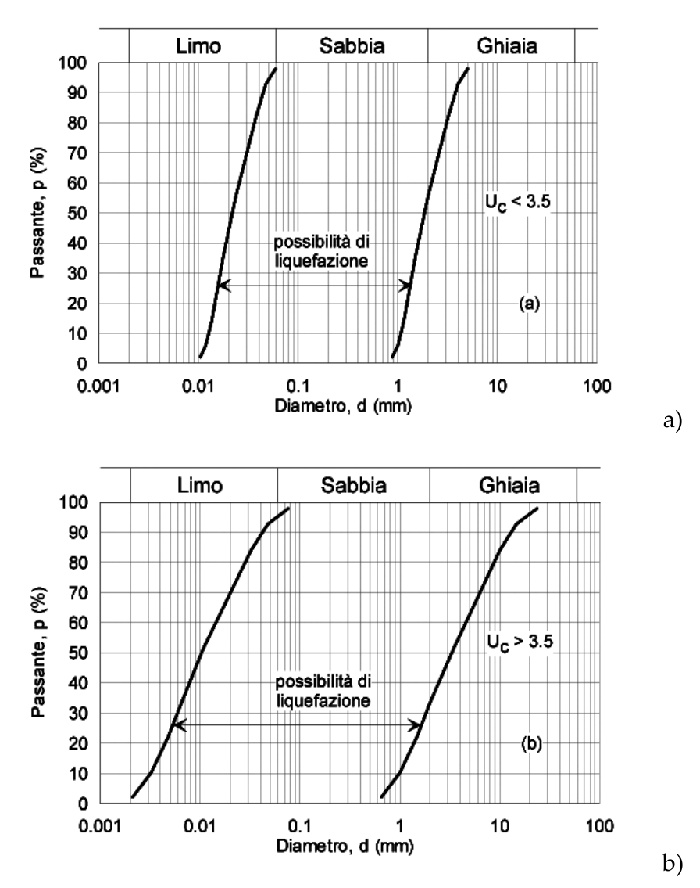

[Torna all'indice del capitolo](indice-cap07.md) | [Torna all'indice generale](../indice-ntc2018.md)

# 7.11. Opere e sistemi geotecnici

## Indice del capitolo

- [7.11.1 Requisiti SL (SLV, SLD)](#7111-requisiti-nei-confronti-degli-stati-limite)
- [7.11.2 Caratterizzazione geotecnica sismica](#7112-caratterizzazione-geotecnica-ai-fini-sismici)
- [7.11.3 Risposta sismica e stabilità del sito](#7113-risposta-sismica-e-stabilità-del-sito)
  - [7.11.3.1 Risposta sismica locale](#71131-risposta-sismica-locale)
  - [7.11.3.2 Amplificazione stratigrafica](#71132-fattori-di-amplificazione-stratigrafica)
  - [7.11.3.3 Amplificazione topografica](#71133-fattori-di-amplificazione-topografica)
  - [7.11.3.4 Liquefazione (Fig. 7.11.1)](#71134-stabilità-nei-confronti-della-liquefazione)
  - [7.11.3.5 Pendii (k_h, Tab. 7.11.I β_s)](#71135-stabilità-dei-pendii)
- [7.11.4 Fronti di scavo e rilevati](#7114-fronti-di-scavo-e-rilevati)
- [7.11.5 Fondazioni (Tab. 7.11.II γ_R)](#7115-fondazioni)
  - [7.11.5.1 Regole generali](#71151-regole-generali)
  - [7.11.5.2 Indagini e modello](#71152-indagini-e-modello-geotecnico)
  - [7.11.5.3 Verifiche SLV e SLD](#71153-verifiche-slv-e-sld)
- [7.11.6 Opere di sostegno (muri, paratie)](#7116-opere-di-sostegno)
  - [7.11.6.1 Requisiti generali](#71161-requisiti-generali)
  - [7.11.6.2 Muri di sostegno (Tab. 7.11.III)](#71162-muri-di-sostegno)
  - [7.11.6.3 Paratie (Fig. 7.11.2-3)](#71163-paratie)
  - [7.11.6.4 Sistemi di vincolo](#71164-sistemi-di-vincolo)
- [C7.11.1 — Requisiti SL](#c7111-requisiti-nei-confronti-degli-stati-limite)
- [C7.11.2 — Caratterizzazione](#c7112-caratterizzazione-geotecnica-ai-fini-sismici)
- [C7.11.3 — Risposta sismica](#c7113-risposta-sismica-e-stabilità-del-sito)
  - [C7.11.3.1 Risposta sismica locale](#c71131-risposta-sismica-locale)
- [C7.11.4 — Fronti di scavo](#c7114-fronti-di-scavo-e-rilevati)
- [C7.11.5 — Fondazioni (γ_R=2,3 o 1,8, pali, miste)](#c7115-fondazioni)
- [C7.11.6 — Sostegno (muri β_m, paratie)](#c7116-opere-di-sostegno)

---

# Norma

## 7.11.1. Requisiti nei confronti degli stati limite

Le opere e i sistemi geotecnici devono essere verificati nei confronti degli stati limite ultimi (SLV) e degli stati limite di esercizio (SLD).

I coefficienti parziali sulle azioni derivanti dall'analisi della risposta sismica sono posti pari a 1. I coefficienti parziali sulla resistenza $\gamma_R$ sono quelli indicati nel presente Capitolo 7 per le diverse tipologie di opere geotecniche.

---

## 7.11.2. Caratterizzazione geotecnica ai fini sismici

La caratterizzazione geotecnica ai fini sismici richiede indagini finalizzate a definire:

- il quadro geologico-tettonico del sito;
- la caratterizzazione fisico-meccanica dei terreni;
- la classificazione del sottosuolo secondo le categorie di cui al § 3.2.2.

Le indagini devono essere adeguate all'importanza dell'opera, alla complessità geologica del sito e alle caratteristiche sismiche dell'area.

La resistenza al taglio dei terreni in condizioni sismiche si valuta come segue.

Per terreni a grana grossa e terreni a grana fine in condizioni drenate:

$$\tau_f = c' + (\sigma'_n - \Delta u) \cdot \tan(\varphi')$$ \tag{7.11.1}

dove:

- $c'$ è la coesione efficace;
- $\sigma'_n$ è la tensione normale efficace;
- $\Delta u$ è la sovrappressione interstiziale indotta dal sisma;
- $\varphi'$ è l'angolo di attrito efficace.

Per terreni a grana fine in condizioni non drenate:

$$\tau_f = c_{u,c}$$ \tag{7.11.2}

dove $c_{u,c}$ è la resistenza al taglio non drenata ciclica, determinata mediante prove di laboratorio su campioni soggetti a sollecitazione ciclica, ovvero ricavata dalla resistenza al taglio non drenata statica $c_u$ mediante opportuni fattori riduttivi.

---

## 7.11.3. Risposta sismica e stabilità del sito

### 7.11.3.1. Risposta sismica locale

L'analisi di risposta sismica locale consente di determinare il moto sismico in superficie a partire dal moto sismico di riferimento al substrato rigido, tenendo conto delle condizioni litostratigrafiche e geomorfologiche del sito.

L'analisi di risposta sismica locale è obbligatoria per le categorie di sottosuolo S1 e S2 di cui al § 3.2.2 e, in generale, quando le condizioni del sito non rientrano nelle categorie per le quali sono definiti i coefficienti di amplificazione stratigrafica e topografica.

### 7.11.3.2. Fattori di amplificazione stratigrafica

In assenza di analisi di risposta sismica locale, l'accelerazione massima attesa al piano di posa delle fondazioni si determina come:

$$a_{max} = S_S \cdot a_g$$

dove $S_S$ è il coefficiente di amplificazione stratigrafica, funzione della categoria di sottosuolo e dell'accelerazione di riferimento $a_g$, definito al § 3.2.3.2.

### 7.11.3.3. Fattori di amplificazione topografica

Il coefficiente di amplificazione topografica $S_T$, definito al § 3.2.3.2, tiene conto dell'incremento dell'azione sismica per effetto della morfologia superficiale.

### 7.11.3.4. Stabilità nei confronti della liquefazione

#### 7.11.3.4.1. Generalità

La liquefazione è un fenomeno associato all'insorgere di sovrappressioni interstiziali in terreni saturi a grana grossa, soggetti ad azioni cicliche, con conseguente annullamento della tensione efficace e perdita di resistenza al taglio.

La verifica della sicurezza nei confronti della liquefazione deve essere effettuata quando il terreno di fondazione comprende strati estesi o lenti spesse di sabbie sciolte sotto falda.

#### 7.11.3.4.2. Esclusione della verifica a liquefazione

La verifica a liquefazione può essere omessa quando si manifesti almeno una delle seguenti quattro condizioni:

*a)* la profondità della falda è superiore a 15 m dal piano campagna per ponti e opere in elevazione, o a 5 m per fondazioni di edifici;

*b)* il terreno è costituito da sabbie con contenuto di fine (passante al setaccio 0,075 mm) superiore al 20% e indice di plasticità PI > 10;

*c)* il terreno è costituito da sabbie con $D_{50}$ > 2 mm o $D_{10}$ > 1 mm (cioè sabbie grossolane o ghiaie);

*d)* $a_{max} \cdot S < 0{,}1\text{g}$ e, contemporaneamente, una delle seguenti condizioni è verificata:
  - $(N_1)_{60} > 20$ per sabbie pulite;
  - $(N_1)_{60} > 25$ per sabbie limose;
  - $q_{c1N} > 150$ per sabbie pulite;
  - $q_{c1N} > 175$ per sabbie limose.

**Fig. 7.11.1** – *Fusi granulometrici di terreni suscettibili di liquefazione: a) zona A (più suscettibile); b) zona B (suscettibile)*

#### 7.11.3.4.3. Metodi di analisi

La verifica a liquefazione si esegue confrontando, per ciascuno strato potenzialmente liquefacibile, la resistenza ciclica del terreno (CRR, *Cyclic Resistance Ratio*) con la sollecitazione ciclica indotta dal sisma (CSR, *Cyclic Stress Ratio*).

Il fattore di sicurezza alla liquefazione è:

$$FS_{liq} = \frac{CRR}{CSR}$$

I metodi di valutazione di CRR e CSR si basano su correlazioni empiriche con i risultati di prove in sito (SPT, CPT, $V_s$) e devono essere conformi alla letteratura tecnica internazionale consolidata.

### 7.11.3.5. Stabilità dei pendii

La verifica di stabilità dei pendii in condizioni sismiche si esegue con metodi pseudo-statici, in cui l'azione sismica è rappresentata da una forza statica equivalente proporzionale al peso del volume di terreno potenzialmente instabile.

I coefficienti sismici per l'analisi pseudo-statica sono:

$$k_h = \beta_s \cdot \frac{a_{max}}{g}$$ \tag{7.11.3}

$$k_v = \pm 0{,}5 \cdot k_h$$ \tag{7.11.4}

dove:

$$a_{max} = S \cdot a_g = S_S \cdot S_T \cdot a_g$$ \tag{7.11.5}

e $\beta_s$ è un coefficiente di riduzione dell'accelerazione massima attesa al sito, i cui valori sono riportati nella Tab. 7.11.I.

**Tab. 7.11.I** – *Coefficienti di riduzione $\beta_s$ per la stabilità dei pendii*

| Stato limite | Categoria di sottosuolo A | Categoria di sottosuolo B, C, D, E |
|:---:|:---:|:---:|
| SLV | 0,30 | 0,28 |
| SLD | 0,47 | 0,47 |

I valori di $\beta_s$ della Tab. 7.11.I sono applicabili a condizione che lo spostamento permanente atteso del pendio sia accettabile per l'opera in esame.

**Metodo degli spostamenti**

In alternativa al metodo pseudo-statico, la verifica di stabilità dei pendii può essere effettuata con il metodo degli spostamenti (tipo Newmark). In tal caso, l'accelerazione critica $a_c$ del meccanismo di collasso viene confrontata con l'accelerazione massima attesa e si stima lo spostamento permanente.

---

## 7.11.4. Fronti di scavo e rilevati

Per le verifiche pseudo-statiche di fronti di scavo e rilevati, i coefficienti sismici si assumono con:

$$\beta_s = 0{,}38 \quad \text{per SLV}$$

$$\beta_s = 0{,}47 \quad \text{per SLD}$$

Il coefficiente parziale sulla resistenza globale è:

$$\gamma_R = 1{,}2$$

---

## 7.11.5. Fondazioni

### 7.11.5.1. Regole generali

La progettazione delle fondazioni in zona sismica richiede:

- la valutazione della risposta sismica locale del sito;
- la verifica della sicurezza nei confronti della liquefazione degli strati di terreno di fondazione;
- la verifica della stabilità globale del complesso opera di fondazione – terreno.

Le forze sismiche trasmesse dalla sovrastruttura alle fondazioni devono essere determinate in accordo con le regole generali del presente Capitolo.

### 7.11.5.2. Indagini e modello geotecnico

Le indagini geotecniche devono essere finalizzate alla caratterizzazione del terreno per le verifiche sismiche. Il modello geotecnico deve includere le proprietà di rigidezza e resistenza dei terreni in condizioni cicliche.

### 7.11.5.3. Verifiche SLV e SLD

#### 7.11.5.3.1. Fondazioni superficiali

Le verifiche delle fondazioni superficiali si eseguono nei confronti dei seguenti stati limite, con i coefficienti parziali sulla resistenza $\gamma_R$ riportati nella Tab. 7.11.II:

**Tab. 7.11.II** – *Coefficienti parziali $\gamma_R$ per verifiche sismiche di fondazioni superficiali*

| Verifica | $\gamma_R$ |
|---|:---:|
| Carico limite | 2,3 |
| Scorrimento | 1,1 |
| Resistenza del terreno a lato delle superfici laterali | 1,3 |

Per la verifica al carico limite, si deve tenere conto dell'effetto della componente sismica orizzontale e verticale dell'azione sulla capacità portante della fondazione.

Per la verifica allo scorrimento, la resistenza allo scorrimento alla base della fondazione deve essere non inferiore alla componente orizzontale della risultante delle forze agenti.

#### 7.11.5.3.2. Fondazioni su pali

Le fondazioni su pali in condizioni sismiche devono essere verificate per gli stati limite di:

- resistenza verticale del singolo palo e del gruppo di pali;
- resistenza orizzontale del singolo palo e del gruppo di pali;
- stabilità nei confronti della liquefazione degli strati attraversati dai pali;
- compatibilità degli spostamenti.

Deve essere tenuto conto dell'interazione cinematica (effetto del moto del terreno sui pali) e dell'interazione inerziale (effetto delle forze trasmesse dalla sovrastruttura). L'interazione cinematica è particolarmente significativa in presenza di strati con caratteristiche di rigidezza molto diverse.

Per le fondazioni miste (platee su pali) si applicano le indicazioni del § 6.4.3.

---

## 7.11.6. Opere di sostegno

### 7.11.6.1. Requisiti generali

Le opere di sostegno devono essere progettate in modo da garantire la sicurezza prima, durante e dopo il sisma.

Le verifiche devono essere condotte sia per le condizioni sismiche (azione sismica + spinta del terreno in condizioni sismiche) sia per le condizioni statiche (dopo il sisma, con eventuali sovrappressioni interstiziali residue).

### 7.11.6.2. Muri di sostegno

#### 7.11.6.2.1. Metodi di analisi

Le verifiche pseudo-statiche dei muri di sostegno si eseguono con i seguenti coefficienti sismici:

$$k_h = \beta_m \cdot \frac{a_{max}}{g}$$ \tag{7.11.6}

$$k_v = \pm 0{,}5 \cdot k_h$$ \tag{7.11.7}

dove:

$$a_{max} = S \cdot a_g = S_S \cdot S_T \cdot a_g$$ \tag{7.11.8}

e $\beta_m$ è un coefficiente di riduzione dell'accelerazione massima:

$$\beta_m = 0{,}38 \quad \text{per SLV}$$

$$\beta_m = 0{,}47 \quad \text{per SLD}$$

I coefficienti parziali sulla resistenza $\gamma_R$ per le verifiche sismiche dei muri di sostegno sono riportati nella Tab. 7.11.III:

**Tab. 7.11.III** – *Coefficienti parziali $\gamma_R$ per verifiche sismiche di muri di sostegno*

| Verifica | $\gamma_R$ |
|---|:---:|
| Carico limite della fondazione | 1,2 |
| Scorrimento | 1,0 |
| Ribaltamento | 1,0 |
| Resistenza del terreno a valle | 1,2 |

La spinta del terreno in condizioni sismiche si determina con il metodo di Mononobe-Okabe o con metodi equivalenti, utilizzando i coefficienti sismici $k_h$ e $k_v$ sopra definiti.

**Metodo degli spostamenti**

In alternativa al metodo pseudo-statico, le verifiche dei muri di sostegno possono essere eseguite con il metodo degli spostamenti, determinando l'accelerazione critica del meccanismo di collasso e stimando lo spostamento permanente.

#### 7.11.6.2.2. Verifiche di sicurezza

Le verifiche di sicurezza dei muri di sostegno devono essere effettuate per:

- ribaltamento attorno allo spigolo esterno della base;
- scorrimento sul piano di posa;
- carico limite della fondazione;
- stabilità globale del complesso muro-terreno;
- resistenza strutturale degli elementi del muro (fusto, fondazione).

### 7.11.6.3. Paratie

#### 7.11.6.3.1. Metodi di analisi pseudo-statici

Per le paratie, l'accelerazione sismica di progetto per l'analisi pseudo-statica è:

$$a_h = k_h \cdot g = \alpha \cdot \beta \cdot a_{max}$$ \tag{7.11.9}

dove:

$$a_{max} = S \cdot a_g = S_S \cdot S_T \cdot a_g$$ \tag{7.11.10}

e i coefficienti $\alpha$ e $\beta$ tengono rispettivamente conto della deformabilità della paratia e dello spostamento ammissibile.

Il coefficiente $\alpha$ dipende dal rapporto $H/\lambda$ fra l'altezza della paratia $H$ e la lunghezza d'onda del sisma $\lambda$. I suoi valori sono riportati in Fig. 7.11.2.

Il coefficiente $\beta$ dipende dallo spostamento ammissibile della paratia. I suoi valori sono riportati in Fig. 7.11.3.

Lo spostamento massimo ammissibile della paratia è:

$$u_s \leq 0{,}005 \cdot H$$ \tag{7.11.11}

dove $H$ è l'altezza della paratia.

#### 7.11.6.3.2. Verifiche di sicurezza

Le verifiche di sicurezza delle paratie devono essere effettuate per:

- raggiungimento della resistenza passiva del terreno;
- resistenza strutturale degli elementi della paratia (sezioni di infissione e di vincolo);
- resistenza degli ancoraggi;
- stabilità globale del complesso paratia-terreno.

### 7.11.6.4. Sistemi di vincolo

Per i sistemi di vincolo (ancoraggi, tiranti, chiodi), il coefficiente $\beta$ si assume pari a:

$$\beta = 1$$

La lunghezza di ancoraggio efficace $L_e$ in condizioni sismiche si determina come:

$$L_e = L_s \cdot \left(1 + 1{,}5 \cdot \frac{a_{max}}{g}\right)$$ \tag{7.11.12}

dove $L_s$ è la lunghezza di ancoraggio in condizioni statiche.

#### 7.11.6.4.1. Verifiche di sicurezza

Le verifiche di sicurezza dei sistemi di vincolo devono accertare:

- la resistenza del tirante (sezione del tirante, resistenza della fondazione dell'ancoraggio);
- la lunghezza di ancoraggio sufficiente a garantire la stabilità in condizioni sismiche;
- la stabilità globale del sistema paratia-ancoraggio-terreno.

---

# Circolare

La progettazione delle opere e dei sistemi geotecnici in presenza di azioni sismiche si esegue rispettando, in modo integrato, le prescrizioni contenute nel Capitolo 6 delle NTC relative alle azioni statiche e quelle specifiche fornite nel presente §7.11 per le azioni sismiche.

## C7.11.1. Requisiti nei confronti degli stati limite

Le verifiche agli stati limite ultimi in presenza di azioni sismiche (SLV) devono essere effettuate adottando valori unitari dei coefficienti parziali dei gruppi A ed M per il calcolo delle azioni e dei parametri geotecnici di progetto e i soli coefficienti parziali del gruppo R per il calcolo delle resistenze di progetto. A quest'ultimo fine, devono essere impiegati i valori dei coefficienti $\gamma_R$ riportati nel presente Capitolo 7. Nel caso in cui non fossero espressamente indicati, si fa riferimento ai valori di $\gamma_R$ indicati nel Capitolo 6.

## C7.11.2. Caratterizzazione geotecnica ai fini sismici

La caratterizzazione geotecnica dei terreni e delle rocce, così come la definizione dei modelli geotecnici di sottosuolo, costituiscono un insieme di attività riguardanti unitariamente la progettazione geotecnica, sia in condizioni statiche, sia in condizioni sismiche. Ne consegue che la caratterizzazione geotecnica ai fini sismici costituisce la necessaria integrazione di quella illustrata nel Capitolo 6 delle NTC per la progettazione in condizioni statiche ed è finalizzata a completare la definizione dei modelli geotecnici di sottosuolo secondo le necessità della progettazione sismica. Pertanto, anche in presenza di azioni sismiche, il progetto deve articolarsi nelle fasi prescritte nel § 6.2 delle NTC, comprendendo anche tutti gli elementi necessari per tenere conto degli aspetti sismici.

## C7.11.3. Risposta sismica e stabilità del sito

### C7.11.3.1. Risposta sismica locale

Nella definizione delle azioni sismiche cui è sottoposta una costruzione, sia in fondazione, sia in elevazione, il progettista deve svolgere un'analisi della risposta sismica locale, cioè una valutazione delle modificazioni del segnale sismico, rispetto a quanto atteso sulla base delle indicazioni riportate al paragrafo 3.2 in merito alla pericolosità sismica di base, dovute alla deformabilità e alla capacità dissipativa del terreno compreso nel volume significativo. A questo fine, sono disponibili diversi strumenti per studiare gli effetti della propagazione delle onde sismiche nel sottosuolo, basati in genere su metodi di analisi numerica, lineare e non, riferiti a problemi monodimensionali, bidimensionali o tridimensionali.

Mentre nelle analisi monodimensionali è possibile tenere conto soltanto degli effetti dell'amplificazione stratigrafica, nelle analisi condotte in condizioni bi-tridimensionali è possibile tenere conto, congiuntamente, sia dell'amplificazione stratigrafica, sia dell'amplificazione morfologica (superficiale e/o profonda) del sito.

Nel caso in cui il volume significativo di terreno sia caratterizzato da situazioni stratigrafiche tipiche e ben definite, cui corrispondano anche prefissati campi di variazione della velocità di propagazione delle onde di taglio, le norme offrono la possibilità di studiare la risposta sismica locale con un procedimento semplificato che permette di identificare uno spettro di risposta elastico in accelerazione ancorato all'accelerazione $a_{max} = S_S a_g$, dove $a_g$ è l'accelerazione massima su sito di riferimento rigido e $S_S$ è il coefficiente di amplificazione stratigrafica. Analogamente, per condizioni topografiche riconducibili alle categorie di cui alla Tab. 3.2.III delle NTC, la valutazione dell'amplificazione topografica può essere effettuata con metodi semplificati, utilizzando il coefficiente di amplificazione topografica $S_T$.

#### C7.11.3.1.1. Indagini specifiche

In aggiunta alle indagini in sito e alle prove di laboratorio necessarie per l'identificazione dei modelli geotecnici di sottosuolo in condizioni statiche, per la progettazione in presenza di azioni sismiche le indagini e le prove devono comprendere l'accertamento della profondità e della conformazione del substrato rigido o di una formazione ad esso assimilabile.

Per depositi molto profondi, la profondità di indagine si estende fino alla profondità in corrispondenza della quale vengono individuati strati di terreno molto rigidi, assimilabili al substrato ai fini della risposta sismica locale.

Queste analisi richiedono, inoltre, un'adeguata conoscenza delle proprietà meccaniche dei terreni in condizioni cicliche, da determinare mediante specifiche indagini in sito e prove di laboratorio, programmate dal progettista in funzione del tipo di opera e/o di intervento, della procedura di analisi che intende adottare. In particolare, è auspicabile l'esecuzione di prove in sito per la determinazione dei profili di velocità di propagazione delle onde di taglio, ai fini della valutazione della rigidezza a bassi livelli di deformazione. Le prove di laboratorio sono invece raccomandate per la valutazione della dipendenza della rigidezza e dello smorzamento dal livello deformativo, e per la determinazione, in dipendenza del legame costitutivo adottato per i terreni, dei parametri di ingresso necessari alle analisi. A titolo di esempio e in maniera non esaustiva, le prove in sito possono includere le prove Cross-Hole, le prove Down-Hole, le prove SASW, le prove MASW, le prove eseguite con il dilatometro sismico (SDMT) e con il penetrometro sismico SCPT; le prove di laboratorio possono invece consistere in prove cicliche di taglio torsionale o di taglio semplice, prove di colonna risonante, prove triassiali cicliche, ecc. Le apparecchiature di laboratorio, opportunamente strumentate, possono permettere anche la determinazione delle caratteristiche di rigidezza a bassi livelli di deformazione.

#### C7.11.3.1.2. Analisi numeriche di risposta sismica locale

Le analisi della risposta sismica locale sono effettuate utilizzando procedure di calcolo numerico in cui viene simulata la propagazione delle onde sismiche entro gli strati di terreno compresi tra il sottostante substrato rigido e il piano campagna (volume significativo ai fini della definizione della azione sismica). In generale, queste analisi richiedono le seguenti operazioni:

- scelta della schematizzazione geometrica del problema;
- definizione del modello geotecnico di sottosuolo;
- definizione delle azioni sismiche al substrato rigido;
- scelta della procedura di analisi.

##### C7.11.3.1.2.1. Scelta della schematizzazione geometrica e definizione del modello geotecnico di sottosuolo

La schematizzazione geometrica monodimensionale è la più semplice ai fini delle analisi; a prescindere dalla effettiva configurazione topografica del piano campagna, ci si riconduce allo schema di un terreno omogeneo o stratificato orizzontalmente, delimitato da piano campagna orizzontale e poggiante su un substrato rigido, anch'esso orizzontale. Sono assimilabili ad un substrato rigido strati di terreno caratterizzati da valori di velocità delle onde di taglio maggiori di $800$ m/s.

Qualora il piano di campagna o la giacitura degli strati e/o del substrato non siano facilmente riconducibili a tale schematizzazione a causa di assetti morfologici e stratigrafici complessi debbono essere valutate schematizzazioni che consentano una rappresentazione adeguata degli effetti della morfologia superficiale e dell'assetto stratigrafico del sito, attraverso una modellazione numerica più raffinata.

Nella definizione del modello geotecnico di sottosuolo è necessario specificare, per ciascuno degli strati individuati, i parametri di ingresso all'analisi.

##### C7.11.3.1.2.2. Definizione delle azioni sismiche di ingresso

Le azioni sismiche di ingresso sono costituite da storie temporali del moto del terreno rappresentative dello scuotimento sismico atteso su un sito di riferimento rigido ed affiorante con superficie topografica orizzontale (sottosuolo di categoria A e classe topografica T1 descritte nel § 3.2.2 delle NTC).

Come specificato nel § 3.2.3.6 delle NTC, nelle analisi di risposta sismica locale, così come nelle analisi dinamiche di opere e sistemi geotecnici, non è consentito usare accelerogrammi artificiali. Gli accelerogrammi artificiali spettro-compatibili sono infatti caratterizzati da una banda di frequenze irrealisticamente ampia poiché gli spettri di risposta di progetto, su cui essi sono calibrati, sono ottenuti da inviluppi di spettri di risposta in termini di numerosi eventi reali. Conseguentemente, l'uso di accelerogrammi artificiali in un'analisi di risposta sismica locale può produrre un'amplificazione contemporanea, e perciò poco realistica, dei diversi modi di vibrazione del sistema, mentre un'azione sismica reale, caratterizzata da una larghezza di banda modesta, amplifica solo un limitato numero di modi, o al limite un unico modo. Inoltre, dal momento che la risposta dei terreni a una sollecitazione ciclica è non lineare, la rigidezza e la capacità di dissipare energia dipendono dall'ampiezza del livello deformativo. Perciò, durante il sisma, il terreno modifica la propria rigidezza e le caratteristiche di smorzamento, adattandole all'ampiezza delle vibrazioni che riceve. Se l'azione sismica è poco realistica, la rigidezza e lo smorzamento operativi prodotti dalla non-linearità del comportamento del terreno sono molto distanti dal vero e la conseguente risposta sismica risulta falsata.

Per le analisi di risposta sismica locale e per le analisi dinamiche di opere e sistemi geotecnici devono essere impiegati accelerogrammi registrati. È ammesso tuttavia l'uso di accelerogrammi sintetici, purché siano generati mediante simulazione del meccanismo di sorgente (§ 3.2.3.6 delle NTC). La scelta di accelerogrammi registrati può essere effettuata attingendo da archivi nazionali o internazionali accreditati, disponibili in rete, a condizione che la loro scelta sia rappresentativa della sismicità del sito e sia adeguatamente giustificata in base alle caratteristiche sismogenetiche della sorgente, alla magnitudo, alla distanza dalla sorgente e alla massima accelerazione orizzontale attesa al sito. Nella selezione degli accelerogrammi registrati occorre anche tenere conto del contesto geologico e delle caratteristiche geotecniche dei siti ove sono ubicate le stazioni accelerometriche di registrazione. I segnali sismici dovrebbero essere caratterizzati al substrato roccioso affiorante con superficie topografica orizzontale. Inoltre è opportuno utilizzare registrazioni in campo libero ed evitare la selezione di accelerogrammi registrati all'interno di edifici o altre tipologie di strutture. Ulteriori dettagli sui criteri di scelta degli accelerogrammi registrati sono riportati nel § 3.2.3.6 delle NTC. È inoltre raccomandato effettuare analisi di risposta sismica locale utilizzando un numero adeguato di segnali (almeno 7 come richiamato in diversi punti delle NTC). Ciò è relativamente agevole, considerata l'ampia disponibilità di registrazioni accelerometriche di terremoti reali.

Benché le NTC prescrivano che il requisito della spettro-compatibilità debba essere soddisfatto rispetto allo spettro di risposta medio di un insieme di accelerogrammi, è opportuno evitare l'utilizzo di segnali individuali il cui spettro di risposta presenti uno scarto in eccesso rispetto allo spettro elastico di riferimento superiore al 30%, questo per evitare l'adozione di accelerogrammi rappresentativi di una domanda sismica troppo severa. Tali accelerogrammi potrebbero infatti determinare, sulla struttura o sul sistema geotecnico oggetto dell'analisi, effetti di non linearità eccessivamente pronunciati e incompatibili con l'effettiva pericolosità sismica del sito. Per motivi analoghi, è opportuno selezionare storie temporali che soddisfino l'ulteriore vincolo di compatibilità in media con l'accelerazione massima ($a_g$) prescritta per il sito in esame dallo studio di pericolosità sismica di base.

##### C7.11.3.1.2.3. Scelta della procedura di analisi

Le analisi di risposta sismica locale possono essere effettuate a diversi livelli di raffinatezza, in relazione all'importanza dell'opera e/o dell'intervento, e alla complessità del problema in esame.

Nelle analisi semplificate, il terreno viene assimilato a un mezzo monofase visco-elastico non lineare, con caratteristiche di rigidezza e smorzamento dipendenti dal livello di deformazione. Le analisi sono generalmente eseguite in termini di tensioni totali, risolvendo la non linearità con un approccio lineare equivalente. Queste analisi possono essere condotte in condizioni monodimensionali o bidimensionali e forniscono i profili e le isolinee di accelerazione massima, deformazione e tensione di taglio, i valori operativi del modulo di taglio e del coefficiente di smorzamento, le storie temporali di accelerazione, deformazione e tensione di taglio e gli spettri di risposta a diversi tempi in prefissati punti del dominio. L'analisi non permette la valutazione delle deformazioni permanenti indotte dal sisma nel terreno, in quanto essa è condotta facendo riferimento ad un modello elastico. Inoltre, essendo svolte in termini di tensioni totali, nel caso di terreni saturi, le analisi non permettono la valutazione delle variazioni delle pressioni interstiziali e delle tensioni efficaci. Le analisi semplificate risultano poco accurate nei casi in cui la non-linearità del comportamento dei terreni assume un ruolo importante (eventi sismici di elevata intensità e terreni teneri/sciolti, di modesta rigidezza). Per valori delle deformazioni di taglio maggiori di $1$-$2\%$, soprattutto in presenza di terreni molto deformabili, è quindi opportuno non utilizzare l'approccio lineare equivalente e riferirsi a leggi costitutive maggiormente rappresentative del comportamento meccanico del terreno.

Nelle procedure di analisi avanzate, il terreno viene assimilato a un mezzo polifase elasto-plastico o con comportamento descritto in termini di tensioni efficaci. Affinché le analisi siano affidabili, i modelli costitutivi adottati devono essere in grado di riprodurre adeguatamente il comportamento non lineare e isteretico dei terreni in condizioni cicliche, a partire da bassi livelli di deformazione. In queste condizioni è possibile ottenere una descrizione più realistica del comportamento dei terreni, ottenendo, ad esempio, in aggiunta a quanto summenzionato, la valutazione di:

- sovrappressioni interstiziali indotte dal sisma, particolarmente rilevanti nelle verifiche di stabilità nei confronti della liquefazione;
- ridistribuzione e dissipazione delle sovrappressioni interstiziali nella fase successiva al sisma;
- stato di deformazione permanente indotta dal sisma nel terreno, indotta dalle zone plasticizzate;
- stato di tensione efficace e grado di mobilitazione della resistenza al taglio.

L'uso di queste procedure di analisi richiede in genere un numero elevato di parametri di ingresso all'analisi, in dipendenza dei modelli costitutivi adottati per i terreni, e implica perciò una campagna di indagine specifica, da definire caso per caso.

#### C7.11.3.4. Stabilità nei confronti della liquefazione

La sicurezza nei confronti della liquefazione può essere valutata con procedure di analisi avanzate o con metodologie di carattere semi-empirico.

Le NTC, innanzitutto, fissano i casi in cui è possibile omettere la verifica a liquefazione. È sufficiente che si verifichi almeno una delle quattro condizioni indicate nel §7.11.3.4.2 affinché si possa omettere l'esecuzione di tale verifica.

*Se la condizione relativa alla severità della azione sismica non è soddisfatta e cioè se le accelerazioni massime attese al piano campagna in campo libero sono superiori a $0{,}1\, g$, le NTC prescrivono degli approfondimenti delle indagini geotecniche finalizzati a verificare il manifestarsi o meno delle altre condizioni.*

Nei metodi di analisi avanzata si deve tenere conto della natura polifase dei terreni, considerando l'accoppiamento tra fase solida e fase fluida, e si deve descrivere adeguatamente il comportamento meccanico delle terre in condizioni cicliche.

Le metodologie di carattere semi-empirico permettono sia verifiche di tipo puntuale, sia verifiche di tipo globale.

Nelle analisi puntuali, la sicurezza alla liquefazione è valutata localmente, a diverse profondità, calcolando il rapporto tra la resistenza ciclica alla liquefazione, $CRR = \tau_l / \sigma'_{v0}$, e la sollecitazione ciclica indotta dall'azione sismica, $CSR = \tau_{media} / \sigma'_{v0}$ in cui con $\sigma'_{v0}$ si intende la tensione efficace verticale agente alla profondità considerata prima dell'evento sismico. La sollecitazione ciclica è correlata alla massima tensione tangenziale indotta dall'azione sismica, $\tau_{max}$, che può essere determinata direttamente, da analisi di risposta sismica locale, o indirettamente, da relazioni empiriche, in funzione dei caratteri del moto sismico atteso al sito. La resistenza ciclica alla liquefazione, $CRR$, può essere valutata da prove cicliche di laboratorio o da correlazioni empiriche basate su risultati di prove e misure in sito. La verifica è effettuata utilizzando abachi di letteratura che riportano, in ordinata, la sollecitazione ciclica $CSR$ e in ascissa una proprietà del terreno stimata dalle prove in sito (ad esempio da prove penetrometriche statiche o dinamiche o da misure in sito della velocità di propagazione delle onde di taglio $V_S$). Negli abachi, una curva separa gli stati per i quali nel passato si è osservata la liquefazione da quelli per i quali la liquefazione non è avvenuta.

Nelle verifiche globali, si valutano preliminarmente i profili della sollecitazione e della resistenza ciclica, $CSR$ e $CRR$, e si valuta, per l'intervallo di profondità in esame, il potenziale di liquefazione, $I_L$, funzione dell'area racchiusa tra i due profili. La suscettibilità nei confronti della liquefazione, valutata in base ai valori assunti dal potenziale di liquefazione, è così riferita ad uno spessore finito di terreno piuttosto che al singolo punto.

Tali procedure sono valide per piano di campagna sub-orizzontale. In caso contrario, la verifica deve essere eseguita con studi specifici.

Se le verifiche semplificate sono effettuate contemporaneamente con più metodi, si deve adottare quella più cautelativa, a meno di non giustificare adeguatamente una scelta diversa.

La sicurezza nei confronti della liquefazione deve essere effettuata utilizzando i valori caratteristici delle proprietà meccaniche dei terreni. L'adeguatezza del margine di sicurezza nei confronti della liquefazione deve essere valutata e motivata dal progettista.

#### C7.11.3.5. Stabilità dei pendii

Il comportamento dei pendii durante un evento sismico, e per un periodo successivo all'evento stesso, è strettamente legato alla natura del terreno e alle condizioni esistenti prima del terremoto. Un'analisi completa della stabilità in condizioni sismiche deve perciò sempre comprendere lo studio del comportamento del pendio prima, durante e dopo il terremoto.

I metodi per l'analisi di stabilità dei pendii in presenza di sisma possono essere suddivisi in tre categorie principali, in ordine di complessità crescente:

- metodi pseudostatici
- metodi degli spostamenti (analisi dinamica semplificata)
- metodi di analisi dinamica avanzata

Per i pendii naturali le verifiche di sicurezza devono essere effettuate utilizzando i valori caratteristici dei parametri di resistenza dei terreni e delle azioni. In altre parole, tutti i coefficienti parziali sono assunti unitari.

Nei metodi pseudostatici la condizione di stato limite ultimo viene riferita al cinematismo di collasso critico, caratterizzato dal più basso valore del coefficiente di sicurezza, $FS$, definito come rapporto tra resistenza al taglio disponibile e sforzo di taglio mobilitato lungo la superficie di scorrimento (effettiva o potenziale) ($F_S = \tau_f / \tau_m$).

Nei pendii interessati da frane attive o quiescenti, che possono essere riattivate in occasione del sisma, le analisi in termini di tensioni efficaci risultano più appropriate rispetto a quelle in tensioni totali. In tal caso, particolare riguardo deve essere posto nella scelta delle caratteristiche di resistenza dei materiali, facendo riferimento alla resistenza al taglio a grandi deformazioni, in dipendenza dell'entità dei movimenti e della natura dei terreni.

In terreni saturi e per valori di $a_{max} > 0{,}15\, g$, nell'analisi statica delle condizioni successive al sisma, si deve considerare la riduzione della resistenza al taglio indotta da condizioni di carico ciclico a causa dell'incremento delle pressioni interstiziali e della degradazione dei parametri di resistenza. In assenza di specifiche prove di laboratorio eseguite in condizioni cicliche, l'incremento delle pressioni interstiziali, $\Delta u$, per le analisi in tensioni efficaci, e il coefficiente di riduzione della resistenza non drenata, $\delta_{cu}$, per le analisi in tensioni totali, possono essere stimati facendo ricorso all'uso di relazioni empiriche.

Nelle analisi condotte con i metodi pseudostatici, il campo di accelerazione all'interno del pendio è assunto uniforme e le componenti orizzontale e verticale delle forze di inerzia sono applicate nel baricentro della massa potenzialmente in frana, nei metodi globali, o nei baricentri delle singole strisce, nei metodi delle strisce. Per tener conto del moto sismico all'interno del pendio, il valore dell'accelerazione orizzontale massima su sito di riferimento rigido, $a_g$, può essere moltiplicato per un coefficiente $S$ che comprende l'effetto dell'amplificazione stratigrafica, $S_S$, e dell'amplificazione topografica $S_T$.

In alternativa, la variabilità spaziale dell'azione sismica può essere introdotta valutando un coefficiente sismico orizzontale equivalente, $k_{heq}$, mediante un'analisi della risposta sismica locale.

Nelle verifiche pseudostatiche allo **SLV** dei pendii si utilizzano i coefficienti $\beta_s$ dell'accelerazione massima attesa al sito riportati in Tabella 7.11.I delle NTC. Tali coefficienti derivano da valutazioni sulla duttilità del meccanismo di rottura per scorrimento dei pendii di terra. Nel caso dei pendii di roccia, soprattutto per i meccanismi di rottura per crollo e per ribaltamento, decisamente più fragili di quello per scorrimento, si dovrebbero utilizzare valori di $\beta_s$ più elevati, al limite unitari.

La norma non fissa esplicitamente i valori di $\beta_s$ per le verifiche allo **SLD**. Per queste verifiche il coefficiente $\beta_s$ potrebbe essere unitario, nel caso in cui non si accettassero spostamenti residui, o compreso tra 1 e quello fissato per le verifiche allo **SLV**, in funzione dello spostamento massimo ritenuto accettabile per lo stato limite **SLD** in cinematismi di rottura per scorrimento. Per la valutazione di $\beta_s$ per questo stato limite si può fare riferimento alla Fig. 7.11.3 delle NTC. Per la definizione dello spostamento ammissibile si può fare riferimento alle indicazioni riportate di seguito, nell'illustrazione del metodo degli spostamenti.

I metodi degli spostamenti consentono di valutare gli effetti della storia delle accelerazioni. In essi l'azione sismica è definita da una funzione temporale (ad es., un accelerogramma), e la risposta del pendio all'azione sismica è valutata in termini di spostamenti accumulati, eseguendo la doppia integrazione nel tempo dell'equazione del moto relativo tra massa potenzialmente instabile e terreno stabile.

Gli spostamenti indotti dal sisma possono essere confrontati sia con valori di soglia dello spostamento corrispondenti ad una condizione di Stato Limite di salvaguardia della Vita (**SLV**), sia con valori di soglia dello spostamento corrispondenti ad una perdita di funzionalità (**SLD**).

Tenuto conto che i metodi degli spostamenti fanno riferimento a cinematismi di collasso idealizzati e semplificati, gli spostamenti calcolati devono considerarsi come una stima dell'ordine di grandezza degli spostamenti reali, e quindi come un indice di prestazione del pendio in condizioni sismiche.

Lo spostamento ammissibile dipende da molteplici fattori tra i quali la presenza e la natura di strutture/infrastrutture esistenti, il livello di protezione che si intende adottare, la gravità dei danni connessi ad un eventuale movimento franoso. In generale, maggiori valori dello spostamento ammissibile possono essere adottati per terreni e manufatti a comportamento duttile, o il cui comportamento sia analizzato utilizzando parametri di resistenza a grandi deformazioni.

La sensibilità del metodo degli spostamenti alle caratteristiche dell'accelerogramma ($a_{max}$, forma, durata e contenuto in frequenza) è ben nota e pertanto l'accelerogramma di riferimento dovrebbe essere scelto accuratamente dopo un'analisi dettagliata della pericolosità sismica e un'analisi statistica dei dati strumentali a scala regionale. È opportuno in ogni caso confrontare gli effetti di più accelerogrammi (almeno 7) selezionati secondo i criteri descritti nel § 3.2.3.6.

In aggiunta ai metodi pseudostatici e ai metodi degli spostamenti, la valutazione del comportamento dei pendii in presenza di sisma può essere valutata anche con metodi di analisi dinamica avanzata. In essi le equazioni dinamiche del moto vengono risolte mediante tecniche di integrazione numerica implementate in codici di calcolo.

Le analisi dinamiche avanzate dovrebbero intendersi come un affinamento delle analisi delle condizioni di stabilità di un pendio, non pendendo, allo stato attuale delle conoscenze, considerarsi sostitutive dei metodi pseudostatici e dei metodi degli spostamenti. Anche nel caso in cui si conducano analisi dinamiche avanzate è opportuno che si faccia riferimento a più accelerogrammi (almeno 7) scelti secondo i criteri di cui al§ 3.2.3.6.

### C7.11.4. Fronti di scavo e rilevati

Per le verifiche di sicurezza dei fronti di scavo e dei rilevati si possono utilizzare gli stessi metodi descritti al § 7.11.3.5 e § C7.11.3.5 per i pendii naturali: metodi pseudostatici, metodi degli spostamenti e metodi avanzati di analisi dinamica.

Come specificato in generale al § 7.11.1 delle NTC, le verifiche pseudostatiche di sicurezza dei fronti di scavo e dei rilevati si eseguono adottando valori unitari dei coefficienti parziali dei gruppi A ed M per il calcolo delle azioni e dei parametri geotecnici di progetto e un coefficiente parziale $\gamma_R$ pari a $1{,}20$.

Nelle verifiche con metodi pseudostatici effettuate con riferimento a cinematismi di rottura per scorrimento nei terreni, si utilizzano i coefficienti $\beta_s$ di riduzione della massima accelerazione attesa al sito riportati nel §7.11.4 delle NTC. Valori più elevati di tali coefficienti (al massimo unitari), per le verifiche allo **SLD**, possono essere utilizzati in presenza di elementi particolarmente sensibili agli spostamenti in prossimità del fronte di scavo o del rilevato. Inoltre, valori più elevati di $\beta_s$ si devono utilizzare nel caso di fronti di scavo in ammassi rocciosi, soprattutto nel caso di meccanismi di rottura fragili (ad es., ribaltamento).

Si applicano ai fronti di scavo e ai rilevati le considerazioni già esposte per i pendii naturali, relative alla scelta dei parametri di resistenza, alla necessità di valutare la riduzione della resistenza al taglio indotta dall'azione sismica, e di tenere conto degli effetti dei fenomeni di risposta sismica locale.

Anche quando la verifica viene eseguita con il metodo degli spostamenti, l'accelerazione critica deve essere valutata utilizzando i valori caratteristici dei parametri di resistenza. Le condizioni del fronte di scavo possono in questo caso essere riferite ad una condizione di stato limite di salvaguardia della Vita (**SLV**) o di danno (**SLD**), in dipendenza del valore di soglia fissato per lo spostamento ammissibile (si veda § 7.11.3.5). Anche nel caso dei fronti di scavo o dei rilevati è opportuno che si faccia riferimento a più accelerogrammi (almeno 7) scelti secondo i criteri di cui al §3.2.3.6.

### C7.11.5. Fondazioni

#### C7.11.5.1. Regole generali di progettazione

##### C7.11.5.1.1. Modellazione dell'interazione terreno-fondazione-struttura

Le azioni trasmesse dalla struttura in elevazione alla fondazione rappresentano la soluzione del problema dell'interazione terreno-fondazione-struttura, che può essere studiato con diversi livelli di complessità, in relazione all'importanza dell'opera e alla pericolosità sismica del sito.

Al fine delle verifiche di sicurezza del complesso fondazione-terreno e al fine del dimensionamento strutturale delle fondazioni, il valore delle azioni trasmesse alle fondazioni deve essere scelto secondo quanto prescritto al § 7.2.5, tenendo conto dei criteri di modellazione della struttura e dell'azione sismica di cui al § 7.2.6.

Nei metodi di analisi avanzata, il modello numerico include la struttura in elevazione, la fondazione e il sottosuolo; si considera l'interazione dinamica terreno-fondazione considerando la natura polifase dei terreni, tenendo conto del comportamento non lineare e isteretico degli elementi strutturali e dei terreni in condizioni cicliche, a partire da bassi livelli di deformazione. Tale approccio presuppone di per sé lo svolgimento di analisi dinamiche in campo non lineare.

Nei metodi di complessità intermedia (ad esempio, metodo delle sottostrutture), l'analisi viene eseguita in due fasi. Nella prima viene definita l'azione sismica alla base della struttura, mediante un'analisi non lineare o lineare equivalente di risposta sismica locale nella condizione di campo libero. Si può tenere conto della modifica del moto sismico dovuta all'interazione cinematica fondazione-terreno. Nella seconda fase si applica il moto sismico così ottenuto alla struttura la cui fondazione è generalmente modellata con vincoli visco-elastici caratterizzati da opportune funzioni di impedenza dinamica. Nel calcolo dell'impedenza dinamica è necessario tenere conto della dipendenza della rigidezza e dello smorzamento dei terreni dal livello deformativo e dalla frequenza di eccitazione.

Anche in questo caso l'azione sismica può essere valutata con analisi di risposta sismica-locale lineare o lineare equivalente.

Qualora le verifiche nella struttura in elevazione siano condotte utilizzando le sollecitazioni derivanti da analisi effettuate con spettri di progetto applicati su strutture schematizzate come elastiche, e non da analisi non lineari, le azioni di progetto da considerare applicate sulle strutture di fondazione nelle verifiche agli stati limite ultimi (SLV e, eventualmente, SLC) delle fondazioni devono tenere conto di quanto previsto al § 7.2.5delle NTC.

L'analisi sismica delle fondazioni con il metodo degli spostamenti o con metodi dinamici avanzati si esegue utilizzando i valori caratteristici delle azioni statiche e dei parametri di resistenza. In questo caso, il risultato dell'analisi è uno spostamento permanente (cedimento, traslazione orizzontale e/o rotazione). La verifica consiste nel confronto tra lo spostamento calcolato e quello limite scelto dal progettista per l'opera in esame, in funzione dello stato limite considerato.

#### C7.11.5.3. Verifiche allo stato limite ultimo (SLV) e allo stato limite di esercizio (SLD)

##### C7.11.5.3.1. Fondazioni superficiali

L'analisi pseudo-statica delle fondazioni si esegue utilizzando valori unitari per i coefficienti parziali sulle azioni e sui parametri geotecnici come specificato al § 7.11.1. Si utilizzano invece i coefficienti $\gamma_R$ riportati nella Tabella 7.11.II per i diversi meccanismi considerati.

L'azione del sisma si traduce in accelerazioni nella parte di sottosuolo che interagisce con l'opera e in variazioni delle sollecitazioni normali, di taglio e dei momenti flettenti sulla fondazione, per l'azione delle forze d'inerzia generate nella struttura in elevazione (effetto inerziale). Nella valutazione delle azioni di progetto agenti sulle fondazioni, nelle verifiche **SLV**, si deve tenere conto anche di quanto previsto al §7.2.5.

Le verifiche a scorrimento e a ribaltamento si eseguono utilizzando gli usuali metodi già previsti per le verifiche sotto azioni statiche.

Nelle verifiche a carico limite, le NTC consentono di trascurare le azioni inerziali agenti nel volume di terreno sottostante la fondazione. In tal caso l'effetto dell'azione sismica si traduce nella sola variazione delle azioni di progetto in fondazione rispetto a quelle valutate nelle combinazioni statiche. La verifica viene condotta con le usuali formule del carico limite tenendo conto dell'eccentricità e dell'inclinazione, rispetto alla verticale, del carico agente sul piano di posa. In tal caso si adotta un coefficiente $\gamma_R$ a carico limite pari a $2{,}3$.

Nel caso in cui si considerino esplicitamente le azioni inerziali nel volume di terreno al di sotto della fondazione, le NTC consentono di utilizzare un coefficiente $\gamma_R$ a carico limite più basso e pari a $1{,}8$. In tal caso, le accelerazioni nel volume di sottosuolo interessato dai cinematismi di rottura modificano azioni e coefficienti di capacità portante in funzione del coefficiente sismico pseudo-statico $K_hE$, che simula l'azione sismica in tale volume di terreno. La scelta del valore di $K_hE$ è nella responsabilità del progettista e dovrebbe tenere conto del livello di spostamenti permanenti che si ritiene di accettare in occasione dell'evento sismico, considerando anche che le azioni inerziali sulla struttura in elevazione e quelle sul volume di terreno sottostante la fondazione potrebbero non essere sincrone.

L'analisi sismica delle fondazioni (sia SLV sia SLD) con il metodo degli spostamenti si esegue utilizzando i valori caratteristici delle azioni statiche e delle resistenze. In questo caso, il risultato dell'analisi è uno spostamento permanente, che si genera quando l'accelerazione massima al sito è superiore o uguale all'accelerazione critica del sistema. La verifica consiste nel confrontare lo spostamento calcolato con uno spostamento limite scelto dal progettista per l'opera in esame. Nel caso in cui si applichi il metodo degli spostamenti si deve fare riferimento ad almeno 7 accelerogrammi scelti in accordo con quanto riportato al §3.2.3.6 delle NTC.

In considerazione del fatto che non è consolidato in ambito tecnico l'uso di procedimenti per la valutazione degli spostamenti permanenti delle fondazioni superficiali prodotti da azioni sismiche, le NTC richiedono, anche per le verifiche SLD, che il progettista, in alternativa al calcolo degli spostamenti, effettui le stesse verifiche in fondazione con gli stessi valori dei coefficienti di sicurezza riportati in Tab. 7.11.II. Tali verifiche potrebbero essere anche più gravose di quelle agli allo **SLV**, in quanto in alcuni casi lo spettro elastico SLD può superare quello SLV e dare luogo a sollecitazioni di taglio e flettenti in fondazione maggiori di quelle allo **SLV**.

##### C7.11.5.3.2. Fondazioni su pali

L'analisi pseudo-statica delle fondazioni su pali si esegue utilizzando valori unitari sui coefficienti parziali sulle azioni e sui parametri geotecnici, come specificato al § 7.11.1 delle NTC. Si utilizzano invece i coefficienti $\gamma_R$ riportati nella Tabella 6.4.II e 6.4.VI, rispettivamente, per i carichi assiali e trasversali.

###### Gruppi di pali

La resistenza per carico limite verticale del complesso pali-terreno deve essere valutata tenendo conto dell'eccentricità del carico verticale e degli effetti di gruppo. Ci si deve riferire alla rottura per carico limite verticale ed eccentrico della palificata nel suo complesso. Anche nella verifica a carico limite orizzontale ci si deve riferire alla rottura della palificata nel suo complesso, tenendo conto degli effetti di gruppo.

Nelle verifiche agli stati limite ultimi nei confronti della rottura strutturale dei pali, con le limitazioni alle condizioni previste dalle NTC circa le caratteristiche del sottosuolo in cui sono ammorsati i pali, si deve tenere conto anche degli effetti flessionali prodotti dall'interazione cinematica palo-terreno, tenendo conto dei livelli di deformazione nel sottosuolo prodotti dal passaggio delle onde sismiche.

###### Fondazioni miste

Se la capacità portante della fondazione diretta è sufficiente, ai pali può essere affidata la sola funzione di controllo e regolazione del cedimento. In tale circostanza, per fare in modo che i pali possano svolgere correttamente tale funzione, occorre evitare la rottura di uno degli elementi strutturali (pali e struttura di collegamento).

Se la capacità portante della fondazione diretta è invece insufficiente, è possibile tenere conto del contributo dei pali nell'analisi dei seguenti stati limite ultimi:

- collasso della fondazione mista nei riguardi dei carichi assiali;
- collasso per carico limite della fondazione mista nei riguardi dei carichi trasversali.

Per la resistenza della fondazione mista nei confronti del collasso per carico limite orizzontale, occorre in primo luogo eseguire un'analisi di interazione pali-struttura di collegamento-terreno, al fine di pervenire alle aliquote di ripartizione fra platea e pali sia dei carichi assiali sia dei carichi trasversali. A questo punto la verifica viene effettuata per le due componenti della fondazione mista, secondo le prescrizioni di cui ai §§ 7.11.5.3.1 e 7.11.5.3.2. Se invece l'interazione fra la struttura di collegamento, pali e terreno viene giudicata non significativa, o si omette la relativa analisi, il carico orizzontale deve essere affidato integralmente ai pali, e le verifiche della palificata nei confronti dei carichi trasversali vanno effettuate con le prescrizioni di cui al § 7.11.5.3.2.

L'integrità strutturale della fondazione mista (e dunque di tutti i suoi componenti) deve essere preservata sia se l'aggiunta dei pali serve ad evitare una rottura per carico limite sia se l'aggiunta dei pali serve a ridurre il cedimento delle fondazioni. In ambedue le circostanze, l'azione orizzontale di progetto da applicare alla palificata può essere individuata con lo stesso criterio considerato per la verifica della fondazione mista nei confronti del collasso per carico limite orizzontale.

In considerazione del fatto che non è consolidato in ambito tecnico l'uso di procedimenti per la valutazione degli spostamenti permanenti delle fondazioni su pali prodotti da azioni sismiche, le NTC richiedono, per le verifiche **SLD**, che il progettista, in alternativa al calcolo degli spostamenti, effettui le stesse verifiche in fondazione con gli stessi valori dei coefficienti di sicurezza riportati in Tab. 6.4.II e 6.4.VI rispettivamente per carichi assiali e trasversali. Tali verifiche potrebbero essere anche più gravose di quelle allo **SLV**, in quanto in alcuni casi lo spettro elastico SLD può superare quello SLV e dare luogo a sollecitazioni di taglio e flettenti in fondazione maggiori di quelle allo **SLV**.

### C7.11.6. Opere di sostegno

#### C7.11.6.2. Muri di sostegno

L'analisi dei muri di sostegno in presenza dell'azione sismica si esegue utilizzando sempre valori unitari dei coefficienti parziali sulle azioni e sui parametri geotecnici come prescritto al § 7.11.1. Per le sole verifiche **SLV**, si utilizzano i coefficienti $\gamma_R$ riportati nella Tab. 7.11.III.

Nel caso in cui la verifica si conduca con approccio pseudo-statico, l'azione sismica è rappresentata da una forza statica equivalente funzione dell'accelerazione massima attesa al sito e di un fattore di riduzione dell'accelerazione massima, $\beta_m$ che assume i valori specificati al § 7.11.6.2.1, differenziati per verifiche **SLV** e **SLD**. L'impiego di un fattore $\beta_m < 1$ implica che il muro di sostegno in occasione del sisma possa subire spostamenti permanenti lungo la sua base e che questi spostamenti siano quindi liberi di verificarsi e compatibili con la sicurezza delle strutture che interagiscono con l'opera stessa. Nel caso in cui ciò non fosse possibile, si devono assumere valori di $\beta_m$ più elevati, derivanti dal diagramma di Fig. 7.11.3 delle NTC, fino ad assumere un valore $\beta_m$ unitario nei muri nei quali la traslazione è impedita. Per garantire la sicurezza nei confronti del ribaltamento (meccanismo fragile), la norma impone che la verifica nei confronti di tale meccanismo sia effettuata facendo riferimento ad un valore di $\beta_m$ incrementato del 50% rispetto a quello utilizzato nelle verifiche a scorrimento. Ovviamente, il coefficiente $\beta_m$ utilizzato nelle verifiche a ribaltamento ha un limite superiore pari a $1{,}00$.

Nel rispetto della gerarchia delle resistenze, sarebbe opportuno che le verifiche geotecniche, diverse da quella a scorrimento, e quelle strutturali siano condotte con riferimento alla minore tra l'accelerazione orizzontale massima attesa al sito e l'accelerazione sismica pseudo-statica critica, che produce lo scorrimento in fondazione. L'analisi sismica dei muri di sostegno con il metodo degli spostamenti si esegue utilizzando i valori caratteristici delle azioni statiche e delle resistenze. In questo caso, il risultato dell'analisi è uno spostamento permanente, eventualmente anche nullo. La verifica consiste nel confrontare lo spostamento calcolato con uno spostamento limite scelto dal progettista per l'opera in esame. Nel caso in cui si applichi il metodo degli spostamenti si deve fare riferimento ad almeno 7 accelerogrammi scelti in accordo con quanto riportato al §3.2.3.6. delle NTC. La verifica allo scorrimento con il metodo degli spostamenti sostituisce la sola verifica allo scorrimento pseudo-statica. Vanno ovviamente condotte comunque le altre verifiche geotecniche e strutturali, tenendo conto delle indicazioni riportate in precedenza.

Il progetto dei muri di sostegno sotto azioni sismiche deve essere impostato per favorire lo sviluppo di meccanismi di rottura duttili (scorrimento) rispetto ad altri meccanismi considerati più fragili, primo tra tutti il ribaltamento.

#### C7.11.6.3. Paratie

L'analisi sismica delle paratie si esegue verificando la sicurezza dell'opera, nei confronti di stati limite di tipo strutturale o geotecnico, in presenza di azioni sismiche. Come prescritto al §7.11.1, le verifiche si eseguono con coefficienti parziali unitari sulle azioni e sui parametri geotecnici e considerando le variazioni della spinta delle terre a monte e a valle della paratia per effetto dell'accelerazione sismica.

L'accelerazione sismica fa variare infatti la spinta delle terre e determina una maggiore mobilitazione delle resistenze del terreno con accumulo di spostamenti permanenti. Tali spostamenti consentono una dissipazione di energia progressivamente crescente all'aumentare del volume di terreno coinvolto nel processo di deformazione; la dissipazione diviene massima con l'innesco di un meccanismo di rottura generale nel terreno. Il valore dell'accelerazione sismica in grado di innescare il primo cinematismo è detta accelerazione critica del sistema.

Per tener conto degli effetti dissipativi, nei metodi pseudo-statici si considera il valore dell'accelerazione orizzontale equivalente $a_{\beta}$, valutato secondo la Formula 7.11.9 in funzione del coefficiente di spostamento $\beta$ che tiene conto della capacità del sistema (terreno, struttura e vincoli) di dissipare energia durante il moto sismico.

Il coefficiente $\beta$ è minore di 1 solo se l'accelerazione massima attesa al sito risulta maggiore dell'accelerazione critica del sistema. Con $\beta < 1$, a seguito del sisma, la paratia subirà quindi spostamenti di tipo permanente.

L'entità degli spostamenti permanenti può essere valutata in modo semplificato attraverso il diagramma di Figura 7.11.3 che assimila gli effetti permanenti prodotti dal sisma a quelli calcolati sul blocco rigido di Newmark con riferimento a numerosi accelerogrammi italiani. A tal fine, il valore di $\beta$ può essere assunto pari al rapporto fra accelerazione critica del sistema e accelerazione massima attesa.

Qualora l'accelerazione massima non fosse sufficiente a produrre un meccanismo di rottura generale nel terreno, allora deve essere $\beta = 1$. Conseguentemente, l'accelerazione equivalente coincide con quella massima, a meno del fattore $\alpha$ di deformabilità, che va considerato solo come riduttore della spinta attiva.

La verifica delle paratie può essere condotta anche con metodi dinamici avanzati, tenendo conto del comportamento non lineare, non elastico e isteretico dei terreni interessati dall'opera. L'uso di tali modelli richiede necessariamente un'adeguata campagna di indagini in sito e in laboratorio che consenta la caratterizzazione del comportamento meccanico dei terreni in un ampio campo di deformazioni, oltre a strumenti di calcolo adeguati. Inoltre, poiché, sia per le verifiche **SLV** sia per quelle **SLD**, la verifica consiste nella valutazione degli spostamenti del sisma in termini di spostamenti e di variazioni del regime di sollecitazione dell'opera, la verifica va condotta confrontando gli effetti di più accelerogrammi (almeno 5) selezionati secondo i criteri descritti nel § 3.2.3.6.
