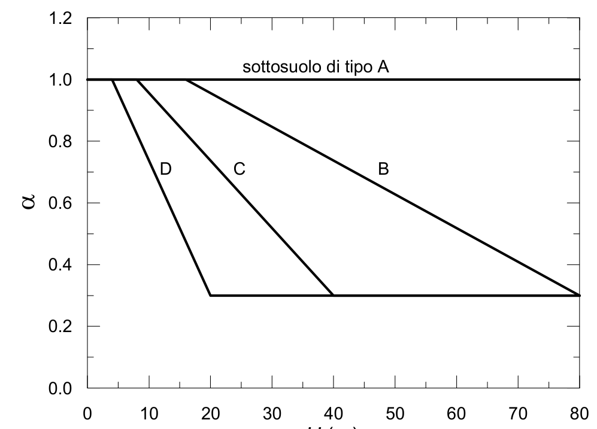
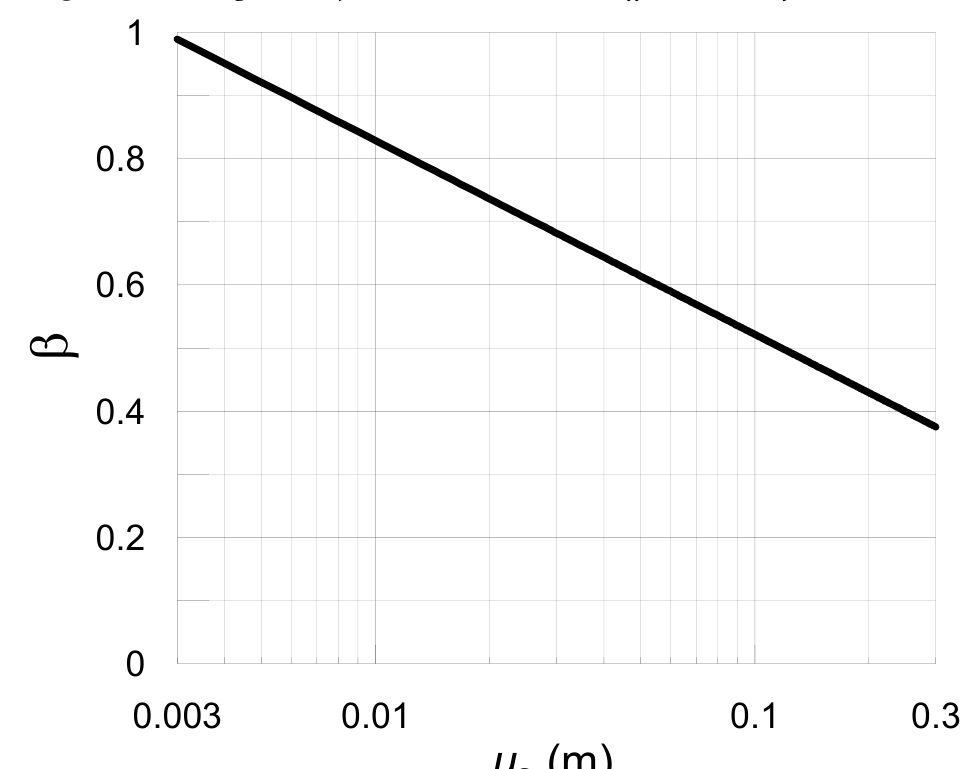

[Torna all'indice del § 7.11](./indice-7.11.md) | [Torna all'indice del capitolo](./indice-cap07.md) | [Torna all'indice generale](../indice-ntc2018.md)

# 7.11.6. Opere di sostegno

<!-- INDICE-INTERNO:INIZIO -->
**Indice interno**

- [Norma](#toc-ntc2018-7-11-6-norma)
  - [7.11.6.1. Requisiti generali](#toc-ntc2018-7-11-6-1)
  - [7.11.6.2. Muri di sostegno](#toc-ntc2018-7-11-6-2)
    - [7.11.6.2.1. Metodi di analisi](#toc-ntc2018-7-11-6-2-1)
    - [7.11.6.2.2. Verifiche di sicurezza](#toc-ntc2018-7-11-6-2-2)
  - [7.11.6.3. Paratie](#toc-ntc2018-7-11-6-3)
    - [7.11.6.3.1. Metodi di analisi pseudo-statici](#toc-ntc2018-7-11-6-3-1)
    - [7.11.6.3.2. Verifiche di sicurezza](#toc-ntc2018-7-11-6-3-2)
  - [7.11.6.4. Sistemi di vincolo](#toc-ntc2018-7-11-6-4)
    - [7.11.6.4.1. Verifiche di sicurezza](#toc-ntc2018-7-11-6-4-1)
- [Circolare](#toc-ntc2018-c7-11-6-circolare)
  - [C7.11.6. Opere di sostegno](#toc-ntc2018-c7-11-6)
    - [C7.11.6.2. Muri di sostegno](#toc-ntc2018-c7-11-6-2)
    - [C7.11.6.3. Paratie](#toc-ntc2018-c7-11-6-3)
<!-- INDICE-INTERNO:FINE -->

## Norma

### 7.11.6.1. Requisiti generali

Le opere di sostegno devono essere progettate in modo da garantire la sicurezza prima, durante e dopo il sisma.

Le verifiche devono essere condotte sia per le condizioni sismiche (azione sismica + spinta del terreno in condizioni sismiche) sia per le condizioni statiche (dopo il sisma, con eventuali sovrappressioni interstiziali residue).

### 7.11.6.2. Muri di sostegno

#### 7.11.6.2.1. Metodi di analisi

Le verifiche pseudo-statiche dei muri di sostegno si eseguono con i seguenti coefficienti sismici:

$$k_h = \beta_m \cdot \frac{a_{max}}{g}$$ \tag{7.11.6}

$$k_v = \pm 0{,}5 \cdot k_h$$ \tag{7.11.7}

dove:

$$a_{max} = S \cdot a_g = S_S \cdot S_T \cdot a_g$$ \tag{7.11.8}

e $\beta_m$ è un coefficiente di riduzione dell'accelerazione massima:

$$\beta_m = 0{,}38 \quad \text{per SLV}$$

$$\beta_m = 0{,}47 \quad \text{per SLD}$$

I coefficienti parziali sulla resistenza $\gamma_R$ per le verifiche sismiche dei muri di sostegno sono riportati nella Tab. 7.11.III:

**Tab. 7.11.III** – *Coefficienti parziali $\gamma_R$ per verifiche sismiche di muri di sostegno*

| Verifica | $\gamma_R$ |
|---|:---:|
| Carico limite della fondazione | 1,2 |
| Scorrimento | 1,0 |
| Ribaltamento | 1,0 |
| Resistenza del terreno a valle | 1,2 |

La spinta del terreno in condizioni sismiche si determina con il metodo di Mononobe-Okabe o con metodi equivalenti, utilizzando i coefficienti sismici $k_h$ e $k_v$ sopra definiti.

**Metodo degli spostamenti**

In alternativa al metodo pseudo-statico, le verifiche dei muri di sostegno possono essere eseguite con il metodo degli spostamenti, determinando l'accelerazione critica del meccanismo di collasso e stimando lo spostamento permanente.

#### 7.11.6.2.2. Verifiche di sicurezza

Le verifiche di sicurezza dei muri di sostegno devono essere effettuate per:

- ribaltamento attorno allo spigolo esterno della base;
- scorrimento sul piano di posa;
- carico limite della fondazione;
- stabilità globale del complesso muro-terreno;
- resistenza strutturale degli elementi del muro (fusto, fondazione).

### 7.11.6.3. Paratie

#### 7.11.6.3.1. Metodi di analisi pseudo-statici

Per le paratie, l'accelerazione sismica di progetto per l'analisi pseudo-statica è:

$$a_h = k_h \cdot g = \alpha \cdot \beta \cdot a_{max}$$ \tag{7.11.9}

dove:

$$a_{max} = S \cdot a_g = S_S \cdot S_T \cdot a_g$$ \tag{7.11.10}

e i coefficienti $\alpha$ e $\beta$ tengono rispettivamente conto della deformabilità della paratia e dello spostamento ammissibile.

Il coefficiente $\alpha$ dipende dal rapporto $H/\lambda$ fra l'altezza della paratia $H$ e la lunghezza d'onda del sisma $\lambda$. I suoi valori sono riportati in Fig. 7.11.2.

Il coefficiente $\beta$ dipende dallo spostamento ammissibile della paratia. I suoi valori sono riportati in Fig. 7.11.3.

Lo spostamento massimo ammissibile della paratia è:

$$u_s \leq 0{,}005 \cdot H$$ \tag{7.11.11}

dove $H$ è l'altezza della paratia.

#### 7.11.6.3.2. Verifiche di sicurezza

Le verifiche di sicurezza delle paratie devono essere effettuate per:

- raggiungimento della resistenza passiva del terreno;
- resistenza strutturale degli elementi della paratia (sezioni di infissione e di vincolo);
- resistenza degli ancoraggi;
- stabilità globale del complesso paratia-terreno.

### 7.11.6.4. Sistemi di vincolo

Per i sistemi di vincolo (ancoraggi, tiranti, chiodi), il coefficiente $\beta$ si assume pari a:

$$\beta = 1$$

La lunghezza di ancoraggio efficace $L_e$ in condizioni sismiche si determina come:

$$L_e = L_s \cdot \left(1 + 1{,}5 \cdot \frac{a_{max}}{g}\right)$$ \tag{7.11.12}

dove $L_s$ è la lunghezza di ancoraggio in condizioni statiche.

#### 7.11.6.4.1. Verifiche di sicurezza

Le verifiche di sicurezza dei sistemi di vincolo devono accertare:

- la resistenza del tirante (sezione del tirante, resistenza della fondazione dell'ancoraggio);
- la lunghezza di ancoraggio sufficiente a garantire la stabilità in condizioni sismiche;
- la stabilità globale del sistema paratia-ancoraggio-terreno.

---

## Circolare

### C7.11.6. Opere di sostegno

#### C7.11.6.2. Muri di sostegno

L'analisi dei muri di sostegno in presenza dell'azione sismica si esegue utilizzando sempre valori unitari dei coefficienti parziali sulle azioni e sui parametri geotecnici come prescritto al § 7.11.1. Per le sole verifiche **SLV**, si utilizzano i coefficienti $\gamma_R$ riportati nella Tab. 7.11.III.

Nel caso in cui la verifica si conduca con approccio pseudo-statico, l'azione sismica è rappresentata da una forza statica equivalente funzione dell'accelerazione massima attesa al sito e di un fattore di riduzione dell'accelerazione massima, $\beta_m$ che assume i valori specificati al § 7.11.6.2.1, differenziati per verifiche **SLV** e **SLD**. L'impiego di un fattore $\beta_m < 1$ implica che il muro di sostegno in occasione del sisma possa subire spostamenti permanenti lungo la sua base e che questi spostamenti siano quindi liberi di verificarsi e compatibili con la sicurezza delle strutture che interagiscono con l'opera stessa. Nel caso in cui ciò non fosse possibile, si devono assumere valori di $\beta_m$ più elevati, derivanti dal diagramma di Fig. 7.11.3 delle NTC, fino ad assumere un valore $\beta_m$ unitario nei muri nei quali la traslazione è impedita. Per garantire la sicurezza nei confronti del ribaltamento (meccanismo fragile), la norma impone che la verifica nei confronti di tale meccanismo sia effettuata facendo riferimento ad un valore di $\beta_m$ incrementato del 50% rispetto a quello utilizzato nelle verifiche a scorrimento. Ovviamente, il coefficiente $\beta_m$ utilizzato nelle verifiche a ribaltamento ha un limite superiore pari a $1{,}00$.

Nel rispetto della gerarchia delle resistenze, sarebbe opportuno che le verifiche geotecniche, diverse da quella a scorrimento, e quelle strutturali siano condotte con riferimento alla minore tra l'accelerazione orizzontale massima attesa al sito e l'accelerazione sismica pseudo-statica critica, che produce lo scorrimento in fondazione. L'analisi sismica dei muri di sostegno con il metodo degli spostamenti si esegue utilizzando i valori caratteristici delle azioni statiche e delle resistenze. In questo caso, il risultato dell'analisi è uno spostamento permanente, eventualmente anche nullo. La verifica consiste nel confrontare lo spostamento calcolato con uno spostamento limite scelto dal progettista per l'opera in esame. Nel caso in cui si applichi il metodo degli spostamenti si deve fare riferimento ad almeno 7 accelerogrammi scelti in accordo con quanto riportato al §3.2.3.6. delle NTC. La verifica allo scorrimento con il metodo degli spostamenti sostituisce la sola verifica allo scorrimento pseudo-statica. Vanno ovviamente condotte comunque le altre verifiche geotecniche e strutturali, tenendo conto delle indicazioni riportate in precedenza.

Il progetto dei muri di sostegno sotto azioni sismiche deve essere impostato per favorire lo sviluppo di meccanismi di rottura duttili (scorrimento) rispetto ad altri meccanismi considerati più fragili, primo tra tutti il ribaltamento.

#### C7.11.6.3. Paratie

L'analisi sismica delle paratie si esegue verificando la sicurezza dell'opera, nei confronti di stati limite di tipo strutturale o geotecnico, in presenza di azioni sismiche. Come prescritto al §7.11.1, le verifiche si eseguono con coefficienti parziali unitari sulle azioni e sui parametri geotecnici e considerando le variazioni della spinta delle terre a monte e a valle della paratia per effetto dell'accelerazione sismica.

L'accelerazione sismica fa variare infatti la spinta delle terre e determina una maggiore mobilitazione delle resistenze del terreno con accumulo di spostamenti permanenti. Tali spostamenti consentono una dissipazione di energia progressivamente crescente all'aumentare del volume di terreno coinvolto nel processo di deformazione; la dissipazione diviene massima con l'innesco di un meccanismo di rottura generale nel terreno. Il valore dell'accelerazione sismica in grado di innescare il primo cinematismo è detta accelerazione critica del sistema.

Per tener conto degli effetti dissipativi, nei metodi pseudo-statici si considera il valore dell'accelerazione orizzontale equivalente $a_{\beta}$, valutato secondo la Formula 7.11.9 in funzione del coefficiente di spostamento $\beta$ che tiene conto della capacità del sistema (terreno, struttura e vincoli) di dissipare energia durante il moto sismico.

Il coefficiente $\beta$ è minore di 1 solo se l'accelerazione massima attesa al sito risulta maggiore dell'accelerazione critica del sistema. Con $\beta < 1$, a seguito del sisma, la paratia subirà quindi spostamenti di tipo permanente.

L'entità degli spostamenti permanenti può essere valutata in modo semplificato attraverso il diagramma di Figura 7.11.3 che assimila gli effetti permanenti prodotti dal sisma a quelli calcolati sul blocco rigido di Newmark con riferimento a numerosi accelerogrammi italiani. A tal fine, il valore di $\beta$ può essere assunto pari al rapporto fra accelerazione critica del sistema e accelerazione massima attesa.

Qualora l'accelerazione massima non fosse sufficiente a produrre un meccanismo di rottura generale nel terreno, allora deve essere $\beta = 1$. Conseguentemente, l'accelerazione equivalente coincide con quella massima, a meno del fattore $\alpha$ di deformabilità, che va considerato solo come riduttore della spinta attiva.

La verifica delle paratie può essere condotta anche con metodi dinamici avanzati, tenendo conto del comportamento non lineare, non elastico e isteretico dei terreni interessati dall'opera. L'uso di tali modelli richiede necessariamente un'adeguata campagna di indagini in sito e in laboratorio che consenta la caratterizzazione del comportamento meccanico dei terreni in un ampio campo di deformazioni, oltre a strumenti di calcolo adeguati. Inoltre, poiché, sia per le verifiche **SLV** sia per quelle **SLD**, la verifica consiste nella valutazione degli spostamenti del sisma in termini di spostamenti e di variazioni del regime di sollecitazione dell'opera, la verifica va condotta confrontando gli effetti di più accelerogrammi (almeno 5) selezionati secondo i criteri descritti nel § 3.2.3.6.
