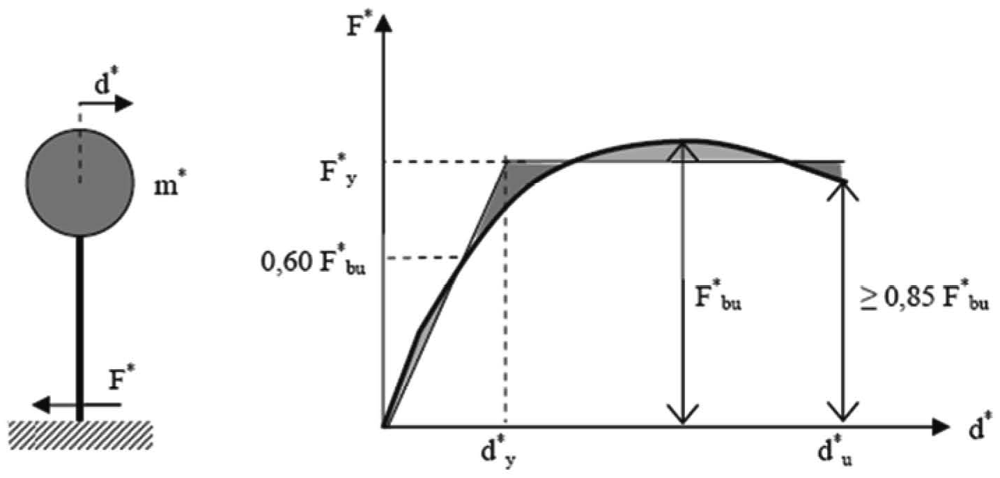
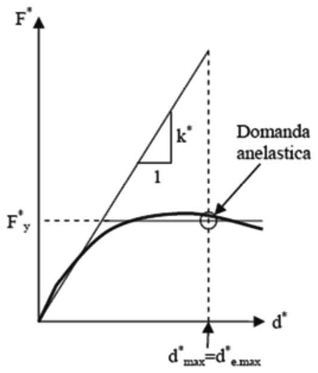
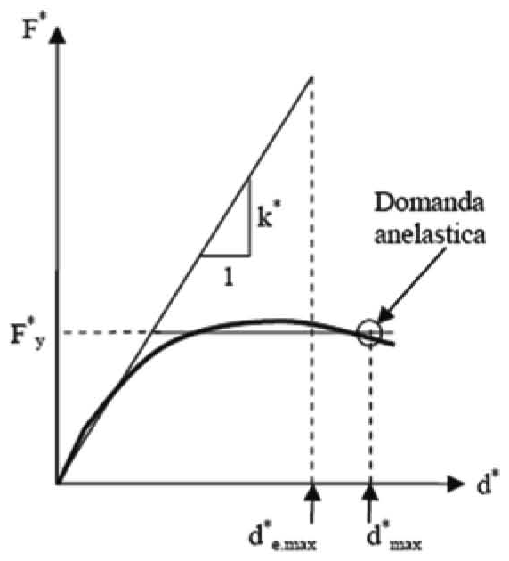
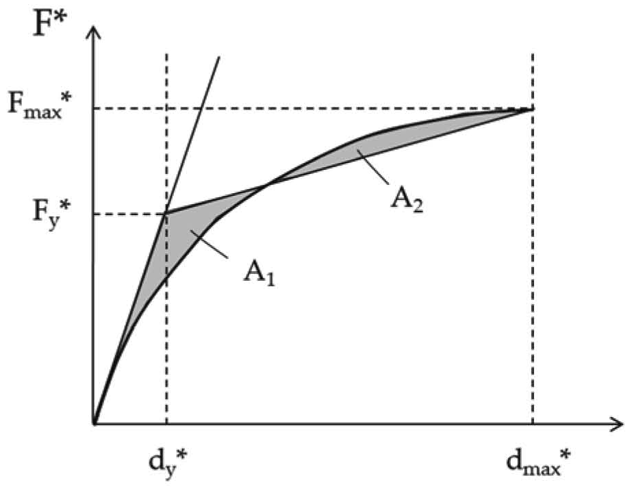
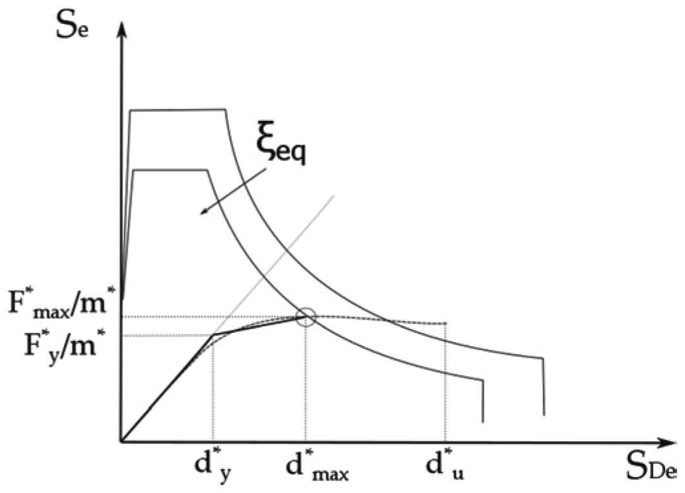
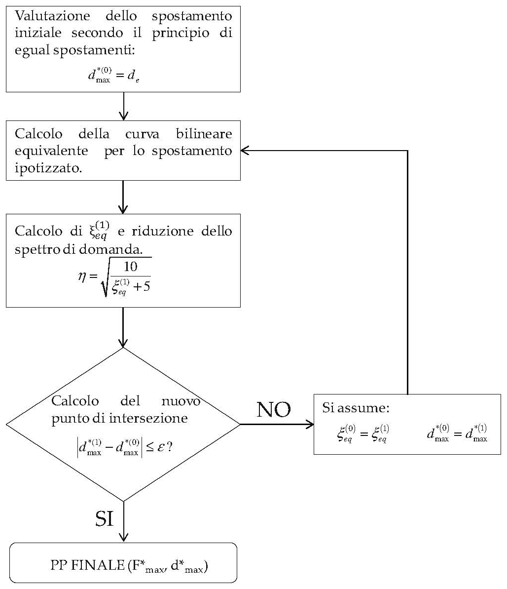

[Torna all'indice del capitolo](indice-cap07.md) | [Torna all'indice generale](../indice-ntc2018.md)

# 7.3. Metodi di analisi e criteri di verifica

## Indice del capitolo

- [7.3.1 Analisi lineari o non lineari (fattore q, Tab. 7.3.I-II)](#731-analisi-lineari-o-non-lineari)
- [7.3.2 Analisi dinamica o statica](#732-analisi-dinamica-o-statica)
- [7.3.3 Analisi lineare dinamica o statica](#733-analisi-lineare-dinamica-o-statica)
  - [7.3.3.1 Lineare dinamica (modale con CQC)](#7331-analisi-lineare-dinamica-analisi-modale-con-spettro-di-risposta)
  - [7.3.3.2 Lineare statica (forze laterali)](#7332-analisi-lineare-statica-forze-laterali)
  - [7.3.3.3 Valutazione spostamenti μ_d](#7333-valutazione-degli-spostamenti)
- [7.3.4 Analisi non lineare dinamica o statica](#734-analisi-non-lineare-dinamica-o-statica)
  - [7.3.4.1 Non lineare dinamica (al passo)](#7341-analisi-non-lineare-dinamica-analisi-al-passo)
  - [7.3.4.2 Non lineare statica (pushover)](#7342-analisi-non-lineare-statica-analisi-pushover)
- [7.3.5 Risposta diverse componenti e combinazione](#735-risposta-alle-diverse-componenti-dellazione-sismica-e-combinazione)
- [7.3.6 Rispetto requisiti SL (Tab. 7.3.III, drift)](#736-rispetto-dei-requisiti-nei-confronti-degli-stati-limite)
  - [7.3.6.1 Verifiche rigidezza (RIG)](#7361-verifiche-di-rigidezza)
  - [7.3.6.2 Verifiche resistenza (RES)](#7362-verifiche-di-resistenza)
  - [7.3.6.3 Verifiche duttilità (DUT)](#7363-verifiche-di-duttilità)
  - [7.3.6.4 Verifiche stabilità (STA)](#7364-verifiche-di-stabilità)
  - [7.3.6.5 Verifiche funzionamento (FUN)](#7365-verifiche-di-funzionamento)
- [C7.3.1 — Analisi lineare o non lineare (q')](#c731-analisi-lineare-o-non-lineare)
- [C7.3.3 — Analisi lineare](#c733-analisi-lineare-dinamica-o-statica)
  - [C7.3.3.1 Lineare dinamica (CQC/SRSS)](#c7331-analisi-lineare-dinamica)
  - [C7.3.3.2 Lineare statica](#c7332-analisi-lineare-statica)
- [C7.3.4 — Non lineare](#c734-analisi-non-lineare-dinamica-o-statica)
  - [C7.3.4.1 Non lineare dinamica](#c7341-analisi-non-lineare-dinamica)
  - [C7.3.4.2 Non lineare statica (Metodo A/B)](#c7342-analisi-non-lineare-statica)
- [C7.3.5 — Componenti azione sismica e variabilità spaziale](#c735-risposta-alle-diverse-componenti-dellazione-sismica-ed-alla-variabilità-spaziale-del-moto)
- [C7.3.6 — Rispetto requisiti SL (Tab. C7.3.I)](#c736-rispetto-dei-requisiti-nei-confronti-degli-stati-limite)
  - [C7.3.6.1 Elementi strutturali (ST)](#c7361-elementi-strutturali-st)
  - [C7.3.6.2 Elementi non strutturali (NS)](#c7362-elementi-non-strutturali-ns)

---

# Norma

## 7.3.1. Analisi lineari o non lineari

Nelle analisi lineari la risposta della struttura è calcolata con riferimento allo spettro di progetto ottenuto dallo spettro di risposta elastico, suddiviso per il fattore di comportamento $q$.

Il fattore di comportamento $q$ è definito come:

$$q = q_0 \cdot K_R$$ \tag{7.3.1}

dove:

- $q_0$ è il valore massimo del fattore di comportamento che dipende dal livello di duttilità atteso, dalla tipologia strutturale e dal rapporto $\alpha_u / \alpha_1$ tra il valore dell'azione sismica per il quale si verifica la formazione di un numero di cerniere plastiche tali da rendere la struttura un meccanismo e quello per il quale il primo elemento strutturale raggiunge la plasticizzazione a flessione;
- $K_R$ è un fattore riduttivo che dipende dalle caratteristiche di regolarità in altezza della costruzione, con valore pari a 1 per costruzioni regolari in altezza e pari a 0,8 per costruzioni non regolari in altezza.

I valori massimi di $q_0$ per le diverse tipologie strutturali sono riportati nella Tab. 7.3.II.

Per le strutture non dissipative si assume $q = 1$.

Per le strutture progettate con comportamento non dissipativo ma comunque secondo le regole di dettaglio di una delle due Classi di Duttilità, il fattore di comportamento si può assumere pari a:

$$q_{ND} = \frac{2}{3}\; q_{CD"B"}$$ \tag{7.3.2}

dove $q_{CD"B"}$ è il valore del fattore di comportamento corrispondente alla Classe di Duttilità Bassa.

#### Fattore kw per strutture a pareti

Per le strutture a pareti in c.a. il fattore $k_w$ assume il valore:

$$k_w = \frac{1 + \alpha_0}{3} \leq 1 \quad \text{ma non inferiore a} \; 0{,}5$$

dove $\alpha_0$ è il rapporto prevalente tra altezze e larghezze delle pareti del sistema strutturale.

**Tab. 7.3.I** – *Modalità di modellazione dell'azione sismica per le verifiche agli SLE e agli SLU*

| Stato limite | Modello dell'azione sismica | Fattore di comportamento |
|---|---|---|
| SLE (SLO, SLD) | Spettro di risposta elastico | $q = 1$ |
| SLU (SLV, SLC) – Analisi lineare | Spettro di risposta di progetto | $q \geq 1$ |
| SLU (SLV, SLC) – Analisi non lineare | Spettro elastico o accelerogrammi | non applicabile |

**Tab. 7.3.II** – *Valori massimi di* $q_0$ *per le diverse tipologie strutturali*

| Tipologia strutturale | CD"B" | CD"A" |
|---|:---:|:---:|
| **Costruzioni in c.a.** | | |
| Strutture a telaio, a pareti accoppiate, miste | $3{,}0\;\alpha_u/\alpha_1$ | $4{,}5\;\alpha_u/\alpha_1$ |
| Strutture a pareti non accoppiate | $3{,}0$ | $4{,}0\;\alpha_u/\alpha_1$ |
| Strutture deformabili torsionalmente | $2{,}0$ | $3{,}0$ |
| Strutture a pendolo inverso | $1{,}5$ | $2{,}0$ |
| **Costruzioni prefabbricate** | | |
| Strutture a telaio con collegamenti duttili | $3{,}0\;\alpha_u/\alpha_1$ | $4{,}5\;\alpha_u/\alpha_1$ |
| Strutture a telaio con collegamenti a resistenza maggiorata | $2{,}5$ | $3{,}5$ |
| Strutture a pannelli | $3{,}0\;\alpha_u/\alpha_1$ | $4{,}5\;\alpha_u/\alpha_1$ |
| Strutture monopiano a pilastri isostatici | $2{,}5\;\alpha_u/\alpha_1$ | $3{,}5\;\alpha_u/\alpha_1$ |
| **Costruzioni in acciaio** | | |
| Strutture a telaio | $4{,}0$ | $6{,}5$ |
| Strutture con controventi concentrici a diagonale tesa attiva | $2{,}0$ | $4{,}0$ |
| Strutture con controventi concentrici a V | $2{,}0$ | $2{,}5$ |
| Strutture con controventi eccentrici | $4{,}0$ | $6{,}0$ |
| Strutture a mensola o a pendolo inverso | $2{,}0$ | $2{,}0$ |
| Strutture intelaiate con controventi concentrici | $2{,}0$ | $4{,}0$ |
| Strutture a telaio con tamponature in muratura | $2{,}0$ | $2{,}0$ |
| **Costruzioni composte acciaio-calcestruzzo** | | |
| Strutture a telaio | $4{,}0$ | $6{,}5$ |
| Strutture con controventi concentrici a diagonale tesa attiva | $2{,}0$ | $4{,}0$ |
| Strutture con controventi concentrici a V | $2{,}0$ | $2{,}5$ |
| Strutture con controventi eccentrici | $4{,}0$ | $6{,}0$ |
| Strutture a mensola o a pendolo inverso | $2{,}0$ | $2{,}0$ |
| Strutture a pareti composte acciaio-calcestruzzo | $3{,}0\;\alpha_u/\alpha_1$ | $4{,}5\;\alpha_u/\alpha_1$ |
| Strutture a pareti di calcestruzzo armato in strutture in acciaio | $3{,}0$ | $4{,}0\;\alpha_u/\alpha_1$ |
| **Costruzioni in legno** | | |
| Pareti a pannelli di legno con diaframmi incollati | $2{,}0$ | $3{,}0$ |
| Pareti a pannelli di legno con diaframmi chiodati | $3{,}0$ | $5{,}0$ |
| Strutture a telaio con giunti a mezzo di connettori | $2{,}5$ | $4{,}0$ |
| Strutture iperstatiche con giunti a mezzo di connettori | $2{,}0$ | $3{,}0$ |
| Portali a tre cerniere con connettori bullonati o spinottati | $2{,}0$ | $2{,}5$ |
| **Costruzioni in muratura** | | |
| Muratura ordinaria | $2{,}0\;\alpha_u/\alpha_1$ | – |
| Muratura armata | $2{,}5\;\alpha_u/\alpha_1$ | $3{,}0\;\alpha_u/\alpha_1$ |
| Muratura confinata | $2{,}0\;\alpha_u/\alpha_1$ | – |
| **Ponti** | | |
| Pile a mensola: c.a. | $3{,}5\;\alpha_u/\alpha_1$ | – |
| Pile a mensola: acciaio | $3{,}5$ | – |
| Archi in c.a. | $2{,}0$ | – |
| **Spalle** | $1{,}5$ | – |

#### Effetti delle non linearità geometriche

Gli effetti delle non linearità geometriche (effetti P-Δ) possono essere trascurati quando, per ogni piano, è soddisfatta la condizione:

$$\theta = \frac{P \cdot d_r}{V \cdot h} \leq 0{,}1$$ \tag{7.3.3}

dove:

- $P$ è il carico verticale totale della parte di struttura sovrastante il piano in esame;
- $d_r$ è lo spostamento interpiano di progetto;
- $V$ è la forza orizzontale totale in corrispondenza del piano in esame;
- $h$ è l'altezza del piano.

Se $0{,}1 < \theta \leq 0{,}2$ gli effetti delle non linearità geometriche possono essere presi in conto incrementando gli effetti dell'azione sismica orizzontale di un fattore pari a $1/(1-\theta)$.

Il valore di $\theta$ non può comunque superare 0,3.

---

## 7.3.2. Analisi dinamica o statica

I metodi di analisi delle strutture soggette ad azioni sismiche si distinguono in:

*a)* **analisi dinamica** — la risposta è calcolata mediante analisi modale con spettro di risposta ovvero mediante integrazione al passo delle equazioni del moto;

*b)* **analisi statica** — la risposta è calcolata applicando alla struttura un sistema di forze statiche orizzontali equivalenti.

Ciascuno dei due metodi può essere condotto in campo lineare o non lineare.

---

## 7.3.3. Analisi lineare dinamica o statica

### 7.3.3.1. Analisi lineare dinamica (analisi modale con spettro di risposta)

L'analisi modale consiste nella determinazione dei modi di vibrare della struttura (analisi modale) e nel calcolo degli effetti dell'azione sismica, rappresentata dallo spettro di risposta di progetto, per ciascun modo di vibrare individuato (analisi spettrale).

Devono essere considerati tutti i modi con massa partecipante significativa. È opportuno a tal riguardo considerare tutti i modi con massa partecipante superiore al 5% e comunque un numero di modi la cui massa partecipante totale sia superiore all'85%.

Per la combinazione degli effetti relativi ai diversi modi deve essere utilizzata una combinazione quadratica completa (CQC) degli effetti relativi a ciascun modo, secondo l'espressione:

$$E = \left(\sum_i \sum_j \rho_{ij} \cdot E_i \cdot E_j\right)^{1/2}$$ \tag{7.3.4}

con il coefficiente di correlazione $\rho_{ij}$ calcolato come:

$$\rho_{ij} = \frac{8 \, \xi^2 \, \beta_{ij}^{3/2}}{(1 + \beta_{ij})[(1 - \beta_{ij})^2 + 4 \, \xi^2 \, \beta_{ij}]}$$ \tag{7.3.5a}

$$\beta_{ij} = \frac{T_j}{T_i}$$ \tag{7.3.5b}

dove $\xi$ è il rapporto di smorzamento viscoso convenzionale e $T_i$, $T_j$ sono i periodi propri dei modi $i$-esimo e $j$-esimo.

### 7.3.3.2. Analisi lineare statica (forze laterali)

L'analisi statica lineare consiste nell'applicazione di forze statiche equivalenti alle forze di inerzia indotte dall'azione sismica.

Essa può essere effettuata per costruzioni che rispettino le condizioni di seguito indicate:

- costruzioni regolari in altezza e il cui periodo del modo di vibrare principale $T_1$ in ciascuna delle due direzioni non superi $2{,}5 \cdot T_C$ oppure $T_D$;
- costruzioni il cui periodo del modo di vibrare principale non superi $T_D$ e il cui modo di vibrare principale in ciascuna direzione abbia una massa partecipante non inferiore al 75%.

Il periodo fondamentale di vibrazione $T_1$ della struttura può essere stimato, per gli edifici, mediante la formula:

$$T_1 = 2\sqrt{d}$$ \tag{7.3.6}

dove $d$ è lo spostamento laterale elastico del punto più alto dell'edificio, espresso in metri, dovuto alla gravità applicata in direzione orizzontale.

La forza da applicare a ciascuna massa della costruzione è data da:

$$F_i = F_h \cdot \frac{z_i \cdot W_i}{\sum_j z_j \cdot W_j}$$ \tag{7.3.7}

dove:

- $F_h$ è la risultante delle forze orizzontali applicate alla costruzione, pari a $F_h = S_d(T_1) \cdot W \cdot \lambda / g$;
- $S_d(T_1)$ è l'ordinata dello spettro di progetto corrispondente al periodo $T_1$;
- $W$ è il peso complessivo della costruzione;
- $\lambda$ è un coefficiente pari a 0,85 se la costruzione ha almeno tre piani e se $T_1 \leq 2T_C$, pari a 1,0 in tutti gli altri casi;
- $W_i$ è il peso della massa $i$-esima;
- $z_i$ è la quota della massa $i$-esima rispetto al piano di fondazione.

### 7.3.3.3. Valutazione degli spostamenti

Gli spostamenti $d_E$ della struttura sotto l'azione sismica di progetto allo SLU si ottengono dagli spostamenti $d_{Ee}$ forniti dall'analisi lineare, come:

$$d_E = \pm \mu_d \cdot d_{Ee}$$ \tag{7.3.8}

dove $\mu_d$ è il coefficiente di duttilità in spostamento, definito come:

$$\mu_d = q \quad \text{se} \; T_1 \geq T_C$$ \tag{7.3.9}

$$\mu_d = 1 + (q - 1) \cdot \frac{T_C}{T_1} \quad \text{se} \; T_1 < T_C$$

dove $q$ è il fattore di comportamento adottato e $T_C$ è il periodo corrispondente all'inizio del tratto a velocità costante dello spettro.

---

## 7.3.4. Analisi non lineare dinamica o statica

Le analisi non lineari possono essere utilizzate per valutare la capacità di deformazione della struttura e per verificarne l'effettivo comportamento sotto l'azione sismica di progetto.

### 7.3.4.1. Analisi non lineare dinamica (analisi al passo)

L'analisi non lineare dinamica consiste nel calcolo della risposta della struttura mediante integrazione delle equazioni del moto, utilizzando un modello non lineare della struttura e applicando alla base gli accelerogrammi definiti al § 3.2.3.6.

Si deve tenere conto degli effetti della non linearità geometrica.

L'analisi deve utilizzare non meno di 7 gruppi di accelerogrammi, ciascuno comprendente le componenti dell'azione sismica indicate al § 7.3.5. La verifica di sicurezza può essere effettuata con riferimento ai valori medi degli effetti.

### 7.3.4.2. Analisi non lineare statica (analisi pushover)

L'analisi statica non lineare consiste nell'applicazione dei carichi gravitazionali e di un sistema di forze orizzontali crescenti monotonamente fino al raggiungimento delle condizioni ultime. Il risultato è espresso dalla curva di capacità, che rappresenta il taglio alla base $F_b$ in funzione dello spostamento del punto di controllo $d_c$.

Le distribuzioni di forze devono appartenere a due gruppi distinti:

**Gruppo 1** — distribuzioni principali:

*a)* distribuzione proporzionale alle forze statiche equivalenti (distribuzione triangolare);

*b)* distribuzione corrispondente a una distribuzione di accelerazioni proporzionale alla forma del modo di vibrare fondamentale;

*c)* distribuzione corrispondente alla distribuzione dei tagli di piano calcolati in un'analisi dinamica lineare.

**Gruppo 2** — distribuzioni secondarie:

*a)* distribuzione uniforme di forze, proporzionale alle masse di piano indipendentemente dalla quota;

*b)* distribuzione adattiva, che cambia al crescere dello spostamento del punto di controllo.

L'analisi deve essere condotta per almeno due distribuzioni di forze, di cui una appartenente al Gruppo 1 e una al Gruppo 2.

---

## 7.3.5. Risposta alle diverse componenti dell'azione sismica e combinazione

La risposta della struttura deve essere calcolata separatamente per ciascuna delle componenti dell'azione sismica e gli effetti combinati si ottengono applicando la seguente combinazione:

$$1{,}00 \cdot E_x + 0{,}30 \cdot E_y + 0{,}30 \cdot E_z$$ \tag{7.3.10}

dove $E_x$, $E_y$ ed $E_z$ rappresentano gli effetti dell'azione sismica nelle tre direzioni.

La combinazione va effettuata variando ciclicamente la componente cui viene assegnato il coefficiente 1,00.

In alternativa si può valutare:

$$E = \sqrt{E_x^2 + E_y^2 + E_z^2}$$

La componente verticale dell'azione sismica va considerata nei casi previsti al § 7.2.1 e per i seguenti elementi:

- elementi pressoché orizzontali con luce superiore a 20 m;
- elementi a sbalzo con luce superiore a 5 m;
- elementi precompressi;
- travi che sostengono pilastri;
- strutture di tipo 4 (ponti ed opere di ingegneria) ad eccezione di quelle con spalle di ridotta altezza;
- isolatori e dispositivi di vincolo.

---

## 7.3.6. Rispetto dei requisiti nei confronti degli stati limite

Le verifiche di sicurezza da effettuare per ciascuno stato limite sono sintetizzate nella Tab. 7.3.III.

**Tab. 7.3.III** – *Verifiche da effettuare per i diversi stati limite e classi d'uso*

| Verifica | Elementi | CU I | CU II | CU III | CU IV |
|---|---|:---:|:---:|:---:|:---:|
| **SLO** | | | | | |
| Rigidezza (RIG) | ST, NS | – | – | sì | sì |
| Funzionamento (FUN) | IM | – | – | sì | sì |
| **SLD** | | | | | |
| Rigidezza (RIG) | ST, NS | sì | sì | sì | sì |
| Funzionamento (FUN) | IM | sì | sì | sì | sì |
| **SLV** | | | | | |
| Resistenza (RES) | ST (primari) | sì | sì | sì | sì |
| Resistenza (RES) | ST (secondari) | sì | sì | sì | sì |
| Duttilità (DUT) | ST (primari) | sì | sì | sì | sì |
| Stabilità (STA) | NS | sì | sì | sì | sì |
| Funzionamento (FUN) | IM | – | – | sì | sì |
| **SLC** | | | | | |
| Resistenza (RES) | ST (primari) | – | – | – | sì |
| Duttilità (DUT) | ST (primari) | – | – | – | sì |
| Stabilità (STA) | NS | – | – | – | sì |

dove: **ST** = elementi strutturali; **NS** = elementi non strutturali; **IM** = impianti; **CU** = classe d'uso.

### 7.3.6.1. Verifiche di rigidezza

Le verifiche di rigidezza (RIG) per gli elementi strutturali consistono nella limitazione degli spostamenti di interpiano $d_r$ sotto l'azione sismica di progetto per lo stato limite di esercizio considerato (SLD o SLO).

Per gli edifici con tamponamenti collegati rigidamente alla struttura che interferiscono con la deformabilità della stessa:

$$d_r \leq 0{,}005 \cdot h$$ \tag{7.3.11a}

Per gli edifici con tamponamenti collegati elasticamente alla struttura principale:

$$d_r \leq 0{,}0075 \cdot h$$ \tag{7.3.11b}

Per gli edifici con struttura portante in muratura ordinaria:

$$d_r \leq 0{,}003 \cdot h$$ \tag{7.3.12}

Per gli edifici con struttura portante in muratura armata:

$$d_r \leq 0{,}004 \cdot h$$ \tag{7.3.13}

dove $d_r$ è lo spostamento interpiano e $h$ è l'altezza del piano.

Per gli elementi non strutturali le verifiche di rigidezza consistono nel controllare che gli spostamenti strutturali siano compatibili con le deformazioni ammesse dagli elementi stessi.

Per le costruzioni ricadenti in classe d'uso III e IV la verifica di rigidezza nei confronti dello SLO si effettua adottando i limiti di spostamento di interpiano sopra indicati ridotti dei 2/3:

$$d_r \leq \frac{2}{3} \cdot d_{r,\text{limite SLD}}$$ \tag{7.3.14}

### 7.3.6.2. Verifiche di resistenza

Le verifiche di resistenza (RES) consistono nel confronto fra le sollecitazioni di progetto indotte dall'azione sismica e la corrispondente resistenza di progetto dell'elemento strutturale.

Per gli elementi strutturali primari:

$$E_d \leq R_d$$ \tag{7.3.15}

dove $E_d$ è il valore di progetto dell'effetto dell'azione e $R_d$ è il valore di progetto della resistenza.

Per gli elementi strutturali secondari, le verifiche di resistenza allo SLV si effettuano con riferimento alle sollecitazioni calcolate considerando le sole forze gravitazionali (senza azione sismica) combinate con gli spostamenti indotti dall'azione sismica.

### 7.3.6.3. Verifiche di duttilità

Le verifiche di duttilità (DUT) si applicano agli elementi strutturali primari e consistono nel controllare che la struttura, e i singoli elementi, possiedano una duttilità coerente con il fattore di comportamento $q$ adottato.

Per le strutture progettate con comportamento dissipativo, la verifica di duttilità è implicitamente soddisfatta se sono rispettate le regole di dettaglio costruttivo delle zone dissipative e le prescrizioni sulla gerarchia delle resistenze indicate nei rispettivi paragrafi per le diverse tipologie strutturali (§§ 7.4 – 7.10).

### 7.3.6.4. Verifiche di stabilità

Le verifiche di stabilità (STA) riguardano gli elementi non strutturali e consistono nel controllare che tali elementi mantengano la propria integrità strutturale sotto l'azione sismica di progetto, evitandone il distacco e il ribaltamento.

### 7.3.6.5. Verifiche di funzionamento

Le verifiche di funzionamento (FUN) riguardano gli impianti e consistono nel controllare che gli impianti mantengano la propria funzionalità sotto l'azione sismica corrispondente allo stato limite di esercizio considerato.

---

# Circolare

## C7.3.1. Analisi lineare o non lineare

Quando nella progettazione allo SLV si adottano fattori di comportamento $q$ elevati (mediamente superiori a 2,5), può accadere che le ordinate dello spettro SLD superino le corrispondenti ordinate dello spettro SLV.

Ciò implica, per le strutture in classe d'uso 1 e 2, per le quali allo SLD è richiesta dalle NTC la sola verifica in termini di rigidezza (RIG, si veda § 7.3.6) che gli elementi strutturali possano plasticizzarsi anche per eventi sismici relativamente frequenti, quali quelli corrispondenti allo SLD. In questo caso, se si vuole garantire l'assenza di danno strutturale allo SLD, è necessario effettuare, allo stesso SLD, anche la verifica in termini di resistenza (RES) oppure si può ridurre il fattore di comportamento da adottare nella progettazione allo SLV in modo tale da mantenere le ordinate dello spettro SLD al di sotto delle corrispondenti ordinate dello spettro SLV.

Il nuovo fattore di comportamento $q'$ può essere ottenuto, per ciascuna direzione, dalla relazione C7.3.1:

$$q' = q_{ND}\, \frac{S_{e,SLV}(T_1)}{S_{e,SLD}(T_1)}$$ \tag{C7.3.1}

Dove $q_{ND}$ è il fattore di comportamento non dissipativo definito dall'espressione [7.3.2] della norma; $T_1$ è il periodo del primo modo traslazionale nella direzione considerata; $S_{e,SLV}(T_1)$ e $S_{e,SLD}(T_1)$ sono, rispettivamente, la risposta spettrale elastica allo SLV e allo SLD, relative al periodo $T_1$.

Gli effetti torsionali accidentali, sia nel caso di analisi lineare statica o dinamica e non lineare statica o dinamica, vengono considerati nel modo previsto al § 7.2.6 delle NTC.

## C7.3.3. Analisi lineare dinamica o statica

### C7.3.3.1. Analisi lineare dinamica

L'analisi lineare dinamica, così come presentata nelle NTC, avviene in tre passi fondamentali:

1) determinazione dei modi di vibrare "naturali" della struttura (analisi modale);
2) calcolo degli effetti dell'azione sismica, rappresentati dallo spettro di risposta di progetto, per ciascuno dei modi di vibrare individuati;
3) combinazione degli effetti relativi a ciascun modo di vibrare per valutare la risposta complessiva.

L'analisi modale consiste nella soluzione delle equazioni del moto della struttura, considerata elastica, in condizioni di oscillazioni libere (assenza di forzante esterna) e nella individuazione di particolari configurazioni deformate che costituiscono i modi naturali di vibrare di una costruzione. Questi modi di vibrare sono una caratteristica propria della struttura, in quanto sono individuati in assenza di forzante, e sono caratterizzati da un periodo proprio di oscillazione $T$ e da un fattore di smorzamento convenzionale $\xi$, nonché da una forma. Tranne che per casi particolari, quali ad esempio quelli di costruzioni dotate di sistemi di isolamento e di dissipazione, si assume che i modi di vibrare abbiano tutti lo stesso valore del fattore di smorzamento convenzionale $\xi$ ossia $\xi = 5\%$. Qualunque configurazione deformata di una struttura (con la sola condizione di tale deformata connessa), può essere ottenuta come combinazione di deformate elementari, ciascuna con la forma di un modo di vibrare. Ovviamente, in funzione dell'azione che agisce sulla costruzione, alcuni modi di vibrare avranno una parte più significativa di altri in grado di descrivere la configurazione deformata. La massa partecipante a un modo di vibrare esprime la quota parte delle forze sismiche di trascinamento ad esso associate, da cui dipendono, unitamente alla corrispondente amplificazione, gli effetti che il singolo modo è in grado di descrivere. Per poter cogliere con sufficiente approssimazione gli effetti dell'azione sismica sulla costruzione, è opportuno considerare tutti i modi con massa partecipante superiore al 5% e comunque un numero di modi la cui massa partecipante totale sia superiore all'85%, trascurando solo i modi di vibrare meno significativi in termini di massa partecipante. L'utilizzo dello spettro di risposta consente di calcolare gli effetti massimi del terremoto sulla costruzione associati a ciascun modo di vibrare. Tuttavia, poiché durante il terremoto gli effetti massimi associati ad un modo di vibrare non si verificano generalmente nello stesso istante in cui sono massimi quelli associati ad un altro modo di vibrare, tali effetti non possono essere combinati tra di loro mediante una semplice somma ma con specifiche regole di combinazione, di natura probabilistica, che tengono conto di questo sfasamento temporale. La regola di combinazione imposta dalla norma è la regola di combinazione quadratica completa CQC (Complete Quadratic Combination): tale regola porta in conto anche l'eventuale correlazione tra i modi, attraverso il fattore $\rho_{ij}$. Essa degenera nella più semplice regola SRSS (Square Root of Sum of Squares), valida nell'ipotesi in cui i contributi massimi dei singoli modi non siano correlati e non si verifichino contemporaneamente. La SRSS può essere utilizzata, ove ritenuto necessario, come riferimento per il controllo dei risultati, tenendo presente che, in assenza di correlazione, la CQC degenera nella SRSS e che, in generale, quando il periodo di vibrazione di ciascun modo differisce di almeno il 10% da quello degli altri modi, le differenze tra le due diventano trascurabili.

### C7.3.3.2. Analisi lineare statica

L'analisi lineare statica consiste sostanzialmente in un'analisi lineare dinamica semplificata in cui:

1) invece di effettuare l'analisi dinamica della costruzione si assume per essa un solo modo di vibrare principale avente un periodo $T_1$ calcolato in maniera approssimata (utilizzando l'espressione [7.3.6] delle NTC) e spostamenti linearmente crescenti con l'altezza dal piano di fondazione, cui corrisponde la distribuzione di forze statiche data dall'espressione [7.3.7] delle NTC. A questo modo di vibrare si associa un'aliquota $\lambda$ di massa partecipante pari a 0,85 se la costruzione ha almeno tre orizzontamenti e se $T_1 < 2T_C$, pari a 1,0 in tutti gli altri casi;
2) si calcolano gli effetti dell'azione sismica, rappresentata dallo spettro di risposta di progetto, per il modo di vibrare principale considerato;
3) non si effettua alcuna combinazione degli effetti in quanto non si considerano altri modi di vibrare.

In letteratura e nei diversi documenti tecnici di riferimento esistono espressioni più o meno semplici per determinare, in maniera approssimata, il periodo del primo modo di vibrare della struttura, in ciascuna delle due direzioni principali.

L'equazione [7.3.6] della norma porta in conto, in maniera indiretta, l'effettiva rigidezza laterale della struttura e risulta, pertanto, più affidabile rispetto ad altre formulazioni più semplici, basate unicamente sul numero di piani o sull'altezza complessiva della costruzione, ma richiede necessariamente un modello di calcolo e un'analisi statica specifica.

Dipende dalla finalità il grado di approssimazione da conseguire nella determinazione del periodo $T_1$, cui è legata la risposta spettrale e quindi l'entità delle forze statiche equivalenti. In via di prima approssimazione, si può utilizzare la seguente espressione semplificata:

$$T_1 = C_1 H^{3/4}$$ \tag{C7.3.2}

dove $H$ è l'altezza della costruzione, in metri, dal piano di fondazione e $C_1$ vale 0,085 per costruzioni con struttura a telaio di acciaio o di legno, 0,075 per costruzioni con struttura a telaio di calcestruzzo armato e 0,050 per costruzioni di muratura o per qualsiasi altro tipo di struttura.

## C7.3.4. Analisi non lineare dinamica o statica

### C7.3.4.1. Analisi non lineare dinamica

Per eseguire analisi non lineari dinamiche occorre definire da un lato un modello della struttura che descriva opportunamente le fonti di non linearità significative, dall'altro le storie temporali di accelerazioni che descrivono il moto del terreno. Ciascuna storia temporale (accelerogramma) descrive una componente, orizzontale o verticale, dell'azione sismica; l'insieme delle tre componenti (due orizzontali, tra loro ortogonali, e una verticale) costituisce un gruppo di storie temporali del moto del terreno. Gli accelerogrammi possono essere artificiali, naturali o simulati e devono essere opportunamente selezionati e scalati, secondo quanto indicato nel § 3.2.3.6 delle NTC.

Nelle analisi non lineari con integrazione al passo, un punto cruciale, oltre alla selezione degli accelerogrammi, è rappresentato dalla scelta delle direzioni di applicazione dell'input sismico rispetto alle direzioni principali della struttura.

A questo scopo, per gli accelerogrammi naturali, può essere utile proiettare ciascuna coppia di registrazioni lungo le direzioni principali del sisma, come indicato al § C3.2.3.6.

I modelli da utilizzare per effettuare analisi non lineari dinamiche devono rispettare i requisiti del § 7.2.6 delle NTC. In particolare essi devono consentire una corretta rappresentazione degli elementi strutturali in termini di rigidezza, resistenza, e di comportamento post-elastico, dovendo rappresentare correttamente la capacità dissipativa per isteresi e i possibili fenomeni di degrado associati alle deformazioni cicliche. Un punto cruciale, nelle analisi non lineari dinamiche, è rappresentato dalla adeguata definizione della matrice di smorzamento.

La norma richiede espressamente il confronto tra i risultati dell'analisi dinamica non lineare e quelli dell'analisi modale con spettro di progetto, in termini di sollecitazioni globali alla base della struttura. Tale confronto deve fornire risultati coerenti, in generale spiegabili attraverso il fattore di comportamento o, in caso contrario, attraverso l'interpretazione della risposta della struttura e dei meccanismi inelastici evidenziati dalle analisi non lineari.

### C7.3.4.2. Analisi non lineare statica

L'analisi non lineare statica consente di determinare la curva di capacità della struttura, espressa dalla relazione $F_b - d_c$, in cui $F_b$ è il taglio alla base e $d_c$ lo spostamento di un punto di controllo, che per gli edifici è in genere rappresentato dal centro di massa dell'ultimo orizzontamento. Per ogni stato limite considerato, il confronto tra la curva di capacità e la domanda di spostamento consente di determinare il livello di prestazione raggiunto. A tal fine, abitualmente, si associa al sistema strutturale reale un sistema strutturale equivalente a un grado di libertà.

*Figura C7.3.1 — Sistema e diagramma bilineare equivalente.*

La forza $F^*$ e lo spostamento $d^*$ del sistema equivalente sono legati alle corrispondenti grandezze $F_b$ e $d_c$ del sistema reale dalle relazioni:

$$F^* = F_b / \Gamma$$ \tag{C7.3.3}

$$d^* = d_c / \Gamma$$ \tag{C7.3.4}

dove $\Gamma$ è il "fattore di partecipazione modale" definito dalla relazione:

$$\Gamma = \frac{\varphi^T M \tau}{\varphi^T M \varphi}$$ \tag{C7.3.5}

Il vettore $\tau$ è il vettore di trascinamento corrispondente alla direzione del sisma considerata; il vettore $\varphi$ è il modo di vibrare fondamentale del sistema reale normalizzato ponendo $d_c = 1$; la matrice $M$ è la matrice di massa del sistema reale.

Ai fini operativi, per poter determinare in forma chiusa l'energia dissipata dal sistema e, quindi, lo smorzamento equivalente, alla curva di capacità del sistema equivalente è utile sostituire una curva bilineare. Le tecniche di bilinearizzazione si basano usualmente su principi di equivalenza energetica, imponendo che le aree sottese dalla curva bilineare e dalla curva $F^*$-$d^*$ siano uguali.

Per la valutazione del punto di prestazione (PP) della struttura è possibile seguire uno dei seguenti metodi:

- **Metodo A**, basato sull'individuazione della domanda anelastica attraverso il principio di uguali spostamenti o uguale energia.
- **Metodo B**, basato sulla costruzione di uno spettro di capacità.

#### Metodo A

Alla curva di capacità del sistema equivalente si sostituisce una curva bilineare avente un primo tratto elastico ed un secondo tratto perfettamente plastico (si veda Figura C7.3.1). Detta $F_{bu}$ la resistenza massima del sistema strutturale reale ed $F^*_{bu} = F_{bu}/\Gamma$ la resistenza massima del sistema equivalente, il tratto elastico si individua imponendone il passaggio per il punto $0{,}6 F^*_{bu}$ della curva di capacità del sistema equivalente, la forza di plasticizzazione $F^*_y$ si individua imponendo l'uguaglianza delle aree sottese dalla curva bilineare e dalla curva di capacità per lo spostamento massimo $d^*_u$ corrispondente ad una riduzione di resistenza $\leq 0{,}15 F^*_{bu}$.

Il periodo elastico del sistema bilineare è dato dall'espressione:

$$T^* = 2\pi\, \sqrt{\frac{m^*}{k^*}}$$ \tag{C7.3.6}

dove $m^* = \varphi M \tau$ e $k^*$ è la rigidezza del tratto elastico della bilineare.

Nel caso in cui $T^* \geq T_C$ la domanda in spostamento per il sistema anelastico è assunta uguale a quella di un sistema elastico di pari periodo (v. § 3.2.3.2.3 delle NTC e Figura C7.3.2a):

$$d^*_{max} = d^*_{e,max} = S_{De}(T^*)$$ \tag{C7.3.7}

Nel caso in cui $T^* < T_C$ la domanda in spostamento per il sistema anelastico è maggiore di quella di un sistema elastico di pari periodo (v. Figura C7.3.2b) e si ottiene da quest'ultima mediante l'espressione:

$$d^*_{max} = \frac{d^*_{e,max}}{q^*}\left[1 + (q^* - 1)\frac{T_C}{T^*}\right] \geq d^*_{e,max}$$ \tag{C7.3.8}

dove $q^* = S_e(T^*) m^* / F^*_y$ è il rapporto tra la forza di risposta elastica e la forza di snervamento del sistema equivalente.

Se risulta $q^* \leq 1$ allora si ha $d^*_{max} = d^*_{e,max}$.

*Figura C7.3.2a — Spostamento di riferimento per $T \geq T_C$. Figura C7.3.2b — Spostamento di riferimento per $T < T_C$.*

#### Metodo B

In questo metodo il punto di prestazione e lo spostamento atteso per un dato livello di azione sono valutati attraverso un processo iterativo.

Si converte lo spettro di domanda nel relativo spettro sul piano ADRS, in cui le accelerazioni spettrali $S_e$ sono rappresentate in funzione degli spostamenti spettrali $S_{De}$, ottenuti attraverso l'espressione [3.2.10] delle NTC.

Si effettua una prima stima del punto di prestazione ipotizzando, generalmente, che lo spostamento $d^*_{max}$ sia pari a quello di una struttura elastica avente la stessa rigidezza iniziale della struttura analizzata:

$$d^{*(0)}_{max} = d_e$$ \tag{C7.3.9}

Stimato il punto di prestazione $(F^{*(0)}_{max}, d^{*(0)}_{max})$ sulla curva di capacità del sistema equivalente $F^*$-$d^*$, ad essa si sostituisce una curva bilineare equivalente, in termini energetici, ottenuta adottando un primo tratto con pendenza pari alla rigidezza iniziale della struttura ed identificando la forza $F^*_y$ e la pendenza del tratto $F^*_y$-$d^*_{max}$ imponendo l'uguaglianza dell'area sottesa dalle due curve, come mostrato in Figura C7.3.3. Per rappresentare la curva bilineare $F^*$-$d^*$ sul piano ADRS, occorre dividere le forze per $m^*$.

*Figura C7.3.3 — Bilinearizzazione equivalente.*

A partire dalla curva bilinearizzata così definita, si calcola lo smorzamento viscoso equivalente associato, espresso in percentuale, attraverso la [C7.3.10]:

$$\xi^{(1)}_{eq} = k\, \frac{63{,}7\left(F^{*(0)}_y\, d^{*(0)}_{max} - F^{*(0)}_{max}\, d^{*(0)}_y\right)}{F^{*(0)}_{max}\, d^{*(0)}_{max}} + 5$$ \tag{C7.3.10}

dove il coefficiente $k$ tiene conto delle capacità dissipative della struttura ed in particolare delle caratteristiche del ciclo di isteresi. Indicativamente, si possono assumere i seguenti valori, a seconda della differente tipologia strutturale:

- strutture a elevata capacità dissipativa (caratterizzate da cicli di isteresi stabili e ragionevolmente ampi): $k = 1$;
- strutture a moderata capacità dissipativa (caratterizzate da cicli di isteresi con moderata riduzione dell'area): $k = 0{,}66$;
- strutture a bassa capacità dissipativa (caratterizzate da cicli di isteresi con pinching elevato e da una sostanziale riduzione dell'area): $k = 0{,}33$;
- strutture dotate di appositi dispositivi di dissipazione: va valutata l'energia dissipata complessivamente, attribuendo alla struttura e al sistema di dissipazione il valore di $k$ corrispondente all'effettiva capacità di dissipazione.

Grazie al coefficiente $\xi_{eq}$ così calcolato si abbatte, utilizzando l'espressione [3.2.4] delle NTC, lo spettro di domanda.

L'intersezione, sul piano ADRS, fra lo spettro abbattuto e la curva bilineare del sistema equivalente fornisce il nuovo punto di prestazione, come mostrato in Figura C7.3.4; se esso è caratterizzato da uno spostamento $d^{*(1)}_{max}$ ragionevolmente prossimo a quello stimato in partenza $d^{*(0)}_{max}$, la procedura iterativa ha termine e si ha la soluzione.

*Figura C7.3.4 — Individuazione del Punto di prestazione.*

La procedura, iterativa, è ripetuta fino a convergenza della soluzione, entro la tolleranza stabilita, secondo lo schema di Figura C7.3.5.

*Figura C7.3.5 — Diagramma di flusso per la procedura iterativa di ricerca del punto di prestazione.*

Una volta trovata la domanda in spostamento, $d^*_{max}$, per lo stato limite in esame si verifica la compatibilità degli spostamenti, per gli elementi/meccanismi duttili, e delle resistenze, per gli elementi/meccanismi fragili.

L'analisi non lineare statica, condotta nei modi previsti dalle NTC, può sottostimare significativamente le deformazioni sui lati più rigidi e resistenti di strutture flessibili torsionalmente, cioè strutture in cui il modo di vibrare torsionale abbia un periodo superiore ad almeno uno dei modi di vibrare principali traslazionali. Per tener conto di questo effetto, tra le distribuzioni secondarie delle forze occorre scegliere la distribuzione adattiva.

Per ciascuna direzione, devono essere eseguite due analisi distinte, applicando l'azione sismica in entrambi i possibili versi e considerando gli effetti più sfavorevoli derivanti da ciascuna delle due analisi.

## C7.3.5. Risposta alle diverse componenti dell'azione sismica ed alla variabilità spaziale del moto

Nel caso di analisi statiche non lineari è possibile applicare separatamente ciascuna delle due componenti orizzontali (insieme a quella verticale ove necessario ed agli spostamenti relativi prodotti della variabilità spaziale del moto ove necessario), riconducendo quindi la valutazione unitaria degli effetti massimi ai valori più sfavorevoli così ottenuti.

Quando la variabilità spaziale del moto può avere effetti significativi sulla risposta strutturale essa deve essere considerata.

In generale l'effetto principale della variabilità è dovuto ai notevoli spostamenti relativi che essa genera alla base delle strutture, mentre la risposta dinamica risulta inferiore a quella ottenuta con moto sincrono. In questi casi risulta pertanto cautelativa la valutazione della risposta strutturale sovrapponendo l'effetto della distorsione degli appoggi a terra alla risposta all'azione sincrona, come indicato al punto 3.2.4.

Qualora si utilizzi l'analisi non lineare si potranno imporre cautelativamente le distorsioni alla base ed effettuare l'analisi dinamica sincrona.

In alternativa è possibile imporre alla base della costruzione serie temporali del moto sismico differenziate ma coerenti tra loro, in accordo con le caratteristiche dei siti ove sono situati i punti di appoggio della costruzione.

Quest'ultimo criterio, apparentemente più rigoroso, presentando difficoltà operative nella effettiva definizione delle storie temporali, richiede una notevole cautela da parte del progettista.

In ogni caso si deve considerare anche la risposta al moto sincrono.

## C7.3.6. Rispetto dei requisiti nei confronti degli stati limite

In generale, la progettazione ha un'articolazione delle prestazioni multi-prestazionale e multi-strategico. I diversi livelli prestazionali sono associati ai diversi stati limite, mentre le diverse strategie sono associate alla destinazione d'uso della costruzione.

La Tab. 7.3.III della norma sintetizza le diverse verifiche da eseguire per le costruzioni a comportamento dissipativo; nella Tabella C7.3.I, si esplicitano con maggiore dettaglio le verifiche riportate nella Tabella 7.3.III della norma, fornendo anche una descrizione sintetica della prestazione associata a ciascuno stato limite e indicando, per ogni elemento costruttivo, il riferimento al paragrafo della norma a cui si riferisce ciascuna delle verifiche.

La tabella C7.3.I fornisce, per ciascuno Stato Limite e per ciascun tipo di elemento (strutturale, non strutturale o impianto), la descrizione delle prestazioni in termini di danno, capacità ultima (resistenza o duttilità) o funzionamento; essa indica, inoltre, il tipo di verifica, in termini di confronto tra capacità e domanda, e il tipo di elemento su cui la verifica deve essere eseguita, per soddisfare il requisito prestazionale dato.

**Tabella C7.3.I — Stati Limite di elementi strutturali primari, elementi non strutturali e impianti: descrizione delle prestazioni e corrispondenti verifiche.**

### C7.3.6.1. Elementi strutturali (ST)

Nelle verifiche di cui al § 7.3.6.1, nel caso di analisi lineari (§7.3.3.) si assume $d_r = d_E$.

In merito alle "Verifiche di Rigidezza (RIG)", per le tamponature duttili di cui al punto a) e per le tamponature di cui al punto b), va verificato sperimentalmente che il raggiungimento dei rispettivi limiti di interpiano $0{,}0075h$ e $0{,}0100h$ siano ottenuti sulla parte ascendente della curva di comportamento Forza-Spostamento relativo, oppure sul ramo discendente verificando però che la perdita di resistenza sia inferiore al 10% del massimo. Inoltre, durante la prova non si dovranno riscontrare significativi danneggiamenti sugli elementi.

Per tamponature duttili si intendono elementi non strutturali che sviluppano un comportamento plastico o incrudente al di là del limite elastico e deformazioni significativamente maggiori delle deformazioni al limite elastico.

### C7.3.6.2. Elementi non strutturali (NS)

Il controllo del danno negli elementi non strutturali si effettua, in maniera indiretta, intervenendo sulla rigidezza degli elementi strutturali al fine di contenere gli spostamenti di interpiano, come indicato al § 7.3.6.1. Devono essere eseguite invece verifiche dirette in relazione alla possibile espulsione delle tamponature sotto l'azione delle $F_a$, si può ritenere conseguita con l'inserimento di leggere reti da intonaco sui due lati della muratura, collegate tra loro ed alle strutture circostanti a distanza non superiore a 500 mm sia in direzione orizzontale sia in direzione verticale, ovvero con l'inserimento di elementi di armatura orizzontale nei letti di malta, a distanza non superiore a 500 mm. La domanda sismica $F_a$ si determina secondo le indicazioni del § 7.2.3 della norma e del § C7.2.3.
