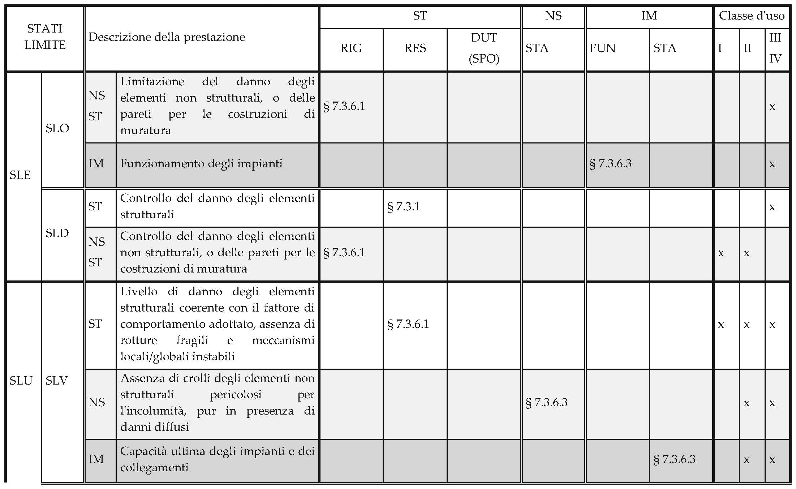
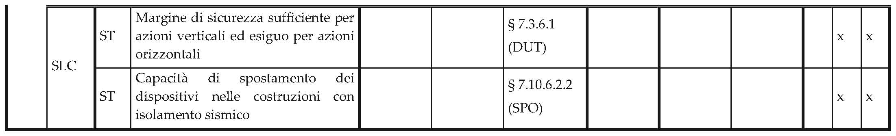

[Torna all'indice del § 7.3](./indice-7.3.md) | [Torna all'indice del capitolo](./indice-cap07.md) | [Torna all'indice generale](../indice-ntc2018.md)

# 7.3.6. Rispetto dei requisiti nei confronti degli stati limite

<!-- INDICE-INTERNO:INIZIO -->
**Indice interno**

- [Norma](#toc-ntc2018-7-3-6-norma)
  - [7.3.6.1. Verifiche di rigidezza](#toc-ntc2018-7-3-6-1)
  - [7.3.6.2. Verifiche di resistenza](#toc-ntc2018-7-3-6-2)
  - [7.3.6.3. Verifiche di duttilità](#toc-ntc2018-7-3-6-3)
  - [7.3.6.4. Verifiche di stabilità](#toc-ntc2018-7-3-6-4)
  - [7.3.6.5. Verifiche di funzionamento](#toc-ntc2018-7-3-6-5)
- [Circolare](#toc-ntc2018-c7-3-6-circolare)
- [C7.3.6. Rispetto dei requisiti nei confronti degli stati limite](#toc-ntc2018-c7-3-6)
  - [C7.3.6.1. Elementi strutturali (ST)](#toc-ntc2018-c7-3-6-1)
  - [C7.3.6.2. Elementi non strutturali (NS)](#toc-ntc2018-c7-3-6-2)
<!-- INDICE-INTERNO:FINE -->

## Norma

Le verifiche di sicurezza da effettuare per ciascuno stato limite sono sintetizzate nella Tab. 7.3.III.

**Tab. 7.3.III** – *Verifiche da effettuare per i diversi stati limite e classi d'uso*

| Verifica | Elementi | CU I | CU II | CU III | CU IV |
|---|---|:---:|:---:|:---:|:---:|
| **SLO** | | | | | |
| Rigidezza (RIG) | ST, NS | – | – | sì | sì |
| Funzionamento (FUN) | IM | – | – | sì | sì |
| **SLD** | | | | | |
| Rigidezza (RIG) | ST, NS | sì | sì | sì | sì |
| Funzionamento (FUN) | IM | sì | sì | sì | sì |
| **SLV** | | | | | |
| Resistenza (RES) | ST (primari) | sì | sì | sì | sì |
| Resistenza (RES) | ST (secondari) | sì | sì | sì | sì |
| Duttilità (DUT) | ST (primari) | sì | sì | sì | sì |
| Stabilità (STA) | NS | sì | sì | sì | sì |
| Funzionamento (FUN) | IM | – | – | sì | sì |
| **SLC** | | | | | |
| Resistenza (RES) | ST (primari) | – | – | – | sì |
| Duttilità (DUT) | ST (primari) | – | – | – | sì |
| Stabilità (STA) | NS | – | – | – | sì |

dove: **ST** = elementi strutturali; **NS** = elementi non strutturali; **IM** = impianti; **CU** = classe d'uso.

### 7.3.6.1. Verifiche di rigidezza

Le verifiche di rigidezza (RIG) per gli elementi strutturali consistono nella limitazione degli spostamenti di interpiano $d_r$ sotto l'azione sismica di progetto per lo stato limite di esercizio considerato (SLD o SLO).

Per gli edifici con tamponamenti collegati rigidamente alla struttura che interferiscono con la deformabilità della stessa:

$$d_r \leq 0{,}005 \cdot h$$ \tag{7.3.11a}

Per gli edifici con tamponamenti collegati elasticamente alla struttura principale:

$$d_r \leq 0{,}0075 \cdot h$$ \tag{7.3.11b}

Per gli edifici con struttura portante in muratura ordinaria:

$$d_r \leq 0{,}003 \cdot h$$ \tag{7.3.12}

Per gli edifici con struttura portante in muratura armata:

$$d_r \leq 0{,}004 \cdot h$$ \tag{7.3.13}

dove $d_r$ è lo spostamento interpiano e $h$ è l'altezza del piano.

Per gli elementi non strutturali le verifiche di rigidezza consistono nel controllare che gli spostamenti strutturali siano compatibili con le deformazioni ammesse dagli elementi stessi.

Per le costruzioni ricadenti in classe d'uso III e IV la verifica di rigidezza nei confronti dello SLO si effettua adottando i limiti di spostamento di interpiano sopra indicati ridotti dei 2/3:

$$d_r \leq \frac{2}{3} \cdot d_{r,\text{limite SLD}}$$ \tag{7.3.14}

### 7.3.6.2. Verifiche di resistenza

Le verifiche di resistenza (RES) consistono nel confronto fra le sollecitazioni di progetto indotte dall'azione sismica e la corrispondente resistenza di progetto dell'elemento strutturale.

Per gli elementi strutturali primari:

$$E_d \leq R_d$$ \tag{7.3.15}

dove $E_d$ è il valore di progetto dell'effetto dell'azione e $R_d$ è il valore di progetto della resistenza.

Per gli elementi strutturali secondari, le verifiche di resistenza allo SLV si effettuano con riferimento alle sollecitazioni calcolate considerando le sole forze gravitazionali (senza azione sismica) combinate con gli spostamenti indotti dall'azione sismica.

### 7.3.6.3. Verifiche di duttilità

Le verifiche di duttilità (DUT) si applicano agli elementi strutturali primari e consistono nel controllare che la struttura, e i singoli elementi, possiedano una duttilità coerente con il fattore di comportamento $q$ adottato.

Per le strutture progettate con comportamento dissipativo, la verifica di duttilità è implicitamente soddisfatta se sono rispettate le regole di dettaglio costruttivo delle zone dissipative e le prescrizioni sulla gerarchia delle resistenze indicate nei rispettivi paragrafi per le diverse tipologie strutturali (§§ 7.4 – 7.10).

### 7.3.6.4. Verifiche di stabilità

Le verifiche di stabilità (STA) riguardano gli elementi non strutturali e consistono nel controllare che tali elementi mantengano la propria integrità strutturale sotto l'azione sismica di progetto, evitandone il distacco e il ribaltamento.

### 7.3.6.5. Verifiche di funzionamento

Le verifiche di funzionamento (FUN) riguardano gli impianti e consistono nel controllare che gli impianti mantengano la propria funzionalità sotto l'azione sismica corrispondente allo stato limite di esercizio considerato.

---

## Circolare

## C7.3.6. Rispetto dei requisiti nei confronti degli stati limite

In generale, la progettazione ha un'articolazione delle prestazioni multi-prestazionale e multi-strategico. I diversi livelli prestazionali sono associati ai diversi stati limite, mentre le diverse strategie sono associate alla destinazione d'uso della costruzione.

La Tab. 7.3.III della norma sintetizza le diverse verifiche da eseguire per le costruzioni a comportamento dissipativo; nella Tabella C7.3.I, si esplicitano con maggiore dettaglio le verifiche riportate nella Tabella 7.3.III della norma, fornendo anche una descrizione sintetica della prestazione associata a ciascuno stato limite e indicando, per ogni elemento costruttivo, il riferimento al paragrafo della norma a cui si riferisce ciascuna delle verifiche.

La tabella C7.3.I fornisce, per ciascuno Stato Limite e per ciascun tipo di elemento (strutturale, non strutturale o impianto), la descrizione delle prestazioni in termini di danno, capacità ultima (resistenza o duttilità) o funzionamento; essa indica, inoltre, il tipo di verifica, in termini di confronto tra capacità e domanda, e il tipo di elemento su cui la verifica deve essere eseguita, per soddisfare il requisito prestazionale dato.

**Tabella C7.3.I — Stati Limite di elementi strutturali primari, elementi non strutturali e impianti: descrizione delle prestazioni e corrispondenti verifiche.**

### C7.3.6.1. Elementi strutturali (ST)

Nelle verifiche di cui al § 7.3.6.1, nel caso di analisi lineari (§7.3.3.) si assume $d_r = d_E$.

In merito alle "Verifiche di Rigidezza (RIG)", per le tamponature duttili di cui al punto a) e per le tamponature di cui al punto b), va verificato sperimentalmente che il raggiungimento dei rispettivi limiti di interpiano $0{,}0075h$ e $0{,}0100h$ siano ottenuti sulla parte ascendente della curva di comportamento Forza-Spostamento relativo, oppure sul ramo discendente verificando però che la perdita di resistenza sia inferiore al 10% del massimo. Inoltre, durante la prova non si dovranno riscontrare significativi danneggiamenti sugli elementi.

Per tamponature duttili si intendono elementi non strutturali che sviluppano un comportamento plastico o incrudente al di là del limite elastico e deformazioni significativamente maggiori delle deformazioni al limite elastico.

### C7.3.6.2. Elementi non strutturali (NS)

Il controllo del danno negli elementi non strutturali si effettua, in maniera indiretta, intervenendo sulla rigidezza degli elementi strutturali al fine di contenere gli spostamenti di interpiano, come indicato al § 7.3.6.1. Devono essere eseguite invece verifiche dirette in relazione alla possibile espulsione delle tamponature sotto l'azione delle $F_a$, si può ritenere conseguita con l'inserimento di leggere reti da intonaco sui due lati della muratura, collegate tra loro ed alle strutture circostanti a distanza non superiore a 500 mm sia in direzione orizzontale sia in direzione verticale, ovvero con l'inserimento di elementi di armatura orizzontale nei letti di malta, a distanza non superiore a 500 mm. La domanda sismica $F_a$ si determina secondo le indicazioni del § 7.2.3 della norma e del § C7.2.3.
