[Torna all'indice del capitolo](indice-cap07.md) | [Torna all'indice generale](../indice-ntc2018.md)

# 7.4. Costruzioni di calcestruzzo

## Indice del capitolo

- [7.4.1 Generalità](#741-generalità)
- [7.4.2 Caratteristiche dei materiali](#742-caratteristiche-dei-materiali)
  - [7.4.2.1 Conglomerato](#7421-conglomerato)
  - [7.4.2.2 Acciaio](#7422-acciaio)
- [7.4.3 Tipologie strutturali e fattori comportamento](#743-tipologie-strutturali-e-fattori-di-comportamento)
  - [7.4.3.1 Tipologie (telaio, pareti, miste, pendolo inverso)](#7431-tipologie-strutturali)
  - [7.4.3.2 Fattori di comportamento (α_u/α_1)](#7432-fattori-di-comportamento)
- [7.4.4 Dimensionamento e verifica](#744-dimensionamento-e-verifica-degli-elementi-strutturali-primari-e-secondari)
  - [7.4.4.1 Travi (flessione, taglio, duttilità μ_φ)](#7441-travi)
  - [7.4.4.2 Pilastri (gerarchia, taglio)](#7442-pilastri)
  - [7.4.4.3 Nodi trave-pilastro (taglio)](#7443-nodi-trave-pilastro)
  - [7.4.4.4 Diaframmi orizzontali](#7444-diaframmi-orizzontali)
  - [7.4.4.5 Pareti (pressoflessione, taglio)](#7445-pareti)
  - [7.4.4.6 Travi di accoppiamento](#7446-travi-di-accoppiamento-dei-sistemi-a-pareti)
- [7.4.5 Costruzioni prefabbricate](#745-costruzioni-con-struttura-prefabbricata)
  - [7.4.5.1 Tipologie e fattori](#7451-tipologie-strutturali-e-fattori-di-comportamento)
  - [7.4.5.2 Collegamenti](#7452-collegamenti)
  - [7.4.5.3 Elementi strutturali](#7453-elementi-strutturali)
- [7.4.6 Dettagli costruttivi (limitazioni geometriche, armatura)](#746-dettagli-costruttivi-per-le-strutture-a-comportamento-dissipativo)
  - [7.4.6.1 Limitazioni geometriche](#7461-limitazioni-geometriche)
  - [7.4.6.2 Limitazioni di armatura](#7462-limitazioni-di-armatura)
- [C7.4.2 — Caratteristiche dei materiali](#c742-caratteristiche-dei-materiali)
- [C7.4.3 — Tipologie (deformabilità torsionale)](#c743-tipologie-strutturali-e-fattori-di-comportamento)
- [C7.4.4 — Dimensionamento e verifica](#c744-dimensionamento-e-verifica-degli-elementi-strutturali-primari-e-secondari)
  - [C7.4.4.1 Travi](#c7441-travi)
  - [C7.4.4.2 Pilastri](#c7442-pilastri)
  - [C7.4.4.3 Nodi trave-pilastro](#c7443-nodi-trave-pilastro)
  - [C7.4.4.4 Diaframmi orizzontali](#c7444-diaframmi-orizzontali)
  - [C7.4.4.5 Pareti (ridistribuzione 30%)](#c7445-pareti)
- [C7.4.5 — Prefabbricate](#c745-costruzioni-con-struttura-prefabbricata)
- [C7.4.6 — Dettagli costruttivi](#c746-dettagli-costruttivi)

---

# Norma

## 7.4.1. Generalità

Le costruzioni di calcestruzzo devono rispettare le prescrizioni del § 4.1 e le prescrizioni aggiuntive contenute nel presente paragrafo.

Il comportamento strutturale sotto azioni sismiche può essere:

- **comportamento non dissipativo**: la struttura è progettata per resistere alle azioni sismiche in campo elastico, senza necessità di requisiti aggiuntivi rispetto a quelli del § 4.1. Il fattore di comportamento $q$ è pari a $1{,}5$;
- **comportamento dissipativo**: la struttura è progettata per resistere alle azioni sismiche sviluppando meccanismi dissipativi stabili fino allo stato limite di collasso (SLC). Il dimensionamento è condotto allo SLV. La struttura deve possedere adeguata capacità dissipativa complessiva, ottenuta assegnando ad alcune zone la funzione di dissipare energia (zone dissipative o zone critiche).

Nel caso di comportamento dissipativo si distinguono due livelli di capacità dissipativa:

- **classe di duttilità alta** (CD"A");
- **classe di duttilità bassa** (CD"B").

Per le strutture a comportamento dissipativo devono essere seguite tre strategie complementari:

*a)* la struttura deve possedere sufficiente resistenza e rigidezza, unitamente ad un'adeguata duttilità. Le zone dissipative devono avere capacità di deformazione (duttilità) tale da garantire il raggiungimento della duttilità globale richiesta;

*b)* le zone non dissipative e i collegamenti fra zone dissipative e resto della struttura devono possedere sufficiente sovraresistenza per consentire la plasticizzazione ciclica delle zone dissipative (criterio della gerarchia delle resistenze o *capacity design*);

*c)* i dettagli costruttivi delle zone dissipative devono essere tali da assicurare, sotto carichi ciclici, il livello di duttilità necessario; il confinamento del calcestruzzo nelle zone dissipative è essenziale per raggiungere la duttilità richiesta.

Per le tamponature in muratura nelle strutture intelaiate, si devono considerare gli effetti della loro presenza e della loro irregolare distribuzione in pianta e in elevazione. In particolare si devono adottare cautele aggiuntive nella progettazione dei pilastri adiacenti alle tamponature, al fine di evitare effetti locali indesiderati (pilastro corto, irregolarità locali, concentrazioni di sollecitazione).

---

## 7.4.2. Caratteristiche dei materiali

### 7.4.2.1. Conglomerato

Per le strutture a comportamento dissipativo si deve utilizzare un conglomerato di classe non inferiore a **C20/25**.

### 7.4.2.2. Acciaio

Per le strutture a comportamento dissipativo si deve utilizzare acciaio di tipo **B450C**.

È consentito l'uso di acciaio di tipo **B450A** a condizione che:

- il rapporto fra il valore medio della tensione di snervamento effettiva e il valore nominale non superi $1{,}30$;
- le zone dissipative siano confinate in modo da assicurare alla struttura adeguata duttilità globale.

---

## 7.4.3. Tipologie strutturali e fattori di comportamento

### 7.4.3.1. Tipologie strutturali

Le strutture sismoresistenti in calcestruzzo armato si classificano nelle seguenti tipologie:

*a)* **Strutture a telaio**: strutture in cui la resistenza alle azioni sia verticali che orizzontali è affidata principalmente a telai spaziali, la cui resistenza a taglio alla base è non inferiore al 65% della resistenza a taglio totale.

*b)* **Strutture a pareti**: strutture in cui la resistenza alle azioni sia verticali che orizzontali è affidata principalmente a pareti, singole o accoppiate, la cui resistenza a taglio alla base è non inferiore al 65% della resistenza a taglio totale.

*c)* **Strutture miste telaio-pareti**: strutture in cui la resistenza alle azioni verticali è affidata principalmente ai telai e la resistenza alle azioni orizzontali è affidata in parte ai telai e in parte alle pareti. Al primo piano nessuna delle due tipologie sorregge più del 65% della resistenza a taglio totale.

*d)* **Strutture a pendolo inverso**: strutture in cui almeno il 50% della massa è nel terzo superiore dell'altezza, oppure in cui la dissipazione di energia avviene prevalentemente alla base di un singolo elemento strutturale.

*e)* **Strutture a pendolo inverso intelaiate monopiano**: strutture a pendolo inverso costituite da pilastri collegati in sommità da travi che non formano un telaio dissipativo con i pilastri (ad esempio strutture prefabbricate monopiano con travi semplicemente appoggiate).

*f)* **Strutture deformabili torsionalmente**: strutture nelle quali il primo modo di vibrare è un modo torsionale.

*g)* **Strutture a pareti estese debolmente armate**: strutture nelle quali la resistenza alle azioni orizzontali è affidata prevalentemente a pareti con armatura minima, progettate per un comportamento duttile limitato.

### 7.4.3.2. Fattori di comportamento

Il valore del fattore di comportamento $q$ è dato dall'espressione:

$$q = q_0 \cdot K_R$$

dove:

- $q_0$ è il valore massimo del fattore di comportamento che dipende dal livello di duttilità attesa, dalla tipologia strutturale e dalla regolarità in elevazione;
- $K_R$ è un fattore riduttivo che vale $1$ per costruzioni regolari in elevazione e $0{,}8$ per costruzioni non regolari in elevazione.

Per costruzioni regolari in pianta, i valori di $q_0$ sono indicati nella seguente tabella, in funzione della tipologia strutturale:

**Strutture a telaio, miste, pareti accoppiate:**

- CD"B": $q_0 = 3{,}0 \cdot \alpha_u / \alpha_1$
- CD"A": $q_0 = 4{,}5 \cdot \alpha_u / \alpha_1$

**Strutture a pareti non accoppiate:**

- CD"B": $q_0 = 3{,}0$
- CD"A": $q_0 = 4{,}0 \cdot \alpha_u / \alpha_1$

**Strutture a pendolo inverso:**

- CD"B": $q_0 = 1{,}5$
- CD"A": $q_0 = 2{,}0$

**Strutture deformabili torsionalmente:**

- CD"B": $q_0 = 2{,}0$
- CD"A": $q_0 = 3{,}0$

**Strutture a pareti estese debolmente armate:**

- CD"B": $q_0 = 3{,}0$

Il rapporto $\alpha_u / \alpha_1$ vale:

- $1{,}1$ per strutture a telaio o miste equivalenti a telaio a una campata;
- $1{,}2$ per strutture a telaio o miste equivalenti a telaio a più campate;
- $1{,}0$ per strutture a pareti o miste equivalenti a pareti con sole due pareti non accoppiate per direzione;
- $1{,}1$ per strutture a pareti o miste equivalenti a pareti con più di due pareti non accoppiate per direzione;
- $1{,}2$ per strutture miste equivalenti a pareti o a telaio con più pareti accoppiate per direzione.

dove:

- $\alpha_1$ è il moltiplicatore dell'azione sismica orizzontale per il quale si verifica, nella struttura, la formazione della prima cerniera plastica;
- $\alpha_u$ è il moltiplicatore dell'azione sismica orizzontale per il quale si verifica la formazione di un numero di cerniere plastiche tale da rendere la struttura labile, ovvero si raggiunge il 90% della resistenza massima in un'analisi incrementale.

Valori superiori di $\alpha_u / \alpha_1$ possono essere utilizzati purché ottenuti da analisi statiche non lineari (*pushover*), comunque nel rispetto del limite $\alpha_u / \alpha_1 \leq 1{,}5$.

---

## 7.4.4. Dimensionamento e verifica degli elementi strutturali primari e secondari

Le zone dissipative sono individuate come segue:

- nelle strutture a telaio: le estremità delle travi e le basi dei pilastri al piano terra;
- nelle strutture a pareti: le basi delle pareti;
- nelle strutture miste: le estremità delle travi e le basi delle pareti e dei pilastri al piano terra.

Per le strutture a comportamento dissipativo, gli elementi strutturali si distinguono in:

- **elementi primari**: contribuiscono alla resistenza sismica della struttura;
- **elementi secondari**: non contribuiscono alla resistenza sismica della struttura e sono progettati per sopportare le sole azioni gravitazionali e le deformazioni imposte dall'azione sismica.

### 7.4.4.1. Travi

#### 7.4.4.1.1. Verifiche di resistenza (RES)

**Flessione**

La resistenza a flessione delle travi deve essere valutata tenendo conto della collaborazione della soletta in calcestruzzo, quando presente. La larghezza collaborante della soletta, su ciascun lato della trave, è assunta pari a:

- per le travi interne: la minore fra la metà della luce di ciascuna campata laterale e la metà della distanza tra le travi adiacenti;
- per le travi di bordo: la minore fra un quarto della luce della campata laterale e la metà della distanza dalla trave adiacente.

La larghezza collaborante dipende dalla posizione della trave rispetto al pilastro e dalla configurazione geometrica della struttura.

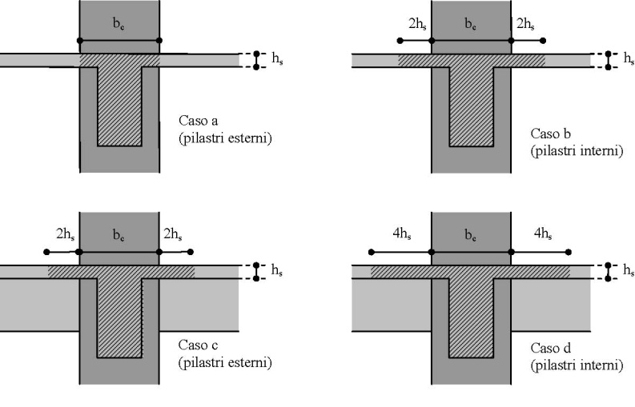

**Taglio**

Nelle strutture a comportamento dissipativo, il taglio nelle travi è determinato con il criterio della progettazione in capacità (*capacity design*). Il taglio di calcolo è dato dalla somma:

- del taglio dovuto ai carichi gravitazionali agenti sulla trave nello schema di trave semplicemente appoggiata;
- del taglio dovuto ai momenti resistenti nelle sezioni di estremità della trave.

Per le zone dissipative il taglio è valutato con $\cot\theta = 1$:

$$V_{Rd} = \min \left\{ \frac{A_{sw}}{s} \cdot z \cdot f_{ywd}; \; 0{,}5 \cdot b_w \cdot z \cdot \nu' \cdot f_{cd} \right\} \tag{7.4.1}$$

dove i simboli hanno il significato di cui al § 4.1.2.3.5.1.

Per la verifica a taglio delle zone dissipative si deve verificare che:

$$V_{Ed,max} \leq \frac{A_s \cdot f_{yd}}{\sqrt{2}} \tag{7.4.2}$$

dove $A_s$ è l'area totale di armatura longitudinale nella sezione.

#### 7.4.4.1.2. Verifiche di duttilità (DUT)

Per le strutture a comportamento dissipativo, la duttilità in curvatura $\mu_\varphi$ nelle zone dissipative delle travi deve soddisfare:

$$\mu_\varphi \geq \begin{cases} 1{,}2 \cdot (2 q_0 - 1) & \text{per } T_1 \geq T_C \\ 1{,}2 \cdot \left[1 + 2 (q_0 - 1) \dfrac{T_C}{T_1}\right] & \text{per } T_1 < T_C \end{cases} \tag{7.4.3}$$

dove:

- $T_1$ è il periodo fondamentale della struttura nella direzione considerata;
- $T_C$ è il periodo di inizio del tratto a velocità costante dello spettro;
- $q_0$ è il valore del fattore di comportamento utilizzato nel progetto.

Il fattore $1{,}2$ diventa $1{,}0$ per la CD"B".

---

### 7.4.4.2. Pilastri

#### 7.4.4.2.1. Verifiche di resistenza (RES)

**Pressoflessione**

Lo sforzo normale nei pilastri deve soddisfare la seguente limitazione:

- per CD"B": $N_{Ed} \leq 0{,}65 \cdot A_c \cdot f_{cd}$
- per CD"A": $N_{Ed} \leq 0{,}55 \cdot A_c \cdot f_{cd}$

dove $A_c$ è l'area della sezione lorda del pilastro e $f_{cd}$ è la resistenza di progetto a compressione del calcestruzzo.

**Gerarchia delle resistenze travi-pilastri**

Per ogni nodo trave-pilastro e per ciascuna direzione e verso dell'azione sismica, deve essere soddisfatta la seguente condizione:

$$\sum M_{c,Rd} \geq \gamma_{Rd} \cdot \sum M_{b,Rd} \tag{7.4.4}$$

dove:

- $\sum M_{c,Rd}$ è la somma dei momenti resistenti dei pilastri che convergono nel nodo, valutati per il livello di sforzo normale presente nella combinazione sismica;
- $\sum M_{b,Rd}$ è la somma dei momenti resistenti delle travi che convergono nel nodo;
- $\gamma_{Rd}$ è il fattore di sovraresistenza, pari a $1{,}3$ per la CD"A" e $1{,}1$ per la CD"B".

La condizione [7.4.4] non si applica ai pilastri dell'ultimo piano degli edifici.

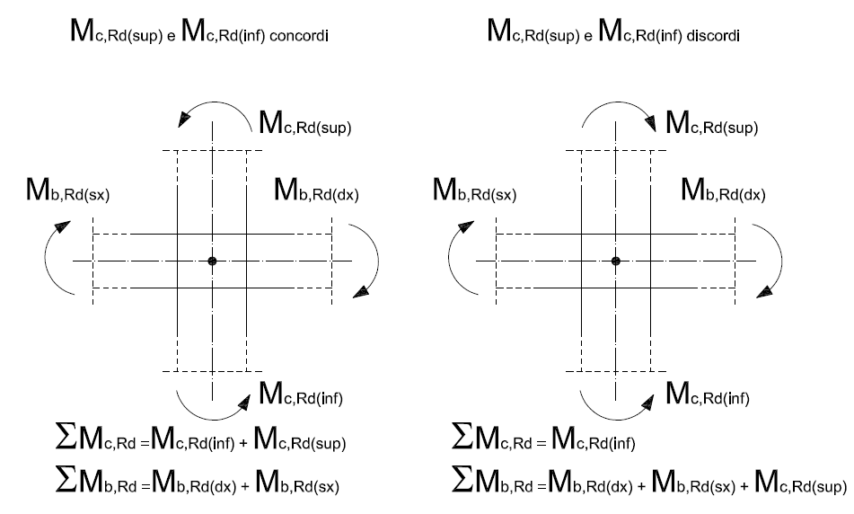

**Taglio**

Il taglio di calcolo nei pilastri è determinato con il criterio della gerarchia delle resistenze:

$$V_{Ed} = \gamma_{Rd} \cdot \frac{M_{i,d}^s + M_{i,d}^i}{l_p} \tag{7.4.5}$$

dove:

- $M_{i,d}^s$ e $M_{i,d}^i$ sono i momenti resistenti nelle sezioni di estremità superiore e inferiore del pilastro, calcolati con il valore di sforzo normale della combinazione sismica;
- $l_p$ è la lunghezza del pilastro;
- $\gamma_{Rd}$ è il fattore di sovraresistenza, pari a $1{,}3$ per la CD"A" e $1{,}1$ per la CD"B".

#### 7.4.4.2.2. Verifiche di duttilità (DUT)

Le verifiche di duttilità per i pilastri seguono i criteri indicati al § 7.4.4.1.2, con la duttilità in curvatura $\mu_\varphi$ espressa dalla [7.4.3]. Il fattore moltiplicativo è $1{,}2$ per CD"A" e $1{,}0$ per CD"B".

Per i pilastri, la duttilità è ottenuta principalmente attraverso il confinamento del calcestruzzo nelle zone critiche, secondo i dettagli costruttivi di cui al § 7.4.6.

---

### 7.4.4.3. Nodi trave-pilastro

I nodi trave-pilastro devono essere verificati a taglio e a compressione.

#### 7.4.4.3.1. Verifiche di resistenza (RES)

**Taglio nel nodo**

La forza di taglio agente nel nucleo del nodo è valutata con la seguente espressione.

Per **nodi interni** (travi su tutti e quattro i lati):

$$V_{jhd} = \gamma_{Rd} \cdot (A_{s1} + A_{s2}) \cdot f_{yd} - V_C \tag{7.4.6}$$

dove:

- $A_{s1}$ e $A_{s2}$ sono le aree di armatura longitudinale della trave superiore e inferiore;
- $f_{yd}$ è la tensione di snervamento di progetto dell'acciaio;
- $V_C$ è il taglio nel pilastro sopra il nodo;
- $\gamma_{Rd} = 1{,}2$.

Per **nodi esterni** (trave su un solo lato):

$$V_{jhd} = \gamma_{Rd} \cdot A_{s1} \cdot f_{yd} - V_C \tag{7.4.7}$$

**Verifica a compressione del puntone**

La resistenza a compressione diagonale nel nodo deve soddisfare le seguenti condizioni.

Per nodi interni:

$$V_{jhd} \leq \eta \cdot f_{cd} \cdot b_j \cdot h_{jc} \cdot \sqrt{1 - \frac{\nu_d}{\eta}} \tag{7.4.8}$$

Per nodi esterni:

$$V_{jhd} \leq 0{,}8 \cdot \eta \cdot f_{cd} \cdot b_j \cdot h_{jc} \cdot \sqrt{1 - \frac{\nu_d}{\eta}} \tag{7.4.9}$$

dove:

- $\eta = 0{,}6 \cdot (1 - f_{ck}/250)$ con $f_{ck}$ in MPa;
- $b_j$ è la larghezza efficace del nodo;
- $h_{jc}$ è la distanza fra le armature superiore e inferiore della trave;
- $\nu_d = N_{Ed} / (A_c \cdot f_{cd})$ è lo sforzo normale adimensionalizzato nel pilastro.

**Verifica a trazione diagonale**

Per nodi interni privi di confinamento adeguato, la resistenza a trazione diagonale del nodo deve soddisfare:

$$V_{jhd} \leq b_j \cdot h_{jc} \cdot \sqrt{f_{ctd}^2 + \nu_d \cdot f_{cd} \cdot f_{ctd}} \tag{7.4.10}$$

Se la condizione [7.4.10] non è soddisfatta, è necessario disporre armature a taglio nel nodo.

Per nodi interni con armature a taglio orizzontali:

$$V_{jhd} \leq b_j \cdot h_{jc} \cdot \sqrt{f_{ctd}^2 + \nu_d \cdot f_{cd} \cdot f_{ctd}} + \frac{A_{sh} \cdot f_{ywd}}{h_{jc}} \cdot (h_{jc} - h_{jw}) \tag{7.4.11}$$

Per nodi esterni:

$$V_{jhd} \leq b_j \cdot h_{jc} \cdot \sqrt{f_{ctd}^2 + \nu_d \cdot f_{cd} \cdot f_{ctd}} \tag{7.4.12}$$

dove $A_{sh}$ è l'area totale delle armature a taglio orizzontali nel nodo e $h_{jw}$ è la distanza fra le staffe più esterne.

---

### 7.4.4.4. Diaframmi orizzontali

I diaframmi orizzontali (solai) devono essere in grado di trasmettere le forze sismiche agli elementi verticali resistenti. Le forze agenti nei diaframmi devono essere incrementate del **30%** rispetto a quelle derivanti dall'analisi, per tener conto delle incertezze nella distribuzione delle azioni.

I diaframmi devono essere adeguatamente collegati alle travi e alle pareti. Le armature dei diaframmi, sia a flessione che a taglio, devono essere dimensionate per le azioni incrementate.

---

### 7.4.4.5. Pareti

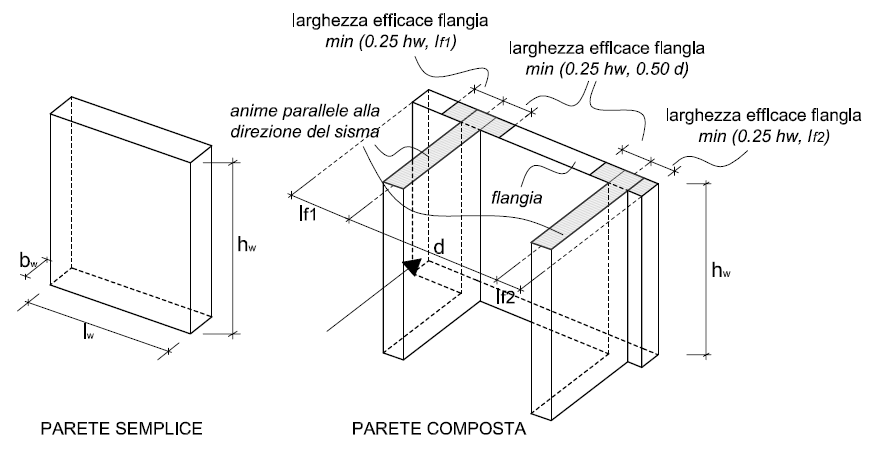

#### 7.4.4.5.1. Verifiche di resistenza (RES)

**Pressoflessione**

La resistenza a pressoflessione delle pareti è valutata secondo i criteri del § 4.1. Per le strutture a comportamento dissipativo, il diagramma dei momenti flettenti derivanti dall'analisi deve essere traslato verso l'alto di una quantità pari a:

$$a_l = \text{altezza della zona critica alla base} \tag{7.4.13}$$

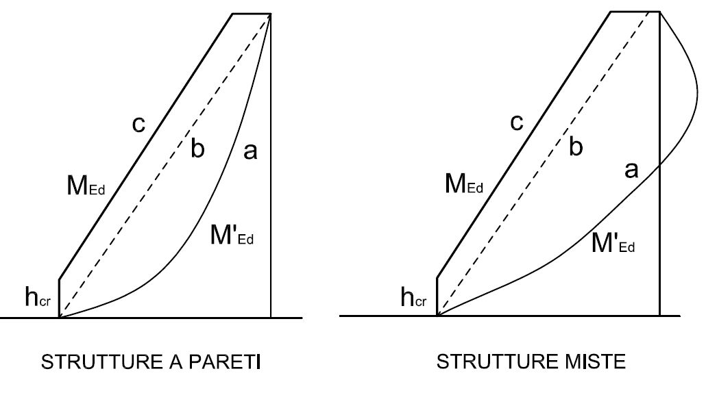

**Taglio**

Per le pareti snelle (rapporto $H_w/l_w > 2$), il taglio di progetto è ottenuto amplificando il taglio derivante dall'analisi. Il taglio di progetto nelle pareti è dato da:

$$V_{Ed}' = \varepsilon \cdot V_{Ed} \tag{7.4.14}$$

Per la CD"B":

$$\varepsilon = 1{,}5 \tag{7.4.15}$$

Per la CD"A", il fattore di amplificazione $\varepsilon$ tiene conto sia della sovraresistenza flessionale che dell'influenza dei modi superiori:

$$\varepsilon = q \cdot \sqrt{\left(\frac{\gamma_{Rd} \cdot M_{Rd}}{q \cdot M_{Ed}}\right)^2 + 0{,}1 \cdot \left(\frac{S_e(T_C)}{S_e(T_1)}\right)^2} \leq q \tag{7.4.16}$$

dove:

- $M_{Ed}$ e $V_{Ed}$ sono il momento e il taglio derivanti dall'analisi alla base della parete;
- $M_{Rd}$ è il momento resistente alla base della parete;
- $S_e(T_C)$ e $S_e(T_1)$ sono le ordinate dello spettro elastico in corrispondenza dei periodi $T_C$ e $T_1$;
- $\gamma_{Rd} = 1{,}2$.

La resistenza a taglio è verificata con le espressioni:

$$V_{Rd,c} = b_w \cdot z \cdot \left[\frac{A_{sh}}{s \cdot b_w} \cdot f_{ywd} + 0{,}25 \cdot \max(0; \nu') \cdot f_{cd}\right] \tag{7.4.17}$$

$$V_{Rd,max} = 0{,}5 \cdot b_w \cdot z \cdot \nu' \cdot f_{cd} \tag{7.4.18}$$

dove $\nu' = 0{,}6 \cdot (1 - f_{ck}/250)$.

Per le zone dissipative alla base delle pareti in CD"A":

$$V_{Rd} = b_w \cdot z \cdot \rho_h \cdot f_{ywd} \tag{7.4.19}$$

dove $\rho_h$ è il rapporto geometrico dell'armatura orizzontale.

Per pareti tozze ($H_w/l_w \leq 2$), il taglio di progetto tiene conto della possibile formazione di meccanismi di scorrimento alla base:

$$V_{Ed}' \leq V_{Rd,s} \tag{7.4.20}$$

La resistenza a scorrimento è data da:

$$V_{Rd,s} = V_{dd} + V_{id} + V_{fd} \tag{7.4.21}$$

dove:

- $V_{dd}$ è il contributo per effetto spinotto delle armature verticali;
- $V_{id}$ è il contributo delle armature inclinate eventualmente presenti;
- $V_{fd}$ è il contributo dell'attrito.

$$V_{dd} = \min \left\{ 1{,}3 \cdot \sum A_{sj} \cdot \sqrt{f_{cd} \cdot f_{yd}}; \; 0{,}25 \cdot f_{yd} \cdot \sum A_{sj} \right\} \tag{7.4.22}$$

dove $A_{sj}$ è l'area di ciascuna barra verticale che attraversa la sezione di scorrimento.

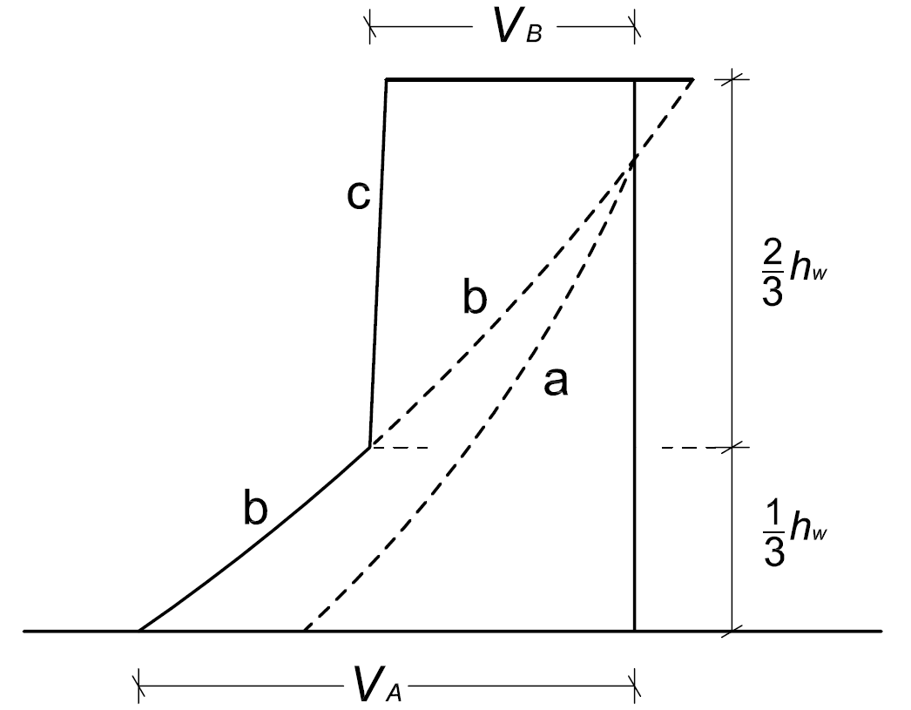

#### 7.4.4.5.2. Verifiche di duttilità (DUT)

Per le pareti, la duttilità in curvatura $\mu_\varphi$ nelle zone critiche alla base deve soddisfare la [7.4.3].

L'altezza della zona critica $h_{cr}$ è pari a:

$$h_{cr} = \max \left\{ l_w; \; H_w / 6 \right\} \tag{7.4.23}$$

con il limite:

$$h_{cr} \leq \begin{cases} 2 \cdot l_w & \text{per pareti con } n \leq 6 \text{ piani} \\ 2 \cdot h_s & \text{per pareti con } n \geq 7 \text{ piani} \end{cases} \tag{7.4.24}$$

dove:

- $l_w$ è la lunghezza in pianta della parete;
- $H_w$ è l'altezza totale della parete;
- $h_s$ è l'altezza di piano;
- $n$ è il numero di piani.

---

### 7.4.4.6. Travi di accoppiamento dei sistemi a pareti

Le travi di accoppiamento delle pareti accoppiate devono essere progettate come zone dissipative. La resistenza a taglio delle travi di accoppiamento è verificata come per le travi (§ 7.4.4.1).

Per travi di accoppiamento corte (luce libera $l_n \leq 3h$, dove $h$ è l'altezza della trave), la resistenza può essere affidata ad armature diagonali che attraversano l'intera trave.

La resistenza a taglio della trave con armature diagonali è:

$$V_{Rd} = 2 \cdot A_{sd} \cdot f_{yd} \cdot \sin\alpha \tag{7.4.25}$$

dove:

- $A_{sd}$ è l'area di ciascun fascio di armature diagonali;
- $\alpha$ è l'angolo di inclinazione delle armature diagonali rispetto all'asse della trave.

---

## 7.4.5. Costruzioni con struttura prefabbricata

### 7.4.5.1. Tipologie strutturali e fattori di comportamento

Le costruzioni con struttura prefabbricata devono rispettare le prescrizioni del presente paragrafo, oltre a quelle del § 4.1.10 relative alle strutture prefabbricate.

I fattori di comportamento sono quelli indicati al § 7.4.3.2, eventualmente ridotti in funzione del tipo di collegamento e della capacità dissipativa della struttura.

Per le strutture a pendolo inverso prefabbricate monopiano, in cui le connessioni sono progettate per rimanere in campo elastico, il fattore di comportamento $q$ è limitato a $2{,}5$ per CD"B".

### 7.4.5.2. Collegamenti

I collegamenti fra gli elementi prefabbricati si classificano in:

*a)* **tipo a** — collegamenti situati fuori dalle zone dissipative, dotati di adeguata sovraresistenza: devono resistere alle sollecitazioni derivanti dalla plasticizzazione delle zone dissipative adiacenti, amplificate del fattore $\gamma_{Rd}$;

*b)* **tipo b** — collegamenti situati nelle zone dissipative, dotati di adeguata duttilità: devono possedere la stessa capacità dissipativa degli elementi monolitici equivalenti;

*c)* **tipo c** — collegamenti situati nelle zone dissipative, dotati di adeguata resistenza: devono avere una resistenza pari a quella degli elementi monolitici equivalenti moltiplicata per un fattore non inferiore a $1{,}2$ per CD"B" e $1{,}35$ per CD"A".

### 7.4.5.3. Elementi strutturali

Gli elementi strutturali delle costruzioni prefabbricate devono essere dimensionati e verificati secondo i criteri del § 7.4.4, con le seguenti specificazioni:

- i diaframmi orizzontali prefabbricati devono garantire un comportamento monolitico, con collegamenti adeguati fra gli elementi;
- le forze di collegamento nei diaframmi devono essere incrementate del 30% come indicato al § 7.4.4.4;
- i dispositivi di appoggio degli elementi portati devono avere dimensioni sufficienti per evitare la perdita di appoggio sotto gli spostamenti sismici;
- nei pilastri prefabbricati a sezione variabile (a calice), la zona critica deve comprendere l'intero calice.

---

## 7.4.6. Dettagli costruttivi per le strutture a comportamento dissipativo

### 7.4.6.1. Limitazioni geometriche

**Travi:**

- larghezza $b \geq 20$ cm;
- rapporto $b/h \geq 0{,}25$;
- la larghezza delle travi non deve eccedere la larghezza del pilastro d'appoggio, aumentata di $h$ su ciascun lato (dove $h$ è l'altezza della trave).

**Pilastri:**

- dimensione minima della sezione trasversale $\geq 25$ cm;
- nel caso di sezioni rettangolari il rapporto fra la dimensione minore e quella maggiore non deve essere inferiore a $1/3$.

**Pareti:**

- spessore minimo $\geq 15$ cm;
- per le pareti delle strutture a comportamento dissipativo, lo spessore deve essere almeno pari a $1/20$ dell'altezza libera di piano per CD"B" e $1/15$ per CD"A".

**Nodi:**

- le dimensioni dei nodi devono essere tali da consentire il passaggio delle armature e l'ancoraggio delle barre.

### 7.4.6.2. Limitazioni di armatura

#### 7.4.6.2.1. Travi

**Armature longitudinali**

Il rapporto geometrico di armatura tesa $\rho$ nella zona dissipativa deve rispettare:

$$\rho \geq \rho_{min} = \frac{1{,}4}{f_{yk}} \tag{7.4.26}$$

con $f_{yk}$ in MPa.

Inoltre, nella zona dissipativa, l'armatura compressa deve essere non inferiore al 25% di quella tesa:

$$\rho' \geq 0{,}25 \cdot \rho$$

Per evitare lo sfilamento delle armature longitudinali in corrispondenza dei nodi, le barre devono essere adeguatamente ancorate oltre il nodo, con una lunghezza di ancoraggio non inferiore a:

$$l_{b,min} = \frac{d_{bL} \cdot f_{yd}}{4 \cdot f_{bd}} \tag{7.4.27}$$

dove:

- $d_{bL}$ è il diametro della barra longitudinale;
- $f_{bd}$ è la tensione di aderenza di progetto.

**Armature trasversali**

Nelle zone dissipative delle travi, le staffe devono rispettare le seguenti prescrizioni:

- il diametro delle staffe non deve essere inferiore a 6 mm;
- la prima staffa deve essere posta a non più di 5 cm dalla faccia del pilastro.

Per la **CD"A"**, il passo delle staffe nelle zone dissipative non deve superare il minore fra:

- $h/4$ (dove $h$ è l'altezza della trave);
- $175$ mm;
- $6 \cdot d_{bL}$ (dove $d_{bL}$ è il diametro delle barre longitudinali);
- $24 \cdot d_{st}$ (dove $d_{st}$ è il diametro delle staffe).

Per la **CD"B"**, il passo delle staffe nelle zone dissipative non deve superare il minore fra:

- $h/4$;
- $225$ mm;
- $8 \cdot d_{bL}$;
- $24 \cdot d_{st}$.

#### 7.4.6.2.2. Pilastri

**Armature longitudinali**

Il rapporto geometrico di armatura longitudinale $\rho$ nei pilastri deve rispettare:

$$1\% \leq \rho \leq 4\% \tag{7.4.28}$$

Nelle sezioni di estremità dei pilastri il rapporto deve essere non inferiore all'1%. I ferri di armatura longitudinale devono avere diametro non inferiore a 12 mm.

Almeno una barra ogni due deve essere trattenuta da staffe d'angolo o da legature.

**Armature trasversali**

Per la **CD"A"**, il passo delle staffe nelle zone dissipative dei pilastri non deve superare il minore fra:

- $b/3$ (dove $b$ è la dimensione minima della sezione);
- $125$ mm;
- $6 \cdot d_{bL}$.

Per la **CD"B"**, il passo delle staffe nelle zone dissipative dei pilastri non deve superare il minore fra:

- $b/2$;
- $175$ mm;
- $8 \cdot d_{bL}$.

**Dettagli per la duttilità**

Il confinamento del calcestruzzo nelle zone critiche dei pilastri deve soddisfare la seguente condizione:

$$\alpha \cdot \omega_{wd} \geq 30 \cdot \mu_\varphi \cdot \nu_d \cdot \varepsilon_{sy,d} \cdot \frac{b_c}{b_0} - 0{,}035 \tag{7.4.29}$$

dove:

- $\alpha$ è il coefficiente di efficacia del confinamento;
- $\omega_{wd} = \dfrac{\text{volume staffe di confinamento} \cdot f_{ywd}}{\text{volume del nucleo confinato} \cdot f_{cd}}$ è il rapporto meccanico di armatura trasversale;
- $\mu_\varphi$ è la duttilità in curvatura richiesta dalla [7.4.3];
- $\nu_d = N_{Ed} / (A_c \cdot f_{cd})$ è lo sforzo normale adimensionalizzato;
- $\varepsilon_{sy,d} = f_{yd} / E_s$ è la deformazione di snervamento dell'acciaio;
- $b_c$ è la dimensione lorda della sezione del pilastro;
- $b_0$ è la dimensione del nucleo confinato (misurata all'asse delle staffe).

Il coefficiente di efficacia $\alpha$ è dato da:

$$\alpha = \alpha_n \cdot \alpha_s \tag{7.4.30}$$

dove:

- per sezioni rettangolari con staffe e legature:

$$\alpha_n = 1 - \sum \frac{b_i^2}{6 \cdot b_0 \cdot h_0} \tag{7.4.31}$$

$$\alpha_s = \left(1 - \frac{s}{2 \cdot b_0}\right) \cdot \left(1 - \frac{s}{2 \cdot h_0}\right)$$

dove:

- $b_i$ è la distanza fra barre consecutive trattenute da staffe d'angolo o legature;
- $b_0$, $h_0$ sono le dimensioni del nucleo confinato;
- $s$ è il passo delle staffe.

Per sezioni circolari con spirale o staffe circolari:

$$\alpha_n = 1{,}0$$

$$\alpha_s = 1 - \frac{s}{2 \cdot D_0}$$

dove $D_0$ è il diametro del nucleo confinato.

#### 7.4.6.2.3. Nodi trave-pilastro

Nei nodi trave-pilastro, le staffe del pilastro devono proseguire all'interno del nodo. Il passo delle staffe nel nodo non deve superare il passo minimo previsto per le zone dissipative dei pilastri.

Per i nodi interni, le armature della trave che attraversano il nodo devono soddisfare le condizioni di ancoraggio.

Per i nodi esterni, le armature della trave devono essere ancorate nella sezione del pilastro con un tratto rettilineo, seguito da un tratto piegato verso l'interno del nodo.

#### 7.4.6.2.4. Pareti

**Armature minime**

L'armatura minima delle pareti, sia orizzontale che verticale, deve essere almeno pari allo **0,2%** della sezione del calcestruzzo.

**Elementi di bordo**

Le estremità delle pareti devono essere rinforzate con elementi di bordo confinati, ove necessario. Gli elementi di bordo sono necessari quando lo sforzo normale di compressione nell'estremità della parete, valutato per la combinazione sismica, supera $0{,}15 \cdot f_{cd}$ per CD"A" e $0{,}20 \cdot f_{cd}$ per CD"B".

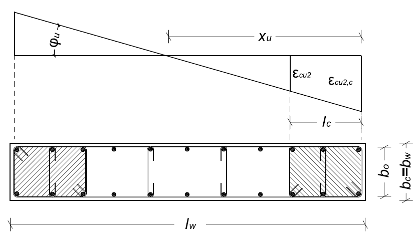

**Dettagli per la duttilità**

Il confinamento negli elementi di bordo delle pareti deve soddisfare:

$$\alpha \cdot \omega_{wd} \geq 30 \cdot \mu_\varphi \cdot (\nu_d + \omega_v) \cdot \varepsilon_{sy,d} \cdot \frac{b_c}{b_0} - 0{,}035 \tag{7.4.32}$$

dove $\omega_v$ è il rapporto meccanico dell'armatura verticale della parete nell'elemento di bordo.

La lunghezza dell'elemento di bordo confinato $l_c$ misurata dal bordo della parete non deve essere inferiore a:

$$l_c = \max \left\{ 0{,}15 \cdot l_w; \; 1{,}50 \cdot b_w \right\} \tag{7.4.33}$$

dove:

- $l_w$ è la lunghezza in pianta della parete;
- $b_w$ è lo spessore della parete.

#### 7.4.6.2.5. Travi di accoppiamento

Le travi di accoppiamento delle pareti accoppiate devono avere armature a staffa conformi ai requisiti delle travi (§ 7.4.6.2.1).

Per travi di accoppiamento con armature diagonali, ciascun fascio di armature diagonali deve essere confinato da staffe lungo tutta la sua lunghezza, con passo non superiore a $100$ mm per CD"A" e $150$ mm per CD"B". In alternativa, può essere confinata l'intera sezione trasversale della trave.

---

# Circolare

Per le costruzioni con struttura di calcestruzzo la norma contiene disposizioni specifiche a seconda del comportamento strutturale prescelto.

Nel caso di *comportamento strutturale non dissipativo* si fa riferimento unicamente al § 4.1 delle NTC, senza nessun requisito aggiuntivo, a condizione che gli elementi strutturali siano progettati per rimanere in campo sostanzialmente elastico.

Nel caso di *comportamento strutturale dissipativo*, i principi e i criteri della progettazione in capacità si applicano, in maniera estesa, alla progettazione di tutti gli elementi strutturali, poiché contribuiscono alla realizzazione di meccanismi ciclici inelastici dissipativi e globalmente stabili.

Nell'ottica del perseguimento di un comportamento duttile, affidato a plasticizzazioni diffuse nelle zone a tal fine individuate (zone dissipative) la norma dà particolare risalto, per le costruzioni di calcestruzzo, al confinamento. È noto, infatti, che il confinamento migliora il comportamento del calcestruzzo in termini sia di resistenza, sia di duttilità. A questo scopo, al § 4.1.2.1.2.2, la norma fornisce un legame costitutivo parabola-rettangolo in grado di descrivere il comportamento del calcestruzzo confinato da armature trasversali. Tale legame può essere utilizzato, con riferimento al solo nucleo confinato, per il calcolo della capacità della sezione, in termini di resistenza e di duttilità.

Per garantire un comportamento globalmente duttile, anche in considerazione dell'esigenza di contenere i fenomeni di degrado oligociclico e riduzione di rigidezza nelle zone dissipative, le verifiche di duttilità sono espressamente richieste nelle zone dissipative, sia degli elementi primari, sia degli elementi secondari.

Un particolare riguardo è richiesto per le verifiche di duttilità nelle zone allo spiccato delle fondazioni di tutti i pilastri primari. Per questi elementi, la norma fornisce, in alternativa alle verifiche specifiche, anche delle espressioni semplificate per il calcolo delle armature trasversali in funzione della domanda di duttilità.

In generale, per tutti gli elementi strutturali, la norma fornisce dettagli costruttivi finalizzati a garantire il comportamento desiderato a livello sia locale sia globale.

## C7.4.2. Caratteristiche dei materiali

### C7.4.2.1. Conglomerato

Si consente l'impiego di calcestruzzi con aggregati leggeri purché di sufficiente resistenza.

## C7.4.3. Tipologie strutturali e fattori di comportamento

### C7.4.3.1. Tipologie strutturali

La norma identifica le tipologie strutturali, classificandole essenzialmente in base alla tipologia delle strutture verticali che contribuiscono maggiormente alla resistenza laterale. Ciò significa che l'individuazione della tipologia è possibile, a rigore, solo a progettazione avvenuta e, considerato che i fattori di comportamento e dunque l'azione sismica di progetto dipendono proprio dalla tipologia, il processo dovrebbe essere di necessità iterativo.

In realtà, almeno in prima battuta, per l'identificazione della tipologia strutturale, si può valutare la percentuale del taglio totale al piede agente su ciascun tipo di struttura verticale sismoresistente (telaio, parete, ecc.) a partire dalle rigidezze relative, quindi in base alla ripartizione delle sollecitazioni ottenuta attraverso un modello elastico. Sarebbe pertanto opportuno verificare, almeno a fine progettazione, la ripartizione delle resistenze rispetto alla resistenza a taglio totale, o comunque tenere debitamente conto delle eventuali incertezze nell'individuazione della tipologia strutturale ai fini della determinazione del fattore di comportamento.

Le strutture dotate di rigidezza e/o resistenza torsionale basse sono deformabili torsionalmente; per tali tipologie strutturali occorre evitare o limitare, quanto più possibile, le eccentricità tra il centro di massa ed il centro di rigidezza, in quanto l'attivazione di modi di vibrare torsionali può provocare amplificazioni significative degli effetti legati all'azione sismica. Qualora non si riesca, modificando opportunamente la geometria e la disposizione degli elementi strutturali, a ridurre la significatività dei modi torsionali, la norma tende a penalizzare la struttura, particolarmente nei telai perimetrali, per tener conto dell'incremento della domanda di duttilità dovuta alla torsione d'insieme.

Da un punto di vista operativo, ciò si traduce in una riduzione significativa del fattore di comportamento e nel conseguente incremento dell'azione sismica di progetto. Secondo quanto prescritto al § 7.4.3.1, le strutture deformabili torsionalmente sono tipologie strutturali la cui rigidezza torsionale non soddisfa ad ogni piano la condizione $r^2/l_s^2 > 1$.

Il parametro $r$ è il raggio torsionale, che può essere così calcolato:

$$r = \sqrt{\frac{K_\theta}{K}}$$ \tag{C7.4.1}

dove:

- $K_\theta$ è la rigidezza torsionale di piano rispetto al centro di rigidezza;
- $K$ è la maggiore tra le rigidezze di piano.

Per la determinazione della rigidezza torsionale e flessionale di piano occorre considerare tutti gli elementi strutturali primari.

Il parametro $l_s$ è il raggio di inerzia delle masse, che è pari alla radice quadrata del rapporto tra il momento di inerzia polare della massa del piano, rispetto ad un asse verticale passante per il centro di massa, e la massa del piano stesso. Nel caso di pianta rettangolare e distribuzione uniforme delle masse, è valida la formulazione semplificata proposta dalla norma al § 7.4.3.1; tale espressione può essere estesa a tutte le strutture che rispettano i requisiti di regolarità in pianta, considerando $L$ e $B$ come le dimensioni medie dell'ingombro lungo le due direzioni principali.

Alternativamente l'individuazione delle strutture deformabili torsionalmente può essere effettuata valutando il rapporto $\Omega$ tra i periodi dei modi di vibrare:

$$\Omega = \frac{T}{T_\theta}$$ \tag{C7.4.2}

dove:

- $T$ Periodo traslazionale disaccoppiato;
- $T_\theta$ Periodo torsionale disaccoppiato.

Se $\Omega$ è maggiore di 1 la risposta è principalmente traslazionale, se inferiore ad 1 la risposta è dominata da un comportamento torsionale, dunque la struttura viene classificata come deformabile torsionalmente.

## C7.4.4. Dimensionamento e verifica degli elementi strutturali primari e secondari

L'analisi delle sollecitazioni è effettuata con riferimento alla combinazione sismica delle azioni specificata al § 2.5.3 delle NTC ed alla combinazione delle componenti orizzontali e verticali del sisma specificata al § 7.3.5 delle NTC (espressione [7.3.10]). Le verifiche di resistenza degli elementi strutturali si effettuano come indicato al § 4.1.2 delle NTC, dove si assumono, per tener conto del degrado ciclico dei materiali, gli stessi coefficienti parziali $\gamma_C$ e $\gamma_S$ delle condizioni non sismiche.

Le verifiche di duttilità previste al § 7.4.4 delle NTC si intendono implicitamente soddisfatte se si seguono le regole per i materiali, i dettagli costruttivi e la progettazione in capacità indicate al § 7.4 delle NTC per le diverse tipologie ed elementi strutturali.

Nella valutazione della duttilità di curvatura per le verifiche di duttilità nelle zone dissipative, il contributo in termini di resistenza e di duttilità dovuto al confinamento del calcestruzzo va considerato utilizzando modelli adeguati, così come specificato al Capitolo 4 delle NTC. A tal fine, la sola parte di calcestruzzo contenuta all'interno delle armature che garantiscono il confinamento può essere considerata efficacemente confinata.

In condizioni sismiche, quando nell'elemento si formano cerniere duttili occorre assicurare che la riduzione di resistenza a taglio, legata alla domanda di duttilità in condizioni cicliche, non attivi un meccanismo combinato di taglio-flessione.

Tale verifica deve essere eseguita almeno nelle zone dissipative degli elementi in cui sono attese con maggiore probabilità le plasticizzazioni, ovvero le sezioni di estremità delle travi, dei pilastri secondari e le sezioni allo spiccato dei pilastri primari e delle pareti.

Si deve verificare che la capacità a taglio nell'elemento sia maggiore della corrispondente domanda valutata in base ai criteri della progettazione in capacità, con i fattori di sovraresistenza specifici per la classe di duttilità scelta.

La capacità a taglio in condizioni cicliche, in funzione della domanda di duttilità, può essere determinata come indicato nei successivi paragrafi. Ciò comporta l'esecuzione di una ulteriore verifica a taglio, per garantire il raggiungimento della duttilità di rotazione delle zone dissipative senza che si attivi un meccanismo a taglio. Il quantitativo di armatura trasversale nelle zone dissipative sarà, pertanto, pari al valore massimo tra l'armatura trasversale a taglio, considerando il degrado ciclico di resistenza, e l'armatura trasversale per il confinamento, necessaria a conseguire una duttilità di curvatura maggiore di quella richiesta, coerentemente con il fattore di comportamento adottato.

### C7.4.4.1. Travi

#### C7.4.4.1.1. Verifiche di resistenza (RES)

##### Taglio

Per il calcolo della domanda a taglio sulla trave, si può fare riferimento allo schema di Figura C7.4.1, dove è rappresentato sia il caso di plasticizzazione delle sezioni di estremità delle travi (quando la somma dei momenti resistenti delle sezioni di estremità delle travi convergenti nel nodo è inferiore alla somma dei momenti resistenti delle sezioni di estremità dei pilastri convergenti nel medesimo nodo) sia il caso di plasticizzazione dei pilastri (quando la somma dei momenti resistenti delle sezioni di estremità delle travi convergenti nel nodo è superiore alla somma dei momenti resistenti delle sezioni di estremità dei pilastri convergenti nel medesimo nodo).

Si precisa che quest'ultima condizione potrebbe presentarsi in differenti situazioni, in accordo con i principi di progettazione in capacità e con le prescrizioni definite nel Capitolo 7 delle NTC, ad esempio in corrispondenza di pilastri trattati come elementi secondari oppure quando le travi appartengono all'ultimo orizzontamento.

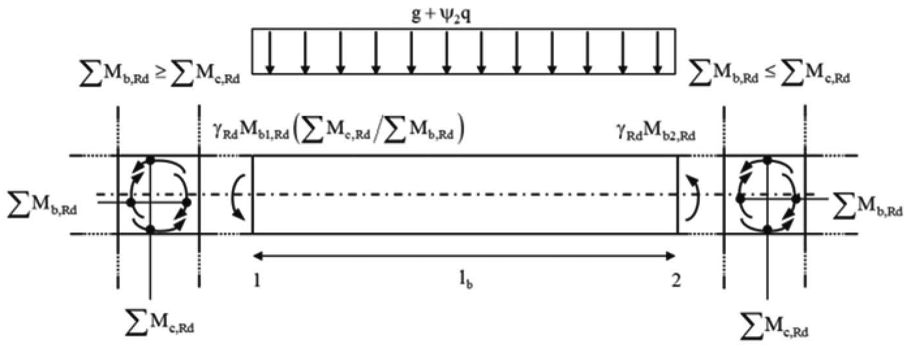

*Figura C7.4.1 — Equilibrio dei momenti per il calcolo delle sollecitazioni di taglio di progetto $V_{Sd}$ nelle travi.*

#### C7.4.4.1.2. Verifiche di duttilità (DUT)

Le verifiche di duttilità devono essere eseguite secondo quanto specificato al Capitolo 4 delle NTC.

### C7.4.4.2. Pilastri

#### C7.4.4.2.1. Verifiche di resistenza (RES)

La progettazione in capacità dei pilastri prevede, basandosi su considerazioni di equilibrio, che la somma dei momenti resistenti delle sezioni di estremità dei pilastri convergenti in un nodo sia maggiore della somma dei momenti resistenti delle sezioni di estremità delle travi convergenti nello stesso nodo, moltiplicati per un fattore di sovraresistenza.

Dal punto di vista operativo, per determinare le sollecitazioni di progetto in ciascuna sezione dei pilastri all'interfaccia col pannello nodale, si può ipotizzare che il rapporto fra i momenti flettenti nelle due sezioni considerate si mantenga invariato a seguito delle plasticizzazioni nelle travi; in tale ipotesi, il coefficiente moltiplicativo $\alpha$ da applicare ai momenti flettenti sui pilastri derivanti dall'analisi elastica vale:

$$\alpha = \frac{\gamma_{Rd}\, \sum M_{b,Rd}}{\sum M_{c,Ed}}$$ \tag{C7.4.3}

con $M_{b,Rd}$ momento resistente della generica trave convergente nel nodo e $M_{c,Ed}$ momento di calcolo del generico pilastro convergente nel nodo; le sommatorie sono estese a tutte le travi e i pilastri concorrenti nel nodo. Se i momenti di calcolo nei due pilastri convergenti al nodo sono discordi vale quanto detto al § 7.4.4.2.1 e descritto in Fig. 7.4.2 delle NTC, dunque al denominatore della [C7.4.3] va il solo valore maggiore, mentre il minore va sommato ai momenti resistenti delle travi.

È opportuno sottolineare che l'utilizzo della formula [C7.4.3] rappresenta solo uno dei possibili modi per arrivare al rispetto della formula [7.4.4] delle NTC, unica condizione di norma da rispettare per proteggere i pilastri dalla plasticizzazione anticipata riducendo, in ossequio ai principi della progettazione in capacità, la domanda di duttilità su di essi. In questo caso, a parte le incertezze portate in conto attraverso il fattore di sovraresistenza, la progettazione in capacità non è in grado di impedire plasticizzazioni, seppur limitate, in alcuni pilastri.

Nella realtà, infatti, a causa delle variazioni delle rigidezze relative fra gli elementi strutturali, quando la struttura entra in campo inelastico varia la distribuzione delle caratteristiche della sollecitazione all'interno della struttura. Può pertanto accadere che, pur mantenendosi inalterato l'equilibrio al nodo, una volta raggiunta la plasticizzazione nelle sezioni delle travi possa modificarsi, all'interfaccia del pannello nodale, il rapporto fra i momenti nelle sezioni dei pilastri convergenti nel medesimo nodo ovvero, in pratica, che uno dei due momenti dei pilastri possa crescere, potenzialmente fino alla plasticizzazione, e l'altro decrescere.

Pertanto non è escluso che, pur avendo utilizzato le regole della progettazione in capacità, si possano verificare delle plasticizzazioni nelle zone di estremità di qualche pilastro. D'altra parte, scopo della progettazione in capacità è limitare il più possibile tale eventualità e, soprattutto, escludere la formazione di meccanismi globalmente instabili, quali ad esempio quelli che possono determinarsi a causa della plasticizzazione contemporanea, alla base ed in testa, di tutti i pilastri di uno stesso livello (meccanismi di piano).

Per i motivi detti, nelle zone dissipative di tutti i pilastri primari la norma aggiunge, all'utilizzo della progettazione in capacità, l'applicazione di specifici accorgimenti per la duttilità. Un riguardo maggiore è dato alle zone dissipative allo spiccato dei pilastri primari, che devono necessariamente plasticizzarsi affinché si possa formare il meccanismo globale desiderato, cioè quello che prevede la contemporanea plasticizzazione delle sezioni di estremità delle travi a tutti i livelli.

Nella progettazione dei pilastri la norma prevede un approccio semplificato consentendo, per ciascuna direzione di applicazione del sisma, una verifica a presso-flessione retta purché la corrispondente capacità a flessione del pilastro venga considerata ridotta del 30%.

Le sollecitazioni della domanda si riferiscono alle due combinazioni sismiche con direzioni prevalenti alternate, secondo le regole di combinazione direzionale illustrate al § 7.3.5 delle NTC. Quando si applica la progettazione in capacità, per ottenere la domanda a pressoflessione deviata su ciascuna sezione dei pilastri, si può procedere nel modo seguente.

Per ciascuna combinazione, si determinano i rapporti tra i momenti flettenti lungo le direzioni principali della sezione considerata. Per ogni direzione principale della sezione, individuata la combinazione che massimizza la relativa componente di momento flettente, se ne incrementa il valore applicando le regole della progettazione in capacità, a partire dalla capacità delle travi convergenti nel nodo disposte lungo la direzione considerata. Si incrementa poi il momento nell'altra direzione, rispetto a quello ottenuto dall'analisi, in modo da mantenere invariato il rapporto fra le componenti. Si procede in analogia, massimizzando il momento lungo l'altra direzione principale della sezione. A partire dalla domanda a pressoflessione deviata nelle diverse combinazioni, associata ai corrispondenti valori del carico assiale, si eseguono le verifiche di resistenza.

##### Taglio

Nella valutazione del taglio di calcolo attraverso la formula [7.4.5] delle NTC, $M_d$ rappresenta la massima azione flettente trasmessa al pilastro, ove si tiene conto che le cerniere plastiche devono formarsi nelle zone dissipative delle travi convergenti al nodo oppure (qualora si formino prima) nelle zone di estremità dei pilastri, come illustrato in Figura C7.4.2.

L'utilizzo della [7.4.5] consente di individuare il massimo taglio agente sul pilastro nell'ipotesi che le sequenze di plasticizzazione siano coerenti col meccanismo globale ipotizzato; nella valutazione del taglio di calcolo mediante l'espressione [7.4.5], la lunghezza del pilastro $l_p$ è da valutarsi escludendo l'ingombro delle travi in esso confluenti.

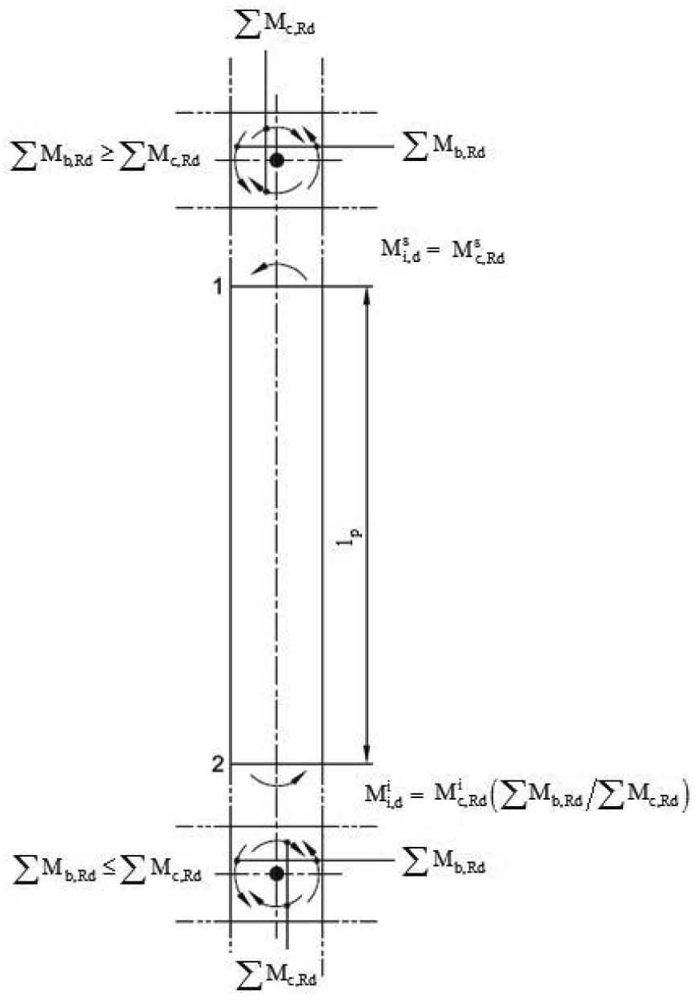

*Figura C7.4.2 — Equilibrio dei momenti per il calcolo delle sollecitazioni di taglio di progetto $V_{Sd}$ nei pilastri.*

#### C7.4.4.2.2. Verifiche di duttilità (DUT)

Le verifiche di duttilità devono essere eseguite secondo quanto specificato al Capitolo 4 delle NTC. Per le zone dissipative allo spiccato dei pilastri primari e per le zone dissipative di tutti i pilastri secondari, al § 7.4.6.2.2 le NTC forniscono, in alternativa alle verifiche di duttilità, i quantitativi di armatura trasversale minimi in funzione della domanda di duttilità.

### C7.4.4.3. Nodi trave-pilastro

Il progetto dei nodi è essenziale, indipendentemente dal comportamento strutturale prescelto, perché la sollecitazione da taglio all'interno del pannello nodale (la zona di intersezione tra travi e pilastri) è decisamente più elevata dell'analoga sollecitazione nei pilastri. Lo stato tensionale all'interno del pannello nodale dipende, oltre che dalla geometria e dalle sollecitazioni derivanti dal calcolo elastico, dai quantitativi di armatura delle travi. Infatti gli sforzi di taglio all'interno del pannello nodale non possono essere determinati direttamente dal modello di calcolo ma richiedono specifiche analisi per determinare la trasmissione degli sforzi all'interno della zona diffusiva. È pertanto indispensabile, se si vogliono evitare rotture da taglio del nodo, ricorrere ai criteri della progettazione in capacità, in questo caso non legata al conseguimento di un comportamento duttile, ma indispensabile per il progetto della resistenza del pannello nodale, che deve garantire il trasferimento delle sollecitazioni tra gli elementi in esso convergenti.

#### C7.4.4.3.1. Verifiche di resistenza (RES)

Le verifiche di resistenza dei nodi indicate nel presente paragrafo si applicano a strutture in CD"A" e, limitatamente ai nodi non interamente confinati, in CD"B". Esse non si applicano alle strutture non dissipative.

Per le verifiche dei nodi trave-pilastro è richiesta l'identificazione della zona efficace ai fini del trasferimento delle sollecitazioni di un elemento strutturale all'altro. In Fig. C7.4.3 sono sintetizzate le limitazioni di norma per la determinazione delle dimensioni della zona efficace nelle due direzioni ortogonali. Le armature trasversali nelle due direzioni devono essere contenute all'interno della zona efficace.

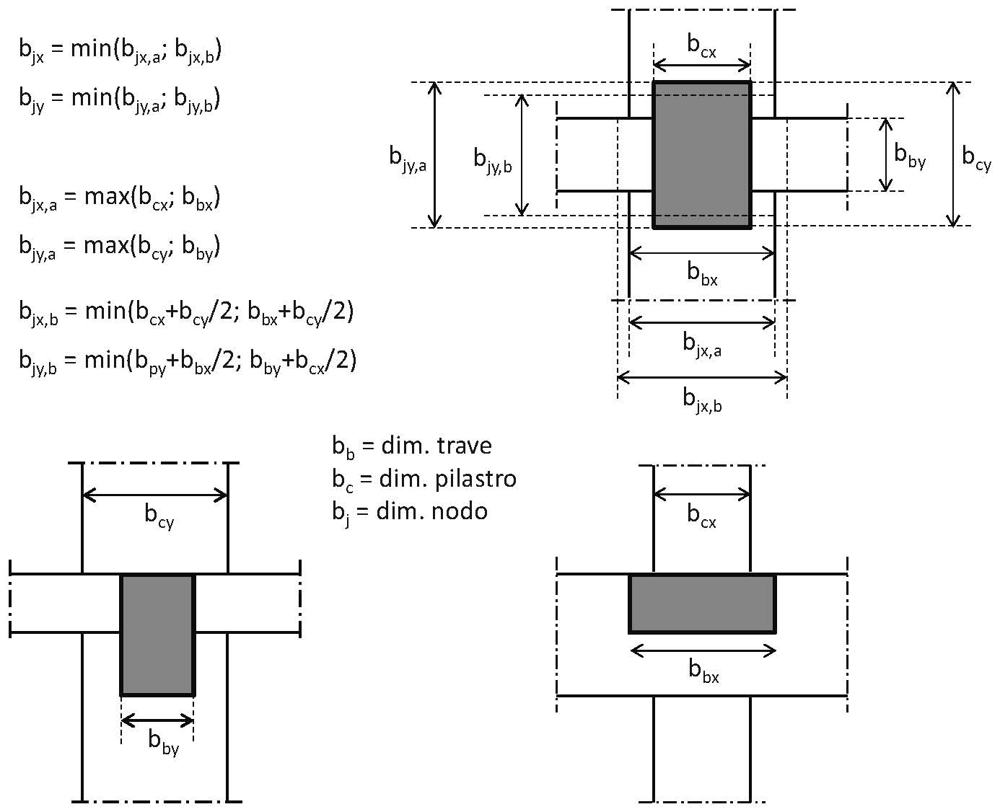

*Figura C7.4.3 — Dimensione efficace dei nodi trave-pilastro.*

Per la verifica della capacità del nodo, relativamente alla massima trazione diagonale nel calcestruzzo, le NTC forniscono due formulazioni alternative. Attraverso l'uso della [7.4.10] si garantisce che le tensioni all'interno del pannello nodale non superino la resistenza a trazione del calcestruzzo, garantendo l'integrità del nodo; attraverso la [7.4.11] e la [7.4.12] la capacità del nodo è affidata interamente alle armature orizzontali, accettando dunque la fessurazione del nodo. Nel primo caso la verifica dipende dalle dimensioni del pannello nodale; nel secondo caso la verifica risulta indipendente da esse. È sufficiente che la verifica risulti soddisfatta per uno dei due approcci.

Per la verifica di capacità del nodo è consigliabile l'utilizzo, nelle due direzioni di verifica del pannello nodale, dello stesso approccio, tra i due consentiti dalla norma.

Nella valutazione di $V_{jhd}$, di cui alla Equazione [7.4.8], è possibile tenere direttamente conto del confinamento del calcestruzzo, così come indicato al § 4.1.2.1.2.1 delle NTC, ponendo $\alpha_j = 0{,}48\, (f_{ck,c} / f_{ck})$, avendo cura di considerare soltanto il volume di calcestruzzo effettivamente confinato.

### C7.4.4.4. Diaframmi orizzontali

#### C7.4.4.4.1. Verifiche di resistenza (RES)

Qualora la verifica indichi deformazioni sensibili dell'orizzontamento nel suo piano, non si può assumere l'ipotesi di diaframma rigido nell'analisi della struttura.

### C7.4.4.5. Pareti

Il presente paragrafo si applica alle verifiche sulle pareti, così come definite al § 7.4.4.5 delle NTC.

Per le strutture di calcestruzzo debolmente armato ottenute con blocchi cassero, si applicano le "linee guida per sistemi costruttivi a pannelli portanti basati sull'impiego di blocchi cassero e calcestruzzo debolmente armato gettato in opera" emanate dal Consiglio Superiore dei Lavori Pubblici.

#### C7.4.4.5.1. Verifiche di resistenza (RES)

Nella progettazione di strutture con pareti, la norma consente una ridistribuzione degli effetti dell'azione sismica fino al 30%, purché non si verifichi una riduzione della domanda totale di resistenza delle pareti stesse.

La norma consente di ridistribuire momenti e tagli dalle pareti soggette a modesta compressione o a trazione semplice a quelle soggette a un'elevata compressione assiale, con la finalità di ottenere un comportamento dissipativo stabile.

Nell'avvalersi della possibilità di ridistribuire tra le pareti gli effetti dell'azione sismica, il progettista dovrebbe considerare le variazioni della risposta d'insieme dovute alle ridistribuzioni, quali ad esempio le possibili eccentricità indotte da plasticizzazioni non uniformi nelle pareti, che potrebbero influire sulle condizioni di regolarità strutturale conseguite in fase di dimensionamento degli elementi strutturali.

#### C7.4.4.5.2. Verifiche di duttilità (DUT)

Per le zone dissipative delle pareti, la norma prevede che vengano eseguite specifiche verifiche di duttilità. La domanda di duttilità in tali zone viene espressa, a livello di sezione, mediante il fattore di duttilità in curvatura $\mu_\varphi$. Qualora non si proceda ad una determinazione diretta mediante analisi non lineare, tale domanda può essere valutata attribuendo a $\mu_\varphi$ i valori forniti dalle [7.4.3] del § 7.4.4.1.2 in cui il valore di $q$ è ridotto del fattore $M_{Ed}/M_{Rd}$, dove $M_{Ed}$ è il momento flettente di progetto alla base della parete fornito dall'analisi nella situazione sismica di progetto (domanda) e $M_{Rd}$ il momento resistente di calcolo (capacità).

Si noti che, nel caso in cui nella progettazione si ricorra alla ridistribuzione degli effetti tra le pareti, il fattore $M_{Ed}/M_{Rd}$ può assumere valori maggiori dell'unità, comportando un conseguente incremento della domanda di duttilità nelle pareti progettate con valori del momento resistente inferiori alla corrispondente sollecitazione flessionale ottenuta dall'analisi.

Le formule [7.4.32] e [7.4.33] contenute nel § 7.4.6.2.4 delle NTC consentono di determinare i quantitativi di armatura trasversale in funzione della domanda di duttilità; tali quantitativi sono da intendersi come minimi inderogabili solo nel caso in cui non vengano eseguite le verifiche di duttilità come indicato al § 7.4.4.5.2.

### C7.4.5. Costruzioni con struttura prefabbricata

#### C7.4.5.1. Tipologie strutturali e fattori di comportamento

Il paragrafo 7.4.5.1 riporta le tipologie di sistemi strutturali previsti dalle NTC per le costruzioni con struttura prefabbricata. I relativi valori massimi di $q_0$ sono contenuti nella tabella 7.3.II.

La norma prevede che *altre tipologie possano essere utilizzate giustificando i fattori di comportamento adottati e impiegando regole di dettaglio tali da garantire i requisiti generali di sicurezza di cui alle presenti norme*. Per tali tipologie i valori dei fattori di comportamento, non indicati nelle NTC, possono essere determinati sulla base di una opportuna campagna di prove e verifiche locali di duttilità e globali di spostamento allo SLV, utilizzando i medesimi principi indicati al § 7.3.1 in merito alla determinazione di $q_0$.

##### C7.4.5.1.1. Strutture a telaio

Una prima categoria di sistemi a telaio prefabbricati si riferisce a strutture con collegamenti monolitici realizzati con getti integrativi che danno continuità di forze e momenti, ad emulazione delle strutture gettate in opera (v. Figura C7.4.4).

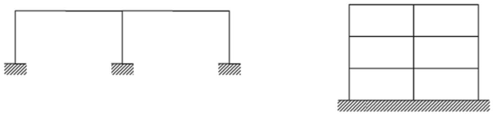

*Figura C7.4.4 — Strutture a telaio con collegamenti monolitici.*

A questa categoria di telai si applicano le regole relative alle strutture in opera di cui al § 7.4 delle NTC. Il vincolo di base dei pilastri deve realizzare un incastro totale con la fondazione dimensionato con le regole delle strutture in opera di cui al § 7.4 o con le regole relative ai collegamenti tipo b) o tipo c) di cui al § 7.4.5.2.1 delle NTC.

Una seconda categoria di sistemi a telaio si riferisce a strutture con collegamenti realizzati con dispositivi meccanici tra i vari elementi prefabbricati. A questa categoria di telai si applicano le regole relative ai collegamenti di cui al § 7.4.5.2.1 delle NTC. Il vincolo di base dei pilastri deve realizzare un incastro totale con la fondazione dimensionato con le regole delle strutture in opera di cui al § 7.4 o con le regole relative ai collegamenti tipo b) o tipo c) di cui al § 7.4.5.2.1 delle NTC.

##### C7.4.5.1.2. Strutture con pilastri incastrati alla base e orizzontamenti ad essi cernierati

Nelle strutture con pilastri incastrati alla base ed orizzontamenti ad essi incernierati il collegamento a cerniera dà continuità di forze (v. Figura C7.4.5). A questa categoria di strutture, tipica della tecnologia della prefabbricazione, si applicano le regole relative ai collegamenti di cui al § 7.4.5.2.1 delle NTC, mentre il vincolo di base dei pilastri deve realizzare un incastro con la fondazione dimensionato con le regole delle strutture in opera di cui al § 7.4 o con le regole relative ai collegamenti tipo b) o tipo c) di cui al § 7.4.5.2.1 delle NTC.

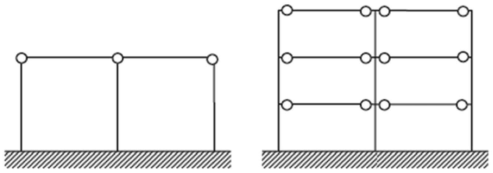

*Figura C7.4.5 — Strutture con pilastri incastrati alla base ed orizzontamenti ad essi cernierati.*

Per tali tipologie di strutture, oltre che in corrispondenza dei giunti come indicato al § 7.4.5.2, i collegamenti ad appoggio mobile sono consentiti, come indicato al § 7.4.5.2.1, per le sole strutture monopiano del tipo di quelle rappresentate in Figura C7.4.6, che consentono le libere dilatazioni della copertura per effetto di fenomeni come le variazioni termiche, concentrando le azioni orizzontali dovute al sisma su alcuni pilastri.

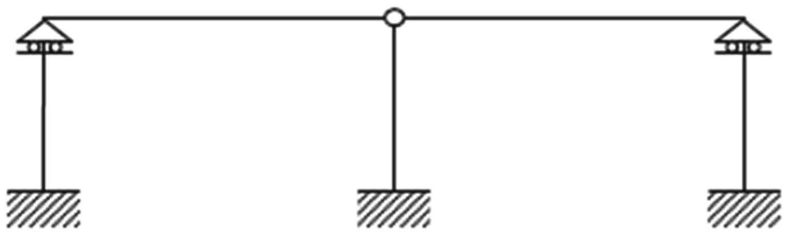

*Figura C7.4.6 — Strutture monopiano con pilastri secondari collegati con appoggi mobili.*

### C7.4.6. Dettagli costruttivi

#### C7.4.6.1. Limitazioni geometriche

##### C7.4.6.1.2. Pilastri

Resta la limitazione sul valore massimo degli effetti del 2° ordine data al § 7.3 delle NTC ($\theta \leq 0{,}3$).

#### C7.4.6.2. Limitazioni di armatura

##### C7.4.6.2.3. Nodi Trave-Pilastro

Le NTC prevedono che, oltre a quanto richiesto dalla verifica nel § 7.4.4.3.1, lungo le armature longitudinali del pilastro che attraversano i nodi devono essere disposte staffe di contenimento in quantità almeno pari alla maggiore prevista nelle zone adiacenti al nodo del pilastro inferiore e superiore; nel caso di nodi interamente confinati il passo risultante dell'armatura di confinamento orizzontale nel nodo può essere raddoppiato, ma non può essere maggiore di 15 cm. Questo è un minimo inderogabile e non aggiuntivo rispetto a quanto previsto al § 7.4.4.3.
