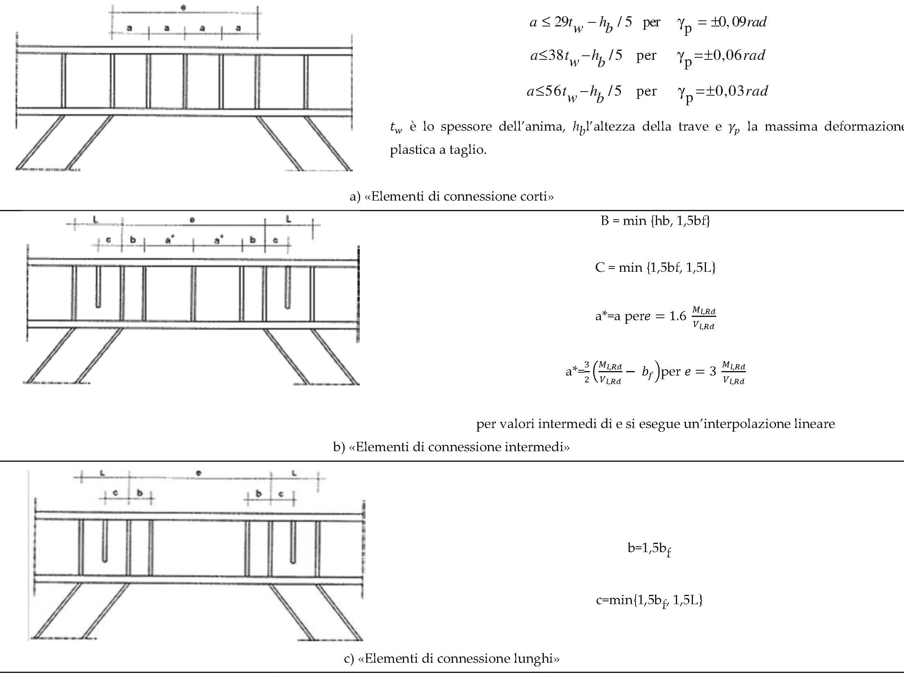

[Torna all'indice del capitolo](indice-cap07.md) | [Torna all'indice generale](../indice-ntc2018.md)

# 7.5. Costruzioni di acciaio

## Indice del capitolo

- [[#7.5.1. Caratteristiche dei materiali|7.5.1 Caratteristiche dei materiali (γ_ov = 1,25/1,15)]]
- [[#7.5.2. Tipologie strutturali e fattori di comportamento|7.5.2 Tipologie strutturali e fattori (Fig. 7.5.1)]]
  - [[#7.5.2.1. Tipologie strutturali|7.5.2.1 Tipologie strutturali]]
  - [[#7.5.2.2. Fattori di comportamento|7.5.2.2 Fattori di comportamento]]
- [[#7.5.3. Regole di progetto generali per elementi strutturali dissipativi|7.5.3 Regole generali elementi dissipativi]]
  - [[#7.5.3.1. Verifiche di resistenza (RES)|7.5.3.1 Verifiche di resistenza (RES)]]
  - [[#7.5.3.2. Verifiche di duttilità (DUT)|7.5.3.2 Verifiche di duttilità (DUT)]]
- [[#7.5.4. Regole di progetto specifiche per strutture intelaiate|7.5.4 Strutture intelaiate (telai)]]
  - [[#7.5.4.1. Travi|7.5.4.1 Travi]]
  - [[#7.5.4.2. Colonne|7.5.4.2 Colonne]]
  - [[#7.5.4.3. Collegamenti trave-colonna|7.5.4.3 Collegamenti trave-colonna]]
  - [[#7.5.4.4. Pannelli d'anima delle colonne|7.5.4.4 Pannelli d'anima colonne]]
  - [[#7.5.4.5. Collegamenti colonna-fondazione|7.5.4.5 Collegamenti colonna-fondazione]]
- [[#7.5.5. Regole di progetto specifiche per strutture con controventi concentrici|7.5.5 Controventi concentrici]]
- [[#7.5.6. Regole di progetto specifiche per strutture con controventi eccentrici|7.5.6 Controventi eccentrici]]
- [[#C7.5.2. Tipologie strutturali e fattori di comportamento|C7.5.2 — Tipologie (Fig. C7.5.1)]]
- [[#C7.5.3. Regole di progetto generali per elementi strutturali dissipativi|C7.5.3 — Generali (bulloni, saldature)]]
- [[#C7.5.4. Regole di progetto specifiche per strutture intelaiate|C7.5.4 — Telai (pannelli)]]
- [[#C7.5.5. Regole di progetto specifiche per strutture con controventi concentrici|C7.5.5 — Concentrici]]
- [[#C7.5.6. Regole di progetto specifiche per struttura con controventi eccentrici|C7.5.6 — Eccentrici (link)]]

---

# Norma

## 7.5.1. Caratteristiche dei materiali

L'acciaio delle membrature deve essere conforme a quanto indicato al § 11.3.4.9.

Il fattore di sovraresistenza del materiale $\gamma_{ov}$ assume i seguenti valori:

- $\gamma_{ov} = 1{,}25$ per acciai S235, S275 e S355;
- $\gamma_{ov} = 1{,}15$ per acciai S420 e S460.

---

## 7.5.2. Tipologie strutturali e fattori di comportamento

### 7.5.2.1. Tipologie strutturali

Le strutture sismoresistenti in acciaio si classificano nelle seguenti tipologie:

*a)* **Strutture intelaiate**: strutture in cui la resistenza alle azioni orizzontali è affidata principalmente alla resistenza flessionale delle membrature e alla rigidezza dei nodi trave-colonna.

*b)* **Strutture con controventi concentrici**: strutture in cui la resistenza alle azioni orizzontali è affidata principalmente alla resistenza assiale delle diagonali di controvento. Si distinguono in:

- controventi a diagonale tesa attiva (controventi a croce di S. Andrea, schema ad X);
- controventi a V (o a Λ invertita);
- controventi a K (non ammessi per strutture dissipative).

*c)* **Strutture con controventi eccentrici**: strutture in cui la resistenza alle azioni orizzontali è affidata a controventi in cui almeno un estremo della diagonale è collegato alla trave anziché al nodo trave-colonna, creando un segmento di trave detto "elemento di connessione" (*link*).

*d)* **Strutture a mensola o a pendolo inverso**: strutture nelle quali almeno il 50% della massa è nel terzo superiore dell'altezza.

*e)* **Strutture intelaiate con controventi concentrici**: strutture miste in cui le azioni orizzontali sono assorbite sia dal telaio che dai controventi concentrici.

*f)* **Strutture intelaiate con tamponature**: strutture intelaiate completate da tamponature duttili in muratura, la cui resistenza è considerata nel dimensionamento.

### 7.5.2.2. Fattori di comportamento

Il fattore di comportamento $q$ è dato da:

$$q = q_0 \cdot K_R$$

dove $K_R = 1$ per costruzioni regolari in elevazione e $K_R = 0{,}8$ per costruzioni non regolari in elevazione.

I valori di $q_0$ sono i seguenti:

**Strutture intelaiate:**

- CD"B": $q_0 = 4{,}0$
- CD"A": $q_0 = 5 \cdot \alpha_u / \alpha_1$

**Strutture con controventi concentrici a diagonale tesa attiva (X):**

- CD"B": $q_0 = 4{,}0$
- CD"A": $q_0 = 4{,}0$

**Strutture con controventi concentrici a V:**

- CD"B": $q_0 = 2{,}0$
- CD"A": $q_0 = 2{,}5$

**Strutture con controventi eccentrici:**

- CD"B": $q_0 = 4{,}0$
- CD"A": $q_0 = 5 \cdot \alpha_u / \alpha_1$

**Strutture a pendolo inverso:**

- CD"B": $q_0 = 2{,}0$
- CD"A": $q_0 = 2 \cdot \alpha_u / \alpha_1$

**Strutture intelaiate con controventi concentrici:**

- CD"B": $q_0 = 4{,}0$
- CD"A": $q_0 = 4 \cdot \alpha_u / \alpha_1$

Il rapporto $\alpha_u / \alpha_1$ vale:

- $1{,}1$ per strutture a portale a una campata;
- $1{,}2$ per strutture a portale a più campate;
- $1{,}1$ per strutture a controventi eccentrici a una campata;
- $1{,}2$ per strutture a controventi eccentrici a più campate;
- $1{,}0$ per strutture a pendolo inverso.

Valori superiori possono essere utilizzati purché ottenuti da analisi non lineari, con il limite $\alpha_u / \alpha_1 \leq 1{,}6$.

---

## 7.5.3. Regole di progetto generali per elementi strutturali dissipativi

### 7.5.3.1. Verifiche di resistenza (RES)

Le membrature non dissipative e i collegamenti delle zone dissipative devono possedere una resistenza tale da garantire la plasticizzazione delle zone dissipative. La resistenza di progetto dei collegamenti e delle zone non dissipative deve soddisfare:

$$R_{j,d} \geq 1{,}1 \cdot \gamma_{ov} \cdot R_{pl,Rd} = R_{U,Rd} \tag{7.5.1}$$

dove:

- $R_{j,d}$ è la resistenza di progetto del collegamento o della zona non dissipativa;
- $R_{pl,Rd}$ è la resistenza plastica di progetto della zona dissipativa collegata;
- $\gamma_{ov}$ è il fattore di sovraresistenza del materiale.

Per i collegamenti bullonati con bulloni a taglio, le sezioni nette devono soddisfare:

$$\frac{A_{res}}{A} \geq 1{,}1 \cdot \frac{\gamma_{M2}}{\gamma_{M0}} \cdot \frac{f_{yk}}{f_{tk}} \tag{7.5.2}$$

dove:

- $A_{res}$ è l'area resistente netta della sezione;
- $A$ è l'area lorda della sezione;
- $\gamma_{M0}$, $\gamma_{M2}$ sono i coefficienti parziali di sicurezza per l'acciaio;
- $f_{yk}$ è la tensione di snervamento caratteristica;
- $f_{tk}$ è la tensione di rottura caratteristica.

### 7.5.3.2. Verifiche di duttilità (DUT)

La duttilità delle zone dissipative è espressa come rapporto:

$$\mu = \frac{\theta_u}{\theta_y}$$

dove $\theta_u$ e $\theta_y$ sono le rotazioni ultima e di snervamento.

Nelle zone dissipative, lo sforzo normale deve soddisfare:

$$\frac{N_{Ed}}{N_{pl,Rd}} \leq 0{,}3 \tag{7.5.3}$$

Le sezioni trasversali degli elementi dissipativi devono appartenere a classi di sezione adeguate al livello di duttilità richiesto, secondo la seguente tabella:

**Tab. 7.5.I** — *Classi di sezione trasversale richieste per gli elementi dissipativi*

| Classe di duttilità | Zone dissipative | Zone non dissipative |
|:---:|:---:|:---:|
| CD"A" | Classe 1 | Classe 1 o 2 |
| CD"B" | Classe 1 o 2 | Classe 1, 2 o 3 |

---

## 7.5.4. Regole di progetto specifiche per strutture intelaiate

### 7.5.4.1. Travi

Le zone dissipative sono localizzate nelle travi, in prossimità dei nodi trave-colonna. Le travi devono soddisfare le seguenti verifiche:

$$\frac{M_{Ed}}{M_{pl,Rd}} \leq 1 \tag{7.5.4}$$

$$\frac{N_{Ed}}{N_{pl,Rd}} \leq 0{,}15 \tag{7.5.5}$$

$$\frac{V_{Ed,G} + V_{Ed,M}}{V_{pl,Rd}} \leq 0{,}50 \tag{7.5.6}$$

dove:

- $M_{Ed}$ è il momento flettente di calcolo;
- $M_{pl,Rd}$ è il momento plastico resistente della sezione;
- $N_{Ed}$ è lo sforzo normale di calcolo;
- $N_{pl,Rd}$ è la resistenza plastica assiale della sezione;
- $V_{Ed,G}$ è il taglio dovuto ai carichi gravitazionali;
- $V_{Ed,M}$ è il taglio dovuto ai momenti plastici alle estremità della trave;
- $V_{pl,Rd}$ è la resistenza plastica a taglio della sezione.

### 7.5.4.2. Colonne

Le colonne devono essere progettate per resistere alle sollecitazioni amplificate derivanti dalla plasticizzazione delle zone dissipative nelle travi. Le verifiche sono condotte con i seguenti effetti delle azioni:

$$N_{Ed} = N_{Ed,G} + 1{,}1 \cdot \gamma_{ov} \cdot \Omega \cdot N_{Ed,E} \tag{7.5.7}$$

$$M_{Ed} = M_{Ed,G} + 1{,}1 \cdot \gamma_{ov} \cdot \Omega \cdot M_{Ed,E} \tag{7.5.8}$$

$$V_{Ed} = V_{Ed,G} + 1{,}1 \cdot \gamma_{ov} \cdot \Omega \cdot V_{Ed,E} \tag{7.5.9}$$

dove:

- $N_{Ed,G}$, $M_{Ed,G}$, $V_{Ed,G}$ sono gli effetti delle azioni gravitazionali nella combinazione sismica;
- $N_{Ed,E}$, $M_{Ed,E}$, $V_{Ed,E}$ sono gli effetti dell'azione sismica;
- $\Omega = \min_i (M_{pl,Rd,i} / M_{Ed,i})$ è il minimo dei rapporti fra momento plastico e momento di calcolo, esteso a tutte le zone dissipative delle travi.

Il rapporto $\Omega$ deve essere il più possibile uniforme nei vari piani; il massimo $\Omega_i$ non deve superare il minimo $\Omega_i$ di oltre il 25%.

Inoltre:

$$\frac{V_{Ed}}{V_{pl,Rd}} \leq 0{,}50 \tag{7.5.10}$$

**Gerarchia delle resistenze**

Per ogni nodo trave-colonna, deve essere soddisfatta la seguente condizione:

$$\sum M_{c,pl,Rd} \geq \gamma_{Rd} \cdot \sum M_{b,pl,Rd} \tag{7.5.11}$$

dove:

- $\sum M_{c,pl,Rd}$ è la somma dei momenti plastici resistenti delle colonne che convergono nel nodo;
- $\sum M_{b,pl,Rd}$ è la somma dei momenti plastici resistenti delle travi che convergono nel nodo;
- $\gamma_{Rd} = 1{,}3$.

### 7.5.4.3. Collegamenti trave-colonna

I collegamenti trave-colonna devono avere una resistenza flessionale non inferiore a quella della trave collegata, amplificata per la sovraresistenza:

$$M_{j,Rd} \geq 1{,}1 \cdot \gamma_{ov} \cdot M_{b,pl,Rd} \tag{7.5.12}$$

dove:

- $M_{j,Rd}$ è il momento resistente del collegamento;
- $M_{b,pl,Rd}$ è il momento plastico resistente della trave.

I collegamenti possono essere a completo ripristino di resistenza (*full-strength*) o a parziale ripristino (*partial-strength*), purché nel secondo caso la zona dissipativa sia localizzata nel collegamento stesso, che deve avere adeguata duttilità.

### 7.5.4.4. Pannelli d'anima delle colonne

I pannelli d'anima delle colonne nei nodi trave-colonna devono essere verificati a taglio:

$$\frac{V_{vp,Ed}}{\min(V_{vp,Rd}; \; V_{vb,Rd})} < 1 \tag{7.5.13}$$

dove:

- $V_{vp,Ed}$ è il taglio agente nel pannello d'anima;
- $V_{vp,Rd}$ è la resistenza plastica a taglio del pannello;
- $V_{vb,Rd}$ è la resistenza a instabilità del pannello.

Se necessario, il pannello d'anima deve essere rinforzato con piastre di irrigidimento o piatti d'anima supplementari.

### 7.5.4.5. Collegamenti colonna-fondazione

I collegamenti colonna-fondazione devono avere una resistenza non inferiore a:

$$M_{C,Rd} \geq 1{,}1 \cdot \gamma_{ov} \cdot M_{c,pl,Rd}(N_{Ed}) \tag{7.5.14}$$

dove $M_{c,pl,Rd}(N_{Ed})$ è il momento plastico resistente della colonna, ridotto per la presenza dello sforzo normale $N_{Ed}$.

---

## 7.5.5. Regole di progetto specifiche per strutture con controventi concentrici

**Controventi a diagonale tesa attiva (schema ad X)**

La snellezza adimensionalizzata $\bar{\lambda}$ delle diagonali deve soddisfare:

$$1{,}3 \leq \bar{\lambda} \leq 2{,}0$$

Il limite inferiore è posto per evitare che la diagonale compressa, prima di instabilizzarsi, attiri una forza troppo elevata sulle colonne. Il limite superiore garantisce un minimo di rigidezza.

**Controventi a V**

La snellezza adimensionalizzata $\bar{\lambda}$ delle diagonali deve soddisfare:

$$\bar{\lambda} \leq 2{,}0$$

Per i controventi a V non è richiesto il limite inferiore di snellezza, ma le travi orizzontali devono essere dimensionate per sopportare i carichi verticali anche in assenza dei controventi.

**Controventi a K**

I controventi a K (con nodo intermedio sulla colonna) **non sono ammessi** per strutture a comportamento dissipativo, in quanto il meccanismo di collasso coinvolgerebbe direttamente la colonna.

**Verifiche delle diagonali**

Le diagonali devono soddisfare:

$$\frac{N_{Ed}}{N_{b,Rd}(M_{Ed})} \leq 1 \tag{7.5.15}$$

dove $N_{b,Rd}(M_{Ed})$ è la resistenza all'instabilità della diagonale, eventualmente ridotta per la presenza di momento flettente.

**Uniformità della sovraresistenza**

Per assicurare un meccanismo dissipativo omogeneo su tutta l'altezza della struttura, il rapporto di sovraresistenza delle diagonali $\Omega_i$ non deve variare più del 25% fra i vari piani:

$$\Omega_i = \frac{N_{pl,Rd,i}}{N_{Ed,i}}$$

Il rapporto fra il valore massimo e il valore minimo di $\Omega_i$ non deve superare $1{,}25$.

Le colonne e le travi dei telai controventati devono essere dimensionate per resistere alle sollecitazioni amplificate con il coefficiente $\Omega$ analogamente alle [7.5.7]-[7.5.9].

**Controventi a V — prescrizioni aggiuntive**

Nei controventi a V, la trave intersecata dalle diagonali deve essere continua e dimensionata per:

- resistere ai carichi verticali nell'ipotesi che i controventi non siano presenti;
- la forza verticale risultante dalla differenza di resistenza delle diagonali tese e compresse nella situazione post-instabilità.

---

## 7.5.6. Regole di progetto specifiche per strutture con controventi eccentrici

Nelle strutture con controventi eccentrici, le zone dissipative sono localizzate negli elementi di connessione (*link*).

Gli elementi di connessione si classificano in funzione della loro lunghezza $e$ rispetto ai parametri di resistenza plastica:

**Elementi di connessione "corti"** (dissipazione prevalentemente a taglio):

$$e \leq 1{,}6 \cdot \frac{M_{p,link}}{V_{p,link}} \tag{7.5.16a}$$

**Elementi di connessione "intermedi"** (dissipazione mista taglio-flessione):

$$1{,}6 \cdot \frac{M_{p,link}}{V_{p,link}} < e < 3{,}0 \cdot \frac{M_{p,link}}{V_{p,link}} \tag{7.5.16b}$$

**Elementi di connessione "lunghi"** (dissipazione prevalentemente a flessione):

$$e \geq 3{,}0 \cdot \frac{M_{p,link}}{V_{p,link}} \tag{7.5.16c}$$

dove $M_{p,link}$ e $V_{p,link}$ sono il momento plastico e il taglio plastico dell'elemento di connessione.

Il momento plastico ridotto dell'elemento di connessione in presenza di sforzo normale è:

$$M_{l,Rd} = M_{p,link} \cdot \left(1 - \left(\frac{N_{Ed}}{N_{pl,Rd}}\right)^2\right) \tag{7.5.17}$$

Il taglio plastico ridotto dell'elemento di connessione in presenza di sforzo normale è:

$$V_{l,Rd} = V_{p,link} \cdot \sqrt{1 - \left(\frac{N_{Ed}}{N_{pl,Rd}}\right)^2} \tag{7.5.18}$$

**Verifiche degli elementi di connessione**

Gli elementi di connessione corti devono soddisfare:

$$V_{Ed} \leq V_{l,Rd} \tag{7.5.19}$$

Gli elementi di connessione lunghi devono soddisfare:

$$M_{Ed} \leq M_{l,Rd} \tag{7.5.20}$$

Gli elementi di connessione intermedi devono soddisfare simultaneamente le condizioni [7.5.19] e [7.5.20].

**Verifiche delle membrature non dissipative**

Le diagonali dei controventi eccentrici sono progettate come elementi non dissipativi e devono resistere alle sollecitazioni amplificate:

$$N_{Ed} = N_{Ed,G} + 1{,}1 \cdot \gamma_{ov} \cdot \Omega \cdot N_{Ed,E} \tag{7.5.21}$$

dove:

- $\Omega = \min_i (V_{l,Rd,i} / V_{Ed,i})$ per elementi di connessione corti;
- $\Omega = \min_i (M_{l,Rd,i} / M_{Ed,i})$ per elementi di connessione lunghi.

Le colonne devono resistere alle sollecitazioni amplificate:

$$N_{Ed} = N_{Ed,G} + 1{,}1 \cdot \gamma_{ov} \cdot \Omega \cdot N_{Ed,E} \tag{7.5.22}$$

$$M_{Ed} = M_{Ed,G} + 1{,}1 \cdot \gamma_{ov} \cdot \Omega \cdot M_{Ed,E} \tag{7.5.23}$$

Le travi al di fuori degli elementi di connessione devono soddisfare:

$$N_{Ed} = N_{Ed,G} + 1{,}1 \cdot \gamma_{ov} \cdot \Omega \cdot N_{Ed,E} \tag{7.5.24}$$

$$M_{Ed} = M_{Ed,G} + 1{,}1 \cdot \gamma_{ov} \cdot \Omega \cdot M_{Ed,E} \tag{7.5.25}$$

$$V_{Ed} = V_{Ed,G} + 1{,}1 \cdot \gamma_{ov} \cdot \Omega \cdot V_{Ed,E} \tag{7.5.26}$$

**Dettagli costruttivi degli elementi di connessione**

Gli elementi di connessione corti devono essere dotati di irrigidimenti d'anima (*web stiffeners*) disposti come segue:

- irrigidimenti a piena altezza dell'anima alle due estremità dell'elemento di connessione;
- irrigidimenti intermedi con passo non superiore a $30 \cdot t_w - d/5$ (dove $t_w$ è lo spessore dell'anima e $d$ è l'altezza dell'anima) per link di lunghezza $e \leq 1{,}6 \cdot M_{p,link}/V_{p,link}$.

Gli elementi di connessione lunghi non necessitano di irrigidimenti intermedi, ma devono avere irrigidimenti a piena altezza alle estremità.

Gli elementi di connessione intermedi devono avere irrigidimenti con passo intermedio fra i due casi precedenti.

Le saldature degli irrigidimenti devono essere dimensionate per resistere alla piena capacità plastica dell'irrigidimento stesso.

---

# Circolare

Nel Capitolo sono opportunamente integrate le regole generali di progettazione ed esecuzione per le Costruzioni in acciaio per l'impiego in zona sismica.

In particolare, al fine di garantire la richiesta duttilità, sono fornite prescrizioni più dettagliate per la concezione dei dettagli nelle zone dissipative e per le modalità di verifica, in termini di gerarchia delle resistenze, dei gruppi trave-colonna.

## C7.5.2. Tipologie strutturali e fattori di comportamento

### C7.5.2.1. Tipologie strutturali

Nelle strutture a telaio le zone dissipative devono essere localizzate principalmente all'estremità delle travi e/o nei nodi trave-colonna in modo tale da dissipare efficacemente l'energia sismica attraverso cicli flessionali inelastici. La localizzazione delle cerniere plastiche nelle strutture a telaio dovrebbe seguire le distribuzioni indicate nella Figura C7.5.1 a seconda della soluzione strutturale realizzata.

È possibile, inoltre, formare le cerniere plastiche nelle colonne, ma solo nelle seguenti parti:

- alla base della struttura a telaio (a, b, c, d, e);
- in sommità delle colonne all'ultimo piano dell'edificio (b e c in alternativa alle travi della copertura);
- alla base ed alla sommità delle colonne nelle strutture ad un unico piano (d).

*Figura C7.5.1 — Configurazioni dissipative di strutture intelaiate: disposizione delle cerniere plastiche, secondo le tipologie esposte nella Tabella 7.3.II del § 7.3.1 delle NTC.*

Una tipologia dissipativa ad un piano, in cui le cerniere plastiche sono localizzate nelle travi ed alla base delle colonne (tipo a, Figura C7.5.1), è caratterizzata da maggiori proprietà dissipative rispetto alle strutture del tipo d (Figura C7.5.1). Infatti, gran parte della capacità dissipativa della struttura è fornita dalle cerniere plastiche delle travi, soggette a sforzi normali trascurabili: per tale ragione il fattore di comportamento $q_0$ è pari a $5\alpha_u/\alpha_1$ per il tipo (a) ed a $2\alpha_u/\alpha_1$ per il tipo (d) e per il tipo (e).

In genere nel calcolo del fattore di comportamento, si assume per il coefficiente di sovra resistenza $\alpha_u/\alpha_1$ il valore proposto nel § 7.5.2.2. Tale valore, però, può essere determinato utilizzando metodi di analisi non lineari quali l'analisi dinamica non-lineare oppure l'analisi statica non-lineare (§ 7.3.4.1 e § 7.3.4.2). Ad ogni modo, durante la progettazione tale coefficiente non può assumere valori maggiori di 1,6, anche nel caso si ottengano valori più elevati a seguito di analisi non-lineari.

## C7.5.3. Regole di progetto generali per elementi strutturali dissipativi

### C7.5.3.1. Verifiche di resistenza (RES)

Si ritiene che il requisito di sovraresistenza sia soddisfatto nel caso di saldature a completa penetrazione.

Nel caso in cui i collegamenti in zone dissipative siano realizzati mediante unioni bullonate, queste devono essere sufficientemente sovraresistenti per evitare la rottura dei bulloni a taglio. Per tale ragione, la resistenza di progetto dei bulloni a taglio deve essere almeno 1,2 volte superiore alla resistenza a rifollamento dell'unione. Inoltre, deve essere assolutamente evitata la rottura dei bulloni a trazione, meccanismo di collasso caratterizzato da un comportamento fragile. Per tale motivo, anche i bulloni soggetti a trazione devono essere dotati di un'opportuna sovraresistenza.

## C7.5.4. Regole di progetto specifiche per strutture intelaiate

### C7.5.4.4. Pannelli d'anima dei collegamenti trave-colonna

Affinché il pannello d'anima della colonna possa sostenere lo sviluppo del meccanismo dissipativo globale a telaio, secondo uno degli schemi proposti nella Figura C7.5.1, è necessario che la forza di taglio trasmessa dalle travi al pannello d'anima della colonna sia calcolata in condizioni di collasso. Per tale motivo la forza con cui è necessario confrontare la resistenza a taglio di progetto del pannello, $V_{WP,Rd}$, non deriva dalle sollecitazioni di calcolo ottenute dall'analisi strutturale, bensì dal momento plastico resistente delle travi in esso concorrenti tramite la formula:

$$V_{WP,Ed,t} = \gamma_{ov}\, \frac{\sum M_{b,pl,Rd}}{Z}\, \left(1 - \frac{z}{H - h_b}\right)$$ \tag{C7.5.1}

dove $\sum M_{b,pl,Rd}$ è la sommatoria dei momenti plastici resistenti delle travi, $H$ è l'altezza di interpiano del telaio, $z$ è il braccio di coppia interna della trave ed $h_b$ è l'altezza della sezione della trave. La resistenza del pannello nodale privo di piatti di irrigidimento e/o continuità, ove i fenomeni di instabilità non siano condizionanti, è data da:

$$V_{WP,Rd} \geq \frac{f_y}{\sqrt{3}}\, A_{VC}\, \sqrt{1 - \left(\frac{\sigma}{f_y}\right)^{2}}$$ \tag{C7.5.2}

dove $A_{VC}$ (§ 4.2.4.1.2.4) è l'area resistente a taglio, mentre $\sigma$ è la tensione normale media agente nel pannello dovuta allo sforzo normale di calcolo presente nella colonna.

In Figura C7.5.2 sono rappresentati i dettagli costruttivi dei pannelli nodali, cui è necessario fare riferimento per il calcolo della resistenza a taglio. Nel caso di collegamenti trave-colonna saldati, i piatti di continuità in prosecuzione delle ali della trave devono essere sempre previsti.

*Figura C7.5.2 — Dettagli costruttivi di pannelli nodali irrigiditi.*

## C7.5.5. Regole di progetto specifiche per strutture con controventi concentrici

La risposta carico-spostamento laterale di una struttura con controventi concentrici deve risultare sostanzialmente indipendente dal verso dell'azione sismica. Tale requisito si ritiene soddisfatto se ad ogni piano vale la seguente disuguaglianza:

$$\frac{|A^+ - A^-|}{A^+ + A^-} \leq 0{,}05$$ \tag{C7.5.3}

essendo $A^+$ e $A^-$ le proiezioni verticali delle sezioni trasversali delle diagonali tese, valutate per i due versi possibili delle azioni sismiche, secondo quanto presentato nella Figura C7.5.3.

*Figura C7.5.3 — Definizione dell'area delle sezioni dei controventi tesi, $A^+$ ed $A^-$, da utilizzare nella formula C7.5.3.*

## C7.5.6. Regole di progetto specifiche per struttura con controventi eccentrici

Le capacità dissipative di un elemento di connessione ("link") di una struttura a controventi eccentrici dipendono dai dettagli strutturali con cui è realizzato tale elemento. In particolare, la presenza degli irrigidimenti trasversali d'anima garantisce lo sviluppo delle deformazioni plastiche all'interno del "link", per cui le regole costruttive presentate in § 7.5.6 devono essere necessariamente impiegate per la realizzazione di "link", sia lunghi sia corti.

*Figura C7.5.4 — Dettagli costruttivi degli elementi di connessione: a) elementi corti; b) elementi intermedi; c) elementi lunghi.*

Per quanto riguarda gli elementi di connessione corti, l'instabilità inelastica a taglio potrebbe limitare le capacità dissipative di tali elementi che potrebbero, quindi, non raggiungere la necessaria capacità rotazionale (espressa in termini di mrad). Pertanto, allo scopo di migliorare la duttilità locale, devono essere impiegati degli irrigidimenti d'anima il cui interasse "$a$", perché si raggiunga un'adeguata capacità deformativa, deve soddisfare le limitazioni presentate nella Figura C7.5.4 (a).

Il comportamento degli elementi di connessione lunghi è dominato dalla plasticizzazione per flessione per cui è necessario disporre irrigidimenti che coprano tutta l'altezza dell'anima del profilo. Anche nel caso di collegamenti "intermedi" o "lunghi" il passo degli irrigidimenti governa le capacità dissipative dell'elemento. Per ottenere "link" di buone proprietà dissipative è necessario seguire le prescrizioni costruttive presentate nelle figure C7.5.4 (b) e C7.5.4 (c).
