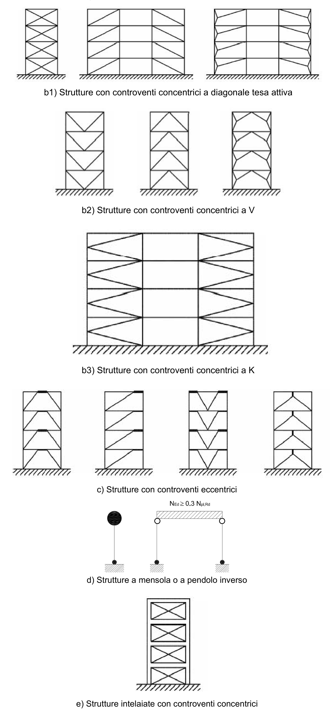
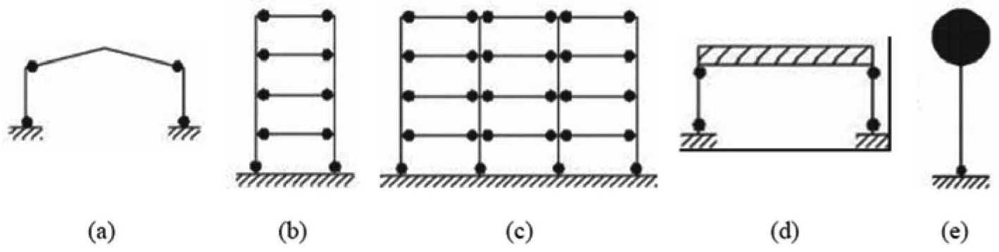

[Torna all'indice del § 7.5](./indice-7.5.md) | [Torna all'indice del capitolo](./indice-cap07.md) | [Torna all'indice generale](../indice-ntc2018.md)

# 7.5.2. Tipologie strutturali e fattori di comportamento

<!-- INDICE-INTERNO:INIZIO -->
**Indice interno**

- [Norma](#toc-ntc2018-7-5-2-norma)
  - [7.5.2.1. Tipologie strutturali](#toc-ntc2018-7-5-2-1)
  - [7.5.2.2. Fattori di comportamento](#toc-ntc2018-7-5-2-2)
- [Circolare](#toc-ntc2018-c7-5-2-circolare)
- [C7.5.2. Tipologie strutturali e fattori di comportamento](#toc-ntc2018-c7-5-2)
  - [C7.5.2.1. Tipologie strutturali](#toc-ntc2018-c7-5-2-1)
<!-- INDICE-INTERNO:FINE -->

## Norma

### 7.5.2.1. Tipologie strutturali

Le strutture sismoresistenti in acciaio si classificano nelle seguenti tipologie:

*a)* **Strutture intelaiate**: strutture in cui la resistenza alle azioni orizzontali è affidata principalmente alla resistenza flessionale delle membrature e alla rigidezza dei nodi trave-colonna.

*b)* **Strutture con controventi concentrici**: strutture in cui la resistenza alle azioni orizzontali è affidata principalmente alla resistenza assiale delle diagonali di controvento. Si distinguono in:

- controventi a diagonale tesa attiva (controventi a croce di S. Andrea, schema ad X);
- controventi a V (o a Λ invertita);
- controventi a K (non ammessi per strutture dissipative).

*c)* **Strutture con controventi eccentrici**: strutture in cui la resistenza alle azioni orizzontali è affidata a controventi in cui almeno un estremo della diagonale è collegato alla trave anziché al nodo trave-colonna, creando un segmento di trave detto "elemento di connessione" (*link*).

*d)* **Strutture a mensola o a pendolo inverso**: strutture nelle quali almeno il 50% della massa è nel terzo superiore dell'altezza.

*e)* **Strutture intelaiate con controventi concentrici**: strutture miste in cui le azioni orizzontali sono assorbite sia dal telaio che dai controventi concentrici.

*f)* **Strutture intelaiate con tamponature**: strutture intelaiate completate da tamponature duttili in muratura, la cui resistenza è considerata nel dimensionamento.

### 7.5.2.2. Fattori di comportamento

Il fattore di comportamento $q$ è dato da:

$$q = q_0 \cdot K_R$$

dove $K_R = 1$ per costruzioni regolari in elevazione e $K_R = 0{,}8$ per costruzioni non regolari in elevazione.

I valori di $q_0$ sono i seguenti:

**Strutture intelaiate:**

- CD"B": $q_0 = 4{,}0$
- CD"A": $q_0 = 5 \cdot \alpha_u / \alpha_1$

**Strutture con controventi concentrici a diagonale tesa attiva (X):**

- CD"B": $q_0 = 4{,}0$
- CD"A": $q_0 = 4{,}0$

**Strutture con controventi concentrici a V:**

- CD"B": $q_0 = 2{,}0$
- CD"A": $q_0 = 2{,}5$

**Strutture con controventi eccentrici:**

- CD"B": $q_0 = 4{,}0$
- CD"A": $q_0 = 5 \cdot \alpha_u / \alpha_1$

**Strutture a pendolo inverso:**

- CD"B": $q_0 = 2{,}0$
- CD"A": $q_0 = 2 \cdot \alpha_u / \alpha_1$

**Strutture intelaiate con controventi concentrici:**

- CD"B": $q_0 = 4{,}0$
- CD"A": $q_0 = 4 \cdot \alpha_u / \alpha_1$

Il rapporto $\alpha_u / \alpha_1$ vale:

- $1{,}1$ per strutture a portale a una campata;
- $1{,}2$ per strutture a portale a più campate;
- $1{,}1$ per strutture a controventi eccentrici a una campata;
- $1{,}2$ per strutture a controventi eccentrici a più campate;
- $1{,}0$ per strutture a pendolo inverso.

Valori superiori possono essere utilizzati purché ottenuti da analisi non lineari, con il limite $\alpha_u / \alpha_1 \leq 1{,}6$.

---

## Circolare

## C7.5.2. Tipologie strutturali e fattori di comportamento

### C7.5.2.1. Tipologie strutturali

Nelle strutture a telaio le zone dissipative devono essere localizzate principalmente all'estremità delle travi e/o nei nodi trave-colonna in modo tale da dissipare efficacemente l'energia sismica attraverso cicli flessionali inelastici. La localizzazione delle cerniere plastiche nelle strutture a telaio dovrebbe seguire le distribuzioni indicate nella Figura C7.5.1 a seconda della soluzione strutturale realizzata.

È possibile, inoltre, formare le cerniere plastiche nelle colonne, ma solo nelle seguenti parti:

- alla base della struttura a telaio (a, b, c, d, e);
- in sommità delle colonne all'ultimo piano dell'edificio (b e c in alternativa alle travi della copertura);
- alla base ed alla sommità delle colonne nelle strutture ad un unico piano (d).

*Figura C7.5.1 — Configurazioni dissipative di strutture intelaiate: disposizione delle cerniere plastiche, secondo le tipologie esposte nella Tabella 7.3.II del § 7.3.1 delle NTC.*

Una tipologia dissipativa ad un piano, in cui le cerniere plastiche sono localizzate nelle travi ed alla base delle colonne (tipo a, Figura C7.5.1), è caratterizzata da maggiori proprietà dissipative rispetto alle strutture del tipo d (Figura C7.5.1). Infatti, gran parte della capacità dissipativa della struttura è fornita dalle cerniere plastiche delle travi, soggette a sforzi normali trascurabili: per tale ragione il fattore di comportamento $q_0$ è pari a $5\alpha_u/\alpha_1$ per il tipo (a) ed a $2\alpha_u/\alpha_1$ per il tipo (d) e per il tipo (e).

In genere nel calcolo del fattore di comportamento, si assume per il coefficiente di sovra resistenza $\alpha_u/\alpha_1$ il valore proposto nel § 7.5.2.2. Tale valore, però, può essere determinato utilizzando metodi di analisi non lineari quali l'analisi dinamica non-lineare oppure l'analisi statica non-lineare (§ 7.3.4.1 e § 7.3.4.2). Ad ogni modo, durante la progettazione tale coefficiente non può assumere valori maggiori di 1,6, anche nel caso si ottengano valori più elevati a seguito di analisi non-lineari.
