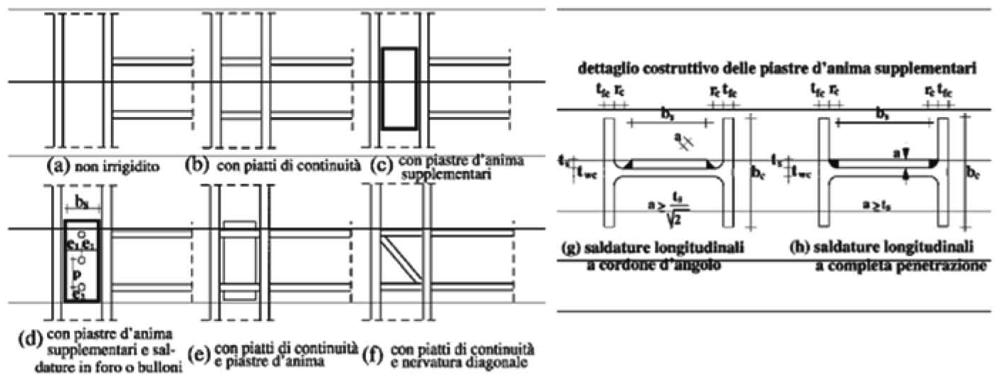

[Torna all'indice del § 7.5](./indice-7.5.md) | [Torna all'indice del capitolo](./indice-cap07.md) | [Torna all'indice generale](../indice-ntc2018.md)

# 7.5.4. Regole di progetto specifiche per strutture intelaiate

<!-- INDICE-INTERNO:INIZIO -->
**Indice interno**

- [Norma](#toc-ntc2018-7-5-4-norma)
  - [7.5.4.1. Travi](#toc-ntc2018-7-5-4-1)
  - [7.5.4.2. Colonne](#toc-ntc2018-7-5-4-2)
  - [7.5.4.3. Collegamenti trave-colonna](#toc-ntc2018-7-5-4-3)
  - [7.5.4.4. Pannelli d'anima delle colonne](#toc-ntc2018-7-5-4-4)
  - [7.5.4.5. Collegamenti colonna-fondazione](#toc-ntc2018-7-5-4-5)
- [Circolare](#toc-ntc2018-c7-5-4-circolare)
- [C7.5.4. Regole di progetto specifiche per strutture intelaiate](#toc-ntc2018-c7-5-4)
  - [C7.5.4.4. Pannelli d'anima dei collegamenti trave-colonna](#toc-ntc2018-c7-5-4-4)
<!-- INDICE-INTERNO:FINE -->

## Norma

### 7.5.4.1. Travi

Le zone dissipative sono localizzate nelle travi, in prossimità dei nodi trave-colonna. Le travi devono soddisfare le seguenti verifiche:

$$\frac{M_{Ed}}{M_{pl,Rd}} \leq 1 \tag{7.5.4}$$

$$\frac{N_{Ed}}{N_{pl,Rd}} \leq 0{,}15 \tag{7.5.5}$$

$$\frac{V_{Ed,G} + V_{Ed,M}}{V_{pl,Rd}} \leq 0{,}50 \tag{7.5.6}$$

dove:

- $M_{Ed}$ è il momento flettente di calcolo;
- $M_{pl,Rd}$ è il momento plastico resistente della sezione;
- $N_{Ed}$ è lo sforzo normale di calcolo;
- $N_{pl,Rd}$ è la resistenza plastica assiale della sezione;
- $V_{Ed,G}$ è il taglio dovuto ai carichi gravitazionali;
- $V_{Ed,M}$ è il taglio dovuto ai momenti plastici alle estremità della trave;
- $V_{pl,Rd}$ è la resistenza plastica a taglio della sezione.

### 7.5.4.2. Colonne

Le colonne devono essere progettate per resistere alle sollecitazioni amplificate derivanti dalla plasticizzazione delle zone dissipative nelle travi. Le verifiche sono condotte con i seguenti effetti delle azioni:

$$N_{Ed} = N_{Ed,G} + 1{,}1 \cdot \gamma_{ov} \cdot \Omega \cdot N_{Ed,E} \tag{7.5.7}$$

$$M_{Ed} = M_{Ed,G} + 1{,}1 \cdot \gamma_{ov} \cdot \Omega \cdot M_{Ed,E} \tag{7.5.8}$$

$$V_{Ed} = V_{Ed,G} + 1{,}1 \cdot \gamma_{ov} \cdot \Omega \cdot V_{Ed,E} \tag{7.5.9}$$

dove:

- $N_{Ed,G}$, $M_{Ed,G}$, $V_{Ed,G}$ sono gli effetti delle azioni gravitazionali nella combinazione sismica;
- $N_{Ed,E}$, $M_{Ed,E}$, $V_{Ed,E}$ sono gli effetti dell'azione sismica;
- $\Omega = \min_i (M_{pl,Rd,i} / M_{Ed,i})$ è il minimo dei rapporti fra momento plastico e momento di calcolo, esteso a tutte le zone dissipative delle travi.

Il rapporto $\Omega$ deve essere il più possibile uniforme nei vari piani; il massimo $\Omega_i$ non deve superare il minimo $\Omega_i$ di oltre il 25%.

Inoltre:

$$\frac{V_{Ed}}{V_{pl,Rd}} \leq 0{,}50 \tag{7.5.10}$$

**Gerarchia delle resistenze**

Per ogni nodo trave-colonna, deve essere soddisfatta la seguente condizione:

$$\sum M_{c,pl,Rd} \geq \gamma_{Rd} \cdot \sum M_{b,pl,Rd} \tag{7.5.11}$$

dove:

- $\sum M_{c,pl,Rd}$ è la somma dei momenti plastici resistenti delle colonne che convergono nel nodo;
- $\sum M_{b,pl,Rd}$ è la somma dei momenti plastici resistenti delle travi che convergono nel nodo;
- $\gamma_{Rd} = 1{,}3$.

### 7.5.4.3. Collegamenti trave-colonna

I collegamenti trave-colonna devono avere una resistenza flessionale non inferiore a quella della trave collegata, amplificata per la sovraresistenza:

$$M_{j,Rd} \geq 1{,}1 \cdot \gamma_{ov} \cdot M_{b,pl,Rd} \tag{7.5.12}$$

dove:

- $M_{j,Rd}$ è il momento resistente del collegamento;
- $M_{b,pl,Rd}$ è il momento plastico resistente della trave.

I collegamenti possono essere a completo ripristino di resistenza (*full-strength*) o a parziale ripristino (*partial-strength*), purché nel secondo caso la zona dissipativa sia localizzata nel collegamento stesso, che deve avere adeguata duttilità.

### 7.5.4.4. Pannelli d'anima delle colonne

I pannelli d'anima delle colonne nei nodi trave-colonna devono essere verificati a taglio:

$$\frac{V_{vp,Ed}}{\min(V_{vp,Rd}; \; V_{vb,Rd})} < 1 \tag{7.5.13}$$

dove:

- $V_{vp,Ed}$ è il taglio agente nel pannello d'anima;
- $V_{vp,Rd}$ è la resistenza plastica a taglio del pannello;
- $V_{vb,Rd}$ è la resistenza a instabilità del pannello.

Se necessario, il pannello d'anima deve essere rinforzato con piastre di irrigidimento o piatti d'anima supplementari.

### 7.5.4.5. Collegamenti colonna-fondazione

I collegamenti colonna-fondazione devono avere una resistenza non inferiore a:

$$M_{C,Rd} \geq 1{,}1 \cdot \gamma_{ov} \cdot M_{c,pl,Rd}(N_{Ed}) \tag{7.5.14}$$

dove $M_{c,pl,Rd}(N_{Ed})$ è il momento plastico resistente della colonna, ridotto per la presenza dello sforzo normale $N_{Ed}$.

---

## Circolare

## C7.5.4. Regole di progetto specifiche per strutture intelaiate

### C7.5.4.4. Pannelli d'anima dei collegamenti trave-colonna

Affinché il pannello d'anima della colonna possa sostenere lo sviluppo del meccanismo dissipativo globale a telaio, secondo uno degli schemi proposti nella Figura C7.5.1, è necessario che la forza di taglio trasmessa dalle travi al pannello d'anima della colonna sia calcolata in condizioni di collasso. Per tale motivo la forza con cui è necessario confrontare la resistenza a taglio di progetto del pannello, $V_{WP,Rd}$, non deriva dalle sollecitazioni di calcolo ottenute dall'analisi strutturale, bensì dal momento plastico resistente delle travi in esso concorrenti tramite la formula:

$$V_{WP,Ed,t} = \gamma_{ov}\, \frac{\sum M_{b,pl,Rd}}{Z}\, \left(1 - \frac{z}{H - h_b}\right) \tag{C7.5.1}$$

dove $\sum M_{b,pl,Rd}$ è la sommatoria dei momenti plastici resistenti delle travi, $H$ è l'altezza di interpiano del telaio, $z$ è il braccio di coppia interna della trave ed $h_b$ è l'altezza della sezione della trave. La resistenza del pannello nodale privo di piatti di irrigidimento e/o continuità, ove i fenomeni di instabilità non siano condizionanti, è data da:

$$V_{WP,Rd} \geq \frac{f_y}{\sqrt{3}}\, A_{VC}\, \sqrt{1 - \left(\frac{\sigma}{f_y}\right)^{2}} \tag{C7.5.2}$$

dove $A_{VC}$ (§ 4.2.4.1.2.4) è l'area resistente a taglio, mentre $\sigma$ è la tensione normale media agente nel pannello dovuta allo sforzo normale di calcolo presente nella colonna.

In Figura C7.5.2 sono rappresentati i dettagli costruttivi dei pannelli nodali, cui è necessario fare riferimento per il calcolo della resistenza a taglio. Nel caso di collegamenti trave-colonna saldati, i piatti di continuità in prosecuzione delle ali della trave devono essere sempre previsti.

*Figura C7.5.2 — Dettagli costruttivi di pannelli nodali irrigiditi.*
