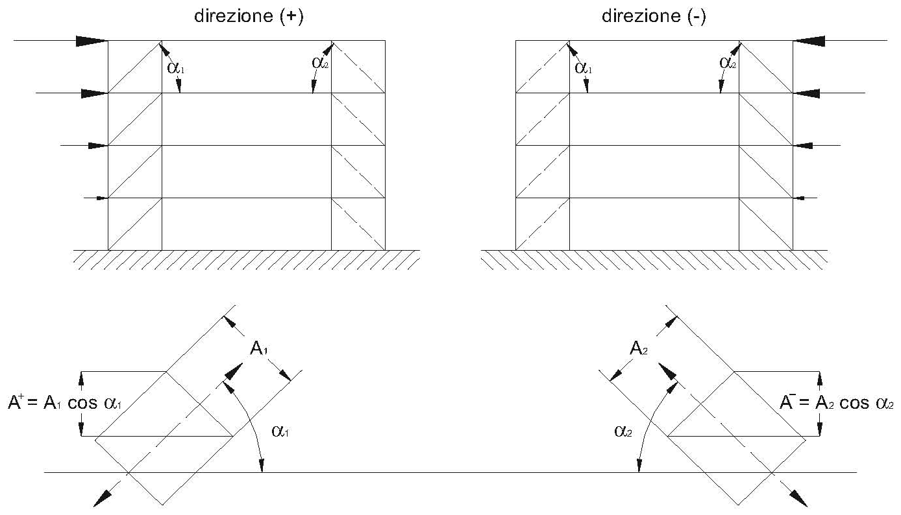

[Torna all'indice del § 7.5](./indice-7.5.md) | [Torna all'indice del capitolo](./indice-cap07.md) | [Torna all'indice generale](../indice-ntc2018.md)

# 7.5.5. Regole di progetto specifiche per strutture con controventi concentrici

<!-- INDICE-INTERNO:INIZIO -->
**Indice interno**

- [Norma](#toc-ntc2018-7-5-5-norma)
- [Circolare](#toc-ntc2018-c7-5-5-circolare)
- [C7.5.5. Regole di progetto specifiche per strutture con controventi concentrici](#toc-ntc2018-c7-5-5)
<!-- INDICE-INTERNO:FINE -->

## Norma

**Controventi a diagonale tesa attiva (schema ad X)**

La snellezza adimensionalizzata $\bar{\lambda}$ delle diagonali deve soddisfare:

$$1{,}3 \leq \bar{\lambda} \leq 2{,}0$$

Il limite inferiore è posto per evitare che la diagonale compressa, prima di instabilizzarsi, attiri una forza troppo elevata sulle colonne. Il limite superiore garantisce un minimo di rigidezza.

**Controventi a V**

La snellezza adimensionalizzata $\bar{\lambda}$ delle diagonali deve soddisfare:

$$\bar{\lambda} \leq 2{,}0$$

Per i controventi a V non è richiesto il limite inferiore di snellezza, ma le travi orizzontali devono essere dimensionate per sopportare i carichi verticali anche in assenza dei controventi.

**Controventi a K**

I controventi a K (con nodo intermedio sulla colonna) **non sono ammessi** per strutture a comportamento dissipativo, in quanto il meccanismo di collasso coinvolgerebbe direttamente la colonna.

**Verifiche delle diagonali**

Le diagonali devono soddisfare:

$$\frac{N_{Ed}}{N_{b,Rd}(M_{Ed})} \leq 1 \tag{7.5.15}$$

dove $N_{b,Rd}(M_{Ed})$ è la resistenza all'instabilità della diagonale, eventualmente ridotta per la presenza di momento flettente.

**Uniformità della sovraresistenza**

Per assicurare un meccanismo dissipativo omogeneo su tutta l'altezza della struttura, il rapporto di sovraresistenza delle diagonali $\Omega_i$ non deve variare più del 25% fra i vari piani:

$$\Omega_i = \frac{N_{pl,Rd,i}}{N_{Ed,i}}$$

Il rapporto fra il valore massimo e il valore minimo di $\Omega_i$ non deve superare $1{,}25$.

Le colonne e le travi dei telai controventati devono essere dimensionate per resistere alle sollecitazioni amplificate con il coefficiente $\Omega$ analogamente alle [7.5.7]-[7.5.9].

**Controventi a V — prescrizioni aggiuntive**

Nei controventi a V, la trave intersecata dalle diagonali deve essere continua e dimensionata per:

- resistere ai carichi verticali nell'ipotesi che i controventi non siano presenti;
- la forza verticale risultante dalla differenza di resistenza delle diagonali tese e compresse nella situazione post-instabilità.

---

## Circolare

## C7.5.5. Regole di progetto specifiche per strutture con controventi concentrici

La risposta carico-spostamento laterale di una struttura con controventi concentrici deve risultare sostanzialmente indipendente dal verso dell'azione sismica. Tale requisito si ritiene soddisfatto se ad ogni piano vale la seguente disuguaglianza:

$$\frac{|A^+ - A^-|}{A^+ + A^-} \leq 0{,}05 \tag{C7.5.3}$$

essendo $A^+$ e $A^-$ le proiezioni verticali delle sezioni trasversali delle diagonali tese, valutate per i due versi possibili delle azioni sismiche, secondo quanto presentato nella Figura C7.5.3.

*Figura C7.5.3 — Definizione dell'area delle sezioni dei controventi tesi, $A^+$ ed $A^-$, da utilizzare nella formula C7.5.3.*
