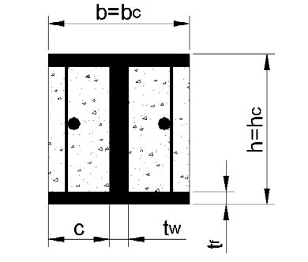
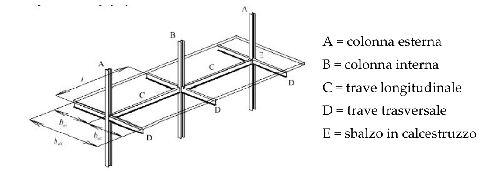
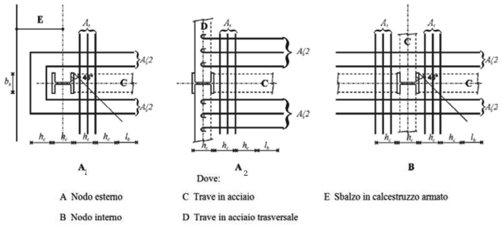
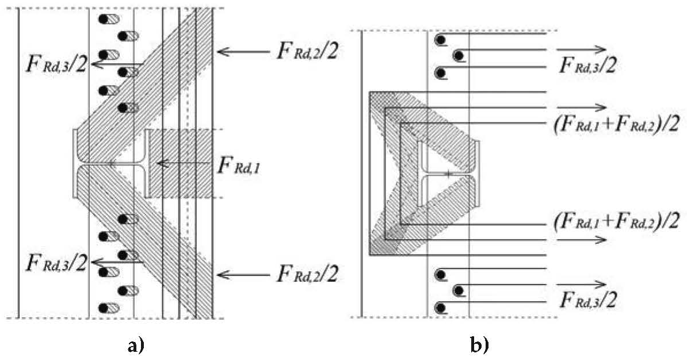
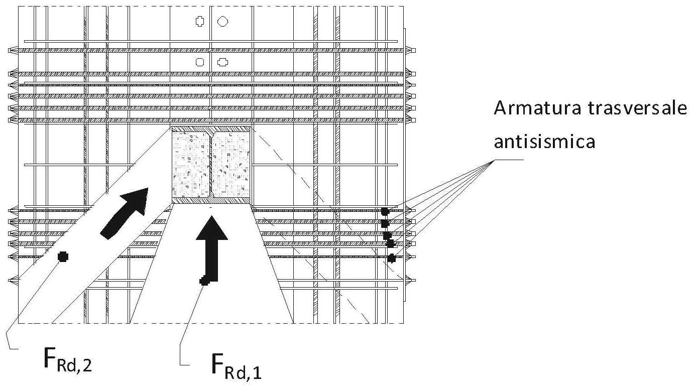
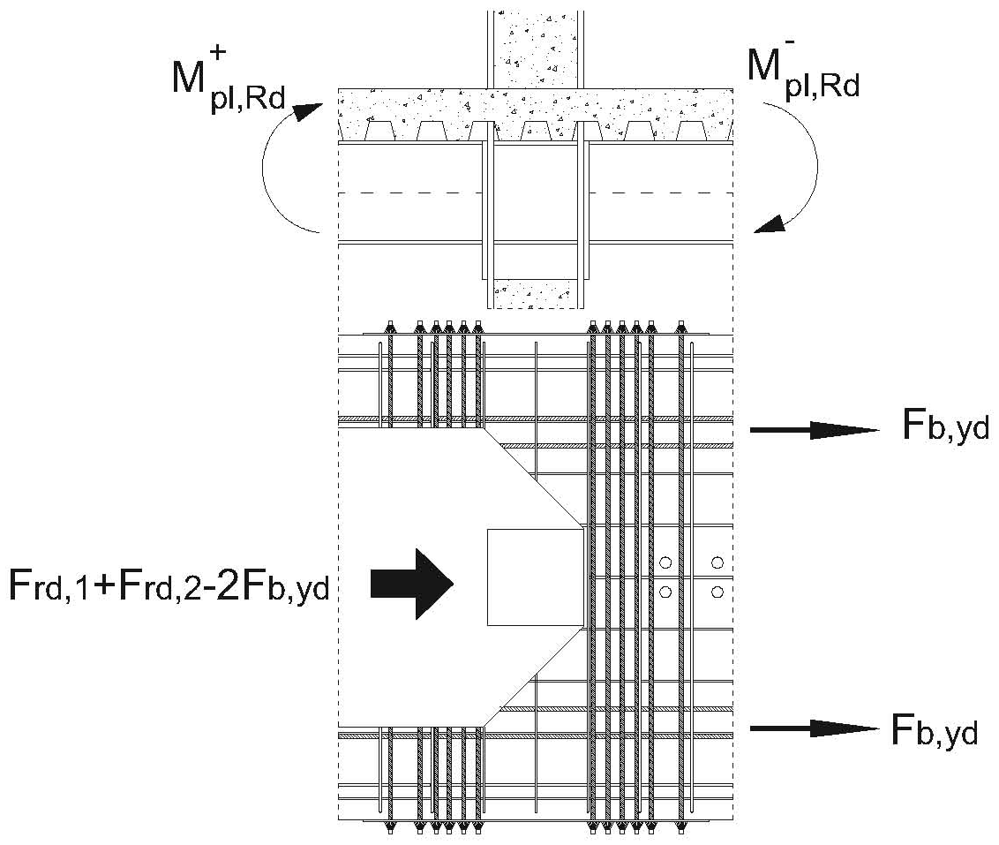
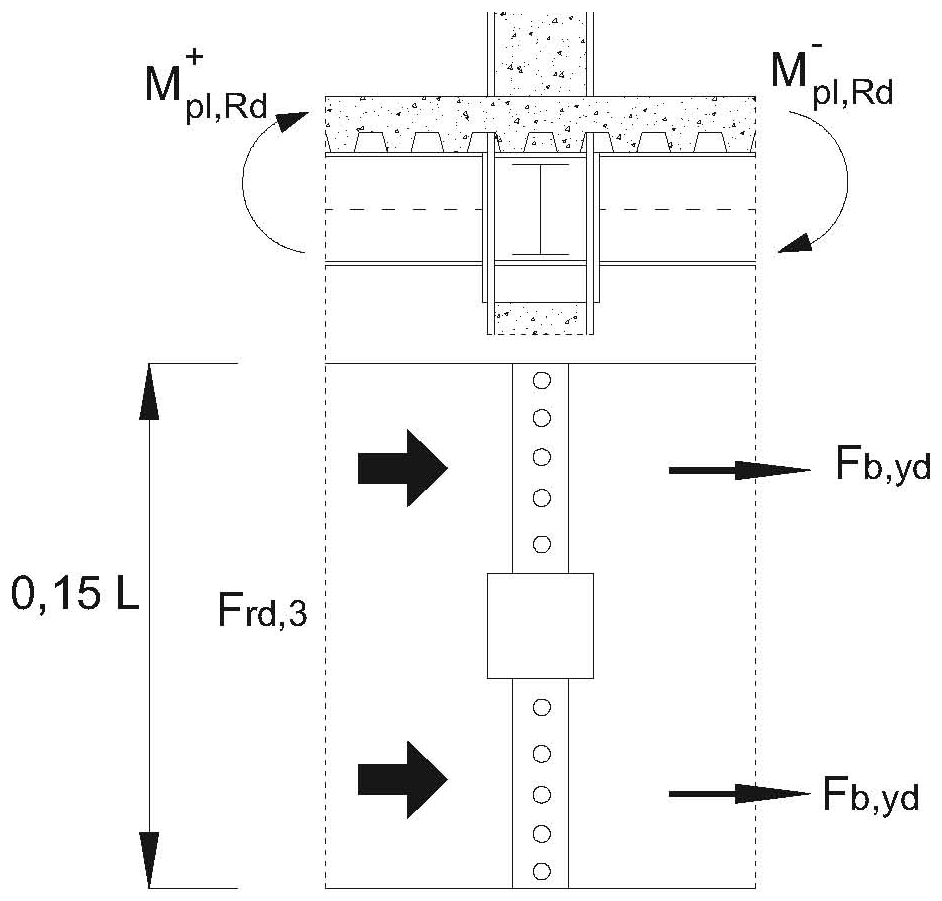
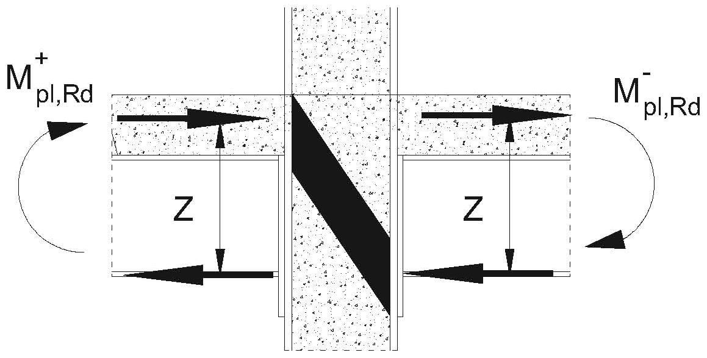

[Torna all'indice del capitolo](indice-cap07.md) | [Torna all'indice generale](../indice-ntc2018.md)

# 7.6. Costruzioni composte di acciaio-calcestruzzo e costruzioni di legno

## Indice del capitolo

- [[#7.6. Costruzioni composte acciaio-calcestruzzo|7.6 Costruzioni composte acciaio-calcestruzzo]]
  - [[#7.6.1. Materiali|7.6.1 Materiali]]
  - [[#7.6.2. Tipologie strutturali e fattori di comportamento|7.6.2 Tipologie e fattori comportamento (Tab. 7.6.I-IV)]]
  - [[#7.6.3. Rigidezza della sezione trasversale composta|7.6.3 Rigidezza sezione composta]]
  - [[#7.6.4. Criteri di progetto e dettagli per strutture dissipative|7.6.4 Criteri progetto dissipative]]
  - [[#7.6.5. Regole specifiche per le membrature|7.6.5 Regole membrature]]
  - [[#7.6.6. Regole specifiche per strutture intelaiate|7.6.6 Strutture intelaiate]]
  - [[#7.6.7. Regole specifiche per strutture con controventi concentrici|7.6.7 Controventi concentrici]]
  - [[#7.6.8. Regole specifiche per strutture con controventi eccentrici|7.6.8 Controventi eccentrici]]
- [[#7.7. Costruzioni di legno|7.7 Costruzioni di legno]]
  - [[#7.7.1. Aspetti concettuali della progettazione|7.7.1 Aspetti concettuali (duttilità, zone dissipative)]]
  - [[#7.7.2. Materiali e proprietà delle zone dissipative|7.7.2 Materiali e zone dissipative]]
  - [[#7.7.3. Tipologie strutturali e fattori di comportamento|7.7.3 Tipologie e fattori comportamento]]
  - [[#7.7.4. Analisi strutturale|7.7.4 Analisi strutturale]]
  - [[#7.7.5. Disposizioni costruttive|7.7.5 Disposizioni costruttive]]
  - [[#7.7.6. Verifiche di sicurezza|7.7.6 Verifiche di sicurezza]]
  - [[#7.7.7. Regole di dettaglio|7.7.7 Regole di dettaglio]]
- [[#C7.6. Costruzioni composte di acciaio-calcestruzzo|C7.6 — Costruzioni composte]]
  - [[#C7.6.4. Criteri di progetto e dettagli per strutture dissipative|C7.6.4 Criteri progetto dissipative (meccanismi 1-2-3)]]
  - [[#C7.6.7. Regole specifiche per strutture con controventi concentrici|C7.6.7 Concentrici composti]]
  - [[#C7.6.8. Controventi eccentrici|C7.6.8 Eccentrici composti]]
- [[#C7.7. Costruzioni di legno|C7.7 — Costruzioni di legno]]
  - [[#C7.7.1. Aspetti concettuali della progettazione|C7.7.1 Aspetti concettuali]]
  - [[#C7.7.2. Materiali e proprietà delle zone dissipative|C7.7.2 Materiali e zone dissipative]]
  - [[#C7.7.3. Tipologie strutturali e fattori di comportamento|C7.7.3 Tipologie e fattori]]
  - [[#C7.7.4. Analisi strutturale|C7.7.4 Analisi strutturale]]
  - [[#C7.7.5. Disposizioni costruttive|C7.7.5 Disposizioni costruttive]]

---

# Norma

## 7.6. Costruzioni composte acciaio-calcestruzzo

Le costruzioni composte di acciaio-calcestruzzo possono ricadere in uno dei seguenti comportamenti strutturali:

*a)* **comportamento non dissipativo**: le membrature composte sono dimensionate per resistere alle sollecitazioni di progetto determinate con $q = 1$;

*b)* **comportamento dissipativo con zone dissipative in componenti composte acciaio-calcestruzzo**: le zone dissipative sono costituite da parti composte di acciaio e calcestruzzo, che devono soddisfare i requisiti di duttilità del presente paragrafo;

*c)* **comportamento dissipativo con zone dissipative in soli elementi di acciaio**: le zone dissipative sono costituite da sole parti di acciaio e devono soddisfare i requisiti del § 7.5.

### 7.6.1. Materiali

Per le costruzioni composte acciaio-calcestruzzo, si applicano le seguenti prescrizioni sui materiali:

- il calcestruzzo deve avere classe di resistenza non inferiore a C20/25 e non superiore a C40/50;
- l'acciaio per armature deve essere del tipo B450C;
- l'acciaio strutturale deve soddisfare i requisiti del § 7.5.

### 7.6.2. Tipologie strutturali e fattori di comportamento

Le tipologie strutturali e i corrispondenti valori massimi del fattore di comportamento $q_0$ sono gli stessi indicati al § 7.5.2 e nella Tab. 7.3.II per le strutture composte acciaio-calcestruzzo.

### 7.6.3. Rigidezza della sezione trasversale composta

Per il calcolo della rigidezza flessionale della sezione trasversale composta, si deve tener conto della fessurazione del calcestruzzo teso. In assenza di analisi più accurate, la rigidezza può essere calcolata utilizzando il coefficiente di omogenizzazione:

$$n = \frac{E_a}{E_{cm}} \approx 7$$

dove $E_a$ è il modulo elastico dell'acciaio ed $E_{cm}$ è il modulo elastico secante del calcestruzzo.

### 7.6.4. Criteri di progetto e dettagli per strutture dissipative

#### 7.6.4.1. Criteri generali

I criteri generali di progettazione in capacità (§ 7.2.2) si applicano anche alle strutture composte acciaio-calcestruzzo. Le zone dissipative devono essere progettate e dettagliate in modo da garantire la duttilità richiesta dalla classe di duttilità adottata.

#### 7.6.4.2. Verifiche di resistenza

La resistenza delle zone non dissipative deve soddisfare la seguente condizione:

$$R_{j,d} \geq R_{U,Rd}$$ \tag{7.6.1}

dove $R_{j,d}$ è la resistenza di progetto della zona non dissipativa e $R_{U,Rd}$ è la resistenza ultima della zona dissipativa adiacente, amplificata con il fattore di sovraresistenza $\gamma_{Rd}$.

La resistenza a taglio del pannello d'anima della zona di collegamento trave-colonna composta è data da:

$$V_{wp,Rd} = 0{,}8 \left( V_{wp,s,Rd} + V_{wp,c,Rd} \right)$$ \tag{7.6.2}

dove $V_{wp,s,Rd}$ è il contributo della parte di acciaio e $V_{wp,c,Rd}$ è il contributo della parte di calcestruzzo alla resistenza a taglio del pannello d'anima.

#### 7.6.4.3. Verifiche di duttilità

Per le membrature composte che costituiscono zone dissipative, il rapporto fra lo sforzo normale di progetto e la resistenza plastica della sezione composta deve soddisfare la seguente limitazione:

$$\frac{N_{Ed}}{N_{pl,Rd}} \leq 0{,}3$$ \tag{7.6.3}

**Tab. 7.6.I** – *Rapporti massimi larghezza/spessore per profili metallici compressi in sezioni composte*

| Classe di duttilità | Parti interne (anima) | Parti a sbalzo (ala) |
|:---:|:---:|:---:|
| CD"B" | Come Classe 1 EN 1994-1-1 | Come Classe 1 EN 1994-1-1 |
| CD"A" | Come Classe 1 EN 1994-1-1, ridotti del 10% | Come Classe 1 EN 1994-1-1, ridotti del 10% |

I rapporti di snellezza dei profili metallici compressi in sezioni composte non devono superare i limiti della Tab. 7.6.I.

#### 7.6.4.4. Dettagli costruttivi

I dettagli costruttivi devono garantire il trasferimento delle forze fra acciaio e calcestruzzo nelle zone critiche. I connettori a taglio devono essere distribuiti in modo da assicurare la completa interazione tra le due componenti.

### 7.6.5. Regole specifiche per le membrature

#### 7.6.5.1. Travi con soletta collaborante

La larghezza efficace della soletta collaborante $b_{eff}$ si calcola come:

$$b_{eff} = b_c + 2 \cdot b_{e}$$ \tag{7.6.4}

dove $b_c$ è la larghezza della colonna e $b_{e}$ è la larghezza efficace della soletta da ciascun lato, in funzione della zona (momento positivo o negativo).

La duttilità della sezione composta della trave è verificata limitando la profondità dell'asse neutro:

$$\frac{x}{d} \leq \text{limite Tab. 7.6.II}$$ \tag{7.6.5}

**Tab. 7.6.II** – *Limiti del rapporto $x/d$ per travi composte con soletta collaborante*

| Classe di duttilità | $q$ | $x/d$ |
|:---:|:---:|:---:|
| CD"B" | 1,5 – 2,0 | 0,40 |
| CD"A" | 3,0 – 4,0 | 0,27 |
| CD"A" | > 4,0 | 0,20 |

**Tab. 7.6.III** – *Larghezza efficace della soletta $b_{eff}$ per travi composte (zona a momento positivo)*

| Condizione | $b_e$ |
|---|---|
| Per travi interne | $b_e = \min(L/8;\; b_0/2)$ |
| Per travi di bordo | $b_e = \min(L/8;\; b_0)$ |

dove $L$ è la luce della trave e $b_0$ è la distanza fra la mezzeria della trave e la mezzeria della trave adiacente o il bordo libero.

**Tab. 7.6.IV** – *Larghezza efficace della soletta $b_{eff}$ per travi composte (zona a momento negativo, presso la colonna)*

| Condizione | $b_e$ |
|---|---|
| Per connessioni con soletta | $b_e = 0{,}1 \cdot L$ |
| Limite massimo | $b_e$ non superiore alla distanza al bordo libero |

#### 7.6.5.2. Membrature parzialmente rivestite

Le membrature parzialmente rivestite sono profili di acciaio con calcestruzzo inserito tra le ali. La resistenza a flessione e a taglio della sezione composta deve essere calcolata tenendo conto dell'interazione fra le due componenti. Le staffe trasversali devono collegare le ali del profilo.

#### 7.6.5.3. Colonne completamente rivestite

Le colonne completamente rivestite in calcestruzzo devono avere uno spessore minimo del rivestimento sufficiente a impedire il distacco del copriferro. L'armatura longitudinale e trasversale del rivestimento deve soddisfare i requisiti del § 7.4 per le colonne in c.a.

#### 7.6.5.4. Colonne riempite di calcestruzzo

Le colonne tubolari riempite di calcestruzzo sfruttano l'effetto di confinamento del tubo. Il calcestruzzo confinato contribuisce ad aumentare sia la resistenza sia la duttilità della membratura.

### 7.6.6. Regole specifiche per strutture intelaiate

#### 7.6.6.1. Analisi strutturale

Per l'analisi delle strutture intelaiate composte, il momento d'inerzia equivalente della sezione composta può essere calcolato come:

$$I_{eq} = I_s + 0{,}5 \cdot I_c + A_s \cdot r^2$$ \tag{7.6.6}

dove $I_s$ è il momento d'inerzia del profilo di acciaio, $I_c$ è il momento d'inerzia della sezione di calcestruzzo, $A_s$ è l'area del profilo di acciaio e $r$ è la distanza fra i baricentri.

La rigidezza flessionale efficace della colonna composta è:

$$(EI)_c = E_a \cdot I_s + 0{,}6 \cdot E_{cm} \cdot I_c + E_s \cdot I_{sr}$$ \tag{7.6.7}

dove $E_s \cdot I_{sr}$ è il contributo dell'armatura.

#### 7.6.6.2. Condizione di gerarchia trave-colonna

La condizione di gerarchia delle resistenze per i nodi trave-colonna è:

$$\sum M_{C,pl,Rd} \geq \gamma_{Rd} \cdot \sum M_{b,pl,Rd}$$ \tag{7.6.8}

dove $\sum M_{C,pl,Rd}$ è la somma dei momenti resistenti plastici delle colonne convergenti nel nodo e $\sum M_{b,pl,Rd}$ è la somma dei momenti resistenti plastici delle travi convergenti nel nodo.

#### 7.6.6.3. Collegamenti trave-colonna

I collegamenti trave-colonna devono essere progettati per resistere alle sollecitazioni derivanti dalla formazione di cerniere plastiche nelle zone dissipative, amplificate con il fattore di sovraresistenza $\gamma_{Rd}$.

#### 7.6.6.4. Pannello nodale

Il pannello nodale deve essere verificato a taglio tenendo conto del contributo sia della parte di acciaio sia della parte di calcestruzzo.

#### 7.6.6.5. Condizione per trascurare il carattere composto

Il carattere composto della membratura può essere trascurato quando il contributo del calcestruzzo alla rigidezza e alla resistenza non supera il 10% del contributo dell'acciaio. In tal caso si applicano le sole regole del § 7.5 per le strutture in acciaio.

### 7.6.7. Regole specifiche per strutture con controventi concentrici

Per le strutture composte con controventi concentrici si applicano le regole del § 7.5.5, integrate con le prescrizioni del presente paragrafo per quanto riguarda le membrature composte.

### 7.6.8. Regole specifiche per strutture con controventi eccentrici

Per le strutture composte con controventi eccentrici si applicano le regole del § 7.5.6, integrate con le prescrizioni del presente paragrafo. I link dissipativi possono essere composti, purché siano garantite le prestazioni di duttilità richieste.

*Fig. 7.6.1 – Rapporti dimensionali per le sezioni composte*

*Fig. 7.6.2 – Definizione degli elementi nelle strutture composte acciaio-calcestruzzo*

---

## 7.7. Costruzioni di legno

### Definizioni

Ai fini del presente paragrafo si definiscono:

- **duttilità statica**: rapporto tra lo spostamento ultimo e lo spostamento al limite elastico della struttura o dell'elemento;
- **nodi semi-rigidi**: collegamenti il cui comportamento meccanico è caratterizzato da una relazione momento-rotazione non lineare con significativa capacità di deformazione e dissipazione;
- **nodi rigidi**: collegamenti che non consentono rotazioni relative apprezzabili tra gli elementi collegati;
- **unioni a gambo cilindrico**: collegamenti realizzati con mezzi di unione metallici a gambo cilindrico (chiodi, bulloni, perni, viti, spinotti) inseriti nel legno;
- **nodi di carpenteria**: collegamenti realizzati mediante contatto diretto tra gli elementi lignei (incastri, intagli, denti), senza mezzi di unione meccanici.

### 7.7.1. Aspetti concettuali della progettazione

La progettazione delle costruzioni di legno in zona sismica può essere svolta per:

- **comportamento strutturale non dissipativo**: la struttura resiste alle azioni sismiche in campo elastico, con $q = 1$;
- **comportamento strutturale dissipativo**: la struttura sfrutta la capacità dissipativa delle unioni, con $q > 1$.

Nel caso di comportamento dissipativo, si distinguono due livelli di Classe di Duttilità:

- **Classe di Duttilità Alta** CD"A";
- **Classe di Duttilità Bassa** CD"B".

La progettazione in capacità richiede che le zone non dissipative (elementi lignei) possiedano una sovraresistenza sufficiente a consentire lo sviluppo della dissipazione nelle sole zone dissipative (le unioni). Il fattore di sovraresistenza $\gamma_{Rd}$ è pari a 1,3 (v. Tab. 7.2.I).

### 7.7.2. Materiali e proprietà delle zone dissipative

Per le costruzioni in legno a comportamento dissipativo, i materiali delle zone dissipative devono possedere adeguata duttilità. In particolare, per i pannelli a base di legno utilizzati come controvento:

- **pannelli di particelle**: spessore minimo 13 mm;
- **pannelli di compensato**: spessore minimo 9 mm;
- **pannelli di OSB (Oriented Strand Board)**: spessore minimo 12 mm per pannelli di tipo OSB/3 e 15 mm per pannelli di tipo OSB/2.

I mezzi di unione a gambo cilindrico nelle zone dissipative devono essere dimensionati per sviluppare meccanismi duttili (modalità di rottura con formazione di cerniere plastiche nel connettore).

### 7.7.3. Tipologie strutturali e fattori di comportamento

Le tipologie strutturali e i corrispondenti valori massimi del fattore di comportamento $q_0$ sono indicati nella Tab. 7.3.II.

#### 7.7.3.1. Prescrizioni sulla duttilità

Per poter adottare valori di $q_0 > 1$, le unioni devono possedere una duttilità statica adeguata. In particolare:

- per CD"B", la duttilità statica delle unioni deve essere almeno pari a 4;
- per CD"A", la duttilità statica delle unioni deve essere almeno pari a 6.

Le unioni con meccanismi di rottura fragile (spacco, strappo di gruppo) non possono essere considerate dissipative.

### 7.7.4. Analisi strutturale

L'analisi strutturale delle costruzioni di legno in zona sismica deve tener conto dei seguenti aspetti:

- il modulo elastico da utilizzare è quello relativo alle azioni istantanee ($k_{mod}$ per classe di durata del carico "istantanea");
- gli impalcati devono essere in grado di trasferire le forze orizzontali ai sistemi di controvento verticali;
- per poter considerare gli impalcati come rigidi nel loro piano, essi devono essere realizzati con pannelli a base di legno chiodati o avvitati, ovvero con solette in c.a. collaboranti.

### 7.7.5. Disposizioni costruttive

#### 7.7.5.1. Generalità

Le costruzioni di legno in zona sismica devono essere progettate in modo da garantire un comportamento d'insieme regolare, evitando concentrazioni di danno. I sistemi di controvento devono essere distribuiti in modo simmetrico in pianta.

#### 7.7.5.2. Disposizioni per i collegamenti

I collegamenti devono essere realizzati in modo da garantire la duttilità richiesta. In particolare:

- devono essere evitati meccanismi di rottura fragile;
- gli elementi metallici di collegamento devono avere adeguata resistenza a trazione e a taglio;
- gli ancoraggi alla fondazione devono essere dimensionati per le sollecitazioni di progetto amplificate con il fattore di sovraresistenza $\gamma_{Rd}$.

#### 7.7.5.3. Disposizioni per gli impalcati

Gli impalcati devono essere in grado di trasferire le forze di inerzia ai sistemi di controvento verticali. I collegamenti fra impalcato e pareti di controvento devono essere verificati per le sollecitazioni derivanti dall'azione sismica.

### 7.7.6. Verifiche di sicurezza

Le verifiche di sicurezza per le costruzioni di legno in zona sismica devono tenere conto delle seguenti prescrizioni:

- i carichi sono di tipo "istantaneo" ai fini della determinazione del coefficiente $k_{mod}$;
- la sovraresistenza $\gamma_{Rd}$ deve essere applicata per la verifica degli elementi non dissipativi (progettazione in capacità);
- le verifiche di duttilità (DUT) devono essere condotte secondo quanto indicato al § 7.7.7.

### 7.7.7. Regole di dettaglio

#### 7.7.7.1. Disposizioni costruttive per i collegamenti

Per i collegamenti delle costruzioni di legno in zona sismica si applicano le seguenti prescrizioni:

- il diametro dei perni e dei bulloni nelle zone dissipative non deve superare 16 mm;
- gli spessori minimi del legno nelle unioni devono garantire la formazione di cerniere plastiche nei mezzi di unione metallici;
- la distanza fra i mezzi di unione e i bordi del legno deve essere sufficiente a evitare fenomeni di spacco;
- le rondelle devono avere dimensioni adeguate a ripartire le forze di serraggio senza provocare l'impronta nel legno.

#### 7.7.7.2. Disposizioni per gli impalcati

Gli impalcati devono soddisfare la seguente limitazione geometrica:

$$\frac{h}{b} \leq 4$$

dove $h$ è la lunghezza e $b$ è la larghezza dell'impalcato. Per rapporti $h/b$ superiori, l'impalcato non può essere considerato rigido nel proprio piano e si deve tener conto della sua deformabilità nell'analisi strutturale.

---

# Circolare

## C7.6. Costruzioni composte di acciaio-calcestruzzo

Le regole integrative di progettazione ed esecuzione, per l'impiego in zona sismica, delle costruzioni composte acciaio-calcestruzzo sono, per larga parte, analoghe a quelle delle corrispondenti strutture metalliche; tuttavia sono previste regole specifiche aggiuntive per quanto riguarda la disposizione delle armature in soletta in prossimità dei nodi trave-pilastro e la progettazione dei pannelli nodali delle strutture intelaiate, poiché i collegamenti trave-pilastro devono essere progettati considerando una gerarchia di resistenza che determini la plasticizzazione nell'elemento trave.

Nel caso del nodo composto la resistenza è fortemente influenzata dalla capacità di trasferimento delle forze dalla soletta alla colonna e dalla resistenza del pannello nodale che può essere in solo acciaio o riempito di calcestruzzo.

Nel seguito sono illustrati i meccanismi resistenti che si possono attivare nella zona del nodo composto e quindi il tipo di dettagli costruttivi a cui si deve fare riferimento; per quanto riguarda ulteriori regole e formule di progetto si rimanda a normative di comprovata validità.

### C7.6.4. Criteri di progetto e dettagli per strutture dissipative

#### C7.6.4.5. Collegamenti composti nelle zone dissipative

I meccanismi che si attivano nelle zone di nodo tra la trave composta e la colonna composta o in acciaio possono essere diversi in base al segno del momento flettente trasferito dalla trave e ad alcuni dettagli costruttivi nella zona nodale.

In particolare, per il nodo esterno, la differenza fondamentale è dovuta alla presenza o meno di una mensola esterna e della trave trasversale (Figura C7.6.1); inoltre nelle zone dissipative delle travi soggette a momento negativo, occorre predisporre armatura metallica ad elevata duttilità, così come schematicamente riportato in Figura C7.6.1.

*Figura C7.6.1 — Dettagli di armatura in corrispondenza dei nodi trave-colonna. A1 Nodo esterno; A2 Nodo interno; B Sbalzo in calcestruzzo armato; C Trave in acciaio; D Trave in acciaio trasversale; E Sbalzo in calcestruzzo armato.*

La disposizione delle barre d'armatura presentata in Figura C7.6.1 è efficace solo nel caso in cui la connessione tra trave e colonna sia sufficientemente rigida da consentire lo svilupparsi delle cerniere plastiche all'interno delle travi composte.

Nel caso si utilizzino collegamenti metallici travi-colonna a parziale ripristino di resistenza e semi-rigidi per una ottimale distribuzione delle tensioni e per evitare un prematuro collasso della porzione di soletta soggetta a compressione è necessario eseguire una opportuna qualifica, per via sperimentale e/o numerica, del collegamento e progettare su tale base la disposizione dell'armatura in soletta.

Le cerniere plastiche all'interno della trave composta devono avere un comportamento duttile, per cui nel disporre l'armatura di rinforzo in corrispondenza dei nodi trave-colonna composti è necessario:

- eliminare tutti i possibili fenomeni di instabilità dell'equilibrio nei componenti in acciaio e nelle armature;
- evitare la prematura rottura della soletta in calcestruzzo a contatto con la colonna composta.

Per il calcolo delle armature necessarie in soletta devono essere utilizzati metodi di calcolo basati su schemi di equilibrio "puntone-tirante". Inoltre, per favorire una migliore diffusione della sollecitazione di compressione dalla colonna composta alla soletta, è possibile predisporre una piastra supplementare saldata sull'ala della colonna e di larghezza maggiore di quest'ultima, in modo da incrementare la porzione di soletta collaborante nel trasferimento delle sollecitazioni in condizioni sismiche.

##### C7.6.4.5.1. Modelli resistenti per la soletta soggetta a compressione

La configurazione di tutti i meccanismi che si possono attivare in un nodo esterno è illustrata nella Figura C7.6.2, per il caso di momento positivo (a) e di momento negativo (b).

*Figura C7.6.2 — Meccanismi attivabili nella soletta: a) Soletta compressa (momento positivo); b) Soletta tesa (momento negativo).*

Nel caso di nodi trave-colonna in acciaio, rigidi ed a completo ripristino di resistenza, si osserva che la compressione trasferibile dalla soletta alla colonna (Figura C7.6.2 a) avviene per contatto diretto della soletta sull'ala della colonna, mediante meccanismi resistenti puntone-tirante in corrispondenza dell'anima della colonna, nel caso in cui sia stata realizzata la mensola esterna, con trasferimento sui connettori della trave trasversale, qualora questa sia presente.

Anche quando la trave trasferisce momento negativo (Figura C7.6.2 b), i meccanismi dipendono dalla configurazione del calcestruzzo nella zona di nodo. Se la soletta termina al filo interno della colonna non si può sviluppare alcun meccanismo e quindi la resistenza del nodo si valuta considerando solo la parte in acciaio; se invece si realizza la mensola esterna e si dispone l'armatura circondando la colonna si forma un sistema di puntoni e tiranti; nel caso in cui sia presente una trave trasversale dotata di connettori a taglio si può realizzare un trasferimento diretto ancorando l'armatura tesa ai pioli.

Sulla base di quanto illustrato, in presenza di momento positivo si possono individuare tre meccanismi di trasferimento della compressione dalla soletta alla colonna, che possono essere sommati:

- **meccanismo 1** – compressione diretta sull'ala della colonna;
- **meccanismo 2** – puntoni inclinati verso l'anima della colonna;
- **meccanismo 3** – compressione sui pioli della trave trasversale.

*Figura C7.6.3 — Vista in pianta dei meccanismi resistenti attivabili nella soletta compressa (momento positivo).*

La forza trasmessa alla colonna dal **meccanismo 1** (Figura C7.6.3), si calcola come segue:

$$F_{Rd,1} = d_{\text{eff}}\, b_b\, f_{cd}$$ \tag{C7.6.1}

dove $d_{\text{eff}}$ e $b_b$ sono, rispettivamente, lo spessore e la larghezza della sezione della soletta a contatto con la colonna. Nel caso di soletta realizzata con lamiera grecata $d_{\text{eff}}$ è lo spessore di calcestruzzo al di sopra delle grecche. Per il completo sviluppo della resistenza $F_{Rd,1}$ è necessario disporre un quantitativo minimo di armatura di "confinamento" la cui area complessiva deve rispettare la disuguaglianza:

$$A_T \geq 0{,}25\, d_{\text{eff}}\, l_{ct}\, \frac{0{,}15\, l - b_b}{0{,}15\, l}\, \frac{f_{cd}}{f_{yd,T}}$$ \tag{C7.6.2}

dove $f_{yd,T}$ è la tensione di snervamento di progetto dell'armatura trasversale disposta in prossimità della colonna ed $l$ è la luce della trave composta collegata al nodo trave-colonna. La prima barra di armatura trasversale o rete elettrosaldata (se considerata nel calcolo) deve essere posta a non più di 30 mm dalla colonna composta.

La forza trasmessa alla colonna dal **meccanismo 2** (Figura C7.6.3), è pari a:

$$F_{Rd,2} = 0{,}7\, h_c\, d_{\text{eff}}\, f_{cd}$$ \tag{C7.6.3}

dove $h_c$ è l'altezza della sezione della colonna. Affinché possano formarsi i due puntoni inclinati del **meccanismo 2** è necessario disporre un quantitativo di armatura minimo pari a:

$$A_T \geq \frac{F_{Rd,2}}{2\, f_{yd,T}}$$ \tag{C7.6.4}

Tale armatura deve essere distribuita su una lunghezza uguale all'altezza $h_c$ della sezione della colonna e le barre trasversali d'armatura impiegate devono avere una lunghezza almeno pari a $L = b_b + 4\, h_c + 2\, l_b$, dove $l_b$ è la lunghezza d'ancoraggio necessaria affinché la singola barra di armatura possa sviluppare la sua tensione di snervamento $f_{yd,T}$.

La massima compressione $F_{c,\text{max}}$ trasferibile dalla trave composta alla colonna in un nodo trave-colonna esterno in assenza di trave trasversale e soggetta a momento flettente positivo, è dunque pari a:

$$F_{c,\text{max}} = F_{Rd,1} + F_{Rd,2} = (0{,}7\, h_c + b_b)\, d_{\text{eff}}\, f_{cd}$$ \tag{C7.6.5}

Per quanto riguarda il contributo del meccanismo 3, da considerare in caso di trave trasversale collegata con pioli alla soletta, si rimanda al caso del nodo interno trattato successivamente poiché è analogo anche per il nodo esterno.

Nel caso di nodo esterno soggetto a momento negativo, i meccanismi presentati nella figura C7.6.2b si attivano solo in presenza di mensola esterna e possono essere ancora distinti come **meccanismo 1**, di compressione diretta sull'ala della colonna, **meccanismo 2**, di diffusione verso l'anima della colonna, **meccanismo 3**, di ancoraggio dell'armatura quando è presente la trave trasversale.

Si deve rilevare che nel caso di momento negativo la larghezza efficace della trave nella zona di nodo è determinata dall'angolo di diffusione $\theta$ delle bielle che si formano nella mensola, dipendenti dalla geometria dell'armatura posizionata nella mensola stessa, e in presenza di trave trasversale, dalla zona in cui sono ancorate le barre longitudinali ai pioli.

Pertanto la larghezza efficace della trave per il caso in esame di nodo esterno a momento negativo si deve definire come il minimo tra quella determinata dal suddetto dettaglio costruttivo e quella riportata dalla Tabella 7.6.IV delle NTC.

Nei nodi trave-colonna interni appartenenti a telai progettati per avere un comportamento dissipativo, è necessario limitare la massima forza di compressione trasmissibile alla colonna con i **meccanismi 1** e **2**. L'assumere in fase di progetto un comportamento dissipativo per una struttura a telaio, impone infatti lo sviluppo delle cerniere plastiche all'estremità delle travi composte; per tale motivo, la massima compressione trasferibile alla colonna dalla trave soggetta a momento flettente positivo deve essere limitata in ragione della massima trazione che le barre d'armatura trasferiscono alla colonna dalla trave soggetta a momento flettente negativo, come mostrato in Figura C7.6.4.

In tal caso, considerando che si raggiunga lo snervamento delle armature prima della crisi del calcestruzzo, la massima compressione $F_{c,\text{max}}$ trasferibile alla colonna dalla trave composta è pari a:

$$F_{c,\text{max}} = F_{Rd,1} + F_{Rd,2} - 2\, F_{b,yd}$$ \tag{C7.6.6}

dove $2 F_{b,yd}$ è la forza complessiva dovuta allo snervamento delle barre longitudinali disposte sul lato teso della soletta che circonda la colonna composta.

*Figura C7.6.4 — Distribuzione a SLU sotto azioni sismiche, delle massime resistenze agenti nella soletta del nodo.*

La presenza delle travi secondarie o di travi di bordo meccanicamente connesse con la soletta può rendere possibile un ulteriore meccanismo di trasferimento delle sollecitazioni di compressione (**meccanismo 3**), utile specialmente nei nodi trave-colonna interni al telaio ed in cui si abbia la presenza delle barre d'armatura in trazione. L'attivazione di questo meccanismo resistente è infatti assicurata dalla resistenza a taglio dei connettori disposti sull'ala superiore della trave secondaria e ricadenti all'interno di una zona di soletta larga $0{,}15 L$ (Figura C7.6.5) con $L$ luce della trave.

La resistenza del **meccanismo 3** è pari a:

$$F_{Rd,3} = n\, P_{Rd}$$ \tag{C7.6.7}

dove $n$ è il numero dei connettori a taglio presenti all'interno della larghezza collaborante $0{,}15 L$ mentre $P_{Rd}$ è la resistenza a taglio del singolo connettore impiegato.

*Figura C7.6.5 — Meccanismo 3 — Connettori a taglio sulle travi secondarie.*

In conclusione:

- per i nodi trave-colonna perimetrali al telaio, in cui concorre una sola trave composta, la compressione massima $F_{c,\text{max}}$ trasferibile dalla soletta della trave composta alla colonna, considerando la collaborazione delle travi secondarie connesse a taglio alla soletta, è pari a:

$$F_{c,\text{max}} = F_{Rd,1} + F_{Rd,2} + F_{Rd,3} = n\, P_{Rd} + (0{,}7\, h_c + b_b)\, d_{\text{eff}}\, f_{cd}$$ \tag{C7.6.8}

- per i nodi trave-colonna interni al telaio, in cui concorrono due travi composte, la compressione massima $F_{c,\text{max}}$ trasferibile dalla soletta della trave composta alla colonna è pari a:

$$F_{c,\text{max}} = F_{Rd,1} + F_{Rd,2} + F_{Rd,3} - 2\, F_{b,yd} = n\, P_{Rd} + (0{,}7\, h_c + b_b)\, d_{\text{eff}}\, f_{cd} - A_{s,l,\text{totale}}\, f_{yd}$$ \tag{C7.6.9}

Al fine di poter ritenere il giunto composto a completo ripristino di resistenza è necessario che:

a) Il giunto metallico sia sovraresistente a flessione rispetto alla trave metallica (nel rispetto della gerarchia delle resistenze) considerando entrambi i segni del momento flettente. Il pannello d'anima della colonna deve essere sovraresistente a taglio (vedere punto C7.6.4.5.2);

b) La compressione $F_{sc}$ calcolata come ai punti precedenti in funzione della posizione del giunto (interno o esterno) sia maggiore della massima compressione trasmissibile dalla soletta della trave pari a:

$$F_{Sc} = b^*_{\text{eff}}\, d_{\text{eff}}\, (0{,}85\, f_{ck}/\gamma_c)$$ \tag{C7.6.10}

con $b^*_{\text{eff}}$ pari alla larghezza efficace della trave per il caso in esame di nodo soggetto a momento positivo riportata in Tabella 7.6.IV delle NTC;

c) La compressione $F_{c,\text{max}}$ calcolata come ai punti precedenti in un giunto esterno soggetto a momento negativo (Figura C7.6.2 b) sia maggiore della massima trazione trasmissibile dalla soletta pari a:

$$F_{Sl} = A_{s,l,\text{totale}}\, f_{yd}$$ \tag{C7.6.11}

dove $A_{s,l,\text{totale}}$ rappresenta l'armatura longitudinale contenuta all'interno della larghezza efficace della trave a momento negativo riportata in Tabella 7.6.IV delle NTC;

Tale metodo di calcolo è valido solo per le tipologie di nodo, presentate in questo paragrafo e cioè nodi a completo ripristino di resistenza e rigidi, con colonna parzialmente o completamente rivestita di calcestruzzo e con/senza travi secondarie.

Nel caso si utilizzino colonne di differente geometria o particolari sistemi di connessione tra gli elementi di acciaio concorrenti nel nodo e la soletta, si deve fare riferimento ad altre normative o a documentazione tecnica di comprovata validità.

##### C7.6.4.5.2. Resistenza dei pannelli d'anima delle colonne composte

La resistenza a taglio del pannello d'anima, nel caso dei profili composti parzialmente rivestiti, può essere valutata considerando anche il contributo resistente del riempimento in calcestruzzo localizzato a livello del nodo trave-colonna. Il taglio sollecitante agente sul pannello, $V_{wp,Sd}$, deve essere calcolato considerando la situazione di maggior cimento. In particolare, sotto azioni sismiche, il pannello d'anima della colonna composta deve consentire lo sviluppo del meccanismo dissipativo globale a telaio assunto in fase di progettazione. Per tale ragione è necessario che la forza di taglio trasmessa dalle travi al pannello d'anima della colonna sia calcolata in condizioni di collasso, secondo lo schema proposto in § C7.5.4.4 per le strutture metalliche.

Per una colonna il contributo del riempimento in calcestruzzo della sezione, $V_{wp,c,Rd}$, può essere calcolato utilizzando normative e documentazione tecnica di comprovata affidabilità. In alternativa, nel caso delle colonne completamente o parzialmente rivestite, è possibile calcolare tale contributo tramite la formula

$$V_{wp,c,Rd} = 0{,}85\, \nu\, A_C\, f_{cd}\, \sin(\theta)$$ \tag{C7.6.12}

dove $A_C$ rappresenta l'area della sezione del puntone inclinato che si forma, a livello del pannello d'anima della colonna, tra la linea d'azione della risultante delle forze di compressione e la linea d'azione della risultante delle forze di trazione ambedue trasmesse dalla trave composta alla colonna, come mostrato in Figura C7.6.6. L'area della sezione del puntone inclinato è pari a:

$$A_C = 0{,}8\, (b_c - t_w)\, (h - 2\, t_f)\, \cos(\theta)\quad \text{con}\quad \theta = \arctan\!\left(\frac{h - 2\, t_f}{z}\right)$$ \tag{C7.6.13}

dove $b_c$ è la larghezza del rivestimento in calcestruzzo, $h$ è l'altezza della sezione della colonna, $t_f$ e $t_w$ sono, rispettivamente, lo spessore della flangia e dell'anima del profilo in acciaio, mentre $z$ è il braccio di coppia interna, misurato tra la linea d'azione della risultante delle compressioni e la linea d'azione della risultante delle trazioni trasmesse dal collegamento trave-colonna al pannello nodale.

*Figura C7.6.6 — Definizione del braccio di coppia interna $Z$ e rappresentazione del puntone di calcestruzzo attivo nell'assorbire le sollecitazioni di taglio.*

Il fattore $\nu$ tiene in conto gli effetti della compressione assiale presente nella colonna riducendo, opportunamente, la resistenza del rivestimento in calcestruzzo in ragione del livello di sforzo presente. Tale coefficiente può essere determinato tramite la formula:

$$\nu = 0{,}55\, \left[1 + 2\, \left(\frac{N_{Ed}}{N_{pl,Rd}}\right)\right] \leq 1$$ \tag{C7.6.14}

### C7.6.7. Regole specifiche per strutture con controventi concentrici

I controventi dovrebbero essere realizzati utilizzando unicamente elementi in acciaio, seguendo in tal modo tutte le indicazioni progettuali fornite in §7.5.5 delle NTC ed in § C7.5.5.

### C7.6.8. Controventi eccentrici

I telai composti forniti di un sistema resistente a controventi eccentrici dovrebbero essere progettati in modo da dissipare l'energia sismica essenzialmente per cicli deformativi plastici di taglio del link mantenendo in campo elastico tutti i restanti elementi. Per la sezione del link, qualora sia composta, deve essere garantita la collaborazione tra sezione in acciaio e soletta e deve essere spiegato come viene garantito il ripristino.

L'elemento di connessione deve essere di lunghezza corta o limitata, perciò la sua luce massima deve rispettare le seguenti limitazioni:

- nel caso in cui si consideri lo sviluppo di due cerniere plastiche all'estremità dell'elemento di connessione $e \leq \dfrac{2 M_{LRd}}{V_{LRd}}$
- nel caso in cui si consideri lo sviluppo di una sola cerniera plastica all'interno dell'elemento di connessione $e \leq \dfrac{M_{LRd}}{V_{LRd}}$

dove $M_{LRd}$ e $V_{LRd}$ sono, rispettivamente, il momento resistente ed il taglio resistente della sezione del profilo in acciaio nella zona del link, calcolati secondo le formule riportate nel §7.5.6 delle NTC, trascurando perciò il contributo della soletta.

## C7.7. Costruzioni di legno

### C7.7.1. Aspetti concettuali della progettazione

Gli edifici a struttura lignea devono essere progettati in accordo a un comportamento strutturale dissipativo (classe di duttilità "A" o "B") o non dissipativo.

Per gli edifici a struttura lignea progettati in accordo a un comportamento strutturale non dissipativo non è necessario adottare i procedimenti tipici della progettazione in capacità, rimanendo comunque valido quanto riportato nelle norme tecniche (Capitolo 4.4 delle NTC) e nel C4.4.

### C7.7.2. Materiali e proprietà delle zone dissipative

Le richieste di dissipazione energetica sono concentrate a livello dei singoli collegamenti specificamente individuati e progettati. Conseguentemente tali richieste possono non essere estese agli altri collegamenti strutturali non ritenuti dissipativi purché, applicando i procedimenti tipici della progettazione in capacità, questi siano progettati per essere sovraresistenti rispetto a quei collegamenti individuati come dissipativi, utilizzando le disposizioni del pertinente Capitolo delle NTC (7.2.2).

I valori del fattore di sovraresistenza indicati in Tabella 7.2.I per la tipologia strutturale Legno sono utilizzati per incrementare la capacità in resistenza degli elementi/collegamenti/meccanismi duttili al fine di dimensionare, con tale capacità maggiorata, la capacità degli elementi/collegamenti/meccanismi fragili indesiderati.

Si dovrà controllare che gli elementi meccanici di collegamento utilizzati nelle zone dissipative posseggano un adeguato comportamento oligociclico.

Con riguardo agli spessori minimi richiesti per i pannelli strutturali di rivestimento di OSB, lo spessore minimo di 12 mm si applica se si prevede l'utilizzo di due pannelli, da disporre uno per lato e con la medesima tipologia di chiodatura (tipo e dimensione di chiodo, passo di chiodatura), lo spessore minimo di 15 mm si applica se si prevede l'utilizzo di un solo pannello.

Nel caso di utilizzo di pannelli realizzati con altri materiali la possibilità del loro utilizzo nelle zone considerate dissipative deve essere valutata sulla base di comprovata documentazione tecnico-scientifica, basata su sperimentazione, in accordo con normative di comprovata validità.

### C7.7.3. Tipologie strutturali e fattori di comportamento

Nella Tab. 7.3.II delle NTC sono riportati i valori massimi del valore del fattore di comportamento per alcuni esempi di tipologie strutturali.

Relativamente alle tipologie strutturali riportate nella Tabella 7.3.II delle NTC si precisa che con il termine diaframma si intendono solai e coperture. Nella medesima tabella, per diaframmi chiodati si intendono solai e coperture in grado di dissipare energia. Per le tipologie strutturali che adottano tali diaframmi, i fattori di comportamento adottati in CD "A" devono essere giustificati mediante analisi di tipo non lineare tenendo debitamente in conto la dissipazione dei solai. Per diaframmi incollati si intendono solai e coperture non in grado di dissipare energia.

Qualora più tipologie strutturali, anche di materiali diversi, collaborino nella resistenza sismica (sistemi resistenti in parallelo), è possibile computare il contributo di entrambe le tipologie, purché nell'analisi sia adottato il fattore di comportamento con valore minore. In alternativa dovranno essere utilizzate analisi di tipo non lineare.

È consentito realizzare una struttura in legno che sormonti una struttura realizzata con altra tipologia di materiale (calcestruzzo armato, muratura, acciaio, ecc.). In particolare, qualora sia presente un piano cantinato o seminterrato con pareti di calcestruzzo armato, esso può essere assimilato a struttura di fondazione dei sovrastanti piani in legno, nel rispetto dei requisiti di continuità delle fondazioni.

In generale, nel caso in cui la sottostruttura possa essere considerata rigida rispetto alla sovrastruttura in legno, progettata come dissipativa, l'analisi delle azioni sulla sovrastruttura in legno può essere eseguita indipendentemente dalla sottostruttura, utilizzando i fattori di struttura nella Tabella 7.3.II delle NTC relativi alle strutture in legno. In tal caso è necessario progettare la sottostruttura sovraresistente al fine di evitare possibili meccanismi di collasso di piano debole.

Nel caso di strutture a comportamento dissipativo (classe di duttilità "A" o "B"), il progettista giustifica l'adozione nel progetto del valore dei fattori di comportamento presenti nella Tab. 7.3.II delle NTC, in generale mediante analisi non lineari, nelle quali il comportamento delle zone dissipative è modellato a partire da dati sperimentali. Tale giustificazione può essere omessa se vengono adottate le disposizioni riportate al punto 7.7.3.1 delle NTC.

Qualora nella Tabella 7.3.II non sia indicato uno specifico valore per la CD"A", le relative tipologie strutturali possono essere progettate solo in classe di duttilità bassa CD"B".

Per edifici a struttura lignea non attribuibili a nessuna delle tipologie strutturali riportate nella Tabella 7.3.II delle NTC, qualora si scelga di adottare un comportamento strutturale dissipativo, il valore appropriato del fattore di comportamento $q$ dovrà essere determinato mediante analisi non lineari, effettuate utilizzando per le zone dissipative i risultati di test sperimentali.

### C7.7.4. Analisi strutturale

Nell'analisi della struttura, sia di tipo lineare sia di tipo non lineare, di edifici lignei realizzati a pareti portanti (pareti intelaiate leggere, pareti di tavole incollate incrociate, ecc.), devono essere considerati i possibili contributi di deformabilità derivanti dal comportamento meccanico delle pareti (deformabilità del materiale e dei sistemi di giunzione interni alla parete stessa, tenendo conto delle reali dimensioni di produzione dei pannelli che la costituiscono) e dei collegamenti che la vincolano al sollevamento e alla traslazione.

Per le tipologie strutturali riconducibili a quella di parete a telaio leggero, qualora gli elementi di parete svolgano anche funzione di controventamento nel loro piano, è necessario escludere nell'analisi nei confronti delle azioni orizzontali il contributo della porzione di parete contenente un'apertura di porta o finestra.

Le pareti di tamponamento e le pareti strutturali non facenti parte del sistema sismoresistente (pareti secondarie in accordo con il punto 7.2.3 delle NTC) devono essere progettate con dettagli costruttivi atti a non trasmettere azioni orizzontali nel piano della parete medesima. Nell'analisi della struttura, il contributo in termini di resistenza e rigidezza di tali pareti secondarie nei confronti delle azioni orizzontali deve essere trascurato.

Negli edifici lignei gli elementi strutturali sismoresistenti dovranno garantire la continuità della trasmissione delle azioni a partire dal solaio di partenza delle elevazioni in legno; non è quindi ammesso interrompere tali elementi prima del raggiungimento di tale solaio. È invece consentito disporre elementi strutturali sismoresistenti portanti che non raggiungono la sommità dell'edificio.

Gli impalcati (solai, orizzontamenti, coperture, ecc.), ai fini dell'analisi strutturale, devono essere dotati di opportuna rigidezza e resistenza nel piano e devono altresì essere collegati in maniera efficace agli elementi verticali che li sostengono. La capacità di esplicare la funzione di diaframma deve essere opportunamente verificata, tenendo conto delle modalità di realizzazione, dei materiali impiegati e delle caratteristiche dei mezzi di unione.

Possono essere considerati rigidi nel proprio piano:

- gli impalcati lignei realizzati mediante travi ed elementi di rivestimento (pannelli, tavolato, tavoloni, ecc), per i quali il trasferimento delle azioni orizzontali sia affidato al rivestimento, che rispettino tutte le disposizioni competenti riportate al punto 7.7.5.3. delle NTC e al punto C7.7.5.3;
- gli impalcati lignei realizzati mediante elementi prefabbricati (ad esempio cassoni, pannelli di tavole incollate incrociate, ecc.) che rispettino tutte le disposizioni pertinenti al punto C7.7.5.3.

### C7.7.5. Disposizioni costruttive

#### C7.7.5.1. Generalità

Negli edifici lignei realizzati a pareti portanti (pareti intelaiate leggere, pareti di tavole incollate incrociate, ecc.) la giunzione in altezza tra gli elementi di parete dovrà avvenire all'intersezione con i solai. Deve cioè essere evitata la giunzione nelle zone non presidiate dagli impalcati a meno che non venga disposto un opportuno elemento stabilizzante.

Nel caso di pareti a telaio leggero tutti i bordi dei rivestimenti strutturali devono essere collegati agli elementi del telaio: i rivestimenti che non terminano su elementi del telaio (ad esempio fogli di rivestimento giuntati in altezza) devono essere sostenuti e collegati da appositi elementi di bloccaggio taglio-resistenti. La valutazione della rigidezza della parete dovrà tener conto della cedevolezza di tali connessioni.

#### C7.7.5.3. Disposizioni costruttive per gli impalcati

Negli impalcati (solai, orizzontamenti, coperture, ecc.), realizzati mediante travi ed elementi di rivestimento (pannelli, tavolato, tavoloni, ecc.), gli elementi di rivestimento dovranno essere collegati meccanicamente o mediante incollaggio alle travi del solaio e ad elementi trasversali opportunamente inseriti (elementi di bloccaggio taglio resistenti o a un secondo strato di elementi di rivestimento).

Nei solai, specialmente in corrispondenza delle aperture, è necessario che le travi garantiscano la continuità nel trasferimento delle azioni orizzontali, eventualmente mediante elementi di collegamento specificamente progettati e verificati.

In corrispondenza delle zone nelle quali si attua il trasferimento delle forze orizzontali alle pareti di controvento, il mantenimento della tessitura delle travi può essere evitato purché il dettaglio costruttivo adottato garantisca la trasmissione delle azioni orizzontali tra impalcato e pareti di controvento.

Negli impalcati (solai, orizzontamenti, coperture, ecc.), realizzati mediante elementi prefabbricati (ad esempio cassoni, pannelli di tavole incollate incrociate, ecc.) valgono le seguenti prescrizioni:

- il collegamento reciproco tra gli elementi deve essere progettato e realizzato in modo da assicurare il trasferimento delle forze sismiche di piano;
- i vincoli tra gli elementi di solaio e i sistemi resistenti a sviluppo verticale devono essere di tipo bilatero.
