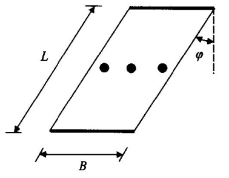
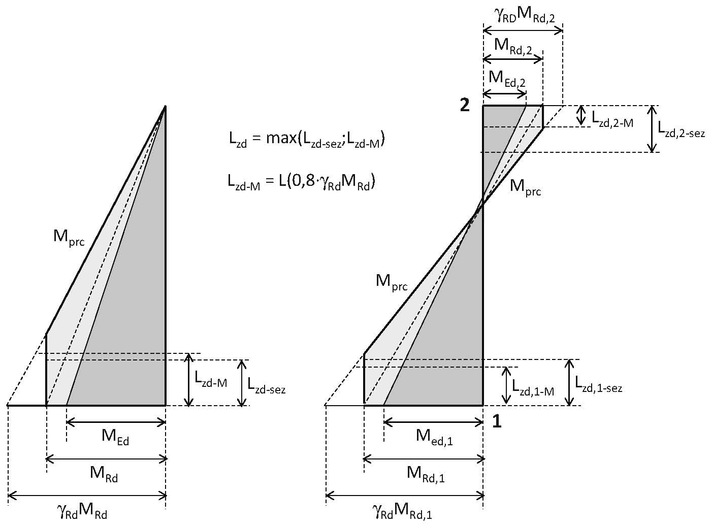
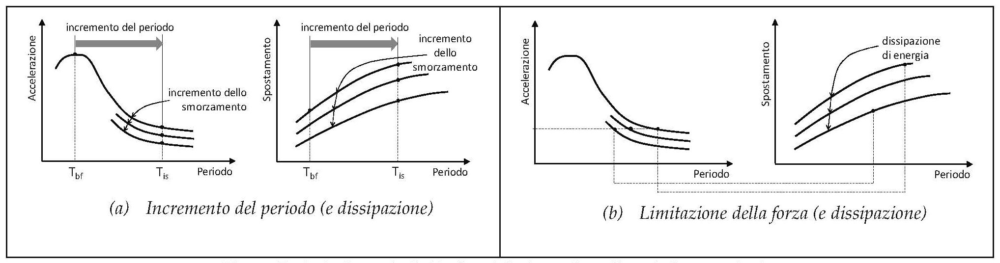
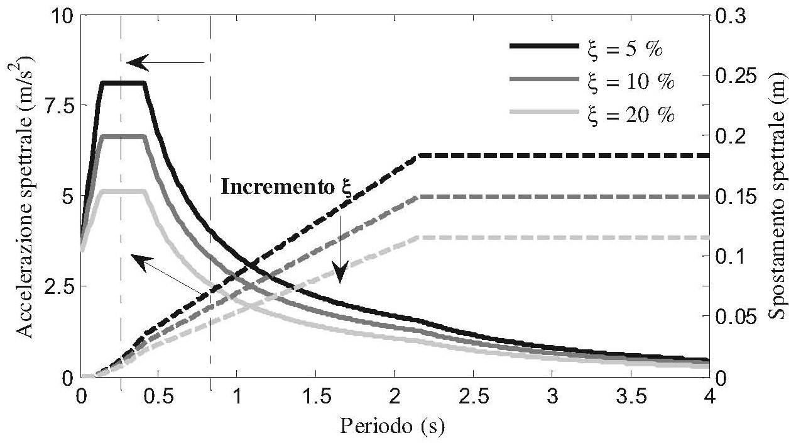
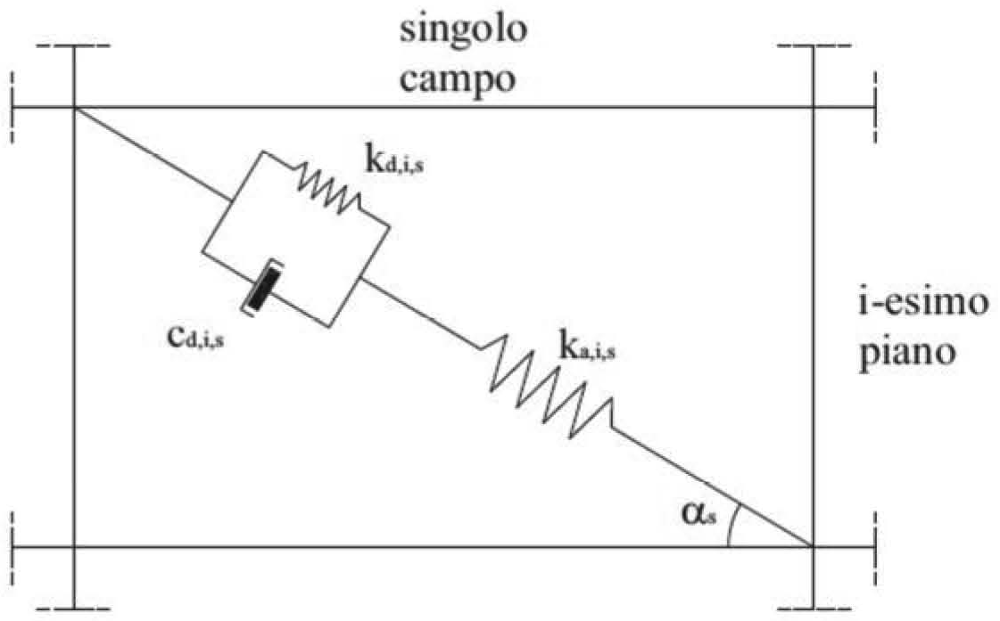

[Torna all'indice del capitolo](indice-cap07.md) | [Torna all'indice generale](../indice-ntc2018.md)

# 7.9. Ponti e costruzioni con isolamento e/o dissipazione

## Indice del capitolo

- [[#7.9. Ponti|7.9 Ponti]]
  - [[#7.9.1. Campo di applicazione|7.9.1 Campo di applicazione]]
  - [[#7.9.2. Criteri generali di progettazione|7.9.2 Criteri generali (q₀(ν_k), γ_Rd, pile)]]
  - [[#7.9.3. Modello strutturale|7.9.3 Modello strutturale]]
  - [[#7.9.4. Analisi strutturale|7.9.4 Analisi strutturale]]
  - [[#7.9.5. Dimensionamento e verifica degli elementi strutturali|7.9.5 Dimensionamento e verifica (pile, impalcato, appoggi, spalle)]]
  - [[#7.9.6. Dettagli costruttivi per elementi in c.a.|7.9.6 Dettagli costruttivi (ω_wd)]]
- [[#7.10. Costruzioni con isolamento e/o dissipazione|7.10 Costruzioni con isolamento e/o dissipazione]]
  - [[#7.10.1. Scopo|7.10.1 Scopo]]
  - [[#7.10.2. Requisiti generali|7.10.2 Requisiti generali (sotto/sovrastruttura)]]
  - [[#7.10.3. Caratteristiche e criteri di accettazione dei dispositivi|7.10.3 Dispositivi]]
  - [[#7.10.4. Indicazioni progettuali|7.10.4 Indicazioni progettuali]]
  - [[#7.10.5. Modellazione e analisi strutturale|7.10.5 Modellazione e analisi]]
  - [[#7.10.6. Verifiche|7.10.6 Verifiche (SLE, SLV q≤1,5, SLC)]]
  - [[#7.10.7. Aspetti costruttivi|7.10.7 Aspetti costruttivi]]
  - [[#7.10.8. Accorgimenti in fase di collaudo|7.10.8 Accorgimenti in fase di collaudo]]
- [[#C7.9. Ponti|C7.9 — Ponti]]
  - [[#C7.9.5. Dimensionamento e verifica degli elementi strutturali|C7.9.5 Dimensionamento (pile, Fig. C7.9.1)]]
- [[#C7.10. Costruzioni con isolamento e/o dissipazione|C7.10 — Isolamento e dissipazione]]
  - [[#C7.10.1. Scopo|C7.10.1 Scopo (Fig. C7.10.1-2)]]
  - [[#C7.10.2. Requisiti generali e criteri per il loro soddisfacimento|C7.10.2 Requisiti generali (sotto/sovra-struttura non dissip., CDB)]]
  - [[#C7.10.3. Caratteristiche e criteri di accettazione dei dispositivi|C7.10.3 Dispositivi]]
  - [[#C7.10.4. Indicazioni progettuali|C7.10.4 Indicazioni progettuali (Fig. C7.10.3)]]
  - [[#C7.10.5. Modellazione e analisi strutturale|C7.10.5 Modellazione (statica/dinamica/non lineare)]]
  - [[#C7.10.8. Accorgimenti specifici in fase di collaudo|C7.10.8 Collaudo]]

---

# Norma

## 7.9. Ponti

### 7.9.1. Campo di applicazione

Le norme del presente paragrafo si applicano ai ponti a pile e travate, sia con schema a travi semplicemente appoggiate, sia con impalcato continuo. Per le altre tipologie strutturali (ponti ad arco, ponti strallati, ponti sospesi) si potrà fare riferimento ad una documentazione tecnica di comprovata validità.

---

### 7.9.2. Criteri generali di progettazione

La progettazione dei ponti per azioni sismiche può essere effettuata per:

- **comportamento strutturale non dissipativo**: le sollecitazioni di progetto si calcolano assumendo un fattore di comportamento $q = 1$;

- **comportamento strutturale dissipativo**: le sollecitazioni di progetto si calcolano assumendo un fattore di comportamento $q > 1$, ammettendo che la struttura sviluppi zone dissipative nelle posizioni prestabilite.

Nel caso di comportamento dissipativo, la dissipazione di energia deve avvenire nelle pile, mediante formazione di cerniere plastiche. L'impalcato, gli apparecchi di appoggio, le fondazioni e le spalle devono essere progettati in capacità per rimanere in campo elastico.

Il fattore di sovraresistenza $\gamma_{Rd}$ per la progettazione in capacità degli elementi non dissipativi (impalcato, apparecchi di appoggio, fondazioni, spalle) si ottiene amplificando le sollecitazioni derivanti dalle zone dissipative (pile) per il valore:

$$\gamma_{Rd} = 1{,}3$$

#### 7.9.2.1. Valori del fattore di comportamento

Il fattore di comportamento $q$ è dato da:

$$q = q_0 \cdot K_R$$ \tag{7.9.2}

dove:

- $q_0$ è il valore base del fattore di comportamento, funzione della tipologia strutturale delle pile;
- $K_R$ è il fattore riduttivo che dipende dalla regolarità del ponte.

I valori di $q_0$ sono riportati nella Tab. 7.3.II.

**Tab. 7.3.II** – *Valori di $q_0$ per ponti*

| Tipologia delle pile | $q_0$ |
|---|:---:|
| Pile a fusto singolo in c.a. — flessibilità in direzione longitudinale (cerniera plastica alla base) | 3,5 $\lambda$ |
| Pile a fusto singolo in c.a. — flessibilità in direzione trasversale (doppia cerniera plastica) | 3,5 $\lambda$ |
| Pile a più fusti in c.a. | 3,5 |
| Pile a parete in c.a. — flessibilità in direzione trasversale | 2,1 |
| Pile a parete in c.a. — flessibilità in direzione longitudinale | 3,5 |
| Pile in acciaio (comportamento dissipativo) | 2,0 |

dove $\lambda$ è un fattore che tiene conto del rapporto di snellezza della pila. Per pile a fusto singolo in c.a., i valori di $q_0$ vanno moltiplicati per $\lambda$, dipendente dal rapporto fra altezza della pila e dimensione della sezione nella direzione considerata.

Per ponti progettati con sforzo normale ridotto $\nu_k > 0{,}3$, il valore di $q_0$ deve essere ridotto secondo la relazione:

$$q_0(\nu_k) = q_0 \cdot \left(1 - \frac{\nu_k - 0{,}3}{0{,}3}\right) \geq 1{,}0$$ \tag{7.9.1}

dove $\nu_k = N_{Ed} / (A_c \cdot f_{ck})$ è lo sforzo normale ridotto.

Il fattore $K_R$ tiene conto della regolarità del ponte:

$$K_R = 1{,}0 \quad \text{per ponti regolari}$$

$$K_R < 1{,}0 \quad \text{per ponti non regolari}$$

Un ponte è regolare quando il rapporto $\rho_i$ tra la domanda di duttilità locale massima e minima nelle diverse pile è limitato. Il valore di $K_R$ si determina in funzione della distribuzione delle domande di duttilità.

---

### 7.9.3. Modello strutturale

Il modello della struttura deve essere tridimensionale. Deve essere in grado di rappresentare adeguatamente la distribuzione di massa, rigidezza e resistenza della struttura reale.

Per i ponti obliqui (Fig. 7.9.1), la componente sismica in direzione trasversale al ponte genera effetti significativi anche in direzione longitudinale e viceversa. In tal caso il modello strutturale deve tenere conto dell'obliquità.

L'eccentricità accidentale delle masse rispetto al centro di rigidezza deve essere assunta non inferiore a:

$$e_a = 0{,}03 \cdot L$$

dove $L$ è la lunghezza del ponte.

#### 7.9.3.1. Interazione terreno-struttura e analisi di risposta sismica locale

Per le pile di altezza significativa e per i ponti fondati su terreni deformabili, l'interazione terreno-struttura deve essere tenuta in conto nella modellazione. In presenza di terreni di tipo S1 o S2, ovvero in presenza di condizioni topografiche e stratigrafiche particolari, si deve eseguire l'analisi di risposta sismica locale.

---

### 7.9.4. Analisi strutturale

#### 7.9.4.1. Analisi statica lineare

L'analisi statica lineare è applicabile ai ponti che soddisfano i seguenti requisiti:

*a)* la risposta sismica nella direzione considerata non è influenzata in modo significativo dai modi di vibrazione superiori al primo;

*b)* la struttura non presenta significative irregolarità di massa e rigidezza.

La massa totale $M$ da considerare è:

$$M = \sum_{i=1}^{n} G_{1i} + \sum_{i=1}^{n} G_{2i} + \sum_{i=1}^{n} \psi_{2i} \cdot Q_{ki}$$ \tag{7.9.4}

Il periodo fondamentale di vibrazione $T_1$ nella direzione considerata si calcola con:

$$T_1 = 2\pi \sqrt{\frac{M}{K}}$$ \tag{7.9.4}

dove $K$ è la rigidezza del ponte nella direzione considerata, determinata come la forza necessaria a produrre uno spostamento unitario del punto di applicazione della risultante.

Le forze sismiche equivalenti $F_i$ applicate al livello $i$-esimo sono:

$$F_i = M_i \cdot S_d(T_1)$$ \tag{7.9.5}

dove $S_d(T_1)$ è l'ordinata dello spettro di progetto corrispondente al periodo $T_1$ e $M_i$ è la massa del nodo $i$-esimo.

Per la stima approssimata del periodo fondamentale, si può utilizzare la formula:

$$T_1 = 2\pi \sqrt{\frac{\sum_{i} M_i \cdot d_i^2}{\sum_{i} F_i \cdot d_i}}$$ \tag{7.9.6}

dove $d_i$ sono gli spostamenti nella direzione considerata prodotti dalle forze $F_i$.

---

### 7.9.5. Dimensionamento e verifica degli elementi strutturali

Per i ponti progettati per comportamento dissipativo, il fattore di sovraresistenza $\gamma_{Rd}$ per le verifiche in capacità degli elementi non dissipativi è dato da:

$$\gamma_{Rd} = 0{,}7 + 0{,}2 \cdot q \geq 1{,}0$$ \tag{7.9.7}

dove $q$ è il fattore di comportamento adottato.

Le sollecitazioni di progetto negli elementi non dissipativi (impalcato, apparecchi di appoggio, fondazioni, spalle) si determinano amplificando per $\gamma_{Rd}$ le sollecitazioni trasferite dalle zone dissipative (pile) calcolate con le resistenze effettive dei materiali:

$$F_{prc} = \gamma_{Rd} \cdot F_{pile,Rd}$$

#### 7.9.5.1. Pile

Le pile devono essere verificate per le sollecitazioni derivanti dall'analisi, combinate secondo le regole di combinazione delle componenti dell'azione sismica.

**Verifiche a pressoflessione (resistenza)**

Per pile con sezione rettangolare o circolare, la verifica a pressoflessione deviata si esegue controllando che il punto rappresentativo delle sollecitazioni di progetto ($N_{Ed}$, $M_{Ed,y}$, $M_{Ed,z}$) sia interno al dominio di resistenza:

$$\left(\frac{M_{Ed,y}}{M_{Rd,y}}\right)^{\alpha} + \left(\frac{M_{Ed,z}}{M_{Rd,z}}\right)^{\alpha} \leq 1{,}0$$ \tag{7.9.8}

dove $M_{Rd,y}$ e $M_{Rd,z}$ sono i momenti resistenti nelle due direzioni, calcolati in presenza dello sforzo normale $N_{Ed}$, e $\alpha$ è un esponente che dipende dalla forma della sezione e dal livello di sforzo assiale.

Per la verifica allo SLV delle pile, la capacità in termini di rotazione alla corda $\theta$ deve soddisfare:

$$\theta_{Ed} \leq \theta_{Rd}$$ \tag{7.9.9}

dove $\theta_{Ed}$ è la domanda di rotazione e $\theta_{Rd}$ è la capacità di rotazione valutata in base alle proprietà geometriche e meccaniche della sezione.

**Verifiche a taglio**

La resistenza a taglio delle pile deve essere verificata considerando la riduzione della resistenza a taglio del calcestruzzo in funzione della domanda di duttilità. La resistenza a taglio di progetto è:

$$V_{Rd} = V_{Rd,c} + V_{Rd,s}$$ \tag{7.9.10.a}

con:

$$V_{Rd,c} = k(\mu_\Delta) \cdot V_{Rd,c,0}$$ \tag{7.9.10.b}

dove $k(\mu_\Delta)$ è un fattore riduttivo funzione della domanda di duttilità $\mu_\Delta$ e $V_{Rd,c,0}$ è la resistenza a taglio del calcestruzzo in assenza di domanda di duttilità.

La sollecitazione di taglio di progetto delle pile deve soddisfare:

$$V_{Ed} \leq V_{Rd}$$ \tag{7.9.11}

#### 7.9.5.2. Impalcato

L'impalcato deve essere progettato in capacità per resistere alle sollecitazioni trasmesse dalle pile amplificate per il fattore di sovraresistenza $\gamma_{Rd}$:

$$F_{Ed,impalcato} = \gamma_{Rd} \cdot F_{pile,Rd}$$ \tag{7.9.12}

dove $F_{pile,Rd}$ è la resistenza effettiva delle pile.

L'impalcato deve inoltre essere verificato per le sollecitazioni derivanti dalla componente verticale dell'azione sismica, quando significativa.

#### 7.9.5.3. Apparecchi di appoggio

Gli apparecchi di appoggio devono essere progettati per resistere alle forze trasmesse dalla struttura amplificate per il fattore di sovraresistenza $\gamma_{Rd}$, ovvero devono essere dimensionati come elementi fusibili, in modo da limitare le forze trasmesse alla sottostruttura.

In ogni caso, gli spostamenti relativi devono essere compatibili con la capacità di spostamento degli apparecchi di appoggio, tenendo conto di un opportuno margine di sicurezza.

#### 7.9.5.4. Spalle

Le spalle devono essere progettate in capacità, considerando le sollecitazioni trasmesse dall'impalcato amplificate per il fattore di sovraresistenza $\gamma_{Rd}$. Le spalle devono inoltre resistere alle spinte del terreno in condizioni sismiche.

---

### 7.9.6. Dettagli costruttivi per elementi in c.a.

#### 7.9.6.1. Pile

Nelle zone critiche delle pile (zone dissipative) devono essere garantiti adeguati dettagli costruttivi per assicurare la duttilità richiesta.

**Armature longitudinali**

L'armatura longitudinale nelle zone dissipative delle pile deve soddisfare le seguenti condizioni:

- la percentuale geometrica di armatura longitudinale non deve essere inferiore allo 1% e non superiore al 4% della sezione lorda di calcestruzzo;
- le barre longitudinali devono avere diametro non inferiore a 16 mm;
- la distanza massima tra le barre longitudinali non deve superare 200 mm.

**Armature di confinamento**

La percentuale meccanica volumetrica di armatura di confinamento $\omega_{wd}$ nelle zone critiche delle pile deve soddisfare:

Per sezioni rettangolari:

$$\omega_{wd} \geq \max\left\{0{,}08;\; \omega_{wd,min}\right\}$$ \tag{7.9.15}

Per sezioni circolari:

$$\omega_{wd} \geq \max\left\{0{,}12;\; \omega_{wd,min}\right\}$$

dove la percentuale meccanica volumetrica è definita come:

$$\omega_{wd} = \frac{\text{volume staffe}}{\text{volume nucleo}} \cdot \frac{f_{yd}}{f_{cd}}$$

La lunghezza della zona critica $L_{cr}$ alla base delle pile è data dal maggiore fra:

- la dimensione massima della sezione trasversale della pila;
- un sesto dell'altezza della pila;
- 450 mm.

La spaziatura delle staffe nella zona critica non deve superare il minore fra:

- un terzo della dimensione minima della sezione trasversale;
- 6 volte il diametro delle barre longitudinali;
- 150 mm.

Le barre longitudinali devono essere sostenute da staffe o legature con passo non superiore a quanto sopra indicato, in modo che nessuna barra disti più di 200 mm da una barra sostenuta.

La quantità minima di armatura di confinamento $\omega_{wd,min}$ dipende dal valore della duttilità in curvatura richiesta $\mu_\phi$ e dallo sforzo normale ridotto $\nu_k$:

$$\omega_{wd,min} = \max\left\{0;\; \alpha \cdot \left[\lambda \cdot \nu_k - 0{,}035\right]\right\}$$ \tag{7.9.23}

dove $\alpha$ è un coefficiente funzione della geometria della sezione e del tipo di confinamento.

#### 7.9.6.2. Impalcato, fondazioni e spalle

Per l'impalcato, le fondazioni e le spalle, progettati in capacità, si applicano le regole generali dei dettagli costruttivi di cui al § 4.1 e al § 7.4, senza le prescrizioni aggiuntive relative alle zone dissipative.

Le fondazioni devono essere dimensionate per le azioni trasmesse dalle pile amplificate per $\gamma_{Rd}$. L'armatura delle fondazioni deve garantire un adeguato ancoraggio delle barre longitudinali delle pile.

---

## 7.10. Costruzioni con isolamento e/o dissipazione

### 7.10.1. Scopo

L'isolamento sismico ha lo scopo di ridurre la risposta sismica della struttura mediante l'incremento del periodo fondamentale $T_1$ della costruzione (disaccoppiamento dalla frequenza dominante del moto sismico) e/o la limitazione della forza massima trasmessa alla sovrastruttura mediante l'introduzione di dispositivi di dissipazione di energia.

---

### 7.10.2. Requisiti generali

Il sistema strutturale di una costruzione isolata è composto da:

- **sottostruttura**: parte della struttura posta al di sotto dell'interfaccia di isolamento, comprensiva delle fondazioni;
- **sovrastruttura**: parte della struttura posta al di sopra dell'interfaccia di isolamento;
- **interfaccia di isolamento**: superficie di confine fra sottostruttura e sovrastruttura, in corrispondenza della quale è collocato il sistema di isolamento.

Il sistema di isolamento è costituito dall'insieme dei dispositivi utilizzati per l'isolamento sismico.

---

### 7.10.3. Caratteristiche e criteri di accettazione dei dispositivi

I dispositivi di isolamento devono essere conformi ai requisiti di cui al § 11.9. Le loro proprietà meccaniche devono essere determinate mediante prove sperimentali eseguite da laboratori autorizzati.

Le proprietà meccaniche dei dispositivi devono essere stabili sotto l'effetto delle variazioni di temperatura ambientale e della velocità di deformazione, dell'invecchiamento e del carico verticale.

---

### 7.10.4. Indicazioni progettuali

#### 7.10.4.1. Dispositivi ispezionabili e sostituibili

I dispositivi di isolamento devono essere ispezionabili e sostituibili. La struttura deve essere predisposta per consentire la sostituzione dei dispositivi durante la vita utile della costruzione.

#### 7.10.4.2. Controllo di movimenti indesiderati

Il sistema di isolamento deve essere progettato in modo da minimizzare gli effetti torsionali. A tal fine, il centro di rigidezza del sistema di isolamento deve essere il più possibile vicino alla proiezione verticale del centro di massa della sovrastruttura.

Devono essere adottati opportuni accorgimenti per impedire movimenti indesiderati (sollevamento, ribaltamento) della sovrastruttura in condizioni sismiche e non sismiche.

#### 7.10.4.3. Spostamenti sismici differenziali

Il progetto deve tenere conto degli effetti degli spostamenti sismici differenziali del terreno, particolarmente per costruzioni di grande estensione o fondate su terreni con caratteristiche meccaniche variabili.

#### 7.10.4.4. Spostamenti relativi al terreno e costruzioni circostanti

Deve essere previsto un giunto strutturale perimetrale di ampiezza sufficiente a consentire lo spostamento della sovrastruttura senza che questa urti contro costruzioni adiacenti o elementi rigidi circostanti. L'ampiezza del giunto deve essere non inferiore allo spostamento massimo del sistema di isolamento allo SLC.

---

### 7.10.5. Modellazione e analisi strutturale

#### 7.10.5.1. Proprietà del sistema di isolamento

Le proprietà del sistema di isolamento devono essere determinate a partire dalle proprietà dei singoli dispositivi, tenendo conto della variabilità delle proprietà meccaniche.

Per ciascuna proprietà si devono considerare un valore superiore e un valore inferiore, corrispondenti alle condizioni più sfavorevoli. L'analisi deve essere condotta per entrambi i valori e si adottano i risultati più sfavorevoli.

#### 7.10.5.2. Modellazione

La modellazione del sistema di isolamento può essere:

- **lineare equivalente**: il comportamento non lineare dei dispositivi è rappresentato mediante rigidezza secante $K_{eff}$ e smorzamento viscoso equivalente $\xi_{eff}$;

- **non lineare**: il comportamento dei dispositivi è descritto mediante legami costitutivi non lineari (bilineari, multilineari, ecc.).

La modellazione lineare equivalente è ammessa quando i dispositivi hanno un comportamento sostanzialmente simmetrico e le proprietà equivalenti possono essere determinate in modo affidabile.

#### 7.10.5.3. Analisi

##### 7.10.5.3.1. Analisi statica lineare

L'analisi statica lineare è applicabile quando il sistema di isolamento può essere modellato con comportamento lineare equivalente e la struttura è regolare.

Lo spostamento del centro di rigidezza del sistema di isolamento è:

$$d_{dc} = \frac{S_{De}(T_{is};\xi_{eff})}{1}$$ \tag{7.10.1}

dove $S_{De}(T_{is};\xi_{eff})$ è l'ordinata dello spettro di risposta elastico in spostamento, valutata per il periodo $T_{is}$ del sistema isolato e per lo smorzamento equivalente $\xi_{eff}$.

Il periodo equivalente del sistema isolato è:

$$T_{is} = 2\pi \sqrt{\frac{M}{K_{eff}}}$$ \tag{7.10.2}

dove $M$ è la massa della sovrastruttura e $K_{eff}$ è la rigidezza efficace del sistema di isolamento.

Lo spostamento massimo del singolo dispositivo $i$ deve tenere conto degli effetti torsionali:

$$d_i = d_{dc} \cdot \left(1 + e_i \cdot \frac{y_i}{\sum K_i \cdot y_i^2 / K_{eff}}\right)$$ \tag{7.10.3}

dove $e_i$ è l'eccentricità totale (strutturale + accidentale) e $y_i$ è la distanza del dispositivo $i$-esimo dal centro di rigidezza del sistema di isolamento.

La forza orizzontale totale applicata alla sovrastruttura è:

$$F = K_{eff} \cdot d_{dc}$$ \tag{7.10.4}

La distribuzione delle forze orizzontali lungo l'altezza della sovrastruttura è:

$$F_i = F \cdot \frac{m_i \cdot z_i}{\sum_{j} m_j \cdot z_j}$$ \tag{7.10.5}

dove $m_i$ e $z_i$ sono la massa e la quota del livello $i$-esimo rispetto all'interfaccia di isolamento.

##### 7.10.5.3.2. Analisi dinamica lineare

L'analisi dinamica modale con spettro di risposta si applica con le regole generali di cui al § 7.3.3, utilizzando lo spettro di risposta elastico corrispondente allo smorzamento $\xi_{eff}$ del sistema di isolamento. I modi di vibrazione della sovrastruttura devono essere calcolati considerando la deformabilità del sistema di isolamento.

---

### 7.10.6. Verifiche

#### 7.10.6.1. SLE

Per lo SLD, la sovrastruttura e la sottostruttura devono rimanere in campo sostanzialmente elastico. I dispositivi di isolamento devono funzionare correttamente e non subire danni.

Gli spostamenti interpiano della sovrastruttura devono essere compatibili con l'integrità degli elementi non strutturali.

#### 7.10.6.2. SLU

##### 7.10.6.2.1. SLV

Per lo SLV, le verifiche della sovrastruttura e della sottostruttura si eseguono con le regole generali del presente Capitolo, adottando un fattore di comportamento:

- per edifici: $q \leq 1{,}5$;
- per ponti: $q = 1{,}0$.

I dispositivi di isolamento devono essere verificati per lo spostamento e la forza corrispondenti allo SLV.

##### 7.10.6.2.2. SLC

Per lo SLC, i dispositivi di isolamento devono mantenere la propria funzionalità per gli spostamenti corrispondenti a tale stato limite. La capacità di spostamento dei dispositivi deve essere non inferiore allo spostamento di progetto allo SLC, con un opportuno margine di sicurezza.

La sottostruttura deve rimanere in campo elastico anche allo SLC.

---

### 7.10.7. Aspetti costruttivi

La costruzione isolata deve essere dotata di un piano di manutenzione che preveda l'ispezione periodica dei dispositivi di isolamento.

I dispositivi devono essere accessibili per l'ispezione e la sostituzione. A tal fine, la struttura deve essere predisposta con punti di sollevamento (martinetti idraulici) in prossimità di ciascun dispositivo, in modo da consentirne la sostituzione senza compromettere la stabilità della costruzione.

Le connessioni fra i dispositivi e la struttura devono essere progettate per trasmettere le forze massime che i dispositivi possono sviluppare.

---

### 7.10.8. Accorgimenti in fase di collaudo

In fase di collaudo devono essere verificati:

- la corretta posa in opera dei dispositivi di isolamento, con particolare riferimento al posizionamento, all'orientamento e all'eventuale precarico;
- la separazione fra sottostruttura e sovrastruttura, con verifica dell'assenza di contatti rigidi che possano cortocircuitare il sistema di isolamento;
- l'ampiezza effettiva dei giunti strutturali perimetrali;
- le prove dinamiche sulla costruzione isolata, ove richieste, per la determinazione del periodo fondamentale e dello smorzamento del sistema.

---

# Circolare

## C7.9. Ponti

### C7.9.5. Dimensionamento e verifica degli elementi strutturali

Per garantire alle pile da ponte un comportamento dissipativo, nel dimensionamento e nella verifica degli elementi strutturali si adotta la progettazione in capacità. A differenza degli elementi strutturali di tutte le altre tipologie strutturali, per le quali i fattori di sovraresistenza sono tutti riassunti nella Tabella 7.2.I, la norma fornisce un'espressione specifica per le strutture in elevazione dei ponti. Per individuare la domanda calcolata, in base a considerazioni di equilibrio, a partire dalla capacità a flessione delle zone dissipative e dai carichi permanenti, si utilizza, solo per i ponti, il pedice "pre".

#### C7.9.5.1. Pile

##### C7.9.5.1.1. Verifiche di resistenza (RES)

La figura C7.9.1 sintetizza i criteri di verifica per le pile, con riferimento a due schemi tipo: quello della pila libera in testa (mensola) e quello della pila con incastro al piede e in testa, con diverso grado di vincolo. Le prescrizioni sulla lunghezza delle zone dissipative sono riportate al § 7.9.6.1.3 della norma.

*Figura C7.9.1 — Progettazione in capacità delle pile (schemi a mensola e a doppio incastro).*

Si specifica di seguito il significato dei simboli in Figura C7.9.1: $L_{ad}$ = lunghezza della zona dissipativa; $L_{ad,sez}$ = lunghezza della zona dissipativa in funzione delle dimensioni della sezione (§ 7.9.6.1.3 NTC); $L_{ad,M}$ = lunghezza della zona dissipativa in funzione della domanda flessionale $M_{pre}$ definita al § 7.9.5 della norma.

## C7.10. Costruzioni con isolamento e/o dissipazione

### C7.10.1. Scopo

L'isolamento sismico rientra tra le strategie di protezione usualmente raggruppate sotto la denominazione di "controllo passivo delle vibrazioni". Di queste l'*"isolamento sismico"* e la *"dissipazione d'energia"* sono quelle più comunemente utilizzate. Entrambe le tecniche di protezione sono correntemente usate per la protezione delle costruzioni, sia nuove che esistenti, e sono efficaci in ragione del modo in cui ne modificano il comportamento dinamico. La prima è essenzialmente finalizzata a limitare l'energia in ingresso attraverso isolatori collocati tra la porzione di costruzione da proteggere e quella solidale al terreno, la seconda consente di dissipare parte dell'energia in ingresso, attraverso meccanismi di dissipazione controllata, utilizzando appositi dispositivi collocati all'interno della struttura o colleganti strutture contigue.

Queste tecniche di protezione si utilizzano per migliorare le prestazioni delle costruzioni soggette ad azioni sismiche.

Per realizzare l'isolamento sismico, occorre creare una discontinuità strutturale lungo l'altezza della costruzione che permetta ampi spostamenti orizzontali relativi tra la parte della costruzione superiore (*sovrastruttura*) e quella inferiore (*sottostruttura*) alla discontinuità. Il collegamento tra la sovrastruttura e la sottostruttura è realizzato mediante isolatori, ovvero speciali apparecchi di appoggio caratterizzati da rigidezze basse nei confronti degli spostamenti orizzontali, elevate nei confronti di quelli verticali.

Negli edifici, la discontinuità strutturale viene spesso realizzata alla base, tra la fondazione e l'elevazione (isolamento alla base) o immediatamente al di sopra del 1° piano, per lo più lo scantinato.

Nei ponti l'isolamento sismico è generalmente realizzato tra l'impalcato e le strutture di supporto (pile e spalle), nel qual caso gli isolatori sostituiscono gli usuali apparecchi di appoggio. Normalmente la riduzione delle forze sismiche che ne consegue produce i suoi maggiori benefici sulle pile e sulle spalle (benefici indiretti sulla sottostruttura). Nei ponti ad impalcato continuo, un'attenta calibrazione delle caratteristiche meccaniche e dei dispositivi d'isolamento e di vincolo che collegano l'impalcato con le pile e le spalle permette altresì di migliorare la distribuzione delle forze sismiche orizzontali trasmesse dall'impalcato alle diverse strutture di supporto.

Molti degli isolatori attualmente in commercio, anche a comportamento sostanzialmente lineare, garantiscono rapporti di smorzamento del sistema d'isolamento superiori al 5%. Per modificare e migliorare le caratteristiche del sistema d'isolamento, in termini di capacità dissipative e/o ricentranti, si possono utilizzare "dispositivi ausiliari" con opportuno comportamento meccanico.

Gli effetti dell'isolamento su una struttura possono essere ben interpretati facendo riferimento a forme tipiche degli spettri di risposta elastici in accelerazioni e in spostamenti, per diversi rapporti di smorzamento (Figura C7.10.1).

Considerando una porzione di struttura che, a base fissa, avrebbe un periodo fondamentale di oscillazione $T_{bf}$ in una data direzione, l'isolamento alla base di questa porzione deve produrre uno dei seguenti effetti:

a) l'incremento del periodo grazie all'adozione di dispositivi con comportamento d'insieme approssimativamente lineare. Si parla di un buon "disaccoppiamento" quando il periodo della struttura isolata $T_{IS}$ risulta $T_{IS} \geq 3\, T_{bf}$. Maggiore è l'incremento di periodo (generalmente $T_{IS} > 2{,}0$ s) maggiore è la riduzione delle accelerazioni sulla sovrastruttura (spettro in accelerazioni) e l'incremento degli spostamenti (spettro in spostamenti), che si concentrano essenzialmente nel sistema di isolamento;
b) la limitazione della forza trasmessa alla sottostruttura, grazie all'adozione di dispositivi con comportamento non lineare, caratterizzato da basso incrudimento ovvero incrementi minimi o nulli della forza per grandi spostamenti. In questo modo si limitano le forze d'inerzia, quindi l'accelerazione, sulla sovrastruttura, ancora a scapito di un sensibile incremento degli spostamenti nel sistema di isolamento.

Oltre nei due modi detti, l'isolamento si può conseguire utilizzando dispositivi che garantiscano al sistema un comportamento d'insieme intermedio tra i due.

La dissipazione di energia, dovuta agli isolatori e/o ad eventuali dispositivi ausiliari determina sempre una riduzione degli spostamenti nel sistema di isolamento. Essa è particolarmente utile in siti caratterizzati da elevata sismicità e/o nel caso di sottosuoli con caratteristiche meccaniche scadenti (tipo C, D, E), cioè nei casi in cui gli spettri di risposta possono presentare spostamenti elevati ed accelerazioni significative anche su periodi di oscillazioni elevati.

*Figura C7.10.1 — Strategie di riduzione della domanda mediante isolamento sismico: (a) Incremento del periodo (e dissipazione); (b) Limitazione della forza (e dissipazione).*

L'applicazione dell'isolamento sismico, anche alle usuali costruzioni, richiede criteri, regole e accorgimenti particolari, riportati nel § 7.10 delle NTC e, ove necessario, meglio esplicitati in questa circolare, per tener conto del comportamento peculiare dell'insieme sottostruttura-sistema d'isolamento-sovrastruttura.

Tali regole, evidentemente, non possono essere estese all'applicazione strutturale di altri sistemi di protezione sismica, quali quelli basati sull'impiego di dispositivi dissipativi distribuiti a vari livelli, all'interno della costruzione, come nel caso dei sistemi di controventi dissipativi per gli edifici a struttura intelaiata.

Per essi non è necessaria una trattazione specifica, poiché la loro progettazione non richiede regole aggiuntive rispetto a quelle già descritte per le costruzioni ordinarie, una volta che il comportamento dei dispositivi antisismici sia tenuto correttamente in conto e che le loro caratteristiche e le modalità di accertamento siano conformi alle prescrizioni del § 11.9 delle NTC, fatto salvo il numero di cicli da effettuare nelle prove di qualificazione, che dovrà essere commisurato a quello prevedibile per il terremoto di progetto allo SLC. Infatti, le NTC forniscono indicazioni e prescrizioni sugli strumenti e metodi di valutazione (modellazione e analisi strutturali lineari e non lineari) nonché le regole per le verifiche di sicurezza degli elementi strutturali e dei dispositivi.

Per questi schemi applicativi, lo spostamento di interpiano prodotto dal sisma attiva i meccanismi di dissipazione di energia prima che gli spostamenti relativi possano produrre danni significativi sugli elementi strutturali. In tal modo la maggior parte dell'energia in entrata viene immagazzinata e dissipata nei dispositivi, mentre la funzione di sostegno dei carichi verticali rimane attribuita alla struttura convenzionale.

Facendo riferimento alle forme tipiche degli spettri di risposta elastici delle accelerazioni e degli spostamenti di Fig. C7.10.2, il comportamento di una struttura dotata di dispositivi dissipativi, assimilata ad oscillatore elementare, può essere interpretato osservando che l'introduzione del sistema di dissipazione produce un aumento dello smorzamento e, se il sistema determina un irrigidimento della struttura, una riduzione del periodo, oltre che, per molti sistemi di uso corrente, un aumento della resistenza complessiva. Ciò determina una sensibile riduzione degli spostamenti complessivi (si vedano gli spettri in spostamenti) e, quindi, degli spostamenti di interpiano, con conseguente riduzione dei danni agli elementi strutturali e non.

Quando la struttura non isolata ha un periodo elevato, come nel caso esposto in figura, così da ricadere nell'intervallo del ramo calante delle curve spettrali in accelerazione, si può manifestare un aumento delle accelerazioni sulla struttura, e quindi un aumento delle forze sismiche, ma con conseguente maggior impegno delle fondazioni, in particolare di quelle immediatamente sottostanti le maglie strutturali rafforzate. In ogni caso i pilastri interagenti direttamente con i controventi, a fronte di una drastica riduzione delle sollecitazioni flettenti e taglianti, subiscono un incremento delle sollecitazioni assiali.

*Figura C7.10.2 — Strategie di riduzione della domanda mediante dissipazione di energia.*

Tra i pregi che la strategia della dissipazione di energia presenta, anche rispetto all'isolamento sismico, spicca la capacità di far fronte a qualsiasi tipo di azione dinamica, indipendentemente dal contenuto in frequenze della forzante, il che la rende favorevolmente applicabile a qualsiasi tipo di edificio, in particolare anche agli edifici alti, e qualunque sia la natura del terreno di fondazione, quindi anche nel caso di terreni soffici. Inoltre essa ben si presta all'adeguamento o miglioramento sismico di costruzioni esistenti, particolarmente degli edifici intelaiati, con possibili vantaggi rispetto ad interventi sia convenzionali sia basati sull'isolamento sismico.

### C7.10.2. Requisiti generali e criteri per il loro soddisfacimento

Il sistema d'isolamento deve consentire elevati spostamenti orizzontali garantendo, al contempo, le previste condizioni di vincolo sotto le azioni di servizio. Per garantire quest'ultima condizione, qualora i dispositivi d'isolamento non siano in grado di garantire la condizione di vincolo necessaria, possono essere anche utilizzati dispositivi di vincolo temporaneo, del tipo "a fusibile" (v. § 11.9 delle NTC), che cessano di essere efficaci quando l'azione sismica supera una prefissata intensità. Quando si utilizzano dispositivi di vincolo temporaneo occorre valutare gli effetti che hanno sul movimento della struttura, anche per azioni sismiche che eccedono questo livello prefissato.

La capacità di ricentraggio del sistema d'isolamento è un requisito aggiuntivo, legato alla necessità, o semplicemente, all'opportunità, di garantire che al termine di un terremoto anche violento il sistema d'isolamento, e quindi la struttura nella sua globalità, presenti spostamenti residui nulli o molto piccoli, in modo da non comprometterne l'efficacia operativa nel caso di scosse successive.

Il comportamento di una costruzione con isolamento sismico risulta valutabile, con una buona approssimazione, se i suoi elementi strutturali non subiscono grandi escursioni in campo plastico. La completa plasticizzazione della sovrastruttura può condurre, in alcuni casi particolari (strutture con uno o due piani, con alti periodi di isolamento, scarsa ridondanza e basso incrudimento post-elastico), a notevoli richieste di duttilità. Per questo motivo la *sovrastruttura* e la *sottostruttura* devono avere comportamento strutturale non dissipativo, il che, per azioni sismiche relative allo **SLV**, implica un danneggiamento strutturale molto più limitato, quasi nullo, rispetto a quello di una struttura antisismica convenzionale, per la quale si ammette che, per lo stesso livello di azione, si verifichino notevoli richieste di duttilità.

Il rispetto di questa prescrizione, peraltro, non richiede in generale sovradimensionamenti rispetto alle costruzioni convenzionali, grazie al drastico abbattimento delle accelerazioni cui la struttura isolata è soggetta, e anzi conduce a sollecitazioni di progetto paragonabili quando non inferiori. Essendo nulle o molto limitate le richieste di duttilità agli elementi strutturali, l'adozione di una progettazione in alta duttilità comporterebbe degli inutili aggravi di costo, senza sostanziali vantaggi. Pertanto per i dettagli costruttivi (e solo per questi) si fa riferimento alle regole relative alla Classe di Duttilità a media capacità dissipativa "CDB", per la quale non si richiedono particolari capacità dissipative, ma solo un'adeguata resistenza laterale.

I dispositivi dissipativi dovranno soddisfare le condizioni generali di non danneggiamento e di non rottura nei confronti degli stati limite SLD e SLC, analogamente a quanto previsto per i dispositivi facenti parte di sistemi di isolamento. Come per i dispositivi d'isolamento, infatti, un'affidabilità superiore a dispositivi dissipativi è dovuta al ruolo critico che essi svolgono. Tale affidabilità si ritiene conseguita se sono progettati e verificati sperimentalmente secondo quanto stabilito nel § 11.9.

Condizioni di malfunzionamento o di collasso dei sistemi dissipativi possono dipendere anche dai controventi che collegano o inglobano i dispositivi dissipativi, per i quali dovrà essere evitata la possibilità di instabilizzazione a compressione o di plasticizzazione a trazione per livelli di forza inferiori o pari a quelli di progetto, per qualsiasi Stato limite considerato.

Ulteriori condizioni generali sono legate alle caratteristiche di resistenza degli elementi strutturali collegati ai dispositivi e/o ai controventi. In particolare, nei pilastri adiacenti ai campi controventati occorre controllare che eccessivi stati di sforzo assiale di compressione non inducano fenomeni di instabilità nel caso di strutture in acciaio o di rotture di tipo fragile nel caso di strutture in c.a. Per queste ultime occorre, inoltre, evitare che sforzi di trazione troppo grandi indotti dall'azione sismica riducano eccessivamente il momento resistente ultimo, al punto da determinare la rottura.

### C7.10.3. Caratteristiche e criteri di accettazione dei dispositivi

In relazione alla funzione svolta nell'ambito del sistema d'isolamento, i dispositivi facenti parte di un sistema di isolamento si possono distinguere in "isolatori" e "dispositivi ausiliari".

Gli isolatori, in accordo con la definizione data nel § 11.9 delle NTC, sono dispositivi che svolgono fondamentalmente la funzione di sostegno dei carichi verticali, con i requisiti di un'elevata rigidezza in direzione verticale e di una bassa rigidezza o resistenza in direzione orizzontale, permettendo notevoli spostamenti orizzontali. A tale funzione possono essere associate o no quelle di dissipazione di energia, di ricentraggio del sistema, rispetto alle azioni orizzontali, la funzione di dissipazione di energia e/o di ricentraggio del sistema e/o di vincolo laterale temporaneo per azioni sismiche o non sismiche.

Ricadono nell'ampia categoria dei dispositivi ausiliari tutti quei dispositivi, trattati nel § 11.9, che non sostengono carichi verticali ma svolgono, rispetto alle azioni orizzontali, la funzione di dissipazione di energia e/o di ricentraggio del sistema e/o di vincolo laterale temporaneo per azioni sismiche o non sismiche.

Un sistema di isolamento può essere ad esempio costituito da isolatori elastomerici, eventualmente realizzati con elastomeri ad alta dissipazione o comprendenti inserti di materiali dissipativi (ad es. piombo), oppure da isolatori a scorrimento o rotolamento, che inglobano funzioni dissipative o ricentranti per capacità intrinseca o per presenza di elementi capaci di svolgere tali funzioni, oppure da un'opportuna combinazione di isolatori e dispositivi ausiliari, questi ultimi generalmente con funzione dissipativa, ricentrante e/o di vincolo.

Le proprietà di un sistema di isolamento, nel suo complesso, e la loro costanza nel tempo e nelle varie condizioni di funzionamento scaturiscono dalla combinazione delle proprietà dei dispositivi che lo costituiscono.

La scelta della tipologia di dispositivi da utilizzare in ciascun caso dipende da numerosi fattori, tra cui il livello di protezione da conseguire, le caratteristiche della struttura principale, gli ingombri, la necessità di garantire la piena funzionalità o l'assenza di danno ai dispositivi anche dopo terremoti violenti, le esigenze di manutenzione.

Tipicamente si utilizzano dispositivi di un unico tipo per tutta la struttura, sia per semplicità di progettazione ed esecuzione, sia per una generale economia dell'opera. Non è escluso, tuttavia, che, per alcune situazioni progettuali, un'opportuna combinazione di tipologie diverse di dispositivi possa determinare vantaggi nel comportamento generale della struttura. In tali casi occorre ben valutare gli effetti differenziali di fattori, quali ad esempio la temperatura e l'invecchiamento, che possono variare il comportamento dei dispositivi rispetto a condizioni di riferimento medie.

### C7.10.4. Indicazioni progettuali

La progettazione richiede, in generale, la scelta della tipologia dei dispositivi e il loro dimensionamento, in base agli obiettivi da raggiungere.

Nel caso in cui si intervenga su una struttura esistente, l'analisi preliminare della struttura allo stato attuale fornisce utili indicazioni per il progetto del sistema di dissipazione.

L'inserimento del sistema dissipativo sarà finalizzato a ridurre le deformazioni, in modo da contenere i danni ed evitare il collasso della struttura, attraverso le due seguenti azioni alternative:

1) l'incremento della sola dissipazione, che si traduce in uno smorzamento modale equivalente aggiuntivo, con la conseguente riduzione dell'ordinata dello spettro degli spostamenti, a parità di periodo proprio;
2) l'incremento della rigidezza e della dissipazione, per cui la riduzione dell'ordinata dello spettro degli spostamenti avviene sia per aumento dello smorzamento che per riduzione del periodo.

La prima è ottenibile con l'utilizzazione di dispositivi dipendenti dalla velocità e si applica bene a strutture dotate di per sé di buona rigidezza e resistenza, per le quali è sufficiente una riduzione dell'ordine del 20-40% delle deformazioni sismiche, conseguente ad una uguale riduzione delle forze sismiche.

La seconda è ottenibile con l'utilizzazione di dispositivi dipendenti dallo spostamento e permette di ridurre drasticamente le deformazioni prodotte dal sisma. Nel contempo si possono però avere notevoli incrementi delle accelerazioni, e quindi incrementi delle forze sismiche, con aggravio delle sollecitazioni in fondazione.

#### C7.10.4.1. Indicazioni riguardanti i dispositivi

La norma prevede la possibilità di sostituzione dei dispositivi, e dunque predisporre la struttura in modo che sia possibile trasferire temporaneamente alla sottostruttura, attraverso martinetti opportunamente disposti, il carico gravante sul singolo isolatore e prevedere un adeguato spazio per le operazioni necessarie alla rimozione e sostituzione.

Per ridurre o annullare gli spostamenti residui a seguito di un terremoto è inoltre necessario verificare la presenza o prevedere appositi elementi strutturali di contrasto contro cui fare forza per ricollocare la struttura nella sua posizione originaria.

Le connessioni tra i controventi e i nodi strutturali devono essere progettate in modo tale da assorbire, con ampio margine di sicurezza, le forze previste dal calcolo. Le stesse aste non dovranno subire fenomeni di instabilità, sotto la massima forza che il dispositivo dissipativo è in grado di trasmettere.

Per i dispositivi dipendenti dagli spostamenti i parametri fondamentali sono la rigidezza $k_d$ e la resistenza $F_{dy}$, la duttilità $\mu_e$ e il rapporto tra la rigidezza del sistema dissipativo $k_c$ e quella della struttura $k_s$, mentre per i dispositivi dipendenti dalla velocità sono la costante di smorzamento e l'eventuale rigidezza.

*Figura C7.10.3 — Rigidezza risultante del telaio rinforzato con sistema dissipativo (Fig. C7.10.2 nella numerazione della Circolare).*

La rigidezza del sistema dissipativo deriva dalla combinazione delle rigidezze dei singoli componenti, ossia del dispositivo dissipativo e della struttura, generalmente metallica, di supporto.

Indicando con: $k_c$ la rigidezza del sistema dissipativo, $k_a$ la rigidezza del telaio, $k_d$ la rigidezza del dispositivo e $k_s$ la rigidezza del supporto metallico, e con riferimento alla Figura C7.10.3, si ha:

$$k_C = \frac{1}{\dfrac{1}{k_d} + \dfrac{1}{k_s}} \quad \text{rigidezza del sistema}$$ \tag{C7.10.1}

$$k_{tot} = k_a + k_c \quad \text{rigidezza del telaio rinforzato}$$ \tag{C7.10.2}

In generale il sistema di supporto deve possedere un'elevata rigidezza, rigidezza assiale se si tratta di controventi, necessaria per concentrare le deformazioni indotte dal sisma nei dispositivi e per garantire una significativa dissipazione d'energia per piccoli spostamenti.

Per garantire un'efficace interazione, i sistemi dissipativi devono essere posizionati nel piano dei telai, possibilmente all'interno delle maglie strutturali. In caso contrario, particolare attenzione va posta nello studio delle connessioni, che possono risultare non sufficientemente rigide o indurre eccessive sollecitazioni locali nelle strutture portanti dell'edificio.

#### C7.10.4.2. Controllo di movimenti indesiderati

Gli effetti torsionali d'insieme del sistema strutturale, ossia di rotazione intorno ad un asse verticale, determinano spostamenti diversi nei dispositivi dissipativi, e nel caso di forti non linearità, differenze di comportamento che possono ulteriormente accentuare la torsione. Occorre pertanto evitare o limitare quanto più possibile le eccentricità massa-rigidezza, cosa peraltro facilmente ottenibile attraverso una corretta progettazione degli isolatori e dei dispositivi ausiliari, e incrementare la rigidezza e/o resistenza torsionale del sistema d'isolamento.

Si sottolinea la necessità di valutare i possibili effetti sulla struttura legati alla deformabilità verticale degli isolatori elastomerici, funzione delle caratteristiche geometriche dell'isolatore e meccaniche dell'elastomero, e a quella pressoché nulla degli isolatori a scorrimento. Si possono avere spostamenti differenziali significativi sia nella fase elastica di caricamento, sia nella fase successiva, di deformazioni lente (viscosità della gomma), sia, infine, sotto l'azione del terremoto.

L'isolatore in gomma, infatti, sottoposto a spostamento laterale, subisce anche accorciamenti verticali non trascurabili, a causa della concentrazione degli sforzi di compressione nell'area di sovrapposizione tra la piastra superiore e quella inferiore, nella condizione di isolatore deformato. In termini generali è consigliabile adottare isolatori in gomma molto rigidi verticalmente e, dunque, con fattori di forma primario e secondario piuttosto elevati, così da minimizzare gli spostamenti verticali in condizioni statiche e sismiche.

Gli isolatori soggetti a forze di trazione o a sollevamento durante l'azione sismica dovranno essere in grado di sopportare la trazione o il sollevamento senza perdere la loro funzionalità strutturale.

La presenza di sforzi di trazione eccessivi negli isolatori elastomerici può indurre cavitazione nella gomma e l'innesco di rotture. Nel caso di isolatori a scorrimento, possono determinarsi sollevamenti e quindi distacchi tra le superfici di scorrimento, con possibili negativi effetti di impatto. In generale, la trazione negli isolatori determina comportamenti non lineari, difficilmente valutabili attraverso un calcolo lineare, ed una condizione di lavoro degli isolatori di solito non verificata sperimentalmente.

In generale, salvo situazioni particolari in cui una parte della struttura abbia una resistenza sovrabbondante rispetto alla richiesta locale, sarà opportuno che il sistema di dissipazione sia distribuito lungo tutta l'altezza della struttura, con caratteristiche meccaniche piano per piano calibrate in modo da conseguire gli obiettivi sopra richiamati.

La posizione e la configurazione dei controventi dissipativi è spesso condizionata dalle esigenze architettoniche, e ciò può costituire un vincolo all'ottimizzazione della posizione in pianta e della disposizione nella maglia strutturale. Sarà, quindi, opportuno cercare soluzioni concordate con il progettista architettonico, che possano conciliare entrambe le esigenze.

È opportuna una buona ridondanza degli elementi che costituiscono il sistema di protezione per un duplice motivo. In primo luogo, l'utilizzo di un maggior numero di controventi consente di ridurre le sollecitazioni sulle membrature cui essi sono collegati. In secondo luogo, disponendo più controventi all'interno della struttura, è possibile scongiurare il rischio che il malfunzionamento di un dispositivo possa compromettere l'efficacia dell'intero sistema di protezione.

#### C7.10.4.3. Controllo degli spostamenti sismici differenziali del terreno

La rigidità strutturale dei piani immediatamente al di sotto e al di sopra del sistema di isolamento va intesa nel piano orizzontale, ed è finalizzata a garantire una distribuzione regolare degli sforzi tra i diversi isolatori, anche in caso di funzionamenti difformi da quelli previsti, ed a distribuire correttamente le forze degli eventuali dispositivi ausiliari (che sono in genere in numero limitato) tra gli elementi strutturali che debbono assorbirli.

Il ruolo dei diaframmi rigidi orizzontalmente è tanto più importante quanto meno uniforme è la trasmissione degli sforzi orizzontali tra la sovrastruttura e la sottostruttura.

#### C7.10.4.4. Controllo degli spostamenti relativi al terreno ed alle costruzioni circostanti

Il corretto funzionamento di una struttura con isolamento sismico si consegue solo a condizione che la massa isolata, ossia quella della sovrastruttura, possa muoversi liberamente in tutte le direzioni orizzontali per spostamenti almeno pari a quelli di progetto. Questa condizione deve essere verificata in tutte le fasi progettuali, realizzative e di collaudo.

In particolare è importante controllare che elementi non strutturali e/o impianti non riducano le possibilità di movimento della struttura previste nella progettazione strutturale. In tal senso è richiesta, da parte di tutti i progettisti inclusi quelli architettonici e impiantistici, la massima sensibilizzazione e la piena consapevolezza delle modalità di funzionamento di una struttura con isolamento sismico.

È inoltre importante controllare copri-giunti e elementi di attraversamento orizzontali (dispositivi di giunto) e verticali (scale, ascensori), affinché siano concepiti e realizzati così da non impedire il libero movimento della sovrastruttura.

### C7.10.5. Modellazione e analisi strutturale

Il modello matematico dell'edificio deve tener conto della effettiva distribuzione in pianta e in elevazione dei dispositivi dissipativi, per consentire la valutazione esplicita della distribuzione delle forze e delle azioni di progetto nei componenti al sistema dissipativo. I rapporti di rigidezza tra il sistema di dissipazione e la struttura portante sono importanti nel determinare la distribuzione delle forze orizzontali tra l'uno e l'altra e il comportamento dinamico dell'insieme. La complessità, inoltre, si accresce in relazione al fatto che la rigidezza delle membrature in c.a. è fortemente condizionata dalla fessurazione, a sua volta funzione del livello di sollecitazione flessionale e tagliante, dell'entità dello sforzo assiale e della quantità di armatura, e di tali parametri è necessario tener conto almeno in maniera approssimativa.

Nella modellazione del sistema di controventamento, occorre portare in conto la deformabilità dei collegamenti alla struttura portante e al dispositivo dissipativo.

#### C7.10.5.1. Proprietà del sistema di isolamento

Ai fini della valutazione globale delle variazioni delle caratteristiche meccaniche da mettere in conto nelle analisi, occorrerà tener conto sia della (bassa) probabilità di occorrenza del terremoto contemporaneamente alle diverse condizioni che determinano tali variazioni, sia della correlazione tra le variazioni dei parametri che definiscono il comportamento meccanico dei diversi dispositivi che compongono il sistema di isolamento, in particolare verificando se le variazioni avvengono con stesso segno o con segno opposto.

L'entità delle deformazioni subite in relazione allo stato limite considerato ha notevole influenza nel caso di sistemi a comportamento non lineare, minore nel caso di sistemi a comportamento quasi-lineare. Nel primo caso, quando si esegue l'analisi non lineare, tale variabilità è automaticamente messa in conto nel modello. Qualora, invece, fosse possibile adottare l'analisi lineare, particolare cura dovrà essere rivolta alla determinazione delle caratteristiche lineari equivalenti del sistema. Per i sistemi quasi lineari l'effetto risulterà tanto maggiore quanto maggiore è la dissipazione di energia. Nel caso di isolatori elastomerici, per rapporti di smorzamento dell'ordine del 10%, le analisi per lo SLU e per lo SLD possono eseguirsi, in genere, con gli stessi valori di rigidezza e di smorzamento, se i valori di deformazione raggiunti per i due livelli di azione sono compresi tra il 50% e il 150%.

La velocità di deformazione (frequenza), nell'intervallo di variabilità del $\pm 30\%$ del valore di progetto ha, per la maggior parte dei dispositivi normalmente utilizzati, influenza trascurabile. Più importanti sono le differenze di comportamento tra le condizioni di esercizio (ad esempio in relazione a spostamenti lenti dovuti a variazioni termiche) e quelle sismiche, differenziandosi le velocità di qualche ordine di grandezza.

La rigidezza o la resistenza agli spostamenti orizzontali di alcuni tipi di isolatori dipendono dall'entità degli sforzi verticali agenti simultaneamente agli spostamenti sismici orizzontali. Ciò accade in maniera significativa per gli isolatori a scorrimento e, in misura minore, per gli isolatori elastomerici con basso fattore di forma secondario.

Per gli isolatori elastomerici con elevati fattori di forma e con verifiche di stabilità soddisfatte con ampio margine, la dipendenza della rigidezza orizzontale dallo sforzo verticale presente è del tutto trascurabile.

Il comportamento di un dispositivo secondo una direzione può essere, per alcuni tipi, influenzato dalle deformazioni in direzione trasversale a quella considerata, per effetti del second'ordine non trascurabili.

Le variazioni di caratteristiche meccaniche conseguenti alle variazioni termiche potranno essere valutate coerentemente con i valori di combinazione degli effetti termici.

Nel piano di manutenzione dei dispositivi antisismici occorre tenere conto degli effetti dell'invecchiamento che, per i dispositivi elastomerici, possono essere particolarmente significativi.

#### C7.10.5.2. Modellazione

Anche nel caso in cui sia necessario ricorrere all'analisi non lineare, il modello della sovrastruttura e della sottostruttura sarà costituito da elementi a comportamento lineare, essendo assenti o trascurabili le escursioni in campo non lineare della struttura, per quanto specificato in §7.10.5.2 in §7.10.6.2.1.

In tal caso si farà riferimento ad un modello in cui gli elementi della struttura operano in campo elastico lineare mentre gli elementi del sistema d'isolamento operano in campo non lineare, riproducendone al meglio il comportamento ciclico reale dei dispositivi, così come ricavato dalle prove di qualificazione (v. §11.9).

#### C7.10.5.3. Analisi

In relazione alle caratteristiche dell'edificio e del sistema di isolamento possono essere utilizzati i seguenti metodi di analisi:

- statica lineare
- dinamica lineare
- dinamica non lineare

L'analisi statica lineare è applicabile solo nei casi in cui il sistema d'isolamento è modellabile come visco-elastico lineare (v. §7.10.5.2) e solo quando sono soddisfatte le condizioni specificate in §7.10.5.3.1, che individuano edifici e ponti con caratteristiche correnti e regolari.

L'analisi dinamica lineare è applicabile in tutti i casi in cui il sistema d'isolamento è modellabile come visco-elastico lineare (v. §7.10.5.2).

L'analisi dinamica non lineare del sistema di isolamento può essere svolta in ogni caso. Essa è obbligatoria quando il sistema d'isolamento non può essere rappresentato da un modello lineare equivalente. In tal caso si farà riferimento ad un modello in cui gli elementi della struttura operano in campo elastico lineare mentre gli elementi del sistema d'isolamento operano in campo non lineare, riproducendone al meglio il suo comportamento ciclico (v. §7.10.5.2).

Particolare attenzione andrà posta nella scelta dei parametri di smorzamento viscoso del sistema strutturale. Quando la dissipazione nel sistema di isolamento è affidata esclusivamente a dispositivi con comportamento dipendente dallo spostamento, la matrice di smorzamento andrà definita in modo tale che lo smorzamento viscoso dia un contributo trascurabile alla dissipazione di energia nel movimento del sistema d'isolamento e il corretto contributo, assimilabile a quello della struttura in elevazione operante in campo lineare, nei movimenti della struttura. Per valutare l'influenza della scelta dei parametri dello smorzamento è consigliabile eseguire più analisi variando tali parametri intorno al valore ritenuto più idoneo.

Non è citata l'analisi statica non lineare in quanto, dovendo essere trascurabili le non linearità che si sviluppano nella struttura, l'adozione dell'analisi statica non lineare non comporterebbe particolari vantaggi nella progettazione della struttura.

Per le costruzioni con sistemi di dissipazione di energia le prescrizioni del § 7.3 delle NTC, integrate con le indicazioni contenute nei successivi punti possono costituire un utile riferimento.

La dipendenza del comportamento dei dispositivi da fattori quali la frequenza, la temperatura, l'invecchiamento dei materiali, può essere tenuta in conto, qualora significativa, effettuando analisi multiple che considerino il comportamento dei dispositivi in corrispondenza dei valori limite dei parametri sopra detti. Le verifiche di sicurezza degli elementi strutturali e dei componenti del sistema dissipativo saranno riferite alla risposta più gravosa ottenuta dall'analisi multipla.

Per l'effettuazione delle verifiche agli SLU occorre, in generale, effettuare due serie di analisi. Per le verifiche della struttura in elevazione le sollecitazioni saranno calcolate con riferimento alle azioni valide per lo **SLV**, per le verifiche dei dispositivi si farà riferimento alle azioni valide per lo **SLC**.

Nella valutazione dei risultati delle analisi, particolare attenzione andrà posta alla determinazione del numero di cicli di grande ampiezza cui sono soggetti i dispositivi, al fine di definire correttamente il programma delle prove di qualificazione e accettazione dei dispositivi stessi (v. §11.9 e relativi commenti in circolare).

##### C7.10.5.3.1. Analisi lineare statica

L'analisi statica lineare considera due traslazioni orizzontali indipendenti, cui sovrappone gli effetti torsionali. Si assume che la sovrastruttura sia un solido rigido che trasla al di sopra del sistema di isolamento, con un periodo equivalente di traslazione pari a:

$$T_{is} = 2\pi\, \sqrt{M / K_{esi}}$$ \tag{C7.10.3}

in cui:

- $M$ è la massa totale della sovrastruttura;
- $K_{esi}$ è la rigidezza equivalente orizzontale del sistema d'isolamento, ottenuta trascurando eventuali effetti torsionali a livello di isolamento.

Lo spostamento del centro di rigidezza dovuto all'azione sismica $d_{dc}$ verrà calcolato, in ciascuna direzione orizzontale, mediante la seguente espressione (equazione [7.10.2] della norma):

$$d_{dc} = \frac{M \cdot S_e(T_{is}, \xi_{esi})}{K_{esi,\min}}$$ \tag{C7.10.4}

In cui $S_e(T_{is}, \xi_{esi})$ è l'accelerazione spettrale definita in 3.2.3 per la categoria di suolo di fondazione appropriata e $K_{esi,\min}$ è la rigidezza equivalente minima in relazione alla variabilità delle proprietà meccaniche del sistema di isolamento, per effetto dei fattori definiti in § C7.10.1.

Anche quando non sussistono le condizioni per la sua applicabilità, l'analisi statica lineare è un utilissimo ausilio per la progettazione del sistema di isolamento e dei principali elementi strutturali ed i suoi risultati possono fornire utili indicazioni sull'impostazione generale del progetto e sui risultati ottenuti con analisi più sofisticate soprattutto nei passi relativi alla verifica del sistema di isolamento e alla valutazione del taglio alla base.

##### C7.10.5.3.2. Analisi lineare dinamica

La matrice di smorzamento, in caso di integrazione diretta delle equazioni del moto (analisi con accelerogrammi), può essere definita, se non si può determinarla direttamente, con la classica formulazione:

$$C = \alpha M + \beta K$$ \tag{C7.10.5}

con:

$$\alpha = 4\pi\, (\xi_2 T_2 - \xi_1 T_1) / (T_2^2 - T_1^2)$$ \tag{C7.10.6}

$$\beta = [(T_1 T_2)/\pi]\, [(\xi_1 T_2 - \xi_2 T_1)/(T_2^2 - T_1^2)]$$ \tag{C7.10.7}

$\xi$ = valore dello smorzamento che si vuole attribuire ai modi principali, mentre $T_1$ e $T_2$ definiscono il range di periodi per il quale si vuole che lo smorzamento sia all'incirca pari a $\xi$ (con valore esatto agli estremi dell'intervallo).

Si possono adottare due diverse strategie nel fissare i parametri $\xi_1, T_1, \xi_2, T_2$:

- Assumere $T_1$ circa pari a quello della struttura a base fissa e $T_2$ circa pari a quello della struttura isolata (in caso di modello 3D si hanno tre periodi di isolamento);
- Assumere $T_1$ e $T_2$ estremi dell'intervallo di periodi in cui si situano i tre periodi di isolamento del modello 3D.

Per scegliere nella maniera più opportuna occorre tener conto dello smorzamento risultante per gli altri modi di vibrare dall'adozione dei coefficienti $\alpha$ e $\beta$ tarati su due soli modi, ricavabile con la formula seguente:

$$\xi_i = 0{,}5\, [(\alpha T_i)/(2\pi) + (2\pi\beta)/(T_i)]$$ \tag{C7.10.8}

#### C7.10.6. Verifiche

##### C7.10.6.1. Verifiche agli stati limite di esercizio

Il requisito del sostanziale mantenimento in campo elastico della struttura nelle verifiche allo **SLV** fornisce ampie garanzie rispetto alla sicurezza nei confronti dello SLD.

Ovviamente la condizione da rispettare allo SLD relativa agli spostamenti di interpiano, si applica solo agli edifici. In generale gli edifici con isolamento sismico subiscono spostamenti interpiano fissi (sottostruttura, terreno, costruzioni adiacenti), anche per le azioni sismiche relative allo SLD. Tali spostamenti porterebbero a danni alle connessioni, se queste non vengono esplicitamente progettate per sostenerli ed alle tubazioni rigide tipicamente adottate nella transizione tra edifici fissi alla base e terreno (o altre costruzioni o parti strutturali). Occorre, perciò, prestare particolare attenzione ai dettagli degli impianti, soprattutto delle condutture, in corrispondenza dell'attraversamento dei giunti. Per queste ultime occorre adottare delle giunzioni flessibili e comunque che permettano di subire spostamenti dell'entità detta, senza determinare danni e perdite.

Si raccomanda di valutare, di caso in caso, l'opportunità di elevare la protezione degli impianti, riferendola al terremoto di progetto allo SLV, come già richiesto in C7.10.6.2.1 per le costruzioni di classe IV, o comunque ad un'azione di intensità superiore a quella dello SLD.

È auspicabile che i dispositivi dissipativi possano esplicare la loro funzione dissipativa anche per le azioni orizzontali relative allo SLD, senza però comprometterne le prestazioni allo SLC.

Gli edifici rinforzati mediante inserimento di dispositivi dissipativi che potrebbero giungere a rottura per un numero non elevato di cicli (es. smorzatori del tipo elastoplastico) devono resistere in campo elastico alle altre azioni di progetto, al fine di evitare rotture premature dovute a fatica.

##### C7.10.6.2. Verifiche agli stati limite ultimi

###### C7.10.6.2.1. Verifiche allo SLV

Di seguito si forniscono alcune indicazioni per gli edifici isolati alla base.

Per un corretto funzionamento del sistema di isolamento, occorre che la sottostruttura rimanga in campo sostanzialmente elastico, sotto l'effetto delle azioni sismiche di progetto. Le forze d'inerzia rispetto alle quali occorre verificare gli elementi della sottostruttura saranno quelle trasmesse dalla sovrastruttura, attraverso il sistema di isolamento, e quelle direttamente agenti su di essa. Queste ultime, nel caso in cui la sottostruttura sia estremamente rigida ed abbia modi di vibrare con periodo di oscillazione inferiore a $0{,}05$ s, dunque in sostanziale assenza di amplificazioni, potranno essere calcolate applicando direttamente la massima accelerazione del terreno alle masse della sottostruttura.

In virtù della bassa probabilità che i massimi delle sollecitazioni indotte nella sottostruttura dalle forze d'inerzia sulla sovrastruttura e dalle forze d'inerzia direttamente applicate alla sottostruttura siano contemporanei, si può applicare la regola di combinazione della radice quadrata della somma dei quadrati, anche nel caso in cui le sollecitazioni prodotte dai due sistemi di forze d'inerzia (sulla sovrastruttura e sulla sottostruttura) siano calcolate separatamente mediante analisi distinte.

Per evitare danneggiamenti significativi della sovrastruttura, le sollecitazioni di progetto degli elementi strutturali della sovrastruttura possono essere determinate a partire da quelle ottenute dal calcolo, nell'ipotesi di comportamento perfettamente elastico lineare, utilizzando un fattore di comportamento pari a 1,5.

Le parti dei dispositivi non impegnate nella funzione dissipativa, cui si riferisce la norma, sono, ad esempio, gli elementi di connessione alla struttura (bulloni, piastre, etc.), le piastre cui sono attaccate le superfici di scorrimento degli isolatori in acciaio-PTFE, il cilindro e lo stelo di un dispositivo viscoso, tutti gli elementi costruttivi e le connessioni di un dispositivo elasto-plastico ad esclusione degli elementi dissipativi (metallici o altro), etc..

Gli edifici di classe d'uso IV debbono mantenere la loro piena funzionalità anche dopo un terremoto violento. Per i loro impianti, pertanto, si richiede che vengano rispettati i requisiti di assenza di danni nelle connessioni anche per il terremoto di progetto allo SLV.

###### C7.10.6.2.2. Verifiche allo SLC

La verifica allo SLC dei dispositivi del sistema d'isolamento realizza il requisito enunciato in precedenza, riguardante il livello superiore di sicurezza richiesto al sistema d'isolamento. Lo spostamento $d_2$, che definisce lo spostamento di riferimento per la verifica dei dispositivi di isolamento, è prodotto da un terremoto di intensità superiore all'intensità del terremoto per il quale vengono progettate le strutture allo SLV. Ciò implica la necessità di ripetere il calcolo, anche in caso di analisi dinamica lineare.

Per gli impianti pericolosi, in particolare per le condutture del gas, la verifica delle capacità delle giunzioni di sopportare senza perdite di fluidi gli spostamenti relativi va obbligatoriamente riferita alle azioni sismiche relative allo SLC, in relazione all'alto rischio che essi implicano e che, in caso di rottura, può portare la struttura al collasso o creare condizioni di pericolo per la vita umana.

#### C7.10.8. Accorgimenti specifici in fase di collaudo

È auspicabile che il collaudatore abbia specifiche competenze, acquisite attraverso precedenti esperienze, come progettista, collaudatore o direttore dei lavori di strutture con isolamento sismico, o attraverso corsi universitari o di specializzazione universitaria.

Oltre a quanto indicato nelle norme tecniche emanate ai sensi dell'art. 21 della legge 5.11.71 n. 1086, per le opere in c.a., in c.a.p. ed a struttura metallica, devono osservarsi le indicazioni di seguito riportate:

- devono essere acquisiti dal collaudatore i documenti di origine, forniti dal produttore dei dispositivi, unitamente ai certificati relativi alle prove sui materiali ed alla qualificazione dei dispositivi, nonché i certificati relativi alle prove di accettazione in cantiere disposte dalla Direzione dei Lavori;
- la documentazione ed i certificati sopraindicati devono essere esposti nella relazione a struttura ultimata del Direttore dei Lavori cui spetta, ai sensi delle vigenti norme, il preminente compito di accertare la qualità dei materiali impiegati nella realizzazione dell'opera.

In relazione all'importanza di assicurare la totale libertà di spostamento orizzontale della sovrastruttura (ossia della parte isolata), ai fini del corretto funzionamento dell'isolamento sismico, particolare attenzione andrà posta nel verificare tale condizione nelle ispezioni di collaudo. Oltre all'assenza di connessioni strutturali, è importante verificare che non ci siano elementi non strutturali, impianti o contatto con il terreno circostante che possano creare impedimenti al movimento della sovrastruttura.
