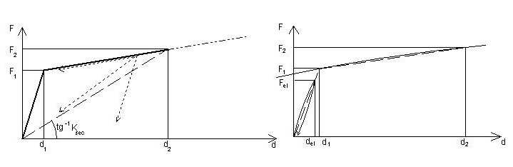

[Torna all'indice del § 11.9](./indice-11.9.md) | [Torna all'indice del capitolo](./indice-cap11.md) | [Torna all'indice generale](../indice-ntc2018.md)

# 11.9.5. Dispositivi a comportamento non lineare

<!-- INDICE-INTERNO:INIZIO -->
**Indice interno**

- [Norma](#toc-ntc2018-11-9-5-norma)
  - [11.9.5.1. Prove di accettazione sui dispositivi](#toc-ntc2018-11-9-5-1)
- [Circolare](#toc-ntc2018-c11-9-5-circolare)
  - [C11.9.5. Dispositivi a comportamento non lineare](#toc-ntc2018-c11-9-5)
<!-- INDICE-INTERNO:FINE -->

## Norma

I dispositivi a comportamento non lineare sono caratterizzati da un ciclo bilineare definito dai punti (del, Fel), (d1, F1), (d2, F2).

**Fig. 11.9.1** — *Diagrammi forza-spostamento per dispositivi non lineari*

La stabilità ciclica è verificata quando, per ciascun ciclo *i*-esimo:

$$\frac{\left|K_{2,(i)} - K_{2,(3)}\right|}{K_{2,(3)}} \leq 10\% \tag{11.9.5}$$

$$\frac{\left|\xi_{e,(i)} - \xi_{e,(3)}\right|}{\xi_{e,(3)}} \leq 10\% \tag{11.9.6}$$

**Tab. 11.9.II** — Limiti delle differenze fra le caratteristiche meccaniche di ciascuna unità e quelle medie della fornitura, dovute all'invecchiamento, alla temperatura e alla frequenza di prova

| | Fornitura | Invecchiamento | Temperatura | Frequenza di prova |
|---|---|---|---|---|
| K2 | ±15% | ±20% | ±20% | ±10% |
| Ksec | ±15% | ±20% | ±40% | ±10% |
| ξv | ±10% | ±15% | ±15% | ±10% |

### 11.9.5.1. Prove di accettazione sui dispositivi

Per le prove di accettazione si applica quanto previsto al § 11.9.4.1.

---

## Circolare

### C11.9.5. Dispositivi a comportamento non lineare

Come descritto nella norma, tali dispositivi sono caratterizzati da un legame forza-spostamento non lineare, sostanzialmente indipendente dalla velocità, che può realizzare comportamenti meccanici diversi, ad elevata o bassa dissipazione di energia, con riduzione o incremento della rigidezza al crescere dello spostamento, con o senza spostamenti residui all'azzeramento della forza.

La stabilità del ciclo si riscontra accertando che, fissata l'ampiezza di spostamento, lo scarto tra la rigidezza del secondo ramo di un generico ciclo "*i*", $K_{2(i)}$, e la stessa valutata al terzo ciclo e presa a riferimento, $K_{2(3)}$, sia minore del 10%. Analogamente si dovrà riscontrare che lo scarto tra il coefficiente di smorzamento viscoso equivalente di un generico ciclo "*i*" e lo stesso valutato al terzo ciclo e preso a riferimento, sia minore del 10% del valore assunto a riferimento.

La rigidezza iniziale si calcola come descritto nel paragrafo relativo ai dispositivi lineari. Per i dispositivi dotati di ramo di *softening*, è possibile assumere come valore della rigidezza $K_1$ anche il valore della rigidezza iniziale $K_{in}$.
