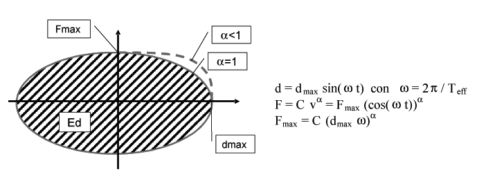

[Torna all'indice del § 11.9](./indice-11.9.md) | [Torna all'indice del capitolo](./indice-cap11.md) | [Torna all'indice generale](../indice-ntc2018.md)

# 11.9.6. Dispositivi a comportamento viscoso

<!-- INDICE-INTERNO:INIZIO -->
**Indice interno**

- [Norma](#toc-ntc2018-11-9-6-norma)
  - [11.9.6.1. Prove di accettazione sui dispositivi](#toc-ntc2018-11-9-6-1)
- [Circolare](#toc-ntc2018-c11-9-6-circolare)
  - [C11.9.6. Dispositivi a comportamento viscoso](#toc-ntc2018-c11-9-6)
<!-- INDICE-INTERNO:FINE -->

## Norma

I dispositivi a comportamento viscoso sono caratterizzati da una forza proporzionale a vα, dove v è la velocità e α è l'esponente del comportamento viscoso.

**Fig. 11.9.2** — *Dispositivi a comportamento viscoso*

La stabilità ciclica è verificata quando, per ciascun ciclo *i*-esimo:

$$\frac{\left|E_{d(i)} - E_{d(3)}\right|}{E_{d(3)}} \leq 10\% \tag{11.9.7}$$

dove Ed è l'energia dissipata nel ciclo.

**Tab. 11.9.III** — Limiti delle differenze fra le caratteristiche meccaniche di ciascuna unità e quelle medie della fornitura, dovute all'invecchiamento, alla temperatura e alla frequenza di prova

| | Fornitura | Invecchiamento | Temperatura | Frequenza di prova |
|---|---|---|---|---|
| Fmax | ±15% | ±5% | ±5% | ±10% |
| Ed | −15% | −5% | −5% | ±10% |

Il fattore di affidabilità γv è definito come:

$$\gamma_v = (1 + t_d) \cdot (1{,}5)^{\alpha} \tag{11.9.8}$$

### 11.9.6.1. Prove di accettazione sui dispositivi

Le prove di accettazione devono essere effettuate su un numero di dispositivi pari al 20% del totale, con un minimo di 4 ed un massimo pari al numero di dispositivi da mettere in opera.

---

## Circolare

### C11.9.6. Dispositivi a comportamento viscoso

I dispositivi a comportamento viscoso hanno un legame costitutivo che dipende dalla velocità e, in genere, trasmettono soltanto azioni lungo il proprio asse longitudinale. Non essendo dotati di rigidezza elastica, essi vengono utilizzati essenzialmente per aumentare la capacità dissipativa di un sistema di isolamento o, più in generale, del sistema strutturale nel quale vengono inseriti.

L'obbligo di disporre le cerniere sferiche alle due estremità del dispositivo trova giustificazione nell'esigenza di scongiurare che eventuali disallineamenti diano luogo, durante i movimenti causati da un evento sismico, alla nascita di sforzi parassiti che danneggino il dispositivo viscoso compromettendone il funzionamento. La capacità di rotazione delle cerniere sferiche necessaria dovrà essere determinata dal progettista, in relazione agli effetti sia delle azioni di servizio, sia dei movimenti dovuti al terremoto, sia, infine, a possibili imperfezioni nell'installazione. In ogni caso è consigliabile che la capacità di rotazione sia non inferiore a $\pm 2°$.
